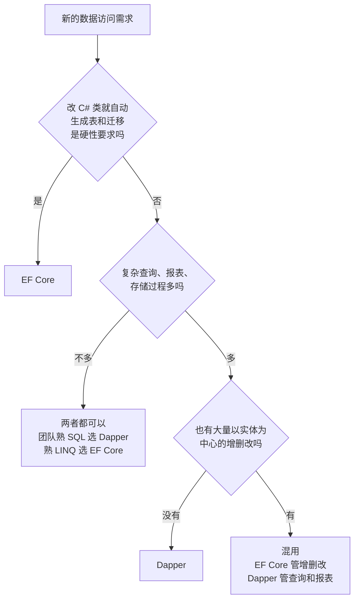

# 附录 D Dapper 和 EF Core 怎么选

用途：新项目或新模块选数据访问方式时，用这一页对照两者的定位和适用场景；两者都是成熟的选择，这里只讲差别，不分高下。

> ⚠️ 本教程没有引入 EF Core 包，本附录里关于 EF Core 的内容是通用事实，**未在沙箱实机验证**。版本核对：NuGet 上 `Microsoft.EntityFrameworkCore` 当前稳定版是 10.0.13，和本教程的 .NET 10 基线同一主版本（2026-10 查询 NuGet API）。

## 1. 两者的定位

| 对比项 | Dapper | EF Core |
|---|---|---|
| 类别 | 微型 ORM（micro-ORM） | 完整 ORM |
| SQL 谁写 | **你写**，Dapper 原样发给服务器（[第 4 章](ch04-parameters.md)、[第 19 章](ch19-see-the-sql.md)） | 大多由 EF Core 根据 LINQ 生成；也可以执行你写的原生 SQL（如 `FromSql`、`Database.ExecuteSql`） |
| 做的事 | 结果集 → 对象、对象 → 参数（[第 1 章](ch01-setup.md)） | 映射之外，还有变更跟踪、`SaveChanges` 生成增删改、导航属性加载关联数据、迁移 |
| 底层 | ADO.NET，你自己 new `SqlConnection` | ADO.NET；SQL Server 提供程序（`Microsoft.EntityFrameworkCore.SqlServer`）底下用的也是 `Microsoft.Data.SqlClient` |
| 表结构 | 不管，建表改表另外维护（[第 1 章](ch01-setup.md)） | 可以用迁移（Migrations）从模型生成和更新表结构；也可以从已有库反向生成实体类（scaffold） |
| 改了数据怎么存 | 每条 INSERT / UPDATE 自己写，`Execute` 返回受影响行数（[第 6 章](ch06-insert-update-delete.md)） | 改实体属性，调 `SaveChanges`，EF Core 生成 UPDATE |
| 关联数据 | 多重映射 + `splitOn`、字典去重、`QueryMultiple`（[第 10–12 章](ch10-multi-mapping-one-to-one.md)） | 导航属性 + `Include` 等加载方式 |
| 名字写错时 | SQL 是字符串：列名错由服务器报 207；SELECT 里漏列、别名错**不报错**，属性留默认值（[第 2 章](ch02-first-query.md)、[第 18 章](ch18-changing-queries.md)） | LINQ 里属性名写错编译不过；模型和真实表结构不一致时运行时才报错 |
| 要学的东西 | 少：本教程 23 章基本覆盖 | 多：模型配置、跟踪行为、加载策略、迁移、读懂生成的 SQL |

两者的共同点：连接池、事务、超时、`SqlException.Number` 都来自 ADO.NET（[第 9 章](ch09-transactions.md)、[第 14 章](ch14-async-timeout-cancel.md)、[第 16 章](ch16-connection-and-repository.md)、[第 20 章](ch20-read-errors.md)），换哪一个，这部分经验都照样用。

## 2. 适合 / 不适合的场景

| 场景 | Dapper | EF Core |
|---|---|---|
| 复杂报表：多表 JOIN、分组统计、窗口函数，需要逐句调 SQL | **适合**：在 SSMS 里调好的 SQL 原样放进代码 | 能做：可以写原生 SQL；用 LINQ 写时要核对它生成的 SQL |
| 业务逻辑大量在存储过程里，表结构归 DBA 管 | **适合**：`commandType`、`DynamicParameters` 的 Output / ReturnValue（[第 8 章](ch08-stored-procedures.md)） | 能调用存储过程，但变更跟踪、迁移这些优势用不上 |
| 以实体为中心的增删改：表单编辑、主从一起保存 | 每张表的 INSERT / UPDATE 都要手写；表加一列要改 SQL 和类（[第 18 章](ch18-changing-queries.md)） | **适合**：改属性后 `SaveChanges`，增删改语句由它生成 |
| 表结构跟着代码一起演进，希望用脚本化的方式升级各环境的库 | 不提供，要另外维护 SQL 脚本 | **适合**：迁移 |
| 团队不想写 SQL，或 SQL 经验较少 | 不适合：SQL 质量全靠自己 | **适合** |
| 团队 SQL 很强，想精确控制每条语句、参数类型和执行计划 | **适合**：`DbString`、表值参数、扩展事件抓到的就是你写的语句（[第 15 章](ch15-performance.md)、[第 19 章](ch19-see-the-sql.md)） | 能做：靠原生 SQL 和查看生成的 SQL；控制粒度没有直接手写那么细 |
| 成批写入成千上万行 | 表值参数或 `SqlBulkCopy`（[第 15 章](ch15-performance.md)） | `SaveChanges` 适合普通批量；按条件批量改删可以用 `ExecuteUpdate` / `ExecuteDelete`；大批量导入同样可以用 `SqlBulkCopy` |
| 想看清每一步做了什么，出问题能自己定位 | 七步流程很短（[第 3 章](ch03-how-it-works.md)） | 抽象层次更多，要先学会看它的日志和生成的 SQL |

## 3. 可以混用

同一个项目里同时用两者是常见做法，分工按"操作类型"划，而不是按"表"划：

| 操作 | 交给谁 | 理由 |
|---|---|---|
| 新建、编辑、删除单据（以实体为中心） | EF Core | 变更跟踪和 `SaveChanges` 省掉大量手写的增删改 |
| 列表页、报表、导出、统计 | Dapper | SQL 自己写，可以按需只查要的列、用分页和多结果集（[第 12–13 章](ch12-query-multiple.md)） |
| 已有的存储过程 | Dapper | Output / ReturnValue 的写法直接（[第 8 章](ch08-stored-procedures.md)） |
| 大批量导入 | `SqlBulkCopy` 或 Dapper + 表值参数 | 两者都不需要实体跟踪 |

混用时要注意：

| 注意点 | 说明 |
|---|---|
| 连接与事务可以共用 | EF Core 的 `Database.GetDbConnection()` 能拿到底层 `DbConnection`，Dapper 的扩展方法可以直接用在它上面；EF Core 事务对象的 `GetDbTransaction()` 能拿到底层事务，传给 Dapper 的 `transaction:`。⚠️ 本教程未实机验证 |
| 跟踪的数据不会自动刷新 | 用 Dapper 改了某一行，同一个 `DbContext` 里已经加载的这个实体不会知道，接着 `SaveChanges` 可能拿旧值覆盖。两种写法改同一批数据时，要么分开在不同的 `DbContext` 生命周期里，要么改完重新加载 |
| 表结构变化要两边一起改 | EF Core 的模型和 Dapper 的 SQL / 类都要跟着改。按[第 18 章](ch18-changing-queries.md)的三步走，冒烟测试把两边的方法都覆盖到 |
| 同一种操作只用一种写法 | 比如"新建申请单"全项目只走一条路径，否则业务规则（默认值、审批记录）会分散在两处 |

## 4. 选择决策图

这张图只是起点：已有项目里沿用现有方式通常比更换成本低；新模块可以按上表重新判断。

[返回目录](../README.md)
