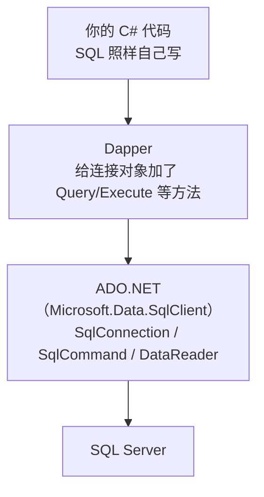
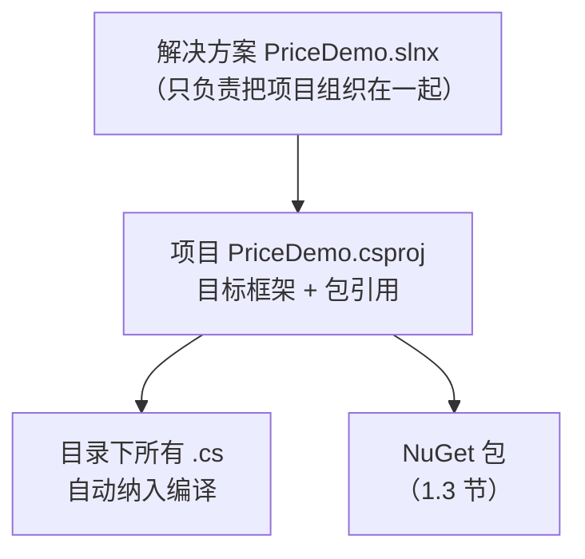
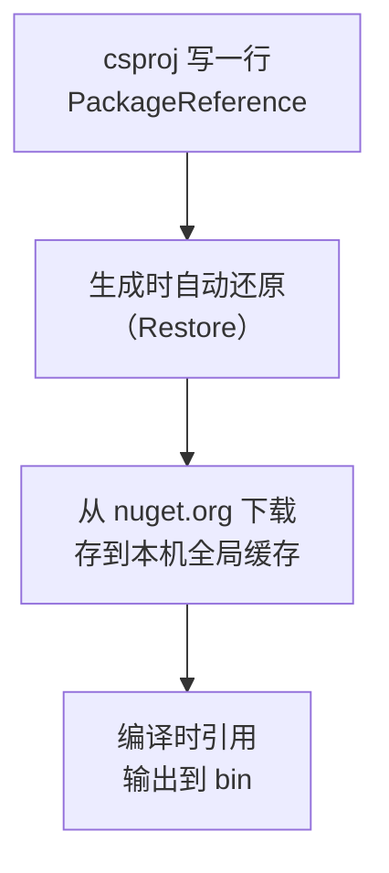
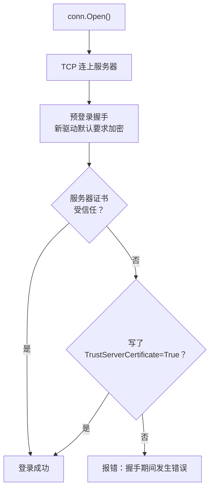

# 第 1 章 搭环境：VS 2026 + .NET 10 + SQL Server

## 这一章解决什么问题

动手之前，你得先知道 Dapper 是什么、要学成什么样。另外，后面 22 章的例子都要在同一个项目、同一个库上跑。

所以本章做三件事：

1. 先用一页讲清 Dapper 是什么、不是什么。
2. 做出一个**能连上你的 SQL Server、按 Ctrl+F5 就能输出客户列表**的控制台程序。这一步用的是你熟悉的 ADO.NET，作为后面的对照组。顺带把三个最常卡人的环节讲清楚：项目文件、NuGet 包、连接字符串。
3. 最后预览同样的功能用 Dapper 写是什么样子。

## 开始之前

- 你已经会：ADO.NET 的 `SqlConnection` / `SqlCommand` / `SqlDataReader`（WebForm 里天天写的那套）。
- 需要的环境：

| 项 | 要求 | 怎么确认 |
|---|---|---|
| Visual Studio 2026 | 已勾选工作负荷「ASP.NET 和 Web 开发」（自带 .NET 10 SDK，第 22 章也要用） | 开始菜单打开「Visual Studio Installer」→ VS 2026 那一栏点「修改」→「工作负荷」页查看 |
| SQL Server | 你自己的实例，2016 及以上都可以 | 能用 SSMS 连上即可 |
| SSMS | 版本不限（当前正式版是 SSMS 22） | 只用来执行建库脚本 |

> 预计耗时：60–75 分钟。

---

## 正文

### 1.0 先认识 Dapper：它是什么、不是什么

**一句话**：Dapper 是一个微型 ORM（micro-ORM，对象关系映射，指把查询结果和 C# 对象互相转换的工具）。**SQL 还是你自己写**，它只做两件事：

- 把**查询结果**变成对象（替你写 `while (reader.Read())` 那一段）；
- 把**对象**变成 SQL 参数（替你写一行行的 `cmd.Parameters.Add(...)`）。

它由 Stack Overflow 团队开发并开源，这个网站自己就在用它。

#### 🖼 Dapper 处在哪一层



关键点：Dapper **不替代** ADO.NET，而是**建在 ADO.NET 上面**。你熟悉的 `SqlConnection` 照用，连接字符串、事务、存储过程、连接池也都还是 ADO.NET 那一套。所以本章搭好的 ADO.NET 环境，后面会原样沿用。

#### Dapper 管什么、不管什么

| Dapper 替你做 | Dapper 不做（仍然是你的事） |
|---|---|
| 结果集一列一列赋值给对象属性 | 写 SQL：不会替你生成 `SELECT`/`INSERT` |
| 根据对象生成 SqlParameter | 建表、改表结构（没有"迁移"功能） |
| 连接没打开时，自动打开再关上 | 跟踪对象改了哪些字段、自动保存 |
| 缓存映射规则，第二次执行更快 | 管理连接字符串、处理异常 |

**反例（什么时候不该选 Dapper）**：如果团队不想手写 SQL，希望改了 C# 类就能自动生成表结构和增删改语句，那应该选 EF Core 这类完整的 ORM。两者的详细取舍放在附录 D。

> 本章后面几节暂时还用不到 Dapper。先把环境和对照组搭好，1.5 节再看 Dapper 版本。

---

### 1.1 准备示例库 PriceDemo

整本教程都用这一个库：客户、产品、价格申请单、申请明细、审批记录，一共 5 张表。

1. 打开 SSMS，用平时的方式连上你的实例。**把「服务器名称」框里填的内容记下来**，1.4 节要用。
2. 菜单「文件 → 打开 → 文件」，选 [`code/sql/00-reset-database.sql`](../code/sql/00-reset-database.sql)。
3. 按 **F5** 执行。

结果窗格最后应该显示一行：`3 / 4 / 3 / 5 / 3`（客户数 / 产品数 / 申请单数 / 明细数 / 审批记录数）。

> 这个脚本可以反复执行。哪一章把数据改乱了，重跑一遍就恢复原样。

---

### 1.2 概念一：SDK 风格项目文件（.csproj）

**白话定义**：`.csproj` 是一个很短的 XML 文件，只写"目标框架是什么、引用了哪些包"。目录里有哪些 `.cs` 文件，它会自动全部纳入编译，不用一个个登记。

**业务场景**：你往项目里新加一个 `PriceRequest.cs`，什么都不用改，直接编译就行。不会再出现"文件拷进来了，却没加到项目里"这种情况。

**反例（什么时候不该用这套写法）**：维护老 WebForm 项目时（.NET Framework 4.x，csproj 里有几百行 `<Compile Include=...>`），**不要**照本章去手改它的 csproj，也不要顺手"升级成 SDK 风格"。WebForm 不能运行在 .NET 10 上，改了也跑不起来。

#### 🖼 图解



#### 💻 操作：新建项目

1. 启动 VS 2026，在开始窗口点「**创建新项目**」。
2. 在顶部搜索框输入 `控制台`，选中「**控制台应用**」（语言标签是 C#，平台标签是 Windows / Linux / macOS）。
   ⚠️ 不要选「控制台应用 (.NET Framework)」，那是旧框架。
3. 点「下一步」。「项目名称」填 `PriceDemo`，位置随意。点「下一步」。
4. 「框架」选 **.NET 10.0（长期支持）**。「不使用顶级语句」**不要勾**，其他复选框保持默认。点「创建」。

> 📷 **截图占位 ch01-01**：「创建新项目」窗口，搜索框里是"控制台"，选中「控制台应用」。
> 截好后保存为 `images/ch01-01-create-project.png`，再删掉下一行的 `<!--` 和 `-->`。
<!--  -->

> 📷 **截图占位 ch01-02**：「其他信息」页，框架选 .NET 10.0。
<!--  -->

5. 在「**解决方案资源管理器**」里**双击项目名 `PriceDemo`**（不是双击解决方案）。项目文件会直接在编辑器里打开：

```xml
<!-- code/ch01/PriceDemo/PriceDemo.csproj（刚建好时） -->
<Project Sdk="Microsoft.NET.Sdk">

  <PropertyGroup>
    <OutputType>Exe</OutputType>
    <TargetFramework>net10.0</TargetFramework>
    <ImplicitUsings>enable</ImplicitUsings>
    <Nullable>enable</Nullable>
  </PropertyGroup>

</Project>
```

> 解决方案文件可能是 `.slnx`。这是 VS 2026 默认的新格式，作用和 `.sln` 一样，不用管它。

#### 🔍 拆解

| 行 | 作用 | 为什么这样设计 |
|---|---|---|
| `Sdk="Microsoft.NET.Sdk"` | 套用一整套默认构建规则 | 默认规则都放在 SDK 里，你的文件只写和默认不一样的地方，所以很短 |
| `OutputType=Exe` | 编译成可执行程序 | 类库项目没有这一行 |
| `TargetFramework=net10.0` | 目标框架 | 决定能用哪些 API，以及能装哪些版本的包 |
| `ImplicitUsings` | 自动 `using System;`、`System.Linq` 等常用命名空间 | 所以 `Program.cs` 顶部看不到这些 using |
| `Nullable` | 打开可空引用检查 | `string` 属性不赋初值会有警告，后面 `Customer` 类里的 `= ""` 就是为了消掉它 |

#### 改坏一处试试

把 `net10.0` 改成 `net10`（少写了 `.0`），保存后按 **Ctrl+Shift+B** 生成。等 1.3 节装完包以后再试，报错会是：

```text
error NU1202: Package Microsoft.Data.SqlClient 7.1.1 is not compatible with net10 (.NETFramework,Version=v1.0).
```

原因：`net10` 会被解析成 **.NET Framework 1.0**（`net` 后面直接跟数字是旧框架的写法，比如 `net48`）。改回 `net10.0`。

---

### 1.3 概念二：NuGet 包引用

**白话定义**：在 csproj 里写一行"我要用某个包的某个版本"。生成时 VS 会自动下载并引用它。`bin` 里不用手动放 dll，项目里也不再有 `packages` 文件夹。

**业务场景**：同事从 Git 拉下项目，打开后直接生成，依赖会自动下载，不用问你"那个 dll 放在哪里"。

**反例**：公司内网**完全连不上 nuget.org**时，这种写法会还原失败。这时需要先在「工具 → 选项 → NuGet 包管理器 → 程序包源」里添加公司内部源或本地文件夹源，不能指望默认配置。

#### 🖼 图解



全局缓存的位置是 `%UserProfile%\.nuget\packages`，所有项目共用，同一个版本只下载一次。

#### 💻 操作：安装 Microsoft.Data.SqlClient

1. 菜单「**工具 → NuGet 包管理器 → 管理解决方案的 NuGet 程序包**」。
   （也可以在解决方案资源管理器里右键项目 →「管理 NuGet 程序包」，效果一样。）
2. 切到「**浏览**」页，搜索 `Microsoft.Data.SqlClient`。
3. 选中它，在右侧勾选项目 `PriceDemo`，版本选 **7.1.1**，点「**安装**」。弹出「预览更改」和许可协议窗口时都点确定 / 我接受。

> 📷 **截图占位 ch01-03**：NuGet 管理器「浏览」页，搜索结果里选中 Microsoft.Data.SqlClient，右侧显示版本 7.1.1。
<!--  -->

4. 装完后，「**视图 → 错误列表**」里会出现 **NU1903 / NU1902 警告**，提示 `System.Security.Cryptography.Pkcs 9.0.18` 有已知漏洞。这个包是 SqlClient 间接引入的。用同样的方法再装一个 `System.Security.Cryptography.Pkcs`，版本选 **10.0.13**，警告就会消失。（这一步在沙箱里实测过：装之前有警告，装之后为 0。）

最终的 csproj：

```xml
<!-- code/ch01/PriceDemo/PriceDemo.csproj -->
<Project Sdk="Microsoft.NET.Sdk">

  <PropertyGroup>
    <OutputType>Exe</OutputType>
    <TargetFramework>net10.0</TargetFramework>
    <ImplicitUsings>enable</ImplicitUsings>
    <Nullable>enable</Nullable>
  </PropertyGroup>

  <ItemGroup>
    <PackageReference Include="Microsoft.Data.SqlClient" Version="7.1.1" />
    <!-- SqlClient 7.1.1 间接带进来的 Pkcs 9.0.18 有已知漏洞（NU1903 警告），显式升到新版消掉 -->
    <PackageReference Include="System.Security.Cryptography.Pkcs" Version="10.0.13" />
  </ItemGroup>

</Project>
```

#### 🔍 拆解

- 图形界面做的事情，就是在 csproj 里加了这两行 `PackageReference`。你直接手改 csproj 并保存，效果完全一样，VS 会立刻自动还原。
- **为什么是 `Microsoft.Data.SqlClient`，不是 `System.Data.SqlClient`**：后者是 .NET Framework 时代的驱动，已经停止开发。新的加密默认值、新版 SQL Server 的特性都只在前者里有。两者的类名完全相同（`SqlConnection`、`SqlCommand`……），**只有命名空间不一样**。

#### 改坏一处试试

| 改法 | 生成时的报错（实测） | 原因 |
|---|---|---|
| 把版本改成 `7.1.99` | `error NU1102: Unable to find package Microsoft.Data.SqlClient with version (>= 7.1.99)`，下一行提示 `Nearest version: 7.1.1` | 这个版本不存在。报错里会告诉你最接近的可用版本 |
| 删掉 SqlClient 那一行 | `error CS0234: The type or namespace name 'Data' does not exist in the namespace 'Microsoft'` | 包没了，`using Microsoft.Data.SqlClient;` 就找不到命名空间 |

---

### 1.4 概念三：连接字符串（以及默认开启的加密）

**白话定义**：一串 `键=值;` 格式的文本，告诉驱动连哪台服务器、哪个库、用什么身份登录。

**业务场景**：开发时连本机实例，发布时只改这一串就能连到正式库，代码一行不动。

**反例**：`TrustServerCertificate=True` **不要用在连接生产库、或者跨公网连接的场景**。它的意思是"不校验服务器证书"，存在被中间人冒充的风险。生产环境应该给 SQL Server 装上受信任的证书。

#### 🖼 图解：为什么同一串连接字符串，在老项目里能用，到这里却报错



`Microsoft.Data.SqlClient` 从 4.0 版开始，把 `Encrypt` 的默认值从 `False` 改成了 `True`。而大多数自己装的 SQL Server 用的是**自签名证书**，所以在开发环境里需要加上 `TrustServerCertificate=True`。

#### Server 那一段怎么填

规则很简单：**SSMS 连接窗口里「服务器名称」填的是什么，`Server=` 后面就填什么。**

| 你的实例 | `Server=` 写法 | 登录方式那一段 |
|---|---|---|
| 本机默认实例 | `Server=.` 或 `Server=localhost` | Windows 身份验证：`Integrated Security=True` |
| 本机命名实例（如 SQLEXPRESS） | `Server=.\SQLEXPRESS` | 同上 |
| 另一台机器 | `Server=192.168.1.10` 或 `Server=机器名\实例名` | SQL 身份验证：`User ID=账号;Password=密码` |
| 非默认端口 | `Server=192.168.1.10,14330`（用**逗号**，不是冒号） | 同上 |

#### 💻 最小可运行代码

把 `Program.cs` 全部替换成下面的内容，再右键项目 →「添加 → 类」，新建 `Customer.cs`。

```csharp
// code/ch01/PriceDemo/Customer.cs
namespace PriceDemo;

// 对应 dbo.Customer 一行。属性名故意与列名一致——第 2 章 Dapper 会靠这一点自动映射。
public class Customer
{
    public int Id { get; set; }
    public string Name { get; set; } = "";   // 给默认值，避免 Nullable 警告 CS8618
    public string City { get; set; } = "";
    public string Level { get; set; } = "";  // 列是 CHAR(1)，读出来是 string
}
```

```csharp
// code/ch01/PriceDemo/Program.cs
using Microsoft.Data.SqlClient;   // 新包的命名空间，不是 System.Data.SqlClient
using PriceDemo;

// 连接字符串：按你的实例改 Server 这一段（详见本章 1.4 节）
// 第 16 章会把它移到配置文件，这里先写死，先求跑通
const string connStr =
    "Server=.;Database=PriceDemo;Integrated Security=True;TrustServerCertificate=True;";

using var conn = new SqlConnection(connStr);   // using：离开作用域自动 Close，不必写 finally
conn.Open();

// ① 连通性检查：取一个单值
using (var cmd = new SqlCommand("SELECT @@VERSION", conn))
{
    var version = (string)cmd.ExecuteScalar()!;
    Console.WriteLine("已连接：" + version.Split('\n')[0]);
}

// ② 用 ADO.NET 手工把结果集变成 List<Customer>——第 2 章要用 Dapper 替换的就是这一段
var customers = new List<Customer>();
using (var cmd = new SqlCommand("SELECT Id, Name, City, Level FROM dbo.Customer ORDER BY Id", conn))
using (var reader = cmd.ExecuteReader())
{
    while (reader.Read())
    {
        customers.Add(new Customer
        {
            Id    = reader.GetInt32(reader.GetOrdinal("Id")),      // 每一列都要手写一次
            Name  = reader.GetString(reader.GetOrdinal("Name")),   // 类型取错（GetInt32 读字符串）运行时才报错
            City  = reader.GetString(reader.GetOrdinal("City")),
            Level = reader.GetString(reader.GetOrdinal("Level")),
        });
    }
}

foreach (var c in customers)
    Console.WriteLine($"{c.Id}  {c.Name}  {c.City}  {c.Level}");

Console.WriteLine($"共 {customers.Count} 个客户");
```

按 **Ctrl+F5**（菜单「调试 → 开始执行(不调试)」）运行。

#### 🔍 拆解运行结果

实测输出（版本号那一行会随你的实例不同而不同）：

```text
已连接：Microsoft SQL Server 2022 (RTM-CU27-GDR) (KB5126934) - 16.0.4305.5 (X64)
1  华东第一医院  上海  A
2  江南检测中心  杭州  B
3  北方影像诊所  天津  C
共 3 个客户
```

> 📷 **截图占位 ch01-04**：控制台窗口显示上面的输出，最后一行是"按任意键关闭此窗口"。
<!--  -->

> ⚠️ 本节里 `Integrated Security=True`（Windows 身份验证）这种写法在沙箱里没有验证过，因为沙箱是 Linux。沙箱里用的是 `User ID=sa;Password=…` 的 SQL 身份验证跑通的，其余代码完全相同。

关键行：

- `using var conn = ...`：C# 8 起的写法，变量离开作用域时自动 `Dispose()`，也就是关闭连接。效果等同于你以前写的 `try { } finally { conn.Close(); }`。
- `ExecuteScalar()!`：末尾的 `!` 是告诉编译器"这里不会是 null"，用来消掉可空警告。它不影响运行。
- `while (reader.Read())` 里的 4 行赋值：**这就是第 2 章要解决的痛点**。表有 20 列，就要手写 20 行；列名和类型都只是字符串和方法名，写错了**编译能通过，运行时才报错**（见下面的改坏实验）。

#### 改坏一处试试

| 改法 | 运行结果（实测） | 说明 |
|---|---|---|
| 删掉 `TrustServerCertificate=True;` | `已成功与服务器建立连接，但是在登录前的握手期间发生错误。 (provider: TCP 提供程序, error: 35 - 捕获内部异常)` | 就是图解里 G 那条路径。内层异常写着 `UntrustedRoot`（证书根不受信任） |
| `GetOrdinal("Level")` 改成 `GetOrdinal("Lvl")` | `System.IndexOutOfRangeException: Lvl` | 列名写错，编译不报错，**运行时**才炸 |
| `reader.GetInt32` 改成 `(int)reader.GetInt64` | `InvalidCastException: Unable to cast object of type 'System.Int32' to type 'System.Int64'.` | Get 方法的类型必须和列类型完全一致，**运行时**才炸 |

---

### 1.5 预览：同一件事，Dapper 怎么写

下面这段代码和 1.4 节读的是同一张表，输出也完全相同。**这里只是让你先看看效果**，每一行为什么能这样写，第 2 章再讲。

```csharp
// code/ch01/Preview/Program.cs
// 第 1 章结尾的预览：和 PriceDemo 读同一张表，换成 Dapper 写。第 2 章再逐行讲解。
using Dapper;                      // 引入 Dapper 的扩展方法
using Microsoft.Data.SqlClient;

const string connStr =
    "Server=.;Database=PriceDemo;Integrated Security=True;TrustServerCertificate=True;";

using var conn = new SqlConnection(connStr);   // 不用手动 Open：Dapper 发现连接是关闭的，会自己打开再关上

// 这一行替代了 PriceDemo 里 while (reader.Read()) 那一整段
var customers = conn.Query<Customer>("SELECT Id, Name, City, Level FROM dbo.Customer ORDER BY Id").ToList();

foreach (var c in customers)
    Console.WriteLine($"{c.Id}  {c.Name}  {c.City}  {c.Level}");

Console.WriteLine($"共 {customers.Count} 个客户");

public class Customer
{
    public int Id { get; set; }
    public string Name { get; set; } = "";
    public string City { get; set; } = "";
    public string Level { get; set; } = "";
}
```

实测输出和 1.4 节完全相同：3 个客户，最后一行是 `共 3 个客户`，只是少了开头那行版本信息。

两种写法对比：

| 对比项 | 1.4 节 ADO.NET | 1.5 节 Dapper |
|---|---|---|
| 把结果变成 `List<Customer>` | `new SqlCommand` + `ExecuteReader` + `while` 循环 + 每列一行赋值，共 15 行 | 1 行 `Query<Customer>(...)` |
| 列名对应属性 | 每列手写一次 `GetOrdinal("列名")` | 按名字自动对上：列 `Name` 对应属性 `Name` |
| 类型转换 | 自己挑 `GetInt32`/`GetString`，挑错运行时才报错 | 按属性类型自动转换 |
| `conn.Open()` | 必须写 | 可以不写 |

> 想现在就跑：项目在 [`code/ch01/Preview/`](../code/ch01/Preview/)，它的 csproj 比 PriceDemo 多一行 `<PackageReference Include="Dapper" Version="2.1.89" />`。不跑也没关系，第 2 章会带你一步一步装包、运行。

---

## 🧱 类比：和你熟悉的 WebForm 项目对照

| 事情 | WebForm（.NET Framework） | 本教程（.NET 10） |
|---|---|---|
| 项目文件 | 旧式 csproj，每个 .cs 都要登记 | SDK 风格，十几行，自动包含所有文件 |
| 第三方库 | `packages.config` + 项目下的 `packages` 文件夹，或者手动「添加引用 → 浏览 dll」 | csproj 里写 `PackageReference`，文件放在全局缓存 |
| 驱动 | `System.Data.SqlClient`（框架自带） | `Microsoft.Data.SqlClient`（NuGet 包） |
| 加密默认值 | `Encrypt=False` | `Encrypt=True`，所以要加 `TrustServerCertificate` |
| 连接字符串放哪 | `web.config` 的 `<connectionStrings>` | 本章写死在代码里，第 16 章移到 `appsettings.json` |
| 关闭连接 | `try/finally` 里写 `Close()` | `using var` |

## ⚠️ 踩坑警告

| 现象 | 原因 | 怎么改 |
|---|---|---|
| 模板列表里有两个"控制台应用"，选错后框架下拉里找不到 .NET 10 | 选成了「控制台应用 (.NET Framework)」 | 删掉项目重建，选不带 "(.NET Framework)" 的那个 |
| `握手期间发生错误` / `UntrustedRoot` | 新驱动默认开启加密，而服务器用的是自签名证书 | 开发环境加 `TrustServerCertificate=True`；生产环境给服务器装正式证书 |
| `error CS1069: The type name 'SqlConnection' could not be found in the namespace 'System.Data.SqlClient'`（实测） | 从老项目复制代码时带过来了 `using System.Data.SqlClient;` | 改成 `using Microsoft.Data.SqlClient;` |
| `在与 SQL Server 建立连接时出现与网络相关的或特定于实例的错误`，后面跟 `error: 26`（定位服务器/实例出错）或 `error: 40` | `Server=` 写错：命名实例漏了 `\SQLEXPRESS`，或者 SQL Server Browser 服务没启动 | 照抄 SSMS 里的服务器名称；用命名实例时确认「SQL Server Browser」服务在运行 |
| `无法打开登录所请求的数据库 "PriceDemo"。登录失败。`（英文版服务器显示 `Cannot open database "PriceDemo" requested by the login`，实测） | 库还没建，或者库名拼错 | 先执行 1.1 节的脚本 |
| 错误列表里有 NU1903 / NU1902 警告 | SqlClient 间接引用了有漏洞的 Pkcs 9.0.18 | 显式安装 `System.Security.Cryptography.Pkcs` 10.0.13 |

## 🎯 动手练习

**练习 1：产品列表**
仿照 `Customer`，新建 `Product` 类，用 ADO.NET 读出 `dbo.Product` 的 4 列（Id、Code、Name、ListPrice），按"编码 名称 目录价"的格式打印。

- 验收标准：输出 4 行，第 1 行是 `US-100  便携超声主机      180,000.00`（价格带千分位和两位小数；列宽对不齐没关系）。
- 提示：`ListPrice` 是 `DECIMAL(18,2)` 类型，想一想该用哪个 Get 方法。

**练习 2：待审单数**
用 `ExecuteScalar` 查出 `Status = 1`（待审）的申请单有几张。

- 验收标准：输出 `待审申请单：1 张`。

卡住了看文末参考答案。

## 📌 一句话总结

新驱动默认加密，Server 照抄 SSMS，手写映射就是下一章要解决的痛点。

## 下一章

动手安装 Dapper，把 1.5 节那一行跑起来，并弄清它为什么不写 `Open()`、不写 `GetOrdinal` 也能工作。

---

<!-- 以下是参考答案，先自己动手，卡住了再往下翻 -->


## 参考答案

思路：练习 1 的写法和客户列表完全相同，只是 `DECIMAL` 列要用 `GetDecimal`；练习 2 中 `COUNT(*)` 返回的是 `int`，所以强转成 `int`（只有 `COUNT_BIG` 才返回 `long`）。

完整项目在 [`code/ch01/Exercise/`](../code/ch01/Exercise/)（csproj 与正文相同）。实测输出：

```text
US-100  便携超声主机      180,000.00
US-200  彩超工作站       420,000.00
PB-01   线阵探头         26,000.00
PB-02   凸阵探头         24,000.00
待审申请单：1 张
```

```csharp
// code/ch01/Exercise/Program.cs
// 第 1 章练习参考答案：练习 1（产品列表）+ 练习 2（待审单数）
using Microsoft.Data.SqlClient;

const string connStr =
    "Server=.;Database=PriceDemo;Integrated Security=True;TrustServerCertificate=True;";

using var conn = new SqlConnection(connStr);
conn.Open();

// 练习 1：产品列表
var products = new List<Product>();
using (var cmd = new SqlCommand("SELECT Id, Code, Name, ListPrice FROM dbo.Product ORDER BY Id", conn))
using (var reader = cmd.ExecuteReader())
{
    while (reader.Read())
    {
        products.Add(new Product
        {
            Id        = reader.GetInt32(reader.GetOrdinal("Id")),
            Code      = reader.GetString(reader.GetOrdinal("Code")),
            Name      = reader.GetString(reader.GetOrdinal("Name")),
            ListPrice = reader.GetDecimal(reader.GetOrdinal("ListPrice")),  // DECIMAL 列要用 GetDecimal
        });
    }
}
foreach (var p in products)
    Console.WriteLine($"{p.Code,-8}{p.Name,-10}{p.ListPrice,12:N2}");   // N2 = 千分位 + 两位小数

// 练习 2：待审（Status = 1）的申请单数量
using (var cmd = new SqlCommand("SELECT COUNT(*) FROM dbo.PriceRequest WHERE Status = 1", conn))
{
    var pending = (int)cmd.ExecuteScalar()!;   // COUNT(*) 返回 int；COUNT_BIG 才是 long
    Console.WriteLine($"待审申请单：{pending} 张");
}

public class Product
{
    public int Id { get; set; }
    public string Code { get; set; } = "";
    public string Name { get; set; } = "";
    public decimal ListPrice { get; set; }
}
```
