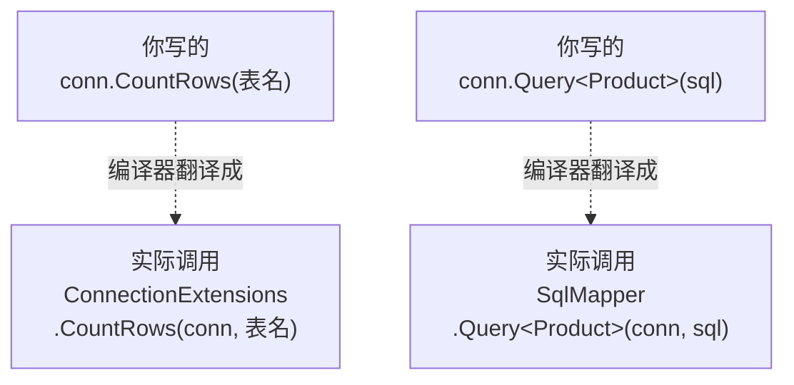
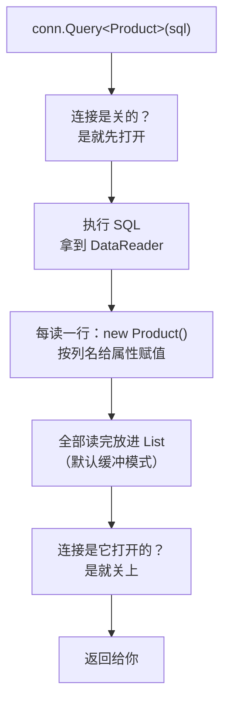
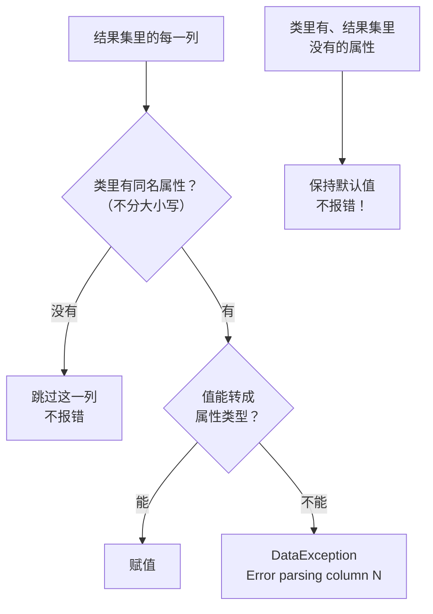

# 第 2 章 第一个 Dapper 查询

## 这一章解决什么问题

第 1 章用 ADO.NET 读客户列表，光映射就写了 15 行：每一列一个 `reader.GetXxx(reader.GetOrdinal("列名"))`。列名写错、类型挑错，都要等到运行时才知道。

本章把这一段换成一行 `conn.Query<T>(sql)`，并讲清三件事：

1. 为什么 `SqlConnection` 上会凭空多出一个 `Query` 方法；
2. `Query<T>` 到底返回什么，查不到数据时又返回什么；
3. Dapper 按什么规则把列对上属性，对不上的时候会怎样。

## 开始之前

- 上一章你已经会了：新建 .NET 10 控制台项目、装 NuGet 包、写对连接字符串，并且建好了 `PriceDemo` 库。
- 需要的环境：第 1 章的解决方案和 SQL Server 实例。如果数据被改乱了，先重跑 [`code/sql/00-reset-database.sql`](../code/sql/00-reset-database.sql)。
- 预计耗时：75–90 分钟。

---

## 正文

### 2.1 准备：新建本章项目并安装 Dapper

本章有 3 个例子，外加练习。它们都放在**同一个新项目**里：每做一个例子，就把 `Program.cs` 的内容**整个替换掉**。每段代码都自带要用的类，替换后直接就能运行。

1. 在「解决方案资源管理器」里**右键解决方案**（最顶上那一行）→「**添加 → 新建项目**」。
2. 选「控制台应用」，项目名称填 `Ch02Demo`，框架选 **.NET 10.0**，点「创建」。
3. **右键 `Ch02Demo` 项目 →「设为启动项目」**。项目名会变成粗体。之后按 Ctrl+F5 运行的就是它。
4. 安装三个包。方法和第 1 章一样：「工具 → NuGet 包管理器 → 管理解决方案的 NuGet 程序包」→「浏览」，搜索后勾选 `Ch02Demo` 项目，再点安装。

| 包 | 版本 | 作用 |
|---|---|---|
| `Dapper` | 2.1.89 | 本章主角 |
| `Microsoft.Data.SqlClient` | 7.1.1 | 驱动。Dapper 本身**不带**驱动，见下面说明 |
| `System.Security.Cryptography.Pkcs` | 10.0.13 | 消除 NU1903 警告（见第 1 章） |

> 📷 **截图占位 ch02-01**：NuGet「浏览」页搜索 `Dapper`，选中第一个结果（包 ID 正好是 `Dapper`），右侧版本是 2.1.89。
<!--  -->

搜索 `Dapper` 会出来一串名字相近的包，比如 `Dapper.Contrib`、`Dapper.SqlBuilder`、`Dapper.StrongName`。**本章只装包 ID 正好是 `Dapper` 的那一个。**

装完后，双击项目名打开 csproj，`<ItemGroup>` 里应该是这三行：

```xml
<!-- code/ch02/Step1-Extension/Step1-Extension.csproj（本章各项目的 csproj 都相同） -->
<Project Sdk="Microsoft.NET.Sdk">

  <PropertyGroup>
    <OutputType>Exe</OutputType>
    <TargetFramework>net10.0</TargetFramework>
    <ImplicitUsings>enable</ImplicitUsings>
    <Nullable>enable</Nullable>
  </PropertyGroup>

  <ItemGroup>
    <PackageReference Include="Dapper" Version="2.1.89" />
    <PackageReference Include="Microsoft.Data.SqlClient" Version="7.1.1" />
    <!-- SqlClient 7.1.1 间接带进来的 Pkcs 9.0.18 有已知漏洞（NU1903 警告），显式升到新版消掉 -->
    <PackageReference Include="System.Security.Cryptography.Pkcs" Version="10.0.13" />
  </ItemGroup>

</Project>
```

**为什么 Dapper 不自带驱动**：Dapper 只认 `IDbConnection` 这个接口（ADO.NET 里所有数据库连接的公共接口），具体连哪种数据库它不管。连 SQL Server 就装 `Microsoft.Data.SqlClient`，换成 MySQL、PostgreSQL 时换驱动包就行，Dapper 的写法不变。

---

### 2.2 概念一：扩展方法（extension method）

**白话定义**：扩展方法是写在**别的静态类**里的静态方法。因为第一个参数前加了 `this`，调用时可以写得**像是那个类型自己的方法**。

**业务场景**：你没法修改 `SqlConnection` 的源码，却希望写 `conn.Query<Customer>(...)`，而不是 `SqlMapper.Query<Customer>(conn, ...)`。Dapper 就是用扩展方法，把 `Query`、`Execute` 这些方法"挂"到所有连接对象上的。

**反例（什么时候不该用）**：类是你自己写的，比如 `PriceRequest`，那就直接在类里加实例方法，不要另外写扩展方法。扩展方法分散在别的文件里，同事读代码时很难找到方法到底定义在哪。

#### 🖼 图解：编译器替你做的翻译



`SqlConnection` 本身**没有**增加任何东西。是 `using Dapper;` 让编译器能找到 `SqlMapper` 这个静态类里的方法。

#### 💻 最小可运行代码：自己写一个扩展方法

先不用 Dapper，自己做一个"迷你版"，看看它背后是怎么回事。

```csharp
// code/ch02/Step1-Extension/Program.cs
// 自己写一个扩展方法，看懂 conn.Query 为什么能"长"在 SqlConnection 上
using System.Data;
using Microsoft.Data.SqlClient;
using PriceDemo.MyExtensions;      // 去掉这一行，下面的 conn.CountRows 就会报 CS1061

const string connStr =
    "Server=.;Database=PriceDemo;Integrated Security=True;TrustServerCertificate=True;";

using var conn = new SqlConnection(connStr);

// 看起来像 SqlConnection 自带的方法，实际调用的是下面静态类里的静态方法
Console.WriteLine($"客户表：{conn.CountRows("dbo.Customer")} 行");

// 编译器把上一行翻译成的样子——两种写法完全等价
Console.WriteLine($"产品表：{ConnectionExtensions.CountRows(conn, "dbo.Product")} 行");

namespace PriceDemo.MyExtensions
{
    public static class ConnectionExtensions       // ① 必须是 static class
    {
        // ② 第一个参数前加 this：表示"把这个方法挂到 IDbConnection 上"
        //    写 IDbConnection 而不是 SqlConnection：任何数据库的连接都能用（Dapper 也是这么做的）
        public static int CountRows(this IDbConnection conn, string table)
        {
            bool wasClosed = conn.State == ConnectionState.Closed;
            if (wasClosed) conn.Open();            // 连接关着就替调用方打开——Dapper 同样这样做
            try
            {
                using var cmd = conn.CreateCommand();
                cmd.CommandText = $"SELECT COUNT(*) FROM {table}";   // 仅演示用；表名拼接的风险第 4 章讲
                return (int)cmd.ExecuteScalar()!;
            }
            finally
            {
                if (wasClosed) conn.Close();       // 谁打开谁关闭：调用方自己开的连接不替它关
            }
        }
    }
}
```

#### 🔍 拆解运行结果

实测输出：

```text
客户表：3 行
产品表：4 行
```

两行结果分别来自两种写法，说明它们**完全等价**。关键点有三处：

| 位置 | 作用 | 对应到 Dapper |
|---|---|---|
| `public static class` | 扩展方法只能写在静态类里 | Dapper 的静态类叫 `SqlMapper` |
| `this IDbConnection conn` | `this` 决定方法"挂"在哪个类型上；写接口，就是挂到所有实现了这个接口的类上 | Dapper 也写的是 `this IDbConnection` |
| `wasClosed` 判断 | 连接是关的，就打开、用完再关；本来是开的，就保持原样 | Dapper 内部逻辑相同，2.3 节例 4 会实测 |

#### 用 VS 看 Dapper 的真身

把 `Program.cs` 临时换成第 1 章 1.5 节的预览代码，或者直接跳到 2.3 节的代码。把光标放在 `Query` 这个词上，按 **F12**（右键 →「转到定义」）。VS 会打开 Dapper 的定义，能看到这一行：

```csharp
public static IEnumerable<T> Query<T>(this IDbConnection cnn, string sql, object? param = null,
    IDbTransaction? transaction = null, bool buffered = true, int? commandTimeout = null,
    CommandType? commandType = null)
```

> 📷 **截图占位 ch02-02**：按 F12 后打开的 `SqlMapper` 定义页，`Query<T>` 那一行带着 `this IDbConnection cnn`。
<!--  -->

这 7 个参数就是 `Query<T>` 的全部用法，本章只用前两个。其余的后面逐个讲：

| 参数 | 作用 | 在哪一章 |
|---|---|---|
| `cnn` | 前面带 `this`，就是调用时 `.Query` 前面的那个连接 | 本章 |
| `sql` | SQL 文本 | 本章 |
| `param` | 参数对象 | 第 4 章 |
| `transaction` | 事务 | 第 9 章 |
| `buffered` | 是否一次读完放进内存 | 第 3、15 章 |
| `commandTimeout` | 超时秒数 | 第 14 章 |
| `commandType` | 普通 SQL 还是存储过程 | 第 8 章 |

#### 改坏一处试试

| 改法 | 编译报错（实测） | 原因 |
|---|---|---|
| 删掉 `using PriceDemo.MyExtensions;` | `error CS1061: 'SqlConnection' does not contain a definition for 'CountRows' and no accessible extension method 'CountRows' accepting a first argument of type 'SqlConnection' could be found (are you missing a using directive or an assembly reference?)` | 编译器只在**已经 using 的命名空间**里找扩展方法 |
| 删掉参数前的 `this` | 同样是 CS1061 | 没有 `this`，它就只是普通静态方法，不能用 `conn.` 的方式调用。第二种写法 `ConnectionExtensions.CountRows(conn, …)` 仍然能用 |

报错信息最后那句 *are you missing a using directive*，意思就是"是不是少了 using"。以后看到 `does not contain a definition for 'Query'`，**第一反应就是检查有没有 `using Dapper;`**。

---

### 2.3 概念二：`Query<T>`

**白话定义**：执行一条查询，把结果的**每一行**变成一个 `T` 对象，返回这些对象的集合。

**业务场景**：申请单列表页、产品下拉框、报表明细，凡是"查出多行、每行对应一个对象"的地方都用它。

**反例（什么时候不该用）**：
- **只要一行**的时候，比如按单号查一张申请单。用 `Query<T>` 后还得 `.First()`，查不到时报错的方式也不对，应该用第 5 章讲的 `QueryFirstOrDefault` 等方法。
- **一次要几十万行**的时候，比如导出全年明细。默认会把所有行一次读进内存，应该用第 15 章讲的流式读取。

#### 🖼 图解：`Query<T>` 的执行过程



这张图里每一步具体怎么做，以及"按列名赋值"为什么能做到又快又准，是第 3 章的内容。

#### 💻 最小可运行代码：四个例子

把 `Ch02Demo` 的 `Program.cs` 整个替换成：

```csharp
// code/ch02/Step2-Query/Program.cs
// Query<T> 的四种常见用法：查对象、查单列、查不到、连接状态
using Dapper;
using Microsoft.Data.SqlClient;

const string connStr =
    "Server=.;Database=PriceDemo;Integrated Security=True;TrustServerCertificate=True;";

using var conn = new SqlConnection(connStr);

// 例 1：一行 → 一个对象，多行 → 多个对象
IEnumerable<Product> products = conn.Query<Product>(
    "SELECT Id, Code, Name, ListPrice FROM dbo.Product ORDER BY Id");
Console.WriteLine("== 例 1 产品");
foreach (var p in products)
    Console.WriteLine($"{p.Code,-8}{p.Name,-10}{p.ListPrice,12:N2}");

// 例 2：只查一列时，T 直接写列的类型，拿到的就是 List<string> / List<decimal>
List<string> cities = conn.Query<string>(
    "SELECT DISTINCT City FROM dbo.Customer ORDER BY City").ToList();
Console.WriteLine("== 例 2 城市：" + string.Join("、", cities));

List<decimal> prices = conn.Query<decimal>(
    "SELECT RequestPrice FROM dbo.PriceRequestItem WHERE RequestId = 1").ToList();
Console.WriteLine("== 例 2 第 1 单申请价合计：" + prices.Sum().ToString("N2"));

// 例 3：查不到数据时，返回的是空集合，不是 null——可以直接 foreach / Count
var none = conn.Query<Product>("SELECT Id, Code, Name, ListPrice FROM dbo.Product WHERE 1 = 0");
Console.WriteLine($"== 例 3 查不到：Count = {none.Count()}，是 null 吗？{none is null}");

// 例 4：连接状态——没 Open 时 Dapper 自己开、用完自己关；你 Open 了它就不替你关
Console.WriteLine($"== 例 4 查询前：{conn.State}");
conn.Query<int>("SELECT 1");
Console.WriteLine($"   Dapper 查完（没手动 Open）：{conn.State}");
conn.Open();
conn.Query<int>("SELECT 1");
Console.WriteLine($"   手动 Open 后再查：{conn.State}");

// 返回类型是 IEnumerable<T>，但默认已经全部读进内存（缓冲模式，第 3 章讲），实际类型是：
Console.WriteLine($"== 实际类型：{products.GetType().Name}");

public class Product
{
    public int Id { get; set; }
    public string Code { get; set; } = "";
    public string Name { get; set; } = "";
    public decimal ListPrice { get; set; }
}
```

#### 🔍 拆解运行结果

实测输出：

```text
== 例 1 产品
US-100  便携超声主机      180,000.00
US-200  彩超工作站       420,000.00
PB-01   线阵探头         26,000.00
PB-02   凸阵探头         24,000.00
== 例 2 城市：上海、天津、杭州
== 例 2 第 1 单申请价合计：188,000.00
== 例 3 查不到：Count = 0，是 null 吗？False
== 例 4 查询前：Closed
   Dapper 查完（没手动 Open）：Closed
   手动 Open 后再查：Open
== 实际类型：List`1
```

> 📷 **截图占位 ch02-03**：控制台显示上面的输出。
<!--  -->

逐个例子看：

| 例 | 看到了什么 | 说明 |
|---|---|---|
| 1 | 4 个产品，价格正确 | 和第 1 章练习的结果一样，但映射代码从十几行变成了 0 行 |
| 2 | 城市列表、价格合计 | `T` 可以是 `string`、`int`、`decimal` 这类简单类型。这时 Dapper 只取**第 1 列**，不再按名字匹配。适合下拉框、ID 列表这类单列场景。合计 188,000 = 165,000（主机申请单价）+ 23,000（探头申请单价）。这里只是把单价相加，没有乘数量 |
| 3 | `Count = 0`，不是 null | 查不到时**不用判断 null**，直接 `foreach` 就行，循环一次都不执行 |
| 4 | Closed → Closed → Open | 证实了图里 B、F 两步：Dapper 自己打开的连接会自己关上；你自己打开的，它不会替你关 |
| 最后 | `List`1` | 声明的返回类型是 `IEnumerable<T>`，其实已经是一个装满数据的 `List<T>`。再调 `.ToList()` 也只是复制一份，不会再查一次数据库 |

**关于例 2 的城市顺序**：沙箱里的 SQL Server 排序规则是 `SQL_Latin1_General_CP1_CI_AS`，按 Unicode 编码排序，结果是"上海、天津、杭州"。中文版 SQL Server 一般默认 `Chinese_PRC_CI_AS`，按拼音排序，你看到的会是"**杭州、上海、天津**"。两种结果都对，区别来自服务器的排序规则，和 Dapper 无关。（实测：同一台服务器上加 `COLLATE Chinese_PRC_CI_AS`，顺序就变成了杭州、上海、天津。）

#### 改坏一处试试

把例 2 的 `conn.Query<string>(` 改成 `conn.Query<int>(`，同时把 `List<string> cities` 改成 `List<int> cities`，然后运行。实测报错：

```text
Unhandled exception. System.Data.DataException: Error parsing column 0 (City=上海 - String)
 ---> System.FormatException: The input string '上海' was not in a correct format.
```

**学会读这条报错**，后面会反复遇到：

| 片段 | 含义 |
|---|---|
| `Error parsing column 0` | 结果集**第 0 列**（从 0 开始数）转换失败 |
| `City=上海` | 这一列叫 `City`，出错这一行的值是"上海" |
| `- String` | 数据库返回的是字符串 |
| 内层 `FormatException` | 想把"上海"转成 `int`，失败了 |

它和 ADO.NET 的 `InvalidCastException` 是同一类问题：类型对不上。但 Dapper 的报错**直接写出了列名和出错的值**，比 ADO.NET 好查得多。

---

### 2.4 概念三：列名 → 属性的自动映射规则

**白话定义**：Dapper 拿结果集里**每一列的名字**，去类里找**同名属性**（不分大小写）。找到了就把值转换成属性的类型并赋值；找不到就跳过。

**业务场景**：在 SSMS 里调好的查询，原样粘进代码，再准备一个属性名和列名一致的类，就能直接拿到对象列表。

**反例（什么时候不该依赖它）**：正式代码里**不要用 `SELECT *` 配合自动映射**。表加了列、改了列名，代码不会报任何错，只会悄悄地多查数据，或者某个属性悄悄变成默认值（实验 2、3 会演示）。要明确写出列名，第 18 章会专门讲这个问题。

#### 🖼 图解：一列数据的命运



最下面这一对最要注意：**少查了列，Dapper 不会提醒你**。

#### 💻 最小可运行代码：五个实验

把 `Program.cs` 整个替换成：

```csharp
// code/ch02/Step3-Mapping/Program.cs
// 映射规则的五个实验：大小写、多出来的列、缺少的列、别名、类型转换
using Dapper;
using Microsoft.Data.SqlClient;

const string connStr =
    "Server=.;Database=PriceDemo;Integrated Security=True;TrustServerCertificate=True;";

using var conn = new SqlConnection(connStr);

// 实验 1：列名大小写不同 —— 照样对上（不区分大小写）
var r1 = conn.Query<RequestBrief>(
    "SELECT ID, REQUESTNO, applicant, Status FROM dbo.PriceRequest WHERE Id = 1").First();
Console.WriteLine($"实验 1 大小写：{r1.Id} {r1.RequestNo} {r1.Applicant} 状态={r1.Status}");

// 实验 2：SQL 多查了类里没有的列（CustomerId、CreatedAt、Remark）—— 静默忽略，不报错
var r2 = conn.Query<RequestBrief>("SELECT * FROM dbo.PriceRequest WHERE Id = 1").First();
Console.WriteLine($"实验 2 多列：{r2.Id} {r2.RequestNo} {r2.Applicant}");

// 实验 3：类里有、SQL 没查的属性（Applicant）—— 也不报错，保持默认值 ""
var r3 = conn.Query<RequestBrief>(
    "SELECT Id, RequestNo, Status FROM dbo.PriceRequest WHERE Id = 1").First();
Console.WriteLine($"实验 3 少列：Applicant=[{r3.Applicant}]  ← 空的，没有任何提示");

// 实验 4：列名和属性名不一样 —— 在 SQL 里用 AS 起别名
var r4 = conn.Query<RequestRow>(
    "SELECT RequestNo AS No, Applicant AS Who FROM dbo.PriceRequest ORDER BY Id").ToList();
Console.WriteLine("实验 4 别名：" + string.Join("，", r4.Select(x => $"{x.No}/{x.Who}")));

// 实验 5：类型不完全一致 —— Status 列是 TINYINT（C# 里是 byte），属性是 int，自动转换
Console.WriteLine($"实验 5 类型：Status 属性类型 {r1.Status.GetType().Name}，值 {r1.Status}");

public class RequestBrief
{
    public int Id { get; set; }
    public string RequestNo { get; set; } = "";
    public string Applicant { get; set; } = "";
    public int Status { get; set; }          // 列是 TINYINT，用 int 接也行
}

public class RequestRow
{
    public string No { get; set; } = "";     // 对应别名 No
    public string Who { get; set; } = "";    // 对应别名 Who
}
```

> `.First()` 在这里只是为了"取出第一个对象来看看"。只查一行的正规写法是第 5 章的内容。

#### 🔍 拆解运行结果

实测输出：

```text
实验 1 大小写：1 PR20261001 张伟 状态=2
实验 2 多列：1 PR20261001 张伟
实验 3 少列：Applicant=[]  ← 空的，没有任何提示
实验 4 别名：PR20261001/张伟，PR20261008/李娜，PR20261015/张伟
实验 5 类型：Status 属性类型 Int32，值 2
```

把五个实验归纳成规则：

| 情况 | Dapper 的行为 | 会报错吗 | 你该怎么做 |
|---|---|---|---|
| 列名和属性名只是大小写不同 | 照样对上 | 不会 | 无需处理 |
| 结果集多出类里没有的列 | 跳过 | 不会 | 只查需要的列，避免白白传输数据 |
| 类里有、结果集里没有的属性 | 保持默认值（`""`、`0`、`null`） | **不会** | 写完 SQL 后核对一遍列清单，这是最隐蔽的坑 |
| 列名和属性名不一样 | 对不上，按"没有"处理 | 不会 | SQL 里用 `AS 属性名` 起别名 |
| 类型不一致但能转换（TINYINT → int） | 自动转换 | 不会 | 无需处理 |
| 类型不一致且转换不了 | 抛出 `DataException` | 会 | 看报错里的列名和值，修改属性类型 |

注意第 3 行和第 4 行：**列名写错、属性名拼错，结果都一样，就是一个"静默的默认值"**。练习 2 就是这种情况。

> 列名用下划线（`request_no`）而属性用驼峰（`RequestNo`）时，除了起别名，还有一个全局开关可以处理，第 7 章再讲。NULL 值怎么映射，也在第 7 章。

#### 改坏一处试试

把 `RequestBrief` 里的 `public string Applicant { get; set; } = "";` 改成 `public int Applicant { get; set; }`，运行。实测报错：

```text
Unhandled exception. System.Data.DataException: Error parsing column 2 (applicant=张伟 - String)
```

报错里写的是 `applicant`，用的是**SQL 里的写法**（实验 1 用了小写），不是属性名 `Applicant`。所以报错里的列名，可以直接拿去 SQL 里搜索。`column 2` 是 `SELECT ID, REQUESTNO, applicant, Status` 里的第 3 列（从 0 开始数）。

---

## 🧱 类比：ADO.NET 写法与 Dapper 写法逐项对照

| 要做的事 | ADO.NET（第 1 章） | Dapper（本章） |
|---|---|---|
| 执行查询 | `new SqlCommand(sql, conn)` + `ExecuteReader()` | `conn.Query<T>(sql)` |
| 打开 / 关闭连接 | 必须手动 `Open()` | 关着时自动打开、自动关闭 |
| 逐行读取 | `while (reader.Read())` | 内部完成 |
| 列对应属性 | 每列手写 `GetOrdinal("列名")` | 按名字自动匹配，不分大小写 |
| 类型转换 | 自己选 `GetInt32` / `GetString` / `GetDecimal` | 按属性类型自动转换 |
| 只要一列 | 还是要 `while` + `reader.GetString(0)` | `Query<string>(sql)` |
| **列名写错** | **运行时报 `IndexOutOfRangeException`** | **不报错，属性是默认值** |
| 类型对不上 | `InvalidCastException`，不告诉你是哪一列 | `DataException`，报出列序号、列名和值 |

倒数第二行是**两者最重要的区别**：ADO.NET 列名写错会直接报错，Dapper 只会安静地给一个默认值。代码少写了很多，但"核对列名"这件事得你自己记着做。

## ⚠️ 踩坑警告

| 现象 | 原因 | 怎么改 |
|---|---|---|
| `error CS1061: 'SqlConnection' does not contain a definition for 'Query'`（实测） | 少了 `using Dapper;`，或者项目没装 Dapper 包 | 文件顶部加 `using Dapper;`；在 csproj 里确认有 `Dapper` 的 `PackageReference` |
| 某个属性一直是 `""` 或 `0`，没有任何报错（实测：练习 2 原题） | SQL 没查这一列，或者列名 / 属性名拼错了 | 逐字核对 SELECT 列表和属性名；名字不一样的用 `AS` 起别名 |
| `DataException: Error parsing column N (列名=值 - 类型)`（实测） | 列的值转换不成属性类型 | 按报错里的列名找到对应属性，改成匹配的类型 |
| 排序结果和教程里不一样（实测：城市顺序） | 服务器排序规则不同（Latin1 按编码、Chinese_PRC 按拼音） | 和 Dapper 无关；需要固定顺序时，在 `ORDER BY` 里写明 `COLLATE` |
| 新加的项目按 Ctrl+F5 跑的还是旧项目 | 启动项目没切换 | 右键新项目 →「设为启动项目」 |

## 🎯 动手练习

**练习 1：用别名映射申请明细**

写一个 `ItemView` 类，包含 `ProductId`、`Qty`、`Price` 三个属性，外加一个只读的计算属性 `Amount => Qty * Price`。查出第 3 号申请单（`RequestId = 3`）的明细。表里的列叫 `RequestPrice`，**不许改类的属性名**，要让它对上 `Price`。

- 验收标准：输出三行，内容完全一致：

```text
产品 3：2 × 24,500.00 = 49,000.00
产品 4：2 × 22,500.00 = 45,000.00
合计：94,000.00
```

- 额外观察：`Amount` 没有 `set`，Dapper 会不会报错？

**练习 2：价格怎么全是 0？**

下面这段代码运行后，4 个产品的价格都是 `0.00`（实测）。**SQL 一个字都不许改**，找出原因并修好。

```csharp
// code/ch02/Exercise2-Bug/Program.cs
// 练习 2 的原题：运行后价格全是 0.00。不要改 SQL，找出原因并修好。
using Dapper;
using Microsoft.Data.SqlClient;

const string connStr =
    "Server=.;Database=PriceDemo;Integrated Security=True;TrustServerCertificate=True;";

using var conn = new SqlConnection(connStr);

var products = conn.Query<ProductPrice>("SELECT Code, ListPrice FROM dbo.Product ORDER BY Id");
foreach (var p in products)
    Console.WriteLine($"{p.Code,-8}{p.ListPirce,12:N2}");

public class ProductPrice
{
    public string Code { get; set; } = "";
    public decimal ListPirce { get; set; }
}
```

- 验收标准：第 1 行输出 `US-100    180,000.00`，4 个价格都不是 0。并且能用一句话说出，Dapper 为什么没有报错。

卡住了看文末参考答案。

## 📌 一句话总结

`Query<T>` 按列名不分大小写填属性，对不上不报错，只留默认值。

## 下一章

`Query<T>` 这一行背后到底执行了哪些步骤？为什么第二次执行比第一次快？第 3 章拆开来看。

---

<!-- 以下是参考答案，先自己动手，卡住了再往下翻 -->


## 参考答案

**练习 1 思路**：在 SQL 里写 `RequestPrice AS Price`，结果集的列名就变成了 `Price`，正好对上属性。`Amount` 只有 `get`，Dapper 只给能写入的属性赋值，结果集里也没有叫 `Amount` 的列，所以不会报错。

**练习 2 思路**：属性名拼成了 `ListPirce`（i 和 r 写反了），而结果集里的列叫 `ListPrice`。按 2.4 节的规则，名字对不上的列会被跳过，对不上的属性保持默认值 0，所以**不会报错**。把属性改成 `ListPrice` 就好了，输出那一行也要跟着改。

两题合在一个文件里，完整项目在 [`code/ch02/Exercise/`](../code/ch02/Exercise/)。实测输出：

```text
产品 3：2 × 24,500.00 = 49,000.00
产品 4：2 × 22,500.00 = 45,000.00
合计：94,000.00
US-100    180,000.00
US-200    420,000.00
PB-01      26,000.00
PB-02      24,000.00
```

```csharp
// code/ch02/Exercise/Program.cs
// 第 2 章练习参考答案：练习 1（别名映射申请明细）+ 练习 2（找出价格全是 0 的原因）
using Dapper;
using Microsoft.Data.SqlClient;

const string connStr =
    "Server=.;Database=PriceDemo;Integrated Security=True;TrustServerCertificate=True;";

using var conn = new SqlConnection(connStr);

// 练习 1：第 3 号申请单的明细。列 RequestPrice 起别名 Price，对上属性 Price
var items = conn.Query<ItemView>(@"
    SELECT ProductId, Qty, RequestPrice AS Price
    FROM dbo.PriceRequestItem
    WHERE RequestId = 3
    ORDER BY Id").ToList();

foreach (var i in items)
    Console.WriteLine($"产品 {i.ProductId}：{i.Qty} × {i.Price:N2} = {i.Amount:N2}");
Console.WriteLine($"合计：{items.Sum(i => i.Amount):N2}");

// 练习 2：原题里属性拼成了 ListPirce，Dapper 找不到同名列，静默保持默认值 0。
// 改成与列同名的 ListPrice 后价格恢复正常。
var products = conn.Query<ProductPrice>("SELECT Code, ListPrice FROM dbo.Product ORDER BY Id");
foreach (var p in products)
    Console.WriteLine($"{p.Code,-8}{p.ListPrice,12:N2}");

public class ItemView
{
    public int ProductId { get; set; }
    public int Qty { get; set; }
    public decimal Price { get; set; }
    public decimal Amount => Qty * Price;   // 只读计算属性：没有 set，Dapper 不会往里写，也不会报错
}

public class ProductPrice
{
    public string Code { get; set; } = "";
    public decimal ListPrice { get; set; }  // 原题是 ListPirce
}
```
