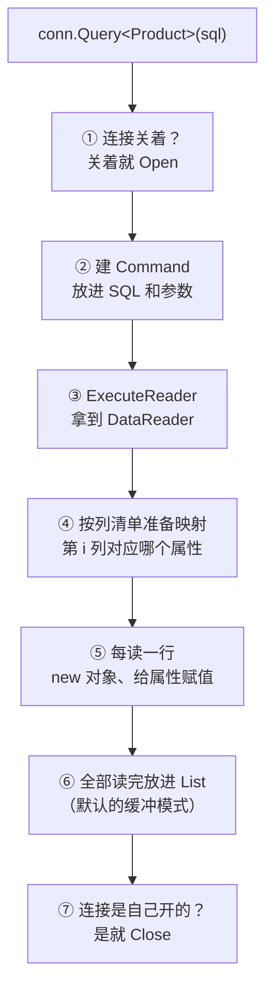
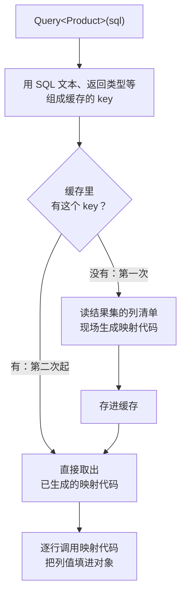
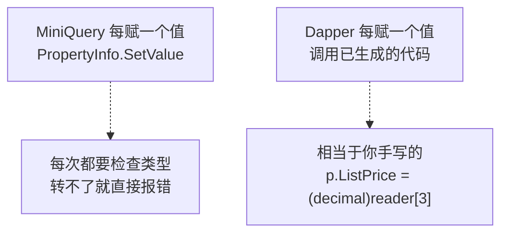
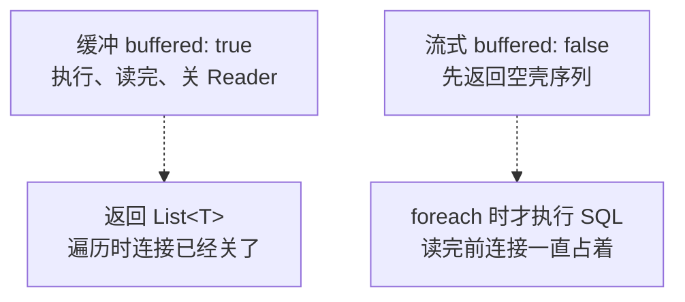
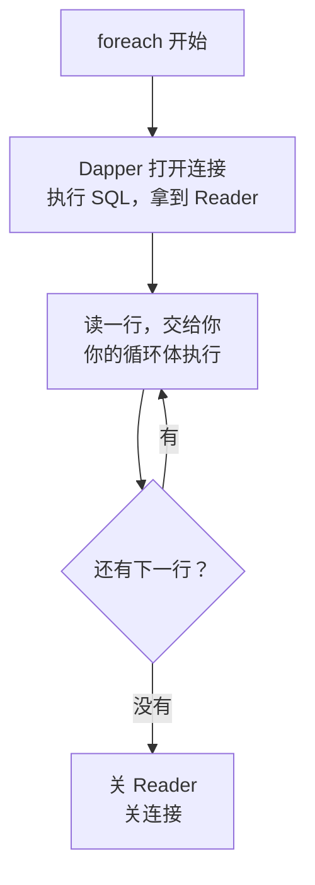

# 第 3 章 原理：Dapper 在背后替你干了什么

## 这一章解决什么问题

第 2 章你已经能用一行 `conn.Query<T>(sql)` 查出对象列表。但出问题时，你只看得到这一行，不知道里面在哪一步出了错。

本章把这一行拆开看，讲清三件事：

1. 这一行背后**按什么顺序**做了哪几步；
2. 为什么**第一次慢、之后快**，以及什么写法会让这个"快"失效；
3. 默认把结果**一次读完**，和**边读边用**有什么区别，后者为什么会报"已有打开的 DataReader"。

只讲到"能指导你查错"的程度，不讲 IL 指令和源码细节。

## 开始之前

- 上一章你已经会了：`using Dapper;` 之后用 `conn.Query<T>(sql)` 查多行；知道它按列名（不分大小写）给属性赋值，对不上的属性保持默认值；知道连接关着时 Dapper 会自己开、自己关。
- 需要的环境：第 1、2 章的解决方案和 `PriceDemo` 库。数据被改乱了就重跑 [`code/sql/00-reset-database.sql`](../code/sql/00-reset-database.sql)。
- 预计耗时：80–90 分钟。

---

## 正文

### 3.1 准备：新建本章项目

和第 2 章一样，本章所有例子放在**同一个新项目**里，每个例子把 `Program.cs` **整个替换掉**就能跑。

1. 「解决方案资源管理器」里**右键解决方案** →「**添加 → 新建项目**」→「控制台应用」，项目名称填 `Ch03Demo`，框架选 **.NET 10.0**，点「创建」。
2. **右键 `Ch03Demo` →「设为启动项目」**。
3. 「工具 → NuGet 包管理器 → 管理解决方案的 NuGet 程序包」→「已安装」页，选中 `Dapper`，在右侧勾上 `Ch03Demo`，点「安装」。`Microsoft.Data.SqlClient`、`System.Security.Cryptography.Pkcs` 也照这样各装一次。三个包的版本和第 2 章完全相同。

> 📷 **截图占位 ch03-01**：NuGet「已安装」页选中 Dapper，右侧项目列表里 `Ch03Demo` 已勾选，版本 2.1.89。
<!--  -->

装完后 `Ch03Demo.csproj` 的 `<ItemGroup>` 和第 2 章的 csproj 一字不差。本章 [`code/ch03/`](../code/ch03/) 下每个文件夹都是一个独立项目，csproj 也都相同。

---

### 3.2 概念一：一次 `Query<T>` 的执行流程

**白话定义**：`Query<T>` 做的事，就是你在 ADO.NET 里每天手写的那一套：开连接 → 建命令 → `ExecuteReader` → `while (reader.Read())` 逐行赋值 → 关连接。Dapper 只是把它们**按固定顺序**替你做了。

**业务场景**：价格申请单列表突然报错，或者某一列总是空的。你知道它内部分哪几步，就能判断问题出在"连接""SQL""映射"中的哪一段，而不是对着一行代码干瞪眼。

**反例（什么时候不该自己写一套）**：本节会手写一个"迷你 Dapper"，**只为看懂原理**。正式项目里不要自己造这种轮子，下一节会看到，它在类型转换、速度上都比不上 Dapper。

#### 🖼 图解：拆开 `Query<T>` 这一行



第 2 章 2.3 节的图是"简化版"，这里多了第 ② 步和第 ④ 步。第 ④ 步是 Dapper 快的关键，放到 3.3 节讲。

#### 💻 最小可运行代码：30 行的迷你 Dapper

下面的 `MiniQuery<T>` 用**反射**（reflection，指程序在运行时查看类有哪些属性并读写它们）照着上图七步实现了一遍。程序先用它查一次产品，再用真 Dapper 查一次，对比结果。

把 `Program.cs` 整个替换成：

```csharp
// code/ch03/Step1-MiniQuery/Program.cs
// 手写一个"迷你 Dapper"：用反射按列名给属性赋值，和真 Dapper 的结果对照
using System.Data;
using System.Reflection;
using Dapper;
using Microsoft.Data.SqlClient;

const string connStr =
    "Server=.;Database=PriceDemo;Integrated Security=True;TrustServerCertificate=True;";

using var conn = new SqlConnection(connStr);

const string sql = "SELECT Id, Code, Name, ListPrice FROM dbo.Product ORDER BY Id";

Console.WriteLine("== 迷你版 MiniQuery<Product>");
foreach (var p in conn.MiniQuery<Product>(sql))
    Console.WriteLine($"{p.Id} {p.Code,-8}{p.Name,-10}{p.ListPrice,12:N2}");
Console.WriteLine($"查完后连接：{conn.State}");

Console.WriteLine("== 真 Dapper Query<Product>");
foreach (var p in conn.Query<Product>(sql))
    Console.WriteLine($"{p.Id} {p.Code,-8}{p.Name,-10}{p.ListPrice,12:N2}");
Console.WriteLine($"查完后连接：{conn.State}");

public class Product
{
    public int Id { get; set; }
    public string Code { get; set; } = "";
    public string Name { get; set; } = "";
    public decimal ListPrice { get; set; }
}

public static class MiniDapper
{
    // 和 Dapper 一样写成 IDbConnection 的扩展方法；where T : new() 表示 T 必须能 new 出来
    public static List<T> MiniQuery<T>(this IDbConnection conn, string sql) where T : new()
    {
        bool wasClosed = conn.State == ConnectionState.Closed;
        if (wasClosed) conn.Open();                        // 第 1 步：连接关着就打开
        try
        {
            using var cmd = conn.CreateCommand();          // 第 2 步：建命令
            cmd.CommandText = sql;
            using var reader = cmd.ExecuteReader();        // 第 3 步：执行，拿到 DataReader

            // 第 4 步：每条查询只做一次——第 i 列对应哪个属性（不分大小写），对不上的记 null
            var props = new PropertyInfo?[reader.FieldCount];
            for (int i = 0; i < reader.FieldCount; i++)
                props[i] = typeof(T).GetProperty(reader.GetName(i),
                    BindingFlags.Public | BindingFlags.Instance | BindingFlags.IgnoreCase);

            var list = new List<T>();
            while (reader.Read())                          // 第 5 步：每读一行，new 一个对象
            {
                var obj = new T();
                for (int i = 0; i < props.Length; i++)
                {
                    var prop = props[i];
                    if (prop is null || !prop.CanWrite || reader.IsDBNull(i)) continue;  // 对不上就跳过
                    prop.SetValue(obj, reader.GetValue(i));   // 反射赋值：每次调用都要做检查，慢
                }
                list.Add(obj);
            }
            return list;                                   // 第 6 步：全部读完才返回（缓冲）
        }
        finally
        {
            if (wasClosed) conn.Close();                   // 第 7 步：自己开的自己关
        }
    }
}
```

#### 🔍 拆解运行结果

实测输出：

```text
== 迷你版 MiniQuery<Product>
1 US-100  便携超声主机      180,000.00
2 US-200  彩超工作站       420,000.00
3 PB-01   线阵探头         26,000.00
4 PB-02   凸阵探头         24,000.00
查完后连接：Closed
== 真 Dapper Query<Product>
1 US-100  便携超声主机      180,000.00
2 US-200  彩超工作站       420,000.00
3 PB-01   线阵探头         26,000.00
4 PB-02   凸阵探头         24,000.00
查完后连接：Closed
```

两段输出完全相同。说明 Dapper 做的事情**没有任何魔法**，就是这七步。逐步对照：

| 步 | 迷你版里的代码 | 你在 ADO.NET 里写的 | 这一步出错时的典型现象 |
|---|---|---|---|
| ① | `if (wasClosed) conn.Open()` | `conn.Open()` | 连接串错、库不存在（第 1 章那几种报错） |
| ② | `conn.CreateCommand()` + `CommandText` | `new SqlCommand(sql, conn)` | 参数没传对（第 4 章） |
| ③ | `cmd.ExecuteReader()` | 同左 | **`SqlException`**：SQL 写错、列名无效、对象名无效 |
| ④ | 按 `reader.GetName(i)` 找属性 | 每列一个 `GetOrdinal("列名")` | **不报错**：名字对不上就跳过（第 2 章 2.4 节） |
| ⑤ | `prop.SetValue(…)` | `reader.GetInt32(…)` 等 | **`DataException: Error parsing column N`**：类型转不过去 |
| ⑥ | `list.Add(obj)`，读完才 `return` | `customers.Add(…)` | 数据量太大时内存占用高（3.4 节、第 15 章） |
| ⑦ | `finally { if (wasClosed) conn.Close(); }` | `using` 或 `finally` 里 Close | 一般不出错 |

**最后一列就是本节的用处**：看到 `SqlException`，问题在 SQL 本身（第 ③ 步），拿 SQL 去 SSMS 里跑一遍；看到 `DataException`，SQL 没问题，问题在类的属性类型（第 ⑤ 步）；什么都不报但值是空的，查第 ④ 步的列名。

几个写法上的细节：

| 代码 | 为什么这样写 |
|---|---|
| `where T : new()` | 第 ⑤ 步要 `new T()`，所以要求 T 有无参构造函数 |
| `BindingFlags.IgnoreCase` | 让列名和属性名不分大小写匹配，和 Dapper 的规则一致 |
| `props` 数组在 `while` 外面算好 | 列和属性的对应关系每条查询只算一次，不是每行都算 |
| `reader.IsDBNull(i)` 时 `continue` | 列值是 NULL 就不赋值，属性保持默认值。Dapper 对 NULL 的处理第 7 章细讲 |

#### 改坏一处试试

把 `MiniQuery` 里第 7 步那一行 `if (wasClosed) conn.Close();` 删掉，再运行。实测输出（只看两处"查完后连接"）：

```text
== 迷你版 MiniQuery<Product>
1 US-100  便携超声主机      180,000.00
2 US-200  彩超工作站       420,000.00
3 PB-01   线阵探头         26,000.00
4 PB-02   凸阵探头         24,000.00
查完后连接：Open
4 PB-02   凸阵探头         24,000.00
查完后连接：Open
```

程序没报错，但连接**一直开着**。第二段真 Dapper 查询之后也是 `Open`，因为 Dapper 发现连接进来时已经是开着的，就不替你关（第 2 章 2.3 节例 4 实测过）。

这种"漏关"在控制台里看不出问题。放到网站上，每个请求都漏关一个连接，连接池很快就会被占满（第 16 章讲连接池）。这正是 Dapper 坚持"谁打开谁关闭"的原因。

---

### 3.3 概念二：映射代码的生成与缓存

**白话定义**：第一次遇到某个"SQL 文本 + 返回类型"的组合时，Dapper 会根据结果集的列清单，**现场生成一段专门的赋值代码**（相当于替你写了第 1 章那 15 行 `reader.GetXxx`），编译好后存进缓存。之后再遇到同一个组合，直接从缓存里取出来用。

**业务场景**：申请单列表页一天被打开几千次，执行的都是同一条 SQL、映射到同一个类。只有第一次要付"生成代码"的成本，之后每次都直接复用。

**反例（什么时候这个机制帮不上你，反而添乱）**：把**值拼进 SQL 文本**，比如 `"… WHERE Id = " + id`。每个不同的 id 都是一段不同的 SQL 文本，Dapper 就会为它们各存一条缓存，缓存帮不上忙，条目还越存越多。正确做法是参数化，第 4 章讲。

#### 🖼 图解：缓存命中与未命中



缓存的 key 由这几样东西组成。**任何一样不同，都算一个新 key**：

| 组成部分 | 举例 |
|---|---|
| SQL 文本（逐字比较，多一个空格也算不同） | `"SELECT Id, Code … FROM dbo.Product"` |
| 命令类型 | 普通 SQL 还是存储过程（第 8 章） |
| 连接字符串 | 连两个不同的库，各算各的 |
| 返回类型 `T` | `Query<Product>` 和 `Query<ProductBrief>` 是两条 |
| 参数对象的类型 | 第 4 章讲参数 |

#### 💻 最小可运行代码：量一量第一次和第二次

`SqlMapper.GetCachedSQLCount()` 是 Dapper 自带的诊断方法，返回当前缓存了多少条查询。程序里用 `Stopwatch` 量每次查询的耗时。

把 `Program.cs` 整个替换成：

```csharp
// code/ch03/Step2-Cache/Program.cs
// 看映射缓存：第一次慢、之后快；SQL 文本一变就是一条新缓存
using System.Diagnostics;
using Dapper;
using Microsoft.Data.SqlClient;

const string connStr =
    "Server=.;Database=PriceDemo;Integrated Security=True;TrustServerCertificate=True;";

using var conn = new SqlConnection(connStr);
conn.Open();   // 先手动打开：把"建立连接"的时间排除在外，下面只量查询本身

// 热身：先用 ADO.NET 跑一条，让 SqlClient 自己的首次加载也不计入
using (var cmd = new SqlCommand("SELECT 1", conn)) cmd.ExecuteScalar();

const string sql = "SELECT Id, Code, Name, ListPrice FROM dbo.Product ORDER BY Id";

// 实验 1：同一条 SQL + 同一个类型，连跑 5 次
Console.WriteLine("== 实验 1：Query<Product>，同一条 SQL 跑 5 次");
for (int i = 1; i <= 5; i++)
{
    var sw = Stopwatch.StartNew();
    conn.Query<Product>(sql);
    sw.Stop();
    Console.WriteLine($"第 {i} 次：{sw.Elapsed.TotalMilliseconds,8:F3} ms");
}
Console.WriteLine($"缓存条数：{SqlMapper.GetCachedSQLCount()}");

// 实验 2：SQL 一字不改，只换接收的类型 —— 又要重新生成一次映射代码
Console.WriteLine("== 实验 2：同一条 SQL，换成 Query<ProductBrief>，跑 3 次");
for (int i = 1; i <= 3; i++)
{
    var sw = Stopwatch.StartNew();
    conn.Query<ProductBrief>(sql);
    sw.Stop();
    Console.WriteLine($"第 {i} 次：{sw.Elapsed.TotalMilliseconds,8:F3} ms");
}
Console.WriteLine($"缓存条数：{SqlMapper.GetCachedSQLCount()}");

// 实验 3：把 Id 拼进 SQL —— 每个 Id 都是一段不同的 SQL 文本，每段一条缓存
var sw3 = Stopwatch.StartNew();
for (int id = 1; id <= 100; id++)
    conn.Query<Product>("SELECT Id, Code, Name, ListPrice FROM dbo.Product WHERE Id = " + id);
sw3.Stop();
Console.WriteLine($"== 实验 3：拼接 SQL 循环 100 次，共 {sw3.Elapsed.TotalMilliseconds:F1} ms，缓存条数：{SqlMapper.GetCachedSQLCount()}");

// 实验 4：参数写法（第 4 章细讲）—— SQL 文本始终不变，只多 1 条缓存
var sw4 = Stopwatch.StartNew();
for (int id = 1; id <= 100; id++)
    conn.Query<Product>("SELECT Id, Code, Name, ListPrice FROM dbo.Product WHERE Id = @Id", new { Id = id });
sw4.Stop();
Console.WriteLine($"== 实验 4：参数写法循环 100 次，共 {sw4.Elapsed.TotalMilliseconds:F1} ms，缓存条数：{SqlMapper.GetCachedSQLCount()}");

public class Product
{
    public int Id { get; set; }
    public string Code { get; set; } = "";
    public string Name { get; set; } = "";
    public decimal ListPrice { get; set; }
}

public class ProductBrief      // 只要两个属性，用来证明"换类型 = 换缓存"
{
    public string Code { get; set; } = "";
    public decimal ListPrice { get; set; }
}
```

> 实验 4 里的 `@Id` 和 `new { Id = id }` 是参数写法，这里只用来对比缓存条数，第 4 章再细讲。

#### 🔍 拆解运行结果

我在沙箱里连续跑了 3 次。第 1 次运行的完整输出：

```text
== 实验 1：Query<Product>，同一条 SQL 跑 5 次
第 1 次：  30.343 ms
第 2 次：   1.347 ms
第 3 次：   0.860 ms
第 4 次：   1.114 ms
第 5 次：   0.711 ms
缓存条数：1
== 实验 2：同一条 SQL，换成 Query<ProductBrief>，跑 3 次
第 1 次：   1.774 ms
第 2 次：   0.489 ms
第 3 次：   0.326 ms
缓存条数：2
== 实验 3：拼接 SQL 循环 100 次，共 52.8 ms，缓存条数：102
== 实验 4：参数写法循环 100 次，共 41.9 ms，缓存条数：103
```

> 📷 **截图占位 ch03-02**：控制台显示实验 1～4 的输出，第 1 次的毫秒数明显大于后面几次。
<!--  -->

3 次运行的耗时汇总（单位 ms）：

| | 第 1 次运行 | 第 2 次运行 | 第 3 次运行 |
|---|---|---|---|
| 实验 1 第 1 次 | 30.343 | 31.690 | 30.811 |
| 实验 1 第 2～5 次 | 0.711～1.347 | 0.511～1.679 | 0.378～1.307 |
| 实验 2 第 1 次（换类型） | 1.774 | 1.909 | 1.418 |
| 实验 2 第 2～3 次 | 0.326～0.489 | 0.367～0.506 | 0.367～0.763 |
| 实验 3 拼接 100 次 | 52.8 | 27.1 | 29.8 |
| 实验 4 参数 100 次 | 41.9 | 47.7 | 48.8 |

**这些毫秒数因机器而异**，你的电脑上可能整体快一倍或慢一倍，也会有上下波动。要看的是**相对大小**：

| 现象 | 原因 |
|---|---|
| 实验 1 第 1 次约 30 ms，之后不到 2 ms | 第 1 次要加载 Dapper 程序集、即时编译（JIT）Dapper 自己的代码，再生成映射代码。这些都只发生一次 |
| 实验 2 第 1 次比后两次慢 | SQL 一字不改，只换了类型，缓存 key 就变了，又生成了一次映射代码。这次 Dapper 自己已经加载好了，所以只多出约 1 ms |
| 缓存条数 1 → 2 | 实验 1 跑 5 次只占 1 条；换类型多 1 条 |
| 实验 3 后变成 102 | 拼了 100 段不同的 SQL，就多了 100 条 |
| 实验 4 后变成 103 | 参数写法的 SQL 文本始终不变，100 次只多 1 条 |

**实验 3 和实验 4 的总耗时差不多**，3 次运行互有快慢。原因是表很小，每次查询的时间主要花在网络往返上，"生成映射代码"那 1 ms 左右被淹没了。所以拼接 SQL 的问题**主要不在速度**，而在于：Dapper 的缓存越存越多；SQL Server 那边也要为每段文本单独编译执行计划（第 4 章 4.4 节实测）；以及最严重的 SQL 注入（第 4 章 4.2 节）。

**为什么 Dapper 生成的代码比 `MiniQuery` 的反射快？**



反射每赋一个值都要做一遍类型检查。Dapper 第一次就生成了"直接赋值"的代码，以后每行都只是普通的方法调用，和你手写 ADO.NET 的速度属于同一个量级。

#### 改坏一处试试

回到 3.2 节的 `Step1-MiniQuery`，把 `Product` 类里的 `public decimal ListPrice` 改成 `public double ListPrice`，运行。实测报错：

```text
== 迷你版 MiniQuery<Product>
Unhandled exception. System.ArgumentException: Object of type 'System.Decimal' cannot be converted to type 'System.Double'.
   at System.RuntimeType.CheckValue(Object& value, Binder binder, CultureInfo culture, BindingFlags invokeAttr)
   at System.Reflection.RuntimeMethodInfo.InvokePropertySetter(Object obj, BindingFlags invokeAttr, Binder binder, Object parameter, CultureInfo culture)
   at System.Reflection.RuntimePropertyInfo.SetValue(Object obj, Object value, Object[] index)
   at MiniDapper.MiniQuery[T](IDbConnection conn, String sql) in /projects/sandbox/.tools/run/b3-dbl/Program.cs:line 60
   at Program.<Main>$(String[] args) in /projects/sandbox/.tools/run/b3-dbl/Program.cs:line 16
```

再把"迷你版"那一段删掉，只留真 Dapper 那段，`ListPrice` 仍然是 `double`。实测输出正常：

```text
== 真 Dapper Query<Product>
1 US-100  便携超声主机      180,000.00
2 US-200  彩超工作站       420,000.00
3 PB-01   线阵探头         26,000.00
4 PB-02   凸阵探头         24,000.00
查完后连接：Closed
```

**怎么读这条报错**：

| 片段 | 含义 |
|---|---|
| `Object of type 'System.Decimal' cannot be converted to type 'System.Double'` | 数据库给的是 `decimal`，属性要的是 `double`，反射不会自动转换 |
| `at …SetValue` | 出错在第 ⑤ 步"给属性赋值" |
| `at MiniDapper.MiniQuery[T](…) line 60` | 堆栈里**第一行你自己的代码**，就是出事的地方 |

Dapper 不报错，是因为它在生成映射代码时，会先比较"列的类型"和"属性的类型"。不一样就在生成的代码里**顺手加上转换**。这就是第 2 章实验 5 里 TINYINT 能装进 `int` 的原因。转换不了的组合（比如把"上海"转成 `int`），Dapper 才报 `Error parsing column`。

> 注意：`DECIMAL` 装进 `double` 可能丢精度。金额、单价**始终用 `decimal`**，这里只是为了演示。

#### 多试一步：拼接的 SQL 会无限涨下去吗？

把实验 3 的循环临时改成 3000 次，每 250 次打印一下缓存条数：

```csharp
// 临时改法：只替换实验 3 的循环，其余不动
for (int id = 1; id <= 3000; id++)
{
    conn.Query<Product>("SELECT Id, Code, Name, ListPrice FROM dbo.Product WHERE Id = " + id);
    if (id % 250 == 0) Console.WriteLine($"{id}: {SqlMapper.GetCachedSQLCount()}");
}
```

实测输出：

```text
250: 252
500: 5
750: 255
1000: 5
1250: 255
1500: 5
1750: 255
2000: 5
2250: 255
2500: 5
2750: 255
3000: 5
```

缓存不会无限增长。实测大约每新增 500 条，Dapper 就会做一次清理，把**只用过一次**的条目删掉，条数又降回个位数（剩下的 5 条是反复用过的）。代价是：被清掉的 SQL 下次再来，又要重新生成一遍映射代码。所以拼接 SQL 不会撑爆内存，但会让缓存一直处在"存了删、删了存"的状态，失去作用。

---

### 3.4 概念三：缓冲读取 vs 流式读取

**白话定义**：

- **缓冲**（buffered，默认）：`Query` 先把所有行读完、放进 `List<T>`、关掉 DataReader，**然后才返回**。
- **流式**（`buffered: false`）：`Query` 立刻返回一个"还没开始读"的序列。你 `foreach` 到哪一行，它才从数据库读到哪一行。

**业务场景**：

- 申请单列表、下拉框、一页 20 行的报表：用缓冲。数据量小，读完马上释放连接，之后想怎么用都行。
- 导出一整年的申请明细到 CSV，几十万行：用流式。读一行写一行，内存里始终只有一行（第 15 章实测内存差别）。

**反例（什么时候不该用流式）**：
- 遍历的过程中**还要用同一个连接再查数据库**（例 3 实测会报错）；
- 结果要遍历多次，或者要先 `Count()` 再遍历；
- 数据量本来就不大。这时流式没有任何好处，只会让连接占用得更久。

#### 🖼 图解：两种模式的区别



流式读取时，一个 `foreach` 内部的时间线：



关键在 C 这一步：**你的循环体执行时，DataReader 还开着**。

#### 💻 最小可运行代码：四个例子

全程不手动 `Open()`，看 Dapper 在什么时候开关连接。把 `Program.cs` 整个替换成：

```csharp
// code/ch03/Step3-Buffered/Program.cs
// 缓冲 vs 流式：看连接什么时候开、什么时候关，以及流式读取时为什么不能再用同一个连接
using Dapper;
using Microsoft.Data.SqlClient;

const string connStr =
    "Server=.;Database=PriceDemo;Integrated Security=True;TrustServerCertificate=True;";

using var conn = new SqlConnection(connStr);   // 注意：全程不手动 Open，让 Dapper 自己开关

const string sql = "SELECT Id, Code, Name, ListPrice FROM dbo.Product ORDER BY Id";

// 例 1：缓冲（默认 buffered: true）——Query 返回时，数据已全部在内存里，连接已关
Console.WriteLine("== 例 1 缓冲");
var list = conn.Query<Product>(sql);
Console.WriteLine($"Query 返回后：连接 {conn.State}，类型 {list.GetType().Name}");
foreach (var p in list)
    Console.WriteLine($"  读到 {p.Code,-7} 连接 {conn.State}");

// 例 2：流式（buffered: false）——Query 返回时还没执行，foreach 时才一边读一边给你
Console.WriteLine("== 例 2 流式");
var stream = conn.Query<Product>(sql, buffered: false);
Console.WriteLine($"Query 返回后：连接 {conn.State}，类型 {stream.GetType().Name}");
foreach (var p in stream)
    Console.WriteLine($"  读到 {p.Code,-7} 连接 {conn.State}");   // 遍历期间连接一直开着
Console.WriteLine($"遍历结束后：连接 {conn.State}");

// 例 3：流式遍历中，再用同一个连接查别的 —— 报错
Console.WriteLine("== 例 3 流式遍历中再查一次");
try
{
    foreach (var p in conn.Query<Product>(sql, buffered: false))
    {
        // 想顺便查这个产品被申请过几次：上一个 DataReader 还没读完，同一连接不能再开一个
        // （@Id 是参数写法，new { p.Id } 就是 new { Id = p.Id }，第 4 章细讲）
        int times = conn.Query<int>(
            "SELECT COUNT(*) FROM dbo.PriceRequestItem WHERE ProductId = @Id", new { p.Id }).First();
        Console.WriteLine($"  {p.Code} 被申请 {times} 次");
    }
}
catch (Exception ex)
{
    Console.WriteLine($"  {ex.GetType().FullName}: {ex.Message}");
}
Console.WriteLine($"出错后：连接 {conn.State}");

// 例 4：同样的写法换回缓冲 —— 外层查询已读完、DataReader 已关，里面再查没问题
Console.WriteLine("== 例 4 缓冲遍历中再查一次");
foreach (var p in conn.Query<Product>(sql))
{
    int times = conn.Query<int>(
        "SELECT COUNT(*) FROM dbo.PriceRequestItem WHERE ProductId = @Id", new { p.Id }).First();
    Console.WriteLine($"  {p.Code} 被申请 {times} 次");
}

public class Product
{
    public int Id { get; set; }
    public string Code { get; set; } = "";
    public string Name { get; set; } = "";
    public decimal ListPrice { get; set; }
}
```

#### 🔍 拆解运行结果

实测输出：

```text
== 例 1 缓冲
Query 返回后：连接 Closed，类型 List`1
  读到 US-100  连接 Closed
  读到 US-200  连接 Closed
  读到 PB-01   连接 Closed
  读到 PB-02   连接 Closed
== 例 2 流式
Query 返回后：连接 Closed，类型 <QueryImpl>d__149`1
  读到 US-100  连接 Open
  读到 US-200  连接 Open
  读到 PB-01   连接 Open
  读到 PB-02   连接 Open
遍历结束后：连接 Closed
== 例 3 流式遍历中再查一次
  System.InvalidOperationException: There is already an open DataReader associated with this Connection which must be closed first.
出错后：连接 Closed
== 例 4 缓冲遍历中再查一次
  US-100 被申请 1 次
  US-200 被申请 1 次
  PB-01 被申请 2 次
  PB-02 被申请 1 次
```

| 例 | 看到了什么 | 说明 |
|---|---|---|
| 1 | 返回后是 `List`1`，遍历时连接 `Closed` | 数据已经全部在内存里，遍历的是一个普通的 `List<Product>`，和数据库无关 |
| 2 | 返回后类型是 `<QueryImpl>d__149`1`，连接仍是 `Closed` | 这个怪名字是编译器为 `yield return` 生成的类。**返回时 SQL 还没执行** |
| 2 | 遍历中 `Open`，结束后 `Closed` | 流式模式下，连接在整个 `foreach` 期间都被占着。循环体里做的事越慢，连接占用越久 |
| 3 | `InvalidOperationException` | 外层的 DataReader 还没读完，同一个连接上不能再执行第二条命令 |
| 3 | 出错后连接 `Closed` | 异常跳出 `foreach` 时，Dapper 照样关了 Reader 和它自己打开的连接，不会漏关 |
| 4 | 正常输出 | 缓冲模式下外层查询已经读完、Reader 已关，在循环里再查没有冲突。PB-01（线阵探头）出现在第 1、3 号申请单里，所以是 2 次 |

> 例 4 这种"循环里每行再查一次"的写法叫 N+1 查询，4 个产品就多跑了 4 条 SQL。数据多时应该改成一条 JOIN 或 `IN` 查询，第 4 章和第 11 章讲。

#### 改坏一处试试

把例 3 外面的 `try { … } catch { … }` 去掉，让异常直接抛出来。实测（堆栈较长，这里贴前 13 行）：

```text
== 例 3 流式遍历中再查一次
Unhandled exception. System.InvalidOperationException: There is already an open DataReader associated with this Connection which must be closed first.
   at Microsoft.Data.SqlClient.Connection.SqlConnectionInternal.ValidateConnectionForExecute(SqlCommand command)
   at Microsoft.Data.SqlClient.SqlConnection.ValidateConnectionForExecute(String method, SqlCommand command)
   at Microsoft.Data.SqlClient.SqlCommand.ValidateCommand(Boolean isAsync, String method)
   at Microsoft.Data.SqlClient.SqlCommand.RunExecuteReader(CommandBehavior cmdBehavior, RunBehavior runBehavior, Boolean returnStream, TaskCompletionSource`1 completion, Int32 timeout, Task& executeTask, Boolean& usedCache, Boolean asyncWrite, Boolean isRetry, String method)
   at Microsoft.Data.SqlClient.SqlCommand.RunExecuteReader(CommandBehavior cmdBehavior, RunBehavior runBehavior, Boolean returnStream, String method)
   at Microsoft.Data.SqlClient.SqlCommand.ExecuteReader(CommandBehavior behavior)
   at Microsoft.Data.SqlClient.SqlCommand.ExecuteDbDataReader(CommandBehavior behavior)
   at Dapper.SqlMapper.ExecuteReaderWithFlagsFallback(IDbCommand cmd, Boolean wasClosed, CommandBehavior behavior) in /_/Dapper/SqlMapper.cs:line 1191
   at Dapper.SqlMapper.QueryImpl[T](IDbConnection cnn, CommandDefinition command, Type effectiveType)+MoveNext() in /_/Dapper/SqlMapper.cs:line 1219
   at System.Collections.Generic.List`1..ctor(IEnumerable`1 collection)
   at System.Linq.Enumerable.ToList[TSource](IEnumerable`1 source)
   at Dapper.SqlMapper.Query[T](IDbConnection cnn, String sql, Object param, IDbTransaction transaction, Boolean buffered, Nullable`1 commandTimeout, Nullable`1 commandType) in /_/Dapper/SqlMapper.cs:line 850
```

中文系统上，这条消息是（沙箱里把系统语言切成中文实测）：

```text
System.InvalidOperationException: 已有打开的与此 Connection 相关联的 DataReader，必须首先将它关闭。
```

> 📷 **截图占位 ch03-03**：VS 里按 F5 调试运行时，在例 3 的内层查询那一行弹出「引发的异常」窗口，显示 InvalidOperationException 和上面的中文消息。
<!--  -->

**怎么读这段堆栈**：从上往下看，找到第一个"认识"的地方。

| 行 | 说明 |
|---|---|
| `SqlConnection.ValidateConnectionForExecute` | SqlClient 执行命令前先检查连接，发现上面还挂着一个没关的 Reader |
| `Dapper.SqlMapper.ExecuteReaderWithFlagsFallback` | Dapper 正在执行 3.2 节图中的第 ③ 步 |
| `Dapper.SqlMapper.Query[T](… Boolean buffered …)` | 是**内层**那次 `Query<int>`（缓冲模式，所以调了 `ToList`）触发的 |

这条报错和 Dapper 无关，ADO.NET 里一个 `SqlDataReader` 没关就在同一连接上执行第二条命令，报的是同一句话。三种改法：

| 改法 | 说明 |
|---|---|
| 外层用缓冲（例 4） | 最简单。数据量不大时首选 |
| 内层查询用**另一个** `SqlConnection` | 外层确实数据量大、必须流式时用。两个连接互不影响 |
| 连接串加 `MultipleActiveResultSets=True`（简称 MARS，多活动结果集） | 我在沙箱实测：加上后例 3 能正常输出 4 行。但它会改变整个连接的行为，不建议只为这一处打开 |

---

## 🧱 类比：ADO.NET 写法与 Dapper 内部步骤逐项对照

| 你在 ADO.NET 里做的事 | Dapper 内部对应的步骤 | 区别 |
|---|---|---|
| `conn.Open()` | ① 关着才打开 | Dapper 记住"是不是自己开的"，只关自己开的 |
| `new SqlCommand(sql, conn)` | ② 建命令 | 参数由 Dapper 根据对象生成（第 4 章） |
| `cmd.ExecuteReader()` | ③ 执行 | 完全相同，SQL 报错也是同一个 `SqlException` |
| 每列手写 `GetOrdinal` | ④ 按列名找属性 | Dapper 只在第一次做，结果缓存起来 |
| 每列手写 `GetXxx` 并赋值 | ⑤ 调用生成的映射代码 | Dapper 按列类型和属性类型自动加转换 |
| `list.Add(…)` 读完再用 | ⑥ 缓冲（默认） | 两者一样：读完再用，连接可以立刻释放 |
| 在 `while (reader.Read())` 里边读边处理 | ⑥ 换成流式 `buffered: false` | 两者一样：处理期间 Reader 一直开着，同一连接不能再执行命令 |
| `finally` 里 `Close()` | ⑦ 自己开的自己关 | 你自己 `Open` 的连接，Dapper 不替你关 |

## ⚠️ 踩坑警告

| 现象 | 原因 | 怎么改 |
|---|---|---|
| `InvalidOperationException: There is already an open DataReader associated with this Connection which must be closed first.`（中文：已有打开的与此 Connection 相关联的 DataReader，必须首先将它关闭。）（实测） | 用了 `buffered: false`，在 `foreach` 里又用同一个连接执行查询 | 外层改回默认缓冲；或者内层用另一个连接 |
| 程序第一次查询明显比后面慢（实测：约 30 ms 对不到 2 ms） | 第一次要加载 Dapper、即时编译、生成映射代码 | 正常现象，不用处理。只在意首次响应时，可以在程序启动时先跑一次常用查询 |
| `GetCachedSQLCount()` 越来越大，又突然掉回个位数（实测） | 把值拼进了 SQL 文本，每个值一条缓存；Dapper 定期清掉只用过一次的条目 | 改成参数化（第 4 章），SQL 文本固定，缓存只占一条 |
| 自己写的通用查询方法用完连接一直是 `Open`（实测：删掉第 7 步的 Close） | 打开了连接却没在 `finally` 里关闭 | 照 Dapper 的做法记录 `wasClosed`，在 `finally` 里只关自己打开的连接 |
| 流式读取的循环里处理很慢，别的请求连不上数据库 | 流式模式下整个 `foreach` 期间连接都被占着 | 循环体里只做轻量的事；耗时的处理先缓冲读完再做 |

## 🎯 动手练习

**练习 1：让 MiniQuery 报告被跳过的列**

第 2 章说过，结果集里多出来的列会被"静默跳过"。改造 3.2 节的 `MiniQuery<T>`：遇到找不到对应属性的列时，打印一行 `跳过列：列名`。要求**每列只打印一次**，不能每读一行就打印一次。

用下面这条 SQL 测试，`Product` 类不变：

```sql
SELECT Id, Code, Name, ListPrice, N'测试' AS Memo FROM dbo.Product WHERE Id = 1
```

然后打印第一个对象的 `Code` 和 `ListPrice`（格式 `N2`）。

- 验收标准：输出完全一致：

```text
跳过列：Memo
US-100 180,000.00
```

- 提示：想一想，在七步中的哪一步做这个判断，才能保证"只打印一次"。

**练习 2：预测缓存条数**

先在纸上写下你的预测，再写程序验证。程序**刚启动、还没执行过任何 Dapper 查询**。设 `sqlA = "SELECT Id, Code, Name, ListPrice FROM dbo.Product"`，依次执行下面 5 步，每步之后打印一次 `SqlMapper.GetCachedSQLCount()`：

1. `Query<Product>(sqlA)` 执行 3 次；
2. `Query<ProductBrief>(sqlA)` 执行 1 次（`ProductBrief` 同 3.3 节）；
3. `Query<Product>(sqlA + " ")` 执行 1 次（末尾多一个空格）；
4. `Query<Product>(sqlA + " WHERE Id = " + id)`，id 从 1 到 3 各执行 1 次；
5. `Query<Product>(sqlA + " WHERE Id = @Id", new { Id = id })`，id 从 1 到 3 各执行 1 次。

- 验收标准：输出 5 行，格式为 `第 N 步：条数`，最后一行是 `第 5 步：7`。并且能说出第 3 步为什么也会加 1。

卡住了看文末参考答案。

## 📌 一句话总结

Query 就是开、建、执行、映射、关七步；映射代码按 SQL 文本缓存，流式读取期间连接被占着。

## 下一章

SQL 里的值怎么传进去，才能既不被注入、又让 SQL 文本保持不变、缓存只占一条？第 4 章讲参数化查询。

---

<!-- 以下是参考答案，先自己动手，卡住了再往下翻 -->


## 参考答案

**练习 1 思路**：列和属性的对应关系在第 ④ 步、`while` 循环之前就算好了，每列只算一次。所以在算 `props[i]` 的那个循环里，发现 `props[i] is null` 就打印，自然只打印一次。如果写在 `while (reader.Read())` 里面，每行都会打印一遍。

**练习 2 思路**：缓存 key 包含 SQL 文本（逐字比较）和返回类型。第 1 步同 SQL 同类型，执行几次都只算 1 条；第 2 步换了类型，+1；第 3 步末尾多一个空格，执行结果完全一样，但对 Dapper 来说是不同的字符串，+1；第 4 步拼出 3 段不同的文本，+3；第 5 步文本固定不变，3 次只 +1。合计 1 → 2 → 3 → 6 → 7。

两题合在一个文件里，完整项目在 [`code/ch03/Exercise/`](../code/ch03/Exercise/)。实测输出：

```text
== 练习 1
跳过列：Memo
US-100 180,000.00
== 练习 2
第 1 步：1
第 2 步：2
第 3 步：3
第 4 步：6
第 5 步：7
```

```csharp
// code/ch03/Exercise/Program.cs
// 第 3 章练习参考答案：练习 1（MiniQuery 报告跳过的列）+ 练习 2（预测缓存条数）
using System.Data;
using System.Reflection;
using Dapper;
using Microsoft.Data.SqlClient;

const string connStr =
    "Server=.;Database=PriceDemo;Integrated Security=True;TrustServerCertificate=True;";

using var conn = new SqlConnection(connStr);

// 练习 1：结果集里多了 Memo 列，Product 里没有这个属性
Console.WriteLine("== 练习 1");
var one = conn.MiniQuery<Product>(
    "SELECT Id, Code, Name, ListPrice, N'测试' AS Memo FROM dbo.Product WHERE Id = 1");
Console.WriteLine($"{one[0].Code} {one[0].ListPrice:N2}");

// 练习 2：每一步之后打印 Dapper 的缓存条数
Console.WriteLine("== 练习 2");
const string sqlA = "SELECT Id, Code, Name, ListPrice FROM dbo.Product";
for (int i = 0; i < 3; i++) conn.Query<Product>(sqlA);        // 同 SQL 同类型跑 3 次：仍是 1 条
Console.WriteLine($"第 1 步：{SqlMapper.GetCachedSQLCount()}");
conn.Query<ProductBrief>(sqlA);                                // 同 SQL 换类型：+1
Console.WriteLine($"第 2 步：{SqlMapper.GetCachedSQLCount()}");
conn.Query<Product>(sqlA + " ");                               // 末尾多一个空格：文本不同，+1
Console.WriteLine($"第 3 步：{SqlMapper.GetCachedSQLCount()}");
for (int id = 1; id <= 3; id++)
    conn.Query<Product>(sqlA + " WHERE Id = " + id);           // 拼接 3 个不同的 Id：+3
Console.WriteLine($"第 4 步：{SqlMapper.GetCachedSQLCount()}");
for (int id = 1; id <= 3; id++)
    conn.Query<Product>(sqlA + " WHERE Id = @Id", new { Id = id });   // 参数写法，文本不变：+1
Console.WriteLine($"第 5 步：{SqlMapper.GetCachedSQLCount()}");

public class Product
{
    public int Id { get; set; }
    public string Code { get; set; } = "";
    public string Name { get; set; } = "";
    public decimal ListPrice { get; set; }
}

public class ProductBrief
{
    public string Code { get; set; } = "";
    public decimal ListPrice { get; set; }
}

public static class MiniDapper
{
    public static List<T> MiniQuery<T>(this IDbConnection conn, string sql) where T : new()
    {
        bool wasClosed = conn.State == ConnectionState.Closed;
        if (wasClosed) conn.Open();
        try
        {
            using var cmd = conn.CreateCommand();
            cmd.CommandText = sql;
            using var reader = cmd.ExecuteReader();

            var props = new PropertyInfo?[reader.FieldCount];
            for (int i = 0; i < reader.FieldCount; i++)
            {
                props[i] = typeof(T).GetProperty(reader.GetName(i),
                    BindingFlags.Public | BindingFlags.Instance | BindingFlags.IgnoreCase);
                // 新增：找列对应属性只做一次，所以在这里报告，不会每行重复打印
                if (props[i] is null) Console.WriteLine($"跳过列：{reader.GetName(i)}");
            }

            var list = new List<T>();
            while (reader.Read())
            {
                var obj = new T();
                for (int i = 0; i < props.Length; i++)
                {
                    var prop = props[i];
                    if (prop is null || !prop.CanWrite || reader.IsDBNull(i)) continue;
                    prop.SetValue(obj, reader.GetValue(i));
                }
                list.Add(obj);
            }
            return list;
        }
        finally
        {
            if (wasClosed) conn.Close();
        }
    }
}
```
