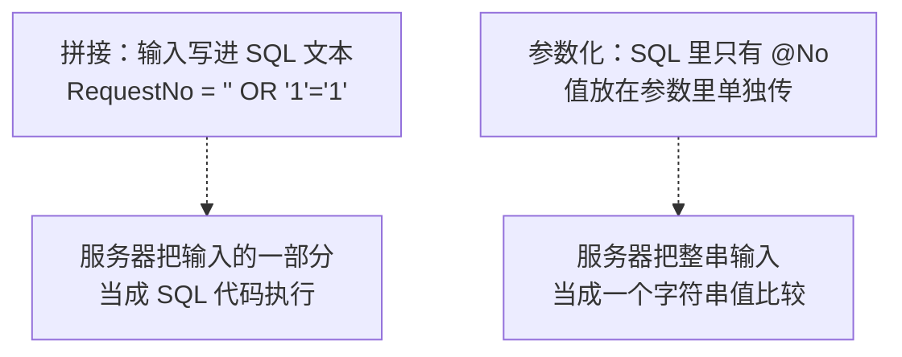
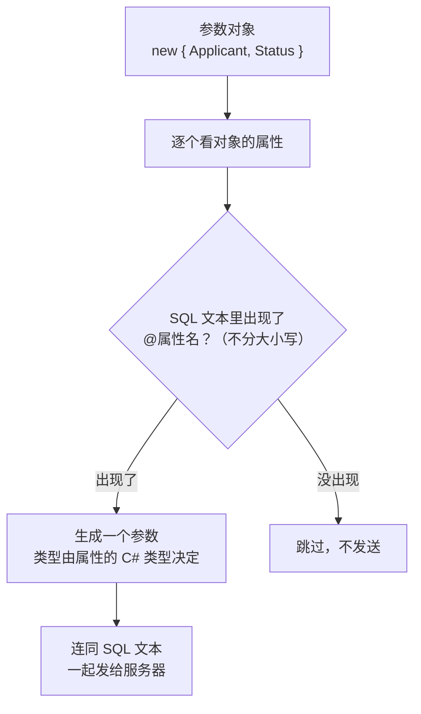
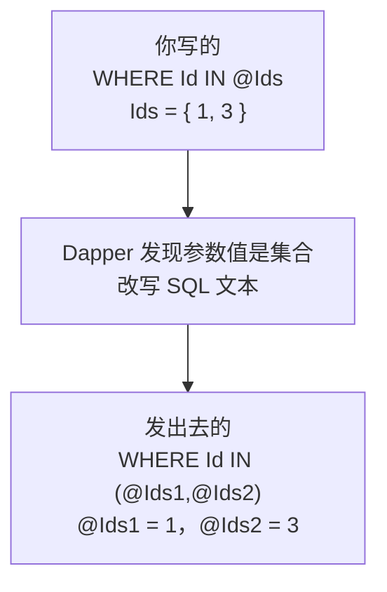
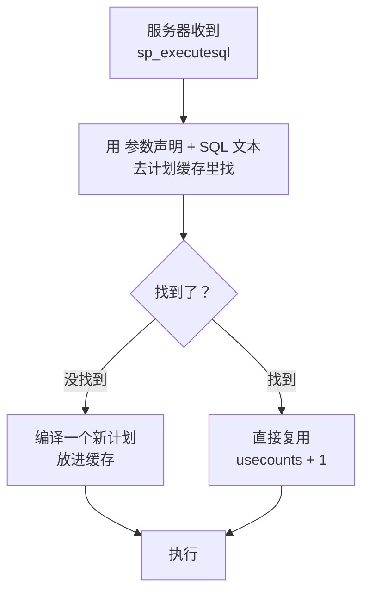

# 第 4 章 参数化查询

## 这一章解决什么问题

前三章的 SQL 都是写死的。真实的查询页上，单号、申请人、状态都是用户填的。最省事的办法是把输入拼进 SQL 字符串，但这样一个单引号就能让 SQL 报错，输入 `' OR '1'='1` 更能把所有单据都查出来。

本章讲三件事：

1. 用 Dapper 怎么把值**作为参数**传进去：匿名对象、实体对象都行，一个 `SqlParameter` 都不用写；
2. `WHERE Id IN @Ids` 怎么传一个列表，空列表时会怎样；
3. 服务器实际收到的是什么。到 SQL Server 的计划缓存里查证据，看参数化为什么能复用执行计划。

## 开始之前

- 上一章你已经会了：`Query<T>` 内部的七步流程；Dapper 按"SQL 文本 + 类型"缓存映射代码，所以拼接 SQL 会让缓存一直涨；流式读取期间连接被占着。
- 需要的环境：第 1 章的解决方案和 `PriceDemo` 库。数据被改乱了就重跑 [`code/sql/00-reset-database.sql`](../code/sql/00-reset-database.sql)。4.4 节要查计划缓存，需要 `VIEW SERVER STATE` 权限。用 Windows 身份验证登录自己电脑上的开发实例时，一般就是管理员，这个权限是有的。
- 预计耗时：80–90 分钟。

---

## 正文

### 4.1 准备：新建本章项目

和前两章一样：

1. **右键解决方案** →「**添加 → 新建项目**」→「控制台应用」，项目名称填 `Ch04Demo`，框架选 **.NET 10.0**。
2. **右键 `Ch04Demo` →「设为启动项目」**。
3. 「工具 → NuGet 包管理器 → 管理解决方案的 NuGet 程序包」→「已安装」页，把 `Dapper`、`Microsoft.Data.SqlClient`、`System.Security.Cryptography.Pkcs` 三个包都勾上 `Ch04Demo` 安装。版本和第 2 章相同。

本章每个例子都把 `Program.cs` **整个替换掉**运行。完整项目在 [`code/ch04/`](../code/ch04/)，csproj 都和第 2 章相同。

---

### 4.2 概念一：用对象传参（匿名对象 / 实体对象）

**白话定义**：SQL 里用 `@名字` 占位，再把一个**对象**作为 `Query` 的第二个参数传进去。Dapper 拿对象的**属性名**去对 SQL 里的 `@名字`（不分大小写），对上一个，就替你生成一个 `SqlParameter`。

**业务场景**：查询页按"申请人 + 状态"筛选申请单；按单号查一张单据。用户输入的东西永远不进 SQL 文本，只作为参数值传过去。

**反例（什么时候参数化帮不上）**：参数只能代替**值**，不能代替**表名、列名、ORDER BY 后面的排序列、ASC/DESC**。比如"用户点表头按某一列排序"，写 `ORDER BY @Col` 实测直接报错 1008：`The SELECT item identified by the ORDER BY number 1 contains a variable as part of the expression identifying a column position.` 这种情况要用白名单，第 13 章讲。

#### 🖼 图解：拼接和参数化，服务器看到的东西不一样



#### 💻 最小可运行代码（一）：先看注入

把 `Program.cs` 整个替换成：

```csharp
// code/ch04/Step1-Injection/Program.cs
// 拼接 SQL 被注入 vs 参数化：同样的输入，结果完全不同
using Dapper;
using Microsoft.Data.SqlClient;

const string connStr =
    "Server=.;Database=PriceDemo;Integrated Security=True;TrustServerCertificate=True;";

using var conn = new SqlConnection(connStr);

// 假设这是查询页"申请单号"输入框里用户填的内容
string input = "' OR '1'='1";

// 错误写法：把输入直接拼进 SQL
string badSql = "SELECT RequestNo, Applicant FROM dbo.PriceRequest WHERE RequestNo = '" + input + "'";
Console.WriteLine("== 拼接写法");
Console.WriteLine("实际执行的 SQL：" + badSql);
var bad = conn.Query<RequestBrief>(badSql).ToList();
Console.WriteLine($"查到 {bad.Count} 行：" + string.Join("，", bad.Select(r => r.RequestNo)));

// 正确写法：SQL 里只写 @No 占位，值放在匿名对象里单独传
const string goodSql = "SELECT RequestNo, Applicant FROM dbo.PriceRequest WHERE RequestNo = @No";
Console.WriteLine("== 参数化写法");
Console.WriteLine("实际执行的 SQL：" + goodSql);
var good = conn.Query<RequestBrief>(goodSql, new { No = input }).ToList();
Console.WriteLine($"查到 {good.Count} 行");   // 整串输入被当成"单号"去比较，没有这个单号

// 参数化写法，正常输入照样能查到
var normal = conn.Query<RequestBrief>(goodSql, new { No = "PR20261008" }).ToList();
Console.WriteLine($"输入 PR20261008：查到 {normal.Count} 行，申请人 {normal[0].Applicant}");

public class RequestBrief
{
    public string RequestNo { get; set; } = "";
    public string Applicant { get; set; } = "";
}
```

#### 🔍 拆解运行结果（一）

实测输出：

```text
== 拼接写法
实际执行的 SQL：SELECT RequestNo, Applicant FROM dbo.PriceRequest WHERE RequestNo = '' OR '1'='1'
查到 3 行：PR20261001，PR20261008，PR20261015
== 参数化写法
实际执行的 SQL：SELECT RequestNo, Applicant FROM dbo.PriceRequest WHERE RequestNo = @No
查到 0 行
输入 PR20261008：查到 1 行，申请人 李娜
```

| 写法 | 结果 | 为什么 |
|---|---|---|
| 拼接 | 查出全部 3 张单 | 输入里的第一个 `'` 把字符串提前闭合了，`OR '1'='1'` 变成了 SQL 条件，永远为真 |
| 参数化 | 0 行 | 整串 `' OR '1'='1` 被当成"单号"去比较，库里没有这个单号 |
| 参数化 + 正常输入 | 1 行 | 正常使用不受任何影响 |

这里只是把单据**多查出来**。如果拼接的是 `UPDATE`、`DELETE`，同样的手法就能改掉或删掉别人的数据。**原则只有一条：用户输入的值，一律走参数。**

#### 💻 最小可运行代码（二）：传参的几种写法

例 0 是你熟悉的 ADO.NET 写法，用来对照。把 `Program.cs` 整个替换成：

```csharp
// code/ch04/Step2-ObjectParam/Program.cs
// 传参的几种写法：ADO.NET 对照、匿名对象、大小写、实体对象、同一参数用两次
using System.Data;
using Dapper;
using Microsoft.Data.SqlClient;

const string connStr =
    "Server=.;Database=PriceDemo;Integrated Security=True;TrustServerCertificate=True;";

using var conn = new SqlConnection(connStr);

const string sql = @"
    SELECT Id, RequestNo, Applicant, Status
    FROM dbo.PriceRequest
    WHERE Applicant = @Applicant AND Status = @Status";

// 例 0：ADO.NET 写法——每个参数三行：名字和类型、长度、值
Console.WriteLine("== 例 0 ADO.NET");
conn.Open();
using (var cmd = new SqlCommand(sql, conn))
{
    cmd.Parameters.Add("@Applicant", SqlDbType.NVarChar, 20).Value = "张伟";
    cmd.Parameters.Add("@Status", SqlDbType.TinyInt).Value = 2;
    using var reader = cmd.ExecuteReader();
    while (reader.Read())
        Console.WriteLine($"{reader.GetString(reader.GetOrdinal("RequestNo"))} {reader.GetString(reader.GetOrdinal("Applicant"))}");
}
conn.Close();

// 例 1：匿名对象——属性名就是参数名（不带 @），值的类型决定参数类型
Console.WriteLine("== 例 1 匿名对象");
foreach (var r in conn.Query<RequestBrief>(sql, new { Applicant = "张伟", Status = 2 }))
    Console.WriteLine($"{r.RequestNo} {r.Applicant}");

// 例 2：属性名和 @参数名大小写不同——照样对上
Console.WriteLine("== 例 2 大小写不同");
foreach (var r in conn.Query<RequestBrief>(sql, new { applicant = "张伟", STATUS = 2 }))
    Console.WriteLine($"{r.RequestNo} {r.Applicant}");

// 例 3：实体对象——把查询条件类直接传进去；类里多出来的属性 SQL 没用到，不会被发送
Console.WriteLine("== 例 3 实体对象");
var filter = new RequestFilter { Applicant = "张伟", Status = 0, PageSize = 20 };
foreach (var r in conn.Query<RequestBrief>(sql, filter))
    Console.WriteLine($"{r.RequestNo} {r.Applicant} 状态={r.Status}");

// 例 4：同一个参数在 SQL 里出现两次——对象里只写一次
Console.WriteLine("== 例 4 同一参数用两次");
var both = conn.Query<RequestBrief>(@"
    SELECT Id, RequestNo, Applicant, Status
    FROM dbo.PriceRequest
    WHERE Applicant = @Name OR RequestNo = @Name", new { Name = "李娜" });
foreach (var r in both)
    Console.WriteLine($"{r.RequestNo} {r.Applicant}");

public class RequestBrief
{
    public int Id { get; set; }
    public string RequestNo { get; set; } = "";
    public string Applicant { get; set; } = "";
    public int Status { get; set; }
}

public class RequestFilter          // 查询页的条件，可能比某一条 SQL 用到的多
{
    public string Applicant { get; set; } = "";
    public int Status { get; set; }
    public int PageSize { get; set; }   // 这条 SQL 没有 @PageSize，Dapper 不会把它当参数发出去
}
```

#### 🔍 拆解运行结果（二）

实测输出：

```text
== 例 0 ADO.NET
PR20261001 张伟
== 例 1 匿名对象
PR20261001 张伟
== 例 2 大小写不同
PR20261001 张伟
== 例 3 实体对象
PR20261015 张伟 状态=0
== 例 4 同一参数用两次
PR20261008 李娜
```

> 📷 **截图占位 ch04-01**：控制台显示例 0～例 4 的输出。
<!--  -->

逐个看：

| 例 | 写法 | 说明 |
|---|---|---|
| 0 | `cmd.Parameters.Add("@Applicant", SqlDbType.NVarChar, 20).Value = "张伟"` | 每个参数都要写名字、类型、长度、值。10 个条件就是 10 行 |
| 1 | `new { Applicant = "张伟", Status = 2 }` | 匿名对象（anonymous type，没有类名、当场 new 出来的对象）。属性名就是参数名，**不带 `@`** |
| 2 | `new { applicant = …, STATUS = … }` | SQL 里写的是 `@Applicant`、`@Status`，大小写不同照样对上 |
| 3 | 传 `RequestFilter` 对象 | 任何类的对象都可以当参数。类里的 `PageSize` 在 SQL 里没有出现，Dapper **不会把它发出去**（4.4 节有证据） |
| 4 | `@Name` 在 SQL 里出现两次 | 对象里只写一次。参数是按名字传的，用几次都行 |

Dapper 怎么把一个对象变成参数：



> ⚠️ 例 2 是在沙箱里实测的，沙箱服务器的排序规则是不区分大小写的 `SQL_Latin1_General_CP1_CI_AS`。如果你的服务器排序规则区分大小写（名字里带 `_CS_`），参数名大小写不一致可能出问题，本段未实机验证。最稳妥的做法：**属性名和 `@参数名` 写得完全一样。**

**属性名从哪来**：`new { p.Id }` 等于 `new { Id = p.Id }`。第 3 章 3.4 节例 3 就用过这种简写，属性名自动取 `Id`。

#### 改坏一处试试

**改法 1**：把例 1 的 `new { Applicant = "张伟", Status = 2 }` 改成 `new { Applicant = "张伟" }`，漏掉 `Status`。实测：

```text
== 例 0 ADO.NET
PR20261001 张伟
== 例 1 匿名对象
Unhandled exception. Microsoft.Data.SqlClient.SqlException (0x80131904): Must declare the scalar variable "@Status".
   at Microsoft.Data.SqlClient.SqlConnection.OnError(SqlException exception, Boolean breakConnection, Action`1 wrapCloseInAction)
```

`Must declare the scalar variable "@Status"`，中文版 SQL Server 是"**必须声明标量变量 "@Status"。**"。这是服务器的报错，Dapper 并不检查参数够不够。它只是没生成 `@Status` 这个参数，服务器执行到 `Status = @Status` 时找不到这个变量。看到这条报错，就去核对**参数对象里有没有这个属性，名字有没有拼错**。

**改法 2**：回到 `Step1-Injection`，把 `input` 改成 `"张'伟"`，模拟名字里带单引号的正常输入。实测：

```text
== 拼接写法
实际执行的 SQL：SELECT RequestNo, Applicant FROM dbo.PriceRequest WHERE RequestNo = '张'伟'
Unhandled exception. Microsoft.Data.SqlClient.SqlException (0x80131904): Incorrect syntax near '伟'.
Unclosed quotation mark after the character string ''.
```

中文版 SQL Server 对应两句：`'伟' 附近有语法错误。`、`字符串 '' 后的引号不完整。` 所以拼接**不仅不安全，对正常输入也会出错**。参数化写法对这个输入一切正常，查到 0 行。

---

### 4.3 概念二：`IN @Ids` 列表展开

**白话定义**：参数值是一个**集合**（数组、`List<T>` 等）时，Dapper 会把 SQL 里的 `@Ids` 改写成 `(@Ids1,@Ids2,…)`，集合里每个元素一个参数。

**业务场景**：列表页勾选了几张申请单，点"批量查看"；按几个状态筛选（草稿 + 待审）；按一组产品编码统计。

**反例（什么时候不该用）**：列表**很长**的时候，比如几千个 Id。每个元素一个参数，SQL Server 一条语句最多只接受 2100 个参数，超过就会报错。而且元素个数每变一次，SQL 文本就变一次，计划缓存里会多出一条（4.4 节能看到）。这种情况应该用表值参数（第 15 章）或临时表。

#### 🖼 图解：Dapper 改写了什么



所以**括号是 Dapper 加的**，你自己别加。

#### 💻 最小可运行代码

把 `Program.cs` 整个替换成：

```csharp
// code/ch04/Step3-InList/Program.cs
// IN @Ids：传一个集合，Dapper 自动把它展开成每个元素一个参数
using Dapper;
using Microsoft.Data.SqlClient;

const string connStr =
    "Server=.;Database=PriceDemo;Integrated Security=True;TrustServerCertificate=True;";

using var conn = new SqlConnection(connStr);

// 例 1：整数列表。注意 IN 后面直接写 @Ids，不加括号
int[] ids = { 1, 3 };
var r1 = conn.Query<RequestBrief>(
    "SELECT Id, RequestNo, Applicant FROM dbo.PriceRequest WHERE Id IN @Ids ORDER BY Id",
    new { Ids = ids });
Console.WriteLine("== 例 1 Id IN (1, 3)");
foreach (var r in r1) Console.WriteLine($"{r.Id} {r.RequestNo} {r.Applicant}");

// 例 2：字符串列表，List<string> 也可以（任何 IEnumerable 都行，string 本身除外）
var nos = new List<string> { "PR20261008", "PR20261015", "PR29999999" };
var r2 = conn.Query<RequestBrief>(
    "SELECT Id, RequestNo, Applicant FROM dbo.PriceRequest WHERE RequestNo IN @Nos ORDER BY Id",
    new { Nos = nos });
Console.WriteLine("== 例 2 RequestNo IN (3 个单号，其中 1 个不存在)");
foreach (var r in r2) Console.WriteLine($"{r.Id} {r.RequestNo} {r.Applicant}");

// 例 3：空列表——不报错，查到 0 行
var r3 = conn.Query<RequestBrief>(
    "SELECT Id, RequestNo, Applicant FROM dbo.PriceRequest WHERE Id IN @Ids",
    new { Ids = Array.Empty<int>() });
Console.WriteLine($"== 例 3 IN 空列表：{r3.Count()} 行");

// 例 4：NOT IN 空列表——一行都没排除，返回全部
var r4 = conn.Query<RequestBrief>(
    "SELECT Id, RequestNo, Applicant FROM dbo.PriceRequest WHERE Id NOT IN @Ids",
    new { Ids = Array.Empty<int>() });
Console.WriteLine($"== 例 4 NOT IN 空列表：{r4.Count()} 行");

// 例 5：集合和普通参数混用
var r5 = conn.Query<RequestBrief>(@"
    SELECT Id, RequestNo, Applicant FROM dbo.PriceRequest
    WHERE Applicant = @Applicant AND Status IN @Statuses ORDER BY Id",
    new { Applicant = "张伟", Statuses = new[] { 0, 1 } });
Console.WriteLine("== 例 5 张伟的草稿和待审单");
foreach (var r in r5) Console.WriteLine($"{r.Id} {r.RequestNo} {r.Applicant}");

public class RequestBrief
{
    public int Id { get; set; }
    public string RequestNo { get; set; } = "";
    public string Applicant { get; set; } = "";
}
```

#### 🔍 拆解运行结果

实测输出：

```text
== 例 1 Id IN (1, 3)
1 PR20261001 张伟
3 PR20261015 张伟
== 例 2 RequestNo IN (3 个单号，其中 1 个不存在)
2 PR20261008 李娜
3 PR20261015 张伟
== 例 3 IN 空列表：0 行
== 例 4 NOT IN 空列表：3 行
== 例 5 张伟的草稿和待审单
3 PR20261015 张伟
```

服务器实际收到的语句（我在沙箱里用扩展事件抓的，抓法第 19 章讲；每条 `exec sp_executesql` 的含义见 4.4 节）：

```text
exec sp_executesql N'SELECT Id, RequestNo, Applicant FROM dbo.PriceRequest WHERE Id IN (@Ids1,@Ids2) ORDER BY Id',N'@Ids1 int,@Ids2 int',@Ids1=1,@Ids2=3
exec sp_executesql N'SELECT Id, RequestNo, Applicant FROM dbo.PriceRequest WHERE RequestNo IN (@Nos1,@Nos2,@Nos3) ORDER BY Id',N'@Nos1 nvarchar(4000),@Nos2 nvarchar(4000),@Nos3 nvarchar(4000)',@Nos1=N'PR20261008',@Nos2=N'PR20261015',@Nos3=N'PR29999999'
exec sp_executesql N'SELECT Id, RequestNo, Applicant FROM dbo.PriceRequest WHERE Id IN (SELECT @Ids WHERE 1 = 0)',N'@Ids nvarchar(4000)',@Ids=NULL
exec sp_executesql N'SELECT Id, RequestNo, Applicant FROM dbo.PriceRequest WHERE Id NOT IN (SELECT @Ids WHERE 1 = 0)',N'@Ids nvarchar(4000)',@Ids=NULL
```

| 例 | 看到了什么 | 说明 |
|---|---|---|
| 1 | 2 行 | `IN @Ids` 被改写成 `IN (@Ids1,@Ids2)` |
| 2 | 2 行 | `List<string>` 同样能展开。不存在的单号不影响其他单号 |
| 3 | 0 行，**不报错** | 空列表时，Dapper 把它改写成 `IN (SELECT @Ids WHERE 1 = 0)`，一个永远为空的子查询。你手写 `IN ()` 是语法错误，Dapper 替你绕开了 |
| 4 | **3 行，全部返回** | 同一个空子查询，用在 `NOT IN` 里就是"什么都不排除"。如果你的本意是"没勾选就什么都不删 / 不查"，这里就会出事 |
| 5 | 1 行 | 集合参数和普通参数可以混用 |

例 4 要特别注意：比如"排除已选客户后的其余客户"，用户一个都没选时返回全部，这可能是对的；但如果是 `DELETE … WHERE Id NOT IN @Ids`，空列表就会**删掉整张表**。所以对可能为空的列表，**调用前先判断 `ids.Length == 0`**，按业务决定是直接返回还是继续。

> 例 2 里字符串参数的类型是 `nvarchar(4000)`，而 `RequestNo` 列是 `varchar(20)`。这对性能有影响，第 15 章讲 `DbString` 时细说。

#### 改坏一处试试

把例 1 的 `WHERE Id IN @Ids` 改成 `WHERE Id IN (@Ids)`，也就是按 SQL 习惯加上括号。实测：

```text
Unhandled exception. Microsoft.Data.SqlClient.SqlException (0x80131904): Incorrect syntax near ','.
   at Microsoft.Data.SqlClient.SqlConnection.OnError(SqlException exception, Boolean breakConnection, Action`1 wrapCloseInAction)
```

中文版 SQL Server 是"`',' 附近有语法错误。`"。服务器实际收到的语句（扩展事件实测）：

```text
exec sp_executesql N'SELECT Id, RequestNo, Applicant FROM dbo.PriceRequest WHERE Id IN ((@Ids1,@Ids2)) ORDER BY Id',N'@Ids1 int,@Ids2 int',@Ids1=1,@Ids2=3
```

双层括号 `((@Ids1,@Ids2))`：外层是你写的，内层是 Dapper 加的。`(@Ids1,@Ids2)` 被当成一个"值"，而值里不能有逗号，所以报 `near ','`。**以后看到 IN 查询报"逗号附近有语法错误"，第一反应就是检查是不是多写了括号。**

---

### 4.4 概念三：服务器实际收到的是什么

**白话定义**：带参数的 Dapper 查询，到了服务器那边是一次 `sp_executesql` 调用：SQL 文本、参数声明、参数值**分开传**。SQL 文本不变，SQL Server 就能**复用**同一个执行计划（execution plan，服务器编译 SQL 后得到的执行方案）。

**业务场景**：申请单详情页一天被打开几千次，每次的单号都不一样。参数化以后，服务器只编译一次，之后几千次都复用这个计划；拼接的话，每个单号都要单独编译一次，计划缓存里会塞满只用过一次的计划。

**反例（什么时候"复用计划"反而不好）**：数据分布极不均匀时，比如某个客户有 100 万张单、其他客户只有几张。第一次编译用的是"小客户"的参数值，计划被复用到"大客户"上就可能很慢，这叫参数嗅探（parameter sniffing）。这是 SQL Server 调优的话题，不在本教程范围内。你只需要知道：遇到"同一条查询有时快有时慢"，可以往这个方向查。

#### 🖼 图解：计划缓存怎么复用



拼接的 SQL 每次文本都不一样，几乎总是走"没找到"那条路。

#### 💻 最小可运行代码：到计划缓存里找证据

程序先执行几条带记号 `/*ch04*/` 的查询，再查 `sys.dm_exec_cached_plans`（计划缓存）和 `sys.dm_exec_sql_text`（计划对应的语句文本），只把带记号的找出来。把 `Program.cs` 整个替换成：

```csharp
// code/ch04/Step4-ServerSide/Program.cs
// 到 SQL Server 的计划缓存里看：参数化和拼接，服务器实际收到的语句有什么不同
using Dapper;
using Microsoft.Data.SqlClient;

const string connStr =
    "Server=.;Database=PriceDemo;Integrated Security=True;TrustServerCertificate=True;";

using var conn = new SqlConnection(connStr);

// 每条 SQL 开头加一个 /*ch04*/ 注释当记号，方便等会儿在计划缓存里只找出这几条
// A：参数化，执行 3 次
for (int id = 1; id <= 3; id++)
    conn.Query<RequestBrief>("/*ch04*/ SELECT RequestNo, Applicant FROM dbo.PriceRequest WHERE Id = @Id",
        new { Id = id });

// B：拼接，执行 3 次（3 个不同的值）
for (int id = 1; id <= 3; id++)
    conn.Query<RequestBrief>("/*ch04*/ SELECT RequestNo, Applicant FROM dbo.PriceRequest WHERE Id = " + id);

// C：字符串参数 + IN 列表
conn.Query<RequestBrief>("/*ch04*/ SELECT RequestNo, Applicant FROM dbo.PriceRequest WHERE RequestNo = @No",
    new { No = "PR20261001" });
conn.Query<RequestBrief>("/*ch04*/ SELECT RequestNo, Applicant FROM dbo.PriceRequest WHERE Id IN @Ids",
    new { Ids = new[] { 1, 2 } });

// 查计划缓存：objtype 是计划类型，usecounts 是被复用的次数，text 是服务器收到的语句
var plans = conn.Query<PlanRow>(@"
    SELECT cp.objtype AS ObjType, cp.usecounts AS UseCounts, st.text AS SqlText
    FROM sys.dm_exec_cached_plans AS cp
    CROSS APPLY sys.dm_exec_sql_text(cp.plan_handle) AS st
    WHERE st.text LIKE '%/*ch04*/%'
      AND st.text NOT LIKE '%dm_exec_cached_plans%'   -- 排除这条查询自己
    ORDER BY cp.objtype, st.text");

foreach (var p in plans)
    Console.WriteLine($"{p.ObjType,-9}{p.UseCounts,3}  {p.SqlText}");

public class RequestBrief
{
    public string RequestNo { get; set; } = "";
    public string Applicant { get; set; } = "";
}

public class PlanRow
{
    public string ObjType { get; set; } = "";
    public int UseCounts { get; set; }
    public string SqlText { get; set; } = "";
}
```

#### 🔍 拆解运行结果

实测输出（沙箱每次运行前都会重启 SQL Server，计划缓存是空的）：

```text
Adhoc      1  /*ch04*/ SELECT RequestNo, Applicant FROM dbo.PriceRequest WHERE Id = 1
Adhoc      1  /*ch04*/ SELECT RequestNo, Applicant FROM dbo.PriceRequest WHERE Id = 2
Adhoc      1  /*ch04*/ SELECT RequestNo, Applicant FROM dbo.PriceRequest WHERE Id = 3
Prepared   3  (@Id int)/*ch04*/ SELECT RequestNo, Applicant FROM dbo.PriceRequest WHERE Id = @Id
Prepared   1  (@Ids1 int,@Ids2 int)/*ch04*/ SELECT RequestNo, Applicant FROM dbo.PriceRequest WHERE Id IN (@Ids1,@Ids2)
Prepared   1  (@No nvarchar(4000))/*ch04*/ SELECT RequestNo, Applicant FROM dbo.PriceRequest WHERE RequestNo = @No
```

> 你在自己的实例上反复运行，`usecounts` 会一直累加，这是正常的。

> 📷 **截图占位 ch04-02**：在 SSMS 里执行程序中那段查计划缓存的 SQL，结果网格里看到 `Prepared 3 (@Id int)/*ch04*/ SELECT …` 那一行。
<!--  -->

| 行 | 说明 |
|---|---|
| 3 条 `Adhoc`，各用 1 次 | 拼接的 3 段 SQL 是 3 个不同的文本，各编译了一个计划，每个只用了 1 次。Adhoc 表示"临时语句" |
| `Prepared 3 (@Id int)…` | 参数化的 3 次执行**共用 1 个计划，用了 3 次**。开头的 `(@Id int)` 就是参数声明，说明这条语句是通过 `sp_executesql` 送来的 |
| `(@Id int)` | `int` 来自 C# 里 `id` 的类型 `int` |
| `(@Ids1 int,@Ids2 int)…IN (@Ids1,@Ids2)` | 4.3 节的列表展开，在服务器上看到的就是展开后的样子。如果列表变成 3 个元素，就会是另一个文本、另一个计划 |
| `(@No nvarchar(4000))` | C# 的 `string` 默认对应 `nvarchar(4000)`，第 15 章讲 |

用 SQL Server Profiler 或扩展事件看，同一次调用是这个样子（沙箱用扩展事件实测，取自 4.2 节 `Step2-ObjectParam` 的例 0、例 1 和例 3）：

```text
exec sp_executesql N'
    SELECT Id, RequestNo, Applicant, Status
    FROM dbo.PriceRequest
    WHERE Applicant = @Applicant AND Status = @Status',N'@Applicant nvarchar(20),@Status tinyint',@Applicant=N'张伟',@Status=2
exec sp_executesql N'
    SELECT Id, RequestNo, Applicant, Status
    FROM dbo.PriceRequest
    WHERE Applicant = @Applicant AND Status = @Status',N'@Applicant nvarchar(4000),@Status int',@Applicant=N'张伟',@Status=2
exec sp_executesql N'
    SELECT Id, RequestNo, Applicant, Status
    FROM dbo.PriceRequest
    WHERE Applicant = @Applicant AND Status = @Status',N'@Applicant nvarchar(4000),@Status int',@Applicant=N'张伟',@Status=0
```

| 看哪里 | 说明 |
|---|---|
| 第 1 条 `nvarchar(20)`、`tinyint` | ADO.NET 例 0 里你手写的类型和长度 |
| 第 2 条 `nvarchar(4000)`、`int` | Dapper 按 C# 类型推断：`string` → `nvarchar(4000)`，`int` → `int` |
| 第 3 条只有 `@Applicant`、`@Status` | 这是例 3 传 `RequestFilter` 对象的那一次。类里的 `PageSize` **确实没有被发送** |

ADO.NET 和 Dapper 发出的都是 `sp_executesql`，**本质是一回事**。区别只是参数由谁来写。

#### 改坏一处试试

把 `Step4-ServerSide` 里 A 段的 `new { Id = id }` 改成 `new { Id = (long)id }`，其余不动，运行。实测：

```text
Adhoc      1  /*ch04*/ SELECT RequestNo, Applicant FROM dbo.PriceRequest WHERE Id = 1
Adhoc      1  /*ch04*/ SELECT RequestNo, Applicant FROM dbo.PriceRequest WHERE Id = 2
Adhoc      1  /*ch04*/ SELECT RequestNo, Applicant FROM dbo.PriceRequest WHERE Id = 3
Prepared   3  (@Id bigint)/*ch04*/ SELECT RequestNo, Applicant FROM dbo.PriceRequest WHERE Id = @Id
Prepared   1  (@Ids1 int,@Ids2 int)/*ch04*/ SELECT RequestNo, Applicant FROM dbo.PriceRequest WHERE Id IN (@Ids1,@Ids2)
Prepared   1  (@No nvarchar(4000))/*ch04*/ SELECT RequestNo, Applicant FROM dbo.PriceRequest WHERE RequestNo = @No
```

没有报错，结果也对，但参数声明变成了 `(@Id bigint)`。参数声明是计划缓存 key 的一部分，所以**同一条 SQL，项目里有的地方传 `int`、有的地方传 `long`，服务器上就是两个计划**。在沙箱里先跑原版、再跑这一版（不重启服务器），能看到 `(@Id int)` 和 `(@Id bigint)` 两行同时存在，各用 3 次。

**结论**：参数的 C# 类型尽量和列类型对应。`INT` 列用 `int`，`BIGINT` 列用 `long`，`TINYINT` 列用 `byte` 或 `int`，同一列全项目保持一致。

---

## 🧱 类比：ADO.NET 写法与 Dapper 写法逐项对照

| 要做的事 | ADO.NET | Dapper |
|---|---|---|
| 声明一个参数 | `cmd.Parameters.Add("@Status", SqlDbType.TinyInt).Value = 2;` | 对象里写一个属性 `Status = 2` |
| 参数名 | 字符串 `"@Status"`，带 `@` | 属性名 `Status`，不带 `@` |
| 参数类型 | 手写 `SqlDbType` 和长度 | 按 C# 类型推断（`string` → `nvarchar(4000)`、`int` → `int`、`long` → `bigint`） |
| 10 个条件 | 10 行 `Parameters.Add` | 一个对象 10 个属性，或者直接传查询条件类 |
| 同一个参数用两次 | 加一次就行 | 写一次就行 |
| `IN` 列表 | 自己循环拼 `@p0,@p1,…` 并逐个 `Add` | `IN @Ids`，传集合 |
| 空列表 | 自己判断，否则拼出 `IN ()` 报语法错误 | 改写成空子查询，不报错（`NOT IN` 时要小心） |
| 漏传参数 | `Must declare the scalar variable` | 同一条报错 |
| 发给服务器的形式 | `sp_executesql` | 同样是 `sp_executesql` |

## ⚠️ 踩坑警告

| 现象 | 原因 | 怎么改 |
|---|---|---|
| `Must declare the scalar variable "@Status".`（中文：必须声明标量变量 "@Status"。）（实测） | 参数对象里没有这个属性，或者属性名拼错了 | 核对 SQL 里每个 `@名字` 在对象里都有同名属性 |
| `Incorrect syntax near ','.`（中文：',' 附近有语法错误。），SQL 里有 `IN (@Ids)`（实测） | 多写了括号，Dapper 展开后成了 `IN ((@Ids1,@Ids2))` | 写成 `IN @Ids`，不加括号 |
| `NOT IN @Ids` 传空列表时返回全部行（实测） | 空列表被改写成永远为空的子查询，`NOT IN` 空集合就是什么都不排除 | 调用前判断列表是否为空；`DELETE`/`UPDATE` 时尤其要判断 |
| 输入带单引号时报 `Unclosed quotation mark`（中文：字符串 '…' 后的引号不完整。）（实测） | 值拼进了 SQL 文本 | 改成参数化。不要用"把 `'` 替换成 `''`"这种办法补救 |
| 计划缓存里同一条 SQL 有好几个计划（实测：`(@Id int)` 和 `(@Id bigint)`） | 同一列在不同地方传了不同的 C# 类型；或者 `IN` 列表长度不同 | 参数类型和列类型保持一致；长列表改用第 15 章的表值参数 |
| `ORDER BY @Col` 报错 1008：`The SELECT item identified by the ORDER BY number 1 contains a variable …`（实测） | 参数只能代替值，不能代替列名 | 用白名单拼列名，第 13 章讲 |

## 🎯 动手练习

**练习 1：客户名模糊查询**

查询页有一个"客户名称包含"输入框。用参数化写出 `LIKE` 查询，依次用三个输入测试：`检测`、`医院`、`' OR '1'='1`。每个输入，查到几行就打印几行 `输入 → Id 名称`；一行都没查到就打印 `输入 → 0 行`。

- 验收标准：输出完全一致：

```text
检测 → 2 江南检测中心
医院 → 1 华东第一医院
' OR '1'='1 → 0 行
```

- 提示：`%` 应该放在参数值里，还是写在 SQL 里？两种都能跑通。想一想哪种写法更不容易被别人误用。

**练习 2：按产品编码统计明细条数**

给定产品编码列表 `PB-01`、`PB-02`，统计它们各自出现在多少条申请明细里（`PriceRequestItem` 关联 `Product`），按编码排序。

- 验收标准：输出完全一致：

```text
PB-01 出现在 2 条明细里
PB-02 出现在 1 条明细里
```

卡住了看文末参考答案。

## 📌 一句话总结

值一律走参数：对象属性对 @名字，集合用 IN @Ids 不加括号，服务器收到的是 sp_executesql。

## 下一章

按单号查一张申请单、统计待审单数，只要一行或一个值时该用哪个方法？查不到时又该返回什么？第 5 章讲。

---

<!-- 以下是参考答案，先自己动手，卡住了再往下翻 -->


## 参考答案

**练习 1 思路**：本答案把 `%` 写在 SQL 里（`LIKE N'%' + @Kw + N'%'`），参数值只放关键字本身。这样调用方只管传关键字，不会有人忘了加 `%`，或者把 `%` 加错位置。第三个输入照样被当成一个普通字符串，没有客户名包含它，所以是 0 行。

> 如果用户输入里本身就有 `%` 或 `_`，它们在 `LIKE` 里是通配符。需要按字面匹配时，要额外转义（比如用 `[%]`）。这不属于注入，但结果可能和用户预期不一样。

**练习 2 思路**：`IN @Codes` 不加括号，Dapper 会展开成 `IN (@Codes1,@Codes2)`。`COUNT(*) AS Cnt` 起别名，正好对上 `CodeCount.Cnt` 属性。

两题合在一个文件里，完整项目在 [`code/ch04/Exercise/`](../code/ch04/Exercise/)。实测输出：

```text
检测 → 2 江南检测中心
医院 → 1 华东第一医院
' OR '1'='1 → 0 行
PB-01 出现在 2 条明细里
PB-02 出现在 1 条明细里
```

```csharp
// code/ch04/Exercise/Program.cs
// 第 4 章练习参考答案：练习 1（LIKE 模糊查询参数化）+ 练习 2（IN 列表 + GROUP BY）
using Dapper;
using Microsoft.Data.SqlClient;

const string connStr =
    "Server=.;Database=PriceDemo;Integrated Security=True;TrustServerCertificate=True;";

using var conn = new SqlConnection(connStr);

// 练习 1：% 写在 SQL 里，用 + 和参数连起来；参数值只放用户输入的关键字本身
const string likeSql = @"
    SELECT Id, Name FROM dbo.Customer
    WHERE Name LIKE N'%' + @Kw + N'%'
    ORDER BY Id";
foreach (var kw in new[] { "检测", "医院", "' OR '1'='1" })
{
    var list = conn.Query<CustomerBrief>(likeSql, new { Kw = kw }).ToList();
    if (list.Count == 0)
        Console.WriteLine($"{kw} → 0 行");
    foreach (var c in list)
        Console.WriteLine($"{kw} → {c.Id} {c.Name}");
}

// 练习 2：IN 后面直接写 @Codes，不加括号
var codes = new[] { "PB-01", "PB-02" };
var counts = conn.Query<CodeCount>(@"
    SELECT p.Code, COUNT(*) AS Cnt
    FROM dbo.PriceRequestItem AS i
    JOIN dbo.Product AS p ON p.Id = i.ProductId
    WHERE p.Code IN @Codes
    GROUP BY p.Code
    ORDER BY p.Code", new { Codes = codes });
foreach (var c in counts)
    Console.WriteLine($"{c.Code} 出现在 {c.Cnt} 条明细里");

public class CustomerBrief
{
    public int Id { get; set; }
    public string Name { get; set; } = "";
}

public class CodeCount
{
    public string Code { get; set; } = "";
    public int Cnt { get; set; }
}
```
