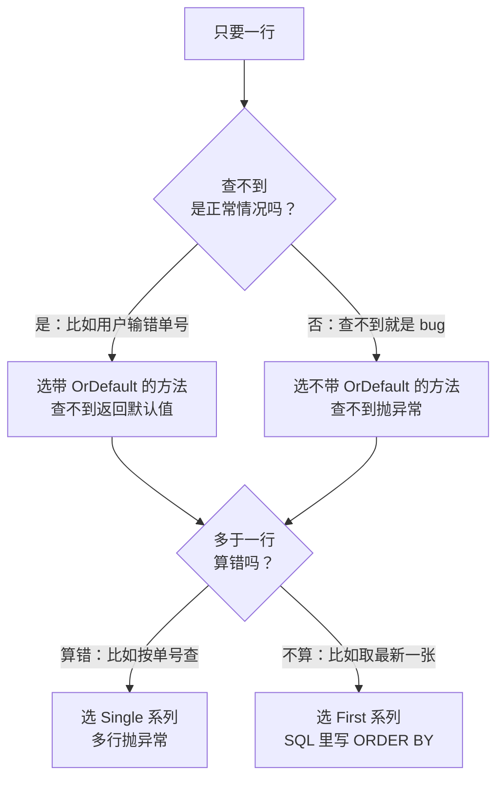
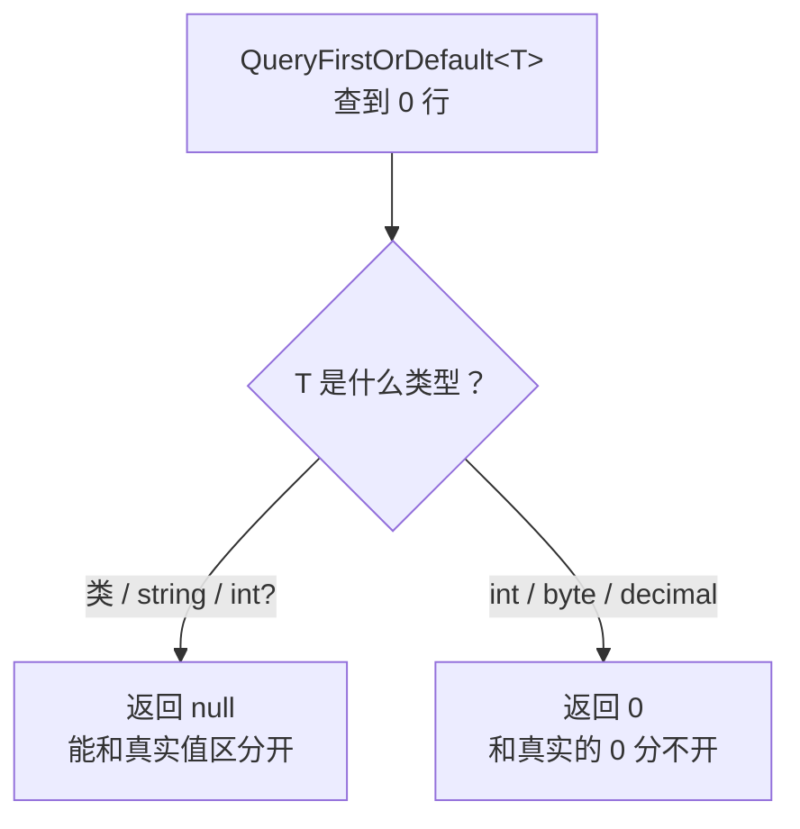
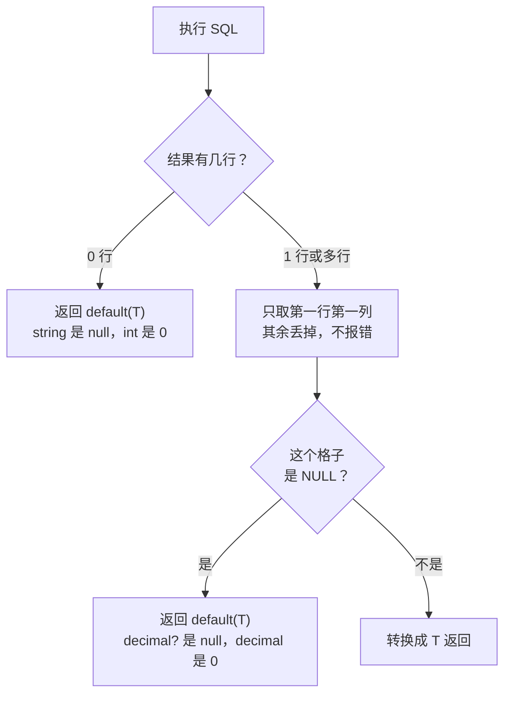

# 第 5 章 只要一行或一个值

## 这一章解决什么问题

前面几章查一张单据时，都是用 `Query<T>(…).First()` 凑合。真实业务里，"按单号查一张申请单""统计待审单数""算一张单的总金额"这类只要**一行**或**一个值**的查询非常多。

问题是：查不到时该返回 null 还是报错？查出两行算不算 bug？`int` 查不到时返回的 0，和"状态 0 = 草稿"怎么区分？`SUM` 没有数据时返回的 NULL 又会变成什么？

本章把 Dapper 的 4 个单行方法和 `ExecuteScalar<T>` 在 0 行、1 行、多行下的行为**全部实测一遍**，让你按业务含义选对方法。

## 开始之前

- 上一章你已经会了：用匿名对象 / 实体对象传参（`@名字` 对属性名）、`IN @Ids` 传列表、知道服务器收到的是 `sp_executesql`。本章所有 SQL 都用参数写法。
- 需要的环境：第 1 章的解决方案和 `PriceDemo` 库。数据被改乱了就重跑 [`code/sql/00-reset-database.sql`](../code/sql/00-reset-database.sql)。
- 预计耗时：70–85 分钟。

---

## 正文

### 5.1 准备：新建本章项目

1. **右键解决方案** →「**添加 → 新建项目**」→「控制台应用」，项目名称填 `Ch05Demo`，框架选 **.NET 10.0**。
2. **右键 `Ch05Demo` →「设为启动项目」**。
3. 「工具 → NuGet 包管理器 → 管理解决方案的 NuGet 程序包」→「已安装」页，把 `Dapper`、`Microsoft.Data.SqlClient`、`System.Security.Cryptography.Pkcs` 都勾上 `Ch05Demo` 安装。版本和第 2 章相同。

本章每个例子都把 `Program.cs` **整个替换掉**运行。完整项目在 [`code/ch05/`](../code/ch05/)。

本章用到的数据（来自建库脚本）：

| 申请人 | 申请单 | 状态 | 备注 |
|---|---|---|---|
| 张伟 | PR20261001 | 2 通过 | 年度框架采购 |
| 李娜 | PR20261008 | 1 待审 | NULL |
| 张伟 | PR20261015 | 0 草稿 | 追加探头 |
| 王五 | 没有任何单据 | | |

---

### 5.2 概念一：First 与 Single 的语义

**白话定义**：两者都返回**一个对象**，区别在于它们对行数的"期望"不同：

- `QueryFirst<T>`：**取第一行**。有多行时只要第一行，其余不管。
- `QuerySingle<T>`：**断言只有一行**。多于一行就抛异常，因为在它看来这说明数据或 SQL 有问题。

两者在 0 行时都抛异常。

**业务场景**：

- 按单号查申请单：单号是唯一的，查出两行一定是数据出了问题。用 `QuerySingle`，有问题时马上报错，比悄悄拿到"其中一张"安全。
- 查张伟"最近一张"申请单：本来就可能有多张，只要最新的那张。用 `QueryFirst`，SQL 里加 `ORDER BY CreatedAt DESC`。

**反例（什么时候不该用）**：
- 不要用 `QueryFirst` **代替 `WHERE` 条件**。比如查出整张表，再取第一行当"默认客户"。这样服务器照样要准备所有行。只要一行时，SQL 里写 `TOP 1` 加上 `ORDER BY`。
- `QueryFirst` 不写 `ORDER BY` 时，"第一行"是谁**没有保证**，今天和明天可能不一样。
- 不要用 `QuerySingle` 查"本来就可能多行"的数据。它会在正常数据上报错。

#### 🖼 图解：按行数和业务含义选方法



`OrDefault` 是 5.3 节的内容。这一节先看 First 和 Single 的区别。

#### 💻 最小可运行代码：4 个方法 × 3 种行数

`Show` 是一个小工具函数：调用传进来的方法，成功就打印单号，抛异常就打印异常类型和消息。这样一次运行就能看全 12 种组合。把 `Program.cs` 整个替换成：

```csharp
// code/ch05/Step1-FirstSingle/Program.cs
// 0 行 / 1 行 / 多行 × 4 个方法：逐一实测返回什么、抛什么异常
using Dapper;
using Microsoft.Data.SqlClient;

const string connStr =
    "Server=.;Database=PriceDemo;Integrated Security=True;TrustServerCertificate=True;";

using var conn = new SqlConnection(connStr);

const string sql = "SELECT Id, RequestNo, Applicant FROM dbo.PriceRequest WHERE Applicant = @Name ORDER BY Id";

// 三种情况：王五 0 张单，李娜 1 张，张伟 2 张
foreach (var name in new[] { "王五", "李娜", "张伟" })
{
    Console.WriteLine($"== 申请人 {name}");
    Show("QueryFirst          ", () => conn.QueryFirst<RequestBrief>(sql, new { Name = name }));
    Show("QueryFirstOrDefault ", () => conn.QueryFirstOrDefault<RequestBrief>(sql, new { Name = name }));
    Show("QuerySingle         ", () => conn.QuerySingle<RequestBrief>(sql, new { Name = name }));
    Show("QuerySingleOrDefault", () => conn.QuerySingleOrDefault<RequestBrief>(sql, new { Name = name }));
}

// 调用一个方法：成功就打印单号（null 打印 "null"），失败就打印异常类型和消息
static void Show(string method, Func<RequestBrief?> call)
{
    try
    {
        var r = call();
        Console.WriteLine($"{method} → {(r is null ? "null" : r.RequestNo)}");
    }
    catch (Exception ex)
    {
        Console.WriteLine($"{method} → {ex.GetType().Name}: {ex.Message}");
    }
}

public class RequestBrief
{
    public int Id { get; set; }
    public string RequestNo { get; set; } = "";
    public string Applicant { get; set; } = "";
}
```

#### 🔍 拆解运行结果

实测输出：

```text
== 申请人 王五
QueryFirst           → InvalidOperationException: Sequence contains no elements
QueryFirstOrDefault  → null
QuerySingle          → InvalidOperationException: Sequence contains no elements
QuerySingleOrDefault → null
== 申请人 李娜
QueryFirst           → PR20261008
QueryFirstOrDefault  → PR20261008
QuerySingle          → PR20261008
QuerySingleOrDefault → PR20261008
== 申请人 张伟
QueryFirst           → PR20261001
QueryFirstOrDefault  → PR20261001
QuerySingle          → InvalidOperationException: Sequence contains more than one element
QuerySingleOrDefault → InvalidOperationException: Sequence contains more than one element
```

> 📷 **截图占位 ch05-01**：控制台显示 12 行结果，王五和张伟两段里各有两行异常。
<!--  -->

整理成表（全部实测）：

| 方法 | 0 行（王五） | 1 行（李娜） | 多行（张伟） |
|---|---|---|---|
| `QueryFirst` | ❌ `Sequence contains no elements` | 那一行 | 第一行 |
| `QueryFirstOrDefault` | `null` | 那一行 | 第一行 |
| `QuerySingle` | ❌ `Sequence contains no elements` | 那一行 | ❌ `Sequence contains more than one element` |
| `QuerySingleOrDefault` | `null` | 那一行 | ❌ `Sequence contains more than one element` |

三个要点：

1. **1 行时，4 个方法结果完全一样。** 区别只在 0 行和多行。
2. **`QuerySingleOrDefault` 多行时照样抛异常。** `OrDefault` 只管"0 行返回默认值"，不管"多行"。很多人以为它"永远不报错"，这是误解。
3. 张伟有两张单，`QueryFirst` 拿到的是 PR20261001，因为 SQL 里写了 `ORDER BY Id`。去掉 `ORDER BY`，拿到哪一张就没有保证了。

异常消息里的 *Sequence*（序列）指"查询结果的行"：`contains no elements` 是"一行都没有"，`contains more than one element` 是"不止一行"。这两句是 .NET 运行时的消息，**中文系统上也是英文**（沙箱切成中文环境实测，消息不变）。

#### 改坏一处试试

把 `Show` 里的 `try { … } catch { … }` 去掉，只留中间两行，让异常直接抛出来。实测：

```text
== 申请人 王五
Unhandled exception. System.InvalidOperationException: Sequence contains no elements
   at System.Linq.ThrowHelper.ThrowNoElementsException()
   at System.Linq.Enumerable.First[TSource](IEnumerable`1 source)
   at Dapper.SqlMapper.ThrowZeroRows(Row row) in /_/Dapper/SqlMapper.cs:line 1291
   at Dapper.SqlMapper.QueryRowImpl[T](IDbConnection cnn, Row row, CommandDefinition& command, Type effectiveType) in /_/Dapper/SqlMapper.cs:line 1330
   at Dapper.SqlMapper.QueryFirst[T](IDbConnection cnn, String sql, Object param, IDbTransaction transaction, Nullable`1 commandTimeout, Nullable`1 commandType) in /_/Dapper/SqlMapper.cs:line 871
   at Program.<>c__DisplayClass0_1.<<Main>$>b__1() in /projects/sandbox/.tools/run/b5-notry/Program.cs:line 17
   at Program.<<Main>$>g__Show|0_0(String method, Func`1 call) in /projects/sandbox/.tools/run/b5-notry/Program.cs:line 26
   at Program.<Main>$(String[] args) in /projects/sandbox/.tools/run/b5-notry/Program.cs:line 17
```

**怎么读这段堆栈**：

| 行 | 说明 |
|---|---|
| `Dapper.SqlMapper.ThrowZeroRows` | 名字直接说明了原因：**0 行**（Zero Rows）。多行时这里是 `ThrowMultipleRows` |
| `Dapper.SqlMapper.QueryFirst[T]` | 是哪个方法抛的 |
| `Program.cs:line 17` | **第一行你自己的代码**，去这一行看是哪条查询 |
| 最上面两行 `System.Linq…First` | Dapper 借用了 LINQ 的 `First()` 来生成这条标准异常消息，不用管 |

在真实项目里，这条异常的意思是"你以为一定有的数据，其实没有"。比如按单号查单据时，单号是从上一个页面传过来的，却被别人删了。**要不要抛异常，取决于业务上"查不到"算不算正常**，这就是下一节的内容。

---

### 5.3 概念二：OrDefault 与默认值

**白话定义**：`QueryFirstOrDefault<T>` / `QuerySingleOrDefault<T>` 在 **0 行**时不抛异常，返回 `default(T)`，也就是 `T` 类型的默认值：

| T | default(T) |
|---|---|
| 类（`RequestBrief`、`string`） | `null` |
| `int`、`byte`、`decimal` | `0` |
| `bool` | `false` |
| `int?`、`decimal?` 等可空类型 | `null` |

**业务场景**：用户在查询框里输入单号，输错是正常的。查不到时应该提示"单号不存在"，而不是让程序抛异常。

**反例（什么时候不该用）**：
- **T 是 `int`、`decimal` 这类值类型，而 0 又是合法值的时候。** 查不到返回 0，查到的值也是 0，你根本分不出来（例 2 实测）。要改用 `int?`。
- 查不到明明是 bug 的时候（比如刚插入的单据马上去查），用 `OrDefault` 会把 bug 藏起来，往后传一个 null，到很远的地方才报 `NullReferenceException`。这时应该用不带 `OrDefault` 的版本，在出问题的地方就报错。

#### 🖼 图解：default(T) 是什么，取决于 T



#### 💻 最小可运行代码：四个例子

把 `Program.cs` 整个替换成：

```csharp
// code/ch05/Step2-OrDefault/Program.cs
// OrDefault 查不到时返回 default(T)：类是 null，int 是 0——而 0 可能正好是一个合法值
using Dapper;
using Microsoft.Data.SqlClient;

const string connStr =
    "Server=.;Database=PriceDemo;Integrated Security=True;TrustServerCertificate=True;";

using var conn = new SqlConnection(connStr);

// 例 1：T 是类——查不到返回 null，判断一下就能区分
Console.WriteLine("== 例 1 T 是类");
foreach (var no in new[] { "PR20261008", "PR404" })
{
    var r = conn.QueryFirstOrDefault<RequestBrief>(
        "SELECT RequestNo, Applicant, Status FROM dbo.PriceRequest WHERE RequestNo = @No", new { No = no });
    Console.WriteLine(r is null ? $"{no}：不存在" : $"{no}：申请人 {r.Applicant}，状态 {r.Status}");
}

// 例 2：陷阱——T 是 int，查不到返回 0；而状态 0 正好表示"草稿"
Console.WriteLine("== 例 2 T 是 int");
foreach (var no in new[] { "PR20261015", "PR404" })
{
    int status = conn.QueryFirstOrDefault<int>(
        "SELECT Status FROM dbo.PriceRequest WHERE RequestNo = @No", new { No = no });
    Console.WriteLine($"{no}：Status = {status}");   // 两行都是 0，分不出"草稿"和"不存在"
}

// 例 3：改成 int?——查不到返回 null，查到 0 就是真的 0
Console.WriteLine("== 例 3 T 是 int?");
foreach (var no in new[] { "PR20261015", "PR404" })
{
    int? status = conn.QueryFirstOrDefault<int?>(
        "SELECT Status FROM dbo.PriceRequest WHERE RequestNo = @No", new { No = no });
    Console.WriteLine(status is null ? $"{no}：不存在" : $"{no}：Status = {status}");
}

// 例 4：string 也有类似问题——"查不到"和"列值是 NULL"都返回 null
Console.WriteLine("== 例 4 T 是 string?");
foreach (var no in new[] { "PR20261001", "PR20261008", "PR404" })
{
    string? remark = conn.QueryFirstOrDefault<string?>(
        "SELECT Remark FROM dbo.PriceRequest WHERE RequestNo = @No", new { No = no });
    Console.WriteLine($"{no}：Remark = {remark ?? "null"}");   // PR20261008 的备注本来就是 NULL
}

public class RequestBrief
{
    public string RequestNo { get; set; } = "";
    public string Applicant { get; set; } = "";
    public int Status { get; set; }
}
```

#### 🔍 拆解运行结果

实测输出：

```text
== 例 1 T 是类
PR20261008：申请人 李娜，状态 1
PR404：不存在
== 例 2 T 是 int
PR20261015：Status = 0
PR404：Status = 0
== 例 3 T 是 int?
PR20261015：Status = 0
PR404：不存在
== 例 4 T 是 string?
PR20261001：Remark = 年度框架采购
PR20261008：Remark = null
PR404：Remark = null
```

| 例 | 看到了什么 | 说明 |
|---|---|---|
| 1 | 查不到返回 `null` | T 是类，`r is null` 就能判断"不存在"。这是最常见、最安全的用法 |
| 2 | **两行都是 `Status = 0`** | PR20261015 是真的草稿（状态 0）；PR404 根本不存在，返回的是 `default(int)` 也就是 0。界面上会把一张不存在的单据显示成"草稿" |
| 3 | 一个是 0，一个是"不存在" | 换成 `int?`，查不到返回 `null`，查到 0 就是真的 0 |
| 4 | PR20261008 和 PR404 都是 `null` | PR20261008 的备注列本来就是 NULL；PR404 是查不到。只查一列 `string` 时，这两种情况**也分不出来** |

例 4 怎么区分？像例 1 那样，把整行查成一个对象：查不到时对象是 `null`，查到了但备注为空时是 `对象.Remark == null`。NULL 列怎么映射到属性，第 7 章细讲。

**规则**：用 `OrDefault` 取单个值时，**T 一律写可空类型**（`int?`、`decimal?`、`DateTime?`），除非你确定 0 不可能是合法值。

#### 改坏一处试试

把例 1 里的判断去掉，直接用结果：

```csharp
Console.WriteLine($"{no}：申请人 {r.Applicant}，状态 {r.Status}");
```

先看生成。「生成 → 生成解决方案」（Ctrl+Shift+B）后，「错误列表」里出现一条**警告**（实测）：

```text
Program.cs(17,35): warning CS8602: Dereference of a possibly null reference.
```

中文版 VS 显示为"**CS8602 解引用可能出现空引用。**"这是第 1 章打开的 `<Nullable>enable</Nullable>` 在起作用：`QueryFirstOrDefault<RequestBrief>` 的返回类型是 `RequestBrief?`，编译器知道它可能是 null。

警告不挡运行。运行一下，实测：

```text
== 例 1 T 是类
PR20261008：申请人 李娜，状态 1
Unhandled exception. System.NullReferenceException: Object reference not set to an instance of an object.
   at Program.<Main>$(String[] args) in /projects/sandbox/.tools/run/b5-nonull/Program.cs:line 17
```

第一个单号正常，第二个 PR404 查不到，`r` 是 null，访问 `r.Applicant` 就炸了。**CS8602 警告不要忽略**，它提前告诉了你这里会出 `NullReferenceException`。

> 📷 **截图占位 ch05-02**：VS「错误列表」窗口里的 CS8602 警告，双击后跳到 `r.Applicant` 那一行，`r` 下面有绿色波浪线。
<!--  -->

---

### 5.4 概念三：`ExecuteScalar<T>`

**白话定义**：执行 SQL，只取**第一行第一列**的那一个值，转成 `T` 返回。和 ADO.NET 的 `cmd.ExecuteScalar()` 是同一个意思，只是不用你自己强转类型。

**业务场景**：首页上的"待审申请单 N 张"、一张单的合计金额、最大单号、某个客户有没有单据（`COUNT(*)`）。

**反例（什么时候不该用）**：
- 要一整行的时候。不要为了拿 3 个字段跑 3 次 `ExecuteScalar`，应该用 5.2 节的 `QuerySingle<T>` 一次拿一个对象。
- 结果可能多行、而多行算错的时候。`ExecuteScalar` 多行**不报错**，只取第一行（例 5 实测），问题会被藏起来。这种情况用 `QuerySingle<int>` 这类写法，多行就会报错。

#### 🖼 图解：结果集里只取一个格子



注意 C 和 F：**"一行都没有"和"有一行但值是 NULL"，到 C# 里是同一个结果。**

#### 💻 最小可运行代码：六个例子

把 `Program.cs` 整个替换成：

```csharp
// code/ch05/Step3-Scalar/Program.cs
// ExecuteScalar<T>：只要第一行第一列的一个值——统计、求和、取最大单号
using Dapper;
using Microsoft.Data.SqlClient;

const string connStr =
    "Server=.;Database=PriceDemo;Integrated Security=True;TrustServerCertificate=True;";

using var conn = new SqlConnection(connStr);

// 例 1：COUNT —— 一定有一行一列，用 int 接
int pending = conn.ExecuteScalar<int>(
    "SELECT COUNT(*) FROM dbo.PriceRequest WHERE Status = @Status", new { Status = 1 });
Console.WriteLine($"例 1 待审申请单：{pending} 张");

// 例 2：SUM —— 第 1 号单有明细
const string sumSql = "SELECT SUM(Qty * RequestPrice) FROM dbo.PriceRequestItem WHERE RequestId = @Id";
decimal? total1 = conn.ExecuteScalar<decimal?>(sumSql, new { Id = 1 });
Console.WriteLine($"例 2 第 1 号单金额：{total1:N2}");

// 例 3：SUM 没有匹配行时，SQL 返回的是 NULL（不是 0）——用 decimal? 接，就能看出"没有明细"
decimal? total99 = conn.ExecuteScalar<decimal?>(sumSql, new { Id = 99 });
Console.WriteLine($"例 3 第 99 号单金额：{(total99 is null ? "null（没有明细）" : total99.Value.ToString("N2"))}");

// 例 4：同样的 NULL，用 decimal 接——不报错，悄悄变成 0
decimal total99b = conn.ExecuteScalar<decimal>(sumSql, new { Id = 99 });
Console.WriteLine($"例 4 用 decimal 接：{total99b:N2}");

// 例 5：多行多列——只取第一行第一列，其余丢掉，不报错
string? firstNo = conn.ExecuteScalar<string>(
    "SELECT RequestNo, Applicant FROM dbo.PriceRequest ORDER BY Id DESC");
Console.WriteLine($"例 5 最新单号：{firstNo}");

// 例 6：0 行——返回 default(T)：string 是 null
string? none = conn.ExecuteScalar<string>(
    "SELECT RequestNo FROM dbo.PriceRequest WHERE Applicant = @Name", new { Name = "王五" });
Console.WriteLine($"例 6 王五的单号：{none ?? "null"}");
```

#### 🔍 拆解运行结果

实测输出：

```text
例 1 待审申请单：1 张
例 2 第 1 号单金额：422,000.00
例 3 第 99 号单金额：null（没有明细）
例 4 用 decimal 接：0.00
例 5 最新单号：PR20261015
例 6 王五的单号：null
```

| 例 | 看到了什么 | 说明 |
|---|---|---|
| 1 | 1 张 | `COUNT(*)` 永远返回一行一列，不会是 NULL，用 `int` 接最合适 |
| 2 | 422,000.00 | 2 × 165,000 + 4 × 23,000 = 330,000 + 92,000 |
| 3 | `null` | 第 99 号单没有明细。`SUM` 对 0 行返回的是**一行 NULL**，不是 0。用 `decimal?` 接，就知道"没有明细" |
| 4 | **0.00，不报错** | 同样的 NULL 用 `decimal` 接，Dapper 返回 `default(decimal)` 也就是 0。"没有明细"和"金额为 0"分不出来 |
| 5 | PR20261015 | SQL 返回 3 行 2 列，只取了第一行第一列（按 `Id DESC` 排序，是最新的单号）。**没有任何提示** |
| 6 | `null` | 0 行，`string` 的默认值是 null |

例 4 和 ADO.NET 不一样：ADO.NET 的 `cmd.ExecuteScalar()` 遇到 NULL 返回 `DBNull.Value`，你写 `(decimal)cmd.ExecuteScalar()` 会抛 `InvalidCastException`。Dapper 把 NULL 和 `DBNull` 都转成了 `default(T)`，**不会报错，但会把问题藏起来**。

想让"没有明细"显示成 0，有两种做法，按业务选：

| 做法 | 写法 | 适合 |
|---|---|---|
| C# 里处理 | `ExecuteScalar<decimal?>(…) ?? 0m` | 需要区分"没有明细"和"金额 0"时，先拿 `decimal?`，再决定怎么显示 |
| SQL 里处理 | `SELECT ISNULL(SUM(Qty * RequestPrice), 0) …` | 业务上两者确实没有区别时，在 SQL 里说清楚，代码就能直接用 `decimal` |

**和 `QuerySingle<T>` 怎么选**：

| 情况 | `ExecuteScalar<T>` | `QuerySingle<T>` |
|---|---|---|
| 0 行 | 返回 `default(T)` | 抛 `Sequence contains no elements` |
| 多行 | 取第一行，不报错 | 抛 `Sequence contains more than one element` |
| 多列 | 取第一列 | T 是简单类型时取第一列 |
| 适合 | `COUNT`、`SUM`、`MAX` 这类一定只有一行的聚合 | "必须正好一行"的单值，比如按主键取某个字段 |

#### 改坏一处试试

把例 5 的 `string? firstNo = conn.ExecuteScalar<string>(` 改成 `int firstNo = conn.ExecuteScalar<int>(`，也就是用 `int` 去接单号。实测：

```text
例 1 待审申请单：1 张
例 2 第 1 号单金额：422,000.00
例 3 第 99 号单金额：null（没有明细）
例 4 用 decimal 接：0.00
Unhandled exception. System.FormatException: The input string 'PR20261015' was not in a correct format.
   at System.Number.ThrowFormatException[TChar](ReadOnlySpan`1 value)
   at System.String.System.IConvertible.ToInt32(IFormatProvider provider)
   at System.Convert.ChangeType(Object value, Type conversionType, IFormatProvider provider)
   at Dapper.SqlMapper.Parse[T](Object value) in /_/Dapper/SqlMapper.cs:line 3207
   at Dapper.SqlMapper.ExecuteScalarImpl[T](IDbConnection cnn, CommandDefinition& command) in /_/Dapper/SqlMapper.cs:line 3050
   at Dapper.SqlMapper.ExecuteScalar[T](IDbConnection cnn, String sql, Object param, IDbTransaction transaction, Nullable`1 commandTimeout, Nullable`1 commandType) in /_/Dapper/SqlMapper.cs:line 603
   at Program.<Main>$(String[] args) in /projects/sandbox/.tools/run/b5-str/Program.cs:line 30
```

| 片段 | 含义 |
|---|---|
| `The input string 'PR20261015' was not in a correct format.` | 想把字符串 `PR20261015` 转成数字，失败 |
| `Convert.ChangeType` | Dapper 的 `ExecuteScalar<T>` 用 `Convert.ChangeType` 把值转成 T |
| `Dapper.SqlMapper.ExecuteScalar[T]` | 是 `ExecuteScalar<T>` 抛的，不是 `Query` |

和第 2 章的 `Error parsing column 0 (City=上海 - String)` 对比：`Query` 的报错会带上列名，`ExecuteScalar` 的**不带列名**，只有值。所以 `ExecuteScalar` 报格式错误时，先看 SQL 的**第一列**是什么。

反过来，把例 2 改成 `int total1 = conn.ExecuteScalar<int>(sumSql, new { Id = 1 });`，用 `int` 接金额，实测**不报错**，照样输出 `422,000.00`。因为 `Convert.ChangeType` 能把 `decimal` 转成 `int`。但小数部分会被舍入：我单独实测了 `Convert.ChangeType(422000.50m, typeof(int))` 得 422000，`422001.50m` 得 422002（.NET 的"四舍六入五取偶"）。**金额永远用 `decimal` / `decimal?` 接。**

---

## 🧱 类比：ADO.NET 写法与 Dapper 写法逐项对照

| 要做的事 | ADO.NET | Dapper |
|---|---|---|
| 取一个统计值 | `(int)cmd.ExecuteScalar()` | `conn.ExecuteScalar<int>(sql, param)` |
| 取一个可能是 NULL 的值 | 先判断 `result is DBNull`，再强转 | `ExecuteScalar<decimal?>`，NULL 直接是 `null` |
| 用非可空类型接 NULL | `(decimal)DBNull.Value` 抛 `InvalidCastException` | 不报错，返回 0（例 4） |
| 取一行，查不到要报错 | `if (!reader.Read()) throw …` | `QuerySingle<T>` / `QueryFirst<T>` |
| 取一行，查不到返回 null | `reader.Read() ? 映射 : null` | `QuerySingleOrDefault<T>` / `QueryFirstOrDefault<T>` |
| 断言最多一行 | 读完第一行后再 `if (reader.Read()) throw …` | `QuerySingle` / `QuerySingleOrDefault` |
| 只要第一行 | 只 `Read()` 一次 | `QueryFirst` / `QueryFirstOrDefault`，SQL 里写 `TOP 1` + `ORDER BY` |

## ⚠️ 踩坑警告

| 现象 | 原因 | 怎么改 |
|---|---|---|
| 不存在的单号显示成"草稿"（实测：`QueryFirstOrDefault<int>` 查不到返回 0） | 值类型的 `default` 是 0，而 0 正好是合法状态 | T 改成 `int?` / `byte?`，用 `is null` 判断"不存在" |
| `InvalidOperationException: Sequence contains more than one element`，用的是 `QuerySingleOrDefault`（实测） | `OrDefault` 只管 0 行，多行照样抛异常 | 检查数据是否真的重复；本来就可能多行就改用 `QueryFirstOrDefault` + `ORDER BY` |
| `InvalidOperationException: Sequence contains no elements`（实测） | `QueryFirst` / `QuerySingle` 查到 0 行 | 查不到是正常情况就换成 `OrDefault` 版本并判断 null；不正常就去查数据为什么没了 |
| 合计金额显示 0.00，其实是没有明细（实测：`ExecuteScalar<decimal>` 遇 NULL 返回 0） | `SUM` 对 0 行返回 NULL，Dapper 转成 `default(decimal)` | 用 `decimal?` 接；或者 SQL 里写 `ISNULL(SUM(…), 0)`，明确表示两者等价 |
| 访问结果属性时报 `NullReferenceException`，编译时有 CS8602 警告（实测） | `OrDefault` 查不到返回 null，没判断就用 | 先判断 `is null`；不要忽略 CS8602 |
| 同一条 `QueryFirst` 今天和昨天拿到的不是同一行 | SQL 没写 `ORDER BY`，"第一行"没有保证 | 用 `QueryFirst` 时一定写 `ORDER BY` |

## 🎯 动手练习

**练习 1：按单号显示状态文字**

写一段程序，依次查询 `PR20261001`、`PR20261015`、`PR404` 三个单号的状态，按 0 草稿 / 1 待审 / 2 通过 / 3 驳回 显示文字，查不到就显示"单号不存在"。要求：

- 单号是唯一的，选一个"查出两行会报错"的方法；
- 只查 `Status` 这一列，不要查整行；
- `PR20261015`（真的草稿）和 `PR404`（不存在）必须能区分开。

- 验收标准：输出完全一致：

```text
PR20261001：通过
PR20261015：草稿
PR404：单号不存在
```

**练习 2：统计张数与金额**

1. 统计张伟的申请单有几张；
2. 按单号算 `PR20261008`、`PR404` 两张单的金额（`SUM(Qty * RequestPrice)`，需要关联 `PriceRequest` 按单号查），没有明细时显示"无明细"。

- 验收标准：输出完全一致：

```text
张伟的申请单：2 张
PR20261008 金额：395,000.00
PR404 金额：无明细
```

卡住了看文末参考答案。

## 📌 一句话总结

0 行看 OrDefault，多行看 First/Single；取单值一律用可空类型，别让 0 冒充数据。

## 下一章

查询讲完了，接下来是写数据：新建申请单、改状态、删除，怎么知道改到了几行、怎么拿回新单据的自增 Id？第 6 章讲增删改。

---

<!-- 以下是参考答案，先自己动手，卡住了再往下翻 -->


## 参考答案

**练习 1 思路**：单号唯一，查出两行说明数据有问题，所以用 `QuerySingleOrDefault`（查不到是正常情况，所以要 `OrDefault`）。`Status` 列是 `TINYINT`，T 写 `byte?`：查不到是 `null`，草稿是 `0`，正好用 `switch` 分开处理。如果写成 `byte`，`PR404` 会显示成"草稿"。

**练习 2 思路**：`COUNT(*)` 一定有一行，用 `ExecuteScalar<int>`。`SUM` 在没有匹配行时返回 NULL，用 `ExecuteScalar<decimal?>`，`null` 就显示"无明细"。PR20261008 只有一条明细：1 × 395,000。

两题合在一个文件里，完整项目在 [`code/ch05/Exercise/`](../code/ch05/Exercise/)。实测输出：

```text
PR20261001：通过
PR20261015：草稿
PR404：单号不存在
张伟的申请单：2 张
PR20261008 金额：395,000.00
PR404 金额：无明细
```

```csharp
// code/ch05/Exercise/Program.cs
// 第 5 章练习参考答案：练习 1（按单号显示状态文字）+ 练习 2（统计张数与金额）
using Dapper;
using Microsoft.Data.SqlClient;

const string connStr =
    "Server=.;Database=PriceDemo;Integrated Security=True;TrustServerCertificate=True;";

using var conn = new SqlConnection(connStr);

// 练习 1：单号唯一，用 QuerySingleOrDefault；状态 0 是合法值，所以用 byte? 区分"不存在"
foreach (var no in new[] { "PR20261001", "PR20261015", "PR404" })
{
    byte? status = conn.QuerySingleOrDefault<byte?>(
        "SELECT Status FROM dbo.PriceRequest WHERE RequestNo = @No", new { No = no });
    string text = status switch
    {
        null => "单号不存在",
        0 => "草稿",
        1 => "待审",
        2 => "通过",
        3 => "驳回",
        _ => "未知状态",
    };
    Console.WriteLine($"{no}：{text}");
}

// 练习 2：COUNT 用 int；SUM 可能是 NULL，用 decimal?
int count = conn.ExecuteScalar<int>(
    "SELECT COUNT(*) FROM dbo.PriceRequest WHERE Applicant = @Name", new { Name = "张伟" });
Console.WriteLine($"张伟的申请单：{count} 张");

foreach (var no in new[] { "PR20261008", "PR404" })
{
    decimal? amount = conn.ExecuteScalar<decimal?>(@"
        SELECT SUM(i.Qty * i.RequestPrice)
        FROM dbo.PriceRequestItem AS i
        JOIN dbo.PriceRequest AS r ON r.Id = i.RequestId
        WHERE r.RequestNo = @No", new { No = no });
    Console.WriteLine($"{no} 金额：{(amount is null ? "无明细" : amount.Value.ToString("N2"))}");
}
```
