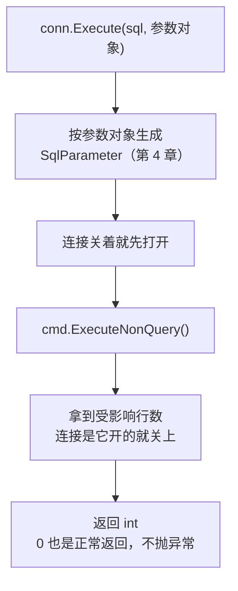
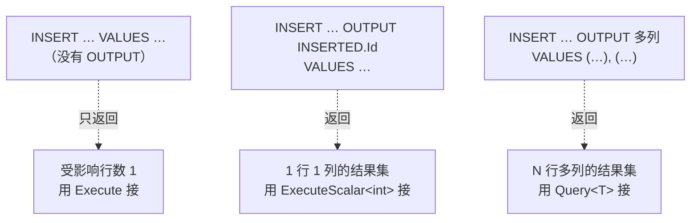
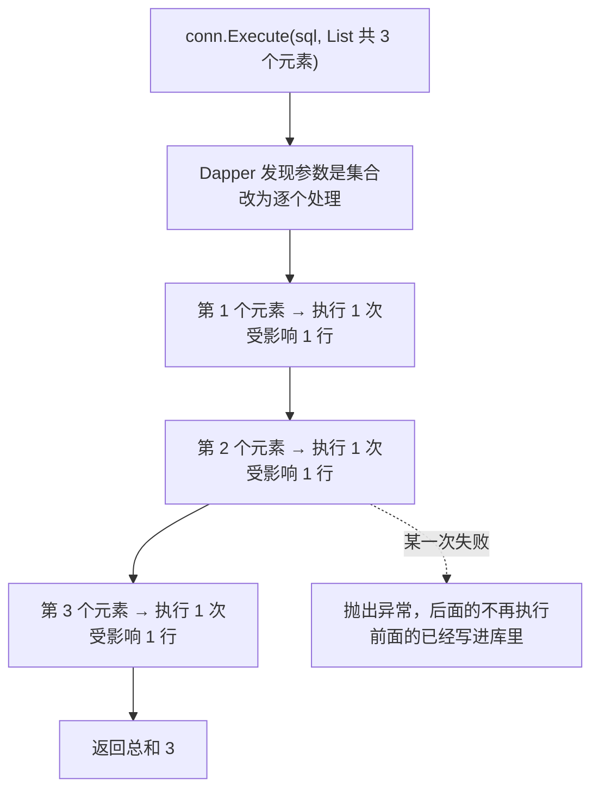

# 第 6 章 增、删、改

## 这一章解决什么问题

前 5 章都在"读"。可价格申请系统每天更多的是"写"：业务员新建一张申请单，点"提交"把草稿改成待审，作废的草稿要删掉。

ADO.NET 里这些都靠 `ExecuteNonQuery()`，再加上一行行 `Parameters.Add`。本章换成 Dapper 的写法，并讲清三件写数据时最常问的事：

1. `Execute` 返回的那个数字是什么？返回 0 说明什么？
2. 插入一行后，怎么拿到数据库刚生成的自增 Id，好接着插明细？
3. 一次要写好几行时，传一个 List 进去，Dapper 背后到底做了什么？

## 开始之前

- 上一章你已经会了：`QueryFirst` / `QuerySingle` / `OrDefault` 的区别，以及用 `ExecuteScalar<T>` 取单个值（第 5 章）。传参数用匿名对象 `new { Id = 1 }`（第 4 章）。
- 需要的环境：第 1 章的解决方案和 `PriceDemo` 库。本章的例子会**改数据**，每跑完一个例子，建议重跑一遍 [`code/sql/00-reset-database.sql`](../code/sql/00-reset-database.sql)，这样你看到的 Id 和行数才会和教程一致。
- 预计耗时：80–90 分钟。

---

## 正文

### 6.1 准备：新建本章项目

和第 2 章一样，本章所有例子放在**同一个新项目**里，每个例子把 `Program.cs` **整个替换**掉。

1. 在「解决方案资源管理器」里**右键解决方案** →「**添加 → 新建项目**」。
2. 选「控制台应用」，项目名称填 `Ch06Demo`，框架选 **.NET 10.0**，点「创建」。
3. **右键 `Ch06Demo` 项目 →「设为启动项目」**。
4. 「工具 → NuGet 包管理器 → 管理解决方案的 NuGet 程序包」→「浏览」，给 `Ch06Demo` 装上三个包：`Dapper` 2.1.89、`Microsoft.Data.SqlClient` 7.1.1、`System.Security.Cryptography.Pkcs` 10.0.13（和第 2 章完全一样）。

> 📷 **截图占位 ch06-01**：解决方案资源管理器里 `Ch06Demo` 显示为粗体（已设为启动项目），下面能看到 Dapper 等 3 个包。
<!--  -->

本章要用的数据（来自建库脚本）：

| 表 | 本章关心的内容 |
|---|---|
| `PriceRequest` | 3 张单：1 号 PR20261001（通过）、2 号 PR20261008（待审）、3 号 PR20261015（草稿）。`Status` 默认 0，`CreatedAt` 默认当前时间 |
| `PriceRequestItem` | 1 号单 2 条明细，2 号单 1 条，3 号单 2 条。`RequestId` 有外键指向 `PriceRequest` |
| `ApprovalLog` | 1 号单 2 条、2 号单 1 条审批记录。同样有外键指向 `PriceRequest` |

---

### 6.2 概念一：`Execute` 与受影响行数

**白话定义**：`conn.Execute(sql, 参数)` 执行一条**不需要返回结果集**的 SQL（INSERT / UPDATE / DELETE），返回一个 `int`：这条 SQL **影响了几行**。它就是 Dapper 版的 `ExecuteNonQuery()`。

**业务场景**：业务员点"提交"。SQL 写成 `UPDATE … SET Status = 1 WHERE RequestNo = @RequestNo AND Status = 0`。返回 1，说明提交成功；返回 0，说明单号不对，或者这张单已经不是草稿了（比如别人刚提交过）。**不用先查一遍再改**，一条 UPDATE 加上受影响行数就够了。

**反例（什么时候不该用）**：
- **要拿回数据的时候**，比如插入后要新 Id。`Execute` 只给你行数，拿不到 Id，要用 6.3 节的写法。
- **调用存储过程、而过程里写了 `SET NOCOUNT ON` 的时候**，返回值是 -1，没有参考意义（本节"改坏一处"会实测）。判断存储过程成功与否，要用第 8 章讲的 OUTPUT 参数和返回值。

#### 🖼 图解：`Execute` 做了什么



和第 2 章 `Query<T>` 的图比，只少了"把每一行变成对象"那一步。其余的打开连接、生成参数、用完关闭，完全一样。

#### 💻 最小可运行代码：五个例子

把 `Ch06Demo` 的 `Program.cs` 整个替换成：

```csharp
// code/ch06/Step1-Execute/Program.cs
// Execute 的四个例子：新建申请单、提交（看受影响行数）、一次改多行、删除撞外键
using Dapper;
using Microsoft.Data.SqlClient;

const string connStr =
    "Server=.;Database=PriceDemo;Integrated Security=True;TrustServerCertificate=True;";

using var conn = new SqlConnection(connStr);

// 例 1：INSERT —— 新建一张草稿申请单。参数用匿名对象（第 4 章讲过）
// Status、CreatedAt 不写，用表上的默认值：0 草稿、当前时间
int inserted = conn.Execute(@"
    INSERT dbo.PriceRequest (RequestNo, CustomerId, Applicant, Remark)
    VALUES (@RequestNo, @CustomerId, @Applicant, @Remark)",
    new { RequestNo = "PR20261020", CustomerId = 3, Applicant = "王芳", Remark = "首次询价" });
Console.WriteLine($"例 1 新建：受影响 {inserted} 行");

// 例 2：UPDATE —— 提交审批。WHERE 里带上 Status = 0：只有草稿才能提交
const string submitSql =
    "UPDATE dbo.PriceRequest SET Status = 1 WHERE RequestNo = @RequestNo AND Status = 0";

int first  = conn.Execute(submitSql, new { RequestNo = "PR20261020" });   // 草稿 → 待审
int second = conn.Execute(submitSql, new { RequestNo = "PR20261020" });   // 已经是待审了
int wrong  = conn.Execute(submitSql, new { RequestNo = "PR99999999" });   // 单号不存在
Console.WriteLine($"例 2 提交：第 1 次 {first} 行，第 2 次 {second} 行，单号不存在 {wrong} 行");

// 受影响行数就是"条件有没有命中"的证据：0 行不会抛异常，要自己判断
if (second == 0)
    Console.WriteLine("       第 2 次没命中：单号不存在，或者已经不是草稿");

// 例 3：一条 UPDATE 改多行 —— 返回的是这条语句一共改了几行
int many = conn.Execute(
    "UPDATE dbo.PriceRequest SET Remark = ISNULL(Remark, N'') + N'（已复核）' WHERE Applicant = @Applicant",
    new { Applicant = "张伟" });
Console.WriteLine($"例 3 张伟的单子加备注：受影响 {many} 行");

// 例 4：DELETE —— 1 号单下面有明细和审批记录，外键不让删
try
{
    conn.Execute("DELETE dbo.PriceRequest WHERE Id = @Id", new { Id = 1 });
}
catch (SqlException ex)                        // 数据库报的错，Dapper 原样往外抛
{
    Console.WriteLine($"例 4 删除 1 号单失败：Number = {ex.Number}");
    Console.WriteLine(ex.Message);
}

// 例 5：DELETE —— 例 1 新建的单子没有明细，可以删
int deleted = conn.Execute("DELETE dbo.PriceRequest WHERE RequestNo = @RequestNo",
    new { RequestNo = "PR20261020" });
Console.WriteLine($"例 5 删除新单：受影响 {deleted} 行");
```

#### 🔍 拆解运行结果

实测输出：

```text
例 1 新建：受影响 1 行
例 2 提交：第 1 次 1 行，第 2 次 0 行，单号不存在 0 行
       第 2 次没命中：单号不存在，或者已经不是草稿
例 3 张伟的单子加备注：受影响 2 行
例 4 删除 1 号单失败：Number = 547
The DELETE statement conflicted with the REFERENCE constraint "FK__PriceRequ__Reque__178D7CA5". The conflict occurred in database "PriceDemo", table "dbo.PriceRequestItem", column 'RequestId'.
The statement has been terminated.
例 5 删除新单：受影响 1 行
```

> 📷 **截图占位 ch06-02**：控制台显示上面的输出。
<!--  -->

逐个例子看：

| 例 | 看到了什么 | 说明 |
|---|---|---|
| 1 | 受影响 1 行 | INSERT 插了 1 行。`Status`、`CreatedAt` 没写，用的是表上的默认值 |
| 2 | 1 行、0 行、0 行 | 第 1 次：草稿改成待审。第 2 次：`Status = 0` 这个条件不成立了，一行也没改。单号不存在：同样 0 行。**三次都没有异常** |
| 2 的第二行 | "第 2 次没命中" | 这一行是代码里 `if (second == 0)` 打印的。0 行要你自己判断，Dapper 不会替你报错 |
| 3 | 2 行 | 张伟有 1 号、3 号两张单。一条 UPDATE 改了几行，就返回几 |
| 4 | `SqlException`，`Number = 547` | 1 号单下面有明细和审批记录，外键挡住了删除。Dapper 不包装数据库的报错，原样抛出 `SqlException` |
| 5 | 受影响 1 行 | 例 1 那张新单没有任何子表数据，可以删 |

**例 4 的报错怎么读**：

| 片段 | 含义 |
|---|---|
| `Number = 547` | SQL Server 的错误号。547 = 违反约束（外键、CHECK 都是它）。用 `catch (SqlException ex) when (ex.Number == 547)` 就能只抓这一类错误，第 20 章细讲 |
| `REFERENCE constraint "FK__PriceRequ__Reque__178D7CA5"` | 挡住你的是哪条外键。建表时没给外键起名，名字是 SQL Server 自动生成的，后半段是随机的（重跑建库脚本后实测变成了 `FK__PriceRequ__Reque__60083D91`）。所以**不要在代码里按约束名判断** |
| `table "dbo.PriceRequestItem", column 'RequestId'` | 是哪张子表、哪一列还引用着这张单。先删这里的明细（还有 `ApprovalLog`），才能删主表 |
| `The statement has been terminated.` | 这条 DELETE 整条作废，一行都没删 |

中文版 SQL Server 上，这条消息大致是：`DELETE 语句与 REFERENCE 约束"FK__PriceRequ__Reque__178D7CA5"冲突。该冲突发生于数据库"PriceDemo"，表"dbo.PriceRequestItem", column 'RequestId'。` 下一行是 `语句已终止。`（⚠️ 中文措辞本段未实机验证，以你的服务器为准。）

**为什么 0 行不抛异常**：从数据库的角度看，`UPDATE … WHERE` 一行都没命中，是完全合法的执行结果，不是错误。Dapper 只是把 `ExecuteNonQuery()` 的返回值原样交给你。这和你在 ADO.NET 里的经验一致。

#### 改坏一处试试

把例 2 的 `submitSql` 前面加上 `SET NOCOUNT ON; `，变成：

```csharp
const string submitSql =
    "SET NOCOUNT ON; UPDATE dbo.PriceRequest SET Status = 1 WHERE RequestNo = @RequestNo AND Status = 0";
```

实测输出（只看例 2 那几行）：

```text
例 1 新建：受影响 1 行
例 2 提交：第 1 次 -1 行，第 2 次 -1 行，单号不存在 -1 行
例 3 张伟的单子加备注：受影响 2 行
```

三次都是 **-1**，而且"第 2 次没命中"那一行**没有打印**。

| 现象 | 为什么 |
|---|---|
| 返回 -1 | `SET NOCOUNT ON` 让服务器不再回传"(1 row affected)"这类行数消息。`ExecuteNonQuery()` 拿不到行数，就返回 -1。Dapper 只是转交 |
| "没命中"那一行没打印 | 代码判断的是 `second == 0`，而 -1 不等于 0。**提交失败被当成了成功**，这就是这个坑的危害 |

所以：要靠受影响行数做判断的 SQL，**不要加 `SET NOCOUNT ON`**。存储过程里通常会写这一句，所以调存储过程时不要用 `Execute` 的返回值判断成败，第 8 章会实测这一点。

---

### 6.3 概念二：插入后取自增 ID（`OUTPUT INSERTED`）

**白话定义**：在 INSERT 语句里加一句 `OUTPUT INSERTED.Id`，INSERT 执行完会**像 SELECT 一样返回一个结果集**，里面是刚插入那一行的 Id。既然是结果集，就用读的方法去接：一个值用 `ExecuteScalar<int>` 或 `QuerySingle<int>`（第 5 章讲过）。

**业务场景**：新建申请单时，先插主表 `PriceRequest`，拿到新单的 Id，再用这个 Id 作为 `RequestId` 插入明细。拿不到 Id，明细就没法挂到这张单上。

**反例（什么时候不该用）**：
- **表上有触发器的时候**，不能直接写 `OUTPUT INSERTED.Id`，SQL Server 会报错 334（踩坑警告里有实测原文）。这时要改成 `OUTPUT … INTO @表变量`，或者用 `SCOPE_IDENTITY()`。
- **主键不是自增列**，比如单号就是主键、由程序生成。这时 Id 本来就在你手里，用 6.2 节的 `Execute` 就够了，不需要再从数据库取回来。

#### 🖼 图解：`OUTPUT` 把 INSERT 变成了"会返回结果"的语句



`INSERTED` 是 SQL Server 提供的"刚插进去的那些行"，写触发器时你可能用过它。`OUTPUT INSERTED.列名` 就是把这些行直接返回给调用方。

#### 💻 最小可运行代码：五种写法

把 `Program.cs` 整个替换成：

```csharp
// code/ch06/Step2-Identity/Program.cs
// 插入后拿到数据库生成的自增 Id：OUTPUT INSERTED、SCOPE_IDENTITY、一次拿多列、一次拿多行
using Dapper;
using Microsoft.Data.SqlClient;

const string connStr =
    "Server=.;Database=PriceDemo;Integrated Security=True;TrustServerCertificate=True;";

using var conn = new SqlConnection(connStr);

// 写法 A：OUTPUT INSERTED.Id —— INSERT 语句自己"吐出"一个单值结果集，用 ExecuteScalar<int> 接
int idA = conn.ExecuteScalar<int>(@"
    INSERT dbo.PriceRequest (RequestNo, CustomerId, Applicant)
    OUTPUT INSERTED.Id
    VALUES (@RequestNo, @CustomerId, @Applicant)",
    new { RequestNo = "PR20261021", CustomerId = 1, Applicant = "张伟" });
Console.WriteLine($"写法 A  OUTPUT + ExecuteScalar<int>：新 Id = {idA}");

// 写法 B：同一条 SQL，用 QuerySingle<int> 接（第 5 章：必须正好 1 行，否则抛异常）
int idB = conn.QuerySingle<int>(@"
    INSERT dbo.PriceRequest (RequestNo, CustomerId, Applicant)
    OUTPUT INSERTED.Id
    VALUES (@RequestNo, @CustomerId, @Applicant)",
    new { RequestNo = "PR20261022", CustomerId = 2, Applicant = "李娜" });
Console.WriteLine($"写法 B  OUTPUT + QuerySingle<int>：新 Id = {idB}");

// 写法 C：老办法 SCOPE_IDENTITY()。两条语句放在同一次调用里，它返回 decimal，所以 CAST 成 int
int idC = conn.ExecuteScalar<int>(@"
    INSERT dbo.PriceRequest (RequestNo, CustomerId, Applicant)
    VALUES (@RequestNo, @CustomerId, @Applicant);
    SELECT CAST(SCOPE_IDENTITY() AS int);",
    new { RequestNo = "PR20261023", CustomerId = 3, Applicant = "王芳" });
Console.WriteLine($"写法 C  SCOPE_IDENTITY()：新 Id = {idC}");

// 写法 D：OUTPUT 多列 —— 连同数据库填的默认值（Status、CreatedAt）一起带回来，用对象接
NewRequest row = conn.QuerySingle<NewRequest>(@"
    INSERT dbo.PriceRequest (RequestNo, CustomerId, Applicant)
    OUTPUT INSERTED.Id, INSERTED.RequestNo, INSERTED.Status, INSERTED.CreatedAt
    VALUES (@RequestNo, @CustomerId, @Applicant)",
    new { RequestNo = "PR20261024", CustomerId = 1, Applicant = "张伟" });
Console.WriteLine($"写法 D  OUTPUT 多列：Id = {row.Id}，单号 = {row.RequestNo}，" +
                  $"状态 = {row.Status}，创建时间 = {row.CreatedAt:yyyy-MM-dd HH:mm:ss}");

// 写法 E：一条 INSERT 插多行，OUTPUT 每插一行吐一行 —— 用 Query<int> 拿到全部新 Id
List<int> itemIds = conn.Query<int>(@"
    INSERT dbo.PriceRequestItem (RequestId, ProductId, Qty, RequestPrice)
    OUTPUT INSERTED.Id
    VALUES (@RequestId, 3, 2, 24000), (@RequestId, 4, 2, 22000)",
    new { RequestId = row.Id }).ToList();
Console.WriteLine($"写法 E  一次插 2 条明细：新 Id = {string.Join("、", itemIds)}");

public class NewRequest
{
    public int Id { get; set; }
    public string RequestNo { get; set; } = "";
    public byte Status { get; set; }           // TINYINT 对应 byte
    public DateTime CreatedAt { get; set; }
}
```

#### 🔍 拆解运行结果

实测输出（重跑建库脚本后运行；创建时间是你运行时的当前时间）：

```text
写法 A  OUTPUT + ExecuteScalar<int>：新 Id = 4
写法 B  OUTPUT + QuerySingle<int>：新 Id = 5
写法 C  SCOPE_IDENTITY()：新 Id = 6
写法 D  OUTPUT 多列：Id = 7，单号 = PR20261024，状态 = 0，创建时间 = 2026-10-23 08:33:59
写法 E  一次插 2 条明细：新 Id = 6、7
```

库里原来有 3 张单，所以新单从 4 开始。明细表原来有 5 条，所以新明细是 6、7。

| 写法 | 看到了什么 | 什么时候用 |
|---|---|---|
| A `OUTPUT` + `ExecuteScalar<int>` | 新 Id = 4 | 只要 Id，最常用 |
| B `OUTPUT` + `QuerySingle<int>` | 新 Id = 5 | 和 A 等价。`QuerySingle` 多一层保险：结果不是正好 1 行就抛异常（第 5 章） |
| C `SCOPE_IDENTITY()` | 新 Id = 6 | 老写法，表上有触发器时用它。两条语句必须在**同一次** `ExecuteScalar` 里发出去 |
| D `OUTPUT` 多列 + `QuerySingle<NewRequest>` | 连 `Status = 0` 和创建时间都拿回来了 | 想知道数据库填了什么默认值时，不用再查一次 |
| E 多行 `VALUES` + `OUTPUT` + `Query<int>` | 两个新 Id：6、7 | 一条 INSERT 插多行，每行的 Id 都要。`SCOPE_IDENTITY()` 只能给最后一个 |

几个要点：

- **`OUTPUT` 写在哪**：在 `INSERT dbo.表 (列…)` 和 `VALUES` 之间。写错位置是 SQL 语法错误。
- **写法 C 为什么要 `CAST`**：`SCOPE_IDENTITY()` 的返回类型是 `numeric(38,0)`，不是 `int`。实测不加 `CAST`，Dapper 的 `ExecuteScalar<int>` 也能转换成功。加上 `CAST` 是让 SQL 自己把类型说清楚，在 SSMS 里单独运行时看到的也是 int。
- **为什么不用 `@@IDENTITY`**：`@@IDENTITY` 取的是"本连接上最后生成的自增值"，如果表上有触发器往别的表插了数据，拿到的是**那张表**的 Id。`SCOPE_IDENTITY()` 只看当前作用域，`OUTPUT INSERTED` 直接来自这条 INSERT，两者都不会受触发器影响。

> 写法 E 把明细挂在写法 D 新建的 7 号单上。真实的"新建主表 + 明细"应该放在一个事务里，主表插成功、明细插失败时整体回滚，这是第 9 章的内容。

#### 改坏一处试试

把写法 A 的 `conn.ExecuteScalar<int>(` 改成 `conn.Execute(`，其他一个字不动。实测输出：

```text
写法 A  OUTPUT + ExecuteScalar<int>：新 Id = 1
写法 B  OUTPUT + QuerySingle<int>：新 Id = 5
```

**没有任何报错**，但"新 Id"变成了 1。

| 现象 | 为什么 |
|---|---|
| 新 Id = 1 | `Execute` 返回的是**受影响行数**。插了 1 行，所以是 1。`OUTPUT` 返回的结果集被它直接丢掉了 |
| 写法 B 还是 5 | 那一行确实插进去了，Id 是 4，只是你没拿到 |

这个错误最危险的地方是：库里**正好有一张 Id = 1 的单**（PR20261001）。如果接下来用这个"1"去插明细，明细会**静默地挂到别人的单子上**，不报任何错。

记住一条：**SQL 里写了 `OUTPUT`，就要用"读"的方法接**（`ExecuteScalar` / `QuerySingle` / `Query`），不要用 `Execute`。

---

### 6.4 概念三：传集合，逐条执行

**白话定义**：给 `Execute` 的参数传一个**集合**（`List<T>`、数组），Dapper 会对集合里的**每个元素各执行一次**这条 SQL，最后返回**所有次数的受影响行数之和**。

**业务场景**：一张申请单要加 3 条明细；或者产品部一次调整几个产品的目录价。SQL 只写一份，参数准备成一个 List，一行代码执行完。

**反例（什么时候不该用）**：
- **数据量大的时候**，比如一次导入 1000 条明细。它就是 1000 次往返数据库，**不是批量插入**。大批量要用第 15 章讲的表值参数，或者 `SqlBulkCopy`。
- **要求"要么全成功、要么全不做"的时候**。不加事务时，中间一条失败，前面已经执行的不会撤销（例 3 会实测）。这种情况必须配合第 9 章的事务。

#### 🖼 图解：一行代码，N 次执行



#### 💻 最小可运行代码：三个例子

把 `Program.cs` 整个替换成：

```csharp
// code/ch06/Step3-List/Program.cs
// 把一个集合传给 Execute：Dapper 对每个元素执行一次 SQL，返回受影响行数的总和
using Dapper;
using Microsoft.Data.SqlClient;

const string connStr =
    "Server=.;Database=PriceDemo;Integrated Security=True;TrustServerCertificate=True;";

using var conn = new SqlConnection(connStr);

const string insertItemSql = @"
    INSERT dbo.PriceRequestItem (RequestId, ProductId, Qty, RequestPrice)
    VALUES (@RequestId, @ProductId, @Qty, @RequestPrice)";

// 查服务器计划缓存：上面这条 INSERT 一共执行了几次
// sys.dm_exec_sql_text 第 4 章用过；sys.dm_exec_query_stats 多了一列 execution_count（执行次数）
const string execCountSql = @"
    SELECT SUM(qs.execution_count)
    FROM sys.dm_exec_query_stats qs
    CROSS APPLY sys.dm_exec_sql_text(qs.sql_handle) t
    WHERE t.text LIKE '%INSERT dbo.PriceRequestItem%'
      AND t.text NOT LIKE '%dm_exec_query_stats%'";   // 排除这条统计 SQL 自己

// 例 1：给 3 号申请单追加 3 条明细 —— 参数传 List<NewItem>
var items = new List<NewItem>
{
    new NewItem { RequestId = 3, ProductId = 1, Qty = 1, RequestPrice = 170000m },
    new NewItem { RequestId = 3, ProductId = 2, Qty = 1, RequestPrice = 400000m },
    new NewItem { RequestId = 3, ProductId = 3, Qty = 6, RequestPrice =  23800m },
};

int before = conn.ExecuteScalar<int?>(execCountSql) ?? 0;   // 从没执行过时是 NULL，第 5 章讲过用 int?
int rows = conn.Execute(insertItemSql, items);              // 一行代码，背后是 3 次执行
int after = conn.ExecuteScalar<int?>(execCountSql) ?? 0;

Console.WriteLine($"例 1 传 3 个对象：Execute 返回 {rows}，服务器上这条 INSERT 多执行了 {after - before} 次");
Console.WriteLine($"     3 号单现在有 {CountItems(3)} 条明细");

// 例 2：匿名对象数组也行。批量改目录价，第 3 个编码不存在
int changed = conn.Execute(
    "UPDATE dbo.Product SET ListPrice = @ListPrice WHERE Code = @Code",
    new[]
    {
        new { Code = "PB-01", ListPrice = 25000m },
        new { Code = "PB-02", ListPrice = 23000m },
        new { Code = "XX-00", ListPrice = 1m },      // 不存在：这一次影响 0 行
    });
Console.WriteLine($"例 2 改 3 个产品的价：Execute 返回 {changed}（1 + 1 + 0）");

// 例 3：中间一条失败会怎样？给 2 号单插 3 条，第 2 条的 ProductId = 99 不存在
var bad = new List<NewItem>
{
    new NewItem { RequestId = 2, ProductId = 1,  Qty = 1, RequestPrice = 170000m },
    new NewItem { RequestId = 2, ProductId = 99, Qty = 1, RequestPrice = 1m },      // 撞外键
    new NewItem { RequestId = 2, ProductId = 3,  Qty = 1, RequestPrice = 23800m },
};

Console.WriteLine($"例 3 执行前：2 号单有 {CountItems(2)} 条明细");
try
{
    conn.Execute(insertItemSql, bad);
}
catch (SqlException ex)
{
    Console.WriteLine($"     第 2 条失败：Number = {ex.Number}");
}
Console.WriteLine($"     执行后：2 号单有 {CountItems(2)} 条明细  ← 第 1 条已经写进去了，第 3 条没执行");

int CountItems(int requestId) => conn.ExecuteScalar<int>(
    "SELECT COUNT(*) FROM dbo.PriceRequestItem WHERE RequestId = @requestId", new { requestId });

public class NewItem
{
    public int RequestId { get; set; }
    public int ProductId { get; set; }
    public int Qty { get; set; }
    public decimal RequestPrice { get; set; }
}
```

#### 🔍 拆解运行结果

实测输出（重跑建库脚本后运行）：

```text
例 1 传 3 个对象：Execute 返回 3，服务器上这条 INSERT 多执行了 3 次
     3 号单现在有 5 条明细
例 2 改 3 个产品的价：Execute 返回 2（1 + 1 + 0）
例 3 执行前：2 号单有 1 条明细
     第 2 条失败：Number = 547
     执行后：2 号单有 2 条明细  ← 第 1 条已经写进去了，第 3 条没执行
```

| 例 | 看到了什么 | 说明 |
|---|---|---|
| 1 | 返回 3，服务器上执行了 3 次 | 计划缓存里的执行次数证明了：Dapper 确实发了 **3 次**命令，不是把 3 行合成一条 SQL。3 号单原有 2 条明细，加 3 条后是 5 条 |
| 2 | 返回 2 | 每次的受影响行数相加：PB-01 改了 1 行，PB-02 改了 1 行，XX-00 不存在改了 0 行。**你没法从总数 2 看出是哪一个没命中** |
| 3 | 1 条 → 2 条 | 第 1 条插进去了，第 2 条撞外键（ProductId 99 不存在），抛异常，第 3 条根本没执行。库里留下了"半截"数据 |

**为什么 Dapper 这样设计**：它只是替你写了一个 `foreach`，每次换一组参数再执行。好处是 SQL 只写一份、代码很短；代价是次数多了会慢，而且失败时不会自动回滚。你在 ADO.NET 里自己写循环调用 `ExecuteNonQuery()`，效果完全一样。

**例 2 想知道哪个没命中怎么办**：那就别传集合，自己写 `foreach`，每次单独 `Execute`，逐个检查返回值。

> 统计执行次数用的 `sys.dm_exec_query_stats` 是服务器级的计划缓存统计。你的服务器上如果之前跑过同样的 INSERT，计划会被复用，所以代码里用的是"执行后减执行前"的差值。查它需要 `VIEW SERVER STATE` 权限。如果你的账号没有这个权限，把 `before`、`after` 两行和输出里的"多执行了几次"删掉即可，不影响例子本身（⚠️ 无权限时的报错未实机验证）。

#### 改坏一处试试

**改法 1**：把例 1 的 `conn.Execute(insertItemSql, items)` 改成 `conn.Query<int>(insertItemSql, items).Count()`。实测报错：

```text
Unhandled exception. System.InvalidOperationException: An enumerable sequence of parameters (arrays, lists, etc) is not allowed in this context
   at Dapper.SqlMapper.GetCacheInfo(Identity identity, Object exampleParameters, Boolean addToCache) in /_/Dapper/SqlMapper.cs:line 1863
```

意思是"这种场合不允许传参数集合"。**只有 `Execute` 支持"传集合逐条执行"**，`Query` 系列不支持，因为"执行 N 次、每次返回一个结果集"没法合并成一个结果。

**改法 2**：想按 Id 删两条明细，写成 `conn.Execute("DELETE dbo.PriceRequestItem WHERE Id = @Id", new[] { 1, 2 })`。实测报错：

```text
Unhandled exception. Microsoft.Data.SqlClient.SqlException (0x80131904): Must declare the scalar variable "@Id".
```

中文版 SQL Server 为：`必须声明标量变量 "@Id"。`

| 为什么 | 怎么改 |
|---|---|
| 集合里每个元素是一个 `int`，`int` 没有叫 `Id` 的属性，Dapper 生成不出 `@Id` 参数，SQL 里的 `@Id` 就成了未声明的变量 | 要么传对象集合：`new[] { new { Id = 1 }, new { Id = 2 } }`（逐条执行 2 次）；要么用第 4 章的 `WHERE Id IN @Ids` 配 `new { Ids = new[] { 1, 2 } }`（只执行 1 次，更好） |

报错的中文意思是"必须先声明标量变量 @Id"。在 Dapper 里看到它，**第一反应是检查参数对象里有没有同名属性**。

---

## 🧱 类比：ADO.NET 写法与 Dapper 写法逐项对照

| 要做的事 | ADO.NET | Dapper（本章） |
|---|---|---|
| 执行 INSERT/UPDATE/DELETE | `new SqlCommand(sql, conn)` + 每个参数一行 `Parameters.Add` + `ExecuteNonQuery()` | `conn.Execute(sql, new { … })` |
| 受影响行数 | `ExecuteNonQuery()` 的返回值 | `Execute` 的返回值，含义完全相同（`NOCOUNT ON` 时同样是 -1） |
| 打开 / 关闭连接 | 手动 `Open()` | 关着时自动打开、自动关闭（第 2 章） |
| 取自增 Id | `OUTPUT INSERTED.Id` + `(int)cmd.ExecuteScalar()` | `OUTPUT INSERTED.Id` + `ExecuteScalar<int>`，不用强转 |
| 插入后拿多列 | `OUTPUT …` + `ExecuteReader` + 逐列 `GetXxx` | `OUTPUT …` + `QuerySingle<T>` |
| 一次写多行 | 自己写 `foreach`，每次 `Parameters.Clear()` 再加参数 | 参数传 List，Dapper 替你循环 |
| 数据库报错 | `SqlException` | 同样是 `SqlException`，Dapper 不包装 |

本章没有新的"坑"是 Dapper 独有的：0 行、-1、547 在 ADO.NET 里也一模一样。Dapper 省掉的是参数和循环的样板代码。

## ⚠️ 踩坑警告

| 现象 | 原因 | 怎么改 |
|---|---|---|
| `Execute` 一直返回 -1（实测） | SQL 或存储过程里有 `SET NOCOUNT ON`，服务器不回传行数 | 要靠行数判断的 SQL 去掉 `NOCOUNT ON`；存储过程改用 OUTPUT 参数 / 返回值（第 8 章） |
| 插入后拿到的"新 Id"总是 1（实测） | SQL 写了 `OUTPUT INSERTED.Id`，却用 `Execute` 接，拿到的是受影响行数 | 改成 `ExecuteScalar<int>` 或 `QuerySingle<int>` |
| `The target table 'dbo.PriceRequest' of the DML statement cannot have any enabled triggers if the statement contains an OUTPUT clause without INTO clause.`（实测，错误号 334） | 表上有触发器时，不允许不带 `INTO` 的 `OUTPUT` | 改成 `DECLARE @t TABLE (Id INT); INSERT … OUTPUT INSERTED.Id INTO @t VALUES …; SELECT Id FROM @t;`（实测可取到 Id），或用 `SCOPE_IDENTITY()` |
| 传 List 插明细，中间一条失败后库里留下一半数据（实测） | 逐条执行，不在事务里，已执行的不会撤销 | 放进事务（第 9 章） |
| `An enumerable sequence of parameters (arrays, lists, etc) is not allowed in this context`（实测） | 把集合当参数传给了 `Query` / `QuerySingle` 等读方法 | 只有 `Execute` 支持集合参数；查询多个值用 `IN @Ids`（第 4 章） |
| `DELETE statement conflicted with the REFERENCE constraint`，错误号 547（实测） | 还有子表数据引用这一行 | 先删子表（明细、审批记录），再删主表；或者业务上改成"作废"状态，不物理删除 |

## 🎯 动手练习

**练习：新建申请单 → 写明细 → 提交**

写一个程序，依次完成：

1. 新建一张申请单：单号 `PR20261101`，客户 Id 2，申请人"李娜"，备注"探头补货"。用 `OUTPUT INSERTED.Id` 拿到新 Id 并打印。
2. 用上一步的新 Id，**传一个 List** 一次写入 2 条明细：产品 3，数量 5，申请价 23,500；产品 4，数量 5，申请价 21,500。打印 `Execute` 的返回值。
3. 用一条 `UPDATE … WHERE Id = @Id AND Status = 0` 提交这张单，**连续执行两次**，根据受影响行数打印结果。

- 验收标准（先重跑建库脚本，再运行）：输出四行，内容完全一致：

```text
新单 Id：4
明细写入：2 行
第 1 次提交：1 行 → 提交成功
第 2 次提交：0 行 → 没命中：单号不存在或已不是草稿
```

- 额外观察：不重跑建库脚本、直接再运行一次，会在第 1 步报什么错？为什么？（提示：`RequestNo` 列上有 `UNIQUE`。）

卡住了看文末参考答案。

## 📌 一句话总结

`Execute` 返回受影响行数；要新 Id 用 `OUTPUT` 加读方法；传 List 是逐条执行。

## 下一章

列名和属性名对不上、库里是 NULL、状态是数字而代码里想用枚举——第 7 章专门处理这些"映射不上"的情况。

---

<!-- 以下是参考答案，先自己动手，卡住了再往下翻 -->


## 参考答案

**思路**：第 1 步 INSERT 带 `OUTPUT INSERTED.Id`，用 `ExecuteScalar<int>` 接（不能用 `Execute`，否则拿到的是 1）。第 2 步把新 Id 填进每个明细对象的 `RequestId`，整个 List 传给 `Execute`，返回 1 + 1 = 2。第 3 步的 WHERE 带 `Status = 0`，第 1 次命中返回 1；第 2 次状态已经是 1，返回 0，程序据此判断"没命中"。

**额外观察**：不重置直接再运行，第 1 步实测报唯一键冲突（错误号 2627）：

```text
Unhandled exception. Microsoft.Data.SqlClient.SqlException (0x80131904): Violation of UNIQUE KEY constraint 'UQ__PriceReq__33A869A49EB87CB3'. Cannot insert duplicate key in object 'dbo.PriceRequest'. The duplicate key value is (PR20261101).
```

单号 `PR20261101` 已经存在，`RequestNo` 列上的 `UNIQUE` 挡住了。约束名后半段和外键一样是自动生成的。错误号和处理方法在第 20 章细讲。

完整项目在 [`code/ch06/Exercise/`](../code/ch06/Exercise/)。实测输出：

```text
新单 Id：4
明细写入：2 行
第 1 次提交：1 行 → 提交成功
第 2 次提交：0 行 → 没命中：单号不存在或已不是草稿
```

```csharp
// code/ch06/Exercise/Program.cs
// 第 6 章练习参考答案：新建申请单拿到 Id → 用 List 写 2 条明细 → 提交两次看受影响行数
using Dapper;
using Microsoft.Data.SqlClient;

const string connStr =
    "Server=.;Database=PriceDemo;Integrated Security=True;TrustServerCertificate=True;";

using var conn = new SqlConnection(connStr);

// 第 1 步：新建主表，OUTPUT INSERTED.Id 把新 Id 带回来
int newId = conn.ExecuteScalar<int>(@"
    INSERT dbo.PriceRequest (RequestNo, CustomerId, Applicant, Remark)
    OUTPUT INSERTED.Id
    VALUES (@RequestNo, @CustomerId, @Applicant, @Remark)",
    new { RequestNo = "PR20261101", CustomerId = 2, Applicant = "李娜", Remark = "探头补货" });
Console.WriteLine($"新单 Id：{newId}");

// 第 2 步：明细的 RequestId 用刚拿到的新 Id；传 List，Dapper 逐条执行
var items = new List<NewItem>
{
    new NewItem { RequestId = newId, ProductId = 3, Qty = 5, RequestPrice = 23500m },
    new NewItem { RequestId = newId, ProductId = 4, Qty = 5, RequestPrice = 21500m },
};
int itemRows = conn.Execute(@"
    INSERT dbo.PriceRequestItem (RequestId, ProductId, Qty, RequestPrice)
    VALUES (@RequestId, @ProductId, @Qty, @RequestPrice)", items);
Console.WriteLine($"明细写入：{itemRows} 行");

// 第 3 步：提交两次。条件里带 Status = 0，第 2 次就命中不了
for (int i = 1; i <= 2; i++)
{
    int rows = conn.Execute(
        "UPDATE dbo.PriceRequest SET Status = 1 WHERE Id = @Id AND Status = 0",
        new { Id = newId });
    string result = rows == 1 ? "提交成功" : "没命中：单号不存在或已不是草稿";
    Console.WriteLine($"第 {i} 次提交：{rows} 行 → {result}");
}

public class NewItem
{
    public int RequestId { get; set; }
    public int ProductId { get; set; }
    public int Qty { get; set; }
    public decimal RequestPrice { get; set; }
}
```
