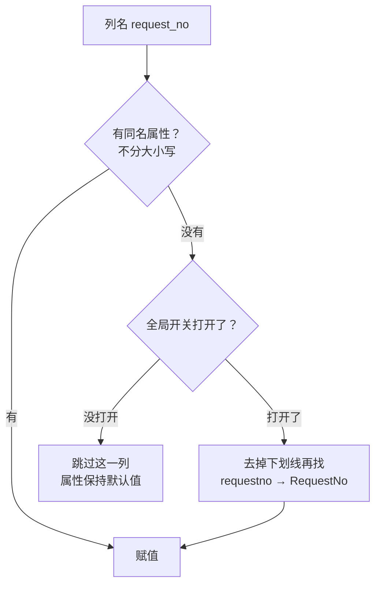
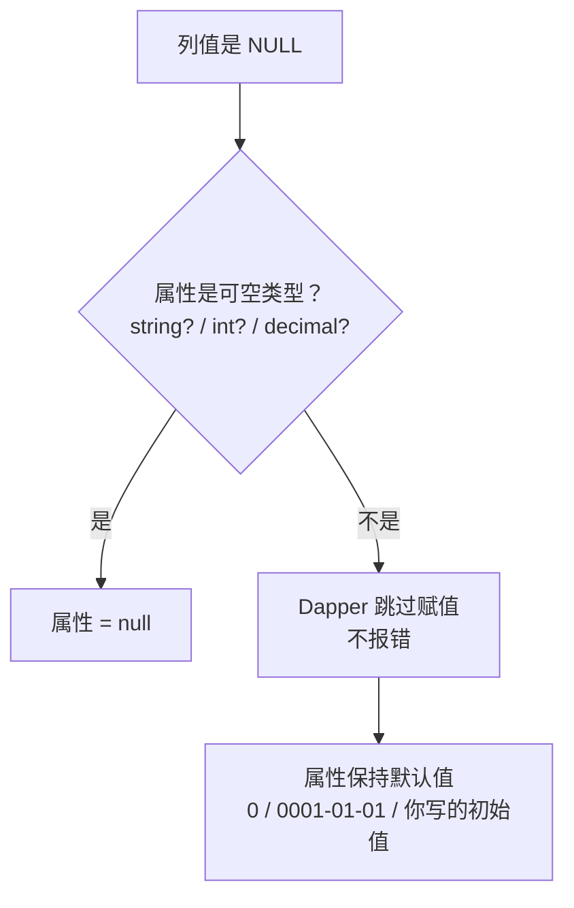
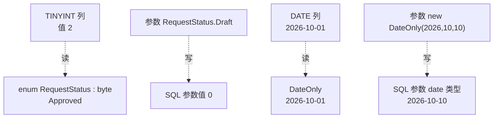

# 第 7 章 映射不上怎么办

## 这一章解决什么问题

第 2 章的自动映射有个前提：列名和属性名一样、类型也对得上。真实项目里经常不是这样：

- 老系统的表，列名是 `request_no` 这种下划线风格，而 C# 属性是 `RequestNo`；
- 备注、审批意见这些列允许 NULL，报表里 LEFT JOIN 出来的金额也可能是 NULL；
- `Status` 存的是 0/1/2/3，代码里却想写 `RequestStatus.Approved`；日期列只要年月日，不想带个 `00:00:00`。

这些情况大多**不报错**，只是属性悄悄变成默认值。本章把每种情况的真实行为都实测一遍，再给出对应的写法。

## 开始之前

- 上一章你已经会了：用 `Execute` 增删改，用 `OUTPUT INSERTED.Id` 取新 Id（第 6 章）。第 2 章讲过的映射规则要记牢：**按列名找同名属性，不分大小写；对不上的不报错，属性保持默认值**。
- 需要的环境：第 1 章的解决方案和 `PriceDemo` 库（数据被改乱了就重跑 [`code/sql/00-reset-database.sql`](../code/sql/00-reset-database.sql)）。7.2 节还要先执行一个建视图的小脚本。
- 预计耗时：80–90 分钟。

---

## 正文

### 7.1 准备：新建本章项目，建一个"老表"视图

1. **右键解决方案** →「**添加 → 新建项目**」→「控制台应用」，项目名称填 `Ch07Demo`，框架选 **.NET 10.0**。
2. **右键 `Ch07Demo` →「设为启动项目」**。
3. 「工具 → NuGet 包管理器 → 管理解决方案的 NuGet 程序包」，给 `Ch07Demo` 装上 `Dapper` 2.1.89、`Microsoft.Data.SqlClient` 7.1.1、`System.Security.Cryptography.Pkcs` 10.0.13。
4. 在 SSMS 里「文件 → 打开 → 文件」，打开 [`code/sql/ch07-legacy-view.sql`](../code/sql/ch07-legacy-view.sql)，按 **F5** 执行。

这个脚本建了一个视图 `dbo.legacy_price_request`，用来模拟"老系统的表"：

```sql
-- code/sql/ch07-legacy-view.sql
-- 用途：第 7 章模拟一张"老系统的表"——列名全是下划线风格（request_no 这种）。
-- 做法是建一个视图，用 AS 把 PriceRequest 的列改成下划线名字。可以反复执行。
-- 在 SSMS 中连上 PriceDemo 库后整段执行（F5）。

USE PriceDemo;
GO

CREATE OR ALTER VIEW dbo.legacy_price_request
AS
SELECT Id         AS request_id,
       RequestNo  AS request_no,
       Applicant  AS applicant_name,
       CreatedAt  AS created_at
FROM dbo.PriceRequest;
GO
```

> 📷 **截图占位 ch07-01**：SSMS 对象资源管理器展开「PriceDemo → 视图」，能看到 `dbo.legacy_price_request`；右侧查询结果显示 request_id / request_no / applicant_name / created_at 四列。
<!--  -->

和前几章一样，每个例子把 `Program.cs` **整个替换**掉。

---

### 7.2 概念一：名字不同——别名与 `MatchNamesWithUnderscores`

**白话定义**：列名和属性名不一样时，有两种办法让它们对上：

- **别名**：在 SQL 里写 `request_no AS RequestNo`，把列名改成属性名。只影响这一条 SQL。
- **全局开关** `DefaultTypeMap.MatchNamesWithUnderscores = true`：让 Dapper 匹配时**忽略列名里的下划线**，`request_no` 就能对上 `RequestNo`。影响整个程序的所有查询。

**业务场景**：价格系统要读 ERP 老库的数据，那边所有表都是 `request_no`、`applicant_name` 这种列名。几十条 SQL，每条都起别名太累，也容易漏，开全局开关一次解决。

**反例（什么时候不该用全局开关）**：
- **只有一两条 SQL 涉及下划线列**。起别名就够了，一眼就能看出列和属性的对应关系。开全局开关，会让所有查询的匹配规则都变掉，而且它有生效时机的问题（见"改坏一处试试"）。
- **列名和属性名差别不只是下划线**，比如 `applicant_name` 要对上 `Who`。开关管不了，只能起别名。

#### 🖼 图解：一个列名怎么找到属性



#### 💻 最小可运行代码（一）：先看对不上，再用别名

把 `Ch07Demo` 的 `Program.cs` 整个替换成：

```csharp
// code/ch07/Step1-Alias/Program.cs
// 列名是下划线风格、属性是驼峰风格：先看对不上的样子，再用 SQL 别名逐个对上
// 运行前先执行 code/sql/ch07-legacy-view.sql
using Dapper;
using Microsoft.Data.SqlClient;

const string connStr =
    "Server=.;Database=PriceDemo;Integrated Security=True;TrustServerCertificate=True;";

using var conn = new SqlConnection(connStr);

// 例 1：原样查老表 —— request_no 和 RequestNo 名字不一样（多了下划线），对不上
var a = conn.QuerySingle<LegacyRequest>(@"
    SELECT request_id, request_no, applicant_name, created_at
    FROM dbo.legacy_price_request
    WHERE request_id = 1");
Console.WriteLine($"例 1 不处理：Id={a.RequestId}，单号=[{a.RequestNo}]，申请人=[{a.ApplicantName}]，" +
                  $"创建={a.CreatedAt:yyyy-MM-dd}");

// 例 2：办法一 —— 每一列用 AS 起一个和属性同名的别名（第 2 章讲过别名）
var b = conn.QuerySingle<LegacyRequest>(@"
    SELECT request_id     AS RequestId,
           request_no     AS RequestNo,
           applicant_name AS ApplicantName,
           created_at     AS CreatedAt
    FROM dbo.legacy_price_request
    WHERE request_id = 1");
Console.WriteLine($"例 2 起别名：Id={b.RequestId}，单号=[{b.RequestNo}]，申请人=[{b.ApplicantName}]，" +
                  $"创建={b.CreatedAt:yyyy-MM-dd}");

public class LegacyRequest
{
    public int RequestId { get; set; }
    public string RequestNo { get; set; } = "";
    public string ApplicantName { get; set; } = "";
    public DateTime CreatedAt { get; set; }
}
```

#### 🔍 拆解运行结果（一）

实测输出：

```text
例 1 不处理：Id=0，单号=[]，申请人=[]，创建=0001-01-01
例 2 起别名：Id=1，单号=[PR20261001]，申请人=[张伟]，创建=2026-10-01
```

| 例 | 看到了什么 | 说明 |
|---|---|---|
| 1 | 四个属性全是默认值：`0`、`""`、`""`、`0001-01-01` | `request_no` 和 `RequestNo` 差一个下划线，按第 2 章的规则就是"对不上"，**没有任何报错**。`0001-01-01` 是 `DateTime` 的默认值，在报表里看到它，基本就是这一列没映射上 |
| 2 | 全部正确 | 每列 `AS` 成属性名，结果集里的列名就变成了 `RequestId`、`RequestNo`……，规则又对上了 |

别名的好处是**对应关系就写在 SQL 里**，同事看 SQL 就知道哪列进哪个属性。缺点是列多、SQL 多的时候很啰嗦。

#### 💻 最小可运行代码（二）：打开全局开关

把 `Program.cs` 整个替换成：

```csharp
// code/ch07/Step2-Underscores/Program.cs
// 全局开关 MatchNamesWithUnderscores：打开后 request_no 能自动对上 RequestNo，SQL 不用改
// 运行前先执行 code/sql/ch07-legacy-view.sql
using Dapper;
using Microsoft.Data.SqlClient;

// 程序一启动就打开，必须在第一次查询之前（原因见"改坏一处试试"）
DefaultTypeMap.MatchNamesWithUnderscores = true;

const string connStr =
    "Server=.;Database=PriceDemo;Integrated Security=True;TrustServerCertificate=True;";

using var conn = new SqlConnection(connStr);

// 例 1：SQL 和 7.2 例 1 一字不差，这次能对上了
var list = conn.Query<LegacyRequest>(@"
    SELECT request_id, request_no, applicant_name, created_at
    FROM dbo.legacy_price_request
    ORDER BY request_id");
foreach (var r in list)
    Console.WriteLine($"例 1 {r.RequestId} {r.RequestNo} {r.ApplicantName} {r.CreatedAt:yyyy-MM-dd}");

// 例 2：开关打开后，普通的同名列照样能对上，不受影响
var p = conn.QuerySingle<ProductBrief>(
    "SELECT Code, ListPrice FROM dbo.Product WHERE Id = 1");
Console.WriteLine($"例 2 普通列：{p.Code} {p.ListPrice:N2}");

// 例 3："全局"的意思：整个程序里所有类、所有查询都按这个规则匹配，包括别的类
var c = conn.QuerySingle<CustomerBrief>(
    "SELECT Name AS customer_name, City AS customer_city FROM dbo.Customer WHERE Id = 2");
Console.WriteLine($"例 3 别的类：{c.CustomerName} {c.CustomerCity}");

public class LegacyRequest
{
    public int RequestId { get; set; }
    public string RequestNo { get; set; } = "";
    public string ApplicantName { get; set; } = "";
    public DateTime CreatedAt { get; set; }
}

public class ProductBrief
{
    public string Code { get; set; } = "";
    public decimal ListPrice { get; set; }
}

public class CustomerBrief
{
    public string CustomerName { get; set; } = "";
    public string CustomerCity { get; set; } = "";
}
```

#### 🔍 拆解运行结果（二）

实测输出：

```text
例 1 1 PR20261001 张伟 2026-10-01
例 1 2 PR20261008 李娜 2026-10-08
例 1 3 PR20261015 张伟 2026-10-15
例 2 普通列：US-100 180,000.00
例 3 别的类：江南检测中心 杭州
```

| 例 | 看到了什么 | 说明 |
|---|---|---|
| 1 | 三张单全部对上 | SQL 和 7.2 例 1 一样，**没有别名**。开关打开后，`request_no` 去掉下划线成了 `requestno`，再不分大小写，对上 `RequestNo` |
| 2 | 普通列照常 | 先按原名找，找不到才去掉下划线再找。所以 `Code`、`ListPrice` 这些普通列不受影响 |
| 3 | 另一个类也对上了 | `customer_name` → `CustomerName`。这就是"全局"的意思：它是一个**静态属性**，设一次，**整个程序里所有类、所有查询**都按这个规则匹配 |

**为什么叫 `DefaultTypeMap`**：Dapper 给每个类准备一份"类型映射"（type map，记录这个类有哪些属性、列名怎么对到属性）。默认用的就是 `DefaultTypeMap`，这个开关是它的一个设置。

#### 改坏一处试试

把顶部那行 `DefaultTypeMap.MatchNamesWithUnderscores = true;` 删掉，挪到例 1 的 `foreach` 后面，并且紧接着**再用 `LegacyRequest` 查一次**：

```csharp
DefaultTypeMap.MatchNamesWithUnderscores = true;   // 挪到例 1 之后才打开
foreach (var r in conn.Query<LegacyRequest>("SELECT request_id, request_no, applicant_name, created_at FROM dbo.legacy_price_request WHERE request_id = 1"))
    Console.WriteLine($"开关打开后再查 LegacyRequest：[{r.RequestNo}] [{r.ApplicantName}]");
```

实测输出：

```text
例 1 0   0001-01-01
例 1 0   0001-01-01
例 1 0   0001-01-01
开关打开后再查 LegacyRequest：[] []
例 2 普通列：US-100 180,000.00
例 3 别的类：江南检测中心 杭州
```

| 现象 | 为什么 |
|---|---|
| 例 1 全是默认值 | 那时开关还没打开，正常 |
| 开关打开后**再查** `LegacyRequest`，还是空的 | `LegacyRequest` 在开关打开前已经被映射过一次。Dapper 会把一个类的映射信息**缓存**起来（第 3 章讲过缓存），之后改开关，对这个类不再起作用 |
| 例 3 的 `CustomerBrief` 却能对上 | 它是开关打开**之后**才第一次被用到的类 |

反过来也实测过：开关打开时先查 `LegacyRequest`，再把开关关掉（设为 `false`），之后用另一条 SQL 查 `LegacyRequest`，**仍然能对上**（实测）。结论是：**一个类第一次被映射时，开关是什么值，之后就一直按那个值来**。

所以这一行**必须放在程序启动的第一行**，在任何查询之前。Web 项目也一样，放在 `Program.cs` 的最前面。不要在某个方法里临时打开、用完再关上，那样的效果取决于哪个类先被用到，结果会时好时坏。

---

### 7.3 概念二：NULL 与可空类型

**白话定义**：数据库里的 NULL 到了 C#，**只有"可空"的属性才能装下**：引用类型写成 `string?`，值类型写成 `int?`、`decimal?`、`DateTime?`。属性不是可空的时候，Dapper 遇到 NULL 会**跳过赋值**，属性保持默认值（或你给的初始值），而且不报错。

**业务场景**：
- 申请单的"备注"可以不填，库里是 NULL。界面上要显示成空白或者"（无备注）"。
- 客户申请金额报表：用 LEFT JOIN 把没申请过的客户也列出来，他们的 `SUM` 是 NULL。报表上"没申请"和"申请了 0 元"要能分开。

**反例（什么时候不该用可空类型）**：列是 `NOT NULL` 的，比如 `RequestNo`、`Qty`，属性就**不要**写成可空。写成 `int?` 以后，每个用到它的地方都得处理 `null`，代码里到处是 `?.` 和 `?? 0`，而这一列根本不会是 NULL。**可空与否，照着表结构里的 NULL / NOT NULL 写。**

#### 🖼 图解：NULL 遇到不同的属性类型



#### 💻 最小可运行代码：四个例子

把 `Program.cs` 整个替换成：

```csharp
// code/ch07/Step3-Null/Program.cs
// 数据库里的 NULL 到了 C# 变成什么：string? 、有初始值的属性、decimal 与 decimal?
using Dapper;
using Microsoft.Data.SqlClient;

const string connStr =
    "Server=.;Database=PriceDemo;Integrated Security=True;TrustServerCertificate=True;";

using var conn = new SqlConnection(connStr);

const string remarkSql = "SELECT RequestNo, Remark FROM dbo.PriceRequest ORDER BY Id";

// 例 1：Remark 列允许 NULL（2 号单就是 NULL），属性写成 string? —— 拿到的就是 null
Console.WriteLine("例 1 string?：");
foreach (var r in conn.Query<RemarkNullable>(remarkSql))
    Console.WriteLine($"  {r.RequestNo}  Remark = {(r.Remark is null ? "null" : r.Remark)}");

// 例 2：属性写成 string 并给了初始值 —— 遇到 NULL 时 Dapper 不赋值，初始值原样保留
Console.WriteLine("例 2 有初始值的 string：");
foreach (var r in conn.Query<RemarkWithDefault>(remarkSql))
    Console.WriteLine($"  {r.RequestNo}  Remark = {r.Remark}");

// 例 3：报表 —— 每个客户的申请总金额。LEFT JOIN 后没申请过的客户，SUM 结果是 NULL
const string totalSql = @"
    SELECT c.Name, SUM(i.Qty * i.RequestPrice) AS Total
    FROM dbo.Customer c
    LEFT JOIN dbo.PriceRequest r     ON r.CustomerId = c.Id
    LEFT JOIN dbo.PriceRequestItem i ON i.RequestId  = r.Id
    GROUP BY c.Id, c.Name
    ORDER BY c.Id";

Console.WriteLine("例 3a 用 decimal 接：");
foreach (var t in conn.Query<CustomerTotal>(totalSql))
    Console.WriteLine($"  {t.Name}  {t.Total:N2}");          // NULL → 0.00，看不出是"没申请"

Console.WriteLine("例 3b 用 decimal? 接：");
foreach (var t in conn.Query<CustomerTotalNullable>(totalSql))
    Console.WriteLine($"  {t.Name}  {(t.Total is null ? "（无申请）" : t.Total.Value.ToString("N2"))}");

// 例 4：只取一个值时，ExecuteScalar<decimal> 遇到 NULL 也悄悄给 0（第 5 章讲过要用 decimal?）
decimal scalar = conn.ExecuteScalar<decimal>(@"
    SELECT SUM(i.Qty * i.RequestPrice)
    FROM dbo.PriceRequestItem i
    JOIN dbo.PriceRequest r ON r.Id = i.RequestId
    WHERE r.CustomerId = 3");
Console.WriteLine($"例 4 ExecuteScalar<decimal> 北方影像诊所：{scalar:N2}");

public class RemarkNullable
{
    public string RequestNo { get; set; } = "";
    public string? Remark { get; set; }                  // 可空：NULL 就是 null
}

public class RemarkWithDefault
{
    public string RequestNo { get; set; } = "";
    public string Remark { get; set; } = "（无备注）";     // NULL 时保留这个初始值
}

public class CustomerTotal
{
    public string Name { get; set; } = "";
    public decimal Total { get; set; }                   // 非可空：NULL 时保持默认值 0
}

public class CustomerTotalNullable
{
    public string Name { get; set; } = "";
    public decimal? Total { get; set; }                  // 可空：NULL 和 0 能分开
}
```

#### 🔍 拆解运行结果

实测输出：

```text
例 1 string?：
  PR20261001  Remark = 年度框架采购
  PR20261008  Remark = null
  PR20261015  Remark = 追加探头
例 2 有初始值的 string：
  PR20261001  Remark = 年度框架采购
  PR20261008  Remark = （无备注）
  PR20261015  Remark = 追加探头
例 3a 用 decimal 接：
  华东第一医院  516,000.00
  江南检测中心  395,000.00
  北方影像诊所  0.00
例 3b 用 decimal? 接：
  华东第一医院  516,000.00
  江南检测中心  395,000.00
  北方影像诊所  （无申请）
例 4 ExecuteScalar<decimal> 北方影像诊所：0.00
```

| 例 | 看到了什么 | 说明 |
|---|---|---|
| 1 | 2 号单 `Remark = null` | `string?` 能装 null，NULL 就是 null。这是最直接、最推荐的写法 |
| 2 | 2 号单显示"（无备注）" | 属性是 `string`，初始值"（无备注）"。Dapper 遇到 NULL **不调用 set**，初始值保留了下来。注意：这是 Dapper 的行为，不是 C# 的规则 |
| 3a | 北方影像诊所 `0.00` | `decimal` 装不下 NULL，Dapper 跳过，留下默认值 0。**报表上看起来像"申请了 0 元"** |
| 3b | 北方影像诊所"（无申请）" | `decimal?` 拿到 null，可以和 0 区分开 |
| 4 | `0.00` | `ExecuteScalar<decimal>` 遇到 NULL 也给默认值 0，第 5 章讲过要改用 `decimal?` |

金额核对：华东第一医院 = 1 号单（2 × 165,000 + 4 × 23,000 = 422,000）+ 3 号单（2 × 24,500 + 2 × 22,500 = 94,000）= 516,000；江南检测中心 = 2 号单 1 × 395,000。

**NULL 进非可空值类型，到底会怎样**——这是常被问到的问题，各种接法我都实测了一遍：

| 接收方式 | 实测结果 | 会报错吗 |
|---|---|---|
| 类的 `int` / `decimal` 属性（例 3a） | 跳过赋值，保持 `0` | 不会 |
| 类的 `int` 属性，带初始值 `= 99` | 跳过赋值，保持 `99` | 不会 |
| record 构造函数参数 `int Qty`（7.4 节补充讲 record） | 传进去的是 `0` | 不会 |
| `ExecuteScalar<decimal>`（例 4） | `0` | 不会 |
| `Query<int>` / `QueryFirst<int>` / `QuerySingle<decimal>` 只取一列 | `DataException` | **会**（见"改坏一处试试"） |

规律是：**映射到对象的属性时，NULL 一律静默跳过；直接把一列当成 `int` / `decimal` 返回时，NULL 无处可放，才会报错。**

> Dapper 有一个设置 `SqlMapper.Settings.ApplyNullValues`，默认是 `false`，就是上面"遇到 NULL 跳过赋值"的行为。实测把它设成 `true` 后：`string` 和 `int?` 属性会被赋成 null（初始值被覆盖），而非可空的 `int` 属性**仍然保持初始值**。一般不需要动它。

#### 改坏一处试试

把例 4 的 `conn.ExecuteScalar<decimal>(` 改成 `conn.QuerySingle<decimal>(`。看起来都是"取一个值"，实测报错：

```text
Unhandled exception. System.Data.DataException: Error parsing column 0 ((Unnamed Column)=n/a - Null object cannot be converted to a value type.)
 ---> System.InvalidCastException: Null object cannot be converted to a value type.
```

用第 2 章学的方法读这条报错：

| 片段 | 含义 |
|---|---|
| `Error parsing column 0` | 第 0 列转换失败 |
| `(Unnamed Column)` | 这一列**没有名字**：`SELECT SUM(…)` 没写别名。加上 `AS Total`，这里就会显示 `Total` |
| `=n/a` | 值是 NULL（not available） |
| `Null object cannot be converted to a value type` | NULL 没法变成值类型 `decimal` |

怎么改：`QuerySingle<decimal?>`，或者在 SQL 里写 `ISNULL(SUM(…), 0)`。选哪个看业务：报表要区分"没有"和"0"，就用 `decimal?`；只是求和显示，用 `ISNULL` 更省事。

---

### 7.4 概念三：枚举与 `DateOnly`

**白话定义**：
- **枚举**：属性类型写成枚举，Dapper 会把 TINYINT / INT 列的数字转成对应的枚举值；当参数传进 SQL 时，会转回数字。
- **`DateOnly`**：.NET 6 起有的"只有日期、没有时间"的类型，对应 SQL Server 的 `DATE`。Dapper 2.1.89 读写都支持（这个支持曾经被关掉过，[2.1.86 的发布说明](https://github.com/DapperLib/Dapper/releases)里写了重新启用）。

**业务场景**：申请单状态 `Status` 是 0 草稿、1 待审、2 通过、3 驳回。代码里写 `if (r.Status == RequestStatus.Pending)`，比写 `if (r.Status == 1)` 清楚得多，也不会把 2 和 3 记反。报表的"申请日期"只要年月日，用 `DateOnly` 就不会再出现 `2026-10-01 00:00:00`。

**反例（什么时候不该用）**：
- **枚举**：状态值经常增加、而且由业务人员在数据库里维护（比如有一张"状态字典表"）。代码里的枚举要改代码、重新发布才能跟上，这时应该把状态当普通的 `byte` / `string`，从字典表取名称。
- **`DateOnly`**：列本身是 `DATETIME2`、时间部分有意义（比如审批时间要精确到分钟）。读进 `DateOnly` 会**静默丢掉时间**（"改坏一处试试"第 2 条实测）。

#### 🖼 图解：数据库类型 ↔ C# 类型



#### 💻 最小可运行代码：四个例子

把 `Program.cs` 整个替换成：

```csharp
// code/ch07/Step4-EnumDate/Program.cs
// TINYINT 状态列 ↔ 枚举，DATE 列 ↔ DateOnly；读和写都演示；最后补充 record 构造函数映射
using Dapper;
using Microsoft.Data.SqlClient;

const string connStr =
    "Server=.;Database=PriceDemo;Integrated Security=True;TrustServerCertificate=True;";

using var conn = new SqlConnection(connStr);

// 例 1：读 —— Status(TINYINT) 进枚举；CAST(... AS date) 得到 DATE 列，进 DateOnly
var list = conn.Query<RequestView>(@"
    SELECT Id, RequestNo, Status, CAST(CreatedAt AS date) AS CreatedDate
    FROM dbo.PriceRequest
    ORDER BY Id");
foreach (var r in list)
    Console.WriteLine($"例 1 {r.RequestNo}  {r.Status,-8}（{(byte)r.Status}）  {r.CreatedDate:yyyy-MM-dd}");

// 例 2：写 —— 枚举和 DateOnly 直接当参数用
var drafts = conn.Query<string>(@"
    SELECT RequestNo FROM dbo.PriceRequest
    WHERE Status = @Status AND CreatedAt >= @From",
    new { Status = RequestStatus.Draft, From = new DateOnly(2026, 10, 10) });
Console.WriteLine("例 2 10 月 10 日以后的草稿：" + string.Join("、", drafts));

// 例 3：库里出现了枚举没定义的值（9），或者列里存的是文字 —— 都不报错
var odd = conn.QuerySingle<StatusOnly>("SELECT CAST(9 AS tinyint) AS Status");
Console.WriteLine($"例 3a 值 9：Status = {odd.Status}，枚举里有定义吗？{Enum.IsDefined(odd.Status)}");
var text = conn.QuerySingle<StatusOnly>("SELECT 'Approved' AS Status");
Console.WriteLine($"例 3b 文字 'Approved'：Status = {text.Status}（{(byte)text.Status}）");

// 例 4（补充）：record 没有无参构造函数，Dapper 改用构造函数：
// 找一个参数个数、名字、顺序、类型都和结果集对得上的构造函数，把列值按顺序传进去
var rec = conn.QuerySingle<RequestRecord>(
    "SELECT Id, RequestNo, Status FROM dbo.PriceRequest WHERE Id = 2");
Console.WriteLine($"例 4 record：{rec}");

// 值从 0 开始，和表上的注释"0 草稿 1 待审 2 通过 3 驳回"逐个对应
// 写 : byte 让枚举的底层类型和 TINYINT 一致
public enum RequestStatus : byte
{
    Draft = 0,       // 草稿
    Pending = 1,     // 待审
    Approved = 2,    // 通过
    Rejected = 3,    // 驳回
}

public class RequestView
{
    public int Id { get; set; }
    public string RequestNo { get; set; } = "";
    public RequestStatus Status { get; set; }
    public DateOnly CreatedDate { get; set; }       // 只要日期，不要时分秒
}

public class StatusOnly
{
    public RequestStatus Status { get; set; }
}

// 构造函数参数的类型必须和列的类型严格一致：Status 列是 TINYINT，这里只能写 byte
public record RequestRecord(int Id, string RequestNo, byte Status);
```

#### 🔍 拆解运行结果

实测输出：

```text
例 1 PR20261001  Approved（2）  2026-10-01
例 1 PR20261008  Pending （1）  2026-10-08
例 1 PR20261015  Draft   （0）  2026-10-15
例 2 10 月 10 日以后的草稿：PR20261015
例 3a 值 9：Status = 9，枚举里有定义吗？False
例 3b 文字 'Approved'：Status = Approved（2）
例 4 record：RequestRecord { Id = 2, RequestNo = PR20261008, Status = 1 }
```

> 📷 **截图占位 ch07-02**：控制台显示上面的输出。
<!--  -->

| 例 | 看到了什么 | 说明 |
|---|---|---|
| 1 | 状态显示成名字，日期没有时间 | TINYINT 2 → `Approved`；`CAST(CreatedAt AS date)` 得到 DATE 列，进 `DateOnly` |
| 2 | 找到 PR20261015 | `RequestStatus.Draft` 作为参数，发给数据库的是数字 0；`DateOnly` 参数发过去的是 `date` 类型 |
| 3a | `Status = 9`，没有定义 | 数据库里出现了枚举没定义的值，Dapper **不报错**，照样塞进去。C# 枚举本来就允许装任意底层值。用 `Enum.IsDefined` 可以检查 |
| 3b | 文字 `'Approved'` 也能转 | 列里存的是枚举名字的文字时，Dapper 会按名字解析。有的老表把状态存成文字，这样也能直接用枚举接 |
| 4 | record 也能接 | record 没有无参构造函数，Dapper 改用构造函数，把列值按顺序传进去 |

**为什么枚举要写 `: byte`**：表上 `Status` 是 TINYINT，对应 C# 的 `byte`。实测不写 `: byte`（默认底层类型是 `int`），读取也能成功，Dapper 会转换。但 7.4 例 4 的 record 构造函数要求**类型严格一致**，写成 `: byte` 可以让枚举和列的类型保持一致，少一个隐患。

#### 改坏一处试试

**改法 1**：把最后一行 record 的 `byte Status` 改成 `int Status`。实测报错：

```text
Unhandled exception. System.InvalidOperationException: A parameterless default constructor or one matching signature (System.Int32 Id, System.String RequestNo, System.Byte Status) is required for RequestRecord materialization
```

| 片段 | 含义 |
|---|---|
| `A parameterless default constructor` | 要么给这个类一个**无参构造函数**（那样就按属性赋值） |
| `or one matching signature (System.Int32 Id, System.String RequestNo, System.Byte Status)` | 要么有一个参数**正好是这样**的构造函数。括号里就是结果集的列名和类型，直接照抄就是正确答案 |
| `materialization` | "把一行数据变成对象"这个过程 |

对比 7.4 例 1：用普通类、属性写 `int`，接 TINYINT 是可以的（第 2 章实验 5 也验证过）。**构造函数映射比属性映射严格得多**：名字、顺序、类型都要对上，`byte` 和 `int` 也不行。所以 record 适合"列和类型都很确定"的小查询；拿不准时，用带 `{ get; set; }` 的普通类。

**改法 2**：把例 1 SQL 里的 `CAST(CreatedAt AS date) AS CreatedDate` 改成 `CreatedAt AS CreatedDate`（不转换，直接把 DATETIME2 给 `DateOnly`）。实测输出**和原来一模一样**：

```text
例 1 PR20261001  Approved（2）  2026-10-01
例 1 PR20261008  Pending （1）  2026-10-08
例 1 PR20261015  Draft   （0）  2026-10-15
```

没有报错，但 1 号单的 `09:30:00` 被**静默丢掉**了。只要日期时这样没问题；可如果你本意是要时间，就不会有任何提示。建议**在 SQL 里写明 `CAST(… AS date)`**，让"只要日期"这个意图出现在 SQL 里。

---

## 🧱 类比：ADO.NET 写法与 Dapper 写法逐项对照

| 情况 | ADO.NET | Dapper（本章） |
|---|---|---|
| 列名和属性名不同 | `reader["request_no"]` 手写对应 | SQL 起别名，或全局开关 `MatchNamesWithUnderscores` |
| 列名写错 | `IndexOutOfRangeException`，马上发现 | 不报错，属性是默认值（第 2 章） |
| 读可空列 | `reader.IsDBNull(i) ? null : reader.GetString(i)` | 属性写 `string?`，自动得到 null |
| NULL 进非可空属性 | `GetInt32` 抛 `SqlNullValueException` | 跳过赋值，保持默认值，**不报错** |
| 读状态码 | `(RequestStatus)reader.GetByte(i)` 自己强转 | 属性写成枚举，自动转换 |
| 枚举当参数 | `Parameters.Add("@s", SqlDbType.TinyInt).Value = (byte)status` | 直接传 `RequestStatus.Draft` |
| 读 DATE 列 | `reader.GetDateTime(i)`，再自己 `DateOnly.FromDateTime` | 属性写 `DateOnly` |

最需要注意的是第 2、4 行：**ADO.NET 会报错的地方，Dapper 大多是"安静地给默认值"**。所以本章的每个坑都要靠你主动去核对数据，而不是等报错。

## ⚠️ 踩坑警告

| 现象 | 原因 | 怎么改 |
|---|---|---|
| 所有属性都是 `0`、`""`、`0001-01-01`，不报错（实测） | 列名是下划线风格，和属性名对不上 | 起别名；或在程序第一行打开 `MatchNamesWithUnderscores` |
| 打开了 `MatchNamesWithUnderscores`，某个类还是对不上（实测） | 开关在这个类第一次被映射**之后**才打开，映射信息已经缓存 | 把开关放到程序启动的第一行，任何查询之前 |
| 报表里没数据的行显示 `0.00`，和"金额为 0"分不清（实测） | NULL 进了非可空的 `decimal`，被静默跳过 | 属性改成 `decimal?` |
| `Error parsing column 0 ((Unnamed Column)=n/a - Null object cannot be converted to a value type.)`（实测） | 只取一列的 `Query<int>` / `QuerySingle<decimal>` 等遇到了 NULL | 泛型参数改成可空类型，或 SQL 里用 `ISNULL` |
| `A parameterless default constructor or one matching signature (…) is required for … materialization`（实测） | record / 只有带参构造函数的类，参数类型和列类型不完全一致 | 照报错括号里的签名改参数类型；或改用普通类 |
| `Invalid object name 'dbo.legacy_price_request'.`（实测，错误号 208） | 没执行 7.1 节的建视图脚本 | 在 SSMS 里执行 `code/sql/ch07-legacy-view.sql` |

## 🎯 动手练习

**练习：客户汇总报表**

下面这条 SQL **一个字都不许改**。它按客户统计申请单数、最近一次申请的日期和状态。列名都是下划线风格，北方影像诊所没有任何申请单，后两列是 NULL：

```sql
SELECT c.Name                          AS customer_name,
       COUNT(r.Id)                     AS request_count,
       MAX(CAST(r.CreatedAt AS date))  AS last_request_date,
       (SELECT TOP 1 r2.Status
        FROM dbo.PriceRequest r2
        WHERE r2.CustomerId = c.Id
        ORDER BY r2.CreatedAt DESC)    AS last_status
FROM dbo.Customer c
LEFT JOIN dbo.PriceRequest r ON r.CustomerId = c.Id
GROUP BY c.Id, c.Name
ORDER BY c.Id
```

写一个 `CustomerSummary` 类，属性名用驼峰（`CustomerName`、`RequestCount`、`LastRequestDate`、`LastStatus`），日期用 `DateOnly` 系列，状态用本章的 `RequestStatus` 枚举。NULL 显示成"（无）"。

- 验收标准：输出三行，内容完全一致：

```text
华东第一医院：2 单，最近 2026-10-15，状态 Draft
江南检测中心：1 单，最近 2026-10-08，状态 Pending
北方影像诊所：0 单，最近 （无），状态 （无）
```

- 额外观察：如果 `LastRequestDate` 写成 `DateOnly`（不可空），北方影像诊所那一行会显示什么？

卡住了看文末参考答案。

## 📌 一句话总结

对不上、是 NULL、类型不同，Dapper 大多静默给默认值，要主动核对。

## 下一章

公司里很多业务逻辑写在存储过程里，有输出参数、有返回值。第 8 章讲怎么用 Dapper 调存储过程。

---

<!-- 以下是参考答案，先自己动手，卡住了再往下翻 -->


## 参考答案

**思路**：SQL 不能改，下划线列名只能靠全局开关，而且要放在**第一次查询之前**。`last_request_date` 和 `last_status` 对没申请过的客户是 NULL，所以属性必须是 `DateOnly?` 和 `RequestStatus?`，输出时用 `?.ToString(…) ?? "（无）"`。`request_count` 用的是 `COUNT(r.Id)`，没有申请单时是 0 而不是 NULL，用 `int` 就行。

**额外观察**：写成不可空的 `DateOnly`，北方影像诊所会显示 `0001-01-01`（`DateOnly` 的默认值），不报错。这正是 7.3 节"NULL 静默跳过"的规律。

完整项目在 [`code/ch07/Exercise/`](../code/ch07/Exercise/)。实测输出：

```text
华东第一医院：2 单，最近 2026-10-15，状态 Draft
江南检测中心：1 单，最近 2026-10-08，状态 Pending
北方影像诊所：0 单，最近 （无），状态 （无）
```

```csharp
// code/ch07/Exercise/Program.cs
// 第 7 章练习参考答案：SQL 一字不改，靠全局开关 + 可空类型 + 枚举 + DateOnly 把客户汇总映射出来
using Dapper;
using Microsoft.Data.SqlClient;

// 列名都是下划线风格，SQL 又不许改 → 打开全局开关，而且要在第一次查询之前
DefaultTypeMap.MatchNamesWithUnderscores = true;

const string connStr =
    "Server=.;Database=PriceDemo;Integrated Security=True;TrustServerCertificate=True;";

using var conn = new SqlConnection(connStr);

// 题目给定的 SQL，不许改
const string sql = @"
    SELECT c.Name                          AS customer_name,
           COUNT(r.Id)                     AS request_count,
           MAX(CAST(r.CreatedAt AS date))  AS last_request_date,
           (SELECT TOP 1 r2.Status
            FROM dbo.PriceRequest r2
            WHERE r2.CustomerId = c.Id
            ORDER BY r2.CreatedAt DESC)    AS last_status
    FROM dbo.Customer c
    LEFT JOIN dbo.PriceRequest r ON r.CustomerId = c.Id
    GROUP BY c.Id, c.Name
    ORDER BY c.Id";

foreach (var s in conn.Query<CustomerSummary>(sql))
{
    string date = s.LastRequestDate?.ToString("yyyy-MM-dd") ?? "（无）";
    string status = s.LastStatus?.ToString() ?? "（无）";
    Console.WriteLine($"{s.CustomerName}：{s.RequestCount} 单，最近 {date}，状态 {status}");
}

public enum RequestStatus : byte
{
    Draft = 0,
    Pending = 1,
    Approved = 2,
    Rejected = 3,
}

public class CustomerSummary
{
    public string CustomerName { get; set; } = "";    // customer_name
    public int RequestCount { get; set; }             // request_count：COUNT 不会是 NULL
    public DateOnly? LastRequestDate { get; set; }    // 没申请过的客户是 NULL → 必须可空
    public RequestStatus? LastStatus { get; set; }    // 同上
}
```
