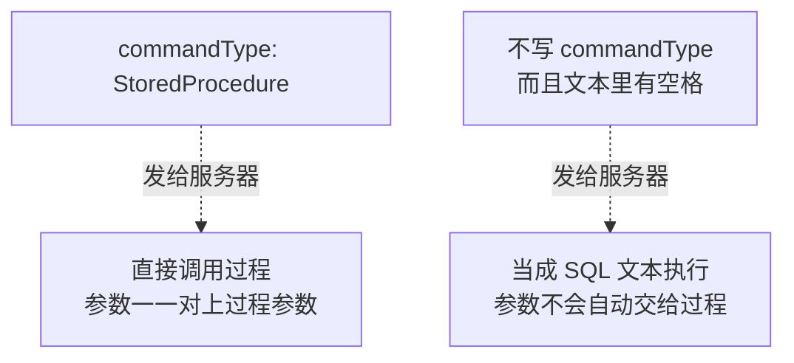
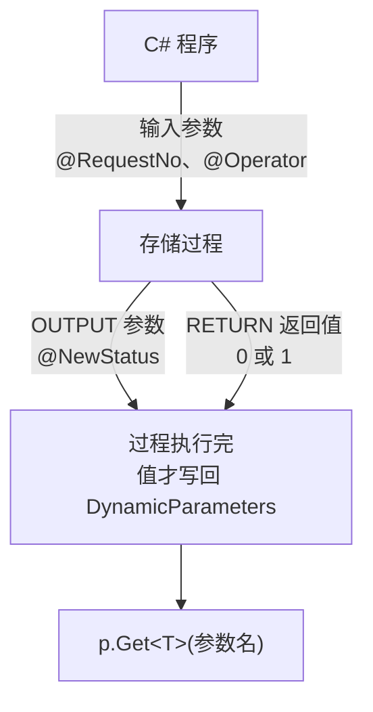
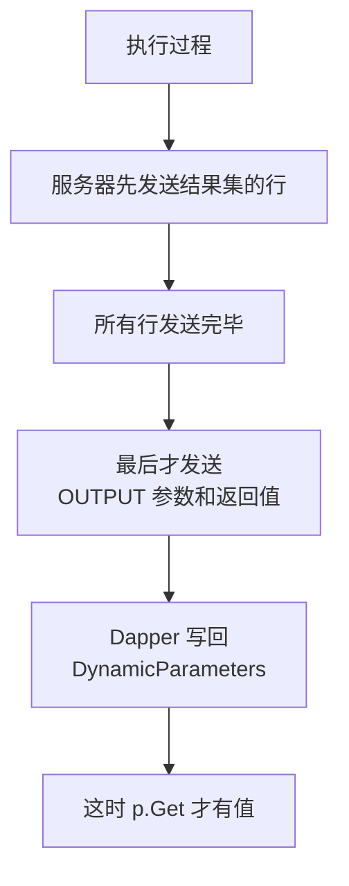

# 第 8 章 调存储过程

## 这一章解决什么问题

你们公司的核心业务逻辑很可能写在存储过程里，比如"提交审批"：先检查单据状态，再改状态、写审批记录，最后用 OUTPUT 参数告诉调用方新状态，用 RETURN 返回成功还是失败。

ADO.NET 调这样一个过程，光参数就要写十来行：每个参数 `Add`、设 `Direction`、设 `Value`，执行完再从 `Parameters` 里把值取出来、判断 `DBNull`。本章讲 Dapper 的写法，以及调用存储过程时最常见的几种报错：

1. 怎么告诉 Dapper"这是存储过程，不是 SQL 文本"？忘了说会怎样？
2. OUTPUT 参数和 RETURN 返回值怎么传、怎么取？什么时候才能取？
3. 过程返回结果集时，怎么映射成对象？

## 开始之前

- 上一章你已经会了：列名和属性名对不上时用别名、NULL 用可空类型接、状态码用枚举接（第 7 章）。`Execute` 返回受影响行数、`SET NOCOUNT ON` 时返回 -1（第 6 章）。`QuerySingleOrDefault` 查不到返回 null（第 5 章）。
- 需要的环境：第 1 章的解决方案和 `PriceDemo` 库（数据被改乱了就重跑 [`code/sql/00-reset-database.sql`](../code/sql/00-reset-database.sql)）。本章还要先建 3 个存储过程，见 8.1 节。
- 预计耗时：80–90 分钟。

---

## 正文

### 8.1 准备：新建本章项目，建存储过程

1. **右键解决方案** →「**添加 → 新建项目**」→「控制台应用」，项目名称填 `Ch08Demo`，框架选 **.NET 10.0**。
2. **右键 `Ch08Demo` →「设为启动项目」**。
3. 「工具 → NuGet 包管理器 → 管理解决方案的 NuGet 程序包」，给 `Ch08Demo` 装上 `Dapper` 2.1.89、`Microsoft.Data.SqlClient` 7.1.1、`System.Security.Cryptography.Pkcs` 10.0.13。
4. 在 SSMS 里「文件 → 打开 → 文件」，打开 [`code/sql/ch08-procs.sql`](../code/sql/ch08-procs.sql)，按 **F5** 执行。

脚本内容如下。过程名按"动作前缀_业务名_Proc"的规则命名，一眼就能看出是查还是改：

```sql
-- code/sql/ch08-procs.sql
-- 用途：第 8 章用到的 3 个存储过程。可以反复执行（CREATE OR ALTER，SQL Server 2016 SP1 起支持）。
-- 命名规则：动作前缀_业务名_Proc。在 SSMS 中连上 PriceDemo 库后整段执行（F5）。

USE PriceDemo;
GO

-- ① 按单号查一张申请单：只有输入参数，返回一个结果集（0 或 1 行）
CREATE OR ALTER PROCEDURE dbo.Select_PriceRequestByNo_Proc
    @RequestNo VARCHAR(20)
AS
BEGIN
    SET NOCOUNT ON;
    SELECT Id, RequestNo, CustomerId, Applicant, Status, CreatedAt, Remark
    FROM dbo.PriceRequest
    WHERE RequestNo = @RequestNo;
END
GO

-- ② 提交审批：只有"草稿(0)"能提交。改成"待审(1)"并写一条审批记录。
--    @NewStatus（OUTPUT）：执行后单据的状态；单号不存在时为 NULL
--    RETURN 0 = 成功，1 = 失败（单号不存在或不是草稿）
CREATE OR ALTER PROCEDURE dbo.Update_PriceRequestSubmit_Proc
    @RequestNo VARCHAR(20),
    @Operator  NVARCHAR(20),
    @NewStatus TINYINT OUTPUT
AS
BEGIN
    SET NOCOUNT ON;
    DECLARE @Id INT;

    SELECT @Id = Id, @NewStatus = Status
    FROM dbo.PriceRequest
    WHERE RequestNo = @RequestNo;

    IF @Id IS NULL OR @NewStatus <> 0
        RETURN 1;                       -- 失败：@NewStatus 保留查到的当前状态（查不到就是 NULL）

    BEGIN TRAN;                         -- 两条写操作要么都成功要么都不做（事务第 9 章细讲）
        UPDATE dbo.PriceRequest SET Status = 1 WHERE Id = @Id;
        INSERT dbo.ApprovalLog (RequestId, Approver, Action) VALUES (@Id, @Operator, N'提交');
    COMMIT;

    SET @NewStatus = 1;
    RETURN 0;                           -- 成功
END
GO

-- ③ 按申请人分页查申请单：返回一页结果集，同时用 OUTPUT 参数带回总行数
CREATE OR ALTER PROCEDURE dbo.Select_PriceRequestPage_Proc
    @Applicant  NVARCHAR(20),
    @PageIndex  INT,                    -- 从 1 开始
    @PageSize   INT,
    @TotalCount INT OUTPUT
AS
BEGIN
    SET NOCOUNT ON;

    SELECT @TotalCount = COUNT(*)
    FROM dbo.PriceRequest
    WHERE Applicant = @Applicant;

    SELECT Id, RequestNo, Applicant, Status, CreatedAt
    FROM dbo.PriceRequest
    WHERE Applicant = @Applicant
    ORDER BY Id
    OFFSET (@PageIndex - 1) * @PageSize ROWS FETCH NEXT @PageSize ROWS ONLY;
END
GO
```

> 📷 **截图占位 ch08-01**：SSMS 对象资源管理器展开「PriceDemo → 可编程性 → 存储过程」，能看到 3 个以 `_Proc` 结尾的过程。
<!--  -->

| 过程 | 输入 | 输出 | 本章哪一节用 |
|---|---|---|---|
| `Select_PriceRequestByNo_Proc` | 单号 | 一个结果集（0 或 1 行） | 8.2 |
| `Update_PriceRequestSubmit_Proc` | 单号、操作人 | OUTPUT `@NewStatus`，RETURN 0/1 | 8.3 |
| `Select_PriceRequestPage_Proc` | 申请人、页码、每页行数 | 一个结果集 + OUTPUT `@TotalCount` | 8.4 |

**重跑建库脚本会把这 3 个过程一起删掉吗？** 不会。建库脚本只删、建 5 张表，过程还在。但因为过程会改数据，每个例子跑完，最好重跑建库脚本，让数据回到初始状态。

---

### 8.2 概念一：`commandType: CommandType.StoredProcedure`

**白话定义**：调用 `Query` / `Execute` 时多传一个命名参数 `commandType: CommandType.StoredProcedure`，告诉 Dapper：第一个字符串是**存储过程的名字**，不是 SQL 文本。Dapper 会把参数对象的每个属性，作为过程的一个参数传进去。它就是 ADO.NET 里的 `cmd.CommandType = CommandType.StoredProcedure`。

**业务场景**：按单号查申请单的逻辑已经写成了存储过程 `Select_PriceRequestByNo_Proc`，DBA 还会在里面加权限检查。C# 这边只管调用，不再自己写 SELECT。

**反例（什么时候不该用存储过程）**：只是一条简单的 SELECT 或 UPDATE，没有多步逻辑，也没有 DBA 要求。为它专门建一个过程，改一个字段就要同时改 C# 和数据库两处，部署也要多一步。Dapper 本来就是让你直接写 SQL 的，简单语句直接写在代码里就好。

#### 🖼 图解：同一个名字，两种发送方式



#### 💻 最小可运行代码：三个例子

把 `Ch08Demo` 的 `Program.cs` 整个替换成：

```csharp
// code/ch08/Step1-CommandType/Program.cs
// 调用只有输入参数的存储过程：过程名 + 匿名对象 + commandType: CommandType.StoredProcedure
// 运行前先执行 code/sql/ch08-procs.sql
using System.Data;                 // CommandType 在这个命名空间里
using Dapper;
using Microsoft.Data.SqlClient;

const string connStr =
    "Server=.;Database=PriceDemo;Integrated Security=True;TrustServerCertificate=True;";

using var conn = new SqlConnection(connStr);

// 例 1：正规写法。第一个参数只写过程名，参数对象的属性名 = 过程的参数名（去掉 @）
var r1 = conn.QuerySingleOrDefault<PriceRequestRow>(
    "dbo.Select_PriceRequestByNo_Proc",
    new { RequestNo = "PR20261008" },
    commandType: CommandType.StoredProcedure);
Console.WriteLine($"例 1 找到：{r1?.RequestNo} {r1?.Applicant} 状态={r1?.Status} " +
                  $"备注={(r1?.Remark is null ? "null" : r1.Remark)}");

// 例 2：查不到时过程返回 0 行 → QuerySingleOrDefault 返回 null（第 5 章讲过）
var r2 = conn.QuerySingleOrDefault<PriceRequestRow>(
    "dbo.Select_PriceRequestByNo_Proc",
    new { RequestNo = "PR99999999" },
    commandType: CommandType.StoredProcedure);
Console.WriteLine($"例 2 查不到：结果是 null 吗？{r2 is null}");

// 例 3：另一种写法 —— 当普通 SQL 文本执行 EXEC，参数要自己在文本里一一对应
var r3 = conn.QuerySingleOrDefault<PriceRequestRow>(
    "EXEC dbo.Select_PriceRequestByNo_Proc @RequestNo = @RequestNo",
    new { RequestNo = "PR20261001" });
Console.WriteLine($"例 3 EXEC 文本：{r3?.RequestNo} {r3?.Applicant} 状态={r3?.Status}");

public class PriceRequestRow
{
    public int Id { get; set; }
    public string RequestNo { get; set; } = "";
    public int CustomerId { get; set; }
    public string Applicant { get; set; } = "";
    public byte Status { get; set; }
    public DateTime CreatedAt { get; set; }
    public string? Remark { get; set; }           // 允许 NULL，第 7 章讲过
}
```

#### 🔍 拆解运行结果

实测输出：

```text
例 1 找到：PR20261008 李娜 状态=1 备注=null
例 2 查不到：结果是 null 吗？True
例 3 EXEC 文本：PR20261001 张伟 状态=2
```

| 例 | 看到了什么 | 说明 |
|---|---|---|
| 1 | 2 号单，备注 null | 匿名对象的 `RequestNo` 属性 → 过程参数 `@RequestNo`。过程返回的结果集，按第 2 章的规则映射到 `PriceRequestRow`。NULL 备注进 `string?`，第 7 章讲过 |
| 2 | null | 过程返回 0 行，`QuerySingleOrDefault` 返回 null，和查普通 SQL 一样 |
| 3 | 1 号单 | 不写 `commandType`，文本是 `EXEC 过程名 @RequestNo = @RequestNo`。左边的 `@RequestNo` 是**过程的参数名**，右边的 `@RequestNo` 是 **Dapper 传进来的参数**。这种写法能用，但每个参数都要写一遍对应关系 |

**`using System.Data;` 不能少**：`CommandType` 和后面的 `DbType`、`ParameterDirection` 都在这个命名空间里。项目的 ImplicitUsings 默认不包含它。

#### 改坏一处试试

下面每一行都是**单独**改例 1 的一处，其余不动。全部实测：

| 改法 | 实测结果 | 错误号 |
|---|---|---|
| ① 删掉 `commandType: CommandType.StoredProcedure` | **正常运行**，结果和原来一样 | — |
| ② 删掉 `commandType`，并且过程名后面多一个空格 `"dbo.Select_PriceRequestByNo_Proc "` | `Procedure or function 'Select_PriceRequestByNo_Proc' expects parameter '@RequestNo', which was not supplied.` | 201 |
| ③ 删掉 `commandType`，过程名前加 `EXEC `：`"EXEC dbo.Select_PriceRequestByNo_Proc"` | 同 ②，201 | 201 |
| ④ 保留 `commandType`，参数写成 `new { No = "PR20261008" }` | 同 ②，201 | 201 |
| ⑤ 保留 `commandType`，参数多一个属性 `new { RequestNo = "PR20261008", Applicant = "李娜" }` | `Procedure or function Select_PriceRequestByNo_Proc has too many arguments specified.` | 8144 |
| ⑥ 过程名写错 `"dbo.Select_PriceRequestByNo"` | `Could not find stored procedure 'dbo.Select_PriceRequestByNo'.` | 2812 |

②的完整报错开头：

```text
Unhandled exception. Microsoft.Data.SqlClient.SqlException (0x80131904): Procedure or function 'Select_PriceRequestByNo_Proc' expects parameter '@RequestNo', which was not supplied.
```

中文版 SQL Server 上，这几条大致是：201 `过程或函数 'Select_PriceRequestByNo_Proc' 需要参数 '@RequestNo'，但未提供该参数。`；8144 `为过程或函数 Select_PriceRequestByNo_Proc 指定了过多的参数。`；2812 `找不到存储过程 'dbo.Select_PriceRequestByNo'。`（⚠️ 中文措辞本段未实机验证，以你的服务器为准。）

逐条解释：

- **① 为什么不写也能跑**：Dapper 2.1.89 在你没写 `commandType` 时会**自己猜**：文本里没有空格、分号、注释符号，就当成存储过程名。`dbo.Select_PriceRequestByNo_Proc` 正好符合，所以碰巧能跑。
- **② ③ 为什么报 201**：文本里有了空格，Dapper 就当成普通 SQL 文本。参数 `@RequestNo` 确实发给了服务器，但它只是**这段文本的参数**。文本里调用过程时没把它交给过程，过程自己的 `@RequestNo` 就"没有提供"。②这种多一个空格的情况，在拼接过程名或者从配置文件读名字时很容易出现。
- **④ 201**：过程参数是按**名字**对应的。属性叫 `No`，Dapper 就传了一个 `@No`，过程要的 `@RequestNo` 还是没有。
- **⑤ 8144**：调普通 SQL 文本时，参数对象里多出来的属性没关系（第 4 章）。但调存储过程时，Dapper 会把**每一个属性**都作为参数传过去，过程没有 `@Applicant`，就报"参数过多"。所以**不要把整个实体对象直接传给存储过程**，用匿名对象只挑过程要的那几个。
- **⑥ 2812**：名字写错，或者忘了执行 8.1 节的脚本。

**结论**：①能跑只是碰巧。**调存储过程永远显式写 `commandType: CommandType.StoredProcedure`**，不要依赖 Dapper 的猜测。

---

### 8.3 概念二：`DynamicParameters`（Output 与 ReturnValue）

**白话定义**：`DynamicParameters` 是 Dapper 提供的"参数容器"。匿名对象只能传**输入**参数；要用 OUTPUT 参数或者拿 RETURN 返回值，就要用它：`Add` 时写明类型和方向，执行完用 `Get<T>("参数名")` 取值。

**业务场景**：业务员点"提交"，调用 `Update_PriceRequestSubmit_Proc`。过程用 RETURN 0/1 表示成功或失败，用 OUTPUT `@NewStatus` 返回单据现在的状态。界面根据这两个值提示"提交成功"，或者"这张单已经是待审，不能重复提交"。

**反例（什么时候不该用）**：只有输入参数的时候。用匿名对象 `new { RequestNo = "…" }` 就够了，8.2 节就是这样做的。为了"统一"而全部改成 `DynamicParameters` 加一串 `Add`，代码会变长，又回到了 ADO.NET 的样子。

#### 🖼 图解：参数的方向



#### 💻 先看对照组：ADO.NET 怎么写

先看你熟悉的写法，等会儿逐行对照。把 `Program.cs` 整个替换成：

```csharp
// code/ch08/Step2-AdoNet/Program.cs
// 对照组：用 ADO.NET 调"提交审批"过程，拿 OUTPUT 参数和 RETURN 返回值
// 运行前先执行 code/sql/ch08-procs.sql
using System.Data;
using Microsoft.Data.SqlClient;

const string connStr =
    "Server=.;Database=PriceDemo;Integrated Security=True;TrustServerCertificate=True;";

using var conn = new SqlConnection(connStr);
conn.Open();

using var cmd = new SqlCommand("dbo.Update_PriceRequestSubmit_Proc", conn);
cmd.CommandType = CommandType.StoredProcedure;

// 输入参数
cmd.Parameters.Add("@RequestNo", SqlDbType.VarChar, 20).Value = "PR20261015";
cmd.Parameters.Add("@Operator", SqlDbType.NVarChar, 20).Value = "张伟";

// OUTPUT 参数：声明类型 + 方向，三行
var pStatus = cmd.Parameters.Add("@NewStatus", SqlDbType.TinyInt);
pStatus.Direction = ParameterDirection.Output;

// RETURN 返回值：也是一个"参数"，方向是 ReturnValue
var pReturn = cmd.Parameters.Add("@ReturnValue", SqlDbType.Int);
pReturn.Direction = ParameterDirection.ReturnValue;

cmd.ExecuteNonQuery();

// 执行完才能读；值可能是 DBNull，要自己判断
int ret = (int)pReturn.Value;
string status = pStatus.Value == DBNull.Value ? "NULL" : pStatus.Value.ToString()!;
Console.WriteLine($"ADO.NET：返回值 = {ret}，新状态 = {status}");
```

实测输出：

```text
ADO.NET：返回值 = 0，新状态 = 1
```

3 号单 PR20261015 原来是草稿，提交成功，返回 0，新状态 1。参数部分写了 8 行：输出参数每个要 `Add` + 设 `Direction` 两行，读出来还要判断 `DBNull`。

#### 💻 最小可运行代码：Dapper 版

**先重跑一遍建库脚本**（上面已经把 3 号单提交了），再把 `Program.cs` 整个替换成：

```csharp
// code/ch08/Step3-Output/Program.cs
// 用 DynamicParameters 调"提交审批"过程：输入参数、OUTPUT 参数、RETURN 返回值
// 运行前先执行 code/sql/ch08-procs.sql
using System.Data;
using Dapper;
using Microsoft.Data.SqlClient;

const string connStr =
    "Server=.;Database=PriceDemo;Integrated Security=True;TrustServerCertificate=True;";

using var conn = new SqlConnection(connStr);

Submit("PR20261015");   // 3 号单是草稿 → 成功
Submit("PR20261015");   // 再提交一次 → 已经是待审，失败
Submit("PR20261001");   // 1 号单早已通过 → 失败
Submit("PR99999999");   // 单号不存在 → 失败，NewStatus 是 NULL

// 过程里写的审批记录
var logs = conn.Query<string>(@"
    SELECT l.Approver + N' ' + l.Action
    FROM dbo.ApprovalLog l JOIN dbo.PriceRequest r ON r.Id = l.RequestId
    WHERE r.RequestNo = 'PR20261015'");
Console.WriteLine("PR20261015 的审批记录：" + string.Join("、", logs));

void Submit(string requestNo)
{
    var p = new DynamicParameters();
    p.Add("@RequestNo", requestNo);                     // 输入参数：名字 + 值，类型 Dapper 推断
    p.Add("@Operator", "张伟");
    p.Add("@NewStatus", dbType: DbType.Byte,            // OUTPUT 参数：不给值，给类型和方向
          direction: ParameterDirection.Output);
    p.Add("@ReturnValue", dbType: DbType.Int32,         // RETURN 返回值：名字随便起
          direction: ParameterDirection.ReturnValue);

    int rows = conn.Execute("dbo.Update_PriceRequestSubmit_Proc", p,
        commandType: CommandType.StoredProcedure);

    // Execute 返回之后，过程已经执行完，这时才能 Get
    int ret = p.Get<int>("@ReturnValue");
    byte? status = p.Get<byte?>("@NewStatus");          // 可能是 NULL，所以用 byte?
    Console.WriteLine($"{requestNo}：返回值 {ret}（{(ret == 0 ? "成功" : "失败")}），" +
                      $"新状态 {(status is null ? "NULL" : status)}，Execute 返回 {rows}");
}
```

#### 🔍 拆解运行结果

实测输出：

```text
PR20261015：返回值 0（成功），新状态 1，Execute 返回 -1
PR20261015：返回值 1（失败），新状态 1，Execute 返回 -1
PR20261001：返回值 1（失败），新状态 2，Execute 返回 -1
PR99999999：返回值 1（失败），新状态 NULL，Execute 返回 -1
PR20261015 的审批记录：张伟 提交
```

> 📷 **截图占位 ch08-02**：控制台显示上面的输出。
<!--  -->

| 行 | 看到了什么 | 说明 |
|---|---|---|
| 1 | 返回 0，新状态 1 | 草稿提交成功。和 ADO.NET 对照组结果一致 |
| 2 | 返回 1，新状态 1 | 已经是待审，过程走了 `RETURN 1`。`@NewStatus` 是过程里 `SELECT` 查到的当前状态 |
| 3 | 返回 1，新状态 2 | 1 号单早已通过，同样不能提交 |
| 4 | 返回 1，新状态 NULL | 单号不存在，过程里的 `SELECT` 没有给 `@NewStatus` 赋值，它保持 NULL。所以代码里用 `Get<byte?>` |
| 每行末尾 | `Execute 返回 -1` | 过程里有 `SET NOCOUNT ON`，第 6 章讲过这时行数是 -1。**判断成败要看返回值，不要看 `Execute` 的返回值** |
| 最后 | 一条"张伟 提交" | 只有第 1 次成功的调用写了审批记录 |

逐行对照 ADO.NET：

| 要做的事 | ADO.NET | Dapper |
|---|---|---|
| 输入参数 | `cmd.Parameters.Add("@RequestNo", SqlDbType.VarChar, 20).Value = …;` | `p.Add("@RequestNo", requestNo);` |
| OUTPUT 参数 | `var x = cmd.Parameters.Add("@NewStatus", SqlDbType.TinyInt);` + `x.Direction = ParameterDirection.Output;` | `p.Add("@NewStatus", dbType: DbType.Byte, direction: ParameterDirection.Output);` |
| RETURN 返回值 | 同上两行，方向是 `ReturnValue` | `p.Add("@ReturnValue", dbType: DbType.Int32, direction: ParameterDirection.ReturnValue);` |
| 执行 | `cmd.ExecuteNonQuery();` | `conn.Execute(过程名, p, commandType: …);` |
| 取值 | `pStatus.Value == DBNull.Value ? … : …` | `p.Get<byte?>("@NewStatus")` |

几个细节：

- **类型用 `DbType`，不是 `SqlDbType`**：Dapper 面向所有数据库，用的是通用的 `System.Data.DbType`。TINYINT 对应 `DbType.Byte`，INT 对应 `DbType.Int32`。
- **输入参数不写类型**：Dapper 根据值的 C# 类型推断（`int` → int，`string` → nvarchar）。字符串参数类型对 VARCHAR 列的影响，第 15 章讲。
- **RETURN 返回值的参数名随便起**：方向是 `ReturnValue` 的参数，SQL Server 不按名字对应，只要 `Get` 时用同一个名字即可。
- **`Get` 的名字带不带 `@` 都行**：Dapper 内部会去掉 `@`（下面改法 ④ 的报错里能看到）。

#### 改坏一处试试

每一行单独改一处，全部实测：

| 改法 | 实测结果 | 为什么 |
|---|---|---|
| ① 在 `conn.Execute` 前面加一行，提前读 `p.Get<byte?>("@NewStatus")` | 得到 null，**不报错** | 过程还没执行，值还没写回来 |
| ② 同 ①，但用 `p.Get<byte>(…)` | `System.NullReferenceException: Object reference not set to an instance of an object.` | 同上。非可空类型连 null 都装不下，直接空引用异常 |
| ③ 执行后用 `p.Get<byte>("@NewStatus")`（不可空） | 前 3 次正常，第 4 次（单号不存在）抛 `System.ApplicationException` | 那一次 OUTPUT 值是 NULL，`byte` 装不下 |
| ④ `p.Get<int>("@Ret")`（名字写错） | `System.Collections.Generic.KeyNotFoundException: The given key 'Ret' was not present in the dictionary.` | 没有叫 `Ret` 的参数。注意报错里的名字**没有 `@`** |
| ⑤ `@NewStatus` 只写 `p.Add("@NewStatus", dbType: DbType.Byte);`，忘了 `direction` | 4 次的新状态**全是 NULL**，不报错 | 没有声明为 Output，它就是一个值为 NULL 的输入参数，过程改了它也不会传回来 |

③的完整报错值得仔细读：

```text
Unhandled exception. System.ApplicationException: Attempting to cast a DBNull to a non nullable type! Note that out/return parameters will not have updated values until the data stream completes (after the 'foreach' for Query(..., buffered: false), or after the GridReader has been disposed for QueryMultiple)
```

| 片段 | 含义 |
|---|---|
| `Attempting to cast a DBNull to a non nullable type!` | 想把 DBNull 转成不可空类型。**改成 `Get<byte?>`** |
| `Note that out/return parameters will not have updated values until the data stream completes` | Dapper 的提示：OUTPUT 和返回值要等**数据流读完**才会更新 |
| `after the 'foreach' for Query(..., buffered: false)` | 流式读取时，要等 `foreach` 结束。8.4 节"改坏一处试试"实测 |
| `after the GridReader has been disposed for QueryMultiple` | 多结果集要等读取器释放后，第 12 章讲 |

⑤最隐蔽：一切看起来正常，只是拿不到值。**拿到的 OUTPUT 值总是 NULL 时，先检查 `direction` 写了没有。**

---

### 8.4 概念三：存储过程返回结果集

**白话定义**：存储过程里的 SELECT 返回的结果集，和普通 SQL 的结果集**没有区别**：用 `Query<T>` 接，映射规则和第 2、7 章完全一样。过程同时有 OUTPUT 参数时，就把参数换成 `DynamicParameters`，读完结果集再 `Get`。

**业务场景**：申请单列表页按申请人分页，DBA 写好了分页过程 `Select_PriceRequestPage_Proc`：返回当前页的数据，同时用 OUTPUT 参数带回总行数，界面据此显示"共 N 条"。

**反例（什么时候不该用）**：
- **过程返回多个结果集**（比如主表一个、明细一个）时，`Query<T>` 只会读第一个，后面的被丢掉（实测：一批 SQL 先返回 3 张单、再返回 3 个客户，`Query<string>` 只拿到 3 个单号，不报错）。要用第 12 章的 `QueryMultiple`。
- **数据量很大、想用 `buffered: false` 边读边处理**时，OUTPUT 参数要等全部读完才拿得到（"改坏一处试试"实测）。如果业务上要先知道总数再决定怎么读，就把总数单独查。

#### 🖼 图解：结果集和 OUTPUT 参数的先后



这是 SQL Server 通信协议决定的：OUTPUT 参数跟在所有结果集**后面**。ADO.NET 里也一样，`SqlDataReader` 没关闭之前，输出参数的 `Value` 是拿不到的。

#### 💻 最小可运行代码：分页 + 总数

把 `Program.cs` 整个替换成：

```csharp
// code/ch08/Step4-ResultSet/Program.cs
// 存储过程既返回结果集、又带 OUTPUT 参数：分页查申请单 + 总行数
// 运行前先执行 code/sql/ch08-procs.sql
using System.Data;
using Dapper;
using Microsoft.Data.SqlClient;

const string connStr =
    "Server=.;Database=PriceDemo;Integrated Security=True;TrustServerCertificate=True;";

using var conn = new SqlConnection(connStr);

for (int page = 1; page <= 3; page++)
{
    // 输入参数直接用匿名对象传给 DynamicParameters 的构造函数，省得一个个 Add
    var p = new DynamicParameters(new { Applicant = "张伟", PageIndex = page, PageSize = 1 });
    p.Add("@TotalCount", dbType: DbType.Int32, direction: ParameterDirection.Output);

    // 过程返回的结果集，和普通 SELECT 一样用 Query<T> 接，映射规则也一样
    List<RequestListRow> rows = conn.Query<RequestListRow>(
        "dbo.Select_PriceRequestPage_Proc", p,
        commandType: CommandType.StoredProcedure).ToList();

    int total = p.Get<int>("@TotalCount");      // Query 默认缓冲：返回时结果已读完，OUTPUT 已到手
    string text = rows.Count == 0
        ? "（这一页没有数据）"
        : string.Join("、", rows.Select(r => $"{r.RequestNo} {r.Status} {r.CreatedAt:MM-dd}"));
    Console.WriteLine($"第 {page} 页 / 共 {total} 行：{text}");
}

public enum RequestStatus : byte { Draft = 0, Pending = 1, Approved = 2, Rejected = 3 }

public class RequestListRow
{
    public int Id { get; set; }
    public string RequestNo { get; set; } = "";
    public string Applicant { get; set; } = "";
    public RequestStatus Status { get; set; }     // TINYINT → 枚举，第 7 章讲过
    public DateTime CreatedAt { get; set; }
}
```

#### 🔍 拆解运行结果

实测输出：

```text
第 1 页 / 共 2 行：PR20261001 Approved 10-01
第 2 页 / 共 2 行：PR20261015 Draft 10-15
第 3 页 / 共 2 行：（这一页没有数据）
```

| 看到了什么 | 说明 |
|---|---|
| 每页 1 行，共 2 行 | 张伟有 1 号、3 号两张单。每页 1 行，所以分成 2 页 |
| 状态显示 `Approved`、`Draft` | 过程返回的 TINYINT 列进了枚举属性，映射规则和第 7 章一样 |
| 第 3 页为空，但总数还是 2 | 页码超出范围，结果集为空；`COUNT(*)` 和页码无关 |
| `new DynamicParameters(new { … })` | 输入参数用匿名对象一次给齐，Output 参数再单独 `Add`。两种方式可以混用 |

**为什么 `ToList()` 之后马上 `Get` 没问题**：`Query<T>` 默认是缓冲模式（第 3 章）。它返回时，所有行已经读完，读取器已经关闭，OUTPUT 值已经写回来了。

#### 改坏一处试试

把 `Query` 改成流式读取 `buffered: false`，并在 `foreach` **循环里面**读总数：

```csharp
    var rows = new List<RequestListRow>();
    foreach (var r in conn.Query<RequestListRow>("dbo.Select_PriceRequestPage_Proc", p,
                 commandType: CommandType.StoredProcedure, buffered: false))
    {
        Console.WriteLine($"  循环里读 TotalCount：{p.Get<int?>("@TotalCount")?.ToString() ?? "null"}");
        rows.Add(r);
    }
```

实测输出：

```text
  循环里读 TotalCount：null
第 1 页 / 共 2 行：PR20261001 Approved 10-01
  循环里读 TotalCount：null
第 2 页 / 共 2 行：PR20261015 Draft 10-15
第 3 页 / 共 2 行：（这一页没有数据）
```

循环里是 null，循环结束后（下面那行 `p.Get<int>`）就是 2。这正好印证了上面的图：**结果集读完之前，OUTPUT 参数还没到**。

如果把循环里的 `Get<int?>` 改成 `Get<int>`，实测报：

```text
Unhandled exception. System.NullReferenceException: Object reference not set to an instance of an object.
   at Dapper.DynamicParameters.Get[T](String name) in /_/Dapper/DynamicParameters.cs:line 335
```

和 8.3 节改法 ② 是同一个异常。以后在 `DynamicParameters.Get` 里看到 `NullReferenceException`，**先检查是不是取早了**。

---

## 🧱 类比：ADO.NET 写法与 Dapper 写法逐项对照

| 要做的事 | ADO.NET | Dapper（本章） |
|---|---|---|
| 指明是存储过程 | `cmd.CommandType = CommandType.StoredProcedure;` | `commandType: CommandType.StoredProcedure` |
| 只有输入参数 | 每个参数一行 `Parameters.Add(...).Value = …` | 匿名对象 `new { RequestNo = "…" }` |
| OUTPUT 参数 | `Add` + `Direction = Output`，两行 | `p.Add(名, dbType: …, direction: Output)`，一行 |
| RETURN 返回值 | `Add` + `Direction = ReturnValue`，两行 | `p.Add(名, dbType: DbType.Int32, direction: ReturnValue)` |
| 读输出值 | `param.Value`，自己判断 `DBNull`、自己强转 | `p.Get<byte?>(名)` |
| 输出值什么时候可读 | `ExecuteNonQuery` 返回后，或 `reader` 关闭后 | `Execute` 返回后；`Query` 缓冲模式返回后；流式要等 `foreach` 结束 |
| 过程返回结果集 | `ExecuteReader` + `while (reader.Read())` 逐列取 | `Query<T>`，自动映射 |
| 参数类型枚举 | `SqlDbType.TinyInt` | `DbType.Byte` |

Dapper 没有改变存储过程的任何规则，它只是把"建参数 → 设方向 → 读值 → 判断 DBNull"这一套压缩成了 `Add` 和 `Get`。

## ⚠️ 踩坑警告

| 现象 | 原因 | 怎么改 |
|---|---|---|
| `Procedure or function '…' expects parameter '@RequestNo', which was not supplied.`（实测，201） | 没写 `commandType` 且文本里有空格 / 写成了 `EXEC 过程名`；或参数属性名和过程参数名不一致 | 显式写 `commandType: CommandType.StoredProcedure`；属性名和过程参数名一致（去掉 `@`） |
| `Procedure or function … has too many arguments specified.`（实测，8144） | 调存储过程时，参数对象的**每个属性**都会传过去，把实体对象直接传给了过程 | 用匿名对象只挑过程要的参数 |
| `Execute` 调存储过程总返回 -1（实测） | 过程里有 `SET NOCOUNT ON` | 用 RETURN 返回值或 OUTPUT 参数判断成败 |
| OUTPUT 参数总是 NULL，不报错（实测） | `Add` 时忘了写 `direction: ParameterDirection.Output` | 补上 `direction` |
| `Attempting to cast a DBNull to a non nullable type!`（实测） | OUTPUT 值是 NULL，却用不可空类型 `Get<byte>` 取 | 改用 `Get<byte?>` |
| `DynamicParameters.Get` 里 `NullReferenceException`（实测） | 执行前就 `Get`；或 `buffered: false` 时在 `foreach` 里面 `Get` | 执行完、结果集读完再 `Get` |

## 🎯 动手练习

**练习：写一个"审批"存储过程并调用**

1. 写过程 `dbo.Update_PriceRequestApprove_Proc`，参数：`@RequestNo VARCHAR(20)`、`@Approver NVARCHAR(20)`、`@Pass BIT`（1 通过、0 驳回）、`@Comment NVARCHAR(200) = NULL`、`@NewStatus TINYINT OUTPUT`。规则：只有**待审(1)**的单据能审批；通过改成 2，驳回改成 3，并往 `ApprovalLog` 写一条记录（Action 是"通过"或"驳回"，Comment 是审批意见）。RETURN 0 表示成功，1 表示失败。脚本要能反复执行。
2. C# 里用 `DynamicParameters` 调用它：审批人"王经理"、通过、意见"同意"，对 2 号单 PR20261008 **连续调用两次**，打印每次的返回值和新状态。
3. 再用 8.2 节的 `Select_PriceRequestByNo_Proc` 查一次这张单，确认状态（用第 7 章的 `RequestStatus` 枚举接）。
4. 最后列出这张单的全部审批记录，没有意见的显示"无"。

- 验收标准（先重跑建库脚本和 `ch08-procs.sql`，再执行你的过程脚本，然后运行）：输出四行，内容完全一致：

```text
第 1 次审批 PR20261008：返回值 0，新状态 2
第 2 次审批 PR20261008：返回值 1，新状态 2
查询过程确认：PR20261008 状态 = Approved
审批记录：李娜 提交（无） / 王经理 通过（同意）
```

卡住了看文末参考答案。

## 📌 一句话总结

调过程必写 commandType；Output/返回值用 DynamicParameters，执行完再 Get。

## 下一章

存储过程里用 `BEGIN TRAN` 保证两条写操作一起成功。如果这几条写操作是在 C# 里分别 `Execute` 的，怎么办？第 9 章讲事务。

---

<!-- 以下是参考答案，先自己动手，卡住了再往下翻 -->


## 参考答案

**思路**：

- 过程照着 `Update_PriceRequestSubmit_Proc` 改：先查出 Id 和当前状态；不是待审就 `RETURN 1`；否则算出新状态，在事务里改主表、写审批记录，最后 `RETURN 0`。用 `CREATE OR ALTER` 保证脚本能反复执行。
- C# 里输入参数用匿名对象传给 `DynamicParameters` 的构造函数，Output 和 ReturnValue 再单独 `Add`。属性名 `Pass` 对应过程参数 `@Pass`，C# 的 `bool` 会作为 `bit` 传过去。
- 第 2 次调用时单据已经是 2（通过），不满足"待审"，返回 1；`@NewStatus` 带回的是当前状态 2。
- 审批记录里，原来那条"李娜 提交"的 Comment 是 NULL，SQL 里用 `ISNULL(l.Comment, N'无')` 处理。

过程脚本 [`code/sql/ch08-exercise.sql`](../code/sql/ch08-exercise.sql)：

```sql
-- code/sql/ch08-exercise.sql
-- 用途：第 8 章练习的参考答案——"审批"存储过程。可以反复执行。
-- 规则：只有"待审(1)"的单据能审批；通过改成 2，驳回改成 3，并写一条审批记录。
--   @NewStatus（OUTPUT）：执行后单据的状态；单号不存在时为 NULL
--   RETURN 0 = 成功，1 = 失败

USE PriceDemo;
GO

CREATE OR ALTER PROCEDURE dbo.Update_PriceRequestApprove_Proc
    @RequestNo VARCHAR(20),
    @Approver  NVARCHAR(20),
    @Pass      BIT,                     -- 1 通过，0 驳回
    @Comment   NVARCHAR(200) = NULL,    -- 审批意见，可以不传
    @NewStatus TINYINT OUTPUT
AS
BEGIN
    SET NOCOUNT ON;
    DECLARE @Id INT;

    SELECT @Id = Id, @NewStatus = Status
    FROM dbo.PriceRequest
    WHERE RequestNo = @RequestNo;

    IF @Id IS NULL OR @NewStatus <> 1
        RETURN 1;

    SET @NewStatus = CASE WHEN @Pass = 1 THEN 2 ELSE 3 END;

    BEGIN TRAN;
        UPDATE dbo.PriceRequest SET Status = @NewStatus WHERE Id = @Id;
        INSERT dbo.ApprovalLog (RequestId, Approver, Action, Comment)
        VALUES (@Id, @Approver, CASE WHEN @Pass = 1 THEN N'通过' ELSE N'驳回' END, @Comment);
    COMMIT;

    RETURN 0;
END
GO
```

完整项目在 [`code/ch08/Exercise/`](../code/ch08/Exercise/)。实测输出：

```text
第 1 次审批 PR20261008：返回值 0，新状态 2
第 2 次审批 PR20261008：返回值 1，新状态 2
查询过程确认：PR20261008 状态 = Approved
审批记录：李娜 提交（无） / 王经理 通过（同意）
```

```csharp
// code/ch08/Exercise/Program.cs
// 第 8 章练习参考答案：调审批过程两次，再用查询过程确认状态，最后列出审批记录
// 运行前先执行 code/sql/ch08-procs.sql 和 code/sql/ch08-exercise.sql
using System.Data;
using Dapper;
using Microsoft.Data.SqlClient;

const string connStr =
    "Server=.;Database=PriceDemo;Integrated Security=True;TrustServerCertificate=True;";

using var conn = new SqlConnection(connStr);

for (int i = 1; i <= 2; i++)
{
    // 输入参数用匿名对象一次给齐；Output 和 ReturnValue 再单独 Add
    var p = new DynamicParameters(new
    {
        RequestNo = "PR20261008",
        Approver = "王经理",
        Pass = true,
        Comment = "同意",
    });
    p.Add("@NewStatus", dbType: DbType.Byte, direction: ParameterDirection.Output);
    p.Add("@ReturnValue", dbType: DbType.Int32, direction: ParameterDirection.ReturnValue);

    conn.Execute("dbo.Update_PriceRequestApprove_Proc", p,
        commandType: CommandType.StoredProcedure);

    Console.WriteLine($"第 {i} 次审批 PR20261008：返回值 {p.Get<int>("@ReturnValue")}，" +
                      $"新状态 {p.Get<byte?>("@NewStatus")}");
}

// 用第 8 章的查询过程确认状态
var row = conn.QuerySingleOrDefault<RequestRow>(
    "dbo.Select_PriceRequestByNo_Proc",
    new { RequestNo = "PR20261008" },
    commandType: CommandType.StoredProcedure);
Console.WriteLine($"查询过程确认：{row?.RequestNo} 状态 = {row?.Status}");

// 审批记录：ISNULL 把没写意见的 NULL 换成"无"，按时间先后列出
var logs = conn.Query<string>(@"
    SELECT l.Approver + N' ' + l.Action + N'（' + ISNULL(l.Comment, N'无') + N'）'
    FROM dbo.ApprovalLog l
    WHERE l.RequestId = @Id
    ORDER BY l.Id", new { row!.Id });
Console.WriteLine("审批记录：" + string.Join(" / ", logs));

public enum RequestStatus : byte { Draft = 0, Pending = 1, Approved = 2, Rejected = 3 }

public class RequestRow
{
    public int Id { get; set; }
    public string RequestNo { get; set; } = "";
    public RequestStatus Status { get; set; }
}
```
