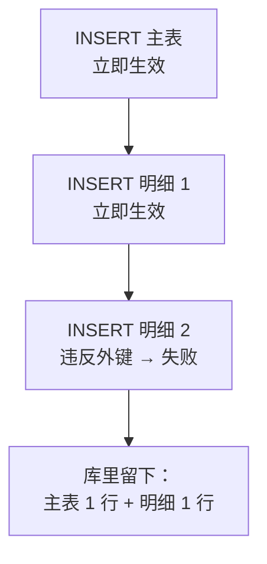
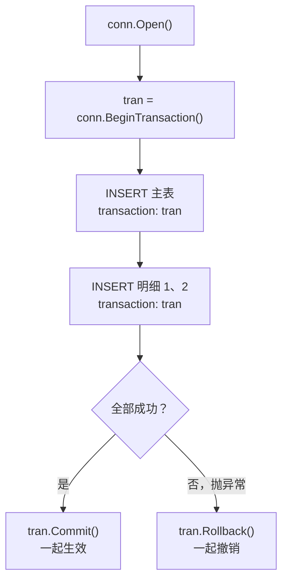
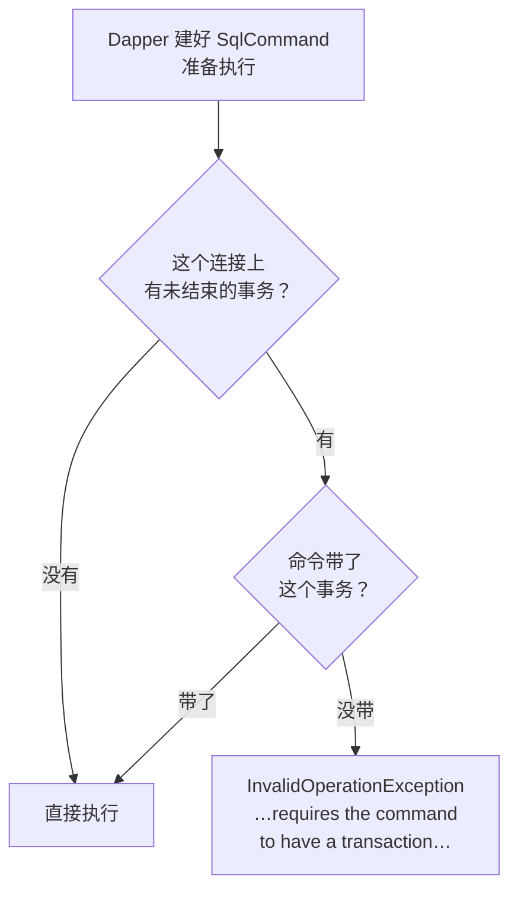
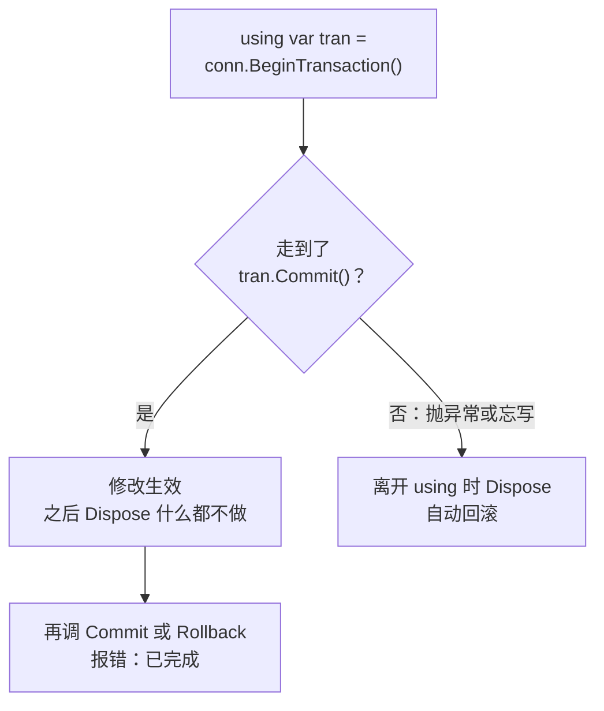

# 第 9 章 事务

## 这一章解决什么问题

新建一张价格申请单，要写两张表：主表 `PriceRequest` 一行，明细 `PriceRequestItem` 若干行。第 6 章你已经会分别插入它们，但那是**一条一条独立执行**的：主表插进去了，第 2 条明细因为产品编号不对失败了，库里就留下一张"只有半截明细"的单据。

本章用事务（transaction）把这几条语句绑成一个整体：**要么全部成功，要么一条都不算**。并讲清 Dapper 里最常见的事务错误：开了事务却忘了把它传给某一条命令。

## 开始之前

- 前面几章你已经会了：
  - 第 6 章：`Execute` 返回受影响行数；`OUTPUT INSERTED.Id` + `ExecuteScalar<int>` 取新单据的 Id；给 `Execute` 传一个集合，Dapper 会逐条执行，并且说过"不在事务里会部分成功，第 9 章讲"——就是本章。
  - 第 8 章：用 `commandType: CommandType.StoredProcedure` 调存储过程。存储过程里可以自己写 `BEGIN TRAN … COMMIT`；本章讲的是另一种做法：**在 C# 这边**控制事务。
- 需要的环境：和前几章一样的解决方案和 `PriceDemo` 库。本章的例子会往库里写数据，每个例子开头都会先清掉自己上次留下的单据，可以反复运行。
- 预计耗时：80–90 分钟。

---

## 正文

### 9.1 准备：新建本章项目

本章有 4 个例子，外加练习。和第 2 章一样，都放在**同一个新项目**里，每做一个例子就把 `Program.cs` **整个替换掉**。

1. 在「解决方案资源管理器」里**右键解决方案** →「**添加 → 新建项目**」→ 选「控制台应用」，项目名称填 `Ch09Demo`，框架选 **.NET 10.0**，点「创建」。
2. **右键 `Ch09Demo` 项目 →「设为启动项目」**。
3. 「工具 → NuGet 包管理器 → 管理解决方案的 NuGet 程序包」→「浏览」，给 `Ch09Demo` 装上和第 2 章相同的三个包：`Dapper` 2.1.89、`Microsoft.Data.SqlClient` 7.1.1、`System.Security.Cryptography.Pkcs` 10.0.13。

装完后 csproj 与第 2 章 2.1 节完全相同（本章各项目的 csproj 也都相同）。运行一律用「调试 → 开始执行(不调试)」**Ctrl+F5**。

> 本章不需要新的 NuGet 包。事务对象 `SqlTransaction` 来自 `Microsoft.Data.SqlClient`，是 ADO.NET 的东西，**Dapper 自己没有任何"事务类"**。这一点决定了本章的所有写法。

---

### 9.2 概念一：`BeginTransaction` + 每条命令传 `transaction`

**白话定义**：先在**已打开**的连接上调用 `conn.BeginTransaction()`，拿到一个事务对象 `tran`；之后这个连接上的**每一条** Dapper 调用都加上参数 `transaction: tran`；全部成功调 `tran.Commit()`，中途失败调 `tran.Rollback()`。

**业务场景**：新建申请单 = 插主表 + 插 N 条明细。提交审批 = 改主表状态 + 写一条审批记录。这类"几条语句合起来才算一件事"的操作，都要包在一个事务里。

**反例（什么时候不该用）**：
- **只有一条语句**时不用加。SQL Server 每条语句本身就是原子的：一条 `UPDATE` 改 100 行，要么 100 行全改，要么一行都不改。再包一层事务只是多写代码。
- **事务里不要等人**。不要在 `BeginTransaction` 和 `Commit` 之间弹窗确认、调外部接口、等用户输入。事务没结束，改过的行一直被锁着，别人读这些行会被卡住（踩坑警告里有实测）。
- **跨两个数据库、或者要把几个方法的事务合成一个**，用的是 `TransactionScope`（分布式 / 环境事务），不在本章范围。本章只讲一个连接上的本地事务，这也是日常最常用的。

#### 🖼 图解：没有事务时，失败的那一步之前的都已经生效了



没有事务时，每条语句执行完就"落地"了（SQL Server 的自动提交模式）。后面的失败**不会**把前面的撤回来。

#### 💻 第一步：先看问题——不用事务

把 `Ch09Demo` 的 `Program.cs` 整个替换成：

```csharp
// code/ch09/Step1-NoTransaction/Program.cs
// 不用事务新建"主表 + 2 条明细"：第 2 条明细失败后，主表和第 1 条明细留在了库里
using Dapper;
using Microsoft.Data.SqlClient;

const string connStr =
    "Server=.;Database=PriceDemo;Integrated Security=True;TrustServerCertificate=True;";

using var conn = new SqlConnection(connStr);

// 先清掉上次运行留下的单据，保证这个例子可以反复运行（先删明细再删主表，外键要求这个顺序）
conn.Execute(@"
    DELETE i FROM dbo.PriceRequestItem i
    JOIN dbo.PriceRequest r ON r.Id = i.RequestId
    WHERE r.RequestNo = 'PR20261020';
    DELETE FROM dbo.PriceRequest WHERE RequestNo = 'PR20261020';");

try
{
    // 第 1 步：插主表。OUTPUT INSERTED.Id 取回新单据的 Id（第 6 章讲过）
    int newId = conn.ExecuteScalar<int>(@"
        INSERT dbo.PriceRequest (RequestNo, CustomerId, Applicant)
        OUTPUT INSERTED.Id
        VALUES (@RequestNo, @CustomerId, @Applicant)",
        new { RequestNo = "PR20261020", CustomerId = 2, Applicant = "李娜" });
    Console.WriteLine($"第 1 步 主表已插入，新 Id = {newId}");

    // 第 2 步：插两条明细。传数组 → Dapper 逐条执行 INSERT（第 6 章讲过）
    // 第 2 条的 ProductId = 99，产品表里没有这个产品 → 违反外键
    var items = new[]
    {
        new { RequestId = newId, ProductId = 1,  Qty = 1, RequestPrice = 170000m },
        new { RequestId = newId, ProductId = 99, Qty = 2, RequestPrice = 25000m },
    };
    conn.Execute(@"
        INSERT dbo.PriceRequestItem (RequestId, ProductId, Qty, RequestPrice)
        VALUES (@RequestId, @ProductId, @Qty, @RequestPrice)", items);
    Console.WriteLine("第 2 步 明细已插入");      // 走不到这一行
}
catch (SqlException ex)
{
    Console.WriteLine($"出错了，错误号 {ex.Number}：");
    Console.WriteLine(ex.Message);
}

// 第 3 步：看看库里留下了什么
int heads = conn.ExecuteScalar<int>(
    "SELECT COUNT(*) FROM dbo.PriceRequest WHERE RequestNo = 'PR20261020'");
int lines = conn.ExecuteScalar<int>(@"
    SELECT COUNT(*) FROM dbo.PriceRequestItem i
    JOIN dbo.PriceRequest r ON r.Id = i.RequestId
    WHERE r.RequestNo = 'PR20261020'");
Console.WriteLine($"残留：主表 {heads} 行，明细 {lines} 行");
```

#### 🔍 拆解运行结果

实测输出：

```text
第 1 步 主表已插入，新 Id = 4
出错了，错误号 547：
The INSERT statement conflicted with the FOREIGN KEY constraint "FK__PriceRequ__Produ__13F1F5EB". The conflict occurred in database "PriceDemo", table "dbo.Product", column 'Id'.
The statement has been terminated.
残留：主表 1 行，明细 1 行
```

| 输出 | 说明 |
|---|---|
| `新 Id = 4` | 主表插入成功。库里原来有 3 张单，所以是 4 |
| 错误号 547 | 外键冲突（第 6 章删除时也见过 547）。中文版 SQL Server 的文字是：`INSERT 语句与 FOREIGN KEY 约束"FK__PriceRequ__Produ__…"冲突。该冲突发生于数据库"PriceDemo"，表"dbo.Product", column 'Id'。` |
| `FK__PriceRequ__Produ__13F1F5EB` | 建表时没给外键起名，SQL Server 自动生成了名字，**后面那串十六进制每台机器都不一样**，你看到的不会是 `13F1F5EB` |
| `第 2 步 明细已插入` 没打印 | `Execute` 传数组时逐条执行，第 2 条抛异常，后面的代码就不执行了 |
| **主表 1 行，明细 1 行** | 这就是问题：一张"有头无尾"的单据。用户以为没建成，再建一次，就有了两张单 |

> 📷 **截图占位 ch09-01**：控制台显示上面的输出，最后一行"残留：主表 1 行，明细 1 行"。
<!--  -->

想在 SSMS 里亲眼看看残留，执行：

```sql
SELECT r.Id, r.RequestNo, i.ProductId, i.Qty
FROM dbo.PriceRequest r
LEFT JOIN dbo.PriceRequestItem i ON i.RequestId = r.Id
WHERE r.RequestNo = 'PR20261020';
```

#### 🖼 图解：加上事务以后



#### 💻 第二步：同样的操作放进事务

把 `Program.cs` 整个替换成：

```csharp
// code/ch09/Step2-WithTransaction/Program.cs
// 同样的"主表 + 2 条明细"放进一个事务：第 2 条失败 → 回滚 → 库里什么都不留
using Dapper;
using Microsoft.Data.SqlClient;

const string connStr =
    "Server=.;Database=PriceDemo;Integrated Security=True;TrustServerCertificate=True;";

using var conn = new SqlConnection(connStr);

// 清掉上次运行留下的单据（第 1 步的例子可能留下了残留）
conn.Execute(@"
    DELETE i FROM dbo.PriceRequestItem i
    JOIN dbo.PriceRequest r ON r.Id = i.RequestId
    WHERE r.RequestNo = 'PR20261020';
    DELETE FROM dbo.PriceRequest WHERE RequestNo = 'PR20261020';");

// ① 事务要求连接先打开。BeginTransaction 是 ADO.NET 的方法，Dapper 的"自动打开"管不到它
conn.Open();

// ② 开始事务，拿到事务对象 tran
using var tran = conn.BeginTransaction();
try
{
    // ③ 每一条命令都把 tran 传进去：transaction: tran
    int newId = conn.ExecuteScalar<int>(@"
        INSERT dbo.PriceRequest (RequestNo, CustomerId, Applicant)
        OUTPUT INSERTED.Id
        VALUES (@RequestNo, @CustomerId, @Applicant)",
        new { RequestNo = "PR20261020", CustomerId = 2, Applicant = "李娜" },
        transaction: tran);
    Console.WriteLine($"第 1 步 主表已插入（未提交），新 Id = {newId}");

    var items = new[]
    {
        new { RequestId = newId, ProductId = 1,  Qty = 1, RequestPrice = 170000m },
        new { RequestId = newId, ProductId = 99, Qty = 2, RequestPrice = 25000m },  // 99 不存在 → 外键报错
    };
    conn.Execute(@"
        INSERT dbo.PriceRequestItem (RequestId, ProductId, Qty, RequestPrice)
        VALUES (@RequestId, @ProductId, @Qty, @RequestPrice)",
        items, transaction: tran);

    // ④ 全部成功才提交
    tran.Commit();
    Console.WriteLine("已提交");
}
catch (SqlException ex)
{
    // ⑤ 任何一步失败：回滚，前面已经执行的 INSERT 全部撤销
    tran.Rollback();
    Console.WriteLine($"出错了，错误号 {ex.Number}，已回滚");
}

// 事务已经结束（回滚了），后面的查询不用再传 tran
int heads = conn.ExecuteScalar<int>(
    "SELECT COUNT(*) FROM dbo.PriceRequest WHERE RequestNo = 'PR20261020'");
int lines = conn.ExecuteScalar<int>(@"
    SELECT COUNT(*) FROM dbo.PriceRequestItem i
    JOIN dbo.PriceRequest r ON r.Id = i.RequestId
    WHERE r.RequestNo = 'PR20261020'");
Console.WriteLine($"残留：主表 {heads} 行，明细 {lines} 行");

// 自增值不会随回滚退回去：再插一张看看新 Id 是多少
int nextId = conn.ExecuteScalar<int>(@"
    INSERT dbo.PriceRequest (RequestNo, CustomerId, Applicant)
    OUTPUT INSERTED.Id
    VALUES ('PR20261020', 2, N'李娜')");
Console.WriteLine($"回滚后再插一张，新 Id = {nextId}");
conn.Execute("DELETE FROM dbo.PriceRequest WHERE Id = @Id", new { Id = nextId });   // 看完就删，不留垃圾
```

#### 🔍 拆解运行结果

接着第一步运行（第一步留下的残留会先被清掉）。实测输出：

```text
第 1 步 主表已插入（未提交），新 Id = 5
出错了，错误号 547，已回滚
残留：主表 0 行，明细 0 行
回滚后再插一张，新 Id = 6
```

| 输出 | 说明 |
|---|---|
| `新 Id = 5` | 事务里的 INSERT 也会真的执行，`OUTPUT INSERTED.Id` 照样拿得到 Id，只是还没提交 |
| `已回滚` | 第 2 条明细失败 → 进 `catch` → `Rollback()`，主表和第 1 条明细一起撤销 |
| **主表 0 行，明细 0 行** | 问题解决：要么全有，要么全无 |
| `新 Id = 6` | 注意不是 5。**自增值不随回滚退回**，被回滚的 5 就空着了。所以单号、Id 出现"跳号"是正常的，不要拿 Id 连续来做业务校验 |

代码里编号的 5 处，对应图里的 5 步：

| 编号 | 写法 | 为什么 |
|---|---|---|
| ① | `conn.Open()` | `BeginTransaction` 是 `SqlConnection` 自己的方法，要求连接已打开。第 2 章讲的"Dapper 自动开关连接"只对 Dapper 的方法有效 |
| ② | `using var tran = conn.BeginTransaction()` | 拿到事务对象。`using` 的作用 9.4 节讲 |
| ③ | `transaction: tran` | 告诉 Dapper：这条命令属于这个事务。**每一条都要写**，9.3 节专门讲忘写的后果 |
| ④ | `tran.Commit()` | 放在 try 的最后一行：前面任何一步抛异常，都走不到这里 |
| ⑤ | `tran.Rollback()` | 撤销这个事务里已经做过的所有修改 |

**`transaction: tran` 是什么写法**：C# 的命名参数（named argument）。打开 F12 看 `Execute` 的定义，参数顺序是 `(sql, param, transaction, commandTimeout, commandType)`。写成 `transaction: tran` 就不用管它排第几个，也不容易传错位置（踩坑警告里有一个传错位置的实测）。

#### 改坏一处试试

把 ① 那一行 `conn.Open();` 注释掉，运行。实测报错：

```text
Unhandled exception. System.InvalidOperationException: Invalid operation. The connection is closed.
   at Microsoft.Data.SqlClient.SqlConnection.GetOpenTdsConnection()
   at Microsoft.Data.SqlClient.SqlConnection.BeginTransaction(IsolationLevel iso, String transactionName)
   at Microsoft.Data.SqlClient.SqlConnection.BeginTransaction()
```

中文环境下（实测）第一行是：`System.InvalidOperationException: 无效操作。连接被关闭。`

**怎么读这条报错**：看堆栈的第 2、3 行，出错的是 `SqlConnection.BeginTransaction`，里面**一行 Dapper 都没有**。说明这不是 Dapper 的问题，而是 ADO.NET 要求"开事务前连接必须是打开的"。前面清理数据那句 `conn.Execute(...)` 没报错，是因为 Dapper 替你开了连接，用完又关上了（第 2 章 2.3 节例 4）。

---

### 9.3 概念二：忘传 `transaction` 的报错

**白话定义**：一个连接上开了事务以后，这个连接上的**每一条命令**（写的、读的、取单值的）都必须带着这个事务。少带一条，SqlClient 直接拒绝执行，抛 `InvalidOperationException`。

**业务场景**：你在事务里先插主表，再查一下"这个客户现在有几张待审单"决定要不要继续，最后插明细。中间那句**查询**最容易忘传 `tran`，因为大家总觉得"只是读一下"。

**反例（什么时候不该传）**：
- 事务已经 `Commit` 或 `Rollback` 了，后面的命令**不需要**再传 `tran`（9.2 节例子最后的查询就没传）。
- **另一个连接**上的命令**不能**传这个 `tran`。事务属于开它的那个连接，别的连接拿去用会报错（见下面"改坏一处"）。

#### 🖼 图解：SqlClient 在执行前做的检查



这个检查是 SqlClient 做的，不是 Dapper 做的。你用 ADO.NET 时忘了写 `cmd.Transaction = tran;`，得到的是**同一条**报错。

#### 💻 最小可运行代码：三种"忘传"

把 `Program.cs` 整个替换成：

```csharp
// code/ch09/Step3-ForgetTransaction/Program.cs
// 事务进行中，忘传 transaction 会怎样：写、读、取单值三种情况各试一次，再看正确写法
using Dapper;
using Microsoft.Data.SqlClient;

const string connStr =
    "Server=.;Database=PriceDemo;Integrated Security=True;TrustServerCertificate=True;";

using var conn = new SqlConnection(connStr);
conn.Open();
using var tran = conn.BeginTransaction();

// 情况 1：写操作忘传 transaction
try
{
    conn.Execute("UPDATE dbo.PriceRequest SET Remark = N'改了备注' WHERE Id = 3");
}
catch (InvalidOperationException ex)
{
    Console.WriteLine("情况 1 Execute 忘传：" + ex.Message);
}

// 情况 2：读操作也一样——事务进行中，这个连接上的每一条命令都必须带上事务
try
{
    conn.Query<string>("SELECT RequestNo FROM dbo.PriceRequest WHERE Id = 3");
}
catch (InvalidOperationException ex)
{
    Console.WriteLine("情况 2 Query 忘传：" + ex.Message);
}

// 情况 3：取单值
try
{
    conn.ExecuteScalar<int>("SELECT COUNT(*) FROM dbo.PriceRequest");
}
catch (InvalidOperationException ex)
{
    Console.WriteLine("情况 3 ExecuteScalar 忘传：" + ex.Message);
}

// 正确写法：每条命令都写 transaction: tran（用命名参数，不容易传错位置）
int rows = conn.Execute(
    "UPDATE dbo.PriceRequest SET Remark = N'改了备注' WHERE Id = 3", transaction: tran);
string remark = conn.ExecuteScalar<string>(
    "SELECT Remark FROM dbo.PriceRequest WHERE Id = 3", transaction: tran)!;
Console.WriteLine($"正确写法：改了 {rows} 行，事务里读到的备注 = {remark}");

tran.Rollback();   // 演示用，不保存修改
Console.WriteLine("回滚后的备注 = " + conn.ExecuteScalar<string>(
    "SELECT Remark FROM dbo.PriceRequest WHERE Id = 3"));
```

#### 🔍 拆解运行结果

实测输出：

```text
情况 1 Execute 忘传：ExecuteNonQuery requires the command to have a transaction when the connection assigned to the command is in a pending local transaction.  The Transaction property of the command has not been initialized.
情况 2 Query 忘传：ExecuteReader requires the command to have a transaction when the connection assigned to the command is in a pending local transaction.  The Transaction property of the command has not been initialized.
情况 3 ExecuteScalar 忘传：ExecuteScalar requires the command to have a transaction when the connection assigned to the command is in a pending local transaction.  The Transaction property of the command has not been initialized.
正确写法：改了 1 行，事务里读到的备注 = 改了备注
回滚后的备注 = 追加探头
```

中文环境下的报错（实测，3 条只有开头的方法名不同）：

```text
如果分配给命令的连接位于本地挂起事务中，ExecuteNonQuery 要求命令拥有事务。命令的 Transaction 属性尚未初始化。
```

> 📷 **截图占位 ch09-02**：控制台显示三条"requires the command to have a transaction"报错和最后两行正确结果。
<!--  -->

**学会读这条报错**：

| 片段 | 含义 |
|---|---|
| `ExecuteNonQuery` / `ExecuteReader` / `ExecuteScalar` | 出事的是哪种 ADO.NET 调用。Dapper 的 `Execute` 底下是 `ExecuteNonQuery`，`Query` 底下是 `ExecuteReader`，`ExecuteScalar` 还是 `ExecuteScalar` |
| `pending local transaction` | 这个连接上有一个"还没结束的本地事务" |
| `The Transaction property of the command has not been initialized` | 命令的 `Transaction` 属性是空的——也就是你没传 `transaction: tran` |

**所以看到这条报错，就在出错的那一行 Dapper 调用上找：是不是少了 `transaction: tran`**。报错里的方法名能帮你缩小范围：说 `ExecuteReader`，就去找 `Query` 系列的调用。

最后两行说明：
- 带上 `tran` 以后，事务里**能读到自己刚改的、还没提交的数据**（"改了备注"）。
- `Rollback()` 以后，备注回到原值"追加探头"。

> **为什么 Dapper 不能自动带上事务？** Dapper 只拿到一个 `IDbConnection`，而连接对象上没有公开属性告诉别人"我身上有哪个事务"。所以只能由你每次显式传进去。第 23 章的综合项目里，仓储方法内部开事务，并把同一个 `tx` 传给方法里的每一条命令，漏写的后果也在那一章实测了一次。

#### 改坏一处试试：把事务传给另一个连接

在上面的代码里，再 `new` 一个连接 `conn2` 并打开，然后执行 `conn2.Execute("UPDATE …", transaction: tran)`（`tran` 是 `conn` 开的）。实测报错：

```text
System.InvalidOperationException: The transaction is either not associated with the current connection or has been completed.
```

中文环境（实测）：`事务要么与当前连接无关联，要么已完成。`

原因：事务属于开它的那个连接。每个 `SqlConnection` 在服务器上是一个独立的会话，A 会话的事务不能拿到 B 会话里用。这种错误常出现在"一个方法里 new 了两个连接"的代码里：开事务用的是一个，执行命令用的是另一个。**一个事务里的所有命令，必须用同一个连接对象。**

---

### 9.4 概念三：提交、回滚与 `using`

**白话定义**：
- `Commit()`：让事务里的所有修改正式生效。
- `Rollback()`：撤销事务里的所有修改。
- `using var tran = …`：离开作用域时自动调用 `tran.Dispose()`。**如果此时还没 Commit，`Dispose` 会回滚**。所以"最后一行写 Commit，中途抛异常就跳过它"，是最不容易出错的写法。

**业务场景**：一个 `CreateRequest(...)` 方法，里面插主表、插明细。你希望不管哪一步出错，方法退出时都不留半截数据，同时又不想到处写 `try/catch`。

**反例（什么时候不该这样写）**：
- **出错后还要做点别的**（比如写错误日志、换一种方式重试），就要显式写 `try { …; tran.Commit(); } catch { tran.Rollback(); throw; }`，在 `catch` 里做完这些再 `throw` 继续往外抛。
- **绝对不要在事务里吞掉异常后照样 Commit**。下面"改坏一处"就是这个错误的实测。

#### 🖼 图解：事务对象的三种结局



#### 💻 最小可运行代码：三个场景

把 `Program.cs` 整个替换成：

```csharp
// code/ch09/Step4-CommitRollback/Program.cs
// 提交、回滚与 using：没 Commit 就离开 using 会自动回滚；把 Commit 放在最后一行就是最简单的安全写法
using Dapper;
using Microsoft.Data.SqlClient;

const string connStr =
    "Server=.;Database=PriceDemo;Integrated Security=True;TrustServerCertificate=True;";

using var conn = new SqlConnection(connStr);

// 清掉上次运行留下的单据，保证可以反复运行
conn.Execute(@"
    DELETE i FROM dbo.PriceRequestItem i
    JOIN dbo.PriceRequest r ON r.Id = i.RequestId
    WHERE r.RequestNo IN ('PR20261021', 'PR20261022');
    DELETE FROM dbo.PriceRequest WHERE RequestNo IN ('PR20261021', 'PR20261022');");

conn.Open();

// 场景 A：改了数据，但没调 Commit 就离开了 using
using (var tran = conn.BeginTransaction())
{
    conn.Execute("UPDATE dbo.PriceRequest SET Remark = N'场景A改的' WHERE Id = 3",
        transaction: tran);
    Console.WriteLine("A 事务里读到：" + ReadRemark(conn, tran));
    // 故意不写 tran.Commit()
}   // ← 走到这里，using 调用 tran.Dispose()，未提交的事务被回滚
Console.WriteLine("A 离开 using 后：" + ReadRemark(conn, null));

// 场景 B：正常走完 → 提交
CreateRequest(conn, "PR20261021", productId: 3);
Console.WriteLine("B 正常提交");

// 场景 C：中途出错 → 跳过 Commit → using 结束时自动回滚
try
{
    CreateRequest(conn, "PR20261022", productId: 99);   // 产品 99 不存在
}
catch (SqlException ex)
{
    Console.WriteLine($"C 出错（错误号 {ex.Number}），没走到 Commit");
}

var saved = conn.Query<string>(
    "SELECT RequestNo FROM dbo.PriceRequest WHERE RequestNo IN ('PR20261021', 'PR20261022') ORDER BY RequestNo");
Console.WriteLine("库里的新单据：" + string.Join("、", saved));

// 读 3 号单的备注。tran 为 null 时就是普通查询
static string ReadRemark(SqlConnection conn, SqlTransaction? tran) =>
    conn.ExecuteScalar<string>("SELECT Remark FROM dbo.PriceRequest WHERE Id = 3",
        transaction: tran)!;

// 新建"主表 + 1 条明细"。推荐的最简写法：using 开事务，最后一行 Commit
static void CreateRequest(SqlConnection conn, string requestNo, int productId)
{
    using var tran = conn.BeginTransaction();

    int id = conn.ExecuteScalar<int>(@"
        INSERT dbo.PriceRequest (RequestNo, CustomerId, Applicant)
        OUTPUT INSERTED.Id
        VALUES (@RequestNo, 1, N'张伟')",
        new { RequestNo = requestNo }, transaction: tran);

    conn.Execute(@"
        INSERT dbo.PriceRequestItem (RequestId, ProductId, Qty, RequestPrice)
        VALUES (@RequestId, @ProductId, 1, 25000)",
        new { RequestId = id, ProductId = productId }, transaction: tran);

    tran.Commit();   // 只有上面全部成功才会走到这里；抛异常就跳过它，离开方法时 using 自动回滚
}
```

#### 🔍 拆解运行结果

实测输出：

```text
A 事务里读到：场景A改的
A 离开 using 后：追加探头
B 正常提交
C 出错（错误号 547），没走到 Commit
库里的新单据：PR20261021
```

| 场景 | 发生了什么 | 结论 |
|---|---|---|
| A | 事务里能读到"场景A改的"；离开 `using` 后变回"追加探头" | 没 Commit 就 Dispose = 回滚。**忘写 Commit 不会报错，只是什么都没保存** |
| B | `CreateRequest` 一路执行到 `Commit()` | PR20261021 保存成功 |
| C | 插明细时 547，异常飞出方法，`Commit()` 被跳过，`using` 结束时回滚 | PR20261022 一行都没留下 |

`CreateRequest` 方法里**没有任何 try/catch**，却做到了"出错就回滚"。这就是 `using` + 最后一行 `Commit` 的好处：

| 写法 | 代码 | 适合 |
|---|---|---|
| `using` + 最后 Commit | `using var tran = …; 语句…; tran.Commit();` | 大多数情况。出错时异常照常往外抛，由调用方处理 |
| 显式 try/catch | `try { 语句…; tran.Commit(); } catch { tran.Rollback(); throw; }` | 出错时要在这里写日志或做补救。9.2 节例子用的就是这种 |

两种写法效果一样。**注意第二种的 `throw;` 不能省**，省了就是把异常吞掉了，调用方会以为成功了。

> **场景 A 说明的另一件事**：事务结束前，别的连接读第 3 号单会被卡住（这一行被锁着），见踩坑警告。所以事务要短：准备好数据再开事务，开了就赶紧执行、赶紧提交。

#### 改坏一处试试：吞掉异常后照样 Commit

很多人"为了程序不崩"，会把 `CreateRequest` 里插明细那句包一层 try/catch，只记个日志：

```csharp
    try
    {
        conn.Execute(@"
            INSERT dbo.PriceRequestItem (RequestId, ProductId, Qty, RequestPrice)
            VALUES (@RequestId, @ProductId, 1, 25000)",
            new { RequestId = id, ProductId = productId }, transaction: tran);
    }
    catch (SqlException ex)
    {
        Console.WriteLine($"  明细插入失败（{ex.Number}），记个日志继续");   // 吞掉了异常
    }
```

替换后运行，实测输出：

```text
A 事务里读到：场景A改的
A 离开 using 后：追加探头
B 正常提交
  明细插入失败（547），记个日志继续
库里的新单据：PR20261021、PR20261022
```

**PR20261022 被保存了，但它没有明细**——和 9.2 节第一步"没有事务"的结果一样。原因有两层：

1. 异常被吞掉，代码继续往下走到了 `tran.Commit()`。
2. SQL Server 默认情况下，一条语句出错（比如 547）**只让这一条语句失败，事务本身还活着**。所以 `Commit()` 不报错，把出错之前做成的修改全部提交了。

**结论**：事务里出了错，要么回滚，要么把异常继续往外抛，**不能吞**。（在存储过程里，常用 `SET XACT_ABORT ON` 让任何错误都回滚整个事务，这属于 T-SQL 的写法，本章不展开。）

---

## 🧱 类比：ADO.NET 写法与 Dapper 写法逐项对照

| 要做的事 | ADO.NET | Dapper | 差别 |
|---|---|---|---|
| 打开连接 | `conn.Open()` | `conn.Open()` | 一样，**开事务前必须手动 Open** |
| 开始事务 | `var tran = conn.BeginTransaction();` | 同左 | 完全一样，用的就是 ADO.NET 的方法 |
| 让命令属于事务 | `cmd.Transaction = tran;`（每个 `SqlCommand` 一行） | `transaction: tran`（每次调用一个参数） | 只是写的位置不同 |
| 忘了关联事务 | `InvalidOperationException: …requires the command to have a transaction…` | **同一条报错** | 报错来自 SqlClient，两者一样 |
| 提交 / 回滚 | `tran.Commit()` / `tran.Rollback()` | 同左 | 完全一样 |
| 自动回滚 | `using (var tran = …)` 未 Commit 就离开 | 同左 | 完全一样 |
| 事务里取新 Id | `cmd.Transaction = tran; (int)cmd.ExecuteScalar()` | `conn.ExecuteScalar<int>(sql, param, transaction: tran)` | Dapper 省了建命令、加参数、强转 |
| 事务里插多条明细 | 循环里每次重设参数值再 `ExecuteNonQuery()` | `conn.Execute(sql, 集合, transaction: tran)` | Dapper 替你循环（第 6 章），仍然是逐条执行 |

一句话：**Dapper 在事务这件事上没有发明任何新东西**，事务的开始、提交、回滚全是你熟悉的 ADO.NET；Dapper 只是把 `cmd.Transaction = tran` 变成了一个参数。

## ⚠️ 踩坑警告

| 现象 | 原因 | 怎么改 |
|---|---|---|
| `…requires the command to have a transaction when the connection assigned to the command is in a pending local transaction…`（实测） | 事务进行中，某一条命令没传 `transaction: tran`。**读操作也算** | 按报错里的方法名（`ExecuteReader` 对应 `Query`）找到那一行，补上 `transaction: tran` |
| 写了 `conn.Execute(sql, tran)`，还是报上面那条错（实测） | 第二个位置是 `param`，不是 `transaction`。`tran` 被当成了参数对象，命令照样没带事务 | 一律用命名参数 `transaction: tran` |
| `Invalid operation. The connection is closed.` / `无效操作。连接被关闭。`（实测） | 没 `Open()` 就 `BeginTransaction()` | 开事务前先 `conn.Open()` |
| 程序没报错，数据却一条都没保存（实测：场景 A） | 忘写 `tran.Commit()`，`using` 结束时自动回滚了 | 检查 Commit 是否写在了 try 的最后一行 |
| 数据只保存了一半，程序也没报错（实测：吞异常） | 事务里 catch 了异常不处理，继续 Commit；SQL Server 默认一条语句出错不会让事务失效 | catch 里要么 `Rollback()`，要么 `throw;` |
| `This SqlTransaction has completed; it is no longer usable.` / `此 SqlTransaction 已完成；它再也无法使用。`（实测） | Commit 之后又调了 Commit 或 Rollback | 一个事务只能结束一次。常见于 `finally` 里无条件写了 `Rollback()`：要回滚就写在 `catch` 里 |
| 事务没结束时，另一个连接读同一行卡住（实测：读第 3 号单，`commandTimeout: 3` 下 3 秒后报 `Execution Timeout Expired.`） | 被事务改过的行在提交前一直加着锁 | 事务里不要等用户、不要调外部接口；超时参数第 14 章讲 |
| Id 跳号（实测：5 被回滚后，下一张是 6） | 自增值不随回滚退回 | 这是正常现象，不要依赖 Id 连续 |

## 🎯 动手练习

> 本章的例子和练习都往 `PriceDemo` 里写了数据。做完练习后，**重跑一遍 `code/sql/00-reset-database.sql`**，第 10 章的输出才会和教程一致。

**练习 1：用事务提交审批**

把第 3 号申请单（草稿，`Status = 0`）"提交审批"：两件事必须一起成功或一起失败——

1. `UPDATE dbo.PriceRequest SET Status = 1 WHERE Id = 3 AND Status = 0`
2. 往 `dbo.ApprovalLog` 插一条：`RequestId = 3`、`Approver = 审批人`、`Action = N'提交'`

写一个方法 `Submit(conn, 标题, approver)`，先用 `approver = null` 调一次（`Approver` 列不允许 NULL，第 2 步会失败），再用 `"张伟"` 调一次。每次调完都查一下 3 号单的状态和审批记录条数。程序开头先把 3 号单恢复成草稿、删掉它的审批记录，保证可以反复运行。

- 验收标准：输出两行，内容完全一致：

```text
第 1 次（审批人为空）：出错 515，已回滚 → 状态 0，审批记录 0 条
第 2 次（审批人张伟）：已提交 → 状态 1，审批记录 1 条
```

- 额外思考：第 1 次失败的是第 2 步，第 1 步的 `UPDATE` 明明执行成功了，为什么状态还是 0？第 8 章用存储过程做过同一件事，两种做法各有什么好处？

**练习 2：为什么一运行就报错？**

下面这段代码要给第 3 号单的明细 4 改价，并写上备注。运行后直接抛 `InvalidOperationException`（实测）。**SQL 一个字都不许改**，找出原因并修好。

```csharp
// code/ch09/Exercise2-Bug/Program.cs
// 练习 2 的原题：运行就抛 InvalidOperationException。SQL 不许改，找出原因并修好。
using Dapper;
using Microsoft.Data.SqlClient;

const string connStr =
    "Server=.;Database=PriceDemo;Integrated Security=True;TrustServerCertificate=True;";

using var conn = new SqlConnection(connStr);
conn.Open();
using var tran = conn.BeginTransaction();

// 还没审完（状态 0 草稿 / 1 待审）的单据才允许改价
byte status = conn.ExecuteScalar<byte>(
    "SELECT Status FROM dbo.PriceRequest WHERE Id = @Id", new { Id = 3 });

if (status <= 1)
{
    conn.Execute("UPDATE dbo.PriceRequestItem SET RequestPrice = @Price WHERE Id = @ItemId",
        new { Price = 24000m, ItemId = 4 }, tran);
    conn.Execute("UPDATE dbo.PriceRequest SET Remark = @Remark WHERE Id = @Id",
        new { Remark = "探头改价", Id = 3 }, tran);
}
tran.Commit();

var price = conn.ExecuteScalar<decimal>("SELECT RequestPrice FROM dbo.PriceRequestItem WHERE Id = 4");
var remark = conn.ExecuteScalar<string>("SELECT Remark FROM dbo.PriceRequest WHERE Id = 3");
Console.WriteLine($"改价完成：明细 4 申请价 = {price:N2}，备注 = {remark}");
```

- 验收标准：输出 `改价完成：明细 4 申请价 = 24,000.00，备注 = 探头改价`。并且能说出：报错里的方法名是哪一个，它对应代码里的哪一行。

卡住了看文末参考答案。

## 📌 一句话总结

开事务前先 Open，每条命令都传 tran，最后一行 Commit，出错别吞。

## 下一章

一张申请单要同时显示客户名称和城市，JOIN 查出来的一行怎么拆成"申请单 + 客户"两个对象？第 10 章讲多重映射。

---

<!-- 以下是参考答案，先自己动手，卡住了再往下翻 -->


## 参考答案

**练习 1 思路**：`Submit` 里用 `using` 开事务，两条语句都传 `transaction: tran`，最后一行 Commit；`catch (SqlException)` 里 Rollback 并打印错误号。`Approver` 为 null 时，Dapper 把它当作 `DBNull` 发给服务器，违反 `NOT NULL`，错误号 515（英文原文是 `Cannot insert the value NULL into column 'Approver', table 'PriceDemo.dbo.ApprovalLog'; column does not allow nulls. INSERT fails.`）。第 1 步的 `UPDATE` 虽然执行了，但和第 2 步在同一个事务里，回滚时一起被撤销，所以状态还是 0。

和第 8 章存储过程的对比：存储过程把事务写在服务器端，一次往返，C# 端不用管事务；本章写在 C# 端，SQL 都在代码里看得见，改起来不用动数据库对象。逻辑简单、几条语句的场景，两种都可以；团队规定"写库都走存储过程"时，就按第 8 章来。

**练习 2 思路**：报错里的方法名是 `ExecuteScalar`，对应代码里唯一一处 `conn.ExecuteScalar<byte>(...)`——事务开始后的那句状态查询，它没带事务。后面两句 `Execute` 是按位置传的 `(sql, param, tran)`，第三个位置正好是 `transaction`，所以它们是对的。给查询补上 `tran` 即可。

两题合在一个文件里，完整项目在 [`code/ch09/Exercise/`](../code/ch09/Exercise/)。实测输出：

```text
第 1 次（审批人为空）：出错 515，已回滚 → 状态 0，审批记录 0 条
第 2 次（审批人张伟）：已提交 → 状态 1，审批记录 1 条
改价完成：明细 4 申请价 = 24,000.00，备注 = 探头改价
```

```csharp
// code/ch09/Exercise/Program.cs
// 第 9 章练习参考答案：练习 1（用事务提交审批）+ 练习 2（找出忘传 transaction 的那一行）
using Dapper;
using Microsoft.Data.SqlClient;

const string connStr =
    "Server=.;Database=PriceDemo;Integrated Security=True;TrustServerCertificate=True;";

using var conn = new SqlConnection(connStr);

// 把 3 号单恢复成草稿、删掉它的审批记录，保证可以反复运行
conn.Execute(@"
    UPDATE dbo.PriceRequest SET Status = 0 WHERE Id = 3;
    DELETE FROM dbo.ApprovalLog WHERE RequestId = 3;");
conn.Open();

// ===== 练习 1 =====
Submit(conn, "第 1 次（审批人为空）", null);
Submit(conn, "第 2 次（审批人张伟）", "张伟");

// ===== 练习 2 =====
// 原题错在第一句查询没传 tran：事务进行中，这个连接上的读操作也必须带上事务
using (var tran = conn.BeginTransaction())
{
    byte status = conn.ExecuteScalar<byte>(
        "SELECT Status FROM dbo.PriceRequest WHERE Id = @Id", new { Id = 3 }, tran);

    if (status <= 1)
    {
        conn.Execute("UPDATE dbo.PriceRequestItem SET RequestPrice = @Price WHERE Id = @ItemId",
            new { Price = 24000m, ItemId = 4 }, tran);
        conn.Execute("UPDATE dbo.PriceRequest SET Remark = @Remark WHERE Id = @Id",
            new { Remark = "探头改价", Id = 3 }, tran);
    }
    tran.Commit();
}

var price = conn.ExecuteScalar<decimal>("SELECT RequestPrice FROM dbo.PriceRequestItem WHERE Id = 4");
var remark = conn.ExecuteScalar<string>("SELECT Remark FROM dbo.PriceRequest WHERE Id = 3");
Console.WriteLine($"改价完成：明细 4 申请价 = {price:N2}，备注 = {remark}");

// 提交审批：改状态 + 写审批记录，两件事要么都成功，要么都不做
static void Submit(SqlConnection conn, string title, string? approver)
{
    using (var tran = conn.BeginTransaction())
    {
        try
        {
            conn.Execute("UPDATE dbo.PriceRequest SET Status = 1 WHERE Id = 3 AND Status = 0",
                transaction: tran);
            conn.Execute(@"
                INSERT dbo.ApprovalLog (RequestId, Approver, Action)
                VALUES (3, @Approver, N'提交')",
                new { Approver = approver }, transaction: tran);   // approver 为 null → 违反 NOT NULL
            tran.Commit();
            Console.Write($"{title}：已提交");
        }
        catch (SqlException ex)
        {
            tran.Rollback();
            Console.Write($"{title}：出错 {ex.Number}，已回滚");
        }
    }

    // 事务已结束，再查结果不用传 tran
    byte status = conn.ExecuteScalar<byte>("SELECT Status FROM dbo.PriceRequest WHERE Id = 3");
    int logs = conn.ExecuteScalar<int>("SELECT COUNT(*) FROM dbo.ApprovalLog WHERE RequestId = 3");
    Console.WriteLine($" → 状态 {status}，审批记录 {logs} 条");
}
```
