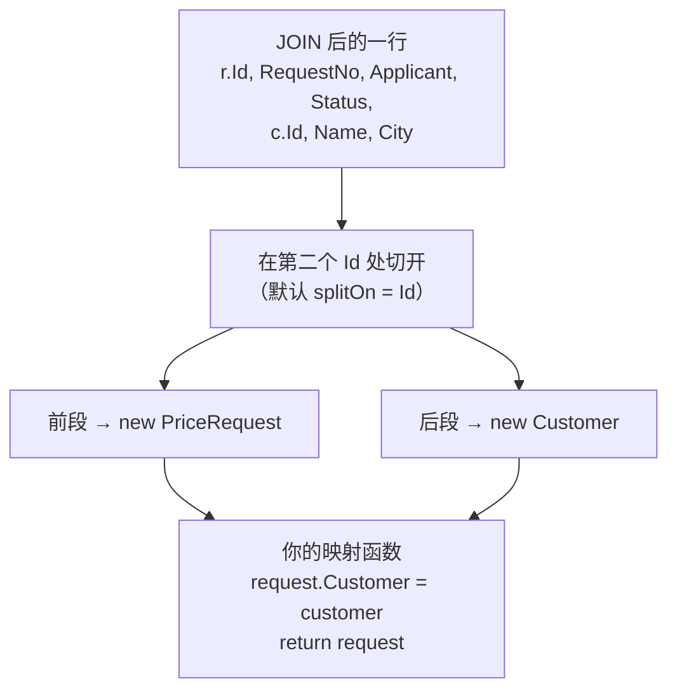
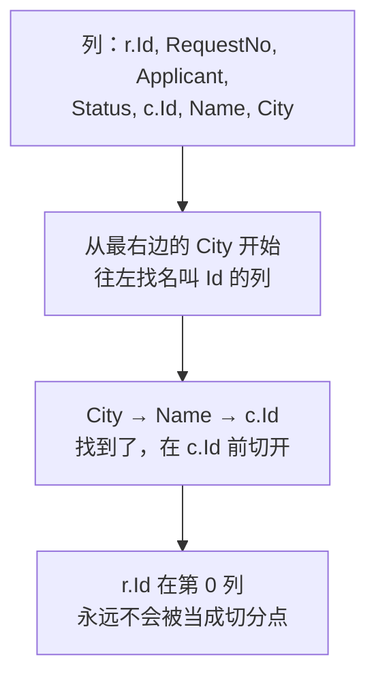
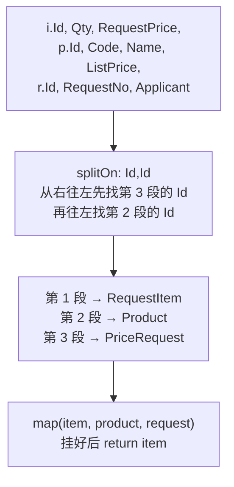

# 第 10 章 多表关联：一对一

## 这一章解决什么问题

申请单列表要显示客户名称和城市。SQL 你闭着眼都会写：`PriceRequest JOIN Customer`。但查出来的一行里，前半截是申请单、后半截是客户，而且**两边都有一列叫 `Id`**。到目前为止，你只会把一行映射成**一个**对象。

本章讲 Dapper 的多重映射（multi-mapping）：把一行拆成两个、三个对象，再按你的意思把它们挂在一起。重点讲清楚拆分点 `splitOn` 是怎么找的——这里写错了，有时报错，有时**不报错只是数据错位**。

## 开始之前

- 前面几章你已经会了：`Query<T>` 按列名映射（第 2 章）、`AS` 起别名、`Query<T>` 的执行流程与映射缓存（第 3 章）、参数化（第 4 章），以及第 9 章的事务。
- 需要的环境：和前几章一样。第 9 章往库里写过数据，**先重跑一遍 [`code/sql/00-reset-database.sql`](../code/sql/00-reset-database.sql)**，本章的输出才会和教程一致。本章只读不写。
- 预计耗时：75–90 分钟。

---

## 正文

### 10.1 准备：新建本章项目

本章 3 个例子加练习，照旧放在同一个新项目里，每个例子整个替换 `Program.cs`。

1. 「解决方案资源管理器」里**右键解决方案** →「**添加 → 新建项目**」→「控制台应用」，项目名称 `Ch10Demo`，框架 **.NET 10.0**。
2. **右键 `Ch10Demo` →「设为启动项目」**。
3. 「工具 → NuGet 包管理器 → 管理解决方案的 NuGet 程序包」，给 `Ch10Demo` 装 `Dapper` 2.1.89、`Microsoft.Data.SqlClient` 7.1.1、`System.Security.Cryptography.Pkcs` 10.0.13。csproj 与第 2 章 2.1 节相同。

本章三张表的关系：

| 关系 | 外键 | 本章的对象写法 |
|---|---|---|
| 申请单 → 客户 | `PriceRequest.CustomerId → Customer.Id` | `PriceRequest.Customer` 属性 |
| 明细 → 产品 | `PriceRequestItem.ProductId → Product.Id` | `RequestItem.Product` 属性 |
| 明细 → 申请单 | `PriceRequestItem.RequestId → PriceRequest.Id` | `RequestItem.Request` 属性 |

它们都是"**一条记录只对应对方一条记录**"的方向（一张单只属于一个客户），所以叫一对一。反过来"一张单有多条明细"是一对多，第 11 章讲。

---

### 10.2 概念一：多重映射 `Query<A, B, R>`

**白话定义**：`Query` 多写几个类型参数，再传一个映射函数（map）。Dapper 把每一行**从左到右切成几段**，每段 new 一个对象，然后把这几个对象交给你的映射函数；函数的返回值就是结果集合里的一个元素。

**业务场景**：申请单列表要显示"单号 / 申请人 / 状态 / 客户名称 / 城市"，而你希望在代码里写 `r.Customer.Name`，而不是给申请单类塞一个 `CustomerName` 属性。

**反例（什么时候不该用）**：
- **只是显示，用不到 `Customer` 对象本身**。比如报表只要一列客户名称，直接 `c.Name AS CustomerName` 起别名（第 2 章 2.4 节），配一个扁平的类，比多重映射简单得多。
- **一对多**（一张单 + 多条明细）。直接用本节的写法会得到重复的申请单，第 11 章讲。

#### 🖼 图解：一行切成两段



每一段内部的映射规则，和第 2 章讲的完全一样：按列名找同名属性，不分大小写，对不上的跳过。

#### 💻 最小可运行代码

把 `Ch10Demo` 的 `Program.cs` 整个替换成：

```csharp
// code/ch10/Step1-MultiMap/Program.cs
// 多重映射：一条 JOIN 查询，每一行拆成"申请单 + 客户"两个对象，再由你把客户挂到申请单上
using Dapper;
using Microsoft.Data.SqlClient;

const string connStr =
    "Server=.;Database=PriceDemo;Integrated Security=True;TrustServerCertificate=True;";

using var conn = new SqlConnection(connStr);

// 前 4 列属于申请单，从 c.Id 开始的 3 列属于客户
const string sql = @"
    SELECT r.Id, r.RequestNo, r.Applicant, r.Status,
           c.Id, c.Name, c.City
    FROM dbo.PriceRequest r
    JOIN dbo.Customer c ON c.Id = r.CustomerId
    ORDER BY r.Id";

// 三个类型参数：<第一个对象, 第二个对象, 最终返回的类型>
var requests = conn.Query<PriceRequest, Customer, PriceRequest>(
    sql,
    (request, customer) =>          // Dapper 每读一行调用一次这个函数
    {
        request.Customer = customer;   // 怎么"挂"上去由你决定，Dapper 不会替你做
        return request;                // 返回值就是结果集合里的一个元素
    }).ToList();                       // 没写 splitOn：默认在名叫 Id 的列处切开

foreach (var r in requests)
    Console.WriteLine($"{r.RequestNo}  {r.Applicant}  状态={r.Status}  " +
                      $"客户={r.Customer!.Name}（{r.Customer.City}，Id={r.Customer.Id}）");

// 1 号和 3 号单的客户都是"华东第一医院"，它们拿到的是同一个 Customer 对象吗？
Console.WriteLine($"1 号和 3 号单的 Customer 是同一个对象吗？" +
                  $"{ReferenceEquals(requests[0].Customer, requests[2].Customer)}");

public class PriceRequest
{
    public int Id { get; set; }
    public string RequestNo { get; set; } = "";
    public string Applicant { get; set; } = "";
    public int Status { get; set; }
    public Customer? Customer { get; set; }   // 一对一：每张申请单属于一个客户。不在表里，靠映射函数赋值
}

public class Customer
{
    public int Id { get; set; }
    public string Name { get; set; } = "";
    public string City { get; set; } = "";
}
```

#### 🔍 拆解运行结果

实测输出：

```text
PR20261001  张伟  状态=2  客户=华东第一医院（上海，Id=1）
PR20261008  李娜  状态=1  客户=江南检测中心（杭州，Id=2）
PR20261015  张伟  状态=0  客户=华东第一医院（上海，Id=1）
1 号和 3 号单的 Customer 是同一个对象吗？False
```

> 📷 **截图占位 ch10-01**：控制台显示上面 4 行输出。
<!--  -->

逐个看关键点：

| 位置 | 说明 |
|---|---|
| `Query<PriceRequest, Customer, PriceRequest>` | 前两个是"每行切出来的对象类型"，**按 SELECT 里列的先后顺序写**；最后一个是返回类型。返回类型通常就是第一个 |
| `(request, customer) => { … }` | 映射函数。参数个数 = 前面的对象类型个数。Dapper **每读一行调用一次** |
| `request.Customer = customer;` | 挂到哪个属性、要不要挂，都是你决定。Dapper 不认识 `Customer` 属性，它只是把两个对象交给你 |
| 申请单的 `Id` 是 1/2/3，客户的 `Id` 是 1/2/1 | 两个 `Id` 列各进了各的对象，没有互相覆盖 |
| `False` | 1 号和 3 号单的客户都是"华东第一医院"，但**每一行都 new 了一个新的 Customer**，这是两个内容相同的不同对象。一对一时没关系；到了一对多，这个行为就会造成重复，第 11 章要处理 |

**和 ADO.NET 的区别**：用 `SqlDataReader` 读这个结果集，两列都叫 `Id`，你只能靠列序号 `reader.GetInt32(4)` 或者在 SQL 里起别名 `c.Id AS CustomerId` 来区分。Dapper 靠"切段"解决了这个问题：每一段里只有一个 `Id`。

#### 改坏一处试试

把映射函数里的 `request.Customer = customer;` 注释掉，运行。实测报错：

```text
Unhandled exception. System.NullReferenceException: Object reference not set to an instance of an object.
   at Program.<Main>$(String[] args) in …/Program.cs:line 29
```

Dapper 照常 new 了 Customer 对象并交给了你，但你没挂上去，`r.Customer` 就一直是 null，打印 `r.Customer!.Name` 时就炸了。`!` 只是让编译器不再警告，**运行时并不保证非 null**。

**怎么读**：`NullReferenceException` 的堆栈里**没有 Dapper**，只有你自己的那一行（第 29 行就是 `Console.WriteLine` 那一句）。说明查询本身没问题，是映射函数没做该做的事。

---

### 10.3 概念二：`splitOn` 的原理

**白话定义**：`splitOn` 写的是**第二个对象的第一列**的列名，Dapper 在这一列前面切一刀。不写时默认是 `"Id"`。

找这一列的规则只有两条：

1. **从右往左找**：从最后一列开始往左，找到的**第一个**同名列就是切分点。
2. **第 0 列永远不算**：第一个对象至少要占一列，所以最左边那列即使叫 `Id` 也不会被当作切分点。

**业务场景**：列表页不需要客户 Id，SQL 里只查 `c.Name, c.City`。这时第二段的第一列叫 `Name`，就要写 `splitOn: "Name"`。

**反例（什么时候不该依赖默认值）**：只要第二个对象的第一列**不是** `Id`，就必须显式写 `splitOn`。另外，**不要拿可能为 NULL 的普通列当切分列**。Dapper 只看切分列的值：它是 NULL，就认为整个对象不存在，直接给你 null（练习 1 会用到这条规则）。实测：把审批记录那一段改成从 `a.Comment` 开始、`splitOn: "Comment"`，1 号单那条"提交"记录的 Comment 是 NULL，整条记录就被当成了 null，明明有数据却显示"没有记录"。用主键当切分列最稳妥，主键不会是 NULL。

#### 🖼 图解：从右往左找切分列



所以第 10.2 节不写 `splitOn` 也能对：从右往左第一个 `Id` 正好是 `c.Id`。

#### 💻 最小可运行代码：两个实验

把 `Program.cs` 整个替换成：

```csharp
// code/ch10/Step2-SplitOn/Program.cs
// splitOn 的两个实验：第二个对象的第一列不叫 Id 时要写 splitOn；列顺序写错会静默错位
using Dapper;
using Microsoft.Data.SqlClient;

const string connStr =
    "Server=.;Database=PriceDemo;Integrated Security=True;TrustServerCertificate=True;";

using var conn = new SqlConnection(connStr);

// 实验 1：列表页不需要客户 Id，客户部分从 c.Name 开始 → 告诉 Dapper 在 Name 列处切开
var list1 = conn.Query<PriceRequest, Customer, PriceRequest>(@"
    SELECT r.Id, r.RequestNo, r.Applicant, r.Status,
           c.Name, c.City
    FROM dbo.PriceRequest r
    JOIN dbo.Customer c ON c.Id = r.CustomerId
    ORDER BY r.Id",
    (request, customer) => { request.Customer = customer; return request; },
    splitOn: "Name");                  // 切分列 = 第二个对象的第一列

Console.WriteLine("实验 1 splitOn: \"Name\"");
foreach (var r in list1)
    Console.WriteLine($"  {r.RequestNo}  状态={r.Status}  客户={r.Customer!.Name}（{r.Customer.City}）");

// 实验 2：有人把 r.Status 加到了 SELECT 的最后——它落在切分点右边，被分给了客户
var list2 = conn.Query<PriceRequest, Customer, PriceRequest>(@"
    SELECT r.Id, r.RequestNo, r.Applicant,
           c.Id, c.Name, c.City,
           r.Status
    FROM dbo.PriceRequest r
    JOIN dbo.Customer c ON c.Id = r.CustomerId
    ORDER BY r.Id",
    (request, customer) => { request.Customer = customer; return request; });

Console.WriteLine("实验 2 r.Status 放到了最后");
foreach (var r in list2)
    Console.WriteLine($"  {r.RequestNo}  状态={r.Status}  客户={r.Customer!.Name}（{r.Customer.City}）");

public class PriceRequest
{
    public int Id { get; set; }
    public string RequestNo { get; set; } = "";
    public string Applicant { get; set; } = "";
    public int Status { get; set; }
    public Customer? Customer { get; set; }
}

public class Customer
{
    public int Id { get; set; }
    public string Name { get; set; } = "";
    public string City { get; set; } = "";
}
```

#### 🔍 拆解运行结果

实测输出：

```text
实验 1 splitOn: "Name"
  PR20261001  状态=2  客户=华东第一医院（上海）
  PR20261008  状态=1  客户=江南检测中心（杭州）
  PR20261015  状态=0  客户=华东第一医院（上海）
实验 2 r.Status 放到了最后
  PR20261001  状态=0  客户=华东第一医院（上海）
  PR20261008  状态=0  客户=江南检测中心（杭州）
  PR20261015  状态=0  客户=华东第一医院（上海）
```

| 实验 | 看到了什么 | 为什么 |
|---|---|---|
| 1 | 客户名称、城市都对 | 从右往左找 `Name`：City → Name，在 `c.Name` 前切开。客户对象没有 `Id` 列，它的 `Id` 保持默认值 0，这里用不到，没关系 |
| 2 | **状态全是 0**，没有任何报错 | 切分点还是 `c.Id`。`r.Status` 写在它右边，就被分到了客户那一段；`Customer` 类没有 `Status` 属性，这一列被跳过；申请单的 `Status` 没人赋值，保持默认值 0 |

实验 2 是本章最需要记住的结论：**SELECT 里列的位置决定它属于哪个对象，和列前面写的表别名 `r.` / `c.` 无关。** Dapper 拿到的结果集里根本没有 `r.`、`c.` 这些前缀，只有列名和位置。

所以多表映射的 SQL，列要**按对象分组、按对象顺序**写：

```text
第一个对象的列 … | 第二个对象的切分列, 第二个对象的其他列 … | 第三个对象的切分列, …
```

以后给这个查询加列，要加到**它所属对象的那一段里**，不能顺手加在 SELECT 的最后。

> 📷 **截图占位 ch10-02**：控制台显示实验 2 的输出，"状态=0"三行。
<!--  -->

#### 改坏一处试试

把实验 1 里的 `splitOn: "Name"` 删掉（也就是用默认值 `"Id"`），运行。实测报错：

```text
Unhandled exception. System.ArgumentException: Multi-map error: splitOn column 'Id' was not found - please ensure your splitOn parameter is set and in the correct order (Parameter 'splitOn')
   at Dapper.SqlMapper.GetNextSplit(Int32 startIdx, String splitOn, DbDataReader reader)
   at Dapper.SqlMapper.GenerateDeserializers(Identity identity, String splitOn, DbDataReader reader)
```

（这是 Dapper 自己的报错，不随系统语言变化，只有英文。）

**怎么读这条报错**：

| 片段 | 含义 |
|---|---|
| `Multi-map error` | 多重映射出错，问题在 `splitOn` 或列的顺序上，不在 SQL |
| `splitOn column 'Id' was not found` | Dapper 在找名叫 `Id` 的切分列，没找到 |
| `please ensure your splitOn parameter is set and in the correct order` | 提醒你：splitOn 设了没有？顺序对不对？ |

注意：实验 1 的 SQL 里**明明有** `r.Id`，Dapper 却说找不到 `Id`。这正好证实了规则 2：`r.Id` 在第 0 列，不算。

把 `splitOn` 拼错成 `"Nmae"`，报错是同一条，只是引号里换成了 `'Nmae'`（实测）。所以看到这条报错，就拿引号里的名字去 SELECT 里找：**它是不是在第 0 列之后？拼写对不对？**

**两种错误放在一起对比**：

| 错误 | 表现 | 难度 |
|---|---|---|
| 切分列找不到（实验 1 去掉 splitOn） | 立刻抛 `Multi-map error` | 容易查：报错里有列名 |
| 切分列找到了，但列放错了段（实验 2） | **不报错**，某些属性是默认值 | 难查：只能靠核对输出 |

---

### 10.4 概念三：三表映射

**白话定义**：多一个对象，就多一个类型参数、多一个切分点。`splitOn` 里用逗号分隔多个列名，从左到右依次是**第 2 个、第 3 个……对象**的第一列。

**业务场景**：做一张"申请价折扣率"报表：每条明细要显示单号、申请人（来自申请单）、产品编码和目录价（来自产品）、申请价和数量（来自明细）。三张表 JOIN，一行切成三个对象。

**反例（什么时候不该用）**：
- **对象超过 3–4 个**时，映射函数和 splitOn 都会变得很难核对。这时考虑只取需要的列做一个扁平的报表类，或者拆成几次查询。泛型版本最多支持 7 个对象（`Query<T1, …, T7, TReturn>`），再多要用传 `Type[]` 的重载，本教程不展开。
- **三张表里有一对多**（比如"申请单 + 明细 + 审批记录"），直接 JOIN 会让行数成倍增加，应该用第 11 章或第 12 章的办法。

#### 🖼 图解：一行切成三段



#### 💻 最小可运行代码

把 `Program.cs` 整个替换成：

```csharp
// code/ch10/Step3-ThreeTables/Program.cs
// 三表映射：明细 + 产品 + 申请单，一行拆成三个对象，做一张"申请价折扣率"报表
using Dapper;
using Microsoft.Data.SqlClient;

const string connStr =
    "Server=.;Database=PriceDemo;Integrated Security=True;TrustServerCertificate=True;";

using var conn = new SqlConnection(connStr);

// 三段列：明细 | 产品（从 p.Id 开始）| 申请单（从 r.Id 开始）
const string sql = @"
    SELECT i.Id, i.Qty, i.RequestPrice,
           p.Id, p.Code, p.Name, p.ListPrice,
           r.Id, r.RequestNo, r.Applicant
    FROM dbo.PriceRequestItem i
    JOIN dbo.Product p      ON p.Id = i.ProductId
    JOIN dbo.PriceRequest r ON r.Id = i.RequestId
    ORDER BY i.Id";

// 四个类型参数：<第 1 段, 第 2 段, 第 3 段, 返回类型>
var items = conn.Query<RequestItem, Product, PriceRequest, RequestItem>(
    sql,
    (item, product, request) =>
    {
        item.Product = product;
        item.Request = request;
        return item;
    },
    splitOn: "Id,Id");     // 三个对象 = 两个切分点，用逗号分隔，从左到右对应第 2、第 3 个对象

foreach (var i in items)
{
    // 折扣率 = 申请价 ÷ 目录价。自己算百分比，避免不同区域设置下 P 格式的写法不同
    decimal rate = i.RequestPrice / i.Product!.ListPrice * 100;
    Console.WriteLine($"{i.Request!.RequestNo}  {i.Request.Applicant}  {i.Product.Code,-7}" +
                      $"目录价 {i.Product.ListPrice,10:N2}  申请价 {i.RequestPrice,10:N2}  " +
                      $"× {i.Qty}  折扣率 {rate:F2}%");
}

public class RequestItem
{
    public int Id { get; set; }
    public int Qty { get; set; }
    public decimal RequestPrice { get; set; }
    public Product? Product { get; set; }
    public PriceRequest? Request { get; set; }
}

public class Product
{
    public int Id { get; set; }
    public string Code { get; set; } = "";
    public string Name { get; set; } = "";
    public decimal ListPrice { get; set; }
}

public class PriceRequest
{
    public int Id { get; set; }
    public string RequestNo { get; set; } = "";
    public string Applicant { get; set; } = "";
}
```

#### 🔍 拆解运行结果

实测输出：

```text
PR20261001  张伟  US-100 目录价 180,000.00  申请价 165,000.00  × 2  折扣率 91.67%
PR20261001  张伟  PB-01  目录价  26,000.00  申请价  23,000.00  × 4  折扣率 88.46%
PR20261008  李娜  US-200 目录价 420,000.00  申请价 395,000.00  × 1  折扣率 94.05%
PR20261015  张伟  PB-01  目录价  26,000.00  申请价  24,500.00  × 2  折扣率 94.23%
PR20261015  张伟  PB-02  目录价  24,000.00  申请价  22,500.00  × 2  折扣率 93.75%
```

> 📷 **截图占位 ch10-03**：控制台显示 5 行折扣率报表。
<!--  -->

| 位置 | 说明 |
|---|---|
| `Query<RequestItem, Product, PriceRequest, RequestItem>` | 3 个对象 + 1 个返回类型。顺序 = SELECT 里三段的顺序 |
| `splitOn: "Id,Id"` | 两个切分点：第 2 段从 `p.Id` 开始，第 3 段从 `r.Id` 开始 |
| 5 行输出 | 明细表 5 行，每行一个 RequestItem，和 JOIN 的行数相同。明细 → 产品、明细 → 申请单都是"一条对一条"，所以不会重复 |
| 第 1 行 91.67% | 165,000 ÷ 180,000 = 0.9167。数据和建库脚本一致，可以自己用 SSMS 核对 |

**只写一个 `"Id"` 行不行？** 实测把 `splitOn: "Id,Id"` 改成 `splitOn: "Id"`，输出完全一样。只给一个名字时，Dapper 会把它用在**每一个**切分点上。教程里仍然写成 `"Id,Id"`：几个对象就几减一个名字，读代码的人一眼能对上。写成 `"Id, Id"`（逗号后带空格）实测也能正常运行。

**切分点在第 2、3 段不同名时**，比如第 2 段从 `p.Code` 开始，就写 `splitOn: "Code,Id"`：顺序和段的顺序一致。

#### 改坏一处试试

**改法 1**：把 `splitOn: "Id,Id"` 改成 `splitOn: "Id,Idd"`（第二个拼错）。实测报错：

```text
Unhandled exception. System.ArgumentException: Multi-map error: splitOn column 'Idd' was not found - please ensure your splitOn parameter is set and in the correct order (Parameter 'splitOn')
```

和 10.3 节是同一条报错，引号里直接告诉你是哪一个名字找不到。

**改法 2**：改成 `splitOn: "Id,Code"`（本意是"第 2 段从 Id 开始，第 3 段从 Code 开始"，但顺序写反了）。实测报错：

```text
Unhandled exception. System.DivideByZeroException: Attempted to divide by zero.
   at System.Decimal.DecCalc.VarDecDiv(DecCalc& d1, DecCalc& d2)
   at System.Decimal.op_Division(Decimal d1, Decimal d2)
   at Program.<Main>$(String[] args) in …/Program.cs:line 35
```

**这次不是 Dapper 报错，而是你的代码除以 0。** 按"从右往左"走一遍就明白了：

| 步骤 | Dapper 做了什么 |
|---|---|
| 先处理最后一个名字 `Code` | 从最右边往左找，找到 `p.Code`，第 3 段从这里开始 |
| 再处理 `Id` | 从 `p.Code` 往左找，找到 `p.Id`，第 2 段从这里开始 |
| 结果 | 第 2 段（Product）只有 `p.Id` 一列，`ListPrice` 保持 0；`p.Code, p.Name, p.ListPrice` 和 `r.Id…` 全进了第 3 段（PriceRequest），对不上的被跳过 |

`RequestPrice / ListPrice` 就成了除以 0。**splitOn 写错的后果不一定是 `Multi-map error`**，也可能是属性变成默认值，然后在后面的计算里才出错。遇到多重映射的查询出现奇怪的 0 或空字符串，先按本节的方法把切分点走一遍。

**改法 3**：splitOn 不动，把 SELECT 里产品那段写成 `p.Code, p.Id, p.Name, p.ListPrice`（Code 写到了 Id 前面）。实测不报错，输出里的产品编码全是空的：`p.Code` 在切分列 `p.Id` 左边，被分进了明细那一段。和 10.3 节实验 2 是同一个道理。

---

## 🧱 类比：ADO.NET 写法与 Dapper 写法逐项对照

| 要做的事 | ADO.NET | Dapper | 差别 |
|---|---|---|---|
| 执行 JOIN 查询 | `ExecuteReader()` + `while (reader.Read())` | `conn.Query<A, B, R>(sql, map)` | Dapper 内部循环 |
| 两张表都有 `Id` 列 | 用序号 `reader.GetInt32(4)`，或在 SQL 里写 `c.Id AS CustomerId` | 靠切分：每段里各有一个 `Id` | Dapper 不需要改列名 |
| 一行变成两个对象 | 每行手写 `new PriceRequest { … }` 和 `new Customer { … }` | Dapper 每行 new 好，交给映射函数 | 你只写"怎么挂" |
| 把客户挂到申请单上 | `request.Customer = customer;` | 同左，写在映射函数里 | 一样 |
| 列放错位置 | 按列名读的不受影响；按序号读的会读错 | **不报错，属性变默认值**（实测） | Dapper 按位置切段，要特别注意列的顺序 |
| 第二个对象可能不存在（LEFT JOIN） | 自己判断 `reader.IsDBNull(…)` 再决定 new 不 new | 切分列是 NULL 就给 null（练习 1 实测） | Dapper 替你判断，但只看切分列 |

## ⚠️ 踩坑警告

| 现象 | 原因 | 怎么改 |
|---|---|---|
| `Multi-map error: splitOn column 'Id' was not found …`（实测） | 第二个对象的第一列不叫 `Id`，又没写 `splitOn`；或者唯一的 `Id` 在第 0 列 | 写 `splitOn: "第二个对象第一列的列名"` |
| 某个属性一直是 0 或空字符串，没有报错（实测：Status 放到了 SELECT 最后） | 这一列在 SELECT 里放进了别的对象那一段 | 列按对象分组排好；新加的列加到它所属对象那一段 |
| `splitOn` 写了多个名字，结果某个对象几乎全是默认值，后面计算出错（实测：`"Id,Code"` 导致除以 0） | 名字的顺序和段的顺序不一致 | 名字从左到右对应第 2、3… 段的第一列 |
| 映射后 `r.Customer` 是 null，`NullReferenceException`（实测） | 映射函数里忘了 `request.Customer = customer;` | 每个切出来的对象都要在映射函数里挂上去 |
| 明明有关联数据，第二个对象却是 null（实测：用可为 NULL 的 `a.Comment` 当切分列） | 切分列的值为 NULL 时，Dapper 认为整个对象不存在 | 用主键（如 `a.Id`）当切分列 |
| LEFT JOIN 时 `r.Approval.Approver` 报 `NullReferenceException`（实测：练习 1 中 2、3 号单没有"通过"记录） | 切分列是 NULL，Dapper 给的就是 null | 属性声明成可空 `ApprovalLog?`，使用前判断 `is null` |

## 🎯 动手练习

> 开始之前确认已经重跑过 `00-reset-database.sql`（本章只读，练习也不写库）。

**练习 1：申请单 + "通过"审批记录（可能没有）**

查出全部 3 张申请单，每张单带上它的"通过"审批记录（`ApprovalLog` 里 `Action = N'通过'` 的那一条）。只有 1 号单有，2、3 号单没有。`PriceRequest` 类加一个 `ApprovalLog? Approval` 属性，`ApprovalLog` 类有 `Id`、`Approver`、`Comment` 三个属性。

- 提示：没有记录也要把申请单查出来，该用哪种 JOIN？"通过"这个条件写在 `ON` 里还是 `WHERE` 里，结果有什么区别？
- 验收标准：输出三行，内容完全一致：

```text
PR20261001  通过人：王经理（同意框架价）
PR20261008  通过人：（还没有通过记录）
PR20261015  通过人：（还没有通过记录）
```

**练习 2：城市怎么全是空的？**

下面这段代码运行后，客户名称都对，城市却全是空的（实测输出 `PR20261001  华东第一医院  []`）。**两个类都不许改**，找出原因并修好。

```csharp
// code/ch10/Exercise2-Bug/Program.cs
// 练习 2 的原题：客户名称能显示，城市却全是空的。类不许改，找出原因并修好。
using Dapper;
using Microsoft.Data.SqlClient;

const string connStr =
    "Server=.;Database=PriceDemo;Integrated Security=True;TrustServerCertificate=True;";

using var conn = new SqlConnection(connStr);

var requests = conn.Query<PriceRequest, Customer, PriceRequest>(@"
    SELECT r.Id, r.RequestNo, c.City, c.Id, c.Name
    FROM dbo.PriceRequest r
    JOIN dbo.Customer c ON c.Id = r.CustomerId
    ORDER BY r.Id",
    (request, customer) => { request.Customer = customer; return request; });

foreach (var r in requests)
    Console.WriteLine($"{r.RequestNo}  {r.Customer!.Name}  [{r.Customer.City}]");

public class PriceRequest
{
    public int Id { get; set; }
    public string RequestNo { get; set; } = "";
    public Customer? Customer { get; set; }
}

public class Customer
{
    public int Id { get; set; }
    public string Name { get; set; } = "";
    public string City { get; set; } = "";
}
```

- 验收标准：第 1 行输出 `PR20261001  华东第一医院  [上海]`，3 行城市都不为空。并且能用 10.3 节的"从右往左"规则，说出 `c.City` 原来被分到了哪个对象里。

卡住了看文末参考答案。

## 📌 一句话总结

splitOn 是第二个对象的第一列，从右往左找；列放错段不报错，只会错位。

## 下一章

一张申请单有多条明细，JOIN 后主表一行变成了好几行，怎么组装成"一个申请单带一个明细列表"？第 11 章讲一对多。

---

<!-- 以下是参考答案，先自己动手，卡住了再往下翻 -->


## 参考答案

**练习 1 思路**：要保留没有审批记录的单据，用 `LEFT JOIN`；"通过"条件必须写在 `ON` 里，写在 `WHERE` 里会把 2、3 号单过滤掉。审批记录那一段从 `a.Id` 开始，默认 splitOn `"Id"` 就够（从右往左第一个 `Id` 是 `a.Id`）。2、3 号单的 `a.Id` 是 NULL，Dapper 给映射函数传的 `approval` 就是 null，所以输出前要先判断 `is null`。

**练习 2 思路**：从右往左找 `Id`：`c.Name` → `c.Id`，切分点在 `c.Id`。写在它左边的 `c.City` 被分进了**申请单**那一段；`PriceRequest` 类没有 `City` 属性，这一列被跳过，客户的 `City` 保持默认值 `""`。把 `c.City` 移到 `c.Id` 后面就好了，SQL 的含义一点没变，只是列的顺序变了。

两题合在一个文件里，完整项目在 [`code/ch10/Exercise/`](../code/ch10/Exercise/)。实测输出：

```text
PR20261001  通过人：王经理（同意框架价）
PR20261008  通过人：（还没有通过记录）
PR20261015  通过人：（还没有通过记录）
PR20261001  华东第一医院  [上海]
PR20261008  江南检测中心  [杭州]
PR20261015  华东第一医院  [上海]
```

```csharp
// code/ch10/Exercise/Program.cs
// 第 10 章练习参考答案：练习 1（LEFT JOIN 审批"通过"记录，没有时为 null）+ 练习 2（修好城市为空）
using Dapper;
using Microsoft.Data.SqlClient;

const string connStr =
    "Server=.;Database=PriceDemo;Integrated Security=True;TrustServerCertificate=True;";

using var conn = new SqlConnection(connStr);

// ===== 练习 1 =====
// LEFT JOIN：没有"通过"记录的单据，a.Id 是 NULL → Dapper 给第二个对象传 null
var list = conn.Query<PriceRequest, ApprovalLog, PriceRequest>(@"
    SELECT r.Id, r.RequestNo,
           a.Id, a.Approver, a.Comment
    FROM dbo.PriceRequest r
    LEFT JOIN dbo.ApprovalLog a ON a.RequestId = r.Id AND a.Action = N'通过'
    ORDER BY r.Id",
    (request, approval) => { request.Approval = approval; return request; });

foreach (var r in list)
{
    string text = r.Approval is null
        ? "（还没有通过记录）"                                   // 必须先判断 null
        : $"{r.Approval.Approver}（{r.Approval.Comment}）";
    Console.WriteLine($"{r.RequestNo}  通过人：{text}");
}

// ===== 练习 2 =====
// 原题把 c.City 写在了 c.Id 前面：切分点在 c.Id，City 落到了申请单那一段（申请单没有 City 属性，被丢掉）
// 修法：客户的列从切分列 c.Id 开始，全部写在它后面
var requests = conn.Query<PriceRequest, Customer, PriceRequest>(@"
    SELECT r.Id, r.RequestNo, c.Id, c.Name, c.City
    FROM dbo.PriceRequest r
    JOIN dbo.Customer c ON c.Id = r.CustomerId
    ORDER BY r.Id",
    (request, customer) => { request.Customer = customer; return request; });

foreach (var r in requests)
    Console.WriteLine($"{r.RequestNo}  {r.Customer!.Name}  [{r.Customer.City}]");

public class PriceRequest
{
    public int Id { get; set; }
    public string RequestNo { get; set; } = "";
    public Customer? Customer { get; set; }
    public ApprovalLog? Approval { get; set; }   // 可能没有，所以是可空类型
}

public class Customer
{
    public int Id { get; set; }
    public string Name { get; set; } = "";
    public string City { get; set; } = "";
}

public class ApprovalLog
{
    public int Id { get; set; }
    public string Approver { get; set; } = "";
    public string? Comment { get; set; }
}
```
