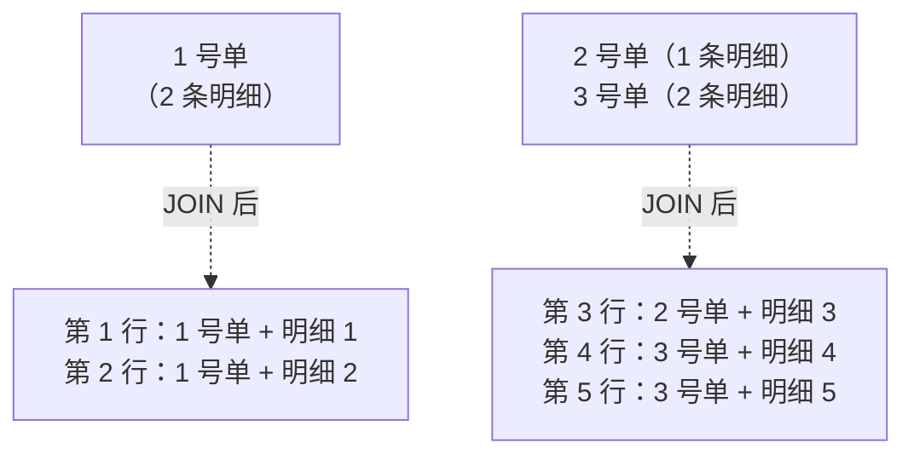
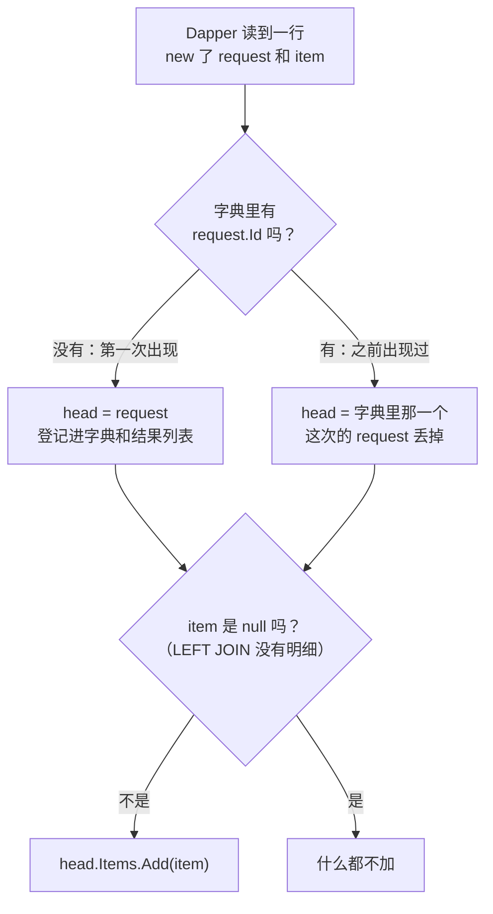
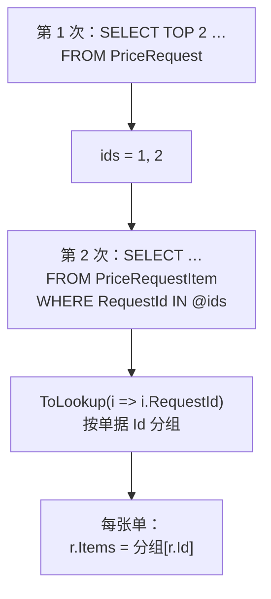

# 第 11 章 一对多：主表 + 明细

## 这一章解决什么问题

查看申请单详情时，你想要的是"**一张申请单对象，里面带一个明细列表**"：`request.Items.Count`、`request.Items.Sum(...)` 直接就能用。

第 10 章的多重映射能把一行拆成"申请单 + 明细"，但 JOIN 之后，一张有 2 条明细的单会变成 2 行，Dapper 就会 new 出 2 个申请单对象。本章先让你亲眼看到这个"重复"，再讲两种组装方法：**JOIN + 字典去重**，以及**分两次查询再在内存里分组**，最后给出取舍。

## 开始之前

- 前面几章你已经会了：多重映射 `Query<A, B, R>` 和 `splitOn`（第 10 章）、`IN @ids` 列表展开（第 4 章）、`Query<T>` 按列名映射（第 2 章）。
- 需要的环境：和前几章一样。如果做过第 9 章的练习还没重置，**先重跑一遍 [`code/sql/00-reset-database.sql`](../code/sql/00-reset-database.sql)**。本章只读不写。
- 预计耗时：75–90 分钟。

本章要用到的数据（3 张单、5 条明细）：

| 申请单 | 明细 | 金额（数量 × 申请价） |
|---|---|---|
| 1 号 PR20261001 张伟 | 产品 1：2 × 165,000；产品 3：4 × 23,000 | 330,000 + 92,000 = **422,000** |
| 2 号 PR20261008 李娜 | 产品 2：1 × 395,000 | **395,000** |
| 3 号 PR20261015 张伟 | 产品 3：2 × 24,500；产品 4：2 × 22,500 | 49,000 + 45,000 = **94,000** |

---

## 正文

### 11.1 准备：新建本章项目

1. 「解决方案资源管理器」里**右键解决方案** →「**添加 → 新建项目**」→「控制台应用」，项目名称 `Ch11Demo`，框架 **.NET 10.0**。
2. **右键 `Ch11Demo` →「设为启动项目」**。
3. 「工具 → NuGet 包管理器 → 管理解决方案的 NuGet 程序包」，给 `Ch11Demo` 装 `Dapper` 2.1.89、`Microsoft.Data.SqlClient` 7.1.1、`System.Security.Cryptography.Pkcs` 10.0.13。csproj 与第 2 章 2.1 节相同。

本章 3 个例子加练习，每个例子整个替换 `Program.cs`。

---

### 11.2 概念一：JOIN 后行数膨胀

**白话定义**：主表 JOIN 子表，结果的行数等于**子表的行数**，主表的每一行会按它有几条明细重复几次。多重映射是"每行 new 一组对象"，所以主对象也跟着重复。

**业务场景**：申请单详情页、导出"申请单 + 明细"的 Excel、打印报价单——凡是"一个主对象带一个子列表"的地方都会碰到。

**反例（什么时候行数膨胀不是问题）**：如果你要的本来就是"**每条明细一行**"的扁平报表（比如第 10 章的折扣率报表），JOIN 后一行一条正是你要的，不需要任何去重。只有"主对象里要装一个子列表"时，才需要本章的办法。

#### 🖼 图解：3 张单变成 5 行



#### 💻 最小可运行代码：先看问题

把 `Ch11Demo` 的 `Program.cs` 整个替换成：

```csharp
// code/ch11/Step1-Duplicate/Program.cs
// 照搬第 10 章一对一的写法查"申请单 + 明细"：JOIN 后一行一个对象，主对象重复了
using Dapper;
using Microsoft.Data.SqlClient;

const string connStr =
    "Server=.;Database=PriceDemo;Integrated Security=True;TrustServerCertificate=True;";

using var conn = new SqlConnection(connStr);

// 例 1：先看 JOIN 之后数据库返回了几行
int rowCount = conn.ExecuteScalar<int>(@"
    SELECT COUNT(*)
    FROM dbo.PriceRequest r
    JOIN dbo.PriceRequestItem i ON i.RequestId = r.Id");
Console.WriteLine($"例 1 申请单 3 张，JOIN 明细后返回 {rowCount} 行");

// 例 2：用第 10 章的写法映射——每一行都会 new 一个 PriceRequest
const string sql = @"
    SELECT r.Id, r.RequestNo, r.Applicant,
           i.Id, i.ProductId, i.Qty, i.RequestPrice
    FROM dbo.PriceRequest r
    JOIN dbo.PriceRequestItem i ON i.RequestId = r.Id
    ORDER BY r.Id, i.Id";

var requests = conn.Query<PriceRequest, RequestItem, PriceRequest>(
    sql,
    (request, item) =>
    {
        request.Items.Add(item);   // 把这一行的明细加进这一行的申请单
        return request;
    }).ToList();

Console.WriteLine($"例 2 得到 {requests.Count} 个 PriceRequest 对象：");
foreach (var r in requests)
    Console.WriteLine($"  {r.RequestNo}  明细 {r.Items.Count} 条  合计 {r.Items.Sum(x => x.Amount),12:N2}");

// 例 3：列表页想取"前 2 张单据"，直接在 JOIN 上写 TOP 2
var top2 = conn.Query<PriceRequest, RequestItem, PriceRequest>(@"
    SELECT TOP 2 r.Id, r.RequestNo, r.Applicant,
           i.Id, i.ProductId, i.Qty, i.RequestPrice
    FROM dbo.PriceRequest r
    JOIN dbo.PriceRequestItem i ON i.RequestId = r.Id
    ORDER BY r.Id, i.Id",
    (request, item) => { request.Items.Add(item); return request; }).ToList();
Console.WriteLine("例 3 TOP 2 拿到的单号：" + string.Join("、", top2.Select(r => r.RequestNo)));

public class PriceRequest
{
    public int Id { get; set; }
    public string RequestNo { get; set; } = "";
    public string Applicant { get; set; } = "";
    public List<RequestItem> Items { get; set; } = new();   // 一对多：一张单有多条明细
}

public class RequestItem
{
    public int Id { get; set; }
    public int ProductId { get; set; }
    public int Qty { get; set; }
    public decimal RequestPrice { get; set; }
    public decimal Amount => Qty * RequestPrice;   // 金额 = 数量 × 申请价
}
```

#### 🔍 拆解运行结果

实测输出：

```text
例 1 申请单 3 张，JOIN 明细后返回 5 行
例 2 得到 5 个 PriceRequest 对象：
  PR20261001  明细 1 条  合计   330,000.00
  PR20261001  明细 1 条  合计    92,000.00
  PR20261008  明细 1 条  合计   395,000.00
  PR20261015  明细 1 条  合计    49,000.00
  PR20261015  明细 1 条  合计    45,000.00
例 3 TOP 2 拿到的单号：PR20261001、PR20261001
```

> 📷 **截图占位 ch11-01**：控制台显示 5 个 PriceRequest 对象、每个"明细 1 条"。
<!--  -->

| 例 | 看到了什么 | 说明 |
|---|---|---|
| 1 | 5 行 | 行数 = 明细数，不是申请单数 |
| 2 | **5 个对象，每个只有 1 条明细** | 1 号单被拆成了两个对象，各拿到一半明细，合计分别是 330,000 和 92,000，而正确的合计是 422,000。界面上会显示成两张单 |
| 3 | 两次都是 PR20261001 | `TOP 2` 数的是**行**，不是单据。前 2 行都属于 1 号单，2 号单就被挤掉了。`OFFSET … FETCH` 分页（第 13 章）也是同样的问题 |

例 2 的映射函数 `request.Items.Add(item)` 本身没有错，错在**每一行的 `request` 都是 Dapper 新建的**（第 10 章 10.2 节最后一行输出 `False` 说的就是这件事）。要把同一张单的明细放到同一个对象里，就得自己认出"这张单前面已经出现过了"。

#### 改坏一处试试

把例 2 里的 `JOIN` 改成 `LEFT JOIN`，结果不变：每张单都有明细，LEFT JOIN 不会多出行来。但如果把条件改成"只看探头"（`AND i.ProductId IN (3, 4)`），2 号单没有探头，LEFT JOIN 后它那一行的明细列全是 NULL——下一节例 2 专门处理这种情况。

真正值得记住的"改坏"是例 3：**在 JOIN 上做 TOP / 分页，数的是明细行**。这不会报任何错，只会让列表页少几张单。11.4 节的方案二就是为了解决它。

---

### 11.3 概念二：字典去重，组装子集合

**白话定义**：准备一个 `Dictionary<int, PriceRequest>`，键是申请单 Id。映射函数每被调用一次，先用 `request.Id` 去字典里查：

- **查不到**：这张单第一次出现，把 Dapper 新建的这个对象登记进字典；
- **查得到**：这张单之前出现过，**丢掉** Dapper 这次新建的对象，改用字典里那一个。

然后把这一行的明细加到"字典里那一个"对象上。

**业务场景**：申请单详情页（一张或几张单 + 全部明细），一次查询、一次往返，拿到组装好的对象。

**反例（什么时候不该用）**：
- **主表要分页**（列表页每页 20 张单）：JOIN 后的 TOP / OFFSET 数的是明细行（11.2 节例 3），用 11.4 节的方案二。
- **主表列很多、明细行也很多**：比如一张单 200 条明细，主表的 30 列就要在网络上重复传 200 遍。数据量大时也用方案二。
- **子表不止一个**（明细 + 审批记录）：两个子表一起 JOIN，行数是两者相乘（2 条明细 × 2 条审批记录 = 4 行），去重更复杂。用第 12 章的 `QueryMultiple`。

#### 🖼 图解：映射函数每一行做的事



#### 💻 最小可运行代码：两个例子

把 `Program.cs` 整个替换成：

```csharp
// code/ch11/Step2-Dictionary/Program.cs
// 用字典去重：同一张单只保留第一次出现的那个对象，后面行里的明细都加到它身上
using Dapper;
using Microsoft.Data.SqlClient;

const string connStr =
    "Server=.;Database=PriceDemo;Integrated Security=True;TrustServerCertificate=True;";

using var conn = new SqlConnection(connStr);

// 例 1：全部明细
List<PriceRequest> all = LoadRequests(conn, @"
    SELECT r.Id, r.RequestNo, r.Applicant,
           i.Id, i.ProductId, i.Qty, i.RequestPrice
    FROM dbo.PriceRequest r
    LEFT JOIN dbo.PriceRequestItem i ON i.RequestId = r.Id
    ORDER BY r.Id, i.Id");
Print("例 1 全部明细", all);

// 例 2：只看探头（产品 3、4）。2 号单没有探头 → LEFT JOIN 后明细那几列全是 NULL
List<PriceRequest> probes = LoadRequests(conn, @"
    SELECT r.Id, r.RequestNo, r.Applicant,
           i.Id, i.ProductId, i.Qty, i.RequestPrice
    FROM dbo.PriceRequest r
    LEFT JOIN dbo.PriceRequestItem i ON i.RequestId = r.Id AND i.ProductId IN (3, 4)
    ORDER BY r.Id, i.Id");
Print("例 2 只看探头", probes);

static List<PriceRequest> LoadRequests(SqlConnection conn, string sql)
{
    var byId = new Dictionary<int, PriceRequest>();   // 去重用：单据 Id → 第一次出现的那个对象
    var result = new List<PriceRequest>();            // 保持 SQL 里 ORDER BY 的顺序

    conn.Query<PriceRequest, RequestItem, PriceRequest>(
        sql,
        (request, item) =>
        {
            // 这张单第一次出现：登记进字典；以后再出现，就用字典里那一个，Dapper 新建的 request 直接丢掉
            if (!byId.TryGetValue(request.Id, out var head))
            {
                head = request;
                byId.Add(head.Id, head);
                result.Add(head);
            }

            // LEFT JOIN 没有明细时，明细那一段的切分列 i.Id 是 NULL，Dapper 传进来的 item 就是 null
            if (item is not null)
                head.Items.Add(item);

            return head;
        });                     // Query 的返回值不用了：它每行一个元素，还是 5 个（有重复引用）

    return result;
}

static void Print(string title, List<PriceRequest> list)
{
    Console.WriteLine($"{title}：{list.Count} 张单");
    foreach (var r in list)
        Console.WriteLine($"  {r.RequestNo}  {r.Applicant}  明细 {r.Items.Count} 条  " +
                          $"合计 {r.Items.Sum(x => x.Amount),12:N2}");
}

public class PriceRequest
{
    public int Id { get; set; }
    public string RequestNo { get; set; } = "";
    public string Applicant { get; set; } = "";
    public List<RequestItem> Items { get; set; } = new();
}

public class RequestItem
{
    public int Id { get; set; }
    public int ProductId { get; set; }
    public int Qty { get; set; }
    public decimal RequestPrice { get; set; }
    public decimal Amount => Qty * RequestPrice;
}
```

#### 🔍 拆解运行结果

实测输出：

```text
例 1 全部明细：3 张单
  PR20261001  张伟  明细 2 条  合计   422,000.00
  PR20261008  李娜  明细 1 条  合计   395,000.00
  PR20261015  张伟  明细 2 条  合计    94,000.00
例 2 只看探头：3 张单
  PR20261001  张伟  明细 1 条  合计    92,000.00
  PR20261008  李娜  明细 0 条  合计         0.00
  PR20261015  张伟  明细 2 条  合计    94,000.00
```

> 📷 **截图占位 ch11-02**：控制台显示例 1 的 3 张单，合计 422,000 / 395,000 / 94,000。
<!--  -->

| 例 | 看到了什么 | 说明 |
|---|---|---|
| 1 | 3 张单，明细 2/1/2 条，合计和本章开头的表格一致 | 去重成功 |
| 2 | 2 号单"明细 0 条"，**没有报错，单据也没丢** | LEFT JOIN 保住了 2 号单；它那一行的 `i.Id` 是 NULL，Dapper 传进来的 `item` 是 null（第 10 章练习 1 的规则），`if (item is not null)` 把它挡在了列表外 |

代码里有三个要点：

| 写法 | 为什么 |
|---|---|
| `Dictionary<int, PriceRequest> byId` | 按主键认"是不是同一张单"。键一定要用主键，用单号这种不保证唯一的列会把两张单合并 |
| 另外维护一个 `List<PriceRequest> result` | 字典只负责去重。结果按 SQL 里 `ORDER BY` 的顺序登记到 `result` 里，顺序就和 SQL 一致，不用依赖字典的遍历顺序 |
| **不用** `Query` 的返回值 | 映射函数每行返回一次 `head`，所以返回值还是 5 个元素，只是同一个对象被重复引用了几次（见下面"改坏一处"） |

**为什么用 LEFT JOIN 而不是 JOIN**：JOIN 会把"没有明细的单"整个丢掉。草稿状态的申请单很可能一条明细都还没有，详情页却必须能打开它。用 LEFT JOIN，再在映射函数里判断 null，两种情况都能处理。

#### 改坏一处试试

**改法 1**：把 `if (item is not null)` 这一行删掉，只留 `head.Items.Add(item);`。实测例 1 正常，例 2 打印到第一张单后报错：

```text
例 2 只看探头：3 张单
  PR20261001  张伟  明细 1 条  合计    92,000.00
Unhandled exception. System.NullReferenceException: Object reference not set to an instance of an object.
   at Program.<>c.<<Main>$>b__0_3(RequestItem x) in …/Program.cs:line 60
   at System.Linq.Enumerable.Sum[TSource,TResult,TAccumulator](IEnumerable`1 source, Func`2 selector)
   at Program.<<Main>$>g__Print|0_1(String title, List`1 list) in …/Program.cs:line 59
```

null 被加进了 2 号单的 `Items`，`Items.Sum(x => x.Amount)` 读 `null.Amount` 就炸了。**注意报错的位置**：不在查询那里，而在很后面的打印（第 59、60 行）。正式项目里，它可能出现在另一个页面、另一个人的代码里。所以 LEFT JOIN 的子对象，**组装的时候就要判断 null**，不要把 null 放进列表。

**改法 2**：用 `Query` 的返回值当结果。在 `LoadRequests` 里把返回值存下来，打印它的个数（`rows.Count()`）和去重后的个数（`rows.Distinct().Count()`）。实测：

```text
  Query 返回 5 个元素，去掉重复引用后 3 个
```

（例 2 是 `4 个元素，去掉重复引用后 3 个`：1 号单只有 1 条探头，那 4 行是 1 + 1 + 2。）

返回值里的 5 个元素只是 3 个对象被重复引用。直接拿去绑定界面，1 号单和 3 号单会各显示两次，而且每次都带着**全部**明细。网上很多例子写的是 `Query(...).Distinct().ToList()`，也能得到 3 个；本章用单独的 `result` 列表，意思更直白。

---

### 11.4 概念三：两次查询的做法与取舍

**白话定义**：不 JOIN。第 1 次只查主表（筛选、排序、分页都在这一次做）；拿到这些单的 Id，第 2 次用 `WHERE RequestId IN @ids` 一次查出它们的全部明细；最后在内存里按 `RequestId` 分组，挂到对应的单上。

**业务场景**：申请单列表页，每页 20 张单，每张单要显示明细条数和合计金额。分页必须按"单据"来数，所以主表要单独查。

**反例（什么时候不该用）**：
- **只查一张单**（按 Id 打开详情）时，两种方案都只有几行数据，JOIN + 字典一次往返更直接。
- **`IN @ids` 里的 Id 非常多**（几千个）：Dapper 会把它展开成几千个参数，而 SQL Server 一条命令最多 2100 个参数。这种情况要分批查，或者改用第 15 章的表值参数。
- **要按明细的条件筛选主表**（"找出含有产品 3 的申请单"）：筛选条件要写进第 1 次查询（用 `EXISTS` 子查询），不能指望第 2 次查询替你过滤主表。

#### 🖼 图解：两次查询 + 内存分组



#### 💻 最小可运行代码

把 `Program.cs` 整个替换成：

```csharp
// code/ch11/Step3-TwoQueries/Program.cs
// 方案二：先查主表（可以放心分页），再用 IN @ids 一次查出这些单的明细，在内存里分组挂上去
using Dapper;
using Microsoft.Data.SqlClient;

const string connStr =
    "Server=.;Database=PriceDemo;Integrated Security=True;TrustServerCertificate=True;";

using var conn = new SqlConnection(connStr);

// 第 1 次查询：只查主表。TOP 2 数的是"单据"，不会被明细行数干扰
List<PriceRequest> requests = conn.Query<PriceRequest>(@"
    SELECT TOP 2 Id, RequestNo, Applicant
    FROM dbo.PriceRequest
    ORDER BY Id").ToList();

// 第 2 次查询：一次查出这几张单的全部明细。IN @ids 不加括号，Dapper 会展开（第 4 章讲过）
List<int> ids = requests.Select(r => r.Id).ToList();
List<RequestItem> items = conn.Query<RequestItem>(@"
    SELECT Id, RequestId, ProductId, Qty, RequestPrice
    FROM dbo.PriceRequestItem
    WHERE RequestId IN @ids
    ORDER BY Id", new { ids }).ToList();
Console.WriteLine($"主表 {requests.Count} 行，明细 {items.Count} 行，共 2 次查询");

// 在内存里按 RequestId 分组。ToLookup 查不存在的 key 返回空序列，不会抛异常
ILookup<int, RequestItem> itemsByRequest = items.ToLookup(i => i.RequestId);
foreach (var r in requests)
    r.Items = itemsByRequest[r.Id].ToList();

foreach (var r in requests)
{
    Console.WriteLine($"{r.RequestNo}  {r.Applicant}  明细 {r.Items.Count} 条  合计 {r.Items.Sum(x => x.Amount),12:N2}");
    foreach (var i in r.Items)
        Console.WriteLine($"    产品 {i.ProductId}：{i.Qty} × {i.RequestPrice:N2}");
}

public class PriceRequest
{
    public int Id { get; set; }
    public string RequestNo { get; set; } = "";
    public string Applicant { get; set; } = "";
    public List<RequestItem> Items { get; set; } = new();
}

public class RequestItem
{
    public int Id { get; set; }
    public int RequestId { get; set; }   // 方案二要靠它在内存里分组，所以必须查出来
    public int ProductId { get; set; }
    public int Qty { get; set; }
    public decimal RequestPrice { get; set; }
    public decimal Amount => Qty * RequestPrice;
}
```

#### 🔍 拆解运行结果

实测输出：

```text
主表 2 行，明细 3 行，共 2 次查询
PR20261001  张伟  明细 2 条  合计   422,000.00
    产品 1：2 × 165,000.00
    产品 3：4 × 23,000.00
PR20261008  李娜  明细 1 条  合计   395,000.00
    产品 2：1 × 395,000.00
```

> 📷 **截图占位 ch11-03**：控制台显示 TOP 2 的两张单及其明细。
<!--  -->

| 位置 | 说明 |
|---|---|
| `主表 2 行` | `TOP 2` 这次数的是单据，拿到了 1 号和 2 号单。对比 11.2 节例 3 的"PR20261001、PR20261001" |
| `明细 3 行` | 1 号单 2 条 + 2 号单 1 条。主表的列一列都没重复传 |
| `IN @ids` | 第 4 章讲过：不写括号，Dapper 展开成 `IN (@ids1, @ids2)` |
| `RequestItem.RequestId` | 方案二**必须**查出这一列，否则内存里不知道每条明细属于哪张单 |
| `ToLookup` | LINQ 方法，把明细按 `RequestId` 分组。和 `Dictionary` 的区别：查一个不存在的键时，`Lookup` 返回空序列，`Dictionary` 会抛 `KeyNotFoundException`。没有明细的单直接得到空列表，不用另外判断 |

**它和第 12 章的关系**：方案二要和数据库往返两次。第 12 章的 `QueryMultiple` 能把这两条 SELECT 放在一次往返里执行，组装的方法和本节完全相同。

#### 改坏一处试试

**改法 1**：把 `WHERE RequestId IN @ids` 写成大家在 SSMS 里习惯的 `WHERE RequestId IN (@ids)`。实测报错：

```text
Unhandled exception. Microsoft.Data.SqlClient.SqlException (0x80131904): Incorrect syntax near ','.
```

中文版 SQL Server 的文字是：`',' 附近有语法错误。`

Dapper 展开列表时自己会带一对括号，你再写一对，发给服务器的就成了类似 `IN ((@ids1,@ids2))` 的写法，SQL Server 不接受。看到 `Incorrect syntax near ','`，而 SQL 里又有 `IN`，先检查是不是多写了括号。

**改法 2**：第 2 次查询的 SELECT 里漏掉 `RequestId`（写成 `SELECT Id, ProductId, Qty, RequestPrice`）。实测**不报错**：

```text
主表 2 行，明细 3 行，共 2 次查询
PR20261001  张伟  明细 0 条  合计         0.00
PR20261008  李娜  明细 0 条  合计         0.00
```

明细明明查回来了 3 行，每张单却都是 0 条。原因是第 2 章讲过的"少查的列保持默认值"：所有明细的 `RequestId` 都是 0，`ToLookup` 把它们全分到了"0 号单"名下，1 号和 2 号单找不到自己的明细。这类问题只能靠核对输出发现，所以练习和验收时，一定要看合计金额对不对。

#### 两种方案的取舍

| 对比项 | 方案一：JOIN + 字典 | 方案二：两次查询 + 分组 |
|---|---|---|
| 往返次数 | 1 次 | 2 次（第 12 章可合成 1 次） |
| 主表的列 | 每条明细重复传一遍 | 只传一遍 |
| 主表分页 / TOP | **不能**直接用，数的是明细行 | 可以，数的是单据 |
| 没有明细的单 | 要用 LEFT JOIN，并判断 item 为 null | 自然得到空列表 |
| 代码量 | 映射函数稍复杂（字典 + 判断） | 两段简单查询 + 一行 `ToLookup` |
| 主对象很多时 | 不受参数个数限制 | `IN @ids` 受 2100 个参数的限制 |
| 适合 | 打开一张或少量几张单的详情 | 列表页、分页、明细多的情况 |

拿不准的时候：**详情页用方案一，列表页用方案二**。

---

## 🧱 类比：ADO.NET 写法与 Dapper 写法逐项对照

| 要做的事 | ADO.NET | Dapper | 差别 |
|---|---|---|---|
| JOIN 读出主表 + 明细 | `while (reader.Read())`，每行自己判断"这张单是不是新的" | `Query<A, B, R>` + 映射函数里查字典 | 去重的思路完全一样，Dapper 省掉了列赋值 |
| 判断"是不是同一张单" | 自己记住上一行的 Id，或用 `Dictionary` | 用 `Dictionary` | 一样 |
| 没有明细（LEFT JOIN） | `reader.IsDBNull(明细Id的序号)` | 切分列为 NULL 时 `item` 为 null | Dapper 替你判断了，但你还是要处理 null |
| 两次查询 | 两个 `SqlCommand`，第二个手写 `IN (@p0, @p1, …)` 并逐个加参数 | 第二次 `IN @ids` 一个参数搞定 | Dapper 替你展开列表 |
| 按主表 Id 分组 | 自己写 `Dictionary<int, List<…>>` | `ToLookup` | 是 LINQ 的功能，两边都能用 |
| 用 `DataSet` + `DataRelation` | 把两张表装进 `DataSet`，建 `DataRelation`，用 `GetChildRows` 取子行 | 没有对应物，直接用对象的 `List` 属性 | 你在 WebForm 里可能这样做过；Dapper 里不需要 |

## ⚠️ 踩坑警告

| 现象 | 原因 | 怎么改 |
|---|---|---|
| 同一张单显示了好几次，每次只带一条明细（实测：5 个对象） | 一对多 JOIN 直接照搬一对一的写法 | 用字典去重（11.3 节） |
| 列表页"每页 2 张"只显示了 1 张单（实测：TOP 2 得到两个 PR20261001） | 在 JOIN 结果上 TOP / 分页，数的是明细行 | 主表单独查、单独分页（11.4 节） |
| 去重后某个页面 `NullReferenceException`，堆栈在 `Sum` 里（实测） | LEFT JOIN 没有明细时 item 是 null，被加进了列表 | 组装时 `if (item is not null)` |
| 用了字典，界面上还是重复（实测：返回值 5 个，去重后 3 个） | 用了 `Query` 的返回值，里面是重复引用 | 用自己维护的结果列表，或 `.Distinct()` |
| `Incorrect syntax near ','` / `',' 附近有语法错误。`（实测） | `IN (@ids)` 多写了括号 | 写成 `IN @ids` |
| 明细查回来了，每张单却都是 0 条（实测） | 第 2 次查询漏了 `RequestId` 列，分组键全是 0 | SELECT 里加上外键列 |

## 🎯 动手练习

> 确认已经重跑过 `00-reset-database.sql`。本章练习只读不写。

**练习 1：客户 + 他的申请单（JOIN + 字典）**

`Customer` 类有 `Id`、`Name`、`City` 和 `List<PriceRequest> Requests`；`PriceRequest` 类有 `Id`、`CustomerId`、`RequestNo`。用一次 JOIN 查询，把 3 个客户和各自的申请单组装好。北方影像诊所没有申请单，也要显示出来。

- 验收标准：输出三行，内容一致（第 3 行末尾"0 张"后面有一个空格，因为后面拼接的单号列表是空的）：

```text
  华东第一医院（上海）：2 张 PR20261001、PR20261015
  江南检测中心（杭州）：1 张 PR20261008
  北方影像诊所（天津）：0 张 
```

**练习 2：同样的结果，用两次查询做**

不用 JOIN：先查客户，再用 `WHERE CustomerId IN @ids` 查申请单，在内存里分组。

- 验收标准：输出和练习 1 完全相同。并且能说出：练习 1 里 `PriceRequest.CustomerId` 没有查，为什么不影响结果；练习 2 里为什么必须查。

卡住了看文末参考答案。

## 📌 一句话总结

一对多 JOIN 会重复主对象：详情页用字典去重，列表页分两次查。

## 下一章

方案二要往返两次数据库，能不能一次发出多条 SELECT、一次拿回多个结果集？第 12 章讲 `QueryMultiple`。

---

<!-- 以下是参考答案，先自己动手，卡住了再往下翻 -->


## 参考答案

**练习 1 思路**：和 11.3 节一模一样，只是主对象换成了客户、子对象换成了申请单。必须用 `LEFT JOIN`，北方影像诊所才不会被丢掉；它那一行的 `r.Id` 是 NULL，`request` 为 null，判断后不加进列表。默认 splitOn `"Id"` 从右往左找到的是 `r.Id`，正好是申请单段的第一列。`CustomerId` 没查，保持 0，但组装靠的是"这一行属于哪个客户"——客户对象就在同一行里，不需要这一列。

**练习 2 思路**：和 11.4 节一样。分组靠的就是每张申请单的 `CustomerId`，所以第 2 次查询必须把它查出来；漏了它，所有申请单都会被分到"0 号客户"名下，三个客户都显示 0 张。

两题合在一个文件里，完整项目在 [`code/ch11/Exercise/`](../code/ch11/Exercise/)。实测输出：

```text
练习 1
  华东第一医院（上海）：2 张 PR20261001、PR20261015
  江南检测中心（杭州）：1 张 PR20261008
  北方影像诊所（天津）：0 张 
练习 2
  华东第一医院（上海）：2 张 PR20261001、PR20261015
  江南检测中心（杭州）：1 张 PR20261008
  北方影像诊所（天津）：0 张 
```

```csharp
// code/ch11/Exercise/Program.cs
// 第 11 章练习参考答案：客户 + 他的申请单。练习 1 用 JOIN + 字典，练习 2 用两次查询
using Dapper;
using Microsoft.Data.SqlClient;

const string connStr =
    "Server=.;Database=PriceDemo;Integrated Security=True;TrustServerCertificate=True;";

using var conn = new SqlConnection(connStr);

// ===== 练习 1：LEFT JOIN + 字典去重 =====
var byId = new Dictionary<int, Customer>();
var customers1 = new List<Customer>();

conn.Query<Customer, PriceRequest, Customer>(@"
    SELECT c.Id, c.Name, c.City,
           r.Id, r.RequestNo
    FROM dbo.Customer c
    LEFT JOIN dbo.PriceRequest r ON r.CustomerId = c.Id
    ORDER BY c.Id, r.Id",
    (customer, request) =>
    {
        if (!byId.TryGetValue(customer.Id, out var head))
        {
            head = customer;
            byId.Add(head.Id, head);
            customers1.Add(head);
        }
        if (request is not null)          // 北方影像诊所没有申请单 → request 是 null
            head.Requests.Add(request);
        return head;
    });

Console.WriteLine("练习 1");
Print(customers1);

// ===== 练习 2：先查客户，再按 CustomerId IN @ids 查申请单 =====
var customers2 = conn.Query<Customer>(
    "SELECT Id, Name, City FROM dbo.Customer ORDER BY Id").ToList();

var ids = customers2.Select(c => c.Id).ToList();
var requestsByCustomer = conn.Query<PriceRequest>(@"
    SELECT Id, CustomerId, RequestNo
    FROM dbo.PriceRequest
    WHERE CustomerId IN @ids
    ORDER BY Id", new { ids }).ToLookup(r => r.CustomerId);

foreach (var c in customers2)
    c.Requests = requestsByCustomer[c.Id].ToList();   // 没有申请单的客户得到空列表

Console.WriteLine("练习 2");
Print(customers2);

static void Print(List<Customer> list)
{
    foreach (var c in list)
        Console.WriteLine($"  {c.Name}（{c.City}）：{c.Requests.Count} 张 " +
                          string.Join("、", c.Requests.Select(r => r.RequestNo)));
}

public class Customer
{
    public int Id { get; set; }
    public string Name { get; set; } = "";
    public string City { get; set; } = "";
    public List<PriceRequest> Requests { get; set; } = new();
}

public class PriceRequest
{
    public int Id { get; set; }
    public int CustomerId { get; set; }   // 练习 2 分组要用；练习 1 没查这一列，保持 0 也不影响
    public string RequestNo { get; set; } = "";
}
```
