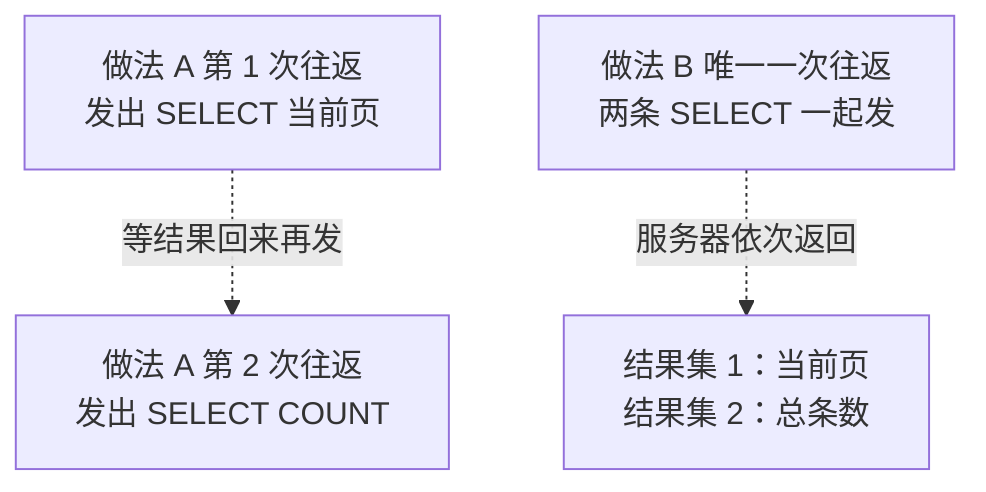
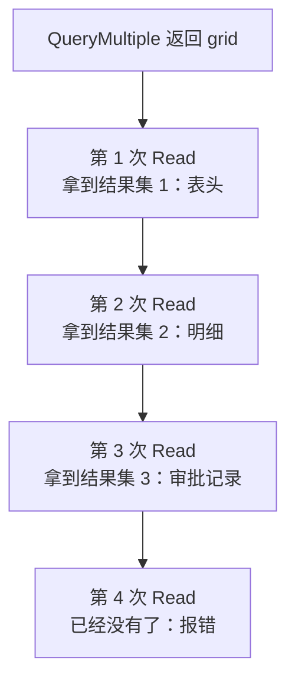
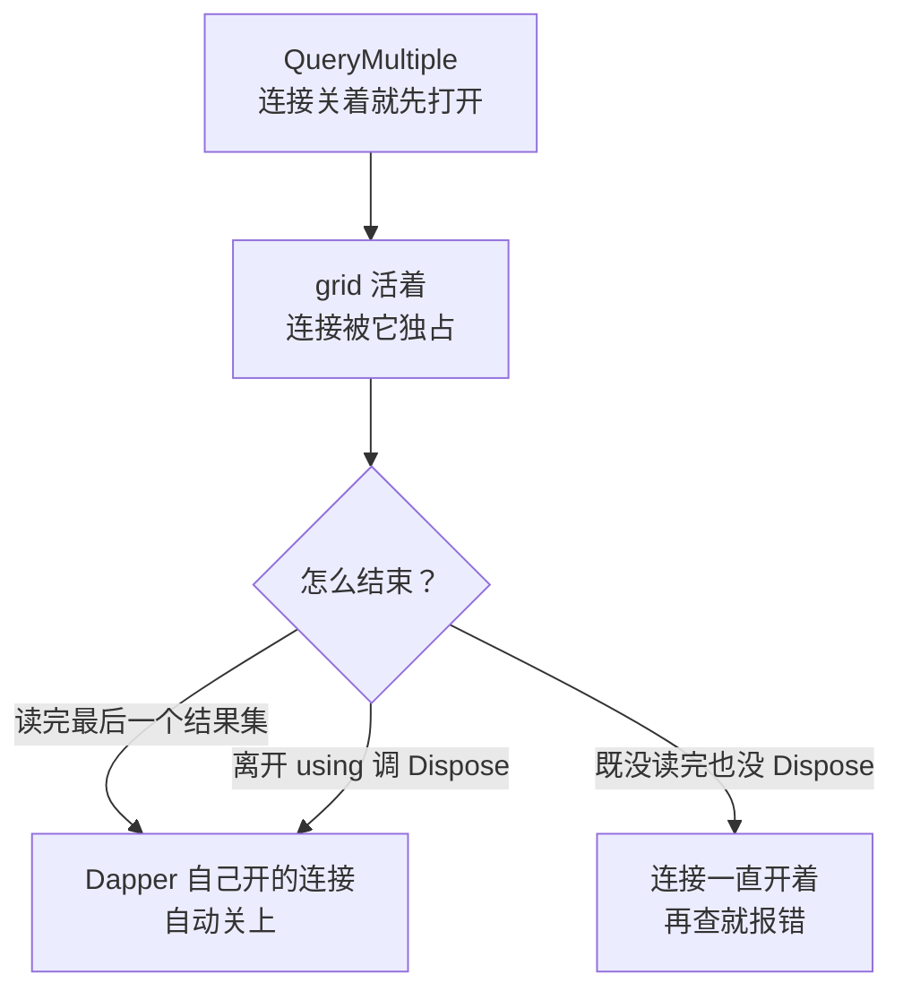
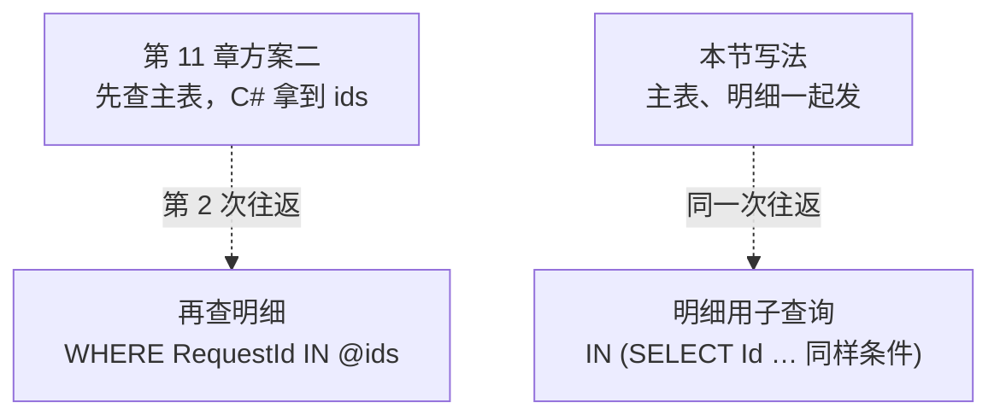

# 第 12 章 一次取多个结果集

## 这一章解决什么问题

申请单列表页要显示两样东西：**当前这一页的数据**，和**一共多少条**（用来算"共几页"）。单据详情页要三样：**表头、明细、审批记录**。

照以前的写法，要几样就查几次，每查一次就和服务器往返一次。第 11 章的"方案二"也是这样：先查主表，再 `IN @ids` 查明细，两次往返。

本章用 `QueryMultiple` 把几条 SELECT 放进**同一次往返**，再按顺序一个一个读出来。要讲清三件事：

1. `QueryMultiple` 怎么用，比分开查省在哪里；
2. 读结果集的**顺序规则**：读错顺序、少读、多读分别会怎样；
3. 它返回的 `GridReader` 什么时候占着连接、什么时候放手。

## 开始之前

- 上一章你已经会了：一对多查询的两种做法。一种是 JOIN 之后用字典去重，组装 `Items` 子集合；另一种是"方案二"，先查主表，再用 `WHERE RequestId IN @ids` 查明细，最后在内存里分组。
- 前面用到的知识：`Query<T>` 和自动映射（第 2 章）、匿名对象传参（第 4 章）、`Single` 与 `First` 的语义（第 5 章）、`string?` 接 NULL 列（第 7 章）。
- 需要的环境：第 1 章的解决方案和 `PriceDemo` 库。本章用的是**初始数据**。如果前面几章把数据改乱了，先重跑 [`code/sql/00-reset-database.sql`](../code/sql/00-reset-database.sql)。
- 预计耗时：75–90 分钟。

---

## 正文

### 12.1 准备：新建本章项目

本章有 4 个例子，外加练习。和第 2 章一样，它们都放在**同一个新项目**里，每做一个例子，就把 `Program.cs` 整个替换掉。

1. 在「解决方案资源管理器」里**右键解决方案** →「**添加 → 新建项目**」。
2. 选「控制台应用」，项目名称填 `Ch12Demo`，框架选 **.NET 10.0**，点「创建」。
3. **右键 `Ch12Demo` 项目 →「设为启动项目」**。
4. 「工具 → NuGet 包管理器 → 管理解决方案的 NuGet 程序包」→「浏览」，给 `Ch12Demo` 装上和第 2 章相同的三个包：`Dapper` 2.1.89、`Microsoft.Data.SqlClient` 7.1.1、`System.Security.Cryptography.Pkcs` 10.0.13。

> 📷 **截图占位 ch12-01**：解决方案资源管理器里 `Ch12Demo` 显示为粗体（已设为启动项目），展开「依赖项 → 包」能看到三个包。
<!--  -->

csproj 和第 2 章完整相同，本章各项目的 csproj 也都一样，所以不再重复贴出。落盘文件见 [`code/ch12/`](../code/ch12/)。

---

### 12.2 概念一：`QueryMultiple`

**白话定义**：把几条 SELECT 写在**同一个 SQL 字符串**里，一次发给服务器。服务器按顺序返回几个结果集。`QueryMultiple` 返回一个"读取器"（`GridReader`），你用它的 `Read<T>()` 一个一个地取。

**业务场景**：

| 页面 | 要几样数据 | 用 `QueryMultiple` 后 |
|---|---|---|
| 申请单列表页 | 当前页 + 总条数 | 1 次往返 |
| 单据详情页 | 表头 + 明细 + 审批记录 | 1 次往返 |
| 新建申请单页面的下拉框 | 客户列表 + 产品列表 | 1 次往返 |

**反例（什么时候不该用）**：

- **几条查询毫无关系，也不在同一个页面上用**。硬塞进一个字符串只会让 SQL 更难读，省下的那一两次往返（局域网里通常不到 1 毫秒）也没有意义。
- **后一条查询要用前一条的结果来决定查什么**，而且没法改写成子查询。比如要先在 C# 里根据第一条的结果做一番判断，才知道第二条怎么写。这时只能分两次查。
- **只要一个结果集**。直接用 `Query<T>`，不要用 `QueryMultiple` 再读一次。

#### 🖼 图解：分开查和一起查



两种做法，服务器干的活一样多，**差别在网络来回的次数**。数据库在本机时，这点差别几乎看不出来。数据库在另一个机房、每次往返要几十毫秒时，详情页一次查 3 样还是查 3 次，就能感觉到了。

#### 💻 最小可运行代码：列表页的"当前页 + 总条数"

下面的代码用两种做法查同一份数据，并用 ADO.NET 自带的**连接统计**（`StatisticsEnabled`）数一数，各自和服务器往返了几次。

当前页的 SQL 用了 `OFFSET … FETCH`，意思是"跳过 @Skip 行，再取 @Take 行"。它的细节是第 13 章的内容，这里先照着用。

把 `Program.cs` 整个替换成：

```csharp
// code/ch12/Step1-PageAndTotal/Program.cs
// QueryMultiple 入门：一次往返同时拿到"当前页数据"和"总条数"，并数一数和服务器往返了几次
using Dapper;
using Microsoft.Data.SqlClient;

const string connStr =
    "Server=.;Database=PriceDemo;Integrated Security=True;TrustServerCertificate=True;";

using var conn = new SqlConnection(connStr);
conn.Open();                      // 手动打开：下面要读这个连接对象上的统计信息
conn.StatisticsEnabled = true;    // ADO.NET 自带的连接统计，ServerRoundtrips = 与服务器往返的次数

// 当前页：跳过 @Skip 行，取 @Take 行（OFFSET…FETCH 的细节第 13 章讲）
const string pageSql = @"
SELECT Id, RequestNo, Applicant, Status
FROM dbo.PriceRequest
ORDER BY Id
OFFSET @Skip ROWS FETCH NEXT @Take ROWS ONLY;";

// 总条数：用来算"共几页"
const string countSql = @"
SELECT COUNT(*) FROM dbo.PriceRequest;";

var pageArgs = new { Skip = 0, Take = 2 };   // 第 1 页，每页 2 条

// 做法 A：分两次查——你以前的习惯写法
conn.ResetStatistics();
var rowsA = conn.Query<RequestRow>(pageSql, pageArgs).ToList();
int totalA = conn.ExecuteScalar<int>(countSql);
Console.WriteLine($"做法 A 两次查询：本页 {rowsA.Count} 条，总数 {totalA}，往返 {Roundtrips(conn)} 次");

// 做法 B：两条 SELECT 拼成一个批（batch），QueryMultiple 一次发给服务器
conn.ResetStatistics();
using (var grid = conn.QueryMultiple(pageSql + countSql, pageArgs))
{
    List<RequestRow> rows = grid.Read<RequestRow>().ToList();   // 读第 1 个结果集：当前页
    int total = grid.ReadSingle<int>();                          // 读第 2 个结果集：总条数（只有 1 行 1 列）

    Console.WriteLine($"做法 B QueryMultiple：本页 {rows.Count} 条，总数 {total}，往返 {Roundtrips(conn)} 次");

    int pageCount = (total + pageArgs.Take - 1) / pageArgs.Take;        // 向上取整：3 条、每页 2 条 → 2 页
    Console.WriteLine($"第 1 页 / 共 {pageCount} 页（共 {total} 条）");
    foreach (var r in rows)
        Console.WriteLine($"  {r.Id}  {r.RequestNo}  {r.Applicant}  状态={r.Status}");
}

// 从连接统计里取出往返次数（值是 long，装在 object 里）
static long Roundtrips(SqlConnection c) => (long)c.RetrieveStatistics()["ServerRoundtrips"]!;

public class RequestRow
{
    public int Id { get; set; }
    public string RequestNo { get; set; } = "";
    public string Applicant { get; set; } = "";
    public int Status { get; set; }
}
```

#### 🔍 拆解运行结果

实测输出：

```text
做法 A 两次查询：本页 2 条，总数 3，往返 2 次
做法 B QueryMultiple：本页 2 条，总数 3，往返 1 次
第 1 页 / 共 2 页（共 3 条）
  1  PR20261001  张伟  状态=2
  2  PR20261008  李娜  状态=1
```

> 📷 **截图占位 ch12-02**：控制台显示上面的输出，两种做法的"往返"次数分别是 2 和 1。
<!--  -->

逐行看：

| 位置 | 作用 | 说明 |
|---|---|---|
| `pageSql + countSql` | 两条 SELECT 拼成一个字符串 | 服务器把它当成**一个批**（batch）执行。两条之间的分号不是必须的，但写上更清楚 |
| `conn.QueryMultiple(sql, pageArgs)` | 发出这一个批 | 参数对象**所有语句共用**：两条 SQL 里出现的 `@Skip`、`@Take` 都来自它 |
| `grid.Read<RequestRow>()` | 读**第 1 个**结果集 | 映射规则和 `Query<T>` 完全一样（第 2 章） |
| `grid.ReadSingle<int>()` | 读**第 2 个**结果集 | 只有 1 行 1 列，用 `ReadSingle`，语义和第 5 章的 `QuerySingle` 相同 |
| `using (var grid = …)` | 用完释放 | 原因在 12.4 节 |
| 往返 2 次 / 1 次 | 证明做法 B 只往返了一次 | 数字来自 `RetrieveStatistics()["ServerRoundtrips"]` |

`GridReader` 上的读法和 `conn` 上的查询方法是一一对应的：

| 连接上的方法（前几章） | `GridReader` 上对应的方法 | 用途 |
|---|---|---|
| `Query<T>` | `Read<T>` | 多行 |
| `QueryFirst<T>` / `QueryFirstOrDefault<T>` | `ReadFirst<T>` / `ReadFirstOrDefault<T>` | 取第一行 |
| `QuerySingle<T>` / `QuerySingleOrDefault<T>` | `ReadSingle<T>` / `ReadSingleOrDefault<T>` | 只应有一行 |
| `Query<A,B,R>`（第 10 章） | `Read<A,B,R>(map, splitOn)` | 多重映射 |

异步版本叫 `QueryMultipleAsync`，读的时候用 `ReadAsync<T>()`，第 14 章讲异步。存储过程返回多个结果集时（第 8 章），同样用 `QueryMultiple`，加上 `commandType: CommandType.StoredProcedure` 就行。

#### 改坏一处试试

把做法 A 的第一行改成 `conn.Query<RequestRow>(pageSql + countSql, pageArgs)`，也就是把两条 SQL 交给普通的 `Query<T>`。

实测：**不报错**，`rowsA` 还是 2 条。`Query<T>` **只读第一个结果集**，后面的 `COUNT(*)` 结果被直接丢掉了，也没有任何提示。

所以要记住：**SQL 里有几条 SELECT，就该用 `QueryMultiple`，不能用 `Query`**。用 `Query` 时，后面的结果集是静默消失的。

---

### 12.3 概念二：`Read` 的顺序规则

**白话定义**：第几次调用 `Read`，读的就是第几个结果集。**和你写的 `T` 是什么无关**。Dapper 不会看类型去"找"对应的结果集，它只会按顺序往下读。

**业务场景**：单据详情页。表头、明细、审批记录三条 SELECT，按这个顺序写，也按这个顺序读。

**反例（什么时候不该依赖它）**：结果集的个数**不固定**时，比如存储过程里有 `IF … SELECT …` 分支，有时返回 2 个，有时返回 3 个。按固定顺序读，迟早会读错位。这种情况应该改过程，让它每次都返回同样个数的结果集（没数据就返回空结果集），或者拆成两个过程。

#### 🖼 图解：一条只能往前走的队列



它和 `SqlDataReader.NextResult()` 是同一个机制：只能往前走，不能回头，也不能跳着读。

#### 💻 最小可运行代码：单据详情页三个结果集

把 `Program.cs` 整个替换成：

```csharp
// code/ch12/Step2-ThreeGrids/Program.cs
// 单据详情页：一次取回"申请单 + 明细 + 审批记录"三个结果集，按 SQL 里的顺序逐个 Read
using Dapper;
using Microsoft.Data.SqlClient;

const string connStr =
    "Server=.;Database=PriceDemo;Integrated Security=True;TrustServerCertificate=True;";

using var conn = new SqlConnection(connStr);

// 三条 SELECT 共用同一个参数 @Id；结果集的顺序 = SELECT 在文本里出现的顺序
const string sql = @"
SELECT r.Id, r.RequestNo, r.Applicant, r.Status, c.Name AS CustomerName
FROM dbo.PriceRequest r
JOIN dbo.Customer c ON c.Id = r.CustomerId
WHERE r.Id = @Id;                                   -- 第 1 个：表头（0 或 1 行）

SELECT i.Id, p.Name AS ProductName, i.Qty, i.RequestPrice
FROM dbo.PriceRequestItem i
JOIN dbo.Product p ON p.Id = i.ProductId
WHERE i.RequestId = @Id
ORDER BY i.Id;                                      -- 第 2 个：明细（多行）

SELECT Approver, Action, Comment, ActedAt
FROM dbo.ApprovalLog
WHERE RequestId = @Id
ORDER BY ActedAt;                                   -- 第 3 个：审批记录（可能 0 行）";

ShowRequest(1);   // 有明细、有 2 条审批记录
ShowRequest(3);   // 有明细、没有审批记录（草稿）
ShowRequest(99);  // 不存在的单据

void ShowRequest(int id)
{
    using var grid = conn.QueryMultiple(sql, new { Id = id });

    // 读的顺序必须和 SQL 里 SELECT 的顺序一致：表头 → 明细 → 审批
    RequestHeader? header = grid.ReadSingleOrDefault<RequestHeader>();   // 0 行返回 null，2 行以上报错
    List<ItemLine> items = grid.Read<ItemLine>().ToList();
    List<LogLine> logs = grid.Read<LogLine>().ToList();

    Console.WriteLine($"===== 单据 Id={id} =====");
    if (header is null)
    {
        Console.WriteLine("  查无此单");   // 后两个结果集也是空的，照样读掉，没有坏处
        return;
    }
    Console.WriteLine($"  {header.RequestNo}  {header.CustomerName}  申请人={header.Applicant}  状态={header.Status}");
    foreach (var i in items)
        Console.WriteLine($"  明细 {i.Id}：{i.ProductName} × {i.Qty} @ {i.RequestPrice:N2}");
    Console.WriteLine($"  审批记录 {logs.Count} 条");
    foreach (var l in logs)
        Console.WriteLine($"    {l.ActedAt:MM-dd HH:mm}  {l.Approver}  {l.Action}  {l.Comment ?? "（无意见）"}");
}

public class RequestHeader
{
    public int Id { get; set; }
    public string RequestNo { get; set; } = "";
    public string Applicant { get; set; } = "";
    public int Status { get; set; }
    public string CustomerName { get; set; } = "";   // 来自 JOIN 的客户名，用别名对上
}

public class ItemLine
{
    public int Id { get; set; }
    public string ProductName { get; set; } = "";
    public int Qty { get; set; }
    public decimal RequestPrice { get; set; }
}

public class LogLine
{
    public string Approver { get; set; } = "";
    public string Action { get; set; } = "";
    public string? Comment { get; set; }             // 列允许 NULL，用 string?（第 7 章讲过）
    public DateTime ActedAt { get; set; }
}
```

#### 🔍 拆解运行结果

实测输出：

```text
===== 单据 Id=1 =====
  PR20261001  华东第一医院  申请人=张伟  状态=2
  明细 1：便携超声主机 × 2 @ 165,000.00
  明细 2：线阵探头 × 4 @ 23,000.00
  审批记录 2 条
    10-01 09:35  张伟  提交  （无意见）
    10-02 11:00  王经理  通过  同意框架价
===== 单据 Id=3 =====
  PR20261015  华东第一医院  申请人=张伟  状态=0
  明细 4：线阵探头 × 2 @ 24,500.00
  明细 5：凸阵探头 × 2 @ 22,500.00
  审批记录 0 条
===== 单据 Id=99 =====
  查无此单
```

> 📷 **截图占位 ch12-03**：控制台显示三张单据的详情输出。
<!--  -->

逐个看：

| 单据 | 看到了什么 | 说明 |
|---|---|---|
| Id=1 | 表头、2 条明细、2 条审批 | 三个结果集各读各的。和第 11 章 JOIN 的做法不同，这里**没有行数膨胀**，表头只有 1 行，所以也不需要字典去重 |
| Id=3 | 审批记录 0 条 | 草稿还没提交。第 3 个结果集**照样存在**，只是 0 行，`Read` 返回空列表 |
| Id=99 | 查无此单 | `ReadSingleOrDefault` 遇到 0 行返回 `null`。后两个结果集也是空的 |

和第 5 章一样，表头用 `ReadSingleOrDefault`：按主键查，0 行是"查无此单"，是正常情况；2 行以上说明数据有问题，就该报错。

**参数是共用的**：三条 SQL 都写了 `@Id`，参数对象里只放了一个 `Id`。Dapper 只发送一次参数，三条语句都能用。

#### 改坏一处试试

这一节要试 4 种改法，都很常见。每次只改一处，改完记得改回来。

**改法 1：把读明细和读审批记录的两行对调**（SQL 不动）：

```text
===== 单据 Id=1 =====
  PR20261001  华东第一医院  申请人=张伟  状态=2
  明细 0： × 0 @ 0.00
  明细 0： × 0 @ 0.00
  审批记录 2 条
    01-01 00:00      （无意见）
    01-01 00:00      （无意见）
===== 单据 Id=3 =====
  PR20261015  华东第一医院  申请人=张伟  状态=0
  审批记录 2 条
    01-01 00:00      （无意见）
    01-01 00:00      （无意见）
===== 单据 Id=99 =====
  查无此单
```

实测**不报错**，数据却全乱了：

- 第 2 次 `Read<LogLine>()` 读到的是**明细**结果集。它的列叫 `Id, ProductName, Qty, RequestPrice`，`LogLine` 里一个同名属性都没有。按第 2 章的规则，对不上的属性全部保持默认值，所以是 `01-01 00:00` 加上空字符串。
- 第 3 次 `Read<ItemLine>()` 读到的是**审批记录**。只有行数是对的，`Id` 等属性全是 0。
- 单据 3 更隐蔽：它有 0 条审批、2 条明细，读反以后显示成"审批记录 2 条"，而明细一行都不显示。

这正好印证了本节的定义：**`Read<T>` 不看 `T`，只看第几次**。

**改法 2：在读完审批记录后，再多读一次** `grid.Read<LogLine>()`：

```text
Unhandled exception. System.ObjectDisposedException: The reader has been disposed; this can happen after all data has been consumed
Object name: 'Dapper.SqlMapper+GridReader'.
   at Dapper.SqlMapper.GridReader.OnBeforeGrid() in /_/Dapper/SqlMapper.GridReader.cs:line 185
```

报错原文直译是"读取器已经被释放；读完所有数据后会出现这种情况"。读完第 3 个结果集时，Dapper 就已经把内部的 DataReader 释放了，第 4 次读不到任何东西。**看到这条报错，就去数一数 SQL 里有几条 SELECT、代码里有几次 Read**。

**改法 3：列表页里先读总数**。把 12.2 节代码里两行 Read 对调，先写 `grid.ReadSingle<int>()`：

```text
Unhandled exception. System.InvalidOperationException: Sequence contains more than one element
   at Dapper.SqlMapper.GridReader.ReadSingle[T]() in /_/Dapper/SqlMapper.GridReader.cs:line 114
```

`ReadSingle` 读到的是当前页，有 2 行，违反了"只应有一行"，所以报错。这次是运气好，至少报错了。

**改法 4：同样先读总数，但用的是 `ReadFirst<int>()`**：

```text
做法 B QueryMultiple：本页 1 条，总数 1，往返 1 次
第 1 页 / 共 1 页（共 1 条）
  0      状态=0
```

**不报错，结果全错**：

- `ReadFirst<int>()` 读到当前页，取第 1 行第 1 列，也就是 `Id = 1`，被当成了"总数"。
- 接着 `Read<RequestRow>()` 读到 `COUNT(*)` 那个结果集。它只有一行、一个没有名字的列，所以映射出一个全是默认值的 `RequestRow`。

把四种改法放在一起：

| 改法 | 现象 | 报错吗 |
|---|---|---|
| 顺序对调，类型对不上列名 | 属性全是默认值 | **不报错** |
| 多读一次 | `ObjectDisposedException` | 报错 |
| 少读（只读前几个） | 剩下的结果集被丢弃 | 不报错，12.4 节实验 2 演示 |
| 顺序对调，用 `ReadSingle` 读多行结果集 | `Sequence contains more than one element` | 报错 |
| 顺序对调，用 `ReadFirst` 或简单类型 | 拿到错误的数字 | **不报错** |

**防错习惯**：在每条 SELECT 后面写注释"第 N 个：……"，Read 的那一行也写上同样的序号。这样对照着看，一眼就能发现顺序不对。

---

### 12.4 概念三：`GridReader` 的生命周期

**白话定义**：`QueryMultiple` 返回的 `GridReader` 里面包着一个**还开着的 DataReader**。只要它没读完、也没被释放，这条连接就被它**占着**，不能执行别的命令。

**业务场景**：详情页读完表头，想顺手再查一下"这个客户还有几张未完结的单子"。如果这条查询写在 grid 还没读完的时候，就会出错。

**反例（什么时候不用操心）**：你**总是一口气读完所有结果集**，并且写了 `using`。这时生命周期自然就是对的，不需要额外处理。真正需要注意的，是在 grid 还活着的时候，插进别的查询。

#### 🖼 图解：连接什么时候被占着



#### 💻 最小可运行代码：三个实验看连接状态

把 `Program.cs` 整个替换成：

```csharp
// code/ch12/Step3-Lifetime/Program.cs
// GridReader 的生命周期：它活着的时候占着连接；读完最后一个结果集或 Dispose 时才放手
using Dapper;
using Microsoft.Data.SqlClient;

const string connStr =
    "Server=.;Database=PriceDemo;Integrated Security=True;TrustServerCertificate=True;";

using var conn = new SqlConnection(connStr);   // 注意：没有手动 Open，交给 Dapper 开关

const string sql = @"
SELECT COUNT(*) FROM dbo.Customer;
SELECT COUNT(*) FROM dbo.Product;";

// 实验 1：老老实实读完两个结果集
Console.WriteLine($"实验 1 调用前：{conn.State}");
using (var grid = conn.QueryMultiple(sql))
{
    Console.WriteLine($"  拿到 grid：{conn.State}，IsConsumed={grid.IsConsumed}");
    int customers = grid.ReadSingle<int>();
    Console.WriteLine($"  读完第 1 个（客户 {customers}）：{conn.State}，IsConsumed={grid.IsConsumed}");
    int products = grid.ReadSingle<int>();
    Console.WriteLine($"  读完第 2 个（产品 {products}）：{conn.State}，IsConsumed={grid.IsConsumed}");
}

// 实验 2：只读第 1 个就离开 using——剩下的结果集被丢弃，连接在 Dispose 时关闭
using (var grid = conn.QueryMultiple(sql))
{
    grid.ReadSingle<int>();
    Console.WriteLine($"实验 2 只读 1 个，还在 using 里：{conn.State}");
}
Console.WriteLine($"  离开 using 之后：{conn.State}");

// 实验 3：grid 没用完时想再查别的？先把需要的数据读进 List，离开 using 再查
List<int> counts;
using (var grid = conn.QueryMultiple(sql))
{
    counts = new List<int> { grid.ReadSingle<int>(), grid.ReadSingle<int>() };
}
int requests = conn.ExecuteScalar<int>("SELECT COUNT(*) FROM dbo.PriceRequest");   // grid 已释放，连接空出来了
Console.WriteLine($"实验 3 客户 {counts[0]}、产品 {counts[1]}、申请单 {requests}，最后：{conn.State}");
```

#### 🔍 拆解运行结果

实测输出：

```text
实验 1 调用前：Closed
  拿到 grid：Open，IsConsumed=False
  读完第 1 个（客户 3）：Open，IsConsumed=False
  读完第 2 个（产品 4）：Closed，IsConsumed=True
实验 2 只读 1 个，还在 using 里：Open
  离开 using 之后：Closed
实验 3 客户 3、产品 4、申请单 3，最后：Closed
```

| 实验 | 看到了什么 | 结论 |
|---|---|---|
| 1 | `QueryMultiple` 之后立刻变成 `Open`；读完第 1 个还是 `Open`；读完最后一个变成 `Closed` | 和第 2 章 `Query<T>` 的规则一样：Dapper 自己打开的连接，用完会自己关上。区别在于**"用完"指的是读完最后一个结果集**，不是调用 `QueryMultiple` 结束 |
| 1 | `IsConsumed` 从 `False` 变成 `True` | 可以用这个属性判断"还有没有没读的结果集" |
| 2 | 只读 1 个，在 using 里还是 `Open`，离开 using 后变成 `Closed` | `Dispose` 会丢弃剩下的结果集，并关闭连接。**少读不报错，前提是写了 using** |
| 3 | 先把数据读进 `List`，离开 using 后再查别的 | 正确的顺序是：读完 → 释放 → 再查 |

如果连接是你自己 `conn.Open()` 打开的，Dapper 就不会替你关（第 2 章讲过的规则）。但 grid 释放以后，连接同样会空出来，可以继续执行下一条命令。

#### 改坏一处试试

**改法 1：在 grid 读完之前插一条查询**。把实验 3 改成：读完第 1 个结果集后，马上 `conn.ExecuteScalar<int>("SELECT COUNT(*) FROM dbo.PriceRequest")`，然后再读第 2 个。实测报错：

```text
Unhandled exception. System.InvalidOperationException: There is already an open DataReader associated with this Connection which must be closed first.
   at Microsoft.Data.SqlClient.Connection.SqlConnectionInternal.ValidateConnectionForExecute(SqlCommand command)
```

用中文环境运行，同一句话是：`已有打开的与此 Connection 相关联的 DataReader，必须首先将它关闭。`（实测）

这条报错来自 SqlClient，不是 Dapper：**一个连接同一时刻只能有一个打开的 DataReader**。你在 ADO.NET 里忘了关 `reader` 就去执行下一条命令，报的也是这一句。

**改法 2：去掉 using**。把实验 3 改成 `var grid3 = conn.QueryMultiple(sql);`，只读第 1 个结果集，也不调用 `Dispose`。实测：

```text
实验 3 忘了 using、只读 1 个：Open
Unhandled exception. System.InvalidOperationException: There is already an open DataReader associated with this Connection which must be closed first.
```

连接一直开着，下一条查询还是同一个报错。在网站里，这种代码会让连接迟迟不还给连接池（第 16 章讲），访问量一大就会出问题。

**改法 3：离开 using 之后再读**。实测报错：

```text
Unhandled exception. System.ObjectDisposedException: The reader has been disposed; this can happen after all data has been consumed
Object name: 'Dapper.SqlMapper+GridReader'.
```

和 12.3 节"多读一次"是同一条报错。不管是读完了还是被释放了，grid 都不能再用。

> 这条报错是 Dapper 自己的，用中文环境运行也还是英文（实测）。

---

### 12.5 和第 11 章"方案二"对比

第 11 章的方案二是：先查主表，拿到 ids，再发第二条 `WHERE RequestId IN @ids` 查明细。第二条要等第一条的结果，所以必须往返两次。

如果"筛主表的条件"能**原样写进第二条的子查询**，两条 SQL 就不再互相依赖，可以放进同一个批。

#### 🖼 图解：两种写法的差别



#### 💻 最小可运行代码：查出张伟的所有申请单和明细

把 `Program.cs` 整个替换成：

```csharp
// code/ch12/Step4-VsTwoQueries/Program.cs
// 与第 11 章"方案二"对比：主表 + 明细分两个结果集，一次往返取回，再在内存里按 RequestId 分组
using Dapper;
using Microsoft.Data.SqlClient;

const string connStr =
    "Server=.;Database=PriceDemo;Integrated Security=True;TrustServerCertificate=True;";

using var conn = new SqlConnection(connStr);

// 第 11 章方案二要先查主表拿到 ids，再发第二条 WHERE RequestId IN @ids。
// 这里把"筛主表的条件"原样写进第二条的子查询，两条 SQL 就不再互相等待，可以放进同一个批。
const string sql = @"
SELECT Id, RequestNo, Applicant, Status
FROM dbo.PriceRequest
WHERE Applicant = @Applicant
ORDER BY Id;

SELECT RequestId, ProductId, Qty, RequestPrice
FROM dbo.PriceRequestItem
WHERE RequestId IN (SELECT Id FROM dbo.PriceRequest WHERE Applicant = @Applicant)
ORDER BY RequestId, Id;";

List<Request> requests;
List<Item> allItems;
using (var grid = conn.QueryMultiple(sql, new { Applicant = "张伟" }))
{
    requests = grid.Read<Request>().ToList();
    allItems = grid.Read<Item>().ToList();
}

// 内存分组：和第 11 章方案二的做法完全一样
var itemsByRequest = allItems.ToLookup(i => i.RequestId);
foreach (var r in requests)
    r.Items = itemsByRequest[r.Id].ToList();   // 某单没有明细时得到空集合，不是 null

foreach (var r in requests)
{
    Console.WriteLine($"{r.RequestNo}  {r.Applicant}  状态={r.Status}  明细 {r.Items.Count} 条");
    foreach (var i in r.Items)
        Console.WriteLine($"    产品 {i.ProductId} × {i.Qty} @ {i.RequestPrice:N2}");
}

public class Request
{
    public int Id { get; set; }
    public string RequestNo { get; set; } = "";
    public string Applicant { get; set; } = "";
    public int Status { get; set; }
    public List<Item> Items { get; set; } = new();   // 结果集里没有 Items 列，Dapper 不碰它
}

public class Item
{
    public int RequestId { get; set; }
    public int ProductId { get; set; }
    public int Qty { get; set; }
    public decimal RequestPrice { get; set; }
}
```

实测输出：

```text
PR20261001  张伟  状态=2  明细 2 条
    产品 1 × 2 @ 165,000.00
    产品 3 × 4 @ 23,000.00
PR20261015  张伟  状态=0  明细 2 条
    产品 3 × 2 @ 24,500.00
    产品 4 × 2 @ 22,500.00
```

组装的部分（`ToLookup` 按 `RequestId` 分组）和第 11 章完全一样，变的只是"怎么把两批数据取回来"。

#### 三种做法怎么选

| 做法 | 往返次数 | 主表行数膨胀 | 适合 | 不适合 |
|---|---|---|---|---|
| JOIN + 字典去重（第 11 章） | 1 | 有（主表每行重复 N 次） | 明细少、主表列也少 | 主表列多、明细多，重复数据大 |
| 两次查询 + `IN @ids`（第 11 章方案二） | 2 | 无 | 第二条要依赖 C# 的处理结果；ids 来自别处 | 主表 ids 很多（SQL Server 一条命令最多 2100 个参数） |
| `QueryMultiple` + 子查询（本节） | 1 | 无 | 筛选条件能原样写进子查询 | 条件很复杂，写两遍容易改漏 |

最后一行的风险是真实存在的：条件写了两遍，以后改需求时只改了一处，明细就会和主表对不上。条件复杂时，可以先把主表的 Id 放进临时表（`SELECT Id INTO #ids …`），后面两条 SELECT 都去 JOIN `#ids`。这样还是一次往返，条件只写一遍。⚠️ 这个临时表写法本段未实机验证。

---

## 🧱 类比：ADO.NET 写法与 Dapper 写法逐项对照

| 要做的事 | ADO.NET | Dapper |
|---|---|---|
| 一次执行多条 SELECT | `new SqlCommand(多条 SQL, conn)` + `ExecuteReader()` | `conn.QueryMultiple(多条 SQL, 参数)` |
| 读当前结果集的所有行 | `while (reader.Read())` + 每列 `GetXxx` | `grid.Read<T>()` |
| 切到下一个结果集 | 手动调用 `reader.NextResult()` | 下一次 `Read` 时自动切换 |
| 只有 1 行 1 列的结果集 | `reader.Read(); reader.GetInt32(0);` | `grid.ReadSingle<int>()` |
| 判断还有没有结果集 | `NextResult()` 返回 `false` | `grid.IsConsumed` 为 `true` |
| 读完后关闭 | `reader.Close()`，或者 `using` | 读完最后一个时自动处理，或者 `using` 时 `Dispose` |
| 多读一次 | 靠 `NextResult()` 的返回值自己判断 | `ObjectDisposedException` |
| 读错顺序 | `GetString(列序号)` 类型不符时，**运行时报错** | 按列名映射，对不上时**静默变成默认值** |

最后一行最要注意：ADO.NET 读错结果集，往往因为类型不符而报错；Dapper 在类型对不上列名时**不报错**。所以用 Dapper 时，结果集的顺序更要靠注释和自查来保证。

## ⚠️ 踩坑警告

| 现象 | 原因 | 怎么改 |
|---|---|---|
| 详情页明细全是空字符串和 0，没有报错（实测） | `Read` 的顺序和 SELECT 的顺序不一致 | 每条 SELECT 和每次 Read 都写上"第 N 个"注释，两边对照检查 |
| 总条数不对，比如永远是 1（实测） | 先用 `ReadFirst<int>` 读了列表结果集，拿到的是第一行的 Id | 同上；总数用 `ReadSingle<int>`，读错位时至少会报错 |
| `ObjectDisposedException: The reader has been disposed; this can happen after all data has been consumed`（实测） | Read 的次数比 SELECT 多，或者离开 using 后还在读 | 数一数 SELECT 和 Read 是不是一样多；要用的数据先读进 `List` |
| `There is already an open DataReader associated with this Connection which must be closed first.`（实测） | grid 没读完、也没释放，就在同一个连接上执行了别的命令 | 先读完或离开 using，再查别的；也可以另开一个连接 |
| SQL 里有两条 SELECT，代码只拿到第一条的结果，第二条"不见了"（实测） | 用的是 `Query<T>`，它只读第一个结果集 | 改用 `QueryMultiple` |

## 🎯 动手练习

**练习：客户概览**

写一段代码，用**一次** `QueryMultiple` 取回 1 号客户的三样数据：

1. 客户信息：`Name`、`City`、`Level`；
2. 这个客户的所有申请单：`RequestNo`、`Status`，按 Id 排序；
3. 这个客户所有申请明细的总金额：`SUM(Qty * RequestPrice)`。

读完以后，再打印 `grid.IsConsumed`。

- 验收标准：输出完全一致（用初始数据）：

```text
客户：华东第一医院（上海，A 级）
  PR20261001  状态=2
  PR20261015  状态=0
申请总金额：516,000.00
全部读完：IsConsumed=True
```

- 额外思考：如果换成一个没有任何申请单的客户，第 3 个结果集会返回什么？代码要怎么写才不报错？

卡住了看文末参考答案。

## 📌 一句话总结

`QueryMultiple` 一次往返取回多个结果集；读的顺序只认第几次，不认类型。

## 下一章

列表页的分页参数是怎么算出来的？查询页有五六个可选条件时，SQL 怎样拼才安全？第 13 章讲分页与动态条件。

---

<!-- 以下是参考答案，先自己动手，卡住了再往下翻 -->


## 参考答案

**思路**：三条 SELECT 按"客户 → 申请单 → 总金额"的顺序写，也按这个顺序读：`ReadSingle<Customer>`、`Read<RequestBrief>`、`ReadSingle<decimal?>`。

总金额要用 `decimal?` 来接：客户没有任何明细时，`SUM` 返回的是一行 NULL，不是 0 行。用 `decimal` 接 NULL，会遇到第 7 章讲过的问题；用 `decimal?` 接，再用 `?? 0` 显示成 0.00 就可以。

516,000 = 2×165,000 + 4×23,000（第 1 单）+ 2×24,500 + 2×22,500（第 3 单）。

完整项目在 [`code/ch12/Exercise/`](../code/ch12/Exercise/)。实测输出：

```text
客户：华东第一医院（上海，A 级）
  PR20261001  状态=2
  PR20261015  状态=0
申请总金额：516,000.00
全部读完：IsConsumed=True
```

```csharp
// code/ch12/Exercise/Program.cs
// 第 12 章练习参考答案：客户概览——客户信息、该客户的申请单、申请总金额，一次 QueryMultiple 取回
using Dapper;
using Microsoft.Data.SqlClient;

const string connStr =
    "Server=.;Database=PriceDemo;Integrated Security=True;TrustServerCertificate=True;";

using var conn = new SqlConnection(connStr);

const string sql = @"
SELECT Id, Name, City, Level
FROM dbo.Customer
WHERE Id = @CustomerId;                         -- 第 1 个：客户（1 行）

SELECT RequestNo, Status
FROM dbo.PriceRequest
WHERE CustomerId = @CustomerId
ORDER BY Id;                                    -- 第 2 个：申请单（多行）

SELECT SUM(i.Qty * i.RequestPrice)
FROM dbo.PriceRequestItem i
JOIN dbo.PriceRequest r ON r.Id = i.RequestId
WHERE r.CustomerId = @CustomerId;               -- 第 3 个：总金额（1 行 1 列，可能是 NULL）";

using (var grid = conn.QueryMultiple(sql, new { CustomerId = 1 }))
{
    var customer = grid.ReadSingle<Customer>();
    var requests = grid.Read<RequestBrief>().ToList();
    decimal? amount = grid.ReadSingle<decimal?>();   // 客户没有任何明细时 SUM 是 NULL，用 decimal? 接

    Console.WriteLine($"客户：{customer.Name}（{customer.City}，{customer.Level} 级）");
    foreach (var r in requests)
        Console.WriteLine($"  {r.RequestNo}  状态={r.Status}");
    Console.WriteLine($"申请总金额：{amount ?? 0:N2}");
    Console.WriteLine($"全部读完：IsConsumed={grid.IsConsumed}");
}

public class Customer
{
    public int Id { get; set; }
    public string Name { get; set; } = "";
    public string City { get; set; } = "";
    public string Level { get; set; } = "";
}

public class RequestBrief
{
    public string RequestNo { get; set; } = "";
    public int Status { get; set; }
}
```
