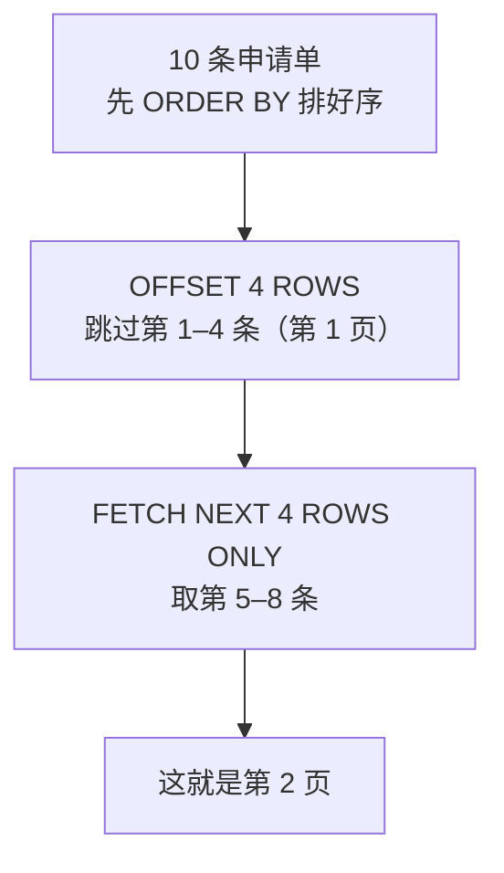
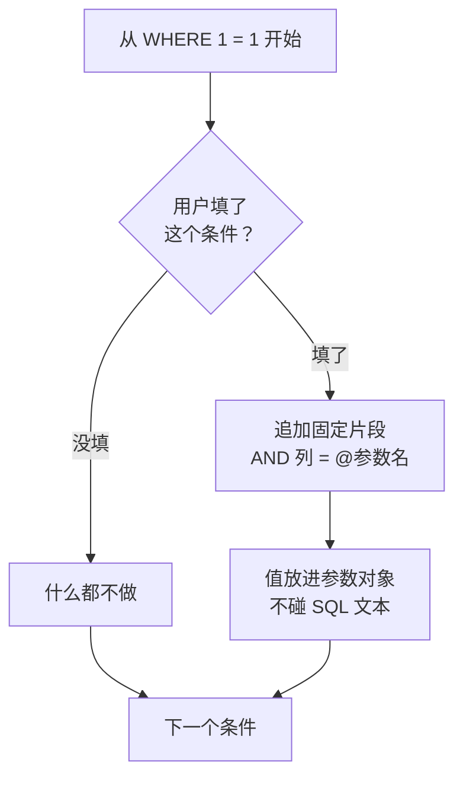
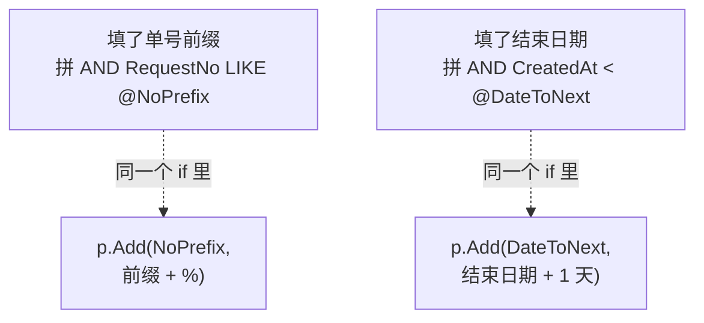
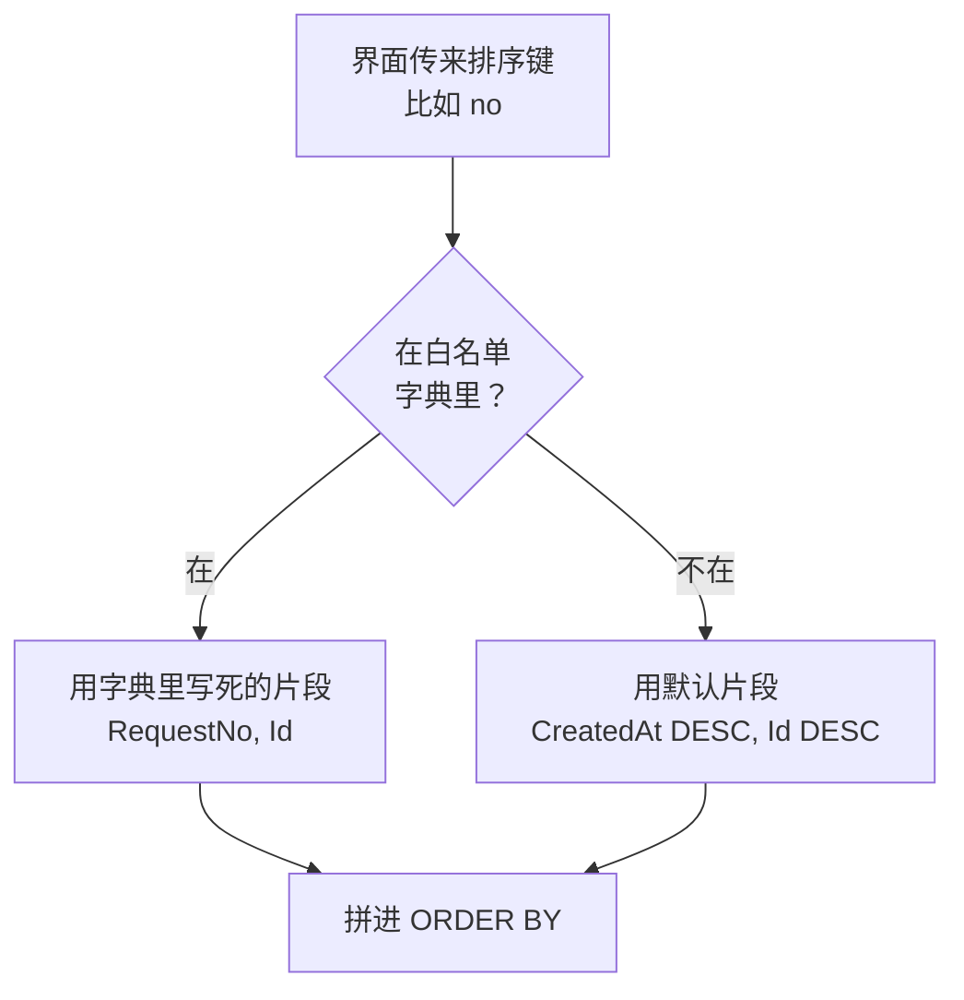

# 第 13 章 分页与动态条件

## 这一章解决什么问题

申请单查询页上通常有五六个输入框：申请人、状态、客户、单号、起止日期。用户**填了哪个就按哪个查，没填就不限**。查出来的结果要分页显示，还能点表头换排序。

WebForm 时代你多半这样写过：`"WHERE Applicant = '" + txtName.Text + "'"`。这种写法会被 SQL 注入，第 4 章已经演示过。可是换成参数化以后，"没填的条件不要拼"又该怎么写？

本章解决三件事：

1. 用 `OFFSET … FETCH` 写分页，并处理好页码越界；
2. 动态拼 WHERE：只拼**写死在代码里的 SQL 片段**，值永远走参数；
3. 用 `DynamicParameters` 按需添加参数，顺带讲清排序列为什么只能用白名单。

## 开始之前

- 上一章你已经会了：用 `QueryMultiple` 一次取回"当前页 + 总条数"，并且知道 `Read` 的顺序规则。
- 前面用到的知识：匿名对象 / 实体对象传参、`IN @ids`、SQL 注入的原理（第 4 章）；可空类型（第 7 章）。
- 需要的环境：第 1 章的解决方案和 `PriceDemo` 库。另外要执行本章的补充数据脚本，见 13.1 节。
- 预计耗时：80–90 分钟。

---

## 正文

### 13.1 准备：新建项目，补充演示数据

**新建项目**：和第 12 章一样。右键解决方案 →「添加 → 新建项目」→「控制台应用」，名称 `Ch13Demo`，框架 .NET 10.0。然后右键 `Ch13Demo` →「设为启动项目」，再通过「工具 → NuGet 包管理器 → 管理解决方案的 NuGet 程序包」装上三个包：`Dapper` 2.1.89、`Microsoft.Data.SqlClient` 7.1.1、`System.Security.Cryptography.Pkcs` 10.0.13。每个例子都是把 `Program.cs` 整个替换掉。

**补充数据**：初始数据只有 3 张申请单，翻页翻不出效果。在 SSMS 里「文件 → 打开 → 文件」，打开 [`code/sql/ch13-more-requests.sql`](../code/sql/ch13-more-requests.sql)，按 **F5** 执行。脚本会再插入 7 张，最后显示 `申请单数 10`。

脚本做三件事：先删掉 Id > 3 的申请单（连同它们的明细和审批记录），再用 `DBCC CHECKIDENT … RESEED, 3` 把自增种子退回 3，最后插入 7 张新单。所以**反复执行，结果都一样**，新单的 Id 固定是 4–10。

执行后的 10 张申请单如下。后面每个例子的结果，都可以拿这张表来核对：

| Id | 单号 | 客户 | 申请人 | 状态 | 创建时间 |
|---|---|---|---|---|---|
| 1 | PR20261001 | 1 | 张伟 | 2 通过 | 10-01 09:30 |
| 2 | PR20261008 | 2 | 李娜 | 1 待审 | 10-08 14:10 |
| 3 | PR20261015 | 1 | 张伟 | 0 草稿 | 10-15 10:00 |
| 4 | PR20261102 | 3 | 王强 | 1 待审 | 11-02 09:00 |
| 5 | PR20261105 | 2 | 李娜 | 2 通过 | 11-05 15:20 |
| 6 | PR20261109 | 1 | 张伟 | 3 驳回 | 11-09 11:45 |
| 7 | PR20261112 | 3 | 王强 | 0 草稿 | 11-12 16:30 |
| 8 | PR20261118 | 2 | 李娜 | 1 待审 | 11-18 10:05 |
| 9 | PR20261123 | 1 | 张伟 | 1 待审 | 11-23 13:40 |
| 10 | PR20261128 | 3 | 王强 | 2 通过 | 11-28 08:50 |

> 脚本可以反复执行，结果都是这 10 张。想回到 3 张的初始状态，就重跑 `00-reset-database.sql`。

---

### 13.2 概念一：`OFFSET … FETCH` 分页

**白话定义**：先按 `ORDER BY` 排好序，再**跳过前面若干行**（`OFFSET n ROWS`），**取接下来的若干行**（`FETCH NEXT m ROWS ONLY`）。第 N 页就是跳过 `(N-1) × 每页条数` 行，再取"每页条数"行。

它是 SQL Server 2012 起提供的语法。你在 2008 时代写的 `ROW_NUMBER() OVER (...)` 嵌套子查询，做的是同一件事。

**业务场景**：申请单列表每页 20 条，底部显示"第 3 页 / 共 15 页"。

**反例（什么时候不该用）**：

- **翻到很深的页**，比如几百万行的日志表翻到第 5 万页。`OFFSET 1000000` 并不会"直接跳过去"，服务器还是要先数过这一百万行，越往后越慢。这种场景应该用"记住上一页最后一条的 Id，下一页 `WHERE Id < @LastId`"的写法（这种写法叫键集分页，keyset pagination）。
- **导出全部数据**。导出不需要分页，应该一次流式读完，第 15 章讲。

#### 🖼 图解：第 2 页是怎么取出来的



页码和参数的换算：

| 每页 4 条 | `@Skip = (页码-1)×4` | `@Take` | 取到第几条 |
|---|---|---|---|
| 第 1 页 | 0 | 4 | 1–4 |
| 第 2 页 | 4 | 4 | 5–8 |
| 第 3 页 | 8 | 4 | 9–10（只剩 2 条） |
| 第 4 页 | 12 | 4 | 没有了，返回 0 行 |

#### 💻 最小可运行代码：翻 4 页，再传一个页码 0

先确认已经执行了 13.1 节的脚本。然后把 `Program.cs` 整个替换成：

```csharp
// code/ch13/Step1-OffsetFetch/Program.cs
// OFFSET…FETCH 分页：第 N 页 = 跳过 (N-1)×每页条数 行，再取"每页条数"行；总数用第 12 章的 QueryMultiple 一起取
using Dapper;
using Microsoft.Data.SqlClient;

const string connStr =
    "Server=.;Database=PriceDemo;Integrated Security=True;TrustServerCertificate=True;";

using var conn = new SqlConnection(connStr);

const int pageSize = 4;                   // 每页 4 条；先执行 ch13-more-requests.sql，表里共 10 条

for (int page = 1; page <= 4; page++)     // 10 条、每页 4 条 → 共 3 页；第 4 页故意越界
    ShowPage(page);
ShowPage(0);                              // 页码 0：界面传错参数时也不能崩

void ShowPage(int pageIndex)
{
    var (rows, total) = GetPage(pageIndex, pageSize);
    int pageCount = (total + pageSize - 1) / pageSize;   // 向上取整：10 / 4 → 3
    Console.WriteLine($"请求第 {pageIndex} 页 / 共 {pageCount} 页（共 {total} 条），本页 {rows.Count} 条");
    foreach (var r in rows)
        Console.WriteLine($"  {r.Id,2}  {r.RequestNo}  {r.Applicant}  {r.CreatedAt:yyyy-MM-dd}");
}

(List<RequestRow> Rows, int Total) GetPage(int pageIndex, int size)
{
    if (pageIndex < 1) pageIndex = 1;     // 页码 0 或负数会算出负的 OFFSET，服务器直接报错（见"改坏一处试试"）

    // ORDER BY 是 OFFSET 的硬性前提；最后加 Id 作为"决胜列"，保证顺序唯一、翻页不重不漏
    const string sql = @"
SELECT Id, RequestNo, Applicant, Status, CreatedAt
FROM dbo.PriceRequest
ORDER BY CreatedAt DESC, Id DESC
OFFSET @Skip ROWS FETCH NEXT @Take ROWS ONLY;

SELECT COUNT(*) FROM dbo.PriceRequest;";

    using var grid = conn.QueryMultiple(sql, new { Skip = (pageIndex - 1) * size, Take = size });
    var rows = grid.Read<RequestRow>().ToList();   // 按顺序：先读当前页
    int total = grid.ReadSingle<int>();            // 再读总数
    return (rows, total);
}

public class RequestRow
{
    public int Id { get; set; }
    public string RequestNo { get; set; } = "";
    public string Applicant { get; set; } = "";
    public int Status { get; set; }
    public DateTime CreatedAt { get; set; }
}
```

#### 🔍 拆解运行结果

实测输出：

```text
请求第 1 页 / 共 3 页（共 10 条），本页 4 条
  10  PR20261128  王强  2026-11-28
   9  PR20261123  张伟  2026-11-23
   8  PR20261118  李娜  2026-11-18
   7  PR20261112  王强  2026-11-12
请求第 2 页 / 共 3 页（共 10 条），本页 4 条
   6  PR20261109  张伟  2026-11-09
   5  PR20261105  李娜  2026-11-05
   4  PR20261102  王强  2026-11-02
   3  PR20261015  张伟  2026-10-15
请求第 3 页 / 共 3 页（共 10 条），本页 2 条
   2  PR20261008  李娜  2026-10-08
   1  PR20261001  张伟  2026-10-01
请求第 4 页 / 共 3 页（共 10 条），本页 0 条
请求第 0 页 / 共 3 页（共 10 条），本页 4 条
  10  PR20261128  王强  2026-11-28
   9  PR20261123  张伟  2026-11-23
   8  PR20261118  李娜  2026-11-18
   7  PR20261112  王强  2026-11-12
```

> 📷 **截图占位 ch13-01**：控制台显示上面的分页输出。
<!--  -->

逐个看：

| 现象 | 说明 |
|---|---|
| 第 1 页从 Id 10 开始 | `ORDER BY CreatedAt DESC`：最新的在前，列表页一般都这样排 |
| 第 3 页只有 2 条 | 最后一页不满，属于正常情况 |
| **第 4 页：0 条，不报错** | 页码越界时，SQL Server 返回空结果集，Dapper 返回空列表（第 2 章讲过，不是 null）。界面上显示"没有数据"就行，不需要 try/catch |
| 第 0 页显示的是第 1 页 | 是代码里 `if (pageIndex < 1) pageIndex = 1;` 的作用。去掉它会怎样，见下面的改坏实验 |
| 共 3 页 | `(10 + 4 - 1) / 4 = 3`，整数除法实现向上取整 |

**为什么 ORDER BY 后面还要加 `Id DESC`**：如果只按 `CreatedAt` 排，而两张单据的创建时间完全相同，那么它们谁先谁后，SQL Server **不保证**每次都一样。结果可能是：翻到第 2 页时，又看到了第 1 页出现过的那一张，而另一张一次都没出现。在最后加上主键这种唯一的列作为"决胜列"，顺序就固定了。示例数据里没有时间相同的单据，所以这个问题在这里演示不出来，但你的正式数据里一定会有。

**为什么总数要用同一个 `QueryMultiple` 取**：第 12 章讲过，这样只往返一次。另外，两条 SQL 在同一个批里执行，中间被别人插入数据的机会也更小。

#### 改坏一处试试

**改法 1：删掉 `ORDER BY CreatedAt DESC, Id DESC` 这一行**。实测报错：

```text
Unhandled exception. Microsoft.Data.SqlClient.SqlException (0x80131904): Incorrect syntax near '@Skip'.
Invalid usage of the option NEXT in the FETCH statement.
Error Number:102,State:1,Class:15
```

`OFFSET` 是 `ORDER BY` 子句的一部分，没有 `ORDER BY` 就没有 `OFFSET`。所以服务器报的是**语法错误**（102），第一句写的是"`@Skip` 附近有语法错误"。看到 `Incorrect syntax near '@Skip'` 再加上 `FETCH`，就去检查 ORDER BY 还在不在。

**改法 2：删掉 `if (pageIndex < 1) pageIndex = 1;`**。前 4 页照常输出，到第 0 页时报错：

```text
Unhandled exception. Microsoft.Data.SqlClient.SqlException (0x80131904): The offset specified in a OFFSET clause may not be negative.
Error Number:10742,State:1,Class:15
```

`(0 - 1) × 4 = -4`，OFFSET 不能是负数。页码来自网址或者界面，用户随时可能传 0、-1 进来，**一定要在 C# 里先校正**。

**改法 3：把 `const int pageSize = 4;` 改成 `0`**。实测报错：

```text
Unhandled exception. Microsoft.Data.SqlClient.SqlException (0x80131904): The number of rows provided for a FETCH clause must be greater then zero.
Error Number:10744,State:1,Class:15
```

`FETCH NEXT 0 ROWS` 也不允许。（原文里的 `greater then` 是 SQL Server 自己的拼写错误，不是抄错了。）每页条数同样要在 C# 里限制范围，比如 1–100。

> 这三条都是服务器端报错。沙箱里的服务器是英文版，中文版 SQL Server 显示的是中文译文，但错误号（102、10742、10744）是一样的。

---

### 13.3 概念二：动态拼接 WHERE

**白话定义**：SQL 文本按用户填写的条件"组装"出来，**但组装的材料只能是写死在代码里的 SQL 片段**，比如 `" AND Status = @Status"`。用户输入的值一律通过参数传递，**永远不进入 SQL 文本**。

**业务场景**：查询页有"申请人、状态、客户、起始日期"四个条件。用户只填了申请人，SQL 里就只有 `AND Applicant = @Applicant` 这一段。

**反例（什么时候不该用）**：

- **条件是固定的**。比如"我的待审单据"永远是 `Applicant = @Me AND Status = 1`，直接写死就行，不要为了"以后可能要加条件"去写拼接。
- **想偷懒写成 `WHERE (@Status IS NULL OR Status = @Status) AND (@Applicant IS NULL OR …)`**。这种写法 SQL 文本是固定的，看起来更简单。但所有条件组合会共用**同一个执行计划**，SQL Server 很难针对"这次只填了申请人"选择合适的索引。数据量大了就容易变慢。动态拼接则是每种条件组合各有一条 SQL、各有一个计划。

#### 🖼 图解：每个条件只做两件事



`WHERE 1 = 1` 是个老技巧：它恒为真，不影响结果。有了它，后面每个条件都可以统一用 `AND` 开头，不用判断"我是不是第一个条件"。SQL Server 会把它优化掉，不影响性能。

#### 💻 最小可运行代码：查询页的 5 种填法

把 `Program.cs` 整个替换成：

```csharp
// code/ch13/Step2-DynamicWhere/Program.cs
// 动态 WHERE：用户填了哪个条件就拼哪段"固定的 SQL 片段"，值一律走参数
using System.Text;
using Dapper;
using Microsoft.Data.SqlClient;

const string connStr =
    "Server=.;Database=PriceDemo;Integrated Security=True;TrustServerCertificate=True;";

using var conn = new SqlConnection(connStr);

// 模拟查询页上的 5 种填法（先执行 ch13-more-requests.sql，表里共 10 条）
Search("例 1 什么都不填", new RequestFilter());
Search("例 2 申请人=张伟", new RequestFilter { Applicant = "张伟" });
Search("例 3 申请人=张伟 且 状态=待审", new RequestFilter { Applicant = "张伟", Status = 1 });
Search("例 4 客户=3 且 11-10 之后", new RequestFilter { CustomerId = 3, DateFrom = new DateTime(2026, 11, 10) });
Search("例 5 状态=草稿（值是 0）", new RequestFilter { Status = 0 });

void Search(string title, RequestFilter f)
{
    var sql = new StringBuilder(@"
SELECT Id, RequestNo, CustomerId, Applicant, Status, CreatedAt
FROM dbo.PriceRequest
WHERE 1 = 1");                            // 1 = 1 恒为真：后面每个条件都能统一以 AND 开头

    // 只拼"写死在代码里的片段"，片段里只有 @参数名，用户输入的值从不进入 SQL 文本
    if (!string.IsNullOrWhiteSpace(f.Applicant)) sql.Append(" AND Applicant = @Applicant");
    if (f.Status.HasValue)                       sql.Append(" AND Status = @Status");      // 用 HasValue，0（草稿）也是合法条件
    if (f.CustomerId.HasValue)                   sql.Append(" AND CustomerId = @CustomerId");
    if (f.DateFrom.HasValue)                     sql.Append(" AND CreatedAt >= @DateFrom");
    sql.Append(" ORDER BY Id;");

    // 参数直接传整个 filter 对象：属性名和 @参数名一致就对得上（第 4 章讲过）
    var rows = conn.Query<RequestRow>(sql.ToString(), f).ToList();

    Console.WriteLine($"== {title}：{rows.Count} 条");
    Console.WriteLine("   WHERE 部分：" + sql.ToString().Split("WHERE ")[1].Replace(" ORDER BY Id;", ""));
    foreach (var r in rows)
        Console.WriteLine($"   {r.Id,2}  {r.RequestNo}  客户{r.CustomerId}  {r.Applicant}  状态={r.Status}  {r.CreatedAt:MM-dd}");
}

// 查询页的条件：全部可空，null = 用户没填 = 不限
public class RequestFilter
{
    public string? Applicant { get; set; }
    public int? Status { get; set; }
    public int? CustomerId { get; set; }
    public DateTime? DateFrom { get; set; }
}

public class RequestRow
{
    public int Id { get; set; }
    public string RequestNo { get; set; } = "";
    public int CustomerId { get; set; }
    public string Applicant { get; set; } = "";
    public int Status { get; set; }
    public DateTime CreatedAt { get; set; }
}
```

#### 🔍 拆解运行结果

实测输出：

```text
== 例 1 什么都不填：10 条
   WHERE 部分：1 = 1
    1  PR20261001  客户1  张伟  状态=2  10-01
    2  PR20261008  客户2  李娜  状态=1  10-08
    3  PR20261015  客户1  张伟  状态=0  10-15
    4  PR20261102  客户3  王强  状态=1  11-02
    5  PR20261105  客户2  李娜  状态=2  11-05
    6  PR20261109  客户1  张伟  状态=3  11-09
    7  PR20261112  客户3  王强  状态=0  11-12
    8  PR20261118  客户2  李娜  状态=1  11-18
    9  PR20261123  客户1  张伟  状态=1  11-23
   10  PR20261128  客户3  王强  状态=2  11-28
== 例 2 申请人=张伟：4 条
   WHERE 部分：1 = 1 AND Applicant = @Applicant
    1  PR20261001  客户1  张伟  状态=2  10-01
    3  PR20261015  客户1  张伟  状态=0  10-15
    6  PR20261109  客户1  张伟  状态=3  11-09
    9  PR20261123  客户1  张伟  状态=1  11-23
== 例 3 申请人=张伟 且 状态=待审：1 条
   WHERE 部分：1 = 1 AND Applicant = @Applicant AND Status = @Status
    9  PR20261123  客户1  张伟  状态=1  11-23
== 例 4 客户=3 且 11-10 之后：2 条
   WHERE 部分：1 = 1 AND CustomerId = @CustomerId AND CreatedAt >= @DateFrom
    7  PR20261112  客户3  王强  状态=0  11-12
   10  PR20261128  客户3  王强  状态=2  11-28
== 例 5 状态=草稿（值是 0）：2 条
   WHERE 部分：1 = 1 AND Status = @Status
    3  PR20261015  客户1  张伟  状态=0  10-15
    7  PR20261112  客户3  王强  状态=0  11-12
```

| 例 | 看点 |
|---|---|
| 1 | 什么都不填，WHERE 只剩 `1 = 1`，查出全部 10 条 |
| 2、3 | 填几个条件，就拼几段。SQL 文本里只有 `@Applicant`，**没有"张伟"两个字** |
| 4 | 日期条件同样是参数，不用操心日期格式和引号 |
| 5 | **状态 0 是合法的条件值**（草稿）。代码用的是 `f.Status.HasValue`，所以 0 也会被拼进去 |

**服务器实际收到了什么**：用第 4 章的方法查计划缓存，在 SSMS 里执行：

```sql
SELECT CAST(t.text AS NVARCHAR(300)) AS txt
FROM sys.dm_exec_cached_plans p
CROSS APPLY sys.dm_exec_sql_text(p.plan_handle) t
WHERE t.text LIKE N'%WHERE 1 = 1%' AND t.text NOT LIKE N'%dm_exec%';
```

实测查到 5 条（顺序可能不同）：

```text
(@Status int)
SELECT Id, RequestNo, CustomerId, Applicant, Status, CreatedAt
FROM dbo.PriceRequest
WHERE 1 = 1 AND Status = @Status ORDER BY Id;
(@CustomerId int,@DateFrom datetime)
SELECT Id, RequestNo, CustomerId, Applicant, Status, CreatedAt
FROM dbo.PriceRequest
WHERE 1 = 1 AND CustomerId = @CustomerId AND CreatedAt >= @DateFrom ORDER BY Id;
(@Applicant nvarchar(4000),@Status int)
SELECT Id, RequestNo, CustomerId, Applicant, Status, CreatedAt
FROM dbo.PriceRequest
WHERE 1 = 1 AND Applicant = @Applicant AND Status = @Status ORDER BY Id;
(@Applicant nvarchar(4000))
SELECT Id, RequestNo, CustomerId, Applicant, Status, CreatedAt
FROM dbo.PriceRequest
WHERE 1 = 1 AND Applicant = @Applicant ORDER BY Id;

SELECT Id, RequestNo, CustomerId, Applicant, Status, CreatedAt
FROM dbo.PriceRequest
WHERE 1 = 1 ORDER BY Id;
```

从这里能看出两点：

1. **每种条件组合各有一个计划**，值不同的查询会复用同一个计划。这就是"反例"里说的，动态拼接比 `@X IS NULL OR …` 更好的原因。
2. 我们传的是**整个 filter 对象**，它有 4 个属性。可是例 2 的参数列表里**只有 `@Applicant`**。这是因为执行普通 SQL 文本时，Dapper 只发送 SQL 里出现过的 `@名字`，对象上其他的属性不会发送。所以把整个条件对象传进去是安全的，不会多发一堆用不上的参数。

> `@Applicant nvarchar(4000)`：string 参数默认按 nvarchar(4000) 发送，第 15 章讲它和 varchar 列的关系。

#### 改坏一处试试

**改法 1：把 `WHERE 1 = 1` 改成只写 `WHERE`**。例 1 一个条件都没有，SQL 变成了 `WHERE ORDER BY Id`。实测报错：

```text
Unhandled exception. Microsoft.Data.SqlClient.SqlException (0x80131904): Incorrect syntax near the keyword 'ORDER'.
Error Number:156,State:1,Class:15
```

再把例 1 那一行删掉，从例 2 开始跑，SQL 变成了 `WHERE AND Applicant = …`。实测报错：

```text
Unhandled exception. Microsoft.Data.SqlClient.SqlException (0x80131904): Incorrect syntax near the keyword 'AND'.
Error Number:156,State:1,Class:15
```

中文版 SQL Server 上，这两条分别是 `关键字 'ORDER' 附近有语法错误。` 和 `关键字 'AND' 附近有语法错误。`。**有没有 `1 = 1` 的区别就在这里**：没有它，就得判断"是不是第一个条件"，决定写 `WHERE` 还是 `AND`。

**改法 2：片段前面漏了空格**。把 `" AND Status = @Status"` 改成 `"AND Status = @Status"`。例 1、例 2 正常，到例 3 时报错：

```text
Unhandled exception. Microsoft.Data.SqlClient.SqlException (0x80131904): Must declare the scalar variable "@ApplicantAND".
Error Number:137,State:2,Class:15
```

中文版是 `必须声明标量变量 "@ApplicantAND"。`。前一段的结尾 `@Applicant` 和这一段的开头 `AND` 粘在一起，变成了一个叫 `@ApplicantAND` 的变量。**每个片段都以空格开头**，养成习惯就不会出这个错。报错里出现奇怪的变量名或者列名时，先把 `sql.ToString()` 打印出来看看。

**改法 3：用 `> 0` 判断"有没有填"**。把 `if (f.Status.HasValue)` 改成 `if (f.Status > 0)`。实测**不报错**，但例 5 变成了：

```text
== 例 5 状态=草稿（值是 0）：10 条
   WHERE 部分：1 = 1
```

用户明明选了"草稿"，却查出了全部 10 条。0 是合法的状态值，不能拿它表示"没填"。**"没填"要用 `null` 表示**，所以条件类的属性都声明成 `int?`、`DateTime?`，判断时用 `HasValue`。

---

### 13.4 概念三：`DynamicParameters` 按需添加参数

**白话定义**：`DynamicParameters` 是 Dapper 提供的一个"参数袋"。先 `new` 一个空的，然后在代码里 `p.Add("名字", 值)`，要几个加几个。最后把它当作参数对象传给任意查询方法。

**业务场景**：查询页有两个条件，值不能原样使用：

| 条件 | 用户填的 | SQL 需要的 |
|---|---|---|
| 单号前缀 | `PR202611` | `LIKE 'PR202611%'`，要在值后面拼一个 `%` |
| 结束日期（含当天） | `2026-11-18` | `CreatedAt < '2026-11-19'`，要加一天 |

匿名对象也能做到，但每种条件组合都得写一个，组合一多就写不过来。`DynamicParameters` 可以跟着 `if` 一起，**拼一段 SQL，就加一个参数**。

**反例（什么时候不该用）**：条件的值不需要加工、名字也和属性一致时，像 13.3 节那样直接传整个条件对象就够了，代码更短。第 8 章用 `DynamicParameters` 取存储过程的 Output 参数，那是它的另一个用途，和这里无关。

#### 🖼 图解：SQL 片段和参数成对出现



一个 `if` 里同时做两件事：拼 SQL 片段、加参数。这样两者永远不会对不上。

#### 💻 最小可运行代码：完整的查询页

这一段把本章的三个概念放到了一起：动态 WHERE、`DynamicParameters`、分页。另外还加了 13.5 节要讲的排序白名单。把 `Program.cs` 整个替换成：

```csharp
// code/ch13/Step3-DynamicParameters/Program.cs
// 完整的查询页：动态 WHERE + DynamicParameters 按需加参数 + 排序白名单 + 分页 + 总数
using System.Text;
using Dapper;
using Microsoft.Data.SqlClient;

const string connStr =
    "Server=.;Database=PriceDemo;Integrated Security=True;TrustServerCertificate=True;";

using var conn = new SqlConnection(connStr);

// 排序白名单：界面只传"排序键"，真正的 ORDER BY 片段由代码决定
// 每一项最后都带 Id，保证顺序唯一（13.2 节讲过翻页不重不漏的前提）
var sortMap = new Dictionary<string, string>(StringComparer.OrdinalIgnoreCase)
{
    ["date"]      = "CreatedAt DESC, Id DESC",   // 默认：最新的在前
    ["no"]        = "RequestNo, Id",
    ["applicant"] = "Applicant, CreatedAt DESC, Id",
};

// 先执行 ch13-more-requests.sql，表里共 10 条
Run("例 1 李娜，11-01 到 11-18（含当天）",
    new SearchForm { Applicant = "李娜", DateFrom = new DateTime(2026, 11, 1), DateTo = new DateTime(2026, 11, 18) });
Run("例 2 单号以 PR202611 开头、待审，按单号，第 1 页",
    new SearchForm { RequestNoPrefix = "PR202611", Status = 1, Sort = "no", PageIndex = 1, PageSize = 2 });
Run("例 3 同上，第 2 页",
    new SearchForm { RequestNoPrefix = "PR202611", Status = 1, Sort = "no", PageIndex = 2, PageSize = 2 });
Run("例 4 排序键被人改成了一段 SQL",
    new SearchForm
    {
        Applicant = "王强",
        // 有人绕过界面，直接在请求里把排序键改成了这一串（含一条 DROP TABLE）
        Sort = "Id OFFSET 0 ROWS FETCH NEXT 1 ROWS ONLY; DROP TABLE dbo.ApprovalLog; SELECT 1 AS Id ORDER BY Id",
    });

// 例 4 之后检查：审批记录表还在不在
bool exists = conn.ExecuteScalar<int?>("SELECT OBJECT_ID('dbo.ApprovalLog')") is not null;
Console.WriteLine($"审批记录表 dbo.ApprovalLog 还在吗？{exists}");

void Run(string title, SearchForm f)
{
    var where = new StringBuilder(" WHERE 1 = 1");
    var p = new DynamicParameters();     // 一个空的参数袋：用到哪个条件，就往里放哪个参数

    if (!string.IsNullOrWhiteSpace(f.Applicant))
    {
        where.Append(" AND Applicant = @Applicant");
        p.Add("Applicant", f.Applicant);
    }
    if (f.Status.HasValue)
    {
        where.Append(" AND Status = @Status");
        p.Add("Status", f.Status.Value);
    }
    if (!string.IsNullOrWhiteSpace(f.RequestNoPrefix))
    {
        where.Append(" AND RequestNo LIKE @NoPrefix");
        p.Add("NoPrefix", f.RequestNoPrefix + "%");          // 值要加工：在 C# 里拼 %，SQL 文本不变
    }
    if (f.DateFrom.HasValue)
    {
        where.Append(" AND CreatedAt >= @DateFrom");
        p.Add("DateFrom", f.DateFrom.Value.Date);
    }
    if (f.DateTo.HasValue)
    {
        where.Append(" AND CreatedAt < @DateToNext");        // "含当天" = 小于第二天 0 点
        p.Add("DateToNext", f.DateTo.Value.Date.AddDays(1));  // 参数名和表单属性名不同，匿名对象做不到这么自由
    }

    // 排序键不在白名单里就用默认值——绝不把 f.Sort 本身拼进 SQL
    string orderBy = sortMap.TryGetValue(f.Sort ?? "", out var o) ? o : sortMap["date"];

    int pageIndex = Math.Max(f.PageIndex, 1);
    p.Add("Skip", (pageIndex - 1) * f.PageSize);
    p.Add("Take", f.PageSize);

    string sql = $@"
SELECT Id, RequestNo, Applicant, Status, CreatedAt
FROM dbo.PriceRequest{where}
ORDER BY {orderBy}
OFFSET @Skip ROWS FETCH NEXT @Take ROWS ONLY;

SELECT COUNT(*) FROM dbo.PriceRequest{where};";   // 总数用同一段 WHERE、同一批参数

    using var grid = conn.QueryMultiple(sql, p);
    var rows = grid.Read<RequestRow>().ToList();
    int total = grid.ReadSingle<int>();

    Console.WriteLine($"== {title}");
    Console.WriteLine($"   参数：{string.Join(", ", p.ParameterNames)}");   // 看看这次实际放了哪些参数
    Console.WriteLine($"   排序：{orderBy}");
    Console.WriteLine($"   第 {pageIndex} 页，本页 {rows.Count} 条 / 共 {total} 条");
    foreach (var r in rows)
        Console.WriteLine($"   {r.Id,2}  {r.RequestNo}  {r.Applicant}  状态={r.Status}  {r.CreatedAt:MM-dd HH:mm}");
}

// 查询页表单：条件全部可空；分页、排序给默认值
public class SearchForm
{
    public string? Applicant { get; set; }
    public int? Status { get; set; }
    public string? RequestNoPrefix { get; set; }
    public DateTime? DateFrom { get; set; }
    public DateTime? DateTo { get; set; }
    public string? Sort { get; set; } = "date";
    public int PageIndex { get; set; } = 1;
    public int PageSize { get; set; } = 10;
}

public class RequestRow
{
    public int Id { get; set; }
    public string RequestNo { get; set; } = "";
    public string Applicant { get; set; } = "";
    public int Status { get; set; }
    public DateTime CreatedAt { get; set; }
}
```

#### 🔍 拆解运行结果

实测输出：

```text
== 例 1 李娜，11-01 到 11-18（含当天）
   参数：Applicant, DateFrom, DateToNext, Skip, Take
   排序：CreatedAt DESC, Id DESC
   第 1 页，本页 2 条 / 共 2 条
    8  PR20261118  李娜  状态=1  11-18 10:05
    5  PR20261105  李娜  状态=2  11-05 15:20
== 例 2 单号以 PR202611 开头、待审，按单号，第 1 页
   参数：Status, NoPrefix, Skip, Take
   排序：RequestNo, Id
   第 1 页，本页 2 条 / 共 3 条
    4  PR20261102  王强  状态=1  11-02 09:00
    8  PR20261118  李娜  状态=1  11-18 10:05
== 例 3 同上，第 2 页
   参数：Status, NoPrefix, Skip, Take
   排序：RequestNo, Id
   第 2 页，本页 1 条 / 共 3 条
    9  PR20261123  张伟  状态=1  11-23 13:40
== 例 4 排序键被人改成了一段 SQL
   参数：Applicant, Skip, Take
   排序：CreatedAt DESC, Id DESC
   第 1 页，本页 3 条 / 共 3 条
   10  PR20261128  王强  状态=2  11-28 08:50
    7  PR20261112  王强  状态=0  11-12 16:30
    4  PR20261102  王强  状态=1  11-02 09:00
审批记录表 dbo.ApprovalLog 还在吗？True
```

> 📷 **截图占位 ch13-02**：控制台显示 4 个例子的输出，例 4 的"排序"一行是默认值 `CreatedAt DESC, Id DESC`。
<!--  -->

逐个看：

| 例 | 看点 |
|---|---|
| 1 | `ParameterNames` 列出了这次实际加进去的 5 个参数，没填的条件对应的参数不在里面。**8 号单（11-18 10:05）被查到了**，因为条件是"小于 11-19 0 点"。下面的改坏实验会演示写成 `<= 11-18` 时，它为什么会丢 |
| 2 | 参数名 `NoPrefix` 和表单属性名 `RequestNoPrefix` 不一样，值也加工过（后面拼了 `%`）。直接传表单对象做不到这一点 |
| 2、3 | 同样的条件，换一页就只改 `Skip`。总数始终是 3，"共 3 条"不会随着翻页而变化，因为总数用的是同一段 WHERE |
| 4 | 排序键是一段带 `DROP TABLE` 的 SQL。它不在白名单里，所以用了默认排序，表还在。13.5 节细讲 |

**`DynamicParameters` 的三个要点**：

| 要点 | 说明 |
|---|---|
| `p.Add("Applicant", 值)` | 名字可以写成 `"Applicant"`，也可以写成 `"@Applicant"`，效果一样（实测：改成 `"@Applicant"` 后输出不变，`ParameterNames` 里显示的仍是 `Applicant`） |
| `p.ParameterNames` | 列出已经加进去的参数名。调试时打印出来，最容易看出"拼了片段却忘了加参数" |
| 同一个 `p` 给两条 SQL 用 | `QueryMultiple` 里的分页 SQL 和 COUNT SQL 共用这一个参数袋（第 12 章讲过，参数所有语句共用） |

> `Add` 还有可选参数 `dbType`、`direction`、`size`。`direction` 是第 8 章 Output 参数用的；`dbType` 和 `size` 第 15 章讲字符串参数类型时再用。本章都不需要。

#### 改坏一处试试

**改法：把"含当天"的写法改成 `<=`**。也就是把

```text
AND CreatedAt < @DateToNext      值 = 结束日期 + 1 天
```

改成看起来更直观的

```text
AND CreatedAt <= @DateTo         值 = 结束日期本身
```

（代码里对应的那两行改成 `where.Append(" AND CreatedAt <= @DateTo");` 和 `p.Add("DateTo", f.DateTo.Value);`。）实测例 1 变成：

```text
== 例 1 李娜，11-01 到 11-18（含当天）
   参数：Applicant, DateFrom, DateTo, Skip, Take
   排序：CreatedAt DESC, Id DESC
   第 1 页，本页 1 条 / 共 1 条
    5  PR20261105  李娜  状态=2  11-05 15:20
```

**8 号单不见了，而且不报错。** `CreatedAt` 是带时分秒的 `DATETIME2`，`<= '2026-11-18'` 的意思是"小于等于 11-18 **0 点 0 分**"，所以 11-18 10:05 这一张就被排除了。用户说"到 18 号"，意思是 18 号一整天都算。**正确的写法是"小于第二天 0 点"**，而"加一天"这个加工，正是需要 `DynamicParameters` 的原因之一。

---

### 13.5 排序列：只能用白名单

点击表头排序时，界面会传一个"按什么排"过来。很多人的第一反应是：值都要参数化，排序列也做成参数，`ORDER BY @Sort`。

**这样做不行**，原因是：参数只能代表一个**值**，不能代表**列名**、表名这类 SQL 结构。

#### 🖼 图解：排序键怎么变成 ORDER BY



界面传来的字符串**只用来查字典**，自己永远不进入 SQL。这样无论传来什么，最终拼进去的都是你写死的那几种片段之一。

#### 改坏一处试试：三种错误写法

以下都是在 13.4 节的代码上改动。

**错误写法 1：`ORDER BY @Sort`**（把字典查出的片段作为参数 `Sort` 传入）。实测报错：

```text
Unhandled exception. Microsoft.Data.SqlClient.SqlException (0x80131904): The SELECT item identified by the ORDER BY number 1 contains a variable as part of the expression identifying a column position. Variables are only allowed when ordering by an expression referencing a column name.
Error Number:1008,State:1,Class:16
```

SQL Server 直接拒绝：ORDER BY 后面单独放一个变量，是不允许的。

**错误写法 2：`ORDER BY (SELECT @Sort)`**。有人会在网上搜到这个"绕过"写法。实测**不报错**，但是排序**静默失效**。例 1 和例 4 的输出变成了：

```text
== 例 1 李娜，11-01 到 11-18（含当天）
   参数：Applicant, DateFrom, DateToNext, Skip, Take, Sort
   排序：CreatedAt DESC, Id DESC
   第 1 页，本页 2 条 / 共 2 条
    5  PR20261105  李娜  状态=2  11-05 15:20
    8  PR20261118  李娜  状态=1  11-18 10:05
```

```text
== 例 4 排序键被人改成了一段 SQL
   参数：Applicant, Skip, Take, Sort
   排序：CreatedAt DESC, Id DESC
   第 1 页，本页 3 条 / 共 3 条
    4  PR20261102  王强  状态=1  11-02 09:00
    7  PR20261112  王强  状态=0  11-12 16:30
   10  PR20261128  王强  状态=2  11-28 08:50
```

本该"最新的在前"，结果却是旧的在前。`(SELECT @Sort)` 对每一行算出来的都是**同一个字符串** `'CreatedAt DESC, Id DESC'`。按一个常量排序，等于没排序，行的先后顺序完全由服务器决定。例 2 碰巧顺序对了，这种"有时对、有时错"的问题最难查。

**错误写法 3：白名单查不到时，直接用原值**。把那一行改成 `… ? o : f.Sort!;`，也就是"字典里没有，就用界面传来的字符串"。实测例 4：

```text
== 例 4 排序键被人改成了一段 SQL
   参数：Applicant, Skip, Take
   排序：Id OFFSET 0 ROWS FETCH NEXT 1 ROWS ONLY; DROP TABLE dbo.ApprovalLog; SELECT 1 AS Id ORDER BY Id
   第 1 页，本页 1 条 / 共 1 条
    4  PR20261102  王强  状态=1  11-02 09:00
审批记录表 dbo.ApprovalLog 还在吗？False
```

**审批记录表真的被删掉了。** 例 4 的那串排序键是精心构造的：先把原来的 SELECT 补完整，再插一条 `DROP TABLE`，最后再写一个 SELECT，去接住模板里剩下的 `OFFSET @Skip …`。整段 SQL 语法完全正确，于是被原样执行了。这就是第 4 章讲的 SQL 注入，只不过这次的入口是 ORDER BY，而不是 WHERE。值都参数化了，**结构类的东西（列名、表名、排序方向）只能用白名单**。

> 做完这个实验，重跑 `00-reset-database.sql` 和 `ch13-more-requests.sql`，把表恢复回来。

---

## 🧱 类比：ADO.NET 写法与 Dapper 写法逐项对照

| 要做的事 | ADO.NET（你以前的写法） | Dapper（本章） |
|---|---|---|
| 分页 SQL | SQL 2008：`ROW_NUMBER() OVER (ORDER BY …)` 子查询 + `WHERE RowNum BETWEEN @a AND @b` | SQL 2012+：`ORDER BY … OFFSET @Skip ROWS FETCH NEXT @Take ROWS ONLY`。这是 SQL 层面的变化，和用不用 Dapper 无关 |
| 当前页 + 总数 | 两次 `ExecuteReader`/`ExecuteScalar`，或者 `NextResult()` | `QueryMultiple` + `Read` + `ReadSingle<int>`（第 12 章） |
| 拼动态 WHERE | `StringBuilder` + `WHERE 1=1` | 完全一样 |
| 按需加参数 | 每个 `if` 里写 `cmd.Parameters.Add("@Status", SqlDbType.Int).Value = …` | 每个 `if` 里写 `p.Add("Status", …)` |
| 查看加了哪些参数 | 遍历 `cmd.Parameters` | `p.ParameterNames` |
| 条件全是同名属性 | 还是要逐个 `Parameters.Add` | 直接传整个条件对象，Dapper 只发送 SQL 里用到的 |
| 排序列 | 只能白名单（`SqlParameter` 同样不能代表列名） | 只能白名单 |

你会发现，动态 SQL 的**思路和 ADO.NET 时代完全一样**，Dapper 只是让"加参数"这一步变短了。安全规则没有任何变化：值走参数，结构走白名单。

## ⚠️ 踩坑警告

| 现象 | 原因 | 怎么改 |
|---|---|---|
| `Incorrect syntax near '@Skip'` + `Invalid usage of the option NEXT in the FETCH statement.`（实测） | 用了 OFFSET，却没有 ORDER BY | 补上 ORDER BY，并且最后带一个唯一列 |
| `The offset specified in a OFFSET clause may not be negative.`（实测） | 页码 0 或负数，算出了负的 OFFSET | 在 C# 里校正：`pageIndex = Math.Max(pageIndex, 1)` |
| 翻页时同一条记录出现两次、另一条一次都没出现 | ORDER BY 的列不唯一，同值行的先后顺序不固定 | ORDER BY 最后加主键 |
| `Must declare the scalar variable "@ApplicantAND"`（实测） | SQL 片段前面漏了空格 | 每个片段都以空格开头；出错时打印 `sql.ToString()` |
| 选了"草稿"却查出全部数据（实测） | 用 `> 0` 判断"有没有填"，把 0 当成了没填 | 条件属性用可空类型，判断用 `HasValue` |
| 结束日期当天的数据查不到（实测） | `CreatedAt <= '日期'` 只到当天 0 点 | 写成 `< 第二天`，在 C# 里 `AddDays(1)` |
| 排序点了没反应，或者顺序时对时错（实测） | `ORDER BY (SELECT @Sort)` 是按常量排序 | 用白名单字典选出固定的片段 |
| 表被删了（实测） | 排序键原样拼进了 SQL | 界面传来的值只用来查字典，绝不拼进 SQL |

## 🎯 动手练习

**练习：按客户等级 + 状态列表查询**

先执行 `ch13-more-requests.sql`。写一个 `Search(title, level, statuses, pageIndex, pageSize)` 方法：

- `level`（`string?`）：客户等级，要 JOIN `dbo.Customer` 用 `c.Level` 过滤。`null` 表示不限。
- `statuses`（`int[]`）：状态列表，用 `IN @Statuses`。**空数组表示不限**。
- 按 `CreatedAt` 升序排，再加 `Id`；返回当前页和总条数（一次往返）。
- 输出格式：标题行是 `== {title}：共 {总数} 条，本页 {本页条数} 条`，每一行是 `   {单号}  {客户名}  状态={状态}  {MM-dd}`。

调用两次：

1. `Search("练习 1 状态=待审或通过，第 2 页", level: null, statuses: new[] { 1, 2 }, pageIndex: 2, pageSize: 3)`
2. `Search("练习 2 客户等级=A，状态不限，第 1 页", level: "A", statuses: Array.Empty<int>(), pageIndex: 1, pageSize: 3)`

- 验收标准：输出完全一致：

```text
== 练习 1 状态=待审或通过，第 2 页：共 7 条，本页 3 条
   PR20261105  江南检测中心  状态=2  11-05
   PR20261118  江南检测中心  状态=1  11-18
   PR20261123  华东第一医院  状态=1  11-23
== 练习 2 客户等级=A，状态不限，第 1 页：共 4 条，本页 3 条
   PR20261001  华东第一医院  状态=2  10-01
   PR20261015  华东第一医院  状态=0  10-15
   PR20261109  华东第一医院  状态=3  11-09
```

- 提示：空数组时如果照样拼 `IN @Statuses`，结果会是什么？（第 4 章实测过空列表的行为。）

卡住了看文末参考答案。

## 📌 一句话总结

值走参数、结构走白名单；分页必须有唯一的 ORDER BY，页码先校正。

## 下一章

查询页查得慢，用户点了"取消"，后台还在傻等；报表跑了 30 秒突然报"超时"。第 14 章讲异步、超时与取消。

---

<!-- 以下是参考答案，先自己动手，卡住了再往下翻 -->


## 参考答案

**思路**：

- 和 13.4 节一样，用 `StringBuilder` + `DynamicParameters`，一个 `if` 里同时拼片段、加参数。
- 状态列表要先判断 `statuses.Length > 0`。空数组时**根本不拼**这个条件，这才是"不限"。如果照样拼，Dapper 会把空列表展开成一个永远为假的条件（第 4 章讲过）。实测：去掉这个判断后，练习 2 变成了 `共 0 条，本页 0 条`。
- 两条 SQL 的 `FROM … JOIN … WHERE` 完全相同，所以单独放在一个 `from` 字符串里，分页 SQL 和 COUNT SQL 都用它，不会出现"改了一处忘了另一处"。
- 核对练习 1：状态是 1 或 2 的有 1、2、4、5、8、9、10 号，共 7 张。按时间升序，第 2 页（每页 3 条）是第 4–6 张，也就是 5、8、9 号。

完整项目在 [`code/ch13/Exercise/`](../code/ch13/Exercise/)。实测输出：

```text
== 练习 1 状态=待审或通过，第 2 页：共 7 条，本页 3 条
   PR20261105  江南检测中心  状态=2  11-05
   PR20261118  江南检测中心  状态=1  11-18
   PR20261123  华东第一医院  状态=1  11-23
== 练习 2 客户等级=A，状态不限，第 1 页：共 4 条，本页 3 条
   PR20261001  华东第一医院  状态=2  10-01
   PR20261015  华东第一医院  状态=0  10-15
   PR20261109  华东第一医院  状态=3  11-09
```

```csharp
// code/ch13/Exercise/Program.cs
// 第 13 章练习参考答案：按"客户等级 + 状态列表"动态查询，按创建时间升序分页
using System.Text;
using Dapper;
using Microsoft.Data.SqlClient;

const string connStr =
    "Server=.;Database=PriceDemo;Integrated Security=True;TrustServerCertificate=True;";

using var conn = new SqlConnection(connStr);

// 先执行 ch13-more-requests.sql
Search("练习 1 状态=待审或通过，第 2 页", level: null, statuses: new[] { 1, 2 }, pageIndex: 2, pageSize: 3);
Search("练习 2 客户等级=A，状态不限，第 1 页", level: "A", statuses: Array.Empty<int>(), pageIndex: 1, pageSize: 3);

void Search(string title, string? level, int[] statuses, int pageIndex, int pageSize)
{
    var where = new StringBuilder(" WHERE 1 = 1");
    var p = new DynamicParameters();

    if (!string.IsNullOrWhiteSpace(level))
    {
        where.Append(" AND c.Level = @Level");
        p.Add("Level", level);
    }
    if (statuses.Length > 0)                     // 空数组 = 不限：根本不拼这个条件
    {
        where.Append(" AND r.Status IN @Statuses"); // IN @列表 不写括号（第 4 章讲过）
        p.Add("Statuses", statuses);
    }

    p.Add("Skip", (Math.Max(pageIndex, 1) - 1) * pageSize);
    p.Add("Take", pageSize);

    string from = $@"
FROM dbo.PriceRequest r
JOIN dbo.Customer c ON c.Id = r.CustomerId{where}";

    string sql = $@"
SELECT r.Id, r.RequestNo, c.Name AS CustomerName, r.Status, r.CreatedAt{from}
ORDER BY r.CreatedAt, r.Id
OFFSET @Skip ROWS FETCH NEXT @Take ROWS ONLY;

SELECT COUNT(*){from};";

    using var grid = conn.QueryMultiple(sql, p);
    var rows = grid.Read<RequestRow>().ToList();
    int total = grid.ReadSingle<int>();

    Console.WriteLine($"== {title}：共 {total} 条，本页 {rows.Count} 条");
    foreach (var r in rows)
        Console.WriteLine($"   {r.RequestNo}  {r.CustomerName}  状态={r.Status}  {r.CreatedAt:MM-dd}");
}

public class RequestRow
{
    public int Id { get; set; }
    public string RequestNo { get; set; } = "";
    public string CustomerName { get; set; } = "";
    public int Status { get; set; }
    public DateTime CreatedAt { get; set; }
}
```
