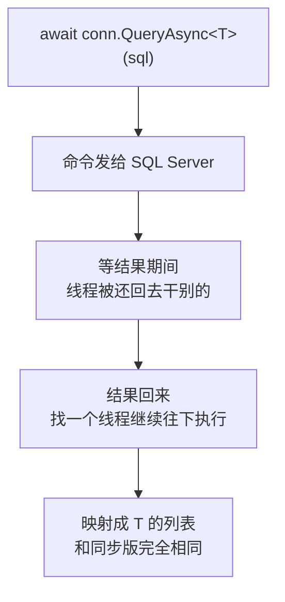
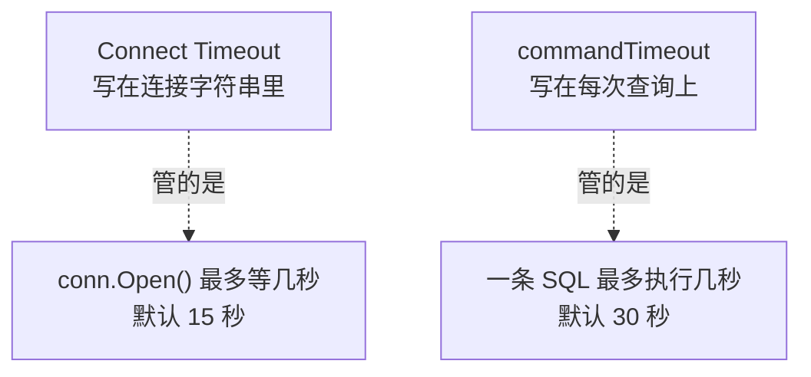
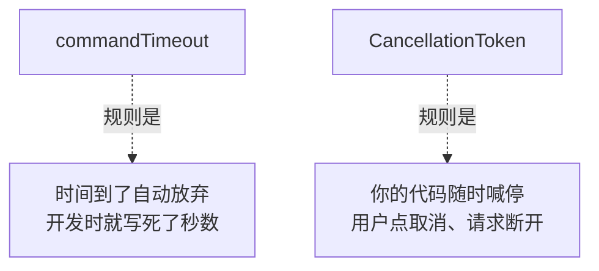

# 第 14 章 异步、超时与取消

## 这一章解决什么问题

月底跑价格汇总报表，查询要 40 秒。程序等到第 30 秒时突然报"执行超时已过期"，可是你从来没设置过什么超时。用户等得不耐烦，点了"取消"，界面上没反应，后台的查询还在接着跑。以后做成网站接口（第 22 章），一个请求卡住 40 秒，就占住一个线程 40 秒。

本章解决三件事：

1. 用 `QueryAsync` 这一类异步方法和 `await`，让等数据库的时候不占着线程；
2. 用 `commandTimeout` 控制一条命令最多等几秒，并且弄清 30 秒这个默认值是从哪来的；
3. 用 `CommandDefinition` 加上 `CancellationToken`，让你的代码可以随时说"不等了"。

## 开始之前

- 上一章你已经会了：分页、动态 WHERE、`DynamicParameters`。
- 前面用到的知识：`Query<T>`、`QuerySingle<T>`、`ExecuteScalar<T>`、`Execute`（第 2、5、6 章），`QueryMultiple`（第 12 章）。
- 需要的环境：第 1 章的解决方案和 `PriceDemo` 库，**用初始数据**。如果你刚做完第 13 章，表里有 10 张申请单，先重跑 [`code/sql/00-reset-database.sql`](../code/sql/00-reset-database.sql) 回到 3 张，否则下面几个数字会对不上。
- 你需要知道 C# 的 `async` / `await` 关键字是什么意思（.NET 4.5 起就有，WebForm 里的 `Page.RegisterAsyncTask` 用的是同一套机制）。本章只讲 Dapper 怎么用它们，不展开讲异步原理。
- 预计耗时：70–85 分钟。本章例子里有故意"等几秒"的语句，运行会慢一些，属于正常现象。

---

## 正文

### 14.1 准备：新建本章项目

和第 12、13 章一样：右键解决方案 →「添加 → 新建项目」→「控制台应用」，名称 `Ch14Demo`，框架 .NET 10.0。右键 `Ch14Demo` →「设为启动项目」。再通过「工具 → NuGet 包管理器 → 管理解决方案的 NuGet 程序包」装上三个包：`Dapper` 2.1.89、`Microsoft.Data.SqlClient` 7.1.1、`System.Security.Cryptography.Pkcs` 10.0.13。每个例子都是把 `Program.cs` 整个替换掉。

本章用 `WAITFOR DELAY '00:00:05'` 来模拟"慢查询"。它是 T-SQL 自带的语句，意思是让服务器原地等 5 秒再返回，不需要真的造一张大表。

> 📷 **截图占位 ch14-01**：解决方案资源管理器里 `Ch14Demo` 为粗体（启动项目），包已装好。
<!--  -->

---

### 14.2 概念一：`QueryAsync` 系列与 `await`

**白话定义**：Dapper 的每个查询方法都有一个**异步版本**，名字后面加 `Async`，返回 `Task<…>`。调用时在前面加 `await`：命令发给服务器后，当前线程**先去干别的**，等结果回来再接着往下执行。SQL、参数、映射规则和同步版本**一模一样**。

**业务场景**：

| 场景 | 为什么用异步 |
|---|---|
| ASP.NET Core 接口（第 22 章） | 等数据库的那段时间，线程可以去处理别的请求。同样多的线程能扛住更多并发 |
| WinForms / WPF 桌面程序 | 查询期间界面不会"未响应"，还能显示一个"取消"按钮（14.4 节） |
| 一个页面要查几样**互不相关**的数据 | 用多个连接同时发出去，总耗时约等于最慢的那一条（例 4） |

**反例（什么时候不该指望它）**：

- **想让一条慢 SQL 变快**。`async` 不会让服务器执行得更快：一条 5 秒的查询，用 `QueryAsync` 也还是 5 秒。慢 SQL 要去看索引和执行计划。
- **一次只做一件事的控制台批处理**。比如每晚跑一次的导数程序，从头到尾只有一个线程在等，异步省下来的线程也没有别的事可做，同步写法更简单。本章用控制台程序，只是为了方便演示。

#### 🖼 图解：await 期间线程去哪了



同步版本在 C 这一步是**线程原地干等**。异步版本则会把线程交出去。所以 SQL 执行的时间没有变，变的是"等待期间线程能不能去干别的"。

#### 💻 最小可运行代码：同步写法改成异步写法

把 `Program.cs` 整个替换成：

```csharp
// code/ch14/Step1-Async/Program.cs
// Dapper 的异步方法：名字加 Async、调用前加 await；SQL、参数、映射规则全都不变
using System.Diagnostics;
using Dapper;
using Microsoft.Data.SqlClient;

const string connStr =
    "Server=.;Database=PriceDemo;Integrated Security=True;TrustServerCertificate=True;";

// 顶级语句里可以直接写 await：编译器自动生成 async Task Main
await using var conn = new SqlConnection(connStr);   // await using：异步释放连接

// 例 1：Query → QueryAsync。返回的是 Task<IEnumerable<T>>，await 之后才是 IEnumerable<T>
var products = (await conn.QueryAsync<Product>(
    "SELECT Id, Code, Name, ListPrice FROM dbo.Product ORDER BY Id")).ToList();
Console.WriteLine($"例 1 QueryAsync：{products.Count} 个产品，第一个是 {products[0].Name}");

// 例 2：单行、单值、增删改也都有 Async 版本，参数写法和同步版一模一样
var req = await conn.QuerySingleAsync<RequestRow>(
    "SELECT Id, RequestNo, Applicant FROM dbo.PriceRequest WHERE Id = @Id", new { Id = 2 });
int pending = await conn.ExecuteScalarAsync<int>(
    "SELECT COUNT(*) FROM dbo.PriceRequest WHERE Status = 1");
int affected = await conn.ExecuteAsync(
    "UPDATE dbo.PriceRequest SET Remark = @Remark WHERE Id = @Id", new { Remark = "异步改的备注", Id = 3 });
Console.WriteLine($"例 2 QuerySingleAsync：{req.RequestNo} {req.Applicant}；待审 {pending} 张；改了 {affected} 行");

// 例 3：async 不会让 SQL 变快——两条各等 1 秒的语句，依次 await，总共还是 2 秒
var sw = Stopwatch.StartNew();
await conn.ExecuteAsync("WAITFOR DELAY '00:00:01'");
await conn.ExecuteAsync("WAITFOR DELAY '00:00:01'");
Console.WriteLine($"例 3 一个连接、依次 await：{sw.Elapsed.TotalSeconds:F1} 秒");

// 例 4：想让两条同时跑，要两个连接——一个连接同一时刻只能执行一条命令
await using var connA = new SqlConnection(connStr);
await using var connB = new SqlConnection(connStr);
sw.Restart();
Task<int> taskA = connA.ExecuteAsync("WAITFOR DELAY '00:00:01'");   // 不 await：先把两个都发出去
Task<int> taskB = connB.ExecuteAsync("WAITFOR DELAY '00:00:01'");
await Task.WhenAll(taskA, taskB);                                   // 再一起等
Console.WriteLine($"例 4 两个连接、同时等待：{sw.Elapsed.TotalSeconds:F1} 秒");

public class Product
{
    public int Id { get; set; }
    public string Code { get; set; } = "";
    public string Name { get; set; } = "";
    public decimal ListPrice { get; set; }
}

public class RequestRow
{
    public int Id { get; set; }
    public string RequestNo { get; set; } = "";
    public string Applicant { get; set; } = "";
}
```

#### 🔍 拆解运行结果

实测输出（用初始数据；例 3、例 4 的秒数每次会有零点几秒的差别）：

```text
例 1 QueryAsync：4 个产品，第一个是 便携超声主机
例 2 QuerySingleAsync：PR20261008 李娜；待审 1 张；改了 1 行
例 3 一个连接、依次 await：2.0 秒
例 4 两个连接、同时等待：1.0 秒
```

> 📷 **截图占位 ch14-02**：控制台显示上面 4 行，例 3 约 2 秒、例 4 约 1 秒。
<!--  -->

逐个看：

| 例 | 看到了什么 | 说明 |
|---|---|---|
| 1 | 和第 2 章同样的结果 | `await conn.QueryAsync<Product>(…)` 的结果是 `IEnumerable<Product>`。外面那层括号不能省：要先 `await` 拿到结果，再 `.ToList()` |
| 2 | 单行、单值、更新都正常 | 每个同步方法都有对应的 Async 版本，见下表 |
| 3 | **2.0 秒** | 两条各等 1 秒的语句，依次 `await`，就是一条做完再做下一条。**async 没有让它变快** |
| 4 | **1.0 秒** | 先把两个 Task 都发出去，再用 `Task.WhenAll` 一起等，两条语句是同时执行的。前提是**两个连接** |

第一行的 `await using var conn`：`SqlConnection` 支持异步释放（`DisposeAsync`）。在异步代码里用 `await using`，关闭连接时也不会占着线程。写成普通的 `using var` 也能用，程序结果一样。

**同步方法与异步方法对照**（本章只演示其中几个，其余的写法都一样）：

| 同步（前面各章） | 异步 | 返回 |
|---|---|---|
| `Query<T>` | `QueryAsync<T>` | `Task<IEnumerable<T>>` |
| `QueryFirst<T>` / `QueryFirstOrDefault<T>` | `QueryFirstAsync<T>` / `QueryFirstOrDefaultAsync<T>` | `Task<T>` |
| `QuerySingle<T>` / `QuerySingleOrDefault<T>` | `QuerySingleAsync<T>` / `QuerySingleOrDefaultAsync<T>` | `Task<T>` |
| `ExecuteScalar<T>` | `ExecuteScalarAsync<T>` | `Task<T>` |
| `Execute` | `ExecuteAsync` | `Task<int>`（受影响行数） |
| `QueryMultiple` + `Read<T>` | `QueryMultipleAsync` + `ReadAsync<T>` | `Task<GridReader>` / `Task<IEnumerable<T>>` |

**事务里也一样**：第 9 章的 `transaction:` 参数，在 Async 版本里照样要传。

#### 改坏一处试试

**改法 1：忘了写 `await`**。把例 1 改成 `var products = (conn.QueryAsync<Product>(…)).ToList();`，生成时实测报错：

```text
error CS0411: The type arguments for method 'Enumerable.ToList<TSource>(IEnumerable<TSource>)' cannot be inferred from the usage. Try specifying the type arguments explicitly.
```

没有 `await`，拿到的是一个 `Task<IEnumerable<Product>>`，也就是"将来会有结果的任务"。它本身不是集合，所以 `.ToList()` 推断不出类型。这条报错看起来和 Dapper 无关，其实就是**漏了 `await`**。

更危险的情况是：返回值没人用的时候，比如 `conn.ExecuteAsync("UPDATE …");` 前面忘了 `await`。这种写法**能编译通过**，只有一条警告（实测）：

```text
warning CS4014: Because this call is not awaited, execution of the current method continues before the call is completed. Consider applying the 'await' operator to the result of the call.
```

意思是"这个调用没有被等待，当前方法会在调用完成前继续往下执行"。程序不等这条 UPDATE 执行完就往下走了，后面的代码再用这个连接，还可能撞上下面改法 2 的报错。所以要留意「视图 → 错误列表」里的 CS4014 警告，最好把它当成错误来对待。

**改法 2：两个 Task 共用一个连接**。把例 4 的 `connB.ExecuteAsync` 改成 `connA.ExecuteAsync`。实测报错：

```text
Unhandled exception. System.InvalidOperationException: The connection does not support MultipleActiveResultSets.
```

中文环境下是：`此连接不支持 MultipleActiveResultSets。`（实测）

**一个连接同一时刻只能执行一条命令**，和第 12 章 12.4 节"grid 没读完不能再查"是同一个规则。想要同时执行，就各用各的连接。连接池（第 16 章）会让"多开一个连接"的成本很低。连接字符串里有个 `MultipleActiveResultSets=True`（MARS）选项可以放宽这个限制，但本教程不推荐靠它来"同时执行"，各用各的连接最清楚。

---

### 14.3 概念二：`commandTimeout`

**白话定义**：一条命令**最多等几秒**。超过这个时间还没执行完，客户端就放弃，并通知服务器停止执行，然后抛出 `SqlException`，它的 `Number` 是 `-2`。不传这个参数时，默认是 **30 秒**。

**业务场景**：

| 场景 | 设多少 |
|---|---|
| 普通列表、详情页 | 不传，用默认的 30 秒，甚至可以更短 |
| 月度汇总报表，正常要跑 40 秒 | 这一条单独传 `commandTimeout: 120` |
| 后台夜间批处理 | 按实际耗时设一个宽松的值，但不要设成"无限" |

**反例（什么时候不该用它来解决问题）**：查询原来 2 秒，现在要 35 秒，于是把超时改成 60 秒"解决问题"。这只是把报错藏了起来，慢的原因（缺索引、数据量涨了、被锁住了）还在。**先查原因，再决定要不要调超时**。另外不要设成 `0`，它的意思是"永远不超时"（下面的改坏实验会演示）。

#### 🖼 图解：两种"超时"不是一回事



服务器连不上，报的是连接超时；连上了但 SQL 跑得太久，报的是命令超时。两者的默认值不同，设置的位置也不同。（实测：`SqlConnectionStringBuilder` 的 `ConnectTimeout` 默认是 15，`CommandTimeout` 默认是 30。）

#### 💻 最小可运行代码：默认值、够用、不够用

把 `Program.cs` 整个替换成：

```csharp
// code/ch14/Step2-Timeout/Program.cs
// commandTimeout：一条命令最多等几秒。默认 30 秒；超时后抛 SqlException，Number = -2
using System.Diagnostics;
using Dapper;
using Microsoft.Data.SqlClient;

const string connStr =
    "Server=.;Database=PriceDemo;Integrated Security=True;TrustServerCertificate=True;";

await using var conn = new SqlConnection(connStr);

// 例 1：不写 commandTimeout 时用的是谁的默认值
using (var cmd = conn.CreateCommand())
    Console.WriteLine($"例 1 SqlCommand 默认 CommandTimeout = {cmd.CommandTimeout} 秒");
Console.WriteLine($"     Dapper 全局 SqlMapper.Settings.CommandTimeout = {SqlMapper.Settings.CommandTimeout?.ToString() ?? "null"}");

// 例 2：给得够——等 1 秒的语句，允许 10 秒，正常完成
var sw = Stopwatch.StartNew();
await conn.ExecuteAsync("WAITFOR DELAY '00:00:01'", commandTimeout: 10);
Console.WriteLine($"例 2 允许 10 秒，实际 {sw.Elapsed.TotalSeconds:F1} 秒，正常完成");

// 例 3：给不够——等 5 秒的语句（模拟慢报表），只允许 2 秒
sw.Restart();
try
{
    await conn.ExecuteAsync("WAITFOR DELAY '00:00:05'", commandTimeout: 2);
    Console.WriteLine("例 3 不会走到这里");
}
catch (SqlException ex) when (ex.Number == -2)   // -2 是客户端超时的固定编号（第 20 章细讲 Number）
{
    Console.WriteLine($"例 3 允许 2 秒，{sw.Elapsed.TotalSeconds:F1} 秒后放弃，Number = {ex.Number}");
    Console.WriteLine($"     {ex.Message}");
}

// 例 4：超时之后，这个连接对象还能接着用（Dapper 自己开的连接已经关上，下次重新打开）
Console.WriteLine($"例 4 超时后连接状态：{conn.State}，再查一次：{await conn.ExecuteScalarAsync<int>("SELECT COUNT(*) FROM dbo.Product")} 个产品");
```

#### 🔍 拆解运行结果

实测输出（秒数会有零点几秒的差别）：

```text
例 1 SqlCommand 默认 CommandTimeout = 30 秒
     Dapper 全局 SqlMapper.Settings.CommandTimeout = null
例 2 允许 10 秒，实际 1.1 秒，正常完成
例 3 允许 2 秒，2.0 秒后放弃，Number = -2
     Execution Timeout Expired.  The timeout period elapsed prior to completion of the operation or the server is not responding.
例 4 超时后连接状态：Closed，再查一次：4 个产品
```

> 📷 **截图占位 ch14-03**：控制台显示例 3 的超时信息。
<!--  -->

逐个看：

| 例 | 看到了什么 | 说明 |
|---|---|---|
| 1 | `SqlCommand` 默认 30 秒，Dapper 全局设置是 `null` | **30 秒来自 ADO.NET，不是 Dapper**。Dapper 在你没传 `commandTimeout`、全局设置也是 `null` 时，就不去动 `SqlCommand.CommandTimeout`，所以用的是 ADO.NET 的默认值。这和你在 WebForm 里遇到的 30 秒是同一个值 |
| 2 | 1 秒的语句，允许 10 秒 | 超时是"上限"，不是"一定要等这么久"。执行完了就立刻返回 |
| 3 | **2.0 秒**后放弃，`Number = -2` | 语句要 5 秒，允许 2 秒，到第 2 秒客户端就放弃了。`-2` 是"客户端超时"的固定编号，用 `catch (SqlException ex) when (ex.Number == -2)` 就能单独接住超时，其他数据库错误不受影响（第 20 章细讲 Number） |
| 4 | 超时后状态是 `Closed`，再查也正常 | Dapper 自己打开的连接，出错时同样会关掉。下一次查询会重新打开，不需要你做额外处理 |

**想统一改默认值时，有两个地方可以设**（下面两条都实测过：用一条等 3 秒的语句，不传 `commandTimeout`，约 1.1 秒后报 `Number = -2`）：

| 设置方式 | 范围 | 写法 |
|---|---|---|
| 连接字符串加 `Command Timeout=秒数;` | 用这个连接字符串的所有命令，包括 ADO.NET 和 Dapper | `…;TrustServerCertificate=True;Command Timeout=60;` |
| `SqlMapper.Settings.CommandTimeout = 秒数;` | 整个程序里所有 Dapper 命令 | 程序启动时写一次 |

不管用哪一种，单次调用传的 `commandTimeout:` 都会覆盖它（实测：全局设为 1 秒，单次传 `commandTimeout: 5`，一条 2 秒的语句正常完成）。

#### 改坏一处试试

**改法 1：不 catch，看完整的异常**。把 `when (ex.Number == -2)` 改成 `when (ex.Number == 12345)`，让异常接不住。实测：

```text
Unhandled exception. Microsoft.Data.SqlClient.SqlException (0x80131904): Execution Timeout Expired.  The timeout period elapsed prior to completion of the operation or the server is not responding.
 ---> System.ComponentModel.Win32Exception (258): Unknown error 258
   …（堆栈省略）
Error Number:-2,State:0,Class:11
```

中文环境下的第一行是（实测）：

```text
Unhandled exception. Microsoft.Data.SqlClient.SqlException (0x80131904): 执行超时已过期。完成操作之前已超时或服务器未响应。
```

**学会读这条报错**：

| 片段 | 含义 |
|---|---|
| `Execution Timeout Expired` / `执行超时已过期` | 命令超时。注意不是连接超时 |
| 内层 `Win32Exception (258)` | 258 是操作系统的"等待超时"代码。沙箱是 Linux，所以显示 `Unknown error 258`；在 Windows 上显示的是这个代码对应的说明文字。⚠️ Windows 上的具体文字本段未实机验证 |
| `Error Number:-2` | 用来在代码里判断"是不是超时" |
| `Class:11` | 严重级别。超时属于普通错误，连接本身没有坏 |

**改法 2：把 `commandTimeout: 2` 改成 `commandTimeout: 0`**。实测输出：

```text
例 3 不会走到这里
```

程序等满 5 秒，正常结束，没有超时。**`0` 的意思是"永远不超时"，不是"立刻超时"**。如果某条 SQL 被锁住了，用 0 就会一直挂在那里。这就是"反例"里说不要设成 0 的原因。

---

### 14.4 概念三：`CommandDefinition` + `CancellationToken`

**白话定义**：

- `CancellationToken`（取消令牌）是 .NET 里通用的"停止信号"。由 `CancellationTokenSource` 发出，可以设定"N 秒后自动发出"，也可以在用户点按钮时手动 `Cancel()`。
- Dapper 那些 `QueryAsync(sql, param, …)` 的写法**没有接收令牌的参数**。要传令牌，得先把 SQL、参数、超时、令牌装进一个 `CommandDefinition` 对象，再把这个对象交给 `QueryAsync`、`ExecuteAsync` 等方法。

**业务场景**：

- 查询页上有"取消"按钮，用户等不及了就点它。
- 网站接口：浏览器关掉了，请求就被取消，后台的查询也应该跟着停下。第 22 章会把 ASP.NET Core 提供的 `CancellationToken` 直接接到这里。

**反例（什么时候不需要）**：一两百毫秒就能查完的普通查询，没人会去取消它，用前面的简单写法就行，不用每条都包一层 `CommandDefinition`。另外，取消**不能代替事务**：一组写操作做到一半被取消时，要靠第 9 章的事务来保证全部回滚，不能指望"取消"帮你收拾残局。

#### 🖼 图解：超时和取消，谁说了算



两者可以同时用：`commandTimeout` 是"最多等这么久"的底线，令牌是"不想等了"的随时信号。哪个先到，就按哪个停。

#### 💻 最小可运行代码：正常、1 秒后取消、调用前已取消

把 `Program.cs` 整个替换成：

```csharp
// code/ch14/Step3-Cancel/Program.cs
// CommandDefinition + CancellationToken：不等超时，由你的代码决定"现在就停"
using System.Diagnostics;
using Dapper;
using Microsoft.Data.SqlClient;

const string connStr =
    "Server=.;Database=PriceDemo;Integrated Security=True;TrustServerCertificate=True;";

await using var conn = new SqlConnection(connStr);

// 例 1：CommandDefinition 把 SQL、参数、超时、取消令牌装进一个对象，再交给 XxxAsync
var normal = new CommandDefinition(
    "SELECT RequestNo FROM dbo.PriceRequest WHERE Applicant = @Applicant ORDER BY Id",
    new { Applicant = "张伟" },
    commandTimeout: 10,
    cancellationToken: CancellationToken.None);          // None = 永远不会被取消
var nos = await conn.QueryAsync<string>(normal);
Console.WriteLine($"例 1 正常查询：{string.Join("、", nos)}");

// 例 2：1 秒后自动取消——模拟用户在界面上点了"取消"，或者 HTTP 请求被浏览器断开
using var cts = new CancellationTokenSource(TimeSpan.FromSeconds(1));
var slow = new CommandDefinition("WAITFOR DELAY '00:00:05'; SELECT 1;", cancellationToken: cts.Token);
var sw = Stopwatch.StartNew();
try
{
    await conn.ExecuteScalarAsync<int>(slow);
    Console.WriteLine("例 2 不会走到这里");
}
catch (Exception ex) when (cts.IsCancellationRequested)   // 判断"是我取消的"，比猜异常类型更可靠
{
    Console.WriteLine($"例 2 {sw.Elapsed.TotalSeconds:F1} 秒后停下：{ex.GetType().FullName}");
    Console.WriteLine($"     {ex.Message}");
}

// 例 3：令牌在调用前就已经取消——命令根本不会发出去
using var cancelled = new CancellationTokenSource();
cancelled.Cancel();
try
{
    await conn.QueryAsync<string>(new CommandDefinition(
        "SELECT RequestNo FROM dbo.PriceRequest", cancellationToken: cancelled.Token));
}
catch (OperationCanceledException ex)   // TaskCanceledException 也是它的子类，一并接住
{
    Console.WriteLine($"例 3 调用前已取消：{ex.GetType().FullName}");
}

Console.WriteLine($"最后连接状态：{conn.State}");
```

#### 🔍 拆解运行结果

实测输出（用初始数据）：

```text
例 1 正常查询：PR20261001、PR20261015
例 2 1.0 秒后停下：Microsoft.Data.SqlClient.SqlException
     A severe error occurred on the current command.  The results, if any, should be discarded.
Operation cancelled by user.
例 3 调用前已取消：System.Threading.Tasks.TaskCanceledException
最后连接状态：Closed
```

中文环境下，例 2 的消息是（实测）：

```text
例 2 1.0 秒后停下：Microsoft.Data.SqlClient.SqlException
     当前命令发生服务器错误。结果(如果有)应被放弃。
用户已取消操作。
```

> 📷 **截图占位 ch14-04**：控制台显示例 2 在 1 秒后停下的输出。
<!--  -->

逐个看：

| 例 | 看到了什么 | 说明 |
|---|---|---|
| 1 | 查出张伟的两张单 | `CommandDefinition` 的构造参数都有名字：`commandTimeout:`、`cancellationToken:`，按名字传，不用记顺序。`CancellationToken.None` 表示"永远不会取消" |
| 2 | **1.0 秒**就停了，不是 5 秒 | 令牌在第 1 秒发出信号，SqlClient 通知服务器停止执行。抛出的是 **`SqlException`**，消息最后一行是 `Operation cancelled by user.`（用户已取消操作） |
| 3 | `TaskCanceledException` | 令牌在调用前就已经取消，命令根本没有发出去，直接抛出 .NET 标准的取消异常 |
| 最后 | `Closed` | 被取消的连接同样被 Dapper 关好了 |

**例 2 和例 3 抛出的异常类型不一样**，这一点很容易踩坑：

| 什么时候取消的 | 实测抛出的异常 |
|---|---|
| 命令执行**过程中**取消 | `SqlException`（`Operation cancelled by user.`） |
| 命令**发出之前**就已取消 | `TaskCanceledException`（它是 `OperationCanceledException` 的子类） |

所以代码里用的是 `catch (Exception ex) when (cts.IsCancellationRequested)`：**不猜异常类型，直接问令牌"是不是我取消的"**。如果只写 `catch (OperationCanceledException)`，执行过程中被取消的那种情况就接不住了。

#### 改坏一处试试

**改法：例 2 创建 `CommandDefinition` 时，忘了传 `cancellationToken: cts.Token`**。实测输出：

```text
例 1 正常查询：PR20261001、PR20261015
例 2 不会走到这里
例 3 调用前已取消：System.Threading.Tasks.TaskCanceledException
最后连接状态：Closed
```

例 2 **等满了 5 秒**，正常执行完。令牌在第 1 秒照样发出了信号，可是没有人听。`CancellationTokenSource` 只负责发信号，**令牌要传到命令上，才能停得下来**。

同样的道理，如果你用的是 `conn.QueryAsync<T>(sql, param)` 这种普通写法，它根本没有令牌参数，查询也就无法取消。在第 22 章的网站接口里，这是最常见的遗漏。

---

## 🧱 类比：ADO.NET 写法与 Dapper 写法逐项对照

| 要做的事 | ADO.NET | Dapper |
|---|---|---|
| 异步查询 | `await cmd.ExecuteReaderAsync()` + `while (await reader.ReadAsync())` | `await conn.QueryAsync<T>(sql, param)` |
| 异步单值 | `await cmd.ExecuteScalarAsync()` 再强转 | `await conn.ExecuteScalarAsync<T>(…)` |
| 异步增删改 | `await cmd.ExecuteNonQueryAsync()` | `await conn.ExecuteAsync(…)` |
| 设命令超时 | `cmd.CommandTimeout = 120;` | 参数 `commandTimeout: 120` |
| 默认超时 | 30 秒（`SqlCommand` 默认值） | 同一个 30 秒，Dapper 不改它 |
| 全局默认 | 连接字符串 `Command Timeout=…` | 同上，或者 `SqlMapper.Settings.CommandTimeout` |
| 传取消令牌 | `cmd.ExecuteReaderAsync(token)` | `new CommandDefinition(sql, param, cancellationToken: token)` |
| 判断超时 | `catch (SqlException ex) when (ex.Number == -2)` | 完全一样，异常本来就来自 SqlClient |

最后一行说明了一点：**超时和取消的异常都来自 SqlClient，不是 Dapper**。你以前处理这些异常的经验可以原样沿用。

## ⚠️ 踩坑警告

| 现象 | 原因 | 怎么改 |
|---|---|---|
| `error CS0411: The type arguments for method 'Enumerable.ToList<TSource>…' cannot be inferred`（实测） | `QueryAsync` 前面漏了 `await`，对 `Task` 调用了 `.ToList()` | 写成 `(await conn.QueryAsync<T>(…)).ToList()` |
| `The connection does not support MultipleActiveResultSets.` / `此连接不支持 MultipleActiveResultSets。`（实测） | 两个 Task 同时用一个连接 | 每个并发任务各用一个连接 |
| 报表跑到第 30 秒报 `Execution Timeout Expired` / `执行超时已过期`（实测：用 2 秒复现） | 没设 `commandTimeout`，用的是 ADO.NET 默认的 30 秒 | 先查慢的原因；确实需要更长时间，就给这一条单独传 `commandTimeout` |
| 设了 `commandTimeout: 0`，结果查询一直挂着（实测） | 0 表示永不超时 | 设一个明确的上限 |
| 用户点了取消，查询还在跑（实测） | 令牌没有传进 `CommandDefinition`，或者用的是不带令牌的普通重载 | 用 `new CommandDefinition(…, cancellationToken: token)` |
| `catch (OperationCanceledException)` 接不住取消（实测） | 执行过程中取消时，抛出的是 `SqlException` | `catch (Exception) when (token.IsCancellationRequested)` |

## 🎯 动手练习

**练习：分清"完成 / 超时 / 已取消"**

写一个方法：

```text
async Task<string> RunReportAsync(string sql, int timeoutSeconds, CancellationToken ct)
```

要求：

- 每次调用新建一个连接，用 `CommandDefinition` 同时传入超时和令牌，执行 `ExecuteScalarAsync<int>`。
- 正常完成时返回 `完成，申请单 N 张`；超时返回 `超时（允许 N 秒，Number = -2）`；被取消返回 `已取消`。

用初始数据，按下面三种情况调用（SQL 都以 `SELECT COUNT(*) FROM dbo.PriceRequest;` 结尾）：

| 情况 | SQL 开头 | 超时 | 令牌 |
|---|---|---|---|
| 1 | `WAITFOR DELAY '00:00:01';` | 3 秒 | `CancellationToken.None` |
| 2 | `WAITFOR DELAY '00:00:03';` | 1 秒 | `CancellationToken.None` |
| 3 | `WAITFOR DELAY '00:00:03';` | 10 秒 | 1 秒后自动取消 |

- 验收标准：输出完全一致：

```text
情况 1：完成，申请单 3 张
情况 2：超时（允许 1 秒，Number = -2）
情况 3：已取消
```

- 想一想：情况 2 和情况 3 抛出的都是 `SqlException`，你的代码靠什么把它们区分开？

卡住了看文末参考答案。

## 📌 一句话总结

async 不让 SQL 变快只让线程不闲等；超时默认 30 秒，取消要把令牌传进去。

## 下一章

一次要导出 20 万行，内存一下涨了几百 MB；批量插入 1000 条明细要好几秒。第 15 章讲大数据量与性能。

---

<!-- 以下是参考答案，先自己动手，卡住了再往下翻 -->


## 参考答案

**思路**：

- 两个 `catch` 的**顺序**很重要：先写 `catch (SqlException ex) when (ex.Number == -2)` 接超时，再写 `catch (Exception) when (ct.IsCancellationRequested)` 接取消。
- 情况 2 和情况 3 的异常都是 `SqlException`，区分它们靠两点：超时的 `Number` 是 `-2`；取消时令牌的 `IsCancellationRequested` 是 `true`。情况 3 被取消时 `Number` 不是 -2，所以会落到第二个 `catch`。
- 连接在方法内部用 `await using` 创建，不管是完成、超时还是取消，都能保证关闭。

完整项目在 [`code/ch14/Exercise/`](../code/ch14/Exercise/)。实测输出：

```text
情况 1：完成，申请单 3 张
情况 2：超时（允许 1 秒，Number = -2）
情况 3：已取消
```

```csharp
// code/ch14/Exercise/Program.cs
// 第 14 章练习参考答案：一个带超时和取消的"跑报表"方法，分清 完成 / 超时 / 已取消 三种结局
using Dapper;
using Microsoft.Data.SqlClient;

const string connStr =
    "Server=.;Database=PriceDemo;Integrated Security=True;TrustServerCertificate=True;";

// 情况 1：语句 1 秒，允许 3 秒 → 完成
Console.WriteLine("情况 1：" + await RunReportAsync("WAITFOR DELAY '00:00:01'; SELECT COUNT(*) FROM dbo.PriceRequest;", 3, CancellationToken.None));

// 情况 2：语句 3 秒，只允许 1 秒 → 超时
Console.WriteLine("情况 2：" + await RunReportAsync("WAITFOR DELAY '00:00:03'; SELECT COUNT(*) FROM dbo.PriceRequest;", 1, CancellationToken.None));

// 情况 3：语句 3 秒，允许 10 秒，但 1 秒后用户点了取消 → 已取消
using (var cts = new CancellationTokenSource(TimeSpan.FromSeconds(1)))
    Console.WriteLine("情况 3：" + await RunReportAsync("WAITFOR DELAY '00:00:03'; SELECT COUNT(*) FROM dbo.PriceRequest;", 10, cts.Token));

async Task<string> RunReportAsync(string sql, int timeoutSeconds, CancellationToken ct)
{
    await using var conn = new SqlConnection(connStr);   // 每次调用一个新连接，用完即关
    var cmd = new CommandDefinition(sql, commandTimeout: timeoutSeconds, cancellationToken: ct);
    try
    {
        int count = await conn.ExecuteScalarAsync<int>(cmd);
        return $"完成，申请单 {count} 张";
    }
    catch (SqlException ex) when (ex.Number == -2)          // 超时：服务器太慢
    {
        return $"超时（允许 {timeoutSeconds} 秒，Number = {ex.Number}）";
    }
    catch (Exception) when (ct.IsCancellationRequested)     // 取消：是调用方不想等了
    {
        return "已取消";
    }
}
```
