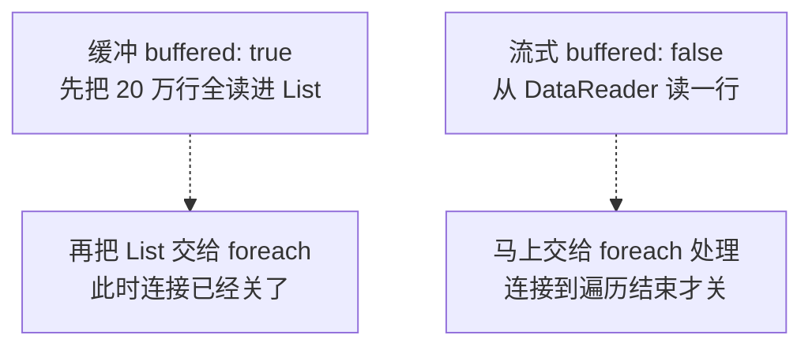
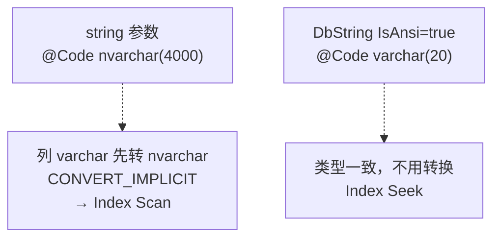
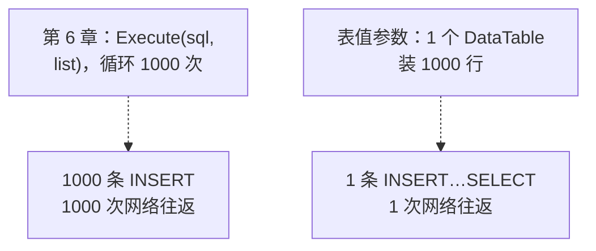
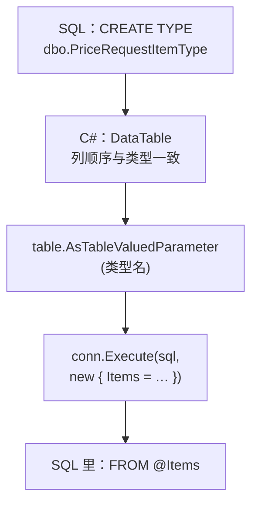

# 第 15 章 大数据量与性能

## 这一章解决什么问题

第 14 章解决了"慢查询别卡死程序"：异步、超时、取消。但有些慢不是等出来的，是**写法本身**造成的：

1. 导出全年明细，20 万行一次 `Query<T>`，内存一下涨几十 MB，数据再多就可能撑爆；
2. 按产品编码查，表上明明有索引，执行计划却是扫描（Scan）——原因是 C# 的 `string` 参数和 `varchar` 列类型不一致；
3. 一次导入 1000 条申请明细，用第 6 章"传 List"的写法要好几秒，因为它其实执行了 1000 次 INSERT。

本章逐个解决：流式读取、`DbString`、表值参数（TVP）。

## 开始之前

- 上一章你已经会了：`QueryAsync` 系列与 `await`、`commandTimeout`、用 `CommandDefinition` + `CancellationToken` 取消查询（第 14 章）。本章的例子用同步方法，这样代码更短；把 `Query` 换成 `QueryAsync`、`Execute` 换成 `ExecuteAsync`，结论不变。
- 还要用到：第 3 章的缓冲与流式、映射缓存；第 4 章在计划缓存里看参数声明的查法；第 6 章传 List 逐条执行。
- 需要的环境：第 1 章的 SQL Server 和 `PriceDemo` 库。15.4 节之前要先执行一个脚本 [`code/sql/ch15-tvp.sql`](../code/sql/ch15-tvp.sql)。
- 预计耗时：80–90 分钟。

> **关于本章的数字**：内存和耗时都是在沙箱里实测的（Linux 上的 SQL Server 2022，程序和数据库在同一台机器）。**你的数值一定会不同**。请看**数量级**和**两种写法之间的对比关系**，不要拿具体毫秒数去比。每个测量都跑了 3 轮，你自己跑的时候也请多跑几次。

---

## 正文

### 15.1 准备：新建本章项目

做法和第 2 章 2.1 节相同：

1. 「解决方案资源管理器」里右键解决方案 →「添加 → 新建项目」→「控制台应用」，项目名 `Ch15Demo`，框架 **.NET 10.0**。
2. **右键 `Ch15Demo` →「设为启动项目」**。
3. 「工具 → NuGet 包管理器 → 管理解决方案的 NuGet 程序包」，给 `Ch15Demo` 装上三个包：`Dapper` 2.1.89、`Microsoft.Data.SqlClient` 7.1.1、`System.Security.Cryptography.Pkcs` 10.0.13。

本章各项目的 csproj 都和第 2 章相同：

```xml
<!-- code/ch15/Step1-Buffered/Step1-Buffered.csproj（本章各项目的 csproj 都相同） -->
<Project Sdk="Microsoft.NET.Sdk">

  <PropertyGroup>
    <OutputType>Exe</OutputType>
    <TargetFramework>net10.0</TargetFramework>
    <ImplicitUsings>enable</ImplicitUsings>
    <Nullable>enable</Nullable>
  </PropertyGroup>

  <ItemGroup>
    <PackageReference Include="Dapper" Version="2.1.89" />
    <PackageReference Include="Microsoft.Data.SqlClient" Version="7.1.1" />
    <!-- SqlClient 7.1.1 间接带进来的 Pkcs 9.0.18 有已知漏洞（NU1903 警告），显式升到新版消掉 -->
    <PackageReference Include="System.Security.Cryptography.Pkcs" Version="10.0.13" />
  </ItemGroup>

</Project>
```

本章 3 个例子加练习，每做一个就把 `Program.cs` **整个替换**。按 **Ctrl+F5**（「调试 → 开始执行(不调试)」）运行。

> **测性能要用 Release 吗？** 本章比的是"两种写法差几倍"，Debug 下的对比关系同样成立，所以直接 Ctrl+F5 就行。要测绝对值，再把工具栏上的「Debug」下拉框改成「Release」。

---

### 15.2 概念一：`buffered: false` 流式读取

**白话定义**：`Query<T>` 默认先把**所有行**读进一个 `List<T>`，再交给你（缓冲）。加上 `buffered: false` 以后，它**读一行、交给你一行**，你处理完这一行，这个对象就可以被回收（流式）。

**业务场景**：年底导出全年价格申请明细到 CSV、对 20 万行做一次汇总统计。你只需要"从头到尾过一遍"，不需要同时把所有行都留在手上。

**反例（什么时候不该用）**：
- **结果要用两次以上**：比如先 `Count()` 再 `foreach`，或者要排序、要绑定到表格控件。流式结果只能遍历一次（再遍历就是再查一次库）。这种情况用默认的缓冲。
- **遍历期间还要用同一个连接查别的**：流式期间连接一直被这个 DataReader 占着，第 3 章已经演示过这样会报错。
- **只有几十、几百行**：缓冲的内存开销可以忽略，没必要改。

#### 🖼 图解：同样 20 万行，两种读法



第 3 章讲过它们的区别；本章用真实的数据量把差距量出来。

#### 💻 最小可运行代码

不需要建表：`sys.all_objects` 是每个库都有的系统视图（两千多行），自己和自己交叉连接，取前 20 万行，就是一份"假报表"。

```csharp
// code/ch15/Step1-Buffered/Program.cs
// 同样读 20 万行：缓冲（默认）和流式（buffered: false）各跑 3 轮，比较内存和耗时
using System.Diagnostics;
using Dapper;
using Microsoft.Data.SqlClient;

const string connStr =
    "Server=.;Database=PriceDemo;Integrated Security=True;TrustServerCertificate=True;";

// 不建表：用系统视图 sys.all_objects 自己交叉连接自己，凭空造出 20 万行"报表明细"
const string sql = @"
SELECT Id,
       CONCAT('PR', 1000000 + Id)       AS RequestNo,
       CAST(Id % 1000 AS DECIMAL(18,2)) AS Amount
FROM (SELECT TOP (200000) CAST(ROW_NUMBER() OVER (ORDER BY (SELECT NULL)) AS INT) AS Id
      FROM sys.all_objects a CROSS JOIN sys.all_objects b) t";

// 跑 3 轮：第 1 轮包含"第一次执行"的额外开销（第 3 章讲过的映射代码生成），看第 2、3 轮更准
for (int round = 1; round <= 3; round++)
{
    Console.WriteLine($"== 第 {round} 轮");
    Measure("缓冲 buffered: true ", buffered: true);
    Measure("流式 buffered: false", buffered: false);
}

void Measure(string label, bool buffered)
{
    using var conn = new SqlConnection(connStr);

    // forceFullCollection: true —— 先做一次完整垃圾回收，量到的才是"真正还活着"的对象占用
    long before = GC.GetTotalMemory(forceFullCollection: true);
    var sw = Stopwatch.StartNew();

    int count = 0;
    decimal total = 0;
    long halfway = 0;
    string stateAtHalf = "";

    foreach (var row in conn.Query<ReportRow>(sql, buffered: buffered))
    {
        count++;
        total += row.Amount;
        if (count == 100_000)
        {
            // 读到一半时量一次：缓冲模式此时 20 万个对象已经全在内存里；流式模式只有手上这一个
            halfway = GC.GetTotalMemory(forceFullCollection: true) - before;
            stateAtHalf = conn.State.ToString();
        }
    }
    sw.Stop();

    Console.WriteLine($"{label}  行数 {count:N0}  合计 {total:N0}  " +
                      $"读到一半时内存 +{halfway / 1024.0 / 1024:F1} MB  连接 {stateAtHalf}  耗时 {sw.ElapsedMilliseconds} ms");
}

public class ReportRow
{
    public int Id { get; set; }
    public string RequestNo { get; set; } = "";
    public decimal Amount { get; set; }
}
```

几个要点：

| 写法 | 为什么 |
|---|---|
| `GC.GetTotalMemory(forceFullCollection: true)` | 先强制做一次垃圾回收再量，量到的是"还活着的对象"占的内存，排除了已经没用但还没回收的垃圾 |
| 在第 100,000 行时量一次 | 缓冲模式这时 20 万个对象全在 List 里；流式模式只有手上这一个。两者差距在这一刻最明显 |
| 同时记下 `conn.State` | 看连接在遍历期间是开着还是关着 |
| 跑 3 轮 | 第 1 轮包含 Dapper 第一次生成映射代码的开销（第 3 章），后两轮才是稳定值 |

#### 🔍 拆解运行结果

实测输出：

```text
== 第 1 轮
缓冲 buffered: true   行数 200,000  合计 99,900,000  读到一半时内存 +19.1 MB  连接 Closed  耗时 622 ms
流式 buffered: false  行数 200,000  合计 99,900,000  读到一半时内存 +0.0 MB  连接 Open  耗时 81 ms
== 第 2 轮
缓冲 buffered: true   行数 200,000  合计 99,900,000  读到一半时内存 +18.8 MB  连接 Closed  耗时 123 ms
流式 buffered: false  行数 200,000  合计 99,900,000  读到一半时内存 +0.0 MB  连接 Open  耗时 88 ms
== 第 3 轮
缓冲 buffered: true   行数 200,000  合计 99,900,000  读到一半时内存 +18.8 MB  连接 Closed  耗时 142 ms
流式 buffered: false  行数 200,000  合计 99,900,000  读到一半时内存 +0.0 MB  连接 Open  耗时 73 ms
```

> 📷 **截图占位 ch15-01**：控制台显示上面 3 轮的输出，缓冲那几行是 +18 MB 左右，流式那几行是 +0.0 MB。
<!--  -->

逐项看：

| 观察项 | 缓冲 | 流式 | 说明 |
|---|---|---|---|
| 行数、合计 | 200,000 / 99,900,000 | 相同 | 结果完全一样，只是读法不同 |
| 读到一半时的内存 | 约 +19 MB | +0.0 MB | 20 万个小对象约 19 MB，每行约 100 字节。按这个比例，200 万行就是 190 MB 左右 |
| 读到一半时的连接 | Closed | Open | 缓冲：`Query` 返回时已经全部读完并关了连接，你的 `foreach` 遍历的是内存里的 List。流式：连接一直开着，直到 `foreach` 结束 |
| 耗时（第 2、3 轮） | 123 / 142 ms | 88 / 73 ms | 流式还略快一点，因为省掉了 List 扩容和大量对象的 GC 压力 |
| 第 1 轮缓冲 622 ms | — | — | 包含第一次执行的准备开销（第 3 章），不能拿来比 |

**结论**：流式读取的内存占用和行数无关，只和"一行有多大"有关。行数越多，差距越大。代价是**遍历期间一直占着一个连接**——如果你在 `foreach` 里对每行做很慢的事（比如调用外部接口），这个连接就被占用很久。

#### 改坏一处试试

很常见的写法：开了 `buffered: false`，后面又顺手加了 `.ToList()`。把 `foreach` 那一行改成：

```csharp
    foreach (var row in conn.Query<ReportRow>(sql, buffered: buffered).ToList())
```

实测输出：

```text
== 第 1 轮
缓冲 buffered: true   行数 200,000  合计 99,900,000  读到一半时内存 +20.6 MB  连接 Closed  耗时 662 ms
流式 buffered: false  行数 200,000  合计 99,900,000  读到一半时内存 +18.8 MB  连接 Closed  耗时 218 ms
== 第 2 轮
缓冲 buffered: true   行数 200,000  合计 99,900,000  读到一半时内存 +20.3 MB  连接 Closed  耗时 135 ms
流式 buffered: false  行数 200,000  合计 99,900,000  读到一半时内存 +18.8 MB  连接 Closed  耗时 135 ms
== 第 3 轮
缓冲 buffered: true   行数 200,000  合计 99,900,000  读到一半时内存 +20.3 MB  连接 Closed  耗时 128 ms
流式 buffered: false  行数 200,000  合计 99,900,000  读到一半时内存 +18.8 MB  连接 Closed  耗时 135 ms
```

流式那几行也变成了 +18.8 MB，连接也是 Closed。**不报错，但流式白开了**：`.ToList()` 把所有行又收集进了一个 List，和缓冲没有区别。（缓冲那行从 18.8 涨到 20 MB 多，是因为又复制了一份 List。）

同样会"悄悄变回缓冲"的写法还有 `.ToArray()`、`.OrderBy(...)`、`.Count()` 之后再遍历。看到 `buffered: false`，就检查它后面有没有接这些方法。

---

### 15.3 概念二：`DbString` 与字符串参数的类型

**白话定义**：C# 只有一种 `string`，SQL Server 却有 `varchar`/`nvarchar`/`char`/`nchar` 四种，长度也各不相同。Dapper 默认把 `string` 参数发成 **`nvarchar(4000)`**。`DbString` 用来明确告诉它："这个参数是 `varchar`，长度 20"。

**业务场景**：`dbo.Product.Code`、`dbo.PriceRequest.RequestNo` 都是 `VARCHAR(20)`，上面有唯一索引，按编码、按单号查是最常见的查询。参数类型和列类型不一致时，SQL Server 要先做类型转换，可能用不上索引。

**反例（什么时候不该用）**：
- **列本来就是 `nvarchar`**（比如 `Customer.Name`、`PriceRequest.Applicant`）：默认的 `nvarchar(4000)` 已经和列一致，不需要 `DbString`。
- **参数里有中文、而列是 varchar**：`IsAnsi = true` 会按服务器的代码页转换，代码页里没有的字会变成 `?`。这种列本来就不该存中文，应该先改表结构。
- 不要因为"听说 DbString 更快"就给所有参数都套上。只在 **varchar/char 列上做查找条件**时才有意义。

#### 🖼 图解：同一条 SQL，参数类型不同，执行计划不同



为什么是**列**被转换，而不是参数？SQL Server 比较两个不同类型的值时，按"数据类型优先级"把低的转成高的，`nvarchar` 比 `varchar` 优先级高。于是表里**每一行**的 `Code` 都要转成 `nvarchar` 再比较，索引里的顺序就用不上了。

#### 💻 最小可运行代码

同一条 SQL，用三种方式传参，各查两个长度不同的编码，再去计划缓存（第 4 章用过）里看服务器到底收到了什么：

```csharp
// code/ch15/Step2-DbString/Program.cs
// 同一条按编码查产品的 SQL，用三种方式传字符串参数，再去计划缓存里看服务器收到的参数类型
using System.Data;
using Dapper;
using Microsoft.Data.SqlClient;

const string connStr =
    "Server=.;Database=PriceDemo;Integrated Security=True;TrustServerCertificate=True;";

// 只查 Id、Code：Code 上有唯一索引（建表时的 UNIQUE），这两列都在索引里，执行计划最简单
const string sql = "SELECT Id, Code FROM dbo.Product WHERE Code = @Code";

using var conn = new SqlConnection(connStr);
conn.Open();

// 方式 1：Dapper 普通 string 参数，查两个不同长度的编码
foreach (var code in new[] { "US-100", "PB-01" })
{
    var p = conn.QuerySingle<Product>(sql, new { Code = code });
    Console.WriteLine($"方式 1 string    ：{p.Id} {p.Code}");
}

// 方式 2：Dapper + DbString，明确告诉它"这是 varchar(20)"
foreach (var code in new[] { "US-100", "PB-01" })
{
    var p = conn.QuerySingle<Product>(sql, new
    {
        Code = new DbString { Value = code, IsAnsi = true, Length = 20 }  // IsAnsi=true → varchar；Length 与列定义一致
    });
    Console.WriteLine($"方式 2 DbString  ：{p.Id} {p.Code}");
}

// 方式 3：对照组——ADO.NET 的 AddWithValue（你在 WebForm 里最常写的那种）
foreach (var code in new[] { "US-100", "PB-01" })
{
    using var cmd = new SqlCommand(sql, conn);
    cmd.Parameters.AddWithValue("@Code", code);   // 没指定类型和长度，全靠驱动猜
    using var reader = cmd.ExecuteReader();
    reader.Read();
    Console.WriteLine($"方式 3 AddWithValue：{reader.GetInt32(0)} {reader.GetString(1)}");
}

// 去计划缓存里看：服务器收到的参数声明是什么、执行计划第一个运算符是什么、有没有隐式转换
var plans = conn.Query<PlanInfo>(@"
SELECT cp.usecounts AS UseCounts,
       LEFT(st.text, CHARINDEX(')SELECT', st.text)) AS ParamDecl,   -- 只取开头的参数声明部分
       qp.query_plan.value('declare namespace p=""http://schemas.microsoft.com/sqlserver/2004/07/showplan"";
                            (//p:RelOp/@PhysicalOp)[1]', 'nvarchar(60)') AS FirstOp,
       CASE WHEN CAST(qp.query_plan AS nvarchar(max)) LIKE '%CONVERT_IMPLICIT%' THEN N'有' ELSE N'无' END AS ImplicitConvert
FROM sys.dm_exec_cached_plans cp
CROSS APPLY sys.dm_exec_sql_text(cp.plan_handle) st
CROSS APPLY sys.dm_exec_query_plan(cp.plan_handle) qp
WHERE st.text LIKE '%FROM dbo.Product WHERE Code = @Code%'
  AND st.text NOT LIKE '%dm_exec%'           -- 排除这条查询自己
ORDER BY ParamDecl");

Console.WriteLine();
Console.WriteLine("计划缓存：使用次数 | 参数声明 | 第一个运算符 | 隐式转换");
foreach (var x in plans)
    Console.WriteLine($"{x.UseCounts} | {x.ParamDecl} | {x.FirstOp} | {x.ImplicitConvert}");

public class Product
{
    public int Id { get; set; }
    public string Code { get; set; } = "";
}

public class PlanInfo
{
    public int UseCounts { get; set; }
    public string ParamDecl { get; set; } = "";
    public string FirstOp { get; set; } = "";
    public string ImplicitConvert { get; set; } = "";
}
```

> 计划缓存里的东西会一直留着，直到 SQL Server 重启或手动清理。你在自己的实例上多跑几次，"使用次数"会继续往上加，这是正常的。

#### 🔍 拆解运行结果

实测输出：

```text
方式 1 string    ：1 US-100
方式 1 string    ：3 PB-01
方式 2 DbString  ：1 US-100
方式 2 DbString  ：3 PB-01
方式 3 AddWithValue：1 US-100
方式 3 AddWithValue：3 PB-01

计划缓存：使用次数 | 参数声明 | 第一个运算符 | 隐式转换
2 | (@Code nvarchar(4000)) | Index Scan | 有
1 | (@Code nvarchar(5)) | Index Scan | 有
1 | (@Code nvarchar(6)) | Index Scan | 有
2 | (@Code varchar(20)) | Index Seek | 无
```

**三种方式查到的数据完全一样**——这就是这个问题难发现的原因。区别全在计划缓存里：

| 行 | 来自 | 说明 |
|---|---|---|
| `nvarchar(4000)`，用了 2 次 | 方式 1：Dapper 普通 `string` | 不管值多长，Dapper 都声明成 4000，所以两个编码**共用一个计划**。但类型是 nvarchar，列要隐式转换，用的是 Index Scan |
| `nvarchar(5)`、`nvarchar(6)`，各 1 次 | 方式 3：`AddWithValue` | 驱动按**值的实际长度**声明参数。值长度不同，SQL 文本就不同，各生成一个计划。值的长度有 20 种，计划就可能有 20 份 |
| `varchar(20)`，用了 2 次 | 方式 2：`DbString` | 类型、长度和列定义一致，两个编码共用一个计划，**Index Seek**，没有隐式转换 |

把 `DbString` 的三个属性对应到 SQL 类型：

| 属性 | 取值 | 发出去的类型 |
|---|---|---|
| `IsAnsi` | `true` / `false`（默认） | `varchar` / `nvarchar` |
| `IsFixedLength` | `true` / `false`（默认） | `char`/`nchar` / `varchar`/`nvarchar` |
| `Length` | 20 | `(20)`；不写时按 4000 处理（值超过 4000 时是 `max`） |

**这 4 行数据看不出速度差别**。表里有几十万行时，Scan 要把整个索引读一遍，Seek 只读几页，差距才会显现出来（本章没有造大表实测这一点）。

**中文版 SQL Server 上会怎样**：中文版默认的排序规则一般是 `Chinese_PRC_CI_AS`（Windows 排序规则），沙箱是 `SQL_Latin1_General_CP1_CI_AS`（SQL 排序规则）。我在沙箱里另建了一张 `Code VARCHAR(20) COLLATE Chinese_PRC_CI_AS` 的表，用 `nvarchar(4000)` 参数查同样的条件（实测）：计划里**仍然有 `CONVERT_IMPLICIT`**，但多了一个 `GetRangeThroughConvert`，SQL Server 先把参数换算成一个范围，再在索引上按范围查找，比整个扫描好。所以在 Windows 排序规则下影响小一些，但转换仍然存在，用 `DbString` 让类型一致仍然是最稳的做法。

> 📷 **截图占位 ch15-02**：在 SSMS 里对 `SELECT Id, Code FROM dbo.Product WHERE Code = N'US-100'` 按 Ctrl+M（「查询 → 包括实际的执行计划」）后执行，执行计划页里鼠标悬停在 Index Scan 上，提示框里能看到 `CONVERT_IMPLICIT`。
<!--  -->

#### 改坏一处试试

把方式 2 里的 `Length = 20` 改成 `Length = 3`。实测输出：

```text
方式 1 string    ：1 US-100
方式 1 string    ：3 PB-01
Unhandled exception. System.InvalidOperationException: Sequence contains no elements
   at System.Linq.ThrowHelper.ThrowNoElementsException()
   at System.Linq.Enumerable.Single[TSource](IEnumerable`1 source)
   at Dapper.SqlMapper.ThrowZeroRows(Row row) in /_/Dapper/SqlMapper.cs:line 1292
```

没有任何"值太长"的提示，而是**查不到数据**，`QuerySingle` 才报了第 5 章讲过的 `Sequence contains no elements`。原因：参数的 `Size` 是 3 时，SqlClient 只会把值的前 3 个字符 `US-` 发给服务器（这是 `SqlParameter.Size` 的规定行为），表里没有 `US-` 这个编码，所以查不到。

如果这里用的是 `Query<T>`，你连异常都看不到，只会得到一个空列表。所以 **`Length` 要照抄列定义**，不要凭感觉写。

---

### 15.4 概念三：表值参数（TVP）批量写入

**白话定义**：表值参数（Table-Valued Parameter，TVP）是**一个参数里装一整张表**。先在数据库里用 `CREATE TYPE … AS TABLE` 定义"这张表长什么样"，C# 这边装一个 `DataTable`，用 `.AsTableValuedParameter("类型名")` 包一下就能当参数传。SQL 里把这个参数当普通表用：`INSERT … SELECT … FROM @Items`。

**业务场景**：从 Excel 导入一张申请单的 1000 条明细；按 50 个产品编码一次查出产品信息（练习 1）。共同点是：**一批数据，一次发过去**。

**反例（什么时候不该用）**：
- **只有几条到几十条**：第 6 章逐条 `Execute` 的写法更简单，不需要建类型。
- **一次几万到几百万行，从文件导入**：用 ADO.NET 的 `SqlBulkCopy` 更合适。它走的是专门的批量导入协议，不用写 INSERT，也不需要建类型。它是 SqlClient 里的类，不属于 Dapper，本章不展开。
- **不能在库里建类型的环境**（没有 DDL 权限，或者库不归你管）：TVP 依赖 `CREATE TYPE`，建不了就用不了。

#### 🖼 图解：1000 次往返 vs 1 次往返





#### 💻 第一步：在库里建类型

在 SSMS 里打开 [`code/sql/ch15-tvp.sql`](../code/sql/ch15-tvp.sql)，按 F5 执行。脚本可以反复执行：

```sql
-- code/sql/ch15-tvp.sql
-- 第 15 章：创建两个表值参数类型（TVP）。可以反复执行。
-- 在 SSMS 里连接 PriceDemo 后整段执行（F5）。

USE PriceDemo;
GO

-- 类型被存储过程引用时不能直接删；本章没有存储过程用到它们，所以直接 DROP 再 CREATE
DROP TYPE IF EXISTS dbo.PriceRequestItemType;
DROP TYPE IF EXISTS dbo.ProductCodeType;
GO

-- 一行 = 一条申请明细。列的顺序很重要：DataTable 是按"第几列"对上的，不是按列名
CREATE TYPE dbo.PriceRequestItemType AS TABLE (
    RequestId    INT           NOT NULL,
    ProductId    INT           NOT NULL,
    Qty          INT           NOT NULL,
    RequestPrice DECIMAL(18,2) NOT NULL
);
GO

-- 一行 = 一个产品编码。练习 1 用：把一批编码一次传给服务器
CREATE TYPE dbo.ProductCodeType AS TABLE (
    Code VARCHAR(20) NOT NULL PRIMARY KEY      -- 和 dbo.Product.Code 类型一致，避免隐式转换
);
GO

-- 执行完应看到两行：PriceRequestItemType、ProductCodeType
SELECT name FROM sys.table_types WHERE schema_id = SCHEMA_ID('dbo') ORDER BY name;
```

执行完，结果窗格显示两行：`PriceRequestItemType`、`ProductCodeType`。在 SSMS「对象资源管理器」里展开「PriceDemo → 可编程性 → 类型 → 用户定义表类型」也能看到它们。

> 📷 **截图占位 ch15-03**：SSMS 对象资源管理器展开到「用户定义表类型」，下面有 `dbo.PriceRequestItemType` 和 `dbo.ProductCodeType`。
<!--  -->

#### 💻 第二步：两种写法各插 1000 行，比耗时

```csharp
// code/ch15/Step3-Tvp/Program.cs
// 插入 1000 条申请明细：第 6 章的"传 List 逐条执行" vs 表值参数一次传完，各跑 3 轮比耗时
// 运行前先执行 code/sql/ch15-tvp.sql（创建 dbo.PriceRequestItemType）
using System.Data;
using System.Diagnostics;
using Dapper;
using Microsoft.Data.SqlClient;

const string connStr =
    "Server=.;Database=PriceDemo;Integrated Security=True;TrustServerCertificate=True;";

// 造 1000 条明细，全挂在第 3 号申请单（草稿）下，产品 3、4 交替
var items = Enumerable.Range(1, 1000)
    .Select(i => new Item
    {
        RequestId = 3,
        ProductId = i % 2 == 0 ? 3 : 4,
        Qty = 1 + i % 4,                 // 1~4
        RequestPrice = 24000m
    })
    .ToList();

using var conn = new SqlConnection(connStr);
conn.Open();   // 手动打开一次，两种方式都不包含"开连接"的时间

for (int round = 1; round <= 3; round++)
{
    // 方式 A：第 6 章的写法。Dapper 对 List 里每个元素各执行一次 INSERT —— 1000 次往返
    ResetItems(conn);
    var sw = Stopwatch.StartNew();
    int rowsA = conn.Execute(@"
        INSERT dbo.PriceRequestItem (RequestId, ProductId, Qty, RequestPrice)
        VALUES (@RequestId, @ProductId, @Qty, @RequestPrice)", items);
    long msA = sw.ElapsedMilliseconds;

    // 方式 B：表值参数。1000 行装进一个 DataTable，作为一个参数发过去 —— 1 次往返
    ResetItems(conn);
    sw.Restart();
    DataTable table = ToDataTable(items);
    int rowsB = conn.Execute(@"
        INSERT dbo.PriceRequestItem (RequestId, ProductId, Qty, RequestPrice)
        SELECT RequestId, ProductId, Qty, RequestPrice FROM @Items",
        new { Items = table.AsTableValuedParameter("dbo.PriceRequestItemType") });  // 类型名要写全：架构.类型
    long msB = sw.ElapsedMilliseconds;

    Console.WriteLine($"第 {round} 轮  逐条 Execute：{rowsA} 行 {msA,5} ms   表值参数：{rowsB} 行 {msB,4} ms");
}

// 核对最后一次（表值参数）插进去的数据：按产品分组看行数和数量合计
Console.WriteLine("核对：");
foreach (var g in conn.Query(@"
    SELECT ProductId, COUNT(*) AS Cnt, SUM(Qty) AS SumQty
    FROM dbo.PriceRequestItem WHERE Id > 5
    GROUP BY ProductId ORDER BY ProductId"))
    Console.WriteLine($"  产品 {g.ProductId}：{g.Cnt} 行，数量合计 {g.SumQty}");

// 删掉本程序加的明细（初始数据只有 Id 1~5），让下一轮从同样的起点开始
static void ResetItems(SqlConnection conn) =>
    conn.Execute("DELETE FROM dbo.PriceRequestItem WHERE Id > 5");

// DataTable 的列顺序必须和 CREATE TYPE 里的列顺序一致——SQL Server 按位置对，不按名字对
static DataTable ToDataTable(List<Item> list)
{
    var t = new DataTable();
    t.Columns.Add("RequestId", typeof(int));
    t.Columns.Add("ProductId", typeof(int));
    t.Columns.Add("Qty", typeof(int));
    t.Columns.Add("RequestPrice", typeof(decimal));
    foreach (var x in list)
    {
        DataRow r = t.NewRow();
        r["RequestId"] = x.RequestId;        // 按列名赋值，读起来清楚；但发给服务器时只看列的位置
        r["ProductId"] = x.ProductId;
        r["Qty"] = x.Qty;
        r["RequestPrice"] = x.RequestPrice;
        t.Rows.Add(r);
    }
    return t;
}

public class Item
{
    public int RequestId { get; set; }
    public int ProductId { get; set; }
    public int Qty { get; set; }
    public decimal RequestPrice { get; set; }
}
```

#### 🔍 拆解运行结果

实测输出：

```text
第 1 轮  逐条 Execute：1000 行  3008 ms   表值参数：1000 行   31 ms
第 2 轮  逐条 Execute：1000 行  3100 ms   表值参数：1000 行   13 ms
第 3 轮  逐条 Execute：1000 行  3185 ms   表值参数：1000 行   19 ms
核对：
  产品 3：500 行，数量合计 1000
  产品 4：500 行，数量合计 1500
```

| 观察项 | 说明 |
|---|---|
| 两边都返回 1000 | 逐条写法返回的是 1000 次执行的受影响行数**之和**（第 6 章）；TVP 写法是一条 INSERT 插了 1000 行 |
| 3000 ms 对 13–31 ms | 差了约 100 倍。在你的机器上倍数可能不同，但通常是**数量级**的差别 |
| 核对结果 | 偶数行是产品 3、数量 1 或 3；奇数行是产品 4、数量 2 或 4。各 500 行，数量合计 1000 和 1500，说明每一列都放对了位置 |

**逐条写法慢在哪？** 有两部分：

1. **1000 次网络往返**：每条 INSERT 都要发出去、等回复。
2. **1000 次提交**：没有显式事务时，每条 INSERT 自己就是一个事务，每次提交都要等日志写盘。

第二部分可以用第 9 章的事务减轻。我把逐条写法包进一个事务再测了一次（实测，只改了方式 A 那两行，加上 `BeginTransaction`、传 `tx`、最后 `Commit`）：

| 写法 | 第 1 轮 | 第 2 轮 | 第 3 轮 |
|---|---|---|---|
| 逐条 Execute（无事务） | 3008 ms | 3100 ms | 3185 ms |
| 逐条 Execute（包在一个事务里） | 249 ms | 230 ms | 255 ms |
| 表值参数 | 32 ms | 15 ms | 20 ms |

事务把"1000 次提交"变成了 1 次，快了十几倍；剩下的 1000 次往返，只有 TVP 能省掉。（沙箱的磁盘写日志比较慢，所以"无事务"那一行特别慢。你的机器上它可能快很多，但三行的先后顺序不会变。）

**DataTable 的两个规则**：

| 规则 | 原因 |
|---|---|
| 列的**顺序**必须和 `CREATE TYPE` 一致 | SQL Server 按第几列对应，不看 DataTable 的列名（见下面的改坏实验） |
| 列的**类型**要对应 | `INT` ↔ `typeof(int)`、`DECIMAL` ↔ `typeof(decimal)`、`VARCHAR` ↔ `typeof(string)` |

#### 改坏一处试试

**改法 1：类型名写错。** 把 `"dbo.PriceRequestItemType"` 改成 `"PriceRequestItemTyp"`（少了架构名，还少了一个字母）。实测报错：

```text
Unhandled exception. Microsoft.Data.SqlClient.SqlException (0x80131904): Column, parameter, or variable @Items. : Cannot find data type PriceRequestItemTyp.
```

后面的堆栈里还有一行 `Error Number:351,State:3,Class:16`。报错说得很直白：参数 `@Items` 的类型找不到。检查两处：脚本有没有在**这个库**里执行过；类型名有没有拼错。养成习惯，类型名总是写成 `架构.类型名`。

**改法 2：DataTable 列顺序和类型不一致。** 在 `ToDataTable` 里把 `ProductId` 和 `Qty` 两行 `Columns.Add` 的顺序对调。赋值用的是列名（`r["ProductId"] = …`），看起来没有问题。实测输出：

```text
第 1 轮  逐条 Execute：1000 行  3150 ms   表值参数：1000 行   30 ms
第 2 轮  逐条 Execute：1000 行  3123 ms   表值参数：1000 行   13 ms
第 3 轮  逐条 Execute：1000 行  3256 ms   表值参数：1000 行   18 ms
核对：
  产品 1：250 行，数量合计 750
  产品 2：250 行，数量合计 1000
  产品 3：250 行，数量合计 750
  产品 4：250 行，数量合计 1000
```

**没有任何报错，但数据错了**：本该只有产品 3、4，现在 1–4 都有。DataTable 第 2 列现在是 `Qty`（值是 1–4），被当成了类型的第 2 列 `ProductId`。正好 1–4 都是存在的产品 Id，外键也没拦住。

这是 TVP 最危险的坑。防法：`ToDataTable` 里 `Columns.Add` 的顺序**照着 `CREATE TYPE` 逐行抄**，并在注释里写明"顺序必须一致"，像本例那样。

---

## 🧱 类比：ADO.NET 写法与 Dapper 写法逐项对照

| 要做的事 | ADO.NET | Dapper |
|---|---|---|
| 大结果集边读边处理 | `while (reader.Read())`，本来就是流式 | `Query<T>(sql, buffered: false)` |
| 默认读法 | 流式（DataReader） | **缓冲**（全部读进 List） |
| varchar 参数 | `cmd.Parameters.Add("@Code", SqlDbType.VarChar, 20).Value = code;` | `new DbString { Value = code, IsAnsi = true, Length = 20 }` |
| 不指定类型的字符串参数 | `AddWithValue`：`nvarchar(值的长度)`，长度不同就生成不同的计划 | 普通 `string`：固定 `nvarchar(4000)`，计划能共用 |
| 表值参数 | `var p = cmd.Parameters.AddWithValue("@Items", table);` `p.SqlDbType = SqlDbType.Structured;` `p.TypeName = "dbo.PriceRequestItemType";` | `new { Items = table.AsTableValuedParameter("dbo.PriceRequestItemType") }` |
| 几万行以上的批量导入 | `SqlBulkCopy` | Dapper 没有对应功能，直接用 `SqlBulkCopy` |

注意第 2 行：**你在 ADO.NET 里习惯的 DataReader 本来就是流式的**。换到 Dapper 后默认变成了缓冲，几百行时省心，几十万行时就要记得改成 `buffered: false`。

## ⚠️ 踩坑警告

| 现象 | 原因 | 怎么改 |
|---|---|---|
| 写了 `buffered: false`，内存照样涨（实测：+18.8 MB） | 后面接了 `.ToList()` / `.ToArray()` / `.OrderBy()`，又把所有行收集起来了 | 直接 `foreach` 流式结果；要排序就在 SQL 里写 `ORDER BY` |
| 流式遍历中再用同一个连接查别的，报错 | 连接被正在读的 DataReader 占着（第 3 章讲过） | 遍历里需要再查时，另开一个连接；或者改用缓冲 |
| 按编码查，执行计划是 Index Scan，计划里有 `CONVERT_IMPLICIT`（实测） | `string` 参数是 `nvarchar(4000)`，列是 `varchar`，列被隐式转换 | `new DbString { Value = …, IsAnsi = true, Length = 列长度 }` |
| 用了 DbString 后查不到数据，也不报错（实测：`Length = 3`） | `Length` 比实际值短，值被截断后才发出去 | `Length` 照抄列定义 |
| `Cannot find data type …`（实测，错误号 351） | TVP 类型名拼错、没写架构名，或者脚本没在这个库执行 | 先执行 `ch15-tvp.sql`；类型名写 `dbo.类型名` |
| TVP 插入成功，但列的值错位（实测：产品 1–4 都出现了） | DataTable 列顺序和 `CREATE TYPE` 不一致，SQL Server 按位置对应 | `Columns.Add` 的顺序照抄 `CREATE TYPE` |
| 传 List 插 1000 行要 3 秒（实测） | 1000 次往返 + 1000 次自动提交 | 少量数据：包一个事务（实测降到约 250 ms）；批量：用 TVP |

## 🎯 动手练习

**练习 1：一批编码，一次查回**

用脚本里已经建好的 `dbo.ProductCodeType`（只有一列 `Code VARCHAR(20)`），把 `US-200`、`PB-01`、`XX-999` 这 3 个编码装进 DataTable，用表值参数一次传给服务器，和 `dbo.Product` 做 `JOIN`，按 `Id` 排序，查出 `Code`、`Name`、`ListPrice`。再在 C# 里算出哪些编码没找到。

- 验收标准：输出 3 行，内容一致（列宽对不齐没关系）：

```text
US-200  彩超工作站     420,000.00
PB-01   线阵探头       26,000.00
找到 2 个，没找到：XX-999
```

**练习 2：流式统计**

用 15.2 节那条造 20 万行的 SQL，**一行都不改**，用 `buffered: false` 读取，在 C# 里统计 `Amount >= 900` 的行数和金额合计。读到第 100,000 行时量一次内存。

- 验收标准：输出完全一致：

```text
Amount >= 900：20,000 行，合计 18,990,000
读到一半时内存不到 1 MB：True
```

- 想一想：这个统计其实一句 SQL 就能做完，为什么还要在 C# 里做？什么情况下必须在 C# 里逐行处理？

卡住了看文末参考答案。

## 📌 一句话总结

大结果集用流式，varchar 条件用 DbString，成批写入用表值参数。

## 下一章

每个例子都在 `new SqlConnection`、都写一遍连接串——这样做到底贵不贵？第 16 章讲连接池，并把连接串和 SQL 收进配置文件和仓储类。

---

<!-- 以下是参考答案，先自己动手，卡住了再往下翻 -->


## 参考答案

**练习 1 思路**：`DataTable` 只需要一列 `Code`，类型 `string`，和 `dbo.ProductCodeType` 一致。SQL 里把 `@Codes` 当成一张表来 `JOIN`。类型里的 `Code` 是 `VARCHAR(20)`，和 `dbo.Product.Code` 完全一致，JOIN 时没有隐式转换。没找到的编码用 LINQ 的 `Except` 算：传进去的编码减去查回来的编码。

**练习 2 思路**：`Id % 1000` 在 900–999 之间的行，每 1000 行有 100 行，20 万行里共 20,000 行。金额合计 = 200 ×（900 + 901 + … + 999）= 200 × 94,950 = 18,990,000。能用 SQL 完成的统计（`SUM`/`COUNT` + `WHERE`）应该交给 SQL，只把一个数字传回来。**必须在 C# 里逐行处理**的情况，是每一行都要做 SQL 做不了的事：写进 CSV 或 Excel 文件、调用外部接口、套用复杂的业务规则。这正是流式读取的用武之地。

两题合在一个文件里，完整项目在 [`code/ch15/Exercise/`](../code/ch15/Exercise/)（运行前先执行 `ch15-tvp.sql`）。实测输出：

```text
US-200  彩超工作站     420,000.00
PB-01   线阵探头       26,000.00
找到 2 个，没找到：XX-999
Amount >= 900：20,000 行，合计 18,990,000
读到一半时内存不到 1 MB：True
```

```csharp
// code/ch15/Exercise/Program.cs
// 第 15 章练习参考答案：练习 1（表值参数按一批编码查产品）+ 练习 2（流式统计 20 万行）
// 运行前先执行 code/sql/ch15-tvp.sql（创建 dbo.ProductCodeType）
using System.Data;
using Dapper;
using Microsoft.Data.SqlClient;

const string connStr =
    "Server=.;Database=PriceDemo;Integrated Security=True;TrustServerCertificate=True;";

using var conn = new SqlConnection(connStr);

// 练习 1：一批编码装进 DataTable，用表值参数一次传过去，和 dbo.Product 做 JOIN
string[] codes = { "US-200", "PB-01", "XX-999" };
var codeTable = new DataTable();
codeTable.Columns.Add("Code", typeof(string));      // 只有一列，和 dbo.ProductCodeType 一致
foreach (var c in codes)
    codeTable.Rows.Add(c);

var found = conn.Query<ProductRow>(@"
    SELECT p.Code, p.Name, p.ListPrice
    FROM dbo.Product p
    JOIN @Codes c ON c.Code = p.Code               -- 类型里 Code 是 VARCHAR(20)，和表列一致，没有隐式转换
    ORDER BY p.Id",
    new { Codes = codeTable.AsTableValuedParameter("dbo.ProductCodeType") }).ToList();

foreach (var p in found)
    Console.WriteLine($"{p.Code,-8}{p.Name,-8}{p.ListPrice,12:N2}");
var missing = codes.Except(found.Select(p => p.Code));
Console.WriteLine($"找到 {found.Count} 个，没找到：{string.Join("、", missing)}");

// 练习 2：流式读 20 万行，只统计 Amount >= 900 的行，读到一半看内存
const string sql = @"
SELECT Id,
       CONCAT('PR', 1000000 + Id)       AS RequestNo,
       CAST(Id % 1000 AS DECIMAL(18,2)) AS Amount
FROM (SELECT TOP (200000) CAST(ROW_NUMBER() OVER (ORDER BY (SELECT NULL)) AS INT) AS Id
      FROM sys.all_objects a CROSS JOIN sys.all_objects b) t";

long before = GC.GetTotalMemory(forceFullCollection: true);
long halfway = 0;
int seen = 0, bigCount = 0;
decimal bigTotal = 0;

foreach (var row in conn.Query<ReportRow>(sql, buffered: false))   // 不缓冲：边读边算，读过的行随时可回收
{
    seen++;
    if (row.Amount >= 900)
    {
        bigCount++;
        bigTotal += row.Amount;
    }
    if (seen == 100_000)
        halfway = GC.GetTotalMemory(forceFullCollection: true) - before;
}

Console.WriteLine($"Amount >= 900：{bigCount:N0} 行，合计 {bigTotal:N0}");
Console.WriteLine($"读到一半时内存不到 1 MB：{halfway < 1024 * 1024}");

public class ProductRow
{
    public string Code { get; set; } = "";
    public string Name { get; set; } = "";
    public decimal ListPrice { get; set; }
}

public class ReportRow
{
    public int Id { get; set; }
    public string RequestNo { get; set; } = "";
    public decimal Amount { get; set; }
}
```
