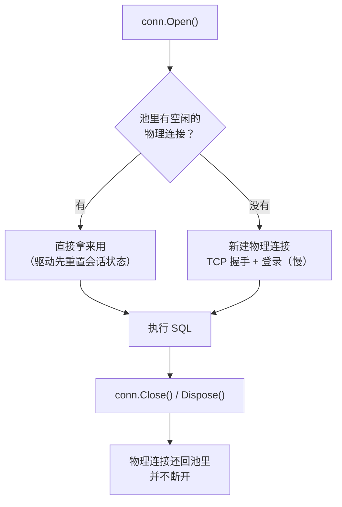
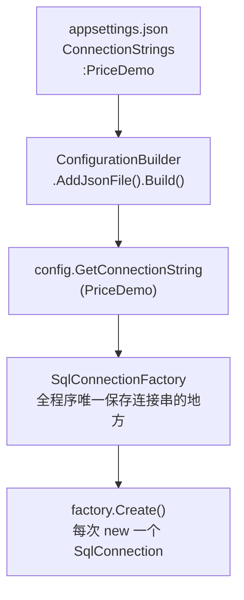
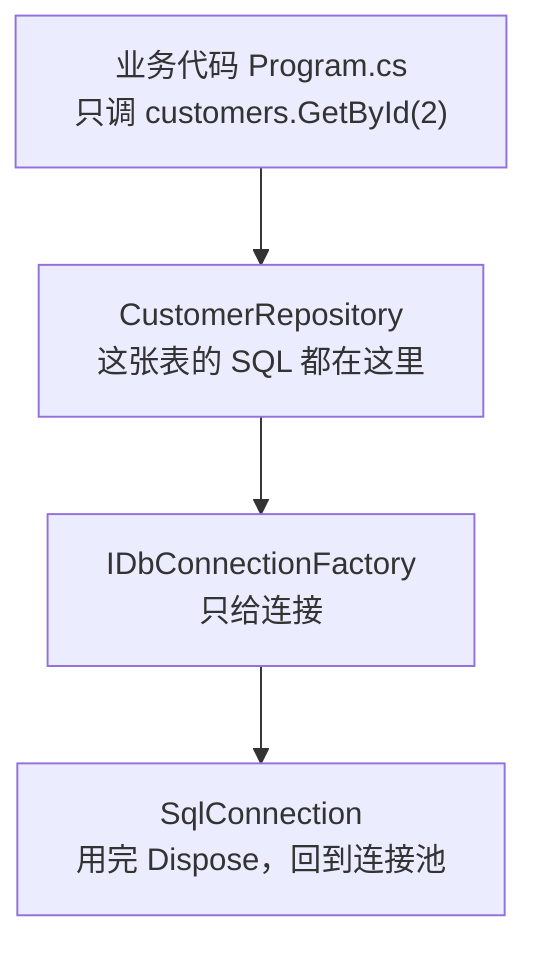

# 第 16 章 连接管理与封装

## 这一章解决什么问题

到第 15 章为止，每个例子开头都有同一行 `const string connStr = "Server=.;…"`，查询前都要 `new SqlConnection`。放到真实项目里会有两个问题：

1. **连接串散落各处**：换一台数据库服务器，就要改几十个文件；
2. **心里没底**：每次查询都 `new` 一个连接、用完就关，是不是很浪费？要不要做成全局共用一个？

本章先用实测回答第 2 个问题（连接池），再把连接串移到 `appsettings.json`，最后用"连接工厂 + 仓储类"把 SQL 和连接收拢起来。从本章起，连接串只写在一个地方。

## 开始之前

- 上一章你已经会了：`buffered: false` 流式读取、`DbString` 指定参数类型、表值参数批量写入（第 15 章）。
- 还要用到：第 5 章的 `QuerySingleOrDefault`、第 6 章的 `OUTPUT INSERTED.Id` 和受影响行数。
- 需要的环境：第 1 章的 SQL Server 和 `PriceDemo` 库。本章不需要额外的 SQL 脚本，数据是初始状态即可（如果被改乱了，重跑 `00-reset-database.sql`）。
- 预计耗时：80–90 分钟。

> **关于本章的数字**：耗时在沙箱里实测（程序和 SQL Server 在同一台 Linux 机器上，用 SQL 身份验证）。**你的数值会不同**，尤其是数据库在另一台机器上时，"建立物理连接"会更慢。请看数量级和对比关系。

---

## 正文

### 16.1 准备：新建本章项目

1. 右键解决方案 →「添加 → 新建项目」→「控制台应用」，项目名 `Ch16Demo`，框架 **.NET 10.0**。
2. **右键 `Ch16Demo` →「设为启动项目」**。
3. 「工具 → NuGet 包管理器 → 管理解决方案的 NuGet 程序包」，给 `Ch16Demo` 装上：

| 包 | 版本 | 从哪一节开始用 |
|---|---|---|
| `Dapper` | 2.1.89 | 16.2 |
| `Microsoft.Data.SqlClient` | 7.1.1 | 16.2 |
| `System.Security.Cryptography.Pkcs` | 10.0.13 | 消除 NU1903 警告（第 1 章） |
| `Microsoft.Extensions.Configuration.Json` | 10.0.13 | 16.3：读 `appsettings.json` |

`Microsoft.Extensions.Configuration.Json` 会顺带引入配置系统的基础包，本章要用的 `ConfigurationBuilder`、`SetBasePath`、`GetConnectionString` 都在里面，不需要再装别的。

本章有 4 个例子加练习。16.2 节的两个例子只用前三个包；16.3 节起还要加一个 `appsettings.json` 文件（16.3 节讲怎么加）。每个例子照旧**整个替换 `Program.cs`**。

---

### 16.2 概念一：连接池（connection pool）

**白话定义**：`conn.Close()`（或 `Dispose()`）**不会真的断开**和 SQL Server 的连接，而是把这条"物理连接"放回一个池子。下次用**同样的连接串** `Open()`，直接从池里拿一条现成的，省掉 TCP 握手和登录。

这是 ADO.NET（SqlClient 驱动）自带的功能，默认开启。你在 WebForm 里写的 `using (var conn = new SqlConnection(...))` 一直在享受它。Dapper 只是调用了 `Open`/`Close`，**没有改变连接池的任何行为**。

**业务场景**：审批页面每打开一次，要查申请单、明细、审批记录 3 次。每次查询都 `new` → `Open` → 查 → `Close`。有连接池，这 3 次很可能用的是同一条物理连接，几乎没有额外开销。

**反例（什么时候不该依赖默认池）**：
- **长时间占着连接不还**：比如打开连接后去调一个要等 10 秒的外部接口。池里的连接（默认最多 100 条）被占着，并发一高，后面的请求就拿不到连接（见改坏实验）。
- **连接串每次都拼得不一样**：比如把用户名拼进 `Application Name`。连接池按**连接串文本**分池，每种写法各一个池，池就失去了意义。
- 一般不需要写 `Pooling=false`。本节只是为了做对比才关掉它。

#### 🖼 图解：Open 和 Close 背后发生了什么



"重置会话状态"是指：驱动下次使用这条连接时，会先让服务器执行 `sp_reset_connection`，清掉上一个使用者留下的临时表、`SET` 选项等，所以你拿到的连接是"干净"的。

#### 💻 最小可运行代码

三个例子：看物理连接编号、比 1000 次 Open/Close 的耗时、从服务器端数连接。

```csharp
// code/ch16/Step1-Pooling/Program.cs
// 连接池：反复 Open/Close 其实一直用同一条物理连接；关掉连接池再比耗时、看服务器上的连接数
using System.Diagnostics;
using Dapper;
using Microsoft.Data.SqlClient;

const string connStr =
    "Server=.;Database=PriceDemo;Integrated Security=True;TrustServerCertificate=True;";

// 关掉连接池的版本：用 SqlConnectionStringBuilder 改一个键，比手工拼字符串安全
string noPoolStr = new SqlConnectionStringBuilder(connStr) { Pooling = false }.ConnectionString;

// 例 1：连续 3 次 new → Open → Close，看每次拿到的是不是同一条物理连接
Console.WriteLine("== 例 1 物理连接编号（ClientConnectionId 前 8 位）");
ShowIds("默认（有连接池）", connStr);
ShowIds("Pooling=false   ", noPoolStr);

// 例 2：1000 次 Open/Close 的耗时，跑 3 轮
Console.WriteLine("== 例 2 1000 次 Open/Close 耗时");
for (int round = 1; round <= 3; round++)
{
    long pooled = OpenClose(connStr, 1000);
    long noPool = OpenClose(noPoolStr, 1000);
    Console.WriteLine($"第 {round} 轮  默认：{pooled,5} ms   Pooling=false：{noPool,5} ms");
}

// 例 3：从服务器这边数一数，到底有几条连接
Console.WriteLine("== 例 3 服务器上的连接数");
SqlConnection.ClearAllPools();                       // 先清空，从 0 开始
var a = new SqlConnection(connStr);
var b = new SqlConnection(connStr);
var c = new SqlConnection(connStr);
a.Open(); b.Open(); c.Open();                        // 同时开着 3 个：池里只能给出 3 条不同的物理连接
Console.WriteLine($"3 个连接同时 Open：{CountSessions()} 条");
a.Close(); b.Close(); c.Close();                     // Close 只是"还给池"，物理连接还在
Console.WriteLine($"3 个连接都 Close 后：{CountSessions()} 条");
SqlConnection.ClearAllPools();                       // 清空连接池，这时才真正断开
Thread.Sleep(500);                                   // 给服务器一点时间清理会话
Console.WriteLine($"ClearAllPools 之后：{CountSessions()} 条");

void ShowIds(string label, string cs)
{
    var ids = new List<string>();
    for (int i = 0; i < 3; i++)
    {
        using var conn = new SqlConnection(cs);
        conn.Open();
        ids.Add(conn.ClientConnectionId.ToString()[..8]);   // 每条物理连接有唯一编号
    }
    Console.WriteLine($"{label}：{string.Join("  ", ids)}");
}

static long OpenClose(string cs, int times)
{
    var sw = Stopwatch.StartNew();
    for (int i = 0; i < times; i++)
    {
        using var conn = new SqlConnection(cs);
        conn.Open();
    }   // 每次循环结束 Dispose → Close：有连接池时只是还回池里，不断开
    return sw.ElapsedMilliseconds;
}

// 用一条不进池的连接去查：PriceDemo 库里、除了我自己以外的用户会话有几个
int CountSessions()
{
    using var monitor = new SqlConnection(noPoolStr);
    return monitor.ExecuteScalar<int>(@"
        SELECT COUNT(*) FROM sys.dm_exec_sessions
        WHERE is_user_process = 1
          AND database_id = DB_ID('PriceDemo')
          AND session_id <> @@SPID");
}
```

| 写法 | 作用 |
|---|---|
| `new SqlConnectionStringBuilder(connStr) { Pooling = false }` | 在原连接串基础上只改一个键。比手拼 `connStr + "Pooling=false;"` 安全，不怕少分号、重复键 |
| `conn.ClientConnectionId` | SqlClient 给每条**物理连接**分配的唯一编号（Guid）。编号相同 = 同一条物理连接 |
| `SqlConnection.ClearAllPools()` | 清空本进程里所有连接池，空闲的物理连接被真正断开。正式代码里一般用不到，这里是为了做实验 |
| `sys.dm_exec_sessions` | 服务器上当前的会话（每条物理连接一个），`is_user_process = 1` 排除系统会话 |

#### 🔍 拆解运行结果

实测输出：

```text
== 例 1 物理连接编号（ClientConnectionId 前 8 位）
默认（有连接池）：8682af97  8682af97  8682af97
Pooling=false   ：f808fbb6  b25328a0  2136a8bf
== 例 2 1000 次 Open/Close 耗时
第 1 轮  默认：    3 ms   Pooling=false：10703 ms
第 2 轮  默认：    1 ms   Pooling=false：10247 ms
第 3 轮  默认：    1 ms   Pooling=false：10081 ms
== 例 3 服务器上的连接数
3 个连接同时 Open：3 条
3 个连接都 Close 后：3 条
ClearAllPools 之后：0 条
```

> 📷 **截图占位 ch16-01**：控制台显示上面的输出，"默认"那一列是个位数毫秒，"Pooling=false"那一列是一万毫秒左右。
<!--  -->

| 例 | 看到了什么 | 说明 |
|---|---|---|
| 1 | 默认：3 次编号相同；关掉池：3 次各不相同 | 有连接池时，3 个 `SqlConnection` **对象**背后是同一条物理连接 |
| 2 | 1000 次：约 1–3 ms 对约 10,000 ms | 平均每次 Open：有池约 0.001–0.003 ms，没池约 10 ms，差了几千倍。第 1 轮"默认"也只有 3 ms，因为例 1 已经在池里留了一条连接 |
| 3 | 同时开 3 个 → 3 条；全关 → 还是 3 条；清池 → 0 条 | **同时**在用的连接，池只能各给一条。`Close` 后物理连接还在服务器上，是"睡着的"会话，等下次复用 |

**为什么"用完立刻关"反而更快**：从例 3 可以看出，池里需要的物理连接数 = **同一时刻**正在用的连接数。每个方法用完就关，连接马上回池，下一个请求就能复用；如果拿着连接不放，并发时池就得不停新建物理连接，每条大约 10 ms（例 2）。所以正确的习惯是：**晚开、早关**，用 `using` 保证一定会关。

> 在 SSMS 里也能看到这些"睡着的"连接：在 SSMS 里执行 `SELECT session_id, status, program_name FROM sys.dm_exec_sessions WHERE database_id = DB_ID('PriceDemo')`，`status` 是 `sleeping` 的就是池里空闲的连接。

#### 改坏一处试试

把 `OpenClose` 方法里的 `using var conn = new SqlConnection(cs);` 去掉 `using`，变成 `var conn = new SqlConnection(cs);`。连接打开后再也没有人关它。运行，例 2 卡住一会儿后报错（实测）：

```text
Unhandled exception. System.InvalidOperationException: Timeout expired.  The timeout period elapsed prior to obtaining a connection from the pool.  This may have occurred because all pooled connections were in use and max pool size was reached.
   at Microsoft.Data.SqlClient.SqlConnectionFactory.TryGetConnection(DbConnection owningConnection, TaskCompletionSource`1 retry, DbConnectionInternal oldConnection, TimeoutTimer timeout, Boolean forceNewConnection, DbConnectionInternal& connection)
```

中文系统下的同一条报错（实测）：

```text
Unhandled exception. System.InvalidOperationException: 超时时间已到。超时时间已到，但是尚未从池中获取连接。出现这种情况可能是因为所有池连接均在使用，并且达到了最大池大小。
```

**怎么读这条报错**：

| 片段 | 含义 |
|---|---|
| `prior to obtaining a connection from the pool` | 不是 SQL 执行超时（第 14 章那种），而是**从池里拿连接**超时 |
| `max pool size was reached` | 池满了。默认最大 100 条（连接串里的 `Max Pool Size`） |
| 卡住的时间 | 默认等 15 秒（连接串里的 `Connect Timeout`）拿不到连接才报错 |

前 100 次 Open 都成功了，每次拿走一条连接却不还；第 101 次池里没有空闲连接，也不能再新建，只好等，等到超时。**看到这条报错，第一反应是找哪里打开了连接却没有 `using`**，而不是去调大 `Max Pool Size`。

---

### 16.3 概念二：配置文件 + 连接工厂

**白话定义**：
- **配置文件**：连接串写进 `appsettings.json`，程序启动时用 `ConfigurationBuilder` 读出来。作用相当于 WebForm 的 `web.config` 里的 `<connectionStrings>`。
- **连接工厂**（connection factory）：一个只有一个方法 `Create()` 的小类，拿着连接串，谁要连接就 `new` 一个给谁。**全程序只有它知道连接串**。`IDbConnectionFactory` 是本章自己定义的接口，不是 Dapper 或微软提供的类型。

**业务场景**：开发库、测试库、正式库各一个。发布时只改 `appsettings.json` 里的一行，代码不动、不重新编译。

**反例（什么时候不该用）**：
- **一次性的小工具**：比如临时导一次数据的控制台程序，连接串写在代码里更直接，不值得加配置文件和工厂。
- **不要把正式库的密码提交进代码仓库**：`appsettings.json` 默认会跟着代码进 Git。正式环境的密码应该放在服务器的环境变量或机密管理工具里。本教程用的是 Windows 身份验证，连接串里没有密码，所以直接写在文件里。

#### 🖼 图解：连接串从文件到连接



#### 💻 第一步：添加 appsettings.json

1. 右键 `Ch16Demo` 项目 →「添加 → 新建项」，在搜索框输入 `json`，选「JSON 文件」，名称填 `appsettings.json`，点「添加」。
2. 在「解决方案资源管理器」里选中 `appsettings.json`，按 **F4** 打开「属性」窗口（或菜单「视图 → 属性窗口」）。
3. 把「**复制到输出目录**」改成「**如果较新则复制**」。

> 📷 **截图占位 ch16-02**：选中 `appsettings.json` 后的「属性」窗口，「复制到输出目录」一栏选的是「如果较新则复制」。
<!--  -->

> ⚠️ 本段未实机验证：沙箱里没有 VS 图形界面，「添加新建项」对话框里模板的名字可能因 VS 版本略有不同。不管用哪个模板，只要最后文件名是 `appsettings.json`、内容如下、属性设置正确即可。

文件内容：

```json
{
  "ConnectionStrings": {
    "PriceDemo": "Server=.;Database=PriceDemo;Integrated Security=True;TrustServerCertificate=True;"
  }
}
```

第 3 步做的事，等于在 csproj 里加了一段 `<None Update="appsettings.json">`。完整的 csproj：

```xml
<Project Sdk="Microsoft.NET.Sdk">

  <PropertyGroup>
    <OutputType>Exe</OutputType>
    <TargetFramework>net10.0</TargetFramework>
    <ImplicitUsings>enable</ImplicitUsings>
    <Nullable>enable</Nullable>
  </PropertyGroup>

  <ItemGroup>
    <PackageReference Include="Dapper" Version="2.1.89" />
    <PackageReference Include="Microsoft.Data.SqlClient" Version="7.1.1" />
    <!-- SqlClient 7.1.1 间接带进来的 Pkcs 9.0.18 有已知漏洞（NU1903 警告），显式升到新版消掉 -->
    <PackageReference Include="System.Security.Cryptography.Pkcs" Version="10.0.13" />
    <!-- 读 appsettings.json：它会顺带引入 Configuration 的基础包，GetConnectionString 就在里面 -->
    <PackageReference Include="Microsoft.Extensions.Configuration.Json" Version="10.0.13" />
  </ItemGroup>

  <ItemGroup>
    <!-- 等于 VS 里 appsettings.json 的属性「复制到输出目录：如果较新则复制」 -->
    <None Update="appsettings.json">
      <CopyToOutputDirectory>PreserveNewest</CopyToOutputDirectory>
    </None>
  </ItemGroup>

</Project>
```

**为什么一定要"复制到输出目录"**：程序运行时的"当前目录"是 `bin\Debug\net10.0\`，不是项目目录。代码里用 `AppContext.BaseDirectory` 找配置文件，找的就是这个目录。文件不复制过去，程序就找不到它（见改坏实验）。

#### 💻 第二步：读配置、建工厂

```csharp
// code/ch16/Step2-Config/Program.cs
// 连接串从 appsettings.json 读出来，交给连接工厂；业务代码里不再出现连接串
using System.Data;
using Dapper;
using Microsoft.Data.SqlClient;
using Microsoft.Extensions.Configuration;

// ① 读配置：从程序运行目录（bin\Debug\net10.0\）找 appsettings.json
IConfiguration config = new ConfigurationBuilder()
    .SetBasePath(AppContext.BaseDirectory)
    .AddJsonFile("appsettings.json", optional: false)   // optional: false —— 找不到文件就立刻报错，不要默默跑下去
    .Build();

// ② GetConnectionString("PriceDemo") 就是读 "ConnectionStrings" 节点下的 "PriceDemo"
string? connStr = config.GetConnectionString("PriceDemo");

// ③ 连接工厂：全程序只在这里用到连接串
IDbConnectionFactory factory = new SqlConnectionFactory(connStr);

// ④ 业务代码：只跟工厂要连接
using (IDbConnection conn = factory.Create())
{
    int customers = conn.ExecuteScalar<int>("SELECT COUNT(*) FROM dbo.Customer");
    int products = conn.ExecuteScalar<int>("SELECT COUNT(*) FROM dbo.Product");
    Console.WriteLine($"客户 {customers} 个，产品 {products} 个");
}

// 连接串里的库名也能取出来看看（不要把整串打印到日志里：里面可能有密码）
var csb = new SqlConnectionStringBuilder(connStr);
Console.WriteLine($"配置文件位置：{Path.Combine(AppContext.BaseDirectory, "appsettings.json")}");
Console.WriteLine($"连接的库：{csb.InitialCatalog}");

// 只有一个方法的接口：调用方只知道"能要到一个连接"，不知道连的是哪台服务器
public interface IDbConnectionFactory
{
    IDbConnection Create();
}

public class SqlConnectionFactory : IDbConnectionFactory
{
    private readonly string _connStr;

    public SqlConnectionFactory(string? connStr)
    {
        // 配置写错时在启动阶段就报清楚，而不是等到第一次查询时报一句看不懂的错
        if (string.IsNullOrWhiteSpace(connStr))
            throw new InvalidOperationException("appsettings.json 里没有找到 ConnectionStrings:PriceDemo");
        _connStr = connStr;
    }

    // 每次都 new 一个新的：便宜（连接池兜底），而且每个调用方各用各的，互不干扰
    public IDbConnection Create() => new SqlConnection(_connStr);
}
```

#### 🔍 拆解运行结果

实测输出：

```text
客户 3 个，产品 4 个
配置文件位置：/projects/sandbox/.tools/run/ch16-Step2-Config/bin/Debug/net10.0/appsettings.json
连接的库：PriceDemo
```

第 2 行是沙箱里的路径。在你的 Windows 上会是 `……\Ch16Demo\bin\Debug\net10.0\appsettings.json`，正好说明了"为什么要复制到输出目录"。

| 代码 | 说明 |
|---|---|
| `SetBasePath(AppContext.BaseDirectory)` | 从 exe 所在的目录找文件，不管你从哪里启动程序 |
| `optional: false` | 文件不存在就**立刻报错**。写成 `true` 时找不到文件不报错，连接串是 null，要到第一次查询才出错，更难查 |
| `GetConnectionString("PriceDemo")` | 是 `config["ConnectionStrings:PriceDemo"]` 的简写，读不到时返回 `null`，**不报错** |
| 工厂构造函数里的检查 | 正因为上一行读不到时不报错，所以在这里检查，启动时就把问题报清楚 |
| `Create() => new SqlConnection(_connStr)` | 每次都新建。有 16.2 节的连接池，新建一个 `SqlConnection` 对象几乎没有成本 |
| 返回 `IDbConnection` | Dapper 的方法都挂在 `IDbConnection` 上（第 2 章），调用方不需要知道背后是 SQL Server |

#### 改坏一处试试

**改法 1：忘了"复制到输出目录"。** 在 csproj 里删掉 `<None Update=…>` 那一段（等于属性里选回「不复制」），运行。实测报错：

```text
Unhandled exception. System.IO.FileNotFoundException: The configuration file 'appsettings.json' was not found and is not optional. The expected physical path was '/projects/sandbox/.tools/run/mut-ch16-NoCopy/bin/Debug/net10.0/appsettings.json'.
```

这条报错来自配置组件，中文系统下也是英文（实测）。它直接告诉你**它去哪里找了**（`expected physical path`）。去那个目录看一眼，没有这个文件，就是没复制。

**改法 2：键名写错。** 把 `GetConnectionString("PriceDemo")` 改成 `GetConnectionString("PriceDemo1")`。实测报错：

```text
Unhandled exception. System.InvalidOperationException: appsettings.json 里没有找到 ConnectionStrings:PriceDemo
   at SqlConnectionFactory..ctor(String connStr) in /projects/sandbox/.tools/run/mut-ch16-KeyTypo/Program.cs:line 47
```

这是工厂里那行检查抛的异常。如果**没有**这行检查，会怎样？把检查去掉再试（实测）：

```text
Unhandled exception. System.InvalidOperationException: The ConnectionString property has not been initialized.
   at Microsoft.Data.SqlClient.SqlConnection.PermissionDemand()
```

中文系统下是 `ConnectionString 属性尚未初始化。`（实测）。这条报错发生在第一次查询时，只说"连接串没初始化"，不说是哪个配置项没读到。在大项目里，第一次查询可能在程序启动很久以后，离出错的配置很远。**所以工厂要在构造时就检查。**

---

### 16.4 概念三：Repository（仓储）封装

**白话定义**：一张表（或一组紧密相关的表）对应一个类，这张表的 SQL **全部**写在这个类的方法里：`GetAll`、`GetById`、`Insert`……业务代码只调方法，看不到 SQL，也看不到连接。

**业务场景**：审批页、报表页、导入工具都要"按 Id 查申请单"。有了 `PriceRequestRepository.GetById`，三处调同一个方法。哪天表加了一列，只改这一个类（第 18 章会用到这一点）。

**反例（什么时候不该用）**：
- **不要写"万能"的泛型仓储** `Repository<T>`，用反射自动拼 `SELECT`/`INSERT`。那是在重写一个 ORM，Dapper 的优势（SQL 由你掌控）就没了。需要这种功能，直接用 EF Core（附录 D）。
- **报表类的复杂查询**：一条 SQL 只在一个报表里用，硬塞进某张表的仓储反而不好找。可以单独建一个 `PriceReportQueries` 类。
- **仓储里不要共享连接**：每个方法自己 `Create()`、自己 `using`。下面的改坏实验演示共享一个连接的后果。

#### 🖼 图解：分层之后，各层只认识下一层



#### 💻 最小可运行代码

和 16.3 节一样需要 `appsettings.json`（内容、属性设置都相同）。`Program.cs` 整个替换成：

```csharp
// code/ch16/Step3-Repository/Program.cs
// Repository 封装：客户、申请单各一个仓储类；业务代码只调方法，不碰连接串、不碰 SQL
using System.Data;
using Dapper;
using Microsoft.Data.SqlClient;
using Microsoft.Extensions.Configuration;

IConfiguration config = new ConfigurationBuilder()
    .SetBasePath(AppContext.BaseDirectory)
    .AddJsonFile("appsettings.json", optional: false)
    .Build();

// 程序启动时组装一次：工厂 → 仓储。之后到处用仓储
IDbConnectionFactory factory = new SqlConnectionFactory(config.GetConnectionString("PriceDemo"));
var customers = new CustomerRepository(factory);
var requests = new PriceRequestRepository(factory);

// 1. 查全部客户
Console.WriteLine("== 1 全部客户");
foreach (var c in customers.GetAll())
    Console.WriteLine($"{c.Id}  {c.Name}  {c.City}  {c.Level}");

// 2. 按 Id 查：查得到 / 查不到
Console.WriteLine("== 2 按 Id 查");
Console.WriteLine($"Id=2：{customers.GetById(2)?.Name}");
Console.WriteLine($"Id=99：{(customers.GetById(99) is null ? "null（查不到）" : "有")}");

// 3. 新增客户，再给他建一张申请单
Console.WriteLine("== 3 新增");
int newCustomerId = customers.Insert(new Customer { Name = "西部康复医院", City = "成都", Level = "B" });
Console.WriteLine($"新客户 Id = {newCustomerId}");

int newRequestId = requests.Insert(new PriceRequest
{
    RequestNo = "PR20261020",
    CustomerId = newCustomerId,
    Applicant = "王芳",
    Remark = "首次报价"
});
var r = requests.GetById(newRequestId)!;
Console.WriteLine($"新申请单 Id = {r.Id}  {r.RequestNo}  客户 {r.CustomerId}  {r.Applicant}  状态 {r.Status}  {r.Remark}");

// 4. 全部申请单
Console.WriteLine("== 4 全部申请单");
foreach (var x in requests.GetAll())
    Console.WriteLine($"{x.Id}  {x.RequestNo}  客户 {x.CustomerId}  {x.Applicant}  状态 {x.Status}  {x.Remark ?? "(无备注)"}");

// ===================== 以下是可复用的部分 =====================

public interface IDbConnectionFactory
{
    IDbConnection Create();
}

public class SqlConnectionFactory : IDbConnectionFactory
{
    private readonly string _connStr;

    public SqlConnectionFactory(string? connStr)
    {
        if (string.IsNullOrWhiteSpace(connStr))
            throw new InvalidOperationException("appsettings.json 里没有找到 ConnectionStrings:PriceDemo");
        _connStr = connStr;
    }

    public IDbConnection Create() => new SqlConnection(_connStr);
}

// 一张表一个仓储：这张表的 SQL 全在这里，改表结构时只需要找这一个类
public class CustomerRepository
{
    private readonly IDbConnectionFactory _factory;

    public CustomerRepository(IDbConnectionFactory factory) => _factory = factory;

    public List<Customer> GetAll()
    {
        using var conn = _factory.Create();          // 每个方法自己要连接、用完立刻还（Dispose → 回到连接池）
        return conn.Query<Customer>(
            "SELECT Id, Name, City, Level FROM dbo.Customer ORDER BY Id").ToList();
    }

    public Customer? GetById(int id)
    {
        using var conn = _factory.Create();
        return conn.QuerySingleOrDefault<Customer>(   // 第 5 章：最多一行，查不到返回 null
            "SELECT Id, Name, City, Level FROM dbo.Customer WHERE Id = @Id", new { Id = id });
    }

    public int Insert(Customer c)
    {
        using var conn = _factory.Create();
        return conn.QuerySingle<int>(@"
            INSERT dbo.Customer (Name, City, Level)
            OUTPUT INSERTED.Id                        -- 第 6 章：直接拿回自增 Id
            VALUES (@Name, @City, @Level)", c);       // 实体对象直接当参数：属性名对上 @参数名
    }
}

public class PriceRequestRepository
{
    private readonly IDbConnectionFactory _factory;

    public PriceRequestRepository(IDbConnectionFactory factory) => _factory = factory;

    // 列清单只写一次，三个查询共用，避免某个方法漏查一列
    private const string Columns = "Id, RequestNo, CustomerId, Applicant, Status, CreatedAt, Remark";

    public List<PriceRequest> GetAll()
    {
        using var conn = _factory.Create();
        return conn.Query<PriceRequest>(
            $"SELECT {Columns} FROM dbo.PriceRequest ORDER BY Id").ToList();
    }

    public PriceRequest? GetById(int id)
    {
        using var conn = _factory.Create();
        return conn.QuerySingleOrDefault<PriceRequest>(
            $"SELECT {Columns} FROM dbo.PriceRequest WHERE Id = @Id", new { Id = id });
    }

    public int Insert(PriceRequest r)
    {
        using var conn = _factory.Create();
        // Status、CreatedAt 不传：用表上的默认值（0 草稿、当前时间）
        return conn.QuerySingle<int>(@"
            INSERT dbo.PriceRequest (RequestNo, CustomerId, Applicant, Remark)
            OUTPUT INSERTED.Id
            VALUES (@RequestNo, @CustomerId, @Applicant, @Remark)", r);
    }
}

public class Customer
{
    public int Id { get; set; }
    public string Name { get; set; } = "";
    public string City { get; set; } = "";
    public string Level { get; set; } = "";
}

public class PriceRequest
{
    public int Id { get; set; }
    public string RequestNo { get; set; } = "";
    public int CustomerId { get; set; }
    public string Applicant { get; set; } = "";
    public byte Status { get; set; }                 // 列是 TINYINT
    public DateTime CreatedAt { get; set; }
    public string? Remark { get; set; }              // 列允许 NULL（第 7 章）
}
```

> 这里为了"整个替换 Program.cs 就能跑"，把所有类都放在了一个文件末尾。真实项目里，按类拆成 `Models.cs`、`Db.cs`、`CustomerRepository.cs` 等文件（第 23 章就是这样做的）。

#### 🔍 拆解运行结果

实测输出（数据是初始状态时）：

```text
== 1 全部客户
1  华东第一医院  上海  A
2  江南检测中心  杭州  B
3  北方影像诊所  天津  C
== 2 按 Id 查
Id=2：江南检测中心
Id=99：null（查不到）
== 3 新增
新客户 Id = 4
新申请单 Id = 4  PR20261020  客户 4  王芳  状态 0  首次报价
== 4 全部申请单
1  PR20261001  客户 1  张伟  状态 2  年度框架采购
2  PR20261008  客户 2  李娜  状态 1  (无备注)
3  PR20261015  客户 1  张伟  状态 0  追加探头
4  PR20261020  客户 4  王芳  状态 0  首次报价
```

> 再运行一次会报错：`PR20261020` 已经存在，`RequestNo` 列有唯一约束。先重跑 `00-reset-database.sql`。

| 看点 | 说明 |
|---|---|
| 业务代码里没有一行 SQL、没有连接串 | 全部在仓储和工厂里 |
| `GetById(99)` 返回 null | 用的是第 5 章的 `QuerySingleOrDefault`，"查不到"是正常情况，不抛异常 |
| `Insert` 直接收实体对象 | `new Customer { … }` 当参数，属性名对上 `@Name`、`@City`、`@Level`（第 4 章）。没有赋值的 `Id` 属性 SQL 里没用到，Dapper 不会发它 |
| 新申请单状态 0 | INSERT 没写 `Status` 和 `CreatedAt`，用了表上的默认值 |
| `Columns` 常量 | 三个查询共用一份列清单，不会出现"这个方法漏查了 Remark"的情况（第 2 章讲过：少查一列不报错，只是默认值） |
| 每个方法都返回 `List`，不返回 `IEnumerable` | 方法结束时连接已经还回池里，返回已经读完的 List 最稳妥 |

#### 改坏一处试试：全局共享一个连接

WebForm 时代有人这样写：做一个静态类，里面放一个 `static SqlConnection`，所有地方都用它，"省得每次 new"。在仓储里，这相当于把 `using var conn = _factory.Create();` 换成同一个共享连接。下面用 50 个并发任务模拟 50 个同时到达的网页请求：

```csharp
// code/ch16/Step4-SharedConnection/Program.cs
// 反例：全程序共享一个静态 SqlConnection，50 个任务同时查询；对照：每次查询新建连接
using System.Collections.Concurrent;
using Dapper;
using Microsoft.Data.SqlClient;

const string sql = "SELECT COUNT(*) FROM dbo.Customer";

// 错误写法：50 个任务同时用 Db.Shared
var (ok1, errors1) = RunParallel(() => Db.Shared.ExecuteScalar<int>(sql));
Console.WriteLine($"== 共享一个连接：成功 {ok1} 次，失败 {50 - ok1} 次");
foreach (var e in errors1.OrderByDescending(e => e.Value))
    Console.WriteLine($"  {e.Value} 次  {e.Key}");

// 被共享连接弄乱的连接池先清掉（16.2 节用过），保证对照组从干净的状态开始
SqlConnection.ClearAllPools();

// 正确写法：每次查询 new 一个连接，用完 Dispose（连接池保证这样做不慢）
var (ok2, errors2) = RunParallel(() =>
{
    using var conn = new SqlConnection(Db.ConnStr);
    return conn.ExecuteScalar<int>(sql);
});
Console.WriteLine($"== 每次新建连接：成功 {ok2} 次，失败 {50 - ok2} 次");
foreach (var e in errors2.OrderByDescending(e => e.Value))
    Console.WriteLine($"  {e.Value} 次  {e.Key}");

// 同时启动 50 个任务执行 query，统计成功次数和各种异常出现的次数
static (int ok, ConcurrentDictionary<string, int> errors) RunParallel(Func<int> query)
{
    int ok = 0;
    var errors = new ConcurrentDictionary<string, int>();
    Parallel.For(0, 50, _ =>
    {
        try
        {
            if (query() == 3) Interlocked.Increment(ref ok);   // 客户表有 3 行，结果对才算成功
        }
        catch (Exception ex)
        {
            errors.AddOrUpdate($"{ex.GetType().Name}: {ex.Message}", 1, (_, n) => n + 1);
        }
    });
    return (ok, errors);
}

static class Db
{
    public const string ConnStr =
        "Server=.;Database=PriceDemo;Integrated Security=True;TrustServerCertificate=True;";

    // ❌ 反例：看起来"省得每次 new"，实际上 SqlConnection 不是线程安全的
    public static readonly SqlConnection Shared = new SqlConnection(ConnStr);
}
```

实测输出（其中一次）：

```text
== 共享一个连接：成功 2 次，失败 48 次
  39 次  InvalidOperationException: ExecuteScalar requires an open and available Connection. The connection's current state is connecting.
  7 次  InvalidOperationException: Internal DbConnection Error: 4
  1 次  InvalidOperationException: The connection was not closed. The connection's current state is connecting.
  1 次  InvalidOperationException: Internal DbConnection Error: 6
== 每次新建连接：成功 50 次，失败 0 次
```

我连续跑了 4 次，共享连接那一组成功 0–2 次；除了上面 4 种报错，有几次还出现了 `NullReferenceException`、`Invalid attempt to call Read when reader is closed.`、`Internal connection fatal error. Error state: 15, Token : 32`。"每次新建连接"那一组 4 次都是 50 次全部成功。

> 并发的结果和机器的 CPU 核数、时机有关，你看到的次数和报错种类一定会不同，但"共享连接大量失败、各用各的全部成功"这个结论不会变。
>
> 关于中间那行 `ClearAllPools()`：最早的版本没有这一行，跑了 12 次里有 2 次，连"每次新建连接"那一组也全部失败了（当时没打印它的异常，原因没能确认）。加上清池之后再没出现过。这也说明：共享连接被多个线程弄乱以后，影响的可能不只是它自己。

**逐条读报错**：

| 报错 | 发生了什么 |
|---|---|
| `The connection's current state is connecting` | 任务 A 发现连接是关的，开始 `Open`；任务 B 同时拿到它，发现它正在"连接中"，不能用 |
| `The connection was not closed` | 两个任务同时去 `Open` 同一个连接，后一个发现它已经不是关闭状态 |
| `Internal DbConnection Error: 4 / 6` | 连接对象内部的状态被多个线程同时改乱了 |

`SqlConnection` **不是线程安全的**：一个连接对象同一时刻只能被一个线程使用。WebForm 里每个请求是一个线程，静态连接就是所有请求共用一个，单人测试时没问题，一上线就出错。正确做法就是本章的写法：每次 `Create()`，用完 `using` 释放，连接池保证这样做几乎没有成本（16.2 节例 2：1000 次 Open/Close 只要几毫秒）。

> 📷 **截图占位 ch16-03**：「解决方案资源管理器」里 `Ch16Demo` 项目下能看到 `appsettings.json`，选中它时「属性」窗口里「复制到输出目录」是「如果较新则复制」。
<!--  -->

---

## 🧱 类比：ADO.NET（WebForm）写法与本章写法逐项对照

| 要做的事 | WebForm + ADO.NET | 本章（.NET 10 + Dapper） |
|---|---|---|
| 连接串放哪里 | `web.config` 的 `<connectionStrings>` | `appsettings.json` 的 `"ConnectionStrings"` 节点 |
| 读连接串 | `ConfigurationManager.ConnectionStrings["PriceDemo"].ConnectionString` | `config.GetConnectionString("PriceDemo")` |
| 配置文件在哪 | 网站根目录，IIS 自动读 | 要「复制到输出目录」，用 `AppContext.BaseDirectory` 找 |
| 键名写错 | `ConnectionStrings["X"]` 返回 null，取 `.ConnectionString` 时 `NullReferenceException` | 返回 null，不报错——所以工厂里要自己检查 |
| 连接池 | SqlClient 自带，默认开启 | **同一个机制**，Dapper 不改变它 |
| 封装 | 一个静态 `SqlHelper` 类，`ExecuteDataTable(sql)` | 连接工厂 + 每张表一个仓储类 |
| 返回什么 | `DataTable`，列名是字符串 | `List<Customer>`，属性有类型，写错编译不过 |

## ⚠️ 踩坑警告

| 现象 | 原因 | 怎么改 |
|---|---|---|
| `Timeout expired. The timeout period elapsed prior to obtaining a connection from the pool`（实测；中文：`超时时间已到，但是尚未从池中获取连接`） | 有连接打开后没关（少了 `using`），池里 100 条连接被占满 | 找出没有 `using` 的 `SqlConnection`；不要靠调大 `Max Pool Size` 掩盖 |
| `The configuration file 'appsettings.json' was not found and is not optional`（实测） | `appsettings.json` 没有复制到 `bin\Debug\net10.0\` | 文件属性「复制到输出目录」选「如果较新则复制」 |
| `The ConnectionString property has not been initialized`（实测；中文：`ConnectionString 属性尚未初始化。`） | `GetConnectionString` 的键名写错，返回了 null，一直传到了 `SqlConnection` | 核对 JSON 里的键名；工厂构造函数里检查 null，启动时就报错 |
| 共享一个静态连接，单人测试正常，并发时报 `current state is connecting`、`Internal DbConnection Error`（实测） | `SqlConnection` 不是线程安全的 | 每次查询 `Create()` 一个新连接，`using` 释放 |

## 🎯 动手练习

**练习：写一个 `ProductRepository`**

照 16.4 节的写法，新建 `ProductRepository`，连接串从 `appsettings.json` 读。要求两个方法：

- `Product? GetByCode(string code)`：按编码查一个产品，查不到返回 null。`Code` 列是 `VARCHAR(20)`，参数要用第 15 章的 `DbString`，让类型和列一致。
- `int UpdateListPrice(string code, decimal price)`：改目录价，返回受影响行数。

在 `Program.cs` 里依次：查 `PB-01`；把它改成 25,500；改一个不存在的 `XX-999`；查 `XX-999`。

- 验收标准：输出 4 行，完全一致：

```text
PB-01 线阵探头 26,000.00
改价 PB-01：影响 1 行 → 25,500.00
改价 XX-999：影响 0 行
查 XX-999：null
```

- 额外思考：两个方法里都要构造同样的 `DbString`，怎样只写一次？

卡住了看文末参考答案。

## 📌 一句话总结

连接晚开早关靠连接池兜底，连接串只进工厂，SQL 只进仓储。

## 下一章

数据库里存的是一段 JSON 文本，C# 里想要的却是一个对象——第 17 章用自定义类型处理器让 Dapper 自动转换。

---

<!-- 以下是参考答案，先自己动手，卡住了再往下翻 -->


## 参考答案

**思路**：结构和 16.4 节的 `CustomerRepository` 完全一样：构造函数接收 `IDbConnectionFactory`，每个方法自己 `using var conn = _factory.Create();`。`GetByCode` 用 `QuerySingleOrDefault`，编码唯一，最多一行，查不到返回 null（第 5 章）。`UpdateListPrice` 用 `Execute`，返回值就是受影响行数，0 表示编码不存在（第 6 章）。两个方法都要的 `DbString` 抽成一个私有静态方法 `CodeParam`，长度 20 只写一次，以后列长度改了也只改这一处。

完整项目在 [`code/ch16/Exercise/`](../code/ch16/Exercise/)（csproj 和 `appsettings.json` 与 16.3 节相同）。实测输出（数据为初始状态时）：

```text
PB-01 线阵探头 26,000.00
改价 PB-01：影响 1 行 → 25,500.00
改价 XX-999：影响 0 行
查 XX-999：null
```

```csharp
// code/ch16/Exercise/Program.cs
// 第 16 章练习参考答案：ProductRepository（按编码查 + 改目录价），连接串来自 appsettings.json
using System.Data;
using Dapper;
using Microsoft.Data.SqlClient;
using Microsoft.Extensions.Configuration;

IConfiguration config = new ConfigurationBuilder()
    .SetBasePath(AppContext.BaseDirectory)
    .AddJsonFile("appsettings.json", optional: false)
    .Build();

var products = new ProductRepository(new SqlConnectionFactory(config.GetConnectionString("PriceDemo")));

var p = products.GetByCode("PB-01")!;
Console.WriteLine($"{p.Code} {p.Name} {p.ListPrice:N2}");

int n1 = products.UpdateListPrice("PB-01", 25500m);
Console.WriteLine($"改价 PB-01：影响 {n1} 行 → {products.GetByCode("PB-01")!.ListPrice:N2}");

int n2 = products.UpdateListPrice("XX-999", 1m);
Console.WriteLine($"改价 XX-999：影响 {n2} 行");

Console.WriteLine($"查 XX-999：{products.GetByCode("XX-999")?.Name ?? "null"}");

public interface IDbConnectionFactory
{
    IDbConnection Create();
}

public class SqlConnectionFactory : IDbConnectionFactory
{
    private readonly string _connStr;

    public SqlConnectionFactory(string? connStr)
    {
        if (string.IsNullOrWhiteSpace(connStr))
            throw new InvalidOperationException("appsettings.json 里没有找到 ConnectionStrings:PriceDemo");
        _connStr = connStr;
    }

    public IDbConnection Create() => new SqlConnection(_connStr);
}

public class ProductRepository
{
    private readonly IDbConnectionFactory _factory;

    public ProductRepository(IDbConnectionFactory factory) => _factory = factory;

    // Code 列是 VARCHAR(20)：用第 15 章的 DbString，参数类型和列一致，能走索引查找
    private static DbString CodeParam(string code) =>
        new DbString { Value = code, IsAnsi = true, Length = 20 };

    public Product? GetByCode(string code)
    {
        using var conn = _factory.Create();
        return conn.QuerySingleOrDefault<Product>(
            "SELECT Id, Code, Name, ListPrice FROM dbo.Product WHERE Code = @Code",
            new { Code = CodeParam(code) });
    }

    // 返回受影响行数：0 表示编码不存在（第 6 章）
    public int UpdateListPrice(string code, decimal price)
    {
        using var conn = _factory.Create();
        return conn.Execute(
            "UPDATE dbo.Product SET ListPrice = @Price WHERE Code = @Code",
            new { Code = CodeParam(code), Price = price });
    }
}

public class Product
{
    public int Id { get; set; }
    public string Code { get; set; } = "";
    public string Name { get; set; } = "";
    public decimal ListPrice { get; set; }
}
```
