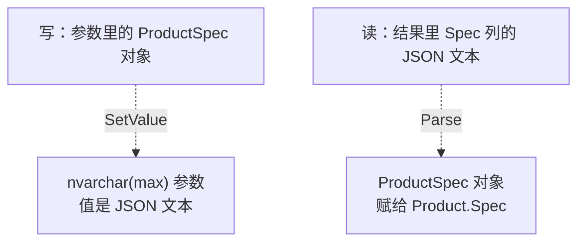
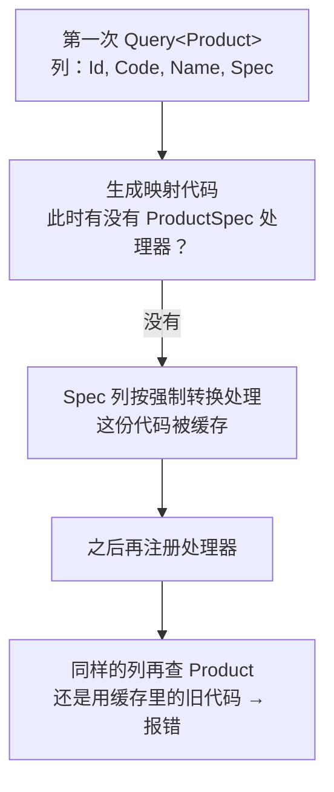
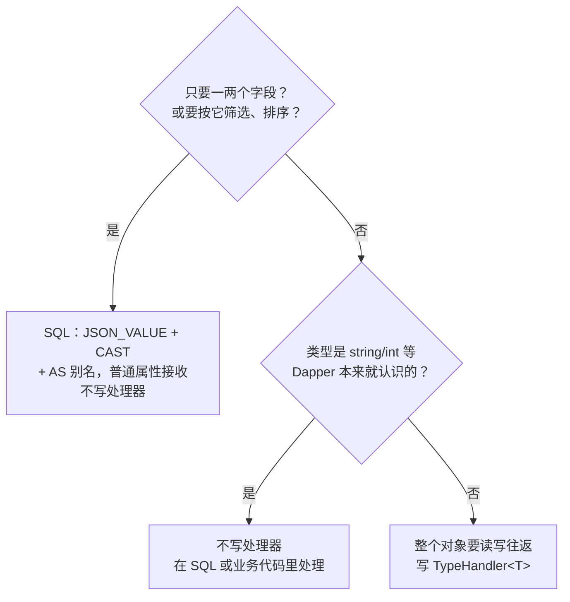

# 第 17 章 自定义类型处理

## 这一章解决什么问题

产品的规格参数（频率、重量、类别……）每种产品都不一样，于是有人在 `dbo.Product` 上加了一列 `Spec`，里面存一段 JSON 文本。C# 这边你想要的是一个 `ProductSpec` 对象，可以直接写 `p.Spec.WeightKg`。

直接把属性类型写成 `ProductSpec`，Dapper 会报错：它只会把字符串转成字符串，不知道怎么把 JSON 变成你的类。本章解决三件事：

1. 写一个**类型处理器**，告诉 Dapper 这个类型怎么读、怎么写；
2. 处理器要在**什么时候**注册——注册晚了，注册了也不生效；
3. 什么情况下**不该**写处理器，用一句 SQL 就够了。

## 开始之前

- 上一章你已经会了：连接池、`appsettings.json` + 连接工厂、Repository 封装（第 16 章）。
- 还要用到：第 3 章讲的"映射代码生成后会被缓存"；第 7 章的别名映射；第 15 章的 `DbString` 和计划缓存查法。
- 需要的环境：第 1 章的 SQL Server 和 `PriceDemo` 库（SQL Server 2016 及以上，`JSON_VALUE` 从 2016 开始支持）。动手前先执行 [`code/sql/ch17-json-column.sql`](../code/sql/ch17-json-column.sql)。
- 预计耗时：75–90 分钟。

> 本章的例子都很短，为了"整个替换 `Program.cs` 就能跑"，连接串仍然直接写在代码里，没有用第 16 章的配置文件。放进真实项目时，处理器的写法不变，只是注册的位置要按 17.3 节的要求放。

---

## 正文

### 17.1 准备：新建本章项目、给产品表加一列

1. 右键解决方案 →「添加 → 新建项目」→「控制台应用」，项目名 `Ch17Demo`，框架 **.NET 10.0**。
2. **右键 `Ch17Demo` →「设为启动项目」**。
3. 「工具 → NuGet 包管理器 → 管理解决方案的 NuGet 程序包」，给 `Ch17Demo` 装上 `Dapper` 2.1.89、`Microsoft.Data.SqlClient` 7.1.1、`System.Security.Cryptography.Pkcs` 10.0.13。csproj 和第 15 章相同。
4. 本章用来转换 JSON 的 `System.Text.Json` 是 .NET 自带的，**不用另外装包**。

然后在 SSMS 里打开 `ch17-json-column.sql`，按 F5 执行：

```sql
-- code/sql/ch17-json-column.sql
-- 第 17 章：给 dbo.Product 加一列 Spec（JSON 文本，存产品规格），并填入示例数据。
-- 可以反复执行：列已存在就不再加，数据每次都重新写一遍。
-- 在 SSMS 里连接 PriceDemo 后整段执行（F5）。

USE PriceDemo;
GO

IF COL_LENGTH('dbo.Product', 'Spec') IS NULL
    ALTER TABLE dbo.Product ADD Spec NVARCHAR(MAX) NULL;   -- 允许 NULL：不是每个产品都录了规格
GO

-- JSON 里的名字和 C# 类 ProductSpec 的属性名一致：频率（MHz）、重量（kg）、类别
UPDATE dbo.Product SET Spec = N'{"FrequencyMHz":5.0,"WeightKg":4.2,"Category":"主机"}'  WHERE Code = 'US-100';
UPDATE dbo.Product SET Spec = N'{"FrequencyMHz":7.5,"WeightKg":65.0,"Category":"主机"}' WHERE Code = 'US-200';
UPDATE dbo.Product SET Spec = N'{"FrequencyMHz":10.0,"WeightKg":0.3,"Category":"探头"}' WHERE Code = 'PB-01';
UPDATE dbo.Product SET Spec = NULL                                                       WHERE Code = 'PB-02';
GO

-- 执行完应看到 4 行，PB-02 的 Spec 是 NULL
SELECT Code, Spec FROM dbo.Product ORDER BY Id;
```

结果窗格最后显示 4 行，前 3 行是 JSON 文本，`PB-02` 是 `NULL`（实测）：

```text
Code                 Spec
-------------------- ----------------------------------------------------------
US-100               {"FrequencyMHz":5.0,"WeightKg":4.2,"Category":"主机"}
US-200               {"FrequencyMHz":7.5,"WeightKg":65.0,"Category":"主机"}
PB-01                {"FrequencyMHz":10.0,"WeightKg":0.3,"Category":"探头"}
PB-02                NULL
```

> 本章每个例子都可能改写 `Spec` 列。**每跑一个例子之前，先重跑一次这个脚本**，结果才会和教程一致。脚本会把 4 行 `Spec` 全部写回初始值。

---

### 17.2 概念一：`SqlMapper.TypeHandler<T>`

**白话定义**：类型处理器（type handler）是你写的一个小类，继承 `SqlMapper.TypeHandler<T>`，实现两个方法：
- `Parse`：**读**的时候，数据库里的值 → `T` 对象；
- `SetValue`：**写**的时候，`T` 对象 → SQL 参数。

再用 `SqlMapper.AddTypeHandler(...)` 注册一次。以后 Dapper 在结果里遇到 `T` 类型的属性、在参数里遇到 `T` 类型的值，都交给它处理。

**业务场景**：`Spec` 列存 JSON，所有查产品的地方都希望直接拿到 `ProductSpec` 对象。不用处理器的话，每个查询后面都要跟一句 `JsonSerializer.Deserialize`，每个写入前面都要跟一句 `Serialize`。

**反例（什么时候不该用）**：
- **类型 Dapper 本来就认识**：`int`、`decimal`、`DateTime`、枚举（第 7 章）都不需要处理器。
- **只要 JSON 里的一两个字段**，或者要**按这些字段筛选**：用 SQL 的 `JSON_VALUE` 更合适（17.4 节）。

#### 🖼 图解：一个处理器管两个方向



#### 💻 最小可运行代码

```csharp
// code/ch17/Step1-Handler/Program.cs
// 自定义类型处理器：JSON 文本列 Spec 读出来直接是 ProductSpec 对象，写的时候自动转回 JSON
// 运行前先执行 code/sql/ch17-json-column.sql
using System.Data;
using System.Text.Encodings.Web;
using System.Text.Json;
using Dapper;
using Microsoft.Data.SqlClient;

const string connStr =
    "Server=.;Database=PriceDemo;Integrated Security=True;TrustServerCertificate=True;";

// 注册：告诉 Dapper "遇到 ProductSpec 类型，就交给这个处理器"。放在程序最开头（17.3 节讲为什么）
SqlMapper.AddTypeHandler(new ProductSpecHandler());

using var conn = new SqlConnection(connStr);

// 读：Spec 列里的 JSON 文本 → ProductSpec 对象
Console.WriteLine("== 读");
foreach (var p in conn.Query<Product>("SELECT Id, Code, Name, Spec FROM dbo.Product ORDER BY Id"))
{
    if (p.Spec is null)
        Console.WriteLine($"{p.Code,-8}（没有录规格）");
    else
        Console.WriteLine($"{p.Code,-8}{p.Spec.Category}  {p.Spec.FrequencyMHz} MHz  {p.Spec.WeightKg} kg");
}

// 写：ProductSpec 对象直接当参数，处理器负责把它变成 JSON 文本
Console.WriteLine("== 写");
var spec = new ProductSpec { FrequencyMHz = 3.5m, WeightKg = 0.25m, Category = "探头" };
int rows = conn.Execute("UPDATE dbo.Product SET Spec = @Spec WHERE Code = @Code",
                        new { Spec = spec, Code = "PB-02" });
Console.WriteLine($"更新 {rows} 行");

// 绕过处理器：用 ExecuteScalar<string> 直接看库里存的原始文本
string? raw = conn.ExecuteScalar<string>("SELECT Spec FROM dbo.Product WHERE Code = 'PB-02'");
Console.WriteLine($"库里存的原文：{raw}");

// 再经过处理器读回来
var back = conn.QuerySingle<Product>("SELECT Id, Code, Name, Spec FROM dbo.Product WHERE Code = 'PB-02'");
Console.WriteLine($"读回来：{back.Spec!.Category}  {back.Spec.FrequencyMHz} MHz  {back.Spec.WeightKg} kg");

// 写 null：属性是 null 时，库里应该是 NULL，而不是字符串 "null"
conn.Execute("UPDATE dbo.Product SET Spec = @Spec WHERE Code = @Code",
             new { Spec = (ProductSpec?)null, Code = "PB-02" });
bool isNull = conn.ExecuteScalar<int>("SELECT CASE WHEN Spec IS NULL THEN 1 ELSE 0 END FROM dbo.Product WHERE Code = 'PB-02'") == 1;
Console.WriteLine($"写入 null 后，库里是 NULL 吗？{isNull}");

// 处理器：一个类型 = 一个处理器。只需要实现两个方法：写（SetValue）和读（Parse）
public class ProductSpecHandler : SqlMapper.TypeHandler<ProductSpec>
{
    // 不转义中文：默认设置会把"探头"存成 \u63A2\u5934（见踩坑警告）
    private static readonly JsonSerializerOptions Options = new()
    {
        Encoder = JavaScriptEncoder.UnsafeRelaxedJsonEscaping
    };

    // 写：C# 对象 → 参数。Dapper 在生成 SqlParameter 时调用
    // 值是 null 时 Dapper 自己传 DBNull，不会调用这里（实测）；下面的 null 判断只是保险
    public override void SetValue(IDbDataParameter parameter, ProductSpec? value)
    {
        parameter.DbType = DbType.String;   // nvarchar
        parameter.Size = -1;                // -1 表示 MAX，和列定义 NVARCHAR(MAX) 一致
        parameter.Value = value is null ? DBNull.Value : JsonSerializer.Serialize(value, Options);
    }

    // 读：数据库里的值 → C# 对象。每读到一行非 NULL 的 Spec 就调用一次；NULL 不调用，属性直接是 null（实测）
    public override ProductSpec? Parse(object value) =>
        JsonSerializer.Deserialize<ProductSpec>((string)value, Options);
}

// JSON 里的字段名和这里的属性名一致
public class ProductSpec
{
    public decimal FrequencyMHz { get; set; }
    public decimal WeightKg { get; set; }
    public string Category { get; set; } = "";
}

public class Product
{
    public int Id { get; set; }
    public string Code { get; set; } = "";
    public string Name { get; set; } = "";
    public ProductSpec? Spec { get; set; }   // 列是 JSON 文本，属性是对象——中间靠处理器转换
}
```

#### 🔍 拆解运行结果

实测输出（运行前先执行了 `ch17-json-column.sql`）：

```text
== 读
US-100  主机  5.0 MHz  4.2 kg
US-200  主机  7.5 MHz  65.0 kg
PB-01   探头  10.0 MHz  0.3 kg
PB-02   （没有录规格）
== 写
更新 1 行
库里存的原文：{"FrequencyMHz":3.5,"WeightKg":0.25,"Category":"探头"}
读回来：探头  3.5 MHz  0.25 kg
写入 null 后，库里是 NULL 吗？True
```

> 📷 **截图占位 ch17-01**：控制台显示上面的输出，"库里存的原文"那一行里"探头"是中文，不是 `\u` 开头的转义。
<!--  -->

逐段看：

| 输出 | 说明 |
|---|---|
| 前 3 行有规格 | `Spec` 列的 JSON 文本经过 `Parse` 变成了对象，可以直接 `p.Spec.Category` |
| PB-02 "没有录规格" | 列是 NULL，属性就是 null |
| 更新 1 行、库里存的原文 | 参数 `Spec = spec` 是个对象，`SetValue` 把它变成了 JSON 文本 |
| 读回来 | 写进去再读出来，值不变 |
| 写入 null 后是 NULL | 属性是 null 时，库里是真正的 NULL，不是字符串 `"null"` |

**处理器到底什么时候被调用？** 我在 `Parse` 和 `SetValue` 里临时各加了一行 `Console.WriteLine` 再跑（实测）：

| 动作 | 调用情况 |
|---|---|
| 读 4 行，其中 1 行是 NULL | `Parse` 被调用 **3 次**。NULL 不调用，属性直接是 null |
| 写一个对象 | `SetValue` 被调用 1 次 |
| 写 null | `SetValue` **没有被调用**，Dapper 自己发了 `DBNull` |

所以 `Parse` 里不用判断 null；`SetValue` 里的 null 判断只是保险。

**`SetValue` 里那两行设置的作用**：

| 代码 | 为什么 |
|---|---|
| `parameter.DbType = DbType.String` | 发成 `nvarchar`，和列 `NVARCHAR(MAX)` 一致（第 15 章：类型要对上列） |
| `parameter.Size = -1` | `-1` 表示 `max`。JSON 可能超过 4000 个字符 |
| `JavaScriptEncoder.UnsafeRelaxedJsonEscaping` | `System.Text.Json` 默认把中文转义成 `\uXXXX`。这个选项让中文原样保存，在 SSMS 里能直接看懂。名字里的 "Unsafe" 指的是"不适合直接嵌进 HTML 页面"，存数据库没有这个问题 |

#### 改坏一处试试

把第一行的 `SqlMapper.AddTypeHandler(new ProductSpecHandler());` 注释掉，运行。实测报错：

```text
== 读
Unhandled exception. System.Data.DataException: Error parsing column 3 (Spec={"FrequencyMHz":5.0,"WeightKg":4.2,"Category":"主机"} - String)
 ---> System.InvalidCastException: Invalid cast from 'System.String' to 'ProductSpec'.
   at System.Convert.DefaultToType(IConvertible value, Type targetType, IFormatProvider provider)
```

这是第 2 章就见过的格式：

| 片段 | 含义 |
|---|---|
| `Error parsing column 3` | 结果集第 3 列（从 0 数：Id、Code、Name、**Spec**） |
| `Spec={"FrequencyMHz"…} - String` | 列名、出错行的值，数据库返回的是字符串 |
| `Invalid cast from 'System.String' to 'ProductSpec'` | 没有处理器时，Dapper 只能尝试把字符串强制转换成 `ProductSpec`，当然转不过去 |

看到 `Invalid cast from 'System.String' to '你自己的类'`，就去检查：这个类的处理器注册了没有、注册得是不是太晚（下一节）。

---

### 17.3 概念二：注册时机

**白话定义**：处理器必须在**第一次用到这个类型的查询之前**注册。Dapper 第一次把某种结果映射成 `Product` 时，会生成一段映射代码并缓存起来（第 3 章）。这段代码里"Spec 列怎么转"是**生成那一刻**决定的。那时还没有处理器，之后再注册，缓存里的旧代码也不会变。

**业务场景**：控制台程序放在 `Program.cs` 的第一行；ASP.NET Core 程序（第 22 章）同样放在 `Program.cs` 的最前面、`builder.Build()` 之前。总之是**程序启动时、任何查询之前**，并且只注册一次。

**反例（什么时候不该这样做）**：
- **不要在仓储的构造函数或查询方法里注册**：每次 new 仓储就注册一次没有必要，而且如果别的代码先查过一次 `Product`，这次注册就是"晚了"。
- **不要用"注册—查询—再取消注册"去临时改变转换方式**：处理器是全局的，在多线程程序里会互相影响。

#### 🖼 图解：为什么"晚了"就不生效



#### 💻 最小可运行代码：故意先查后注册

```csharp
// code/ch17/Step2-RegisterTiming/Program.cs
// 注册时机：先查询、后注册处理器，会发生什么？同一条 SQL 和新的 SQL 表现不一样
// 运行前先执行 code/sql/ch17-json-column.sql
using System.Data;
using System.Text.Encodings.Web;
using System.Text.Json;
using Dapper;
using Microsoft.Data.SqlClient;

const string connStr =
    "Server=.;Database=PriceDemo;Integrated Security=True;TrustServerCertificate=True;";

using var conn = new SqlConnection(connStr);

const string sqlA = "SELECT Id, Code, Name, Spec FROM dbo.Product WHERE Code = 'US-100'";
const string sqlB = "SELECT Id, Code, Name, Spec FROM dbo.Product WHERE Code = 'US-200'";   // 只是 SQL 文本不同

// ① 还没注册就查
Try("① 未注册，查 sqlA", () => conn.QuerySingle<Product>(sqlA).Spec?.Category);

// ② 还没注册就写
Try("② 未注册，写 Spec", () => conn.Execute(
        "UPDATE dbo.Product SET Spec = @Spec WHERE Code = 'PB-02'",
        new { Spec = new ProductSpec { Category = "探头" } }).ToString());

// 现在才注册
SqlMapper.AddTypeHandler(new ProductSpecHandler());
Console.WriteLine($"—— 现在注册处理器，HasTypeHandler = {SqlMapper.HasTypeHandler(typeof(ProductSpec))}");

// ③ 注册后，再查同一条 sqlA
Try("③ 已注册，再查 sqlA", () => conn.QuerySingle<Product>(sqlA).Spec?.Category);

// ④ 注册后，查一条从没执行过的 sqlB
Try("④ 已注册，查 sqlB", () => conn.QuerySingle<Product>(sqlB).Spec?.Category);

// ⑤ 注册后，再写一次
Try("⑤ 已注册，写 Spec", () => conn.Execute(
        "UPDATE dbo.Product SET Spec = @Spec WHERE Code = 'PB-02'",
        new { Spec = new ProductSpec { Category = "探头" } }).ToString());

// ⑥ 清空 Dapper 的查询缓存（第 3 章讲的那个缓存），再查 sqlA
SqlMapper.PurgeQueryCache();
Try("⑥ PurgeQueryCache 后，查 sqlA", () => conn.QuerySingle<Product>(sqlA).Spec?.Category);

// 执行一段代码：成功打印结果，失败打印异常类型和消息的第一行
static void Try(string label, Func<string?> action)
{
    try
    {
        Console.WriteLine($"{label}：成功，结果 = {action()}");
    }
    catch (Exception ex)
    {
        Console.WriteLine($"{label}：{ex.GetType().Name}: {ex.Message.Split('\n')[0]}");
        if (ex.InnerException is not null)
            Console.WriteLine($"      内层：{ex.InnerException.GetType().Name}: {ex.InnerException.Message}");
    }
}

public class ProductSpecHandler : SqlMapper.TypeHandler<ProductSpec>
{
    private static readonly JsonSerializerOptions Options = new()
    {
        Encoder = JavaScriptEncoder.UnsafeRelaxedJsonEscaping
    };

    public override void SetValue(IDbDataParameter parameter, ProductSpec? value)
    {
        parameter.DbType = DbType.String;
        parameter.Size = -1;
        parameter.Value = value is null ? DBNull.Value : JsonSerializer.Serialize(value, Options);
    }

    public override ProductSpec? Parse(object value) =>
        JsonSerializer.Deserialize<ProductSpec>((string)value, Options);
}

public class ProductSpec
{
    public decimal FrequencyMHz { get; set; }
    public decimal WeightKg { get; set; }
    public string Category { get; set; } = "";
}

public class Product
{
    public int Id { get; set; }
    public string Code { get; set; } = "";
    public string Name { get; set; } = "";
    public ProductSpec? Spec { get; set; }
}
```

#### 🔍 拆解运行结果

实测输出（运行前先执行了 `ch17-json-column.sql`）：

```text
① 未注册，查 sqlA：DataException: Error parsing column 3 (Spec={"FrequencyMHz":5.0,"WeightKg":4.2,"Category":"主机"} - String)
      内层：InvalidCastException: Invalid cast from 'System.String' to 'ProductSpec'.
② 未注册，写 Spec：NotSupportedException: The member Spec of type ProductSpec cannot be used as a parameter value
—— 现在注册处理器，HasTypeHandler = True
③ 已注册，再查 sqlA：DataException: Error parsing column 3 (Spec={"FrequencyMHz":5.0,"WeightKg":4.2,"Category":"主机"} - String)
      内层：InvalidCastException: Invalid cast from 'System.String' to 'ProductSpec'.
④ 已注册，查 sqlB：DataException: Error parsing column 3 (Spec={"FrequencyMHz":7.5,"WeightKg":65.0,"Category":"主机"} - String)
      内层：InvalidCastException: Invalid cast from 'System.String' to 'ProductSpec'.
⑤ 已注册，写 Spec：成功，结果 = 1
⑥ PurgeQueryCache 后，查 sqlA：成功，结果 = 主机
```

逐行看：

| 步骤 | 结果 | 为什么 |
|---|---|---|
| ① 未注册就读 | 报错 | 和 17.2 节改坏实验相同。但这次生成的映射代码**已经缓存**了，尽管它会出错 |
| ② 未注册就写 | `NotSupportedException: The member Spec of type ProductSpec cannot be used as a parameter value` | 写方向的报错长这样：Dapper 不知道怎么把 `ProductSpec` 变成参数 |
| 注册 | `HasTypeHandler = True` | 注册本身是成功的 |
| ③ 同一条 SQL 再读 | **还是报错** | 用的是 ① 缓存下来的旧映射代码 |
| ④ 从没执行过的 sqlB | **也报错** | 只是 WHERE 不同，**列还是那 4 列**。实测说明：映射代码不只按 SQL 文本缓存，还按"结果类型 + 列的组合"复用 |
| ⑤ 再写 | 成功 | 写方向和读方向不同：② 是在"生成参数代码"这一步就失败了。从 ⑤ 成功可以看出，失败的那次没有留下缓存，这次重新生成时用上了处理器 |
| ⑥ 清缓存后再读 | 成功 | `SqlMapper.PurgeQueryCache()` 清掉了旧的映射代码，重新生成时有了处理器 |

**最要记住的是 ③ 和 ④**：程序里只要有**任何一个地方**在注册之前读过 `Product`（带 `Spec` 列），后面所有同样列组合的查询都会坏，而且报错和"根本没注册"一模一样。你检查注册代码，看到它明明执行了，很容易被搞糊涂。

`PurgeQueryCache` 能救急，但不要把它当正式方案：它会清掉**所有**查询的缓存，让每条 SQL 重新生成一遍映射代码。正确做法只有一个：**启动时、第一次查询之前注册**。

#### 改坏一处试试

在 ④ 后面加一行，查同一个产品，只是把 `Spec` 挪到第一列：

```csharp
Try("④b 已注册，列顺序不同", () => conn.QuerySingle<Product>("SELECT Spec, Id, Code, Name FROM dbo.Product WHERE Code = 'US-100'").Spec?.Category);
```

实测这一行的输出：

```text
④b 已注册，列顺序不同：成功，结果 = 主机
```

列的顺序变了，Dapper 认为这是一种新的结果形状，重新生成映射代码，这次有了处理器，所以成功。这反过来证明了 ④ 的解释：**复用旧代码的依据是"类型 + 列的组合"**。排查时如果发现"换个列顺序就好了"，基本可以断定是注册晚了。

---

### 17.4 概念三：什么时候不该用类型处理器

**白话定义**：处理器只在 **C# 这一侧**工作，而且是**全局**生效的。下面两种情况，它不是好的选择：
1. SQL 自己就能把值取出来、转好类型——用别名（第 7 章）就够了；
2. 给 `string` 这类 Dapper 内置支持的类型注册处理器——实测读和写的表现不一致。

**业务场景**：报表只要"产品编码 + 重量"两列，还要筛出重量小于 1 kg 的探头。用处理器得把整段 JSON 拿回来再在 C# 里过滤；用 `JSON_VALUE` 一句 SQL 就完成了，还能写进 WHERE。

**反例（什么时候反而该用处理器）**：C# 里需要**整个对象**，并且要**读写往返**（比如编辑页面：读出规格、改一个字段、整体写回），这时处理器最省事，17.2 节就是这种情况。

#### 🖼 图解：先问 SQL 能不能做



#### 💻 最小可运行代码

```csharp
// code/ch17/Step3-NoHandler/Program.cs
// 什么时候不该写处理器：① SQL 自己能取出来的，用 JSON_VALUE + 别名；② 给 string 这种内置类型注册处理器，读写表现不一致
// 运行前先执行 code/sql/ch17-json-column.sql
using System.Data;
using Dapper;
using Microsoft.Data.SqlClient;

const string connStr =
    "Server=.;Database=PriceDemo;Integrated Security=True;TrustServerCertificate=True;";

using var conn = new SqlConnection(connStr);

// 反例 1：只想要规格里的一两个字段 —— 不写处理器。JSON_VALUE 在 SQL 里取出字段，AS 成属性名即可
Console.WriteLine("== 反例 1：JSON_VALUE + 别名，不需要处理器");
var rows = conn.Query<ProductWeight>(@"
    SELECT Code,
           JSON_VALUE(Spec, '$.Category')                         AS Category,
           CAST(JSON_VALUE(Spec, '$.WeightKg') AS DECIMAL(9,2))   AS WeightKg
    FROM dbo.Product
    ORDER BY Id");
foreach (var r in rows)
    Console.WriteLine($"{r.Code,-8}{r.Category ?? "-",-4}{r.WeightKg?.ToString() ?? "NULL"}");

// 还能在 WHERE 里按规格筛选——处理器只在 C# 这边工作，帮不了 WHERE
var light = conn.Query<string>(@"
    SELECT Code FROM dbo.Product
    WHERE CAST(JSON_VALUE(Spec, '$.WeightKg') AS DECIMAL(9,2)) < 1
    ORDER BY Id");
Console.WriteLine("重量 < 1 kg：" + string.Join("、", light));

// 反例 2：想"顺手"让所有字符串自动去掉首尾空格，给 string 注册一个处理器
Console.WriteLine("== 反例 2：给 string 注册处理器");
SqlMapper.AddTypeHandler(new TrimStringHandler());

// 读：结果里的字符串列
var t = conn.QuerySingle<CodeOnly>("SELECT '  US-100  ' AS Code");
Console.WriteLine($"读：Code = [{t.Code}]，Parse 被调用 {TrimStringHandler.ParseCalls} 次");

// 写：字符串参数前面带了空格，如果 SetValue 生效，空格会被去掉，就能查到 US-100
int? id = conn.QuerySingleOrDefault<int?>(
    "SELECT Id FROM dbo.Product WHERE Code = @Code", new { Code = "  US-100" });
Console.WriteLine($"写：查到的 Id = {id?.ToString() ?? "null"}，SetValue 被调用 {TrimStringHandler.SetValueCalls} 次");

public class TrimStringHandler : SqlMapper.TypeHandler<string>
{
    public static int ParseCalls;
    public static int SetValueCalls;

    public override void SetValue(IDbDataParameter parameter, string? value)
    {
        SetValueCalls++;                    // 数一数到底有没有被调用
        parameter.Value = (object?)value?.Trim() ?? DBNull.Value;
    }

    public override string? Parse(object value)
    {
        ParseCalls++;
        return ((string)value).Trim();
    }
}

public class ProductWeight
{
    public string Code { get; set; } = "";
    public string? Category { get; set; }
    public decimal? WeightKg { get; set; }   // PB-02 没有规格，JSON_VALUE 返回 NULL
}

public class CodeOnly
{
    public string Code { get; set; } = "";
}
```

#### 🔍 拆解运行结果

实测输出（运行前先执行了 `ch17-json-column.sql`）：

```text
== 反例 1：JSON_VALUE + 别名，不需要处理器
US-100  主机  4.20
US-200  主机  65.00
PB-01   探头  0.30
PB-02   -   NULL
重量 < 1 kg：PB-01
== 反例 2：给 string 注册处理器
读：Code = [US-100]，Parse 被调用 1 次
写：查到的 Id = null，SetValue 被调用 0 次
```

**反例 1**：

| 看点 | 说明 |
|---|---|
| 没有处理器，也拿到了类别和重量 | `JSON_VALUE(Spec, '$.WeightKg')` 在服务器上取出字段，`AS WeightKg` 对上属性名，就是第 7 章的普通映射 |
| `CAST(… AS DECIMAL(9,2))` | `JSON_VALUE` 返回的是 `nvarchar(4000)`，转成数字再交给 `decimal?` 属性，类型清楚 |
| PB-02 是 NULL | 列是 NULL，`JSON_VALUE` 也返回 NULL，所以属性用 `decimal?` / `string?`（第 7 章） |
| "重量 < 1 kg：PB-01" | 筛选在服务器上完成，只传回 1 行。处理器做不到这一点：它只在数据到了 C# 之后才工作 |

**反例 2**：给 `string` 注册了一个"去首尾空格"的处理器，结果：

| 方向 | 实测 | 结论 |
|---|---|---|
| 读 | `Parse` 被调用 1 次，空格被去掉了 | 读这边生效 |
| 写 | `SetValue` 被调用 **0 次**，带空格的参数原样发出去，没查到 | 写这边**不生效** |

也就是说，在 Dapper 2.1.89 里，给 `string` 这种它内置支持的类型注册处理器，**读的时候用了你的处理器，写参数时仍然走它自己的逻辑**。一个处理器两种表现，还对全程序所有字符串列都生效，很容易埋下难查的问题。想要去空格，就在 SQL 里写 `LTRIM(RTRIM(...))`（SQL Server 2017 起可以直接用 `TRIM`），或者在业务代码里处理，**不要动内置类型**。

> 📷 **截图占位 ch17-02**：在 SSMS 里执行 `SELECT Code, JSON_VALUE(Spec, '$.WeightKg') AS WeightKg FROM dbo.Product`，结果窗格显示 4 行，PB-02 是 NULL。
<!--  -->

#### 改坏一处试试

把 WHERE 里的 `CAST(… AS DECIMAL(9,2))` 去掉，写成 `WHERE JSON_VALUE(Spec, '$.WeightKg') < 1`。实测报错：

```text
Unhandled exception. Microsoft.Data.SqlClient.SqlException (0x80131904): Conversion failed when converting the nvarchar value '4.2' to data type int.
```

中文版 SQL Server 的对应文字是：`在将 nvarchar 值 '4.2' 转换成数据类型 int 时失败。`

`JSON_VALUE` 返回字符串，`1` 是 `int`。按第 15 章讲的数据类型优先级，`int` 比 `nvarchar` 高，于是 SQL Server 把每一行的 `'4.2'` 往 `int` 转，转不过去就报错。这条报错前面的 4 行输出已经正常打印了，说明出错的是第二条查询。**用 `JSON_VALUE` 做比较时，一定先 `CAST` 成目标类型。**

---

## 🧱 类比：ADO.NET 写法与 Dapper 写法逐项对照

| 要做的事 | ADO.NET | Dapper |
|---|---|---|
| 读 JSON 列成对象 | 每个查询里：`var json = reader.IsDBNull(i) ? null : reader.GetString(i);` 再 `JsonSerializer.Deserialize<ProductSpec>(json)` | 写一次 `Parse`，所有查询自动生效 |
| 把对象写进 JSON 列 | 每个写入前：`cmd.Parameters.Add("@Spec", SqlDbType.NVarChar, -1).Value = JsonSerializer.Serialize(spec);` | 写一次 `SetValue`，参数直接传对象 |
| NULL 处理 | 每处都要判断 `IsDBNull` / `DBNull.Value` | 读：NULL 不调用 `Parse`；写：null 不调用 `SetValue`（实测） |
| "这个类型怎么转"写在哪 | 散在每个查询里 | 集中在一个处理器类里，启动时注册一次 |
| 忘了转换 | 编译不过（类型不对）或 `InvalidCastException` | 运行时 `Error parsing column N` / `cannot be used as a parameter value` |
| 只要 JSON 里一个字段 | `SELECT JSON_VALUE(...)` + `reader.GetString` | `SELECT JSON_VALUE(...) AS 属性名`，不需要处理器 |

## ⚠️ 踩坑警告

| 现象 | 原因 | 怎么改 |
|---|---|---|
| `Error parsing column N (Spec=… - String)`，内层 `Invalid cast from 'System.String' to 'ProductSpec'`（实测） | 处理器没注册 | 程序启动时 `SqlMapper.AddTypeHandler(new ProductSpecHandler());` |
| `The member Spec of type ProductSpec cannot be used as a parameter value`（实测） | 写方向：处理器没注册，Dapper 不会把对象变成参数 | 同上 |
| 明明注册了（`HasTypeHandler = True`），读还是报上面第 1 条错；换一条 WHERE 不同的 SQL 也报（实测） | 注册之前已经查过同样列组合的 `Product`，旧的映射代码被缓存了 | 把注册挪到程序最开头、任何查询之前 |
| 库里的 JSON 中文变成 `\u63A2\u5934`（实测：去掉 `Encoder` 那一行） | `System.Text.Json` 默认转义所有非 ASCII 字符 | `new JsonSerializerOptions { Encoder = JavaScriptEncoder.UnsafeRelaxedJsonEscaping }` |
| 给 `string` 注册的处理器，读生效、写不生效（实测：`SetValue` 被调用 0 次） | Dapper 对内置类型的参数仍走自己的逻辑 | 不给内置类型写处理器，改在 SQL 或业务代码里处理 |
| `Conversion failed when converting the nvarchar value '4.2' to data type int`（实测，错误号 245） | `JSON_VALUE` 返回字符串，直接和数字比较 | `CAST(JSON_VALUE(...) AS DECIMAL(9,2))` 后再比较 |

## 🎯 动手练习

**练习：给"产品编码"写一个值对象处理器**

项目里到处都是 `string code`，有时会把申请单号错传给要产品编码的方法。于是你定义了一个只包一个字符串的类型：

```csharp
public record ProductCode(string Value)
{
    public override string ToString() => Value;
}
```

要求：

1. 写 `ProductCodeHandler`，让 `ProductCode` 既能当**参数**，也能当**结果属性**。
2. 参数要发成 `varchar(20)`，和 `dbo.Product.Code` 列一致（想想第 15 章的 `DbString` 设了哪两样东西）。
3. 用 `new { Code = new ProductCode("PB-01") }` 查出 `Code`、`Name`，结果类里的 `Code` 属性类型也是 `ProductCode`。
4. 用第 15 章的方法查计划缓存，确认参数声明。

- 验收标准：输出 2 行，完全一致：

```text
PB-01 线阵探头  Code 属性的类型 = ProductCode
参数声明：(@Code varchar(20))
```

卡住了看文末参考答案。

## 📌 一句话总结

处理器管"对象 ↔ 列值"的往返，启动时注册；SQL 能做的别交给它。

## 下一章

明细表要加一个折扣列，已有的查询怎么改才不漏、不错？第 18 章讲改需求的三步走和最小冒烟测试。

---

<!-- 以下是参考答案，先自己动手，卡住了再往下翻 -->


## 参考答案

**思路**：`ProductCode` 不是 Dapper 认识的类型，所以读和写都需要处理器。`SetValue` 里设 `DbType = DbType.AnsiString`（对应 `varchar`，相当于 `DbString` 的 `IsAnsi = true`）和 `Size = 20`（相当于 `Length = 20`），再把 `value.Value` 赋给参数值。`Parse` 收到的是 `varchar` 列读出来的 `string`，包成 `new ProductCode(...)` 即可。注册放在第一行、任何查询之前（17.3 节）。

注意：本题的 `ProductCode` 是你自己的类型，不是 `string`，所以 17.4 节"内置类型写方向不生效"的问题不会出现。计划缓存里的 `varchar(20)` 就是证明：`SetValue` 被调用了。

完整项目在 [`code/ch17/Exercise/`](../code/ch17/Exercise/)（csproj 与本章其他项目相同，不需要额外 SQL 脚本）。实测输出：

```text
PB-01 线阵探头  Code 属性的类型 = ProductCode
参数声明：(@Code varchar(20))
```

```csharp
// code/ch17/Exercise/Program.cs
// 第 17 章练习参考答案：给"产品编码"值对象 ProductCode 写处理器，读写都用它，并确认参数是 varchar(20)
using System.Data;
using Dapper;
using Microsoft.Data.SqlClient;

const string connStr =
    "Server=.;Database=PriceDemo;Integrated Security=True;TrustServerCertificate=True;";

SqlMapper.AddTypeHandler(new ProductCodeHandler());   // 第一次查询之前注册

using var conn = new SqlConnection(connStr);

// 参数是 ProductCode，结果里的 Code 属性也是 ProductCode
var p = conn.QuerySingle<ProductItem>(
    "SELECT Code, Name FROM dbo.Product WHERE Code = @Code",
    new { Code = new ProductCode("PB-01") });
Console.WriteLine($"{p.Code} {p.Name}  Code 属性的类型 = {p.Code.GetType().Name}");

// 去计划缓存看服务器收到的参数声明（第 15 章的查法）
string decl = conn.QuerySingle<string>(@"
    SELECT LEFT(st.text, CHARINDEX(')SELECT', st.text))
    FROM sys.dm_exec_cached_plans cp
    CROSS APPLY sys.dm_exec_sql_text(cp.plan_handle) st
    WHERE st.text LIKE '%SELECT Code, Name FROM dbo.Product WHERE Code = @Code%'
      AND st.text NOT LIKE '%dm_exec%'");
Console.WriteLine($"参数声明：{decl}");

// 值对象：只包一个字符串，但类型上和"随便一个 string"区分开
public record ProductCode(string Value)
{
    public override string ToString() => Value;
}

public class ProductCodeHandler : SqlMapper.TypeHandler<ProductCode>
{
    // 写：和第 15 章 DbString { IsAnsi = true, Length = 20 } 的效果一样
    public override void SetValue(IDbDataParameter parameter, ProductCode? value)
    {
        parameter.DbType = DbType.AnsiString;   // varchar
        parameter.Size = 20;                    // 和列定义 VARCHAR(20) 一致
        parameter.Value = value is null ? DBNull.Value : value.Value;
    }

    // 读：varchar 读出来是 string，包一层
    public override ProductCode? Parse(object value) => new ProductCode((string)value);
}

public class ProductItem
{
    public ProductCode Code { get; set; } = new("");
    public string Name { get; set; } = "";
}
```
