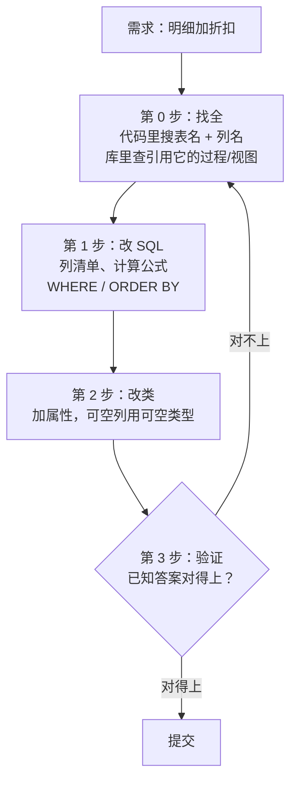
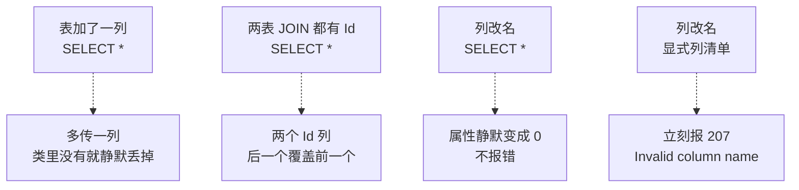
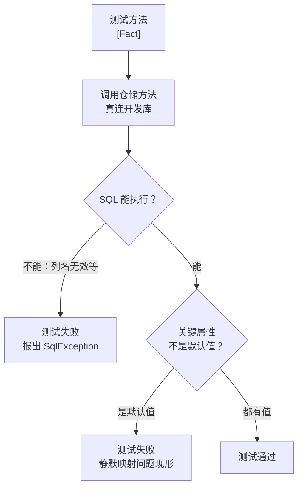

# 第 18 章 改需求：安全地修改已有查询

## 这一章解决什么问题

业务提了新需求：申请明细要能打折，表里加一列 `Discount`。改表很简单，难的是改代码——Dapper 映射对不上时**不报错**，只会悄悄给个默认值（第 2 章讲过）。漏改一处，页面上的金额就是错的，而且没有任何提示。

本章给你一套"改了也放心"的做法：

1. 改动按"改 SQL → 改类 → 验证"三步走，每一步都有检查办法；
2. 看清 `SELECT *` 为什么会把问题藏起来；
3. 写一组冒烟测试，表结构一变，跑一下就知道哪个方法坏了。

## 开始之前

- 上一章你已经会了：用 `SqlMapper.TypeHandler<T>` 让 JSON 列直接映射成对象，知道处理器要在第一次查询前注册。
- 第 16 章你写过 Repository：一张表一个仓储类，这张表的 SQL 全放在里面。本章就是在一个这样的仓储上改需求。
- 需要的环境：第 1 章的解决方案和 `PriceDemo` 库。数据乱了就重跑 [`code/sql/00-reset-database.sql`](../code/sql/00-reset-database.sql)。
- 本章要用的脚本：[`code/sql/ch18-add-discount.sql`](../code/sql/ch18-add-discount.sql)（加折扣列），18.2 节开始前**先不要执行**。
- 预计耗时：80–90 分钟。

---

## 正文

### 18.1 准备：新建本章项目

本章有两个项目：

| 项目 | 类型 | 用途 |
|---|---|---|
| `Ch18Demo` | 控制台应用 | 18.2、18.3 节的例子，每个例子整个替换 `Program.cs` |
| `Ch18Tests` | xUnit 测试项目 | 18.4 节的冒烟测试，到时候再建 |

先建 `Ch18Demo`，步骤和第 2 章 2.1 节一样：

1. 「解决方案资源管理器」里**右键解决方案** →「**添加 → 新建项目**」。
2. 选「控制台应用」，项目名称填 `Ch18Demo`，框架选 **.NET 10.0**，点「创建」。
3. **右键 `Ch18Demo` →「设为启动项目」**。
4. 「工具 → NuGet 包管理器 → 管理解决方案的 NuGet 程序包」，给 `Ch18Demo` 装三个包：`Dapper` 2.1.89、`Microsoft.Data.SqlClient` 7.1.1、`System.Security.Cryptography.Pkcs` 10.0.13。

csproj 和第 2 章 2.1 节完全相同（[`code/ch18/Step1-Before/Step1-Before.csproj`](../code/ch18/Step1-Before/Step1-Before.csproj)），这里不再重复。

> 本章的仓储直接接收连接串，没有用第 16 章的 appsettings.json 和连接工厂。这样每个例子只有一个文件，整个替换就能跑。正式项目里还是照第 16 章那样，把连接串放在配置文件里。

---

### 18.2 概念一：改动三步走（改 SQL → 改类 → 验证）

**白话定义**：表结构变了，代码按固定顺序改三处：先改 **SQL**（每一条用到这张表的 SQL 都要找出来），再改**类**（加属性、选对类型），最后**验证**（用一个已知答案的数核对结果）。三步缺一步，Dapper 都不会提醒你。

**业务场景**：价格申请明细要支持折扣。DBA 给 `PriceRequestItem` 加了一列 `Discount DECIMAL(5,2) NULL`：`0.95` 表示九五折，`NULL` 表示不打折。明细列表、单据合计，都要按折后金额显示。

**反例（什么时候不用这么郑重）**：
- 只是给表**加了一列，代码暂时用不到**它。代码里写的是明确的列清单，多出来的列根本不会被查出来，不用动代码。
- 一次性的临时查询、自己在 SSMS 里跑的统计脚本，用完就扔，不需要走三步。

#### 🖼 图解：三步走，每步都有检查点



第 0 步"找全"最容易被跳过。改漏的往往不是列清单，而是藏在别的方法里的**计算公式**——下面的例子就有一处。

#### 💻 先看起点：改需求之前的仓储

**先不要执行加折扣的脚本。** 把 `Ch18Demo` 的 `Program.cs` 整个替换成：

```csharp
// code/ch18/Step1-Before/Program.cs
// 改需求之前的样子：明细仓储有 3 个方法，表里还没有 Discount 列。这是本章的起点
using Dapper;
using Microsoft.Data.SqlClient;

const string connStr =
    "Server=.;Database=PriceDemo;Integrated Security=True;TrustServerCertificate=True;";

var repo = new ItemRepository(connStr);

// 方法 1：一张申请单的全部明细
foreach (var i in repo.GetByRequestId(1))
    Console.WriteLine($"明细 {i.Id}：产品 {i.ProductId}  {i.Qty} × {i.RequestPrice:N2} = {i.Amount:N2}");

// 方法 2：按明细 Id 查一行
var one = repo.GetById(3);
Console.WriteLine($"明细 3：申请单 {one?.RequestId}  产品 {one?.ProductId}  金额 {one?.Amount:N2}");

// 方法 3：合计在 SQL 里算。C# 里逐行相加，两边应该一致
decimal sumInCode = repo.GetByRequestId(1).Sum(i => i.Amount);
decimal sumInSql = repo.GetTotal(1);
Console.WriteLine($"第 1 单合计：C# 算 {sumInCode:N2}，SQL 算 {sumInSql:N2}，一致吗？{sumInCode == sumInSql}");

// 一张表一个仓储（第 16 章）。本章为了"一个文件就能跑"，直接把连接串传进来；正式项目用第 16 章的连接工厂
public class ItemRepository
{
    private readonly string _connStr;

    public ItemRepository(string connStr) => _connStr = connStr;

    // 列清单只写一处：两个查询共用，加列时只改这一行
    private const string Columns = "Id, RequestId, ProductId, Qty, RequestPrice";

    public List<RequestItem> GetByRequestId(int requestId)
    {
        using var conn = new SqlConnection(_connStr);
        return conn.Query<RequestItem>(
            $"SELECT {Columns} FROM dbo.PriceRequestItem WHERE RequestId = @RequestId ORDER BY Id",
            new { RequestId = requestId }).ToList();
    }

    public RequestItem? GetById(int id)
    {
        using var conn = new SqlConnection(_connStr);
        return conn.QuerySingleOrDefault<RequestItem>(
            $"SELECT {Columns} FROM dbo.PriceRequestItem WHERE Id = @Id", new { Id = id });
    }

    // 金额公式写在 SQL 里——改需求时最容易漏掉的就是这种"不在列清单里"的地方
    public decimal GetTotal(int requestId)
    {
        using var conn = new SqlConnection(_connStr);
        return conn.ExecuteScalar<decimal>(
            "SELECT ISNULL(SUM(Qty * RequestPrice), 0) FROM dbo.PriceRequestItem WHERE RequestId = @RequestId",
            new { RequestId = requestId });
    }
}

public class RequestItem
{
    public int Id { get; set; }
    public int RequestId { get; set; }
    public int ProductId { get; set; }
    public int Qty { get; set; }
    public decimal RequestPrice { get; set; }
    public decimal Amount => Qty * RequestPrice;   // 只读计算属性，Dapper 不会往里写
}
```

实测输出：

```text
明细 1：产品 1  2 × 165,000.00 = 330,000.00
明细 2：产品 3  4 × 23,000.00 = 92,000.00
明细 3：申请单 2  产品 2  金额 395,000.00
第 1 单合计：C# 算 422,000.00，SQL 算 422,000.00，一致吗？True
```

这个仓储里和"金额"有关的 SQL 有**两处**：

| 位置 | 内容 | 改需求时要不要动 |
|---|---|---|
| `Columns` 常量 | 列清单，`GetByRequestId`、`GetById` 共用 | 要：加上 `Discount` |
| `GetTotal` 里的 SQL | `SUM(Qty * RequestPrice)`，公式写死在 SQL 里 | 要：乘上折扣 |

第二处不在列清单里，只盯着 `Columns` 改，就会漏掉它。最后一行"一致吗"就是为了抓这种遗漏：同一个数，C# 算一遍、SQL 算一遍，必须相等。

#### 第 0 步：找全用到这张表的地方

**代码里**：菜单「**编辑 → 查找和替换 → 在文件中查找**」（Ctrl+Shift+F）。

1. 「查找内容」填表名 `PriceRequestItem`；
2. 「查找范围」选「**整个解决方案**」；
3. 点「全部查找」。结果窗口会列出每一处出现的文件和行号。

> 📷 **截图占位 ch18-01**：「在文件中查找」对话框，查找内容 `PriceRequestItem`，查找范围「整个解决方案」；下方「查找结果」窗口列出 `Program.cs` 里的 3 行。
<!--  -->

> ⚠️ 本段 VS 界面操作未实机验证（沙箱没有 VS），菜单名称以你的 VS 2026 为准。

搜完表名，再搜一遍**要改的列名**，比如改名时搜旧列名。光搜表名不够：有的 SQL 片段被拆成了常量（比如上面的 `Columns`），里面只有列名，没有表名。

**数据库里**：存储过程、视图里的 SQL 不在解决方案中，搜不到。用 [`code/sql/ch18-find-usages.sql`](../code/sql/ch18-find-usages.sql) 查：

```sql
-- code/sql/ch18-find-usages.sql 的核心部分
DECLARE @Table SYSNAME = N'PriceRequest';   -- 要改的表（不带架构名）

SELECT OBJECT_SCHEMA_NAME(d.referencing_id) + '.' + OBJECT_NAME(d.referencing_id) AS 引用它的对象,
       o.type_desc                                                               AS 对象类型
FROM sys.sql_expression_dependencies AS d
JOIN sys.objects AS o ON o.object_id = d.referencing_id
WHERE d.referenced_entity_name = @Table
ORDER BY 1;
```

`sys.sql_expression_dependencies` 是 SQL Server 记录"谁引用了谁"的系统视图。示例库里 `PriceRequestItem` 还没有被任何过程引用，所以这里拿 `PriceRequest` 演示。执行过第 7、8 章的脚本后（`ch07-legacy-view.sql`、`ch08-procs.sql`、`ch08-exercise.sql`），实测结果（sqlcmd 输出整理成表格）：

| 引用它的对象 | 对象类型 |
|---|---|
| dbo.legacy_price_request | VIEW |
| dbo.Select_PriceRequestByNo_Proc | SQL_STORED_PROCEDURE |
| dbo.Select_PriceRequestPage_Proc | SQL_STORED_PROCEDURE |
| dbo.Update_PriceRequestApprove_Proc | SQL_STORED_PROCEDURE |
| dbo.Update_PriceRequestSubmit_Proc | SQL_STORED_PROCEDURE |

第 7 章的视图、第 8 章的 4 个过程都列出来了。改 `PriceRequest` 的列，这 5 个对象都要检查一遍。

> 这个视图只能查到**静态 SQL**。存储过程里用 `EXEC(@sql)` 拼出来的动态 SQL 查不到，还得打开过程源码搜。

#### 💻 第 1、2 步：改 SQL、改类

现在执行 [`code/sql/ch18-add-discount.sql`](../code/sql/ch18-add-discount.sql)：

```sql
-- code/sql/ch18-add-discount.sql 的核心部分
IF COL_LENGTH('dbo.PriceRequestItem', 'Discount') IS NULL
    ALTER TABLE dbo.PriceRequestItem ADD Discount DECIMAL(5,2) NULL;   -- 允许 NULL：老数据没有折扣
GO

UPDATE dbo.PriceRequestItem SET Discount = NULL;                 -- 先清空，保证每次执行结果相同
UPDATE dbo.PriceRequestItem SET Discount = 0.95 WHERE Id = 1;    -- 第 1 单的主机：九五折
UPDATE dbo.PriceRequestItem SET Discount = 0.90 WHERE Id = 3;    -- 第 2 单的彩超：九折
```

脚本最后的查询，实测输出：

```text
Id          RequestId   ProductId   Qty         RequestPrice         Discount
----------- ----------- ----------- ----------- -------------------- --------
          1           1           1           2            165000.00     0.95
          2           1           3           4             23000.00     NULL
          3           2           2           1            395000.00     0.90
          4           3           3           2             24500.00     NULL
          5           3           4           2             22500.00     NULL
```

然后把 `Program.cs` 整个替换成改好的版本。和起点相比改了 3 处，注释里标了"第 1 步""第 2 步"：

```csharp
// code/ch18/Step2-AfterChange/Program.cs
// 按"改 SQL → 改类 → 验证"三步加上折扣：列清单、合计公式、RequestItem 类各改一处
// 运行前先执行 code/sql/ch18-add-discount.sql
using Dapper;
using Microsoft.Data.SqlClient;

const string connStr =
    "Server=.;Database=PriceDemo;Integrated Security=True;TrustServerCertificate=True;";

var repo = new ItemRepository(connStr);

// 方法 1：一张申请单的全部明细，现在多了折扣
foreach (var i in repo.GetByRequestId(1))
    Console.WriteLine($"明细 {i.Id}：产品 {i.ProductId}  {i.Qty} × {i.RequestPrice:N2}" +
                      $" × {(i.Discount is null ? "无折扣" : i.Discount.Value.ToString("0.00"))} = {i.NetAmount:N2}");

// 方法 2：按明细 Id 查一行
var one = repo.GetById(3);
Console.WriteLine($"明细 3：申请单 {one?.RequestId}  产品 {one?.ProductId}  折扣 {one?.Discount}  折后 {one?.NetAmount:N2}");

// 第 3 步"验证"：同一个数用两条路算一遍，对不上就说明有地方漏改了
decimal sumInCode = repo.GetByRequestId(1).Sum(i => i.NetAmount);
decimal sumInSql = repo.GetTotal(1);
Console.WriteLine($"第 1 单折后合计：C# 算 {sumInCode:N2}，SQL 算 {sumInSql:N2}，一致吗？{sumInCode == sumInSql}");

public class ItemRepository
{
    private readonly string _connStr;

    public ItemRepository(string connStr) => _connStr = connStr;

    // 第 1 步（改 SQL）：列清单加上 Discount。两个查询共用这一行，所以只改一处
    private const string Columns = "Id, RequestId, ProductId, Qty, RequestPrice, Discount";

    public List<RequestItem> GetByRequestId(int requestId)
    {
        using var conn = new SqlConnection(_connStr);
        return conn.Query<RequestItem>(
            $"SELECT {Columns} FROM dbo.PriceRequestItem WHERE RequestId = @RequestId ORDER BY Id",
            new { RequestId = requestId }).ToList();
    }

    public RequestItem? GetById(int id)
    {
        using var conn = new SqlConnection(_connStr);
        return conn.QuerySingleOrDefault<RequestItem>(
            $"SELECT {Columns} FROM dbo.PriceRequestItem WHERE Id = @Id", new { Id = id });
    }

    // 第 1 步（改 SQL）的第二处：合计公式也要乘折扣。NULL 表示不打折，按 1 算
    public decimal GetTotal(int requestId)
    {
        using var conn = new SqlConnection(_connStr);
        return conn.ExecuteScalar<decimal>(
            "SELECT ISNULL(SUM(Qty * RequestPrice * ISNULL(Discount, 1)), 0) FROM dbo.PriceRequestItem WHERE RequestId = @RequestId",
            new { RequestId = requestId });
    }
}

public class RequestItem
{
    public int Id { get; set; }
    public int RequestId { get; set; }
    public int ProductId { get; set; }
    public int Qty { get; set; }
    public decimal RequestPrice { get; set; }
    public decimal? Discount { get; set; }                              // 第 2 步（改类）：列允许 NULL，所以用 decimal?（第 7 章）
    public decimal Amount => Qty * RequestPrice;                        // 原价金额，保留不动：别处可能还在用
    public decimal NetAmount => Qty * RequestPrice * (Discount ?? 1m);  // 折后金额：规则和 SQL 里的 ISNULL(Discount, 1) 一致
}
```

#### 🔍 拆解运行结果

实测输出：

```text
明细 1：产品 1  2 × 165,000.00 × 0.95 = 313,500.00
明细 2：产品 3  4 × 23,000.00 × 无折扣 = 92,000.00
明细 3：申请单 2  产品 2  折扣 0.90  折后 355,500.00
第 1 单折后合计：C# 算 405,500.00，SQL 算 405,500.00，一致吗？True
```

> 📷 **截图占位 ch18-02**：控制台显示上面 4 行输出。
<!--  -->

逐处对照：

| 步骤 | 改了什么 | 为什么这样改 |
|---|---|---|
| 第 1 步 | `Columns` 加上 `Discount` | 两个查询共用这一行，改一处就够了。这是第 16 章"列清单只写一次"的回报 |
| 第 1 步 | `GetTotal` 的公式乘 `ISNULL(Discount, 1)` | `NULL` 乘任何数都是 `NULL`，`SUM` 会跳过 NULL 值，不打折的明细就从合计里丢了。所以要把 NULL 当 1 |
| 第 2 步 | 加属性 `decimal? Discount` | 列允许 NULL，属性必须可空（第 7 章）。写成 `decimal` 也不报错，但 NULL 会静默变成 0（实测），"不打折"就成了"0 折"，折后金额算出来是 0 |
| 第 2 步 | 加 `NetAmount`，保留 `Amount` | 不改原有属性的含义。别的页面可能还在用 `Amount` 显示原价，改了它就是另一处"静默出错" |
| 第 3 步 | 已知答案核对 | 2 × 165,000 × 0.95 = 313,500，加上 4 × 23,000 = 92,000，合计 405,500。C# 和 SQL 两条路算出的数相等 |

**第 3 步为什么要用"已知答案"**：只看"程序没报错"，等于什么都没验证——Dapper 漏映射也不报错。要用你**手算得出**的数去对，比如上面的 405,500。

#### 改坏一处试试：只改了类，忘了改列清单

把 `Columns` 改回不带 `Discount` 的老样子：

```csharp
private const string Columns = "Id, RequestId, ProductId, Qty, RequestPrice";
```

其余不变，运行。实测输出：

```text
明细 1：产品 1  2 × 165,000.00 × 无折扣 = 330,000.00
明细 2：产品 3  4 × 23,000.00 × 无折扣 = 92,000.00
明细 3：申请单 2  产品 2  折扣   折后 395,000.00
第 1 单折后合计：C# 算 422,000.00，SQL 算 405,500.00，一致吗？False
```

**没有任何异常**。SQL 没查 `Discount`，属性保持默认值 `null`，`NetAmount` 按"无折扣"算，明细 3 的折扣干脆是空的。如果没有最后一行的核对，你只会看到"金额都正常显示了"。

这条输出要这样读：

| 线索 | 说明 |
|---|---|
| 所有行都是"无折扣" | 可空属性**全是** null，先怀疑这一列没被查出来 |
| C# 算的和 SQL 算的不一样 | 两条路有一条没改到。SQL 算出了折扣，说明数据库里有数，问题在 C# 这条路的列清单 |

反过来，只改 `Columns`、忘了改 `GetTotal`，结果是 C# 算 405,500、SQL 算 422,000，同样是 `False`。哪边漏改，核对都能抓到。

---

### 18.3 概念二：`SELECT *` 的隐患

**白话定义**：`SELECT *` 返回的列由**表当前的结构**决定。表一变，结果集跟着变。Dapper 又是按列名静默映射的，于是表结构的变化就直接变成了"属性悄悄变值"，编译期、运行期都没有提示。

**业务场景**：老代码里有很多 `SELECT * FROM dbo.PriceRequestItem`。某天 DBA 为了统一命名，把 `RequestPrice` 改名为 `UnitPrice`。你会希望程序**立刻报错**，而不是报表上的单价全变成 0。

**反例（什么时候可以用 `SELECT *`）**：
- 在 SSMS 里临时看数据，`SELECT TOP 100 *` 完全没问题。
- `EXISTS (SELECT * FROM …)` 里的 `*` 不会真的取列，写 `*` 和写 `1` 一样。
- 除此之外，**写进 C# 代码的 SQL 一律写明列名**。

#### 🖼 图解：同一个变化，两种写法的表现



前三对都是"不报错、结果却变了"。只有最后一对会响亮地失败——**响亮的失败比安静的错误好查得多**。

#### 💻 最小可运行代码：三个隐患

先确认已经执行过 `ch18-add-discount.sql`。程序会**临时**把 `RequestPrice` 改名，`finally` 里一定改回来。把 `Program.cs` 整个替换成：

```csharp
// code/ch18/Step3-SelectStar/Program.cs
// SELECT * 的三个隐患：加列后多拿数据、JOIN 后同名列互相覆盖、列改名后静默变成 0
// 运行前先执行 code/sql/ch18-add-discount.sql。程序会临时改一次列名，结束前一定改回来
using Dapper;
using Microsoft.Data.SqlClient;

const string connStr =
    "Server=.;Database=PriceDemo;Integrated Security=True;TrustServerCertificate=True;";

using var conn = new SqlConnection(connStr);

// 隐患 1：表加了 Discount 列，SELECT * 自动多拿一列；OldItem 里没有这个属性，Dapper 静默丢掉
var columns = conn.Query<string>(
    "SELECT name FROM sys.columns WHERE object_id = OBJECT_ID('dbo.PriceRequestItem') ORDER BY column_id");
Console.WriteLine($"== 隐患 1：SELECT * 现在返回 {columns.Count()} 列：{string.Join(", ", columns)}");
var a = conn.QuerySingle<OldItem>("SELECT * FROM dbo.PriceRequestItem WHERE Id = 1");
Console.WriteLine($"   OldItem 照样能用：明细 {a.Id}  {a.Qty} × {a.RequestPrice:N2}（Discount 被悄悄丢掉，没有任何提示）");

// 隐患 2：两张表都有 Id 列。SELECT * 返回两个叫 Id 的列，Dapper 按顺序赋值，后一个覆盖前一个
var b = conn.QuerySingle<OldItem>(@"
    SELECT * FROM dbo.PriceRequestItem i
    JOIN dbo.Product p ON p.Id = i.ProductId
    WHERE i.Id = 2");
Console.WriteLine($"== 隐患 2：查的是明细 2，拿到的 Id = {b.Id}，ProductId = {b.ProductId}");

// 隐患 3：列改名。同一个需求写成两种 SQL，看改名前后各自的表现
const string starSql = "SELECT * FROM dbo.PriceRequestItem WHERE RequestId = 1 ORDER BY Id";
const string listSql = "SELECT Id, RequestId, ProductId, Qty, RequestPrice FROM dbo.PriceRequestItem WHERE RequestId = 1 ORDER BY Id";

Console.WriteLine("== 隐患 3：改名前");
Print("SELECT *  ", conn.Query<OldItem>(starSql));
Print("显式列清单", conn.Query<OldItem>(listSql));

// 模拟 DBA 把 RequestPrice 改名为 UnitPrice（只为演示，finally 里一定改回来）
conn.Execute("EXEC sp_rename 'dbo.PriceRequestItem.RequestPrice', 'UnitPrice', 'COLUMN'");
try
{
    Console.WriteLine("== 隐患 3：RequestPrice 改名为 UnitPrice 之后");
    Print("SELECT *  ", conn.Query<OldItem>(starSql));        // 不报错，价格全变 0
    try
    {
        Print("显式列清单", conn.Query<OldItem>(listSql));    // 立刻报错，告诉你哪一列不存在
    }
    catch (SqlException ex)
    {
        Console.WriteLine($"显式列清单 → SqlException {ex.Number}：{ex.Message}");
    }
}
finally
{
    conn.Execute("EXEC sp_rename 'dbo.PriceRequestItem.UnitPrice', 'RequestPrice', 'COLUMN'");
    Console.WriteLine("（已把列名改回 RequestPrice）");
}

static void Print(string title, IEnumerable<OldItem> items) =>
    Console.WriteLine($"{title} → " + string.Join("；", items.Select(i => $"明细 {i.Id} 单价 {i.RequestPrice:N2}")));

// 加折扣之前写的类：没有 Discount 属性
public class OldItem
{
    public int Id { get; set; }
    public int RequestId { get; set; }
    public int ProductId { get; set; }
    public int Qty { get; set; }
    public decimal RequestPrice { get; set; }
}
```

#### 🔍 拆解运行结果

实测输出：

```text
== 隐患 1：SELECT * 现在返回 6 列：Id, RequestId, ProductId, Qty, RequestPrice, Discount
   OldItem 照样能用：明细 1  2 × 165,000.00（Discount 被悄悄丢掉，没有任何提示）
== 隐患 2：查的是明细 2，拿到的 Id = 3，ProductId = 3
== 隐患 3：改名前
SELECT *   → 明细 1 单价 165,000.00；明细 2 单价 23,000.00
显式列清单 → 明细 1 单价 165,000.00；明细 2 单价 23,000.00
== 隐患 3：RequestPrice 改名为 UnitPrice 之后
SELECT *   → 明细 1 单价 0.00；明细 2 单价 0.00
显式列清单 → SqlException 207：Invalid column name 'RequestPrice'.
（已把列名改回 RequestPrice）
```

逐个看：

| 隐患 | 看到了什么 | 原因 |
|---|---|---|
| 1 加列 | 结果集 6 列，`OldItem` 只用 5 列，不报错 | 多出来的列 Dapper 直接跳过（第 2 章）。这一列要是 `NVARCHAR(MAX)`，比如第 17 章的 `Spec`，每一行都白白多传一段 JSON |
| 2 同名列 | 明细 2 的 `Id` 变成了 3 | `SELECT *` 先返回明细表的 6 列，再返回产品表的列，里面又有一个 `Id`（产品 Id = 3）。Dapper 按列的顺序逐个赋值，后面那个 `Id` 覆盖了前面的 |
| 3 改名（`*`） | 单价全变 0.00 | 结果集里已经没有叫 `RequestPrice` 的列，属性保持默认值 0 |
| 3 改名（显式） | `SqlException 207` | 列名写在 SQL 里，服务器编译 SQL 时就发现列不存在，直接拒绝执行 |

隐患 2 最隐蔽：`Id` 错了，后面拿这个 Id 去更新、删除，动的就是**另一行**数据。

隐患 3 的两种写法改名前结果一模一样，改名后一个"安静地错"，一个"响亮地错"。207 这个错误号第 20 章细讲。

> SQL Server 中文版里，207 的消息是 `列名 'RequestPrice' 无效。`

#### 改坏一处试试：把 JOIN 的 `*` 换个顺序

有人会想：`SELECT *` 不行，那写成 `SELECT p.*, i.*`，让明细表的列放在后面，`Id` 不就对了？把隐患 2 的 SQL 改成：

```sql
SELECT p.*, i.* FROM dbo.PriceRequestItem i
JOIN dbo.Product p ON p.Id = i.ProductId
WHERE i.Id = 2
```

实测输出的那一行：

```text
== 隐患 2：查的是明细 2，拿到的 Id = 2，ProductId = 3
```

这次"对了"，但只是**碰巧**：结果依赖列的先后顺序。哪天有人调换了 JOIN 的顺序，或者产品表也加了一列和明细表同名的列（比如 `Discount`），就又错了，而且还是不报错。正确的写法是写明列名，同名的列用别名区分：`i.Id, i.ProductId, p.Name AS ProductName`。多表映射的正规做法是第 10 章的 `splitOn`。

---

### 18.4 概念三：冒烟测试（smoke test）

**白话定义**：冒烟测试是一组**很粗**的测试：仓储的每个方法真连一次库、跑一次，检查关键属性**不是默认值**。它不验证业务规则，只回答一个问题："改完之后，有没有哪个方法悄悄坏了？"名字来自硬件行业：新板子通电，先看冒不冒烟。

**业务场景**：明细表加了 `Discount`，你改了 `ItemRepository`。以后 DBA 再改这张表，你不用一个个页面去点，跑一下测试，几秒钟就知道哪些方法受了影响。

**反例（什么时候不该用它）**：
- 冒烟测试**不能代替**业务测试。"驳回后状态必须是 3"这种规则，要单独写测试，不要塞进冒烟测试。
- 它连的是真实数据库。**不要对生产库跑**。只能连开发库或测试库，而且数据要已知（本章用的是 `00-reset-database.sql` 灌的那一批）。
- 方法会改数据的（Insert / Update），不要照搬本节的写法直接跑。要在事务里执行、断言完就回滚（第 9 章），本章不展开。

#### 🖼 图解：冒烟测试抓的是哪一类问题



左边那条路，程序运行时本来也会报错。冒烟测试真正的价值在 F：把 Dapper 的"静默默认值"变成一个**红色的失败**。

#### 💻 新建 xUnit 测试项目

1. **右键解决方案** →「**添加 → 新建项目**」，搜索 `xUnit`，选「**xUnit 测试项目**」（C#），点「下一步」。
2. 项目名称填 `Ch18Tests`，框架选 **.NET 10.0**，点「创建」。
3. 这个模板自带的是 **xUnit v2** 的包。双击项目名 `Ch18Tests` 打开 csproj，**整个替换**成下面的内容，保存。VS 会自动还原新的包。

```xml
<!-- code/ch18/Step4-SmokeTests/Step4-SmokeTests.csproj（你的项目叫 Ch18Tests.csproj，内容相同） -->
<Project Sdk="Microsoft.NET.Sdk">

  <PropertyGroup>
    <!-- xUnit v3 的测试项目本身就是一个可执行程序，所以是 Exe -->
    <OutputType>Exe</OutputType>
    <TargetFramework>net10.0</TargetFramework>
    <ImplicitUsings>enable</ImplicitUsings>
    <Nullable>enable</Nullable>
    <IsPackable>false</IsPackable>
  </PropertyGroup>

  <ItemGroup>
    <PackageReference Include="Dapper" Version="2.1.89" />
    <PackageReference Include="Microsoft.Data.SqlClient" Version="7.1.1" />
    <PackageReference Include="System.Security.Cryptography.Pkcs" Version="10.0.13" />
    <!-- 测试框架本体（自带新测试平台 Microsoft.Testing.Platform 的支持） -->
    <PackageReference Include="xunit.v3" Version="4.0.2" />
    <!-- 这两个给旧的 VSTest 方式用。新平台用不到，xUnit 官方建议先留着，兼容老版本 VS 和其他工具 -->
    <PackageReference Include="xunit.runner.visualstudio" Version="4.0.1" />
    <PackageReference Include="Microsoft.NET.Test.Sdk" Version="18.11.0" />
  </ItemGroup>

</Project>
```

4. 删掉模板生成的 `UnitTest1.cs`。
5. 在**解决方案根目录**（`.slnx` 所在的文件夹）新建一个文件 `global.json`，内容如下。在 VS 里可以「右键解决方案 → 添加 → 新建项」，选 JSON 文件；用记事本建也一样：

```json
{
  "test": {
    "runner": "Microsoft.Testing.Platform"
  }
}
```

**为什么要这个文件**：xUnit v3 4.x 默认走微软的新测试平台（Microsoft.Testing.Platform，MTP）。.NET 10 SDK 的 `dotnet test` 默认还是老的 VSTest 方式，两者对不上就报错（见下面"改坏一处"）。`global.json` 告诉 SDK："这个解决方案用新平台跑测试"。本书代码目录里，这个文件放在测试项目自己的文件夹 [`code/ch18/Step4-SmokeTests/`](../code/ch18/Step4-SmokeTests/) 里，所以单独拷走这个项目也能跑。

> ⚠️ 第 1、5 步的 VS 界面操作未实机验证。模板名「xUnit 测试项目」和它自带的 xUnit v2 包，是从 .NET 10 SDK 的模板文件里核对的。

> 📷 **截图占位 ch18-03**：「添加新项目」窗口，搜索框输入 xUnit，选中「xUnit 测试项目」。
<!--  -->

#### 💻 两个文件：被测的仓储 + 测试

测试项目要能调用仓储。**正式项目里**，仓储放在主项目（或单独的类库）里，测试项目「右键 → 添加 → 项目引用」引用它。本章为了让测试项目自己就能跑，把 `Step2-AfterChange` 里的仓储和类原样复制了一份。

在 `Ch18Tests` 里新建 `ItemRepository.cs`：

```csharp
// code/ch18/Step4-SmokeTests/ItemRepository.cs
// 被测试的仓储：和 Step2-AfterChange 里的 ItemRepository、RequestItem 完全相同（复制过来，让测试项目自己就能跑）
using Dapper;
using Microsoft.Data.SqlClient;

public class ItemRepository
{
    private readonly string _connStr;

    public ItemRepository(string connStr) => _connStr = connStr;

    private const string Columns = "Id, RequestId, ProductId, Qty, RequestPrice, Discount";

    public List<RequestItem> GetByRequestId(int requestId)
    {
        using var conn = new SqlConnection(_connStr);
        return conn.Query<RequestItem>(
            $"SELECT {Columns} FROM dbo.PriceRequestItem WHERE RequestId = @RequestId ORDER BY Id",
            new { RequestId = requestId }).ToList();
    }

    public RequestItem? GetById(int id)
    {
        using var conn = new SqlConnection(_connStr);
        return conn.QuerySingleOrDefault<RequestItem>(
            $"SELECT {Columns} FROM dbo.PriceRequestItem WHERE Id = @Id", new { Id = id });
    }

    public decimal GetTotal(int requestId)
    {
        using var conn = new SqlConnection(_connStr);
        return conn.ExecuteScalar<decimal>(
            "SELECT ISNULL(SUM(Qty * RequestPrice * ISNULL(Discount, 1)), 0) FROM dbo.PriceRequestItem WHERE RequestId = @RequestId",
            new { RequestId = requestId });
    }
}

public class RequestItem
{
    public int Id { get; set; }
    public int RequestId { get; set; }
    public int ProductId { get; set; }
    public int Qty { get; set; }
    public decimal RequestPrice { get; set; }
    public decimal? Discount { get; set; }
    public decimal Amount => Qty * RequestPrice;
    public decimal NetAmount => Qty * RequestPrice * (Discount ?? 1m);
}
```

再新建 `ItemRepositoryTests.cs`：

```csharp
// code/ch18/Step4-SmokeTests/ItemRepositoryTests.cs
// 冒烟测试：仓储的每个方法真连库跑一次，断言关键属性"不是默认值"——专抓 Dapper 不报错的静默映射问题
// 运行前先执行 code/sql/ch18-add-discount.sql
using Xunit;

public class ItemRepositoryTests
{
    // 测试连的是开发库 PriceDemo，数据是 00-reset-database.sql + ch18-add-discount.sql 灌进去的那一批
    private const string ConnStr =
        "Server=.;Database=PriceDemo;Integrated Security=True;TrustServerCertificate=True;";

    private readonly ItemRepository _repo = new(ConnStr);

    [Fact]
    public void GetByRequestId_每一列都映射上了()
    {
        var items = _repo.GetByRequestId(1);

        Assert.Equal(2, items.Count);                        // 第 1 单有 2 行明细
        Assert.All(items, i =>
        {
            Assert.NotEqual(0, i.Id);                        // 每个属性都不该是默认值 0
            Assert.NotEqual(0, i.RequestId);
            Assert.NotEqual(0, i.ProductId);
            Assert.NotEqual(0, i.Qty);
            Assert.NotEqual(0m, i.RequestPrice);
        });
        // 可空列不能断言"每行都有值"，但至少有一行有值，才说明这一列真的查出来了
        Assert.Contains(items, i => i.Discount is not null);
    }

    [Fact]
    public void GetById_查得到时折扣有值()
    {
        var item = _repo.GetById(3);

        Assert.NotNull(item);
        Assert.Equal(2, item.RequestId);
        Assert.Equal(0.90m, item.Discount);                  // 新加的列：用已知数据断言精确值
    }

    [Fact]
    public void GetById_查不到返回null()
    {
        Assert.Null(_repo.GetById(9999));
    }

    [Fact]
    public void GetTotal_与逐行相加一致()
    {
        decimal sumInCode = _repo.GetByRequestId(1).Sum(i => i.NetAmount);

        Assert.Equal(405500m, _repo.GetTotal(1));            // 2×165000×0.95 + 4×23000
        Assert.Equal(sumInCode, _repo.GetTotal(1));          // SQL 公式和 C# 公式必须一致
    }
}
```

几个 xUnit 的写法，第一次见：

| 写法 | 含义 |
|---|---|
| `[Fact]` | 标记"这是一个测试方法"。测试运行器会找出所有带 `[Fact]` 的方法，逐个执行 |
| `Assert.Equal(期望, 实际)` | 不相等就让测试失败，并打印两个值。**期望值写在前面** |
| `Assert.NotEqual` / `Assert.Null` / `Assert.NotNull` | 字面意思 |
| `Assert.All(集合, 检查)` | 集合里每个元素都要通过检查 |
| `Assert.Contains(集合, 条件)` | 至少有一个元素满足条件 |
| 方法名用中文 | 合法。测试失败时显示的就是方法名，写成一句话最好读 |

断言为什么这样挑：

| 断言 | 抓的是什么 |
|---|---|
| 每个非空属性 `NotEqual(0, …)` | 列名拼错、漏查——这些情况下属性就是 0 |
| 可空列 `Contains(… is not null)` | 可空列不能要求每行都有值，但"所有行都是 null"基本就是没查出来 |
| `Equal(0.90m, item.Discount)` | 新加的列，用已知数据断言**精确值** |
| `GetTotal` 两个 `Equal` | 18.2 节的"两条路核对"，写成了自动检查 |

#### 🔍 运行测试，看结果

**在 VS 里**：菜单「**测试 → 测试资源管理器**」，打开后点左上角「**全部运行**」。4 个测试前面都是绿色对勾，就是全部通过。

> 📷 **截图占位 ch18-04**：测试资源管理器，`ItemRepositoryTests` 下 4 个测试全部绿色对勾。
<!--  -->

> ⚠️ 测试资源管理器的界面未实机验证。下面的命令行输出是实测的。

**在命令行里**：在测试项目目录执行 `dotnet test`（先执行过 `ch18-add-discount.sql`）。实测输出：

```text
Running tests from /projects/sandbox/.tools/run/ch18-Step4-SmokeTests/bin/Debug/net10.0/Step4-SmokeTests.dll (net10.0|x64)
/projects/sandbox/.tools/run/ch18-Step4-SmokeTests/bin/Debug/net10.0/Step4-SmokeTests.dll (net10.0|x64) passed (571ms)
Test run summary: Passed!
  total: 4
  failed: 0
  succeeded: 4
  skipped: 0
  duration: 804ms
```

路径是沙箱里的临时目录，你那里会是自己的项目路径；耗时每次不同。只看最后 5 行：总共 4 个，失败 0，成功 4。

#### 改坏一处试试：仓储漏了 `Discount`

回到 18.2 节"改坏一处"的错误：在测试项目的 `ItemRepository.cs` 里把 `Columns` 改回不带 `Discount`：

```csharp
private const string Columns = "Id, RequestId, ProductId, Qty, RequestPrice";
```

再跑 `dotnet test`。实测输出（每个失败只保留了前几行，后面两行 `System.Reflection` 的堆栈是 xUnit 内部的，不用看）：

```text
failed ItemRepositoryTests.GetTotal_与逐行相加一致 (230ms)
  Assert.Equal() Failure: Values differ
  Expected: 422000.00
  Actual:   405500.0000
    at ItemRepositoryTests.GetTotal_与逐行相加一致() in /projects/sandbox/.tools/run/v18c/ItemRepositoryTests.cs:54
failed ItemRepositoryTests.GetById_查得到时折扣有值 (5ms)
  Assert.Equal() Failure: Values differ
  Expected: 0.90
  Actual:   null
    at ItemRepositoryTests.GetById_查得到时折扣有值() in /projects/sandbox/.tools/run/v18c/ItemRepositoryTests.cs:39
failed ItemRepositoryTests.GetByRequestId_每一列都映射上了 (8ms)
  Assert.Contains() Failure: Filter not matched in collection
  Collection: [RequestItem { Amount = 330000.00, Discount = null, Id = 1, NetAmount = 330000.00, ProductId = 1, ··· }, RequestItem { Amount = 92000.00, Discount = null, Id = 2, NetAmount = 92000.00, ProductId = 3, ··· }]
    at ItemRepositoryTests.GetByRequestId_每一列都映射上了() in /projects/sandbox/.tools/run/v18c/ItemRepositoryTests.cs:29
Test run summary: Failed!
  total: 4
  failed: 3
  succeeded: 1
  skipped: 0
  duration: 724ms
Test run completed with non-success exit code: 2 (see: https://aka.ms/testingplatform/exitcodes)
```

**读失败输出**，每个失败都是同一个格式：

| 行 | 含义 |
|---|---|
| `failed 类名.方法名` | 哪个测试失败了。方法名写成中文句子，这里一眼就懂 |
| `Assert.Equal() Failure` | 哪种断言没通过 |
| `Expected` / `Actual` | 期望值和实际值。`Actual: null` 就是"这一列没查出来"的典型样子 |
| `Collection:` | `Assert.Contains` 失败时会把集合打印出来，每个对象的属性都能看到：`Discount = null` |
| `at … ItemRepositoryTests.cs:54` | 失败的断言在测试文件第几行 |

注意 `GetTotal` 那条：`Expected: 422000.00` 是 C# 逐行相加的结果（没有折扣），`Actual: 405500.0000` 是 SQL 算的（有折扣）。两条路不一致，问题就在两条路不同的地方：C# 用的是列清单。`GetById_查不到返回null` 照样通过了——它只断言"查不到时是 null"，抓不到这种问题。所以**每个方法都要至少有一个"查得到"的测试**。

再看一个配置上的坑：**删掉 `global.json`** 再跑 `dotnet test`，实测报错：

```text
/projects/sandbox/.tools/home/nuget/microsoft.testing.platform.msbuild/2.5.1/buildMultiTargeting/Microsoft.Testing.Platform.MSBuild.targets(395,5): error : Testing with VSTest target is no longer supported by Microsoft.Testing.Platform on .NET 10 SDK and later. If you use dotnet test, you should opt-in to the new dotnet test experience. For more information, see https://aka.ms/dotnet-test-mtp-error [/projects/sandbox/.tools/run/v18d/Step4-SmokeTests.csproj]
```

意思是：".NET 10 SDK 上，新测试平台不再支持用 VSTest 方式跑；用 `dotnet test` 的话，要先选用新的 dotnet test 体验"。选用的办法就是上面的 `global.json`。看到这条报错，先检查 `global.json` 在不在解决方案根目录、内容对不对。

---

## 🧱 类比：ADO.NET 写法与 Dapper 写法逐项对照

改需求时，两种写法各自会在哪里"出声"：

| 情况 | ADO.NET（`reader.GetOrdinal("列名")`） | Dapper（自动映射） |
|---|---|---|
| 表加了一列，代码没用到 | 没影响 | 显式列清单：没影响；`SELECT *`：多传一列，静默丢掉 |
| SQL 漏查了一列，代码要读它 | `IndexOutOfRangeException`，**运行到就报错** | 属性是默认值，**不报错** |
| 列改名，SQL 写的是旧名 | 207 `Invalid column name` | 显式列清单：同样 207；`SELECT *`：**静默变 0** |
| 列允许 NULL，代码没处理 | `GetDecimal` 抛 `SqlNullValueException` | 属性用 `decimal?` 就行；用 `decimal`，NULL 静默变成 0（实测） |
| 找出所有要改的地方 | 搜表名、列名 | 一样，外加搜列清单常量 |
| 改完怎么确认 | 运行一遍，看有没有异常 | **运行不报错不算数**，要用已知答案核对，最好写冒烟测试 |

一句话：ADO.NET 的"啰嗦"在改需求时反而是一种保护——列名对不上就报错。用 Dapper 省掉了这些代码，这份保护就要靠显式列清单和冒烟测试补回来。

## ⚠️ 踩坑警告

| 现象 | 原因 | 怎么改 |
|---|---|---|
| 加了属性，值一直是 `null` 或 `0`，没有报错（实测） | 只改了类，没改 SQL 的列清单 | 三步走第 1 步先改 SQL；冒烟测试断言新属性的已知值 |
| 列表金额对，合计金额不对（实测：C# 422,000 / SQL 405,500） | 计算公式写在另一条 SQL 里，没跟着改 | 改之前"在文件中查找"表名和列名，逐处过一遍；用两条路核对 |
| 列改名后报表上的单价全是 0（实测） | `SELECT *` + 自动映射，旧列名对不上 | 代码里不用 `SELECT *`，写明列名；改名后会立刻报 207 |
| JOIN 查询拿到的 `Id` 是另一张表的（实测：明细 2 的 Id 变成 3） | `SELECT *` 返回两个同名的 `Id` 列，后一个覆盖前一个 | 写明列名，同名列用 `AS` 起别名；需要两个对象就用第 10 章的多重映射 |
| 可空列合计时少算了金额 | `Qty * RequestPrice * Discount` 遇到 NULL 得 NULL，`SUM` 跳过它 | 写 `ISNULL(Discount, 1)` |
| `dotnet test` 报 `Testing with VSTest target is no longer supported …`（实测） | xUnit v3 4.x 默认用新测试平台，.NET 10 SDK 要求在 `global.json` 里选用 | 解决方案根目录加 `global.json`，`"test": { "runner": "Microsoft.Testing.Platform" }` |

## 🎯 动手练习

**练习：DBA 把列改名了**

DBA 为了和其他表统一，把 `Discount` 改名为 `DiscountRate`。先执行 `ch18-add-discount.sql`，再执行 [`code/sql/ch18-exercise-rename.sql`](../code/sql/ch18-exercise-rename.sql)：

```sql
-- code/sql/ch18-exercise-rename.sql 的核心部分
IF COL_LENGTH('dbo.PriceRequestItem', 'Discount') IS NOT NULL
   AND COL_LENGTH('dbo.PriceRequestItem', 'DiscountRate') IS NULL
    EXEC sp_rename 'dbo.PriceRequestItem.Discount', 'DiscountRate', 'COLUMN';
```

要求：

1. 改名后**先不改代码**，跑一遍 18.4 节的冒烟测试，看看失败输出长什么样、指向哪一行代码。
2. 按三步走修改 `ItemRepository`，让 4 个测试全部通过。
3. 限制：`RequestItem` 的属性名 `Discount` **不许改**（调用它的页面很多，不想动），测试文件一个字都不许改。

- 验收标准：`dotnet test` 最后输出

```text
Test run summary: Passed!
  total: 4
  failed: 0
  succeeded: 4
  skipped: 0
```

  （`duration` 那一行的耗时每次不同。）并且能说出：第 1 步跑测试时，为什么连 `GetById_查不到返回null` 这个"查不到"的测试也失败了。

卡住了看文末参考答案。

## 📌 一句话总结

改表三步走：改 SQL、改类、用已知答案验证；不写 `SELECT *`，让测试替你报警。

## 下一章

测试失败了，可程序到底往服务器发了一条什么样的 SQL、带了哪些参数？第 19 章教你把它看清楚。

---

<!-- 以下是参考答案，先自己动手，卡住了再往下翻 -->


## 参考答案

**第 1 步的现象**：改名后不改代码，4 个测试全部失败，每个都是同一个原因。实测输出里第一个失败的前几行和最后的汇总：

```text
failed ItemRepositoryTests.GetById_查不到返回null (194ms)
  from /projects/sandbox/.tools/run/ch18-Step4-SmokeTests/bin/Debug/net10.0/Step4-SmokeTests.dll (net10.0|x64)
  Xunit.MicrosoftTestingPlatform.XunitException: Microsoft.Data.SqlClient.SqlException : Invalid column name 'Discount'.
    at Microsoft.Data.SqlClient.SqlConnection.OnError(SqlException exception, Boolean breakConnection, Action`1 wrapCloseInAction)
```

```text
    at Dapper.SqlMapper.QuerySingleOrDefault[T](IDbConnection cnn, String sql, Object param, IDbTransaction transaction, Nullable`1 commandTimeout, Nullable`1 commandType) in /_/Dapper/SqlMapper.cs:934
    at ItemRepository.GetById(Int32 id) in /projects/sandbox/.tools/run/ch18-Step4-SmokeTests/ItemRepository.cs:25
    at ItemRepositoryTests.GetById_查不到返回null() in /projects/sandbox/.tools/run/ch18-Step4-SmokeTests/ItemRepositoryTests.cs:45
```

```text
Test run summary: Failed!
  total: 4
  failed: 4
  succeeded: 0
  skipped: 0
  duration: 693ms
```

堆栈很长，中间十几行都是 `Microsoft.Data.SqlClient` 和 `Dapper` 内部的。往下找到第一行**你自己的文件**：`ItemRepository.cs:25`，就是 `GetById` 里执行 SQL 的那一行（怎么读堆栈，第 20 章细讲）。

**为什么"查不到"的测试也失败**：列名是否存在，是服务器**编译 SQL 时**检查的，那时候还没开始找数据。所以不管 `WHERE Id = 9999` 能不能查到行，SQL 都执行不了。这正是显式列清单的好处——改名立刻、全部、响亮地失败。

**思路**：

1. 第 0 步：「在文件中查找」搜旧列名 `Discount`，找到两处 SQL：`Columns` 常量、`GetTotal` 的公式。C# 属性 `Discount` 也会被搜出来，但题目不许改。
2. 第 1 步：列清单写 `DiscountRate AS Discount`，用别名把新列名映射回原属性（第 2 章的别名规则）；`GetTotal` 的公式改成 `ISNULL(DiscountRate, 1)`。
3. 第 2 步：类不用改——别名已经让列名和属性名对上了。
4. 第 3 步：跑冒烟测试。

实测输出：

```text
Running tests from /projects/sandbox/.tools/run/ch18-Exercise/bin/Debug/net10.0/Exercise.dll (net10.0|x64)
/projects/sandbox/.tools/run/ch18-Exercise/bin/Debug/net10.0/Exercise.dll (net10.0|x64) passed (545ms)
Test run summary: Passed!
  total: 4
  failed: 0
  succeeded: 4
  skipped: 0
  duration: 724ms
```

完整项目在 [`code/ch18/Exercise/`](../code/ch18/Exercise/)（csproj、`global.json` 和 18.4 节相同）。改过的仓储：

```csharp
// code/ch18/Exercise/ItemRepository.cs
// 练习参考答案：列 Discount 改名为 DiscountRate 后，只改 SQL（用别名），C# 属性名不动
using Dapper;
using Microsoft.Data.SqlClient;

public class ItemRepository
{
    private readonly string _connStr;

    public ItemRepository(string connStr) => _connStr = connStr;

    // 改动 1：列清单里用别名，把新列名 DiscountRate 映射回原来的属性 Discount
    private const string Columns = "Id, RequestId, ProductId, Qty, RequestPrice, DiscountRate AS Discount";

    public List<RequestItem> GetByRequestId(int requestId)
    {
        using var conn = new SqlConnection(_connStr);
        return conn.Query<RequestItem>(
            $"SELECT {Columns} FROM dbo.PriceRequestItem WHERE RequestId = @RequestId ORDER BY Id",
            new { RequestId = requestId }).ToList();
    }

    public RequestItem? GetById(int id)
    {
        using var conn = new SqlConnection(_connStr);
        return conn.QuerySingleOrDefault<RequestItem>(
            $"SELECT {Columns} FROM dbo.PriceRequestItem WHERE Id = @Id", new { Id = id });
    }

    // 改动 2：合计公式不走列清单，要单独改。"在文件中查找 Discount" 能把它找出来
    public decimal GetTotal(int requestId)
    {
        using var conn = new SqlConnection(_connStr);
        return conn.ExecuteScalar<decimal>(
            "SELECT ISNULL(SUM(Qty * RequestPrice * ISNULL(DiscountRate, 1)), 0) FROM dbo.PriceRequestItem WHERE RequestId = @RequestId",
            new { RequestId = requestId });
    }
}

public class RequestItem
{
    public int Id { get; set; }
    public int RequestId { get; set; }
    public int ProductId { get; set; }
    public int Qty { get; set; }
    public decimal RequestPrice { get; set; }
    public decimal? Discount { get; set; }      // 不改名：调用方（页面、报表）一行都不用动
    public decimal Amount => Qty * RequestPrice;
    public decimal NetAmount => Qty * RequestPrice * (Discount ?? 1m);
}
```

测试文件除了开头三行注释，和 18.4 节一字不差：

```csharp
// code/ch18/Exercise/ItemRepositoryTests.cs
// 练习用的冒烟测试：测试方法和 Step4-SmokeTests 完全相同（测试不用改，要改的是仓储）
// 运行前先执行 code/sql/ch18-add-discount.sql，再执行 code/sql/ch18-exercise-rename.sql
using Xunit;

public class ItemRepositoryTests
{
    // 测试连的是开发库 PriceDemo，数据是 00-reset-database.sql + ch18-add-discount.sql 灌进去的那一批
    private const string ConnStr =
        "Server=.;Database=PriceDemo;Integrated Security=True;TrustServerCertificate=True;";

    private readonly ItemRepository _repo = new(ConnStr);

    [Fact]
    public void GetByRequestId_每一列都映射上了()
    {
        var items = _repo.GetByRequestId(1);

        Assert.Equal(2, items.Count);                        // 第 1 单有 2 行明细
        Assert.All(items, i =>
        {
            Assert.NotEqual(0, i.Id);                        // 每个属性都不该是默认值 0
            Assert.NotEqual(0, i.RequestId);
            Assert.NotEqual(0, i.ProductId);
            Assert.NotEqual(0, i.Qty);
            Assert.NotEqual(0m, i.RequestPrice);
        });
        // 可空列不能断言"每行都有值"，但至少有一行有值，才说明这一列真的查出来了
        Assert.Contains(items, i => i.Discount is not null);
    }

    [Fact]
    public void GetById_查得到时折扣有值()
    {
        var item = _repo.GetById(3);

        Assert.NotNull(item);
        Assert.Equal(2, item.RequestId);
        Assert.Equal(0.90m, item.Discount);                  // 新加的列：用已知数据断言精确值
    }

    [Fact]
    public void GetById_查不到返回null()
    {
        Assert.Null(_repo.GetById(9999));
    }

    [Fact]
    public void GetTotal_与逐行相加一致()
    {
        decimal sumInCode = _repo.GetByRequestId(1).Sum(i => i.NetAmount);

        Assert.Equal(405500m, _repo.GetTotal(1));            // 2×165000×0.95 + 4×23000
        Assert.Equal(sumInCode, _repo.GetTotal(1));          // SQL 公式和 C# 公式必须一致
    }
}
```
