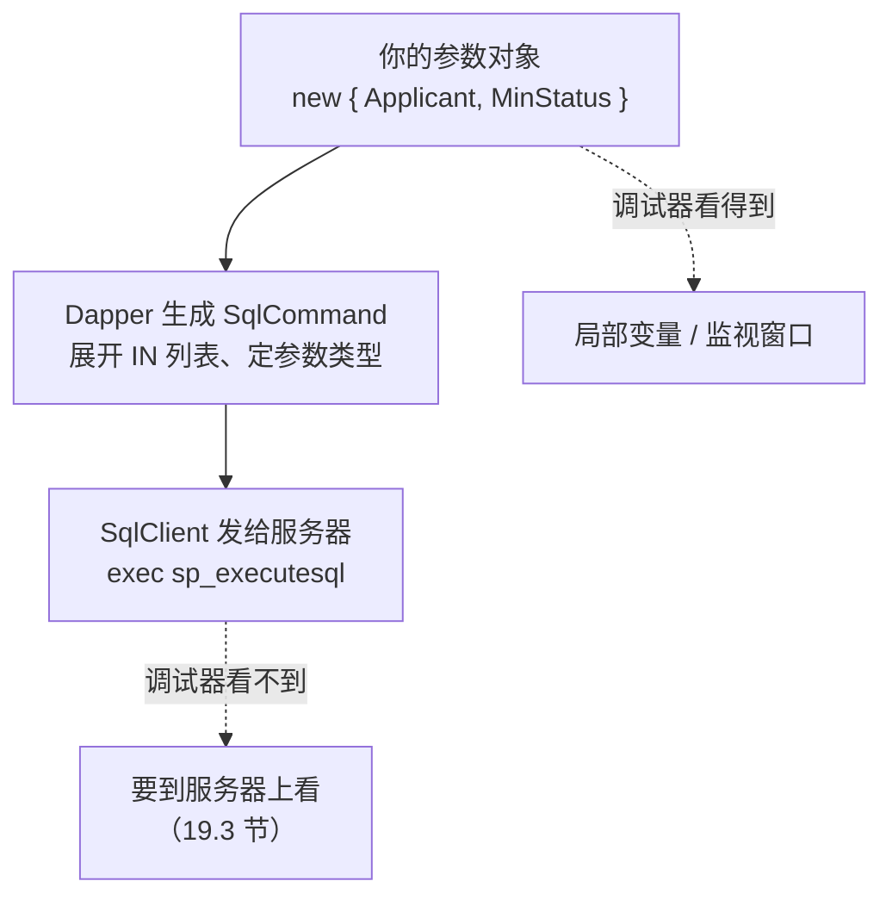
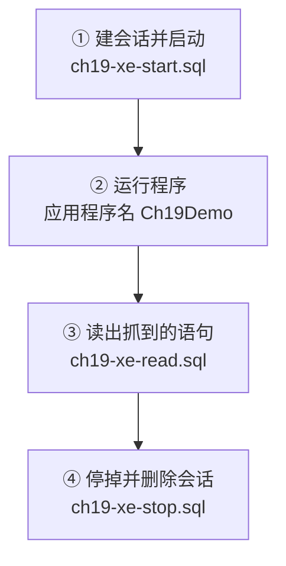
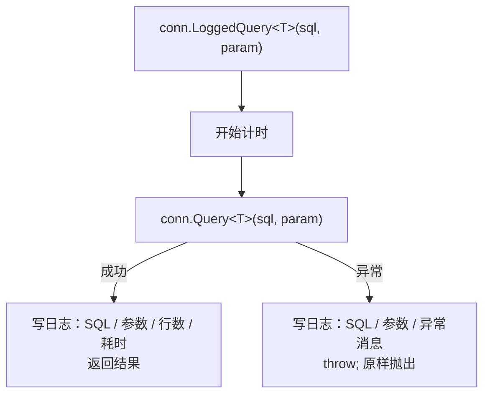

# 第 19 章 看清到底发出了什么 SQL

## 这一章解决什么问题

用 ADO.NET 时，SQL 和参数都是你一行行拼出来的，断点停在 `ExecuteReader` 上，`cmd.CommandText`、`cmd.Parameters` 一看就清楚。换成 Dapper，`SqlCommand` 是它在内部建的，你手里只有一个匿名对象。查不到数据、结果不对的时候，你会想问：**它到底往服务器发了什么？**

本章从近到远给你三种看法：

1. 在 VS 调试器里看你交给 Dapper 的参数；
2. 在 SQL Server 上用扩展事件，抓服务器**实际收到**的语句；
3. 给查询包一层日志，SQL、参数、耗时自动记下来，不用每次都去抓。

## 开始之前

- 上一章你已经会了：改表时按"改 SQL → 改类 → 验证"三步走，用 xUnit 冒烟测试把静默映射问题变成失败。
- 前面讲过、本章会直接用到的：第 4 章的 `sp_executesql` 和 `IN @ids` 展开，第 8 章的 `DynamicParameters`，第 15 章"字符串参数默认 `nvarchar(4000)`"，第 16 章的连接池。
- 需要的环境：第 1 章的解决方案和 `PriceDemo` 库。19.3 节要建扩展事件会话，你的登录名需要较高权限（sysadmin，或者 `ALTER ANY EVENT SESSION` 一类权限）。本机自己装的 SQL Server 一般没问题；公司的库请找 DBA。
- 预计耗时：75–90 分钟。

---

## 正文

### 19.1 准备：新建本章项目

和第 2 章 2.1 节一样：右键解决方案 →「添加 → 新建项目」→「控制台应用」，项目名 `Ch19Demo`，框架 .NET 10.0；右键它 →「设为启动项目」；装 `Dapper` 2.1.89、`Microsoft.Data.SqlClient` 7.1.1、`System.Security.Cryptography.Pkcs` 10.0.13 三个包。csproj 和第 2 章完全相同（[`code/ch19/Step1-Debugger/Step1-Debugger.csproj`](../code/ch19/Step1-Debugger/Step1-Debugger.csproj)）。

每个例子都是**整个替换** `Program.cs`。

---

### 19.2 概念一：在调试器里看参数

**白话定义**：程序停在断点上时，VS 的「局部变量」「监视」窗口能显示每个变量的当前值。你交给 Dapper 的参数对象，也就是第二个参数 `param`，在这里能看得清清楚楚。

**业务场景**：查询页按申请人查单据，用户说"明明有，就是查不出来"。你在 `Query` 那一行设个断点，看一眼参数：申请人是不是多了个空格？状态是不是传成了 0？

**反例（什么时候不该用它）**：
- **生产环境**不能挂调试器，偶发问题等不到你去设断点，要用 19.4 节的日志。
- 调试器看到的是 **C# 这一侧**的对象。Dapper 把它变成什么 SQL 参数（比如 `IN` 列表展开成几个参数、字符串变成什么类型），调试器看不到，要用 19.3 节的扩展事件。

#### 🖼 图解：调试器能看到哪一段



#### 💻 最小可运行代码：四个例子

把 `Program.cs` 整个替换成：

```csharp
// code/ch19/Step1-Debugger/Program.cs
// 在调试器里能看到哪些参数：匿名对象、DynamicParameters（执行前 / 执行后）、IN 列表
using Dapper;
using Microsoft.Data.SqlClient;

const string connStr =
    "Server=.;Database=PriceDemo;Integrated Security=True;TrustServerCertificate=True;";

using var conn = new SqlConnection(connStr);

const string sql =
    "SELECT RequestNo FROM dbo.PriceRequest WHERE Applicant = @Applicant AND Status >= @MinStatus ORDER BY Id";

// 例 1：匿名对象。断点停在 Query 这一行时，「局部变量」窗口里展开 p1，就能看到两个属性的值
var p1 = new { Applicant = "张伟", MinStatus = 0 };
var r1 = conn.Query<string>(sql, p1).ToList();                       // ← 断点 1
Console.WriteLine($"例 1 匿名对象 {p1} → {string.Join("、", r1)}");

// 例 2：DynamicParameters 用 Add 加参数。还没执行，名字和值就已经在里面了
var p2 = new DynamicParameters();
p2.Add("Applicant", "张伟");
p2.Add("MinStatus", 1);
Console.WriteLine($"例 2 执行前 ParameterNames = [{string.Join(", ", p2.ParameterNames)}]");
foreach (var name in p2.ParameterNames)
    Console.WriteLine($"     @{name} = {p2.Get<object>(name)}");      // 「监视」窗口里也可以输入 p2.ParameterNames
var r2 = conn.Query<string>(sql, p2).ToList();                       // ← 断点 2
Console.WriteLine($"     结果 → {string.Join("、", r2)}");

// 例 3：把匿名对象交给 DynamicParameters 的构造函数。执行前 ParameterNames 是空的！
var p3 = new DynamicParameters(new { Applicant = "李娜", MinStatus = 0 });
Console.WriteLine($"例 3 执行前 ParameterNames = [{string.Join(", ", p3.ParameterNames)}]");
var r3 = conn.Query<string>(sql, p3).ToList();                       // ← 断点 3
Console.WriteLine($"     执行后 ParameterNames = [{string.Join(", ", p3.ParameterNames)}]  结果 → {string.Join("、", r3)}");

// 例 4：IN 列表。C# 这边看到的只是一个数组；它在发给服务器之前被展开成几个参数——这一步调试器看不到
var p4 = new { Ids = new[] { 1, 3 } };
var r4 = conn.Query<string>("SELECT RequestNo FROM dbo.PriceRequest WHERE Id IN @Ids ORDER BY Id", p4).ToList();   // ← 断点 4
Console.WriteLine($"例 4 Ids 在 C# 里是 {p4.Ids.GetType().Name}，长度 {p4.Ids.Length} → {string.Join("、", r4)}");
```

#### 在 VS 里看参数

1. 在标了"断点 1"的那一行，单击行号左边的灰色竖条（或者光标放在这一行按 **F9**）。出现一个红点，就是断点。
2. 按 **F5**（「调试 → 开始调试」）。注意不是 Ctrl+F5——「开始执行(不调试)」不会在断点停下。
3. 程序停在断点 1。打开「**调试 → 窗口 → 局部变量**」（Alt+4），展开 `p1`，能看到 `Applicant = "张伟"`、`MinStatus = 0`。
4. 在断点 2 停下时，打开「**调试 → 窗口 → 监视 → 监视 1**」（Ctrl+Alt+W, 1），在「名称」栏输入 `p2.ParameterNames`，回车，展开结果能看到两个参数名。
5. 按 F5 继续，走到下一个断点。

> 📷 **截图占位 ch19-01**：程序停在断点 2，「监视 1」窗口里 `p2.ParameterNames` 展开后显示 Applicant、MinStatus。
<!--  -->

> ⚠️ 本段 VS 调试器的界面操作未实机验证（沙箱没有 VS）。窗口能显示什么，以下面实测的控制台输出为准：程序把调试器里要看的东西都打印了出来。

#### 🔍 拆解运行结果

实测输出：

```text
例 1 匿名对象 { Applicant = 张伟, MinStatus = 0 } → PR20261001、PR20261015
例 2 执行前 ParameterNames = [Applicant, MinStatus]
     @Applicant = 张伟
     @MinStatus = 1
     结果 → PR20261001
例 3 执行前 ParameterNames = []
     执行后 ParameterNames = [Applicant, MinStatus]  结果 → PR20261008
例 4 Ids 在 C# 里是 Int32[]，长度 2 → PR20261001、PR20261015
```

| 例 | 看到了什么 | 说明 |
|---|---|---|
| 1 | 匿名对象直接打印出了 `{ Applicant = 张伟, MinStatus = 0 }` | 匿名类型自带 `ToString()`，把所有属性列出来。调试器的「局部变量」显示的也是这些 |
| 2 | 执行前就有两个参数名，`Get<object>` 能取出值 | `Add` 进去的参数，`DynamicParameters` 马上记下来。`ParameterNames` 里的名字**不带 @** |
| 3 | 执行**前**是空的，执行**后**才有 | 构造函数里传的匿名对象，Dapper 先原样存着，**执行时**才拆成参数。所以调试器停在 Query 之前看 `ParameterNames`，会以为"参数没传进去"——其实传了 |
| 4 | C# 里只是一个长度为 2 的数组 | 它在服务器上变成了什么，这里看不出来。19.3 节揭晓 |

例 3 是调试时最容易误判的地方。看 `new DynamicParameters(匿名对象)` 的参数，要么**展开构造时传进去的那个匿名对象**，要么等执行完再看 `ParameterNames`。

#### 改坏一处试试：取一个不存在的参数名

在「监视」窗口里手误，或者代码里写错名字，把例 2 循环里的 `p2.Get<object>(name)` 改成 `p2.Get<object>("Applicnat")`（少打了一个 a、多了一个 n）。实测报错：

```text
Unhandled exception. System.Collections.Generic.KeyNotFoundException: The given key 'Applicnat' was not present in the dictionary.
   at System.Collections.Generic.Dictionary`2.get_Item(TKey key)
   at Dapper.DynamicParameters.Get[T](String name) in /_/Dapper/DynamicParameters.cs:line 324
   at Program.<Main>$(String[] args) in /projects/sandbox/.tools/run/v19a/Program.cs:line 25
```

| 片段 | 含义 |
|---|---|
| `KeyNotFoundException` | 字典里没有这个键。`DynamicParameters` 内部用一个字典存参数 |
| `'Applicnat'` | 你要找的名字 |
| `DynamicParameters.Get[T]` | 是 `Get` 抛的，不是执行 SQL 时抛的 |
| `Program.cs:line 25` | 你自己代码的第 25 行（沙箱路径，你那里是自己的项目路径） |

`Get` 的名字**不分有没有 @**（`"Applicant"` 和 `"@Applicant"` 都能取到），但**拼写必须一字不差**。在例 3 那种"执行前"的状态下调 `Get`，也会报这个错，因为那时字典还是空的。

---

### 19.3 概念二：用扩展事件抓服务器实际收到的语句

**白话定义**：扩展事件（Extended Events，简称 XEvents）是 SQL Server 自带的事件跟踪功能。你建一个"会话"，告诉它"某件事发生时记下来"，比如"一条 RPC 调用执行完"。它就把服务器**实际收到的语句和参数值**原样记下来。Profiler 背后的 SQL Trace 微软已经标记为弃用，扩展事件是它的替代者。

**业务场景**：你怀疑 `IN @Ids` 展开得不对，或者字符串参数类型和列类型不一致导致走不了索引（第 15 章）。在服务器这一侧看到的，就是最终的事实，不用再猜 Dapper 做了什么。

**反例（什么时候不该用它）**：
- **不加过滤**的会话不要在生产库上长时间开着。所有连接的所有语句都会被记下来，有开销，也可能记下敏感数据。本节的会话按"应用程序名"过滤，用完就删。
- 只是本机开发时想看看 SQL，19.4 节的日志更省事，不需要服务器权限。
- 语句的**执行计划**、为什么慢，不归它管（扩展事件也能抓，但那是 DBA 的话题），本章只抓"发了什么"。

#### 🖼 图解：一次抓取的四步



#### 💻 第一步：建会话

在 SSMS 里执行 [`code/sql/ch19-xe-start.sql`](../code/sql/ch19-xe-start.sql)：

```sql
-- code/sql/ch19-xe-start.sql 的核心部分
CREATE EVENT SESSION Ch19_Capture ON SERVER
    -- 带参数的命令、存储过程：客户端用 RPC 方式发送，完成时触发 rpc_completed
    ADD EVENT sqlserver.rpc_completed (
        WHERE sqlserver.client_app_name = N'Ch19Demo'),
    -- 不带参数的普通 SQL：客户端按"批处理"发送，完成时触发 sql_batch_completed
    ADD EVENT sqlserver.sql_batch_completed (
        WHERE sqlserver.client_app_name = N'Ch19Demo')
    ADD TARGET package0.ring_buffer          -- 存在内存里，会话删掉就没了；够调试用
    WITH (MAX_DISPATCH_LATENCY = 1 SECONDS); -- 默认 30 秒才把事件写进目标；改成 1 秒，跑完马上能查到
GO

ALTER EVENT SESSION Ch19_Capture ON SERVER STATE = START;
```

会话里的几个词：

| 词 | 含义 |
|---|---|
| `rpc_completed` | 一次 RPC（远程过程调用）执行完。带参数的 SQL 走 `sp_executesql`，就是 RPC |
| `sql_batch_completed` | 一个普通批处理执行完。不带参数的 SQL 走这条路 |
| `WHERE sqlserver.client_app_name = …` | 只抓应用程序名是 `Ch19Demo` 的连接。不加这个，SSMS 自己发的语句也会混进来 |
| `ring_buffer` | 目标（target）：事件存在哪里。环形缓冲区在内存里，满了就覆盖最旧的，适合临时调试 |

#### 💻 第二步：运行程序

把 `Program.cs` 整个替换成：

```csharp
// code/ch19/Step2-ExtendedEvents/Program.cs
// 发 4 种典型命令给服务器，再用扩展事件看服务器实际收到的语句
// 运行前先执行 code/sql/ch19-xe-start.sql；运行后执行 code/sql/ch19-xe-read.sql 查看抓到的内容
using Dapper;
using Microsoft.Data.SqlClient;

const string connStr =
    "Server=.;Database=PriceDemo;Integrated Security=True;TrustServerCertificate=True;";

// 给连接起个"应用程序名"：扩展事件会话只抓这个名字发来的语句，SSMS 等其他程序的语句不会混进来
var builder = new SqlConnectionStringBuilder(connStr) { ApplicationName = "Ch19Demo" };
using var conn = new SqlConnection(builder.ConnectionString);

// ① 没有参数
int n1 = conn.ExecuteScalar<int>("SELECT COUNT(*) FROM dbo.Customer");
Console.WriteLine($"① 无参数：客户 {n1} 个");

// ② 匿名对象：一个 string、一个 int
var r2 = conn.Query<string>(
    "SELECT RequestNo FROM dbo.PriceRequest WHERE Applicant = @Applicant AND Status >= @MinStatus",
    new { Applicant = "张伟", MinStatus = 1 }).ToList();
Console.WriteLine($"② 带参数：{string.Join("、", r2)}");

// ③ IN 列表：看服务器收到的参数个数
var r3 = conn.Query<string>(
    "SELECT RequestNo FROM dbo.PriceRequest WHERE Id IN @Ids ORDER BY Id",
    new { Ids = new[] { 1, 3 } }).ToList();
Console.WriteLine($"③ IN 列表：{string.Join("、", r3)}");

// ④ 传集合给 Execute：看服务器收到几条命令（备注改成它自己，不改变数据）
int n4 = conn.Execute(
    "UPDATE dbo.PriceRequest SET Remark = Remark WHERE Id = @Id",
    new[] { new { Id = 1 }, new { Id = 2 } });
Console.WriteLine($"④ 传集合：受影响 {n4} 行");
```

注意第一行代码：连接串还是那一个，只是用 `SqlConnectionStringBuilder` 加上了 `ApplicationName`。它会在连接时告诉服务器"我是 Ch19Demo"，会话的过滤条件靠的就是它。

程序输出（实测）：

```text
① 无参数：客户 3 个
② 带参数：PR20261001
③ IN 列表：PR20261001、PR20261015
④ 传集合：受影响 2 行
```

#### 💻 第三步：读出抓到的语句

等一两秒，在 SSMS 里执行 [`code/sql/ch19-xe-read.sql`](../code/sql/ch19-xe-read.sql)：

```sql
-- code/sql/ch19-xe-read.sql
-- 第 19 章：读出 Ch19_Capture 会话抓到的语句。只读查询，可以反复执行。
-- 先执行 ch19-xe-start.sql，再运行程序，等 1 秒以上，然后在 SSMS 里执行本脚本（F5）。

SELECT
    e.value('@name', 'varchar(30)')                                AS 事件,
    e.value('(data[@name="row_count"]/value)[1]', 'bigint')        AS 行数,
    e.value('(data[@name="duration"]/value)[1]', 'bigint')         AS 耗时微秒,
    COALESCE(e.value('(data[@name="statement"]/value)[1]', 'nvarchar(max)'),    -- rpc_completed 的语句在 statement 里
             e.value('(data[@name="batch_text"]/value)[1]', 'nvarchar(max)'))   -- sql_batch_completed 的在 batch_text 里
                                                                   AS 服务器收到的语句
FROM (
    SELECT CAST(t.target_data AS XML) AS x
    FROM sys.dm_xe_sessions AS s
    JOIN sys.dm_xe_session_targets AS t ON t.event_session_address = s.address
    WHERE s.name = N'Ch19_Capture' AND t.target_name = N'ring_buffer'
) AS d
CROSS APPLY d.x.nodes('/RingBufferTarget/event') AS n(e)
ORDER BY e.value('@timestamp', 'datetime2(7)');                    -- 按发生时间排序
```

ring_buffer 里的内容是一大段 XML，这个查询把每个事件拆成一行。实测结果如下（沙箱用 sqlcmd 执行，中文列名显示成了乱码，这里去掉了表头；4 列依次是：事件、行数、耗时微秒、服务器收到的语句）：

```text
sql_batch_completed 1 735 SELECT COUNT(*) FROM dbo.Customer
rpc_completed 0 19 exec sp_reset_connection
rpc_completed 1 1267 exec sp_executesql N'SELECT RequestNo FROM dbo.PriceRequest WHERE Applicant = @Applicant AND Status >= @MinStatus',N'@Applicant nvarchar(4000),@MinStatus int',@Applicant=N'张伟',@MinStatus=1
rpc_completed 0 22 exec sp_reset_connection
rpc_completed 2 180 exec sp_executesql N'SELECT RequestNo FROM dbo.PriceRequest WHERE Id IN (@Ids1,@Ids2) ORDER BY Id',N'@Ids1 int,@Ids2 int',@Ids1=1,@Ids2=3
rpc_completed 0 15 exec sp_reset_connection
rpc_completed 1 9290 exec sp_executesql N'UPDATE dbo.PriceRequest SET Remark = Remark WHERE Id = @Id',N'@Id int',@Id=1
rpc_completed 1 1109 exec sp_executesql N'UPDATE dbo.PriceRequest SET Remark = Remark WHERE Id = @Id',N'@Id int',@Id=2
```

用完记得执行 [`code/sql/ch19-xe-stop.sql`](../code/sql/ch19-xe-stop.sql) 停掉并删除会话。

#### 🔍 拆解运行结果

逐行对照程序里的 4 个例子：

| 例 | 服务器收到的 | 说明 |
|---|---|---|
| ① 无参数 | `sql_batch_completed`，语句就是 SQL 原文 | 没有参数，SqlClient 把它当普通批处理发送，不包 `sp_executesql` |
| ② 带参数 | `exec sp_executesql N'…',N'@Applicant nvarchar(4000),@MinStatus int',@Applicant=N'张伟',@MinStatus=1` | 第 4 章讲过的参数化。这里还能看到 Dapper 给参数定的**类型**：string 是 `nvarchar(4000)`（第 15 章），int 是 `int` |
| ③ IN 列表 | `IN (@Ids1,@Ids2)`，参数 `@Ids1=1,@Ids2=3` | 第 4 章讲过的展开，这里亲眼看到了：数组有几个元素，就展开成几个参数，SQL 文本也被改写了 |
| ④ 传集合 | 两条 `UPDATE`，`@Id=1`、`@Id=2` 各一次 | 第 6 章讲过：传集合给 `Execute`，Dapper 是逐条执行，不是批量 |
| 夹在中间的 | `exec sp_reset_connection`，行数 0 | 第 16 章的连接池：Dapper 每次查完关闭连接，下一次从池里取出时，SqlClient 先让服务器重置这条连接的状态。它是连接池自己发的，不是你的 SQL |

**最实用的一招**：把 `exec sp_executesql N'…'` 整行复制到 SSMS 里执行，就是**一模一样**地重放了程序那次查询——同样的 SQL、同样的参数类型、同样的值。"程序里查不到、SSMS 里能查到"这类问题，十有八九是你在 SSMS 里手写的 SQL 和程序发的不一样，重放一遍就知道了。

耗时那一列单位是微秒，每次运行都不一样，这里不用细看。

#### 用 SSMS 和 Profiler 的图形界面

不想写 T-SQL，也可以点菜单：

| 工具 | 菜单路径 | 说明 |
|---|---|---|
| SSMS 扩展事件 | 对象资源管理器展开服务器 →「**管理 → 扩展事件 → 会话**」→ 右键「会话」→「**新建会话向导**」 | 向导里选事件 `rpc_completed`、`sql_batch_completed`，加过滤条件 `client_app_name`。建好后右键会话 →「监视实时数据」，能边跑程序边看 |
| SQL Server Profiler | SSMS 菜单「**工具 → SQL Server Profiler**」 | 老工具，模板选 TSQL 即可看到语句。已弃用，新项目用扩展事件 |

> 📷 **截图占位 ch19-02**：SSMS 对象资源管理器，「管理 → 扩展事件 → 会话」下出现 `Ch19_Capture`，右键菜单里有「监视实时数据」。
<!--  -->

> ⚠️ 本段 SSMS / Profiler 的图形界面操作未实机验证（沙箱只有 SQL Server 引擎，没有 SSMS）。上面的 T-SQL 脚本是在沙箱 SQL Server 2022 上实测的。

#### 改坏一处试试：忘了设应用程序名

把程序里的 `new SqlConnection(builder.ConnectionString)` 改成 `new SqlConnection(connStr)`，重建会话（重跑 `ch19-xe-start.sql`），再运行、再读。程序输出和刚才完全一样，读出来的结果却是**空的**（实测：只有表头，0 行）。

原因：没设 `ApplicationName` 时，SqlClient 报给服务器的是它的默认名字，不是 `Ch19Demo`，会话的过滤条件一条都对不上。看到"会话建了、程序也跑了，就是抓不到"，按顺序检查：

| 检查 | 怎么查 |
|---|---|
| 会话启动了吗 | `SELECT name FROM sys.dm_xe_sessions` 里有没有它（只建不 START 不会出现在这里） |
| 过滤条件对得上吗 | 应用程序名、库名是否一字不差 |
| 等够时间了吗 | 事件先进内存缓冲区，过了 `MAX_DISPATCH_LATENCY` 才写进 ring_buffer |

---

### 19.4 概念三：给查询包一层日志

**白话定义**：自己写一个和 `Query<T>` 用法相同的扩展方法 `LoggedQuery<T>`。它内部照样调 `Query<T>`，只是前后多做一件事：把 SQL、参数值、行数、耗时打印出来。出了异常也打印，然后**原样抛出**。

**业务场景**：价格申请系统上线后，偶尔有人反馈"列表是空的"。你不可能守着断点，也不能一直开着扩展事件。把列表页的查询换成 `LoggedQuery`，下次出问题，日志里就有当时的 SQL 和参数。

**反例（什么时候不该用它）**：
- 参数里有**敏感数据**（身份证号、密码、手机号）的查询，不要原样写日志。要么跳过这个参数，要么打码。
- 每秒执行成百上千次的查询，每次都写日志会产生大量 I/O。只记**慢查询**（比如超过 500 毫秒的）或者只记**失败**的。
- 团队已经在用成熟的监控方案（比如 MiniProfiler 一类的工具，它们会包装连接对象，自动记录每条 SQL），就不用再自己写。本节是让你看懂原理、应急可用。

#### 🖼 图解：LoggedQuery 做了什么



#### 💻 最小可运行代码

把 `Program.cs` 整个替换成：

```csharp
// code/ch19/Step3-LoggedQuery/Program.cs
// 给查询包一层日志：LoggedQuery<T> 在控制台打印 SQL、参数值、行数、耗时；出错时也打印，然后照样抛出
using System.Collections;
using System.Data;
using System.Diagnostics;
using System.Text.RegularExpressions;
using Dapper;
using Microsoft.Data.SqlClient;

const string connStr =
    "Server=.;Database=PriceDemo;Integrated Security=True;TrustServerCertificate=True;";

using var conn = new SqlConnection(connStr);

// 用法和 Query<T> 一样，只是方法名换成 LoggedQuery
Console.WriteLine("== 例 1 匿名对象");
var r1 = conn.LoggedQuery<string>(@"
    SELECT RequestNo
    FROM dbo.PriceRequest
    WHERE Applicant = @Applicant", new { Applicant = "张伟" });

Console.WriteLine("== 例 2 IN 列表");
var r2 = conn.LoggedQuery<string>(
    "SELECT RequestNo FROM dbo.PriceRequest WHERE Id IN @Ids", new { Ids = new[] { 1, 3 } });

Console.WriteLine("== 例 3 DynamicParameters，含一个 NULL");
var dp = new DynamicParameters();
dp.Add("Applicant", "李娜");
dp.Add("Remark", null);
var r3 = conn.LoggedQuery<string>(
    "SELECT RequestNo FROM dbo.PriceRequest WHERE Applicant = @Applicant AND (@Remark IS NULL OR Remark = @Remark)", dp);

Console.WriteLine("== 例 4 SQL 写错了");
try
{
    conn.LoggedQuery<string>("SELECT RequestNo FROM dbo.PriceRequest WHERE Applicnat = @Applicant",
                             new { Applicant = "张伟" });
}
catch (SqlException ex)
{
    // 日志已经在 LoggedQuery 里写过了；这里是调用方自己的处理
    Console.WriteLine($"调用方收到异常：{ex.Number}");
}

public static class DapperLogExtensions
{
    // 和 Query<T> 一样挂在 IDbConnection 上（第 2 章的扩展方法），调用处只改方法名
    public static List<T> LoggedQuery<T>(this IDbConnection conn, string sql, object? param = null)
    {
        var sw = Stopwatch.StartNew();
        try
        {
            var rows = conn.Query<T>(sql, param).ToList();
            sw.Stop();
            Log($"[SQL] {OneLine(sql)}");
            Log($"[参数] {Describe(param)}");
            Log($"[结果] {rows.Count} 行，{sw.ElapsedMilliseconds} ms");
            return rows;
        }
        catch (Exception ex)
        {
            sw.Stop();
            Log($"[SQL] {OneLine(sql)}");
            Log($"[参数] {Describe(param)}");
            Log($"[失败] {sw.ElapsedMilliseconds} ms，{ex.GetType().Name}：{ex.Message}");
            throw;   // 只记录，不吞掉：调用方该怎么处理异常还怎么处理
        }
    }

    // 真实项目里换成 ILogger、NLog 等；这里先写控制台，看得最直接
    private static void Log(string line) => Console.WriteLine(line);

    // 多行 SQL 压成一行，日志里好搜索
    private static string OneLine(string sql) => Regex.Replace(sql.Trim(), @"\s+", " ");

    // 把参数对象变成 "@名=值" 列表。匿名对象 / 实体用反射读属性；DynamicParameters 用 ParameterNames + Get
    private static string Describe(object? param)
    {
        if (param is null) return "（无）";
        if (param is DynamicParameters dp)
            return string.Join(", ", dp.ParameterNames.Select(n => $"@{n}={Show(dp.Get<object>(n))}"));
        return string.Join(", ", param.GetType().GetProperties()
                                      .Select(p => $"@{p.Name}={Show(p.GetValue(param))}"));
    }

    private static string Show(object? v) => v switch
    {
        null => "NULL",
        string s => $"'{s}'",                                            // 字符串加引号，能看出首尾空格
        IEnumerable list => "[" + string.Join(",", list.Cast<object>()) + "]",   // IN 列表：显示每个元素
        _ => v.ToString() ?? ""
    };
}
```

#### 🔍 拆解运行结果

实测输出：

```text
== 例 1 匿名对象
[SQL] SELECT RequestNo FROM dbo.PriceRequest WHERE Applicant = @Applicant
[参数] @Applicant='张伟'
[结果] 2 行，157 ms
== 例 2 IN 列表
[SQL] SELECT RequestNo FROM dbo.PriceRequest WHERE Id IN @Ids
[参数] @Ids=[1,3]
[结果] 2 行，7 ms
== 例 3 DynamicParameters，含一个 NULL
[SQL] SELECT RequestNo FROM dbo.PriceRequest WHERE Applicant = @Applicant AND (@Remark IS NULL OR Remark = @Remark)
[参数] @Applicant='李娜', @Remark=NULL
[结果] 1 行，4 ms
== 例 4 SQL 写错了
[SQL] SELECT RequestNo FROM dbo.PriceRequest WHERE Applicnat = @Applicant
[参数] @Applicant='张伟'
[失败] 2 ms，SqlException：Invalid column name 'Applicnat'.
调用方收到异常：207
```

> 📷 **截图占位 ch19-03**：控制台显示上面的日志输出。
<!--  -->

| 看到了什么 | 说明 |
|---|---|
| 例 1 的多行 SQL 变成了一行 | `OneLine` 用正则把连续的空白换成一个空格。日志里一条 SQL 占一行，搜索、比对都方便 |
| 例 1 第一次 157 ms，后面只有几 ms | 第一次要建连接、生成映射代码（第 3 章），后面走连接池和缓存。数值因机器而异 |
| 例 2 记的是 `IN @Ids` 和 `[1,3]` | 日志记录的是**你交给 Dapper 的**原样，不是展开后的 `@Ids1,@Ids2`。要看展开后的样子，还得用 19.3 节的扩展事件 |
| 例 3 显示 `@Remark=NULL` | `DynamicParameters` 用 `ParameterNames` + `Get` 读（19.2 节）。日志是在**执行之后**写的，所以构造函数传匿名对象的写法也能读到 |
| 例 4 先记日志，调用方再收到 207 | `catch` 里写完日志用 `throw;` 原样抛出，调用方原来怎么处理异常，现在还怎么处理 |

两个写法细节：
- 字符串值加了单引号：`'张伟'`。值的首尾多了空格，比如 `'张伟 '`，一眼就能看出来。
- 是 `throw;` 不是 `throw ex;`。`throw ex;` 会把异常的堆栈重置到这一行，原来出错的位置就丢了（第 20 章讲怎么读堆栈）。

#### 改坏一处试试：日志方法把异常吞掉了

有人觉得"日志都记了，就别让程序崩了"，把 `catch` 里的 `throw;` 改成 `return new List<T>();`，调用方也相应地打印拿到的行数。实测输出的最后几行：

```text
== 例 4 SQL 写错了
[SQL] SELECT RequestNo FROM dbo.PriceRequest WHERE Applicnat = @Applicant
[参数] @Applicant='张伟'
[失败] 2 ms，SqlException：Invalid column name 'Applicnat'.
调用方拿到 0 行，以为没有数据
```

SQL 明明写错了，调用方拿到的却是"0 行"。页面上显示"没有符合条件的单据"，用户不会报错，你也不会去看日志，这个 bug 能藏很久。**日志包装只负责记录，不负责决定异常怎么处理。**

---

## 🧱 类比：ADO.NET 写法与 Dapper 写法逐项对照

| 想看的东西 | ADO.NET | Dapper |
|---|---|---|
| SQL 文本 | 断点看 `cmd.CommandText` | 就是你传的 `sql` 字符串；`IN` 展开后的文本只能在服务器上看 |
| 参数名和值 | 断点看 `cmd.Parameters`，或循环打印 | 匿名对象：直接看；`DynamicParameters`：`ParameterNames` + `Get<T>`，构造时传入的要执行后才有 |
| 参数类型（nvarchar / varchar、长度） | `SqlParameter.SqlDbType`、`Size`，你自己定的 | Dapper 定的，C# 这一侧看不到；扩展事件里能看到，如 `nvarchar(4000)` |
| 服务器实际收到的 | 扩展事件 / Profiler | 一样：扩展事件 / Profiler |
| 加日志 | 在每处 `ExecuteReader` 前后手写，或封装一个帮助类 | 写一个扩展方法 `LoggedQuery<T>`，调用处只改方法名 |

ADO.NET 里 `SqlCommand` 握在你手里，看什么都方便；Dapper 把它藏了起来，所以要多学一种"从服务器那头看"的办法。好在服务器那头的办法对两者完全一样。

## ⚠️ 踩坑警告

| 现象 | 原因 | 怎么改 |
|---|---|---|
| 断点停在 `Query` 前，`DynamicParameters.ParameterNames` 是空的（实测） | 构造函数传入的匿名对象，执行时才拆成参数 | 展开构造时传入的那个对象看；或者执行后再看 |
| `KeyNotFoundException: The given key '…' was not present in the dictionary`（实测） | `DynamicParameters.Get` 的名字拼错，或者在执行前取构造时传入的参数 | 核对拼写；名字带不带 `@` 都可以 |
| 扩展事件会话建好了，程序也跑了，读出来是空的（实测） | 过滤条件对不上，比如程序没设 `ApplicationName` | 用 `SqlConnectionStringBuilder` 设 `ApplicationName`，和会话的过滤条件一字不差 |
| 刚跑完就去读，读不到；过一会儿又有了 | 事件先进缓冲区，默认最多 30 秒才写进目标 | 会话加 `WITH (MAX_DISPATCH_LATENCY = 1 SECONDS)` |
| 抓到很多 `exec sp_reset_connection` | 连接池复用连接时的重置命令（第 16 章） | 正常现象，不用管；看你自己的 `sp_executesql` 就行 |
| SQL 写错了，页面却显示"没有数据"（实测） | 日志包装里把异常吞掉，返回了空集合 | `catch` 里写完日志一定要 `throw;` |

## 🎯 动手练习

**练习：写 `LoggedExecute`，再用扩展事件核对**

1. 仿照 `LoggedQuery<T>` 写一个 `LoggedExecute`：调用 `conn.Execute(sql, param)`，日志第三行打印"受影响 N 行"。
2. 连接设上 `ApplicationName = "Ch19Demo"`，执行同一条 SQL 两次：

```sql
UPDATE dbo.PriceRequest SET Remark = @Remark WHERE Id = @Id
```

  第一次传 `Remark = "已电话确认", Id = 2`，第二次 `Id = 99`。
3. 运行前执行 `ch19-xe-start.sql`，运行后执行 `ch19-xe-read.sql`。

- 验收标准：程序输出 6 行，除了毫秒数以外和下面完全一致：

```text
[SQL] UPDATE dbo.PriceRequest SET Remark = @Remark WHERE Id = @Id
[参数] @Remark='已电话确认', @Id=2
[结果] 受影响 1 行，159 ms
[SQL] UPDATE dbo.PriceRequest SET Remark = @Remark WHERE Id = @Id
[参数] @Remark='已电话确认', @Id=99
[结果] 受影响 0 行，2 ms
```

- 并且能从扩展事件的结果里回答：服务器收到的 `@Remark` 是什么类型？表里 `Remark` 列是 `NVARCHAR(200)`，两者一样吗？

卡住了看文末参考答案。

## 📌 一句话总结

调试器看你给的，扩展事件看服务器收到的，日志包装替你一直记着。

## 下一章

看清了发出去的 SQL，报错了又该怎么读？第 20 章把连接、SQL、映射三类报错逐个拆开。

---

<!-- 以下是参考答案，先自己动手，卡住了再往下翻 -->


## 参考答案

**思路**：`LoggedExecute` 和 `LoggedQuery<T>` 结构一样，只是把 `Query<T>(…).ToList()` 换成 `Execute(…)`，返回值从列表换成受影响行数。增删改最关心的就是受影响行数（第 6 章）：第二次 `Id = 99` 没有这张单，`Execute` 不报错，返回 0——日志里一眼就能看到。

程序实测输出（毫秒数每次不同）：

```text
[SQL] UPDATE dbo.PriceRequest SET Remark = @Remark WHERE Id = @Id
[参数] @Remark='已电话确认', @Id=2
[结果] 受影响 1 行，159 ms
[SQL] UPDATE dbo.PriceRequest SET Remark = @Remark WHERE Id = @Id
[参数] @Remark='已电话确认', @Id=99
[结果] 受影响 0 行，2 ms
```

扩展事件实测结果（去掉了乱码表头；4 列依次是事件、行数、耗时微秒、语句）：

```text
rpc_completed 1 5291 exec sp_executesql N'UPDATE dbo.PriceRequest SET Remark = @Remark WHERE Id = @Id',N'@Remark nvarchar(4000),@Id int',@Remark=N'已电话确认',@Id=2
rpc_completed 0 20 exec sp_reset_connection
rpc_completed 0 149 exec sp_executesql N'UPDATE dbo.PriceRequest SET Remark = @Remark WHERE Id = @Id',N'@Remark nvarchar(4000),@Id int',@Remark=N'已电话确认',@Id=99
```

**回答**：`@Remark` 是 `nvarchar(4000)`，列是 `NVARCHAR(200)`，长度不一样。Dapper 对长度不超过 4000 的 string 一律定成 `nvarchar(4000)`（第 15 章讲过）。这里类型都是 nvarchar，只是长度不同，不影响结果；如果列是 `varchar`，就会出现第 15 章讲的隐式转换，那时要用 `DbString` 指定 `IsAnsi`。

完整项目在 [`code/ch19/Exercise/`](../code/ch19/Exercise/)：

```csharp
// code/ch19/Exercise/Program.cs
// 第 19 章练习参考答案：仿照 LoggedQuery 写 LoggedExecute，并用扩展事件核对服务器收到的参数类型
// 运行前先执行 code/sql/ch19-xe-start.sql；运行后执行 code/sql/ch19-xe-read.sql
using System.Data;
using System.Diagnostics;
using System.Text.RegularExpressions;
using Dapper;
using Microsoft.Data.SqlClient;

const string connStr =
    "Server=.;Database=PriceDemo;Integrated Security=True;TrustServerCertificate=True;";

// 应用程序名和 Step2 一样，扩展事件会话才抓得到
var builder = new SqlConnectionStringBuilder(connStr) { ApplicationName = "Ch19Demo" };
using var conn = new SqlConnection(builder.ConnectionString);

const string sql = "UPDATE dbo.PriceRequest SET Remark = @Remark WHERE Id = @Id";

conn.LoggedExecute(sql, new { Remark = "已电话确认", Id = 2 });    // 命中 1 行
conn.LoggedExecute(sql, new { Remark = "已电话确认", Id = 99 });   // 没有这张单：0 行，不报错，但日志里一眼能看出来

public static class DapperLogExtensions
{
    public static int LoggedExecute(this IDbConnection conn, string sql, object? param = null)
    {
        var sw = Stopwatch.StartNew();
        try
        {
            int rows = conn.Execute(sql, param);
            sw.Stop();
            Log($"[SQL] {OneLine(sql)}");
            Log($"[参数] {Describe(param)}");
            Log($"[结果] 受影响 {rows} 行，{sw.ElapsedMilliseconds} ms");   // 增删改最关心受影响行数（第 6 章）
            return rows;
        }
        catch (Exception ex)
        {
            sw.Stop();
            Log($"[SQL] {OneLine(sql)}");
            Log($"[参数] {Describe(param)}");
            Log($"[失败] {sw.ElapsedMilliseconds} ms，{ex.GetType().Name}：{ex.Message}");
            throw;
        }
    }

    private static void Log(string line) => Console.WriteLine(line);

    private static string OneLine(string sql) => Regex.Replace(sql.Trim(), @"\s+", " ");

    private static string Describe(object? param)
    {
        if (param is null) return "（无）";
        if (param is DynamicParameters dp)
            return string.Join(", ", dp.ParameterNames.Select(n => $"@{n}={Show(dp.Get<object>(n))}"));
        return string.Join(", ", param.GetType().GetProperties()
                                      .Select(p => $"@{p.Name}={Show(p.GetValue(param))}"));
    }

    private static string Show(object? v) => v switch
    {
        null => "NULL",
        string s => $"'{s}'",
        _ => v.ToString() ?? ""
    };
}
```
