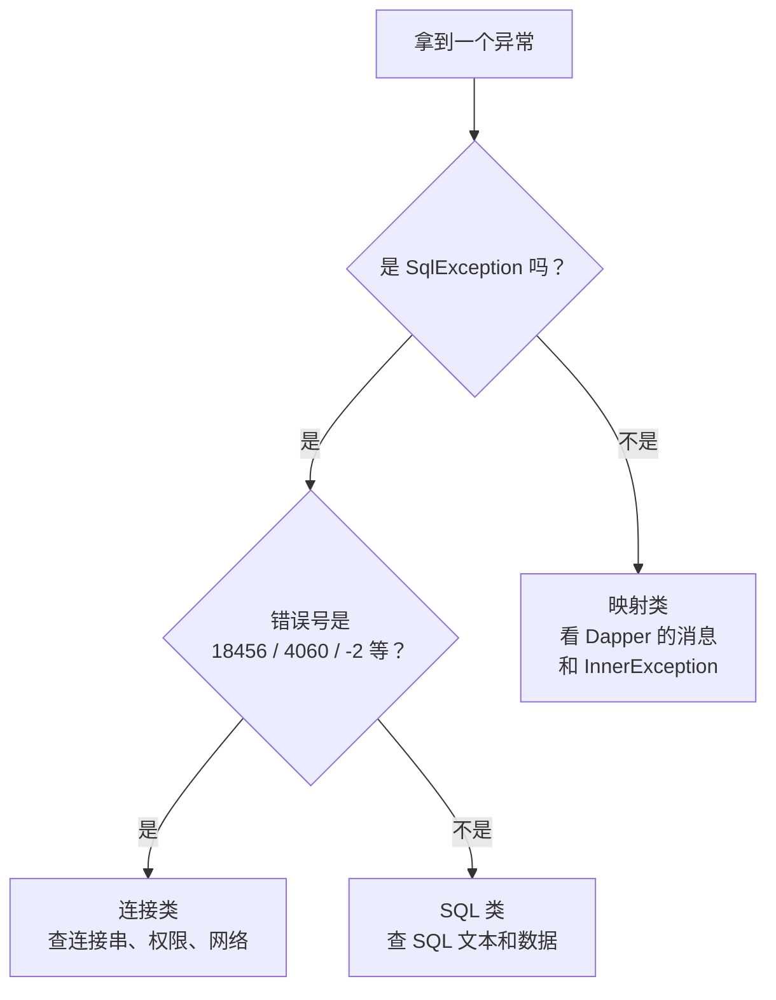
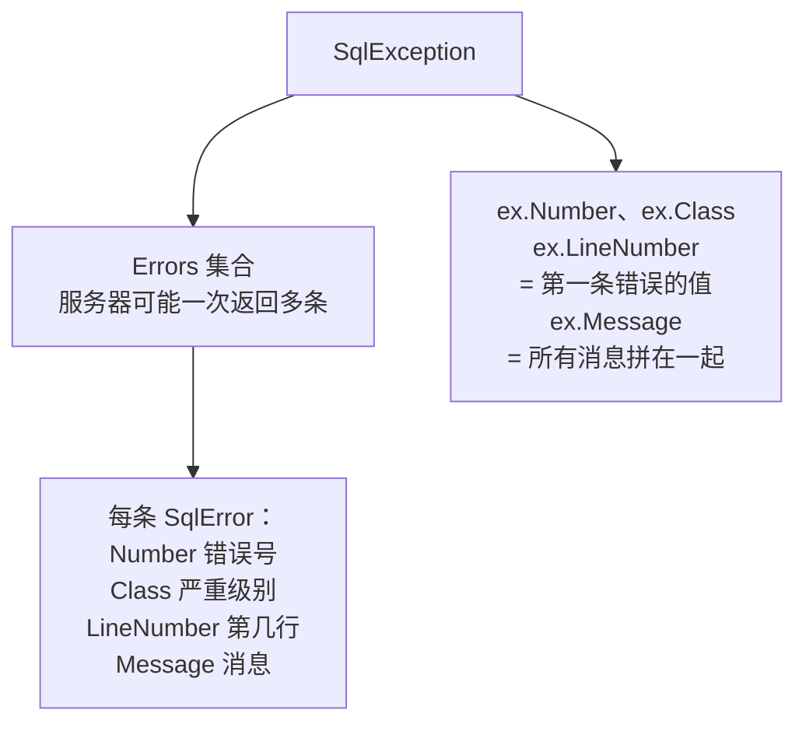
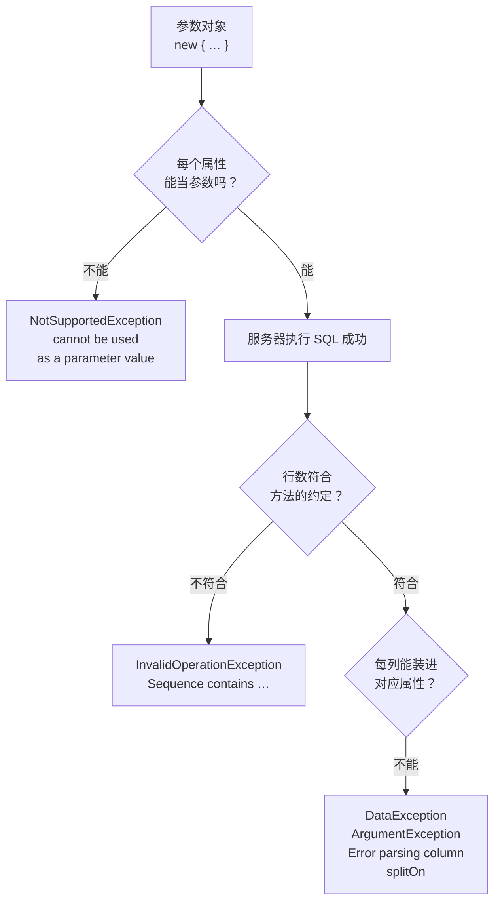

# 第 20 章 读懂报错

## 这一章解决什么问题

程序崩了，控制台上一段英文消息，下面跟着三十多行 `at Microsoft.Data.SqlClient…`。你的第一反应可能是把整段复制去搜索。其实大部分报错，只要回答三个问题就能定位：

1. **哪一类**：连不上？SQL 被服务器拒绝？还是 SQL 成功了、对象没装进去？
2. **错误号是几**：SQL Server 的每种错误都有固定编号，比英文消息可靠；
3. **哪一行是你自己的代码**：在堆栈里跳过框架的行，找到第一行你写的。

本章把前面各章零散见过的报错归拢到一起，逐类拆开。

## 开始之前

- 上一章你已经会了：用调试器、扩展事件、日志包装看清发给服务器的 SQL 和参数。
- 前面各章已经实测过一部分报错，本章会点出来源：第 2 章 `Error parsing column`，第 5 章 `Sequence contains …`，第 6 章外键 547，第 10 章 `splitOn`，第 14 章超时。
- 需要的环境：第 1 章的解决方案和 `PriceDemo` 库。本章例子会故意制造错误，有两处会真的插入数据（20.3 节），跑完想恢复就重跑 [`code/sql/00-reset-database.sql`](../code/sql/00-reset-database.sql)。
- 预计耗时：80–90 分钟。

---

## 正文

### 20.1 准备：新建本章项目

和第 2 章 2.1 节一样：右键解决方案 →「添加 → 新建项目」→「控制台应用」，项目名 `Ch20Demo`，框架 .NET 10.0；右键它 →「设为启动项目」；装 `Dapper` 2.1.89、`Microsoft.Data.SqlClient` 7.1.1、`System.Security.Cryptography.Pkcs` 10.0.13 三个包。csproj 和第 2 章完全相同（[`code/ch20/Step1-ThreeKinds/Step1-ThreeKinds.csproj`](../code/ch20/Step1-ThreeKinds/Step1-ThreeKinds.csproj)）。

每个例子都是**整个替换** `Program.cs`。本章有的例子会故意让程序崩溃，用 **Ctrl+F5**（「调试 → 开始执行(不调试)」）运行，控制台窗口不会自动关闭，报错能看全。

> 📷 **截图占位 ch20-01**：Ctrl+F5 运行后控制台窗口里的 `Unhandled exception.` 报错和堆栈，窗口底部提示按任意键关闭。
<!--  -->

---

### 20.2 概念一：三类异常的定位法

**白话定义**：一次 Dapper 调用要经过三段路：**连上服务器** → **服务器执行 SQL** → **Dapper 把结果装进对象**。异常在哪一段抛出，决定了你该去哪里查。看**异常类型**和**错误号**，就能判断是哪一段。

| 类别 | 在哪一段失败 | 异常类型 | 该去查什么 |
|---|---|---|---|
| 连接类（含命令超时） | 还没执行 SQL，或执行超时被客户端放弃 | `SqlException`，错误号如 18456、4060、-2 | 连接串、服务器名、库名、账号权限、网络、超时设置。-2 严格说是**命令**超时（连接已建好，第 14 章），因为排查方向同样在 SQL 之外（慢、被锁），这里归到一起 |
| SQL 类 | 服务器拒绝了 SQL，或数据违反约束 | `SqlException`，错误号如 207、208、547、2627 | SQL 文本、参数、表结构、数据 |
| 映射类 | SQL 成功了，装对象或转参数时失败 | **不是** `SqlException`：`DataException`、`InvalidOperationException`、`ArgumentException`、`NotSupportedException` | C# 类的属性类型、查询方法选得对不对、`splitOn`、参数对象 |

**业务场景**：测试同事发来一张截图：「新建申请单时报错了」。你先看异常类型：是 `SqlException`，错误号 2627，那就是"单号重复"，不用打开代码也知道往哪查。

**反例（什么时候不该这么做）**：分类是为了**定位**，不是为了"处理"。不要在每个仓储方法里都写 `try/catch`，把三类异常分别打印一遍然后吞掉。大部分异常应该让它冒泡到最外层（控制台的 Main、Web 的全局异常处理），统一记录。只有你**能处理**的那一种（比如 20.3 节的单号重复），才在当地 `catch`。

#### 🖼 图解：拿到一个异常，先走这棵树



#### 💻 最小可运行代码：三类各来一个

把 `Program.cs` 整个替换成：

```csharp
// code/ch20/Step1-ThreeKinds/Program.cs
// 三类异常各来一个：连不上（连接类）、SQL 写错（SQL 类）、对象装不进去（映射类）。最后一个故意不 catch，看完整堆栈
using Dapper;
using Microsoft.Data.SqlClient;

const string connStr =
    "Server=.;Database=PriceDemo;Integrated Security=True;TrustServerCertificate=True;";

// 下面 ①②③ 为了每个例子只占一行，直接 new SqlConnection 不写 using：连接没打开时 Dapper 自己开、自己关（第 2 章）
// ① 连接类：库名写错。用 SqlConnectionStringBuilder 只改库名，其余和正确的连接串一样
var wrongDb = new SqlConnectionStringBuilder(connStr) { InitialCatalog = "PriceDemoX" }.ConnectionString;
Try("① 连接类", () => new SqlConnection(wrongDb).Query<int>("SELECT 1"));

// ② SQL 类：列名写错（Applicnat）。连接没问题，是服务器拒绝了这条 SQL
Try("② SQL 类", () => new SqlConnection(connStr).Query<string>(
    "SELECT RequestNo FROM dbo.PriceRequest WHERE Applicnat = N'张伟'"));

// ③ 映射类：SQL 执行成功了，但 RequestNo（字符串）装不进 int
Try("③ 映射类", () => new SqlConnection(connStr).Query<int>(
    "SELECT RequestNo FROM dbo.PriceRequest"));

// ④ 不 catch：经过一层仓储再出错，看完整的报错和堆栈怎么读
Console.WriteLine("== ④ 不 catch，程序会在这里崩溃");
var repo = new RequestRepository(connStr);
Console.WriteLine(repo.FindNo(1));

// 只打印三样东西：异常类型、错误号（只有 SqlException 有）、消息。定位就靠这三样
static void Try(string title, Func<object> action)
{
    try
    {
        action();
        Console.WriteLine($"{title}：没有报错");
    }
    catch (Exception ex)
    {
        string number = ex is SqlException sql ? $"Number={sql.Number}" : "（不是 SqlException）";
        Console.WriteLine($"{title}：{ex.GetType().FullName}  {number}");
        Console.WriteLine($"    {ex.Message}");
    }
}

public class RequestRepository
{
    private readonly string _connStr;

    public RequestRepository(string connStr) => _connStr = connStr;

    public string FindNo(int id)
    {
        using var conn = new SqlConnection(_connStr);
        return conn.QuerySingle<string>(
            "SELECT RequestNo FROM dbo.PriceRequst WHERE Id = @Id",   // 表名少了一个 e
            new { Id = id });
    }
}
```

#### 🔍 拆解运行结果

实测输出的前半段（①②③）：

```text
① 连接类：Microsoft.Data.SqlClient.SqlException  Number=4060
    Cannot open database "PriceDemoX" requested by the login. The login failed.
Login failed for user 'sa'.
② SQL 类：Microsoft.Data.SqlClient.SqlException  Number=207
    Invalid column name 'Applicnat'.
③ 映射类：System.Data.DataException  （不是 SqlException）
    Error parsing column 0 (RequestNo=PR20261001 - String)
```

| 例 | 类型 + 错误号 | 归类 | 读法 |
|---|---|---|---|
| ① | `SqlException` 4060 | 连接类 | 登录成功了，但打不开 `PriceDemoX` 这个库。消息有两行，第二行 `Login failed for user 'sa'` 是同一次失败附带的第二条错误（沙箱用的是 sa 登录；你用 Windows 身份验证时，这里是你的 Windows 账号） |
| ② | `SqlException` 207 | SQL 类 | 连接没问题，服务器编译 SQL 时发现没有 `Applicnat` 这一列 |
| ③ | `DataException`，没有错误号 | 映射类 | SQL 执行成功了，第 0 列 `RequestNo` 的值 `PR20261001` 转不成 `int`。第 2 章见过同一种报错 |

> SQL Server 中文版上，①的第一行是 `无法打开登录所请求的数据库 "PriceDemoX"。登录失败。`（第 1 章见过同一条），②是 `列名 'Applicnat' 无效。`。错误号和英文版**完全相同**。

#### 🔍 读堆栈：找第一行自己的代码

例 ④ 没有 catch，程序崩溃。实测输出：

```text
Unhandled exception. Microsoft.Data.SqlClient.SqlException (0x80131904): Invalid object name 'dbo.PriceRequst'.
   at Microsoft.Data.SqlClient.SqlConnection.OnError(SqlException exception, Boolean breakConnection, Action`1 wrapCloseInAction)
   at Microsoft.Data.SqlClient.Connection.SqlConnectionInternal.OnError(SqlException exception, Boolean breakConnection, Action`1 wrapCloseInAction)
   at Microsoft.Data.SqlClient.TdsParser.ThrowExceptionAndWarning(TdsParserStateObject stateObj, SqlCommand command, Boolean callerHasConnectionLock, Boolean asyncClose)
   at Microsoft.Data.SqlClient.TdsParser.TryRun(RunBehavior runBehavior, SqlCommand cmdHandler, SqlDataReader dataStream, BulkCopySimpleResultSet bulkCopyHandler, TdsParserStateObject stateObj, Boolean& dataReady)
   at Microsoft.Data.SqlClient.SqlDataReader.TryConsumeMetaData()
   at Microsoft.Data.SqlClient.SqlDataReader.get_MetaData()
   at Microsoft.Data.SqlClient.SqlCommand.FinishExecuteReader(SqlDataReader ds, RunBehavior runBehavior, String resetOptionsString, Boolean isInternal, Boolean forDescribeParameterEncryption, Boolean shouldCacheForAlwaysEncrypted)
   at Microsoft.Data.SqlClient.SqlCommand.RunExecuteReaderTds(CommandBehavior cmdBehavior, RunBehavior runBehavior, Boolean returnStream, Boolean isAsync, Int32 timeout, Task& task, Boolean asyncWrite, Boolean isRetry, SqlDataReader ds, Boolean describeParameterEncryptionRequest)
   at Microsoft.Data.SqlClient.SqlCommand.RunExecuteReader(CommandBehavior cmdBehavior, RunBehavior runBehavior, Boolean returnStream, TaskCompletionSource`1 completion, Int32 timeout, Task& executeTask, Boolean& usedCache, Boolean asyncWrite, Boolean isRetry, String method)
   at Microsoft.Data.SqlClient.SqlCommand.RunExecuteReader(CommandBehavior cmdBehavior, RunBehavior runBehavior, Boolean returnStream, String method)
   at Microsoft.Data.SqlClient.SqlCommand.ExecuteReader(CommandBehavior behavior)
   at Microsoft.Data.SqlClient.SqlCommand.ExecuteDbDataReader(CommandBehavior behavior)
   at Dapper.SqlMapper.ExecuteReaderWithFlagsFallback(IDbCommand cmd, Boolean wasClosed, CommandBehavior behavior) in /_/Dapper/SqlMapper.cs:line 1191
   at Dapper.SqlMapper.QueryRowImpl[T](IDbConnection cnn, Row row, CommandDefinition& command, Type effectiveType) in /_/Dapper/SqlMapper.cs:line 1312
   at Dapper.SqlMapper.QuerySingle[T](IDbConnection cnn, String sql, Object param, IDbTransaction transaction, Nullable`1 commandTimeout, Nullable`1 commandType) in /_/Dapper/SqlMapper.cs:line 913
   at RequestRepository.FindNo(Int32 id) in /projects/sandbox/.tools/run/ch20-Step1-ThreeKinds/Program.cs:line 52
   at Program.<Main>$(String[] args) in /projects/sandbox/.tools/run/ch20-Step1-ThreeKinds/Program.cs:line 25
ClientConnectionId:b27e7701-a355-49a0-816e-2d99a301422a
Error Number:208,State:1,Class:16
```

（路径是沙箱的临时目录，你那里是 `C:\…\Ch20Demo\Program.cs`；`ClientConnectionId` 每次不同。）

**堆栈的顺序**：最上面一行是异常**被抛出**的地方，越往下越靠近调用的源头，最后一行是 `Main`。读的时候分四块：

| 块 | 行 | 看什么 |
|---|---|---|
| 第 1 行 | `SqlException (0x80131904): Invalid object name 'dbo.PriceRequst'.` | 异常类型 + 消息。`0x80131904` 是所有 SqlException 共用的代码，不用管 |
| 框架内部 | `Microsoft.Data.SqlClient.…` 12 行、`Dapper.SqlMapper.…` 3 行 | **从上往下跳过**。它们只说明"是在执行 SQL 时出的错"。`Dapper.SqlMapper.QuerySingle` 告诉你调用的是哪个 Dapper 方法 |
| 第一行自己的代码 | `RequestRepository.FindNo(Int32 id) … Program.cs:line 52` | **就是它**：第 52 行，`FindNo` 里执行 SQL 的那一句。去这里看 SQL |
| 再往下 | `Program.<Main>$ … line 25` | 谁调用了 `FindNo`。查"为什么会走到这里"时才看 |
| 末尾两行 | `Error Number:208,State:1,Class:16` | SqlException 特有的附加信息：错误号 208（对象名无效）、严重级别 16 |

> 堆栈里能显示 `line 52` 这样的行号，是因为默认用 Debug 配置生成，带着调试符号（.pdb 文件）。发布时如果没有 .pdb，只有方法名没有行号。

**规律**：方法名和文件路径里出现你自己的类名（`RequestRepository`、`Program`）的，就是你的代码。从上往下数，**第一个**你的代码，就是离出错点最近的地方。

#### 改坏一处试试：只 catch 了 SqlException

很多人习惯写 `catch (SqlException ex)`，觉得"数据库的错都是它"。把 `Try` 方法里的 `catch (Exception ex)` 改成 `catch (SqlException ex)`，运行。实测输出：

```text
① 连接类：Microsoft.Data.SqlClient.SqlException  Number=4060
    Cannot open database "PriceDemoX" requested by the login. The login failed.
Login failed for user 'sa'.
② SQL 类：Microsoft.Data.SqlClient.SqlException  Number=207
    Invalid column name 'Applicnat'.
Unhandled exception. System.Data.DataException: Error parsing column 0 (RequestNo=PR20261001 - String)
 ---> System.FormatException: The input string 'PR20261001' was not in a correct format.
   at System.Number.ThrowFormatException[TChar](ReadOnlySpan`1 value)
   at System.String.System.IConvertible.ToInt32(IFormatProvider provider)
   at System.Convert.ChangeType(Object value, Type conversionType, IFormatProvider provider)
   at Dapper.SqlMapper.GetValue[T](DbDataReader reader, Type effectiveType, Object val) in /_/Dapper/SqlMapper.cs:line 1402
   --- End of inner exception stack trace ---
```

（后面还有外层异常的堆栈，这里只截了前面部分。）

①② 照样被接住，③ 漏网了，程序直接崩溃：映射类异常**不是** `SqlException`。

这段输出还展示了 **InnerException（内层异常）**的样子：

| 片段 | 含义 |
|---|---|
| `DataException: Error parsing column 0 …` | 外层异常：Dapper 抛的，告诉你**哪一列、什么值** |
| ` ---> System.FormatException: …` | `--->` 后面是内层异常：真正失败的那个操作，"字符串格式不对，转不成数字" |
| `--- End of inner exception stack trace ---` | 内层异常的堆栈到此结束，下面是外层异常的堆栈 |

外层说"在哪"，内层说"为什么"。看到 `--->`，两层都要读。代码里用 `ex.InnerException` 取内层，20.4 节的例子会打印它。

---

### 20.3 概念二：`SqlException.Number`

**白话定义**：服务器返回的每一种错误都有一个固定的**错误号**，`SqlException.Number` 就是它。错误号和服务器语言无关：同一种错误，英文版、中文版消息文字不同，**号码一样**。所以代码里判断"是哪种错"，用 `Number`，不用 `Message`。

**业务场景**：新建申请单时，用户填的单号已经被别人用了。你希望提示"单号已存在，请换一个"，而不是把一段英文的唯一键冲突消息甩给用户。用 `catch (SqlException ex) when (ex.Number == 2627)`，只接住这一种。

**反例（什么时候不该用它）**：
- 不要靠 catch 错误号来代替**事先检查**能轻松避免的问题。比如必填项为空，在 C# 里先校验，比等服务器报 515（不能插入 NULL）再翻译更清楚。
- 不要 catch 了不认识的错误号再吞掉。`when` 条件不满足的异常会原样往上抛，这正是你要的。
- 唯一键冲突并不总是 2627：违反**唯一索引**（`CREATE UNIQUE INDEX`）时是 2601。两个都要判断。

#### 🖼 图解：一个 SqlException 里有什么



所以 20.2 节的 4060 有两行消息：服务器一次返回了两条错误，`Message` 把它们拼在了一起，`Number` 取的是第一条的 4060。

#### 💻 最小可运行代码：9 个错误号各触发一次

把 `Program.cs` 整个替换成：

```csharp
// code/ch20/Step2-SqlNumber/Program.cs
// SqlException.Number：把最常见的 9 个错误号各触发一次；再用 catch + when 只处理"单号重复"这一种
using Dapper;
using Microsoft.Data.SqlClient;

const string connStr =
    "Server=.;Database=PriceDemo;Integrated Security=True;TrustServerCertificate=True;";

using var conn = new SqlConnection(connStr);

// 连接类：分别把用户名 / 库名改错
var badLogin = new SqlConnectionStringBuilder(connStr)
    { IntegratedSecurity = false, UserID = "nobody", Password = "wrong" }.ConnectionString;
var badDb = new SqlConnectionStringBuilder(connStr) { InitialCatalog = "PriceDemoX" }.ConnectionString;

Console.WriteLine("== 连接类");
Try("登录失败", () => new SqlConnection(badLogin).Open());
Try("库不存在", () => new SqlConnection(badDb).Open());
Try("命令超时", () => conn.Execute("WAITFOR DELAY '00:00:03'", commandTimeout: 1));   // 第 14 章讲过

Console.WriteLine("== SQL 类");
Try("列名无效", () => conn.Query<int>("SELECT Idd FROM dbo.Customer"));
Try("对象名无效", () => conn.Query<int>("SELECT Id FROM dbo.Custmer"));
Try("参数没传", () => conn.Query<int>("SELECT Id FROM dbo.Customer WHERE Id = @Id"));   // 忘了传 new { Id = 1 }
Try("外键冲突", () => conn.Execute("DELETE dbo.Customer WHERE Id = 1"));               // 1 号客户有申请单
Try("唯一键冲突", () => conn.Execute(
    "INSERT dbo.PriceRequest (RequestNo, CustomerId, Applicant) VALUES (@No, 1, N'王芳')",
    new { No = "PR20261001" }));                                                      // 单号已存在
Try("字符串截断", () => conn.Execute(
    "INSERT dbo.Customer (Name, City, Level) VALUES (N'测试医院', @City, 'A')",
    new { City = "这是一个超过二十个字的城市名称用来演示截断报错" }));                   // City 是 NVARCHAR(20)

// 业务代码里的用法：只把"单号重复"翻译成用户看得懂的话，其他错误照样往上抛
Console.WriteLine("== catch + when");
Console.WriteLine(CreateRequest(conn, "PR20261001"));
Console.WriteLine(CreateRequest(conn, "PR20261099"));

static string CreateRequest(SqlConnection conn, string requestNo)
{
    try
    {
        int id = conn.QuerySingle<int>(@"
            INSERT dbo.PriceRequest (RequestNo, CustomerId, Applicant)
            OUTPUT INSERTED.Id
            VALUES (@RequestNo, 1, N'王芳')", new { RequestNo = requestNo });
        return $"新建成功：{requestNo}，Id = {id}";
    }
    catch (SqlException ex) when (ex.Number == 2627 || ex.Number == 2601)   // 2627 唯一约束 / 2601 唯一索引
    {
        return $"单号 {requestNo} 已经存在，请换一个";
    }
}

// 打印 SqlException 的四个关键属性：Number（错误号）、Class（严重级别）、LineNumber（SQL 第几行）、Message
static void Try(string title, Action action)
{
    try
    {
        action();
        Console.WriteLine($"{title}：没有报错");
    }
    catch (SqlException ex)
    {
        Console.WriteLine($"{title,-6} Number={ex.Number,-6} Class={ex.Class,-3} Line={ex.LineNumber}");
        Console.WriteLine($"    {ex.Message}");
    }
}
```

#### 🔍 拆解运行结果

实测输出（重置数据库后第一次运行）：

```text
== 连接类
登录失败   Number=18456  Class=14  Line=1
    Login failed for user 'nobody'.
库不存在   Number=4060   Class=11  Line=1
    Cannot open database "PriceDemoX" requested by the login. The login failed.
Login failed for user 'sa'.
命令超时   Number=-2     Class=11  Line=0
    Execution Timeout Expired.  The timeout period elapsed prior to completion of the operation or the server is not responding.
Operation cancelled by user.
== SQL 类
列名无效   Number=207    Class=16  Line=1
    Invalid column name 'Idd'.
对象名无效  Number=208    Class=16  Line=1
    Invalid object name 'dbo.Custmer'.
参数没传   Number=137    Class=15  Line=1
    Must declare the scalar variable "@Id".
外键冲突   Number=547    Class=16  Line=1
    The DELETE statement conflicted with the REFERENCE constraint "FK__PriceRequ__Custo__2AB62B09". The conflict occurred in database "PriceDemo", table "dbo.PriceRequest", column 'CustomerId'.
The statement has been terminated.
唯一键冲突  Number=2627   Class=14  Line=1
    Violation of UNIQUE KEY constraint 'UQ__PriceReq__33A869A430521FC9'. Cannot insert duplicate key in object 'dbo.PriceRequest'. The duplicate key value is (PR20261001).
The statement has been terminated.
字符串截断  Number=2628   Class=16  Line=1
    String or binary data would be truncated in table 'PriceDemo.dbo.Customer', column 'City'. Truncated value: '这是一个超过二十个字的城市名称用来演示截'.
The statement has been terminated.
== catch + when
单号 PR20261001 已经存在，请换一个
新建成功：PR20261099，Id = 6
```

> 📷 **截图占位 ch20-02**：控制台显示上面 9 个错误号的输出。
<!--  -->

把错误号整理成一张表，以后遇到直接查：

| 错误号 | 含义 | 常见原因 | 中文版服务器的消息 |
|---|---|---|---|
| 18456 | 登录失败 | 用户名 / 密码错；Windows 账号没有登录权限 | `用户 'nobody' 登录失败。` |
| 4060 | 打不开库 | 库名拼错、库还没建、账号没有这个库的权限 | `无法打开登录所请求的数据库 "PriceDemoX"。登录失败。` |
| -2 | 命令超时 | 查询太慢，超过 `commandTimeout`（默认 30 秒，第 14 章） | 这条是**客户端**消息，见下面说明 |
| 207 | 列名无效 | 列名拼错；表改过列名（第 18 章） | `列名 'Idd' 无效。` |
| 208 | 对象名无效 | 表 / 视图名拼错；连错了库；架构名不对 | `对象名 'dbo.Custmer' 无效。` |
| 137 | 必须声明标量变量 | SQL 里有 `@Id`，参数对象里没有 `Id` 属性，或者忘了传参数 | `必须声明标量变量 "@Id"。`（与第 4 章一致） |
| 547 | 外键冲突 | 删父表行时子表还有引用；插入子表时父表没有这一行（第 6、9 章） | 第 6 章、第 9 章给过中文原文（⚠️ 未实机验证） |
| 2627 | 违反唯一约束 | 单号、编码重复 | ⚠️ 未核对中文原文，只贴英文 |
| 2628 | 字符串会被截断 | 值比列长；消息里直接给出了**表名、列名和截断后的值** | ⚠️ 未核对中文原文，只贴英文 |

关于这张表，还有几点：

| 观察 | 说明 |
|---|---|
| 超时消息的第二行 | 这里的超时消息第二行是 `Operation cancelled by user.`，和第 14 章"执行中取消"的末行一样：超时时 SqlClient 也是通过"取消命令"让服务器停下的。区分两者看 `Number`：超时是 -2，主动取消不是（第 14 章练习） |
| -2 和其他号不一样 | 负数错误号是 **SqlClient 客户端**自己产生的，不是服务器发来的。所以它的消息语言跟着你的**电脑**走：在中文系统上运行（实测：`LC_ALL=zh_CN.UTF-8`），消息是 `执行超时已过期。完成操作之前已超时或服务器未响应。`，第二行是 `用户已取消操作。` |
| `Class`（严重级别） | 11–16 是"你的 SQL 或数据有问题，改了就好"；20 以上是严重错误，连接通常会被断开 |
| `Line` | SQL 文本里第几行出的错。多行的 SQL 很有用；本例 SQL 都只有一行，所以都是 1。-2 超时不是 SQL 的错，所以是 0 |
| 547 / 2627 里的约束名 | `FK__PriceRequ__Custo__2AB62B09` 后面那串是建表时自动生成的，每台服务器、每次重建都不一样。正式项目建表时**给约束起名**，报错才好读 |
| 2628 | SQL Server 2019 起才有这么详细的消息（2022 默认就是它）。**2017 及以前**是 8152，消息只说 `String or binary data would be truncated.`，不告诉你哪一列。判断截断时 2628 和 8152 都要写上 |
| `Id = 6` 而不是 4 | 表里原来有 3 张单。"唯一键冲突"那次 Try 和 `CreateRequest` 第一次调用，INSERT 都失败了，但**失败的 INSERT 也会消耗自增值**（实测），所以新单是 6 |

> 18456 那条，沙箱是用 SQL 身份验证故意填错的用户名。你用 Windows 身份验证时，同样是 18456，消息里是你的 Windows 账号名。

**`catch` + `when` 这一段**：

```csharp
catch (SqlException ex) when (ex.Number == 2627 || ex.Number == 2601)
```

| 部分 | 作用 |
|---|---|
| `catch (SqlException ex)` | 先按类型筛：只考虑 SqlException |
| `when (…)` | 再按条件筛：条件为 true 才进这个 catch。条件为 false，异常**就像没被 catch 过一样**继续往上抛，堆栈也保持原样 |
| 和"catch 后 if 判断、不是就 `throw;`"比 | 效果接近，但 `when` 更短，意图更清楚：一眼看出"这里只处理单号重复" |

#### 改坏一处试试：用消息文字判断

有人会用消息文字判断，比如在中文版服务器上调试时看到了"重复键"三个字，就写成：

```csharp
catch (SqlException ex) when (ex.Message.Contains("重复键"))
```

在英文版服务器上运行，实测输出：

```text
== catch + when
Unhandled exception. Microsoft.Data.SqlClient.SqlException (0x80131904): Violation of UNIQUE KEY constraint 'UQ__PriceReq__33A869A4FB174A4F'. Cannot insert duplicate key in object 'dbo.PriceRequest'. The duplicate key value is (PR20261001).
   at Microsoft.Data.SqlClient.SqlConnection.OnError(SqlException exception, Boolean breakConnection, Action`1 wrapCloseInAction)
```

（堆栈只截了第一行。）

英文消息里没有"重复键"，`when` 条件为 false，异常没被接住，程序崩溃。开发机是中文版、服务器是英文版（或者反过来），这个 bug 只在上线后出现。**用错误号判断，不用消息文字。**

---

### 20.4 概念三：Dapper 自己的异常

**白话定义**：SQL 已经在服务器上执行成功了，但 Dapper 在"把结果装进对象"或"把对象变成参数"这一步失败了，它会抛出**非 SqlException** 的异常。这类异常没有错误号，靠**异常类型 + 消息里的关键字**来认。

**业务场景**：上线后日志里出现 `Sequence contains more than one element`。你知道这不是数据库坏了，而是某个 `QuerySingle` 查出了两行——要么数据出现了重复，要么 SQL 少了条件。

**反例（什么时候不该往 Dapper 身上想）**：异常类型是 `SqlException` 时，就不是 Dapper 的问题，Dapper 只是把服务器的错误原样转交给你。不要去改映射代码，去看 SQL 和数据。

#### 🖼 图解：Dapper 异常出在哪一步



#### 💻 最小可运行代码：五个 Dapper 异常

把 `Program.cs` 整个替换成：

```csharp
// code/ch20/Step3-DapperErrors/Program.cs
// Dapper 自己抛的异常：SQL 已经执行成功，是"结果装进对象"或"对象变成参数"这一步出了问题
using Dapper;
using Microsoft.Data.SqlClient;

const string connStr =
    "Server=.;Database=PriceDemo;Integrated Security=True;TrustServerCertificate=True;";

using var conn = new SqlConnection(connStr);

// ① 类型转不过去：Name 是字符串，属性是 int
Try("① 列转属性", () => conn.Query<BadCustomer>("SELECT Id, Name FROM dbo.Customer").ToList());

// ② 多重映射（第 10 章）：第二个对象的首列不叫 Id，又没写 splitOn
Try("② splitOn", () => conn.Query<Request, Customer, Request>(@"
    SELECT r.Id, r.RequestNo, c.Name, c.City
    FROM dbo.PriceRequest r JOIN dbo.Customer c ON c.Id = r.CustomerId",
    (r, c) => { r.Customer = c; return r; }).ToList());

// ③ QuerySingle 查到 0 行（第 5 章）
Try("③ 0 行", () => conn.QuerySingle<string>("SELECT RequestNo FROM dbo.PriceRequest WHERE Id = 99"));

// ④ QuerySingle 查到多行
Try("④ 多行", () => conn.QuerySingle<string>("SELECT RequestNo FROM dbo.PriceRequest WHERE Applicant = N'张伟'"));

// ⑤ 参数对象里有一个 Dapper 不认识的类型（把整个 Customer 对象当成了参数值）
Try("⑤ 参数类型", () => conn.Query<int>("SELECT Id FROM dbo.PriceRequest WHERE CustomerId = @Customer",
    new { Customer = new Customer { Name = "华东第一医院" } }).ToList());

// 打印异常类型和消息；有 InnerException（内层异常）就再打印一层——真正的原因常常在里面
static void Try(string title, Func<object> action)
{
    try
    {
        action();
        Console.WriteLine($"{title}：没有报错");
    }
    catch (Exception ex)
    {
        Console.WriteLine($"{title}：{ex.GetType().FullName}");
        Console.WriteLine($"    {ex.Message}");
        if (ex.InnerException is not null)
            Console.WriteLine($"    内层 {ex.InnerException.GetType().FullName}：{ex.InnerException.Message}");
    }
}

public class BadCustomer
{
    public int Id { get; set; }
    public int Name { get; set; }          // 故意写错类型：应该是 string
}

public class Customer
{
    public int Id { get; set; }
    public string Name { get; set; } = "";
    public string City { get; set; } = "";
}

public class Request
{
    public int Id { get; set; }
    public string RequestNo { get; set; } = "";
    public Customer? Customer { get; set; }
}
```

#### 🔍 拆解运行结果

实测输出：

```text
① 列转属性：System.Data.DataException
    Error parsing column 1 (Name=华东第一医院 - String)
    内层 System.FormatException：The input string '华东第一医院' was not in a correct format.
② splitOn：System.ArgumentException
    Multi-map error: splitOn column 'Id' was not found - please ensure your splitOn parameter is set and in the correct order (Parameter 'splitOn')
③ 0 行：System.InvalidOperationException
    Sequence contains no elements
④ 多行：System.InvalidOperationException
    Sequence contains more than one element
⑤ 参数类型：System.NotSupportedException
    The member Customer of type Customer cannot be used as a parameter value
```

这些消息是 Dapper 和 .NET 运行时自己的文字，不随服务器语言变化。沙箱里把区域设成中文（`LC_ALL=zh_CN.UTF-8`）再跑，输出一字不变（实测），所以按英文关键字去认就行。逐个读：

| 例 | 消息里的关键字 | 意思 | 怎么改 | 见第几章 |
|---|---|---|---|---|
| ① | `Error parsing column 1 (Name=华东第一医院 - String)` | 第 1 列（从 0 数）`Name`，值"华东第一医院"，数据库给的是字符串；**内层**说它转不成数字 | 把属性改成和列匹配的类型 | 第 2、7 章 |
| ② | `splitOn column 'Id' was not found` | 多重映射默认在名叫 `Id` 的列处切分，结果集里第二个 `Id` 找不到（这里第二段从 `c.Name` 开始） | 写 `splitOn: "Name"`，或者 SELECT 里把 `c.Id` 放在第二段的第一列 | 第 10 章 |
| ③ | `Sequence contains no elements` | 用了 `QuerySingle` / `QueryFirst`，但一行都没查到 | 允许查不到就用 `…OrDefault`，并处理 null | 第 5 章 |
| ④ | `Sequence contains more than one element` | 用了 `QuerySingle` / `QuerySingleOrDefault`，却查到了多行 | 先想清楚：数据重复了，还是 SQL 少了条件？只要第一行就用 `QueryFirst` + `ORDER BY` | 第 5 章 |
| ⑤ | `The member Customer of type Customer cannot be used as a parameter value` | 参数对象的 `Customer` 属性是个类，Dapper 不知道怎么把它变成一个 SQL 参数 | 传它的某个属性，比如 `new { Customer = c.Id }`；真要整体传，要写第 17 章的类型处理器 | 第 4、17 章 |

③④ 的 `Sequence contains …` 不是 Dapper 独有的，它就是 LINQ 的 `Single()` / `First()` 的消息，Dapper 沿用了同一套语义。看到它，先找堆栈里的 `Dapper.SqlMapper.QuerySingle` 或 `QueryFirst`，就知道是哪种调用。

#### 改坏一处试试：给 ② 补上 splitOn，再拼错它

在 ② 的 lambda 后面加上 `splitOn: "Name"`：

```csharp
(r, c) => { r.Customer = c; return r; }, splitOn: "Name").ToList());
```

实测输出那一行变成：

```text
② splitOn：没有报错
```

再把 `"Name"` 拼成 `"Nmae"`，实测：

```text
② splitOn：System.ArgumentException
    Multi-map error: splitOn column 'Nmae' was not found - please ensure your splitOn parameter is set and in the correct order (Parameter 'splitOn')
```

消息里引号中的名字，就是**你写的** splitOn 值（不写时是默认的 `Id`）。拿它去和 SELECT 列表逐个对照，看结果集里有没有这一列，顺序对不对。

---

## 🧱 类比：ADO.NET 写法与 Dapper 写法逐项对照

| 出错的情况 | ADO.NET（实测） | Dapper（实测） |
|---|---|---|
| 服务器端错误（列名、外键、唯一键…） | `SqlException`，`Number` 相同 | 一样：Dapper 原样转交 `SqlException` |
| 类型对不上 | `reader.GetInt32(0)` 抛 `InvalidCastException: Unable to cast object of type 'System.String' to type 'System.Int32'.`，**不说是哪一列** | `DataException: Error parsing column 0 (RequestNo=PR20261001 - String)`，报出列号、列名、值 |
| 读一个结果集里没有的列 | `reader.GetOrdinal("Applicant")` 抛 `IndexOutOfRangeException: Applicant` | **不报错**，属性保持默认值（第 2 章） |
| 期望有一行，实际 0 行 | 不判断 `Read()` 的返回值就读：`InvalidOperationException: Invalid attempt to read when no data is present.` | `QuerySingle` / `QueryFirst`：`Sequence contains no elements` |
| 期望最多一行，实际多行 | 不会报错，你只读了第一行，其余被忽略 | `QuerySingle` / `QuerySingleOrDefault`：`Sequence contains more than one element` |
| 找出错的代码行 | 堆栈里第一行自己的代码 | 一样，只是中间多了几行 `Dapper.SqlMapper` |

最后两行说明了一件事：`QuerySingle` 比 ADO.NET 的"读第一行"**更严格**。它的报错不是麻烦，而是在告诉你"你对数据的假设不成立"。

## ⚠️ 踩坑警告

| 现象 | 原因 | 怎么改 |
|---|---|---|
| `catch (SqlException)` 没接住，程序还是崩了（实测） | 映射类异常是 `DataException` 等，不是 `SqlException` | 分清三类；需要兜底时在最外层 `catch (Exception)` 统一记录 |
| 本机好好的，换了一台服务器，`catch` 突然不起作用（实测：英文版服务器上 `Message.Contains("重复键")` 不成立） | 用消息文字判断错误，消息随服务器语言变化 | 用 `ex.Number` 判断 |
| 唯一键冲突没被 `when (ex.Number == 2627)` 接住 | 违反的是唯一**索引**，错误号是 2601 | 写成 `ex.Number == 2627 \|\| ex.Number == 2601` |
| 截断错误判断不到 | SQL Server 2017 及以前是 8152，2019 起是 2628（实测 2022 上是 2628） | 两个号都判断 |
| 报错 `Must declare the scalar variable "@Id"`（实测） | SQL 里有参数，参数对象里没有同名属性，或者整个参数忘了传 | 核对 `@名字` 和属性名；看第 19 章的日志确认传了什么 |
| 只看 `ex.Message`，不知道为什么转换失败 | 真正的原因在 `InnerException` 里（实测：`FormatException`） | 看 `--->` 后面的内容；日志里记 `ex.ToString()`，它包含内层异常和全部堆栈 |
| 新建失败了一次，再建成功时 Id 跳号（实测：4 → 6） | 失败的 INSERT 也消耗自增值 | 正常现象。不要用自增 Id 当"连续的单据流水号" |

## 🎯 动手练习

**练习 1：新增产品时给出友好提示**

写一个 `ProductRepository.Add(code, name, listPrice)`，返回一句给用户看的话。`Product` 表的 `Code` 是 `VARCHAR(20) UNIQUE`，`Name` 是 `NVARCHAR(50)`。要求：

- 编码重复时返回"产品编码 XXX 已经存在"；
- 有字段超长时返回"有字段超长：编码最多 20 个字符，名称最多 50 个字"；
- 成功时返回"新增成功：编码，Id = N"；
- 其他错误**不处理**，原样抛出。用错误号判断，不许用消息文字。

依次调用三次：`("US-100", "便携超声主机", 180000m)`、`("PB-03", 51 个"长"字, 28000m)`、`("PB-03", "微凸探头", 28000m)`。

- 验收标准（重置数据库后第一次运行）：输出三行，完全一致：

```text
产品编码 US-100 已经存在
有字段超长：编码最多 20 个字符，名称最多 50 个字
新增成功：PB-03，Id = 7
```

- 额外观察：为什么 Id 是 7，不是 5？

**练习 2：读堆栈修 bug**

下面这段代码运行后崩溃（实测）。**先不要看代码**，只运行它、读报错和堆栈，说出：①哪一类异常；②哪一行自己的代码；③原因。然后修好它。

```csharp
// code/ch20/Exercise2-Bug/Program.cs
// 练习 2 的原题：运行后程序崩溃。只看报错和堆栈，找到出问题的那一行自己的代码，改好它
using Dapper;
using Microsoft.Data.SqlClient;

const string connStr =
    "Server=.;Database=PriceDemo;Integrated Security=True;TrustServerCertificate=True;";

var repo = new RequestRepository(connStr);
var latest = repo.GetLatestByApplicant("张伟");
Console.WriteLine($"张伟最近的申请单：{latest.RequestNo}（{latest.CreatedAt:yyyy-MM-dd}）");

public class RequestRepository
{
    private readonly string _connStr;

    public RequestRepository(string connStr) => _connStr = connStr;

    // 需求：取某个申请人最近的一张申请单
    public RequestBrief GetLatestByApplicant(string applicant)
    {
        using var conn = new SqlConnection(_connStr);
        return conn.QuerySingle<RequestBrief>(@"
            SELECT Id, RequestNo, CreatedAt
            FROM dbo.PriceRequest
            WHERE Applicant = @Applicant
            ORDER BY CreatedAt DESC", new { Applicant = applicant });
    }
}

public class RequestBrief
{
    public int Id { get; set; }
    public string RequestNo { get; set; } = "";
    public DateTime CreatedAt { get; set; }
}
```

- 验收标准：输出一行 `张伟最近的申请单：PR20261015（2026-10-15）`；并且能回答上面三个问题。

卡住了看文末参考答案。

## 📌 一句话总结

先看异常类型分三类，再看错误号，最后在堆栈里找第一行自己的代码。

## 下一章

三类报错都会读了，第 21 章用 8 个真实故障场景，把第 2–20 章的排查手段串起来实战一遍。

---

<!-- 以下是参考答案，先自己动手，卡住了再往下翻 -->


## 参考答案

**练习 1 思路**：两个 `catch (SqlException ex) when (…)`，一个判断 2627 / 2601（唯一约束 / 唯一索引），一个判断 2628 / 8152（新老版本的截断）。不满足任何 `when` 的异常不会被接住，自动原样抛出，不用写额外的代码。

**为什么 Id 是 7**：产品表原来有 4 行（Id 1–4）。第一次调用撞上唯一键、第二次撞上截断，两次 INSERT 都失败了，但都消耗了自增值 5 和 6，所以第三次成功时拿到的是 7（实测）。

**练习 2 思路**：实测报错和堆栈：

```text
Unhandled exception. System.InvalidOperationException: Sequence contains more than one element
   at System.Linq.ThrowHelper.ThrowMoreThanOneElementException()
   at System.Linq.Enumerable.TryGetSingle[TSource](IEnumerable`1 source, Boolean& found)
   at System.Linq.Enumerable.Single[TSource](IEnumerable`1 source)
   at Dapper.SqlMapper.ThrowMultipleRows(Row row) in /_/Dapper/SqlMapper.cs:line 1281
   at Dapper.SqlMapper.QueryRowImpl[T](IDbConnection cnn, Row row, CommandDefinition& command, Type effectiveType) in /_/Dapper/SqlMapper.cs:line 1325
   at Dapper.SqlMapper.QuerySingle[T](IDbConnection cnn, String sql, Object param, IDbTransaction transaction, Nullable`1 commandTimeout, Nullable`1 commandType) in /_/Dapper/SqlMapper.cs:line 913
   at RequestRepository.GetLatestByApplicant(String applicant) in /projects/sandbox/.tools/run/ch20-Exercise2-Bug/Program.cs:line 23
   at Program.<Main>$(String[] args) in /projects/sandbox/.tools/run/ch20-Exercise2-Bug/Program.cs:line 10
```

1. **哪一类**：`InvalidOperationException`，不是 SqlException，是映射类。SQL 执行成功了。
2. **哪一行**：从上往下跳过 `System.Linq` 3 行、`Dapper.SqlMapper` 3 行，第一行自己的代码是 `RequestRepository.GetLatestByApplicant … line 23`，就是 `return conn.QuerySingle<RequestBrief>(` 那一行。上面紧挨着的 `Dapper.SqlMapper.QuerySingle` 也印证了是 `QuerySingle`。
3. **原因**：张伟有 2 张申请单（PR20261001、PR20261015），`QuerySingle` 要求"正好一行"，查到 2 行就抛异常。需求是"最近的一张"，SQL 里虽然写了 `ORDER BY CreatedAt DESC`，但没有限制行数。

改法：SQL 加 `TOP (1)`，方法换成 `QueryFirstOrDefault`，返回类型改成可空的 `RequestBrief?`（申请人没有单子时返回 null）。只加 `TOP (1)` 不换方法也能跑通，但没有单子的申请人就会报 `Sequence contains no elements`。

两题合在一个文件里，完整项目在 [`code/ch20/Exercise/`](../code/ch20/Exercise/)。实测输出：

```text
产品编码 US-100 已经存在
有字段超长：编码最多 20 个字符，名称最多 50 个字
新增成功：PB-03，Id = 7
张伟最近的申请单：PR20261015（2026-10-15）
```

```csharp
// code/ch20/Exercise/Program.cs
// 第 20 章练习参考答案：练习 1（按错误号给出友好提示）+ 练习 2（读堆栈修好 QuerySingle 多行的问题）
using Dapper;
using Microsoft.Data.SqlClient;

const string connStr =
    "Server=.;Database=PriceDemo;Integrated Security=True;TrustServerCertificate=True;";

// 练习 1：三次新增，分别撞上唯一键、截断、正常
var products = new ProductRepository(connStr);
Console.WriteLine(products.Add("US-100", "便携超声主机", 180000m));
Console.WriteLine(products.Add("PB-03", new string('长', 51), 28000m));   // Name 是 NVARCHAR(50)，51 个字
Console.WriteLine(products.Add("PB-03", "微凸探头", 28000m));

// 练习 2：取张伟最近的一张申请单
var repo = new RequestRepository(connStr);
var latest = repo.GetLatestByApplicant("张伟");
Console.WriteLine($"张伟最近的申请单：{latest?.RequestNo}（{latest?.CreatedAt:yyyy-MM-dd}）");

public class ProductRepository
{
    private readonly string _connStr;

    public ProductRepository(string connStr) => _connStr = connStr;

    public string Add(string code, string name, decimal listPrice)
    {
        using var conn = new SqlConnection(_connStr);
        try
        {
            int id = conn.QuerySingle<int>(@"
                INSERT dbo.Product (Code, Name, ListPrice)
                OUTPUT INSERTED.Id
                VALUES (@Code, @Name, @ListPrice)",
                new { Code = code, Name = name, ListPrice = listPrice });
            return $"新增成功：{code}，Id = {id}";
        }
        catch (SqlException ex) when (ex.Number == 2627 || ex.Number == 2601)
        {
            return $"产品编码 {code} 已经存在";
        }
        catch (SqlException ex) when (ex.Number == 2628 || ex.Number == 8152)   // 8152 是 SQL Server 2017 及以前的截断错误号
        {
            return $"有字段超长：编码最多 20 个字符，名称最多 50 个字";
        }
        // 其他错误号不处理：没有 catch 到，就原样抛给调用方
    }
}

public class RequestRepository
{
    private readonly string _connStr;

    public RequestRepository(string connStr) => _connStr = connStr;

    // 原题用 QuerySingle：张伟有 2 张单，"最多一行"的约定被打破，抛 Sequence contains more than one element。
    // 改法：SQL 里 TOP (1) 只取最新一行；方法换成 QueryFirstOrDefault，查不到时返回 null
    public RequestBrief? GetLatestByApplicant(string applicant)
    {
        using var conn = new SqlConnection(_connStr);
        return conn.QueryFirstOrDefault<RequestBrief>(@"
            SELECT TOP (1) Id, RequestNo, CreatedAt
            FROM dbo.PriceRequest
            WHERE Applicant = @Applicant
            ORDER BY CreatedAt DESC", new { Applicant = applicant });
    }
}

public class RequestBrief
{
    public int Id { get; set; }
    public string RequestNo { get; set; } = "";
    public DateTime CreatedAt { get; set; }
}
```
