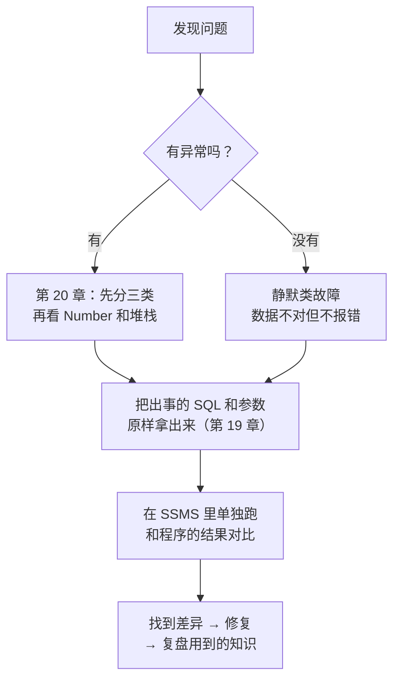
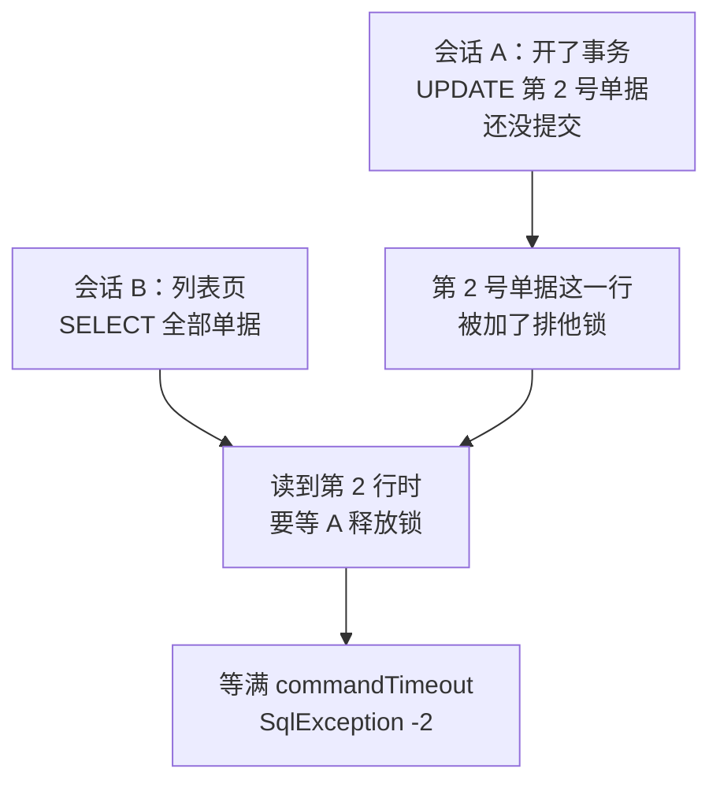
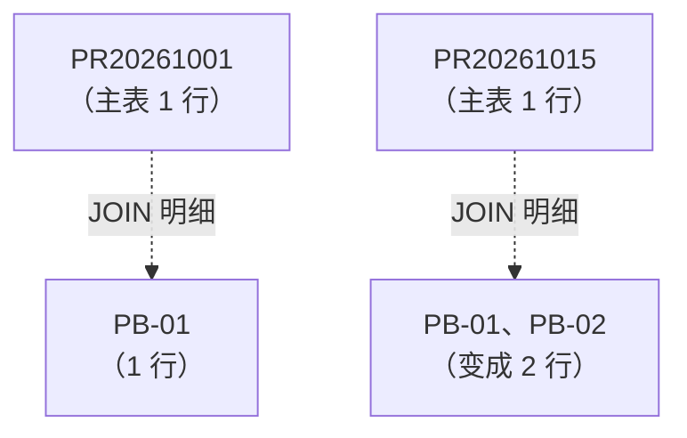
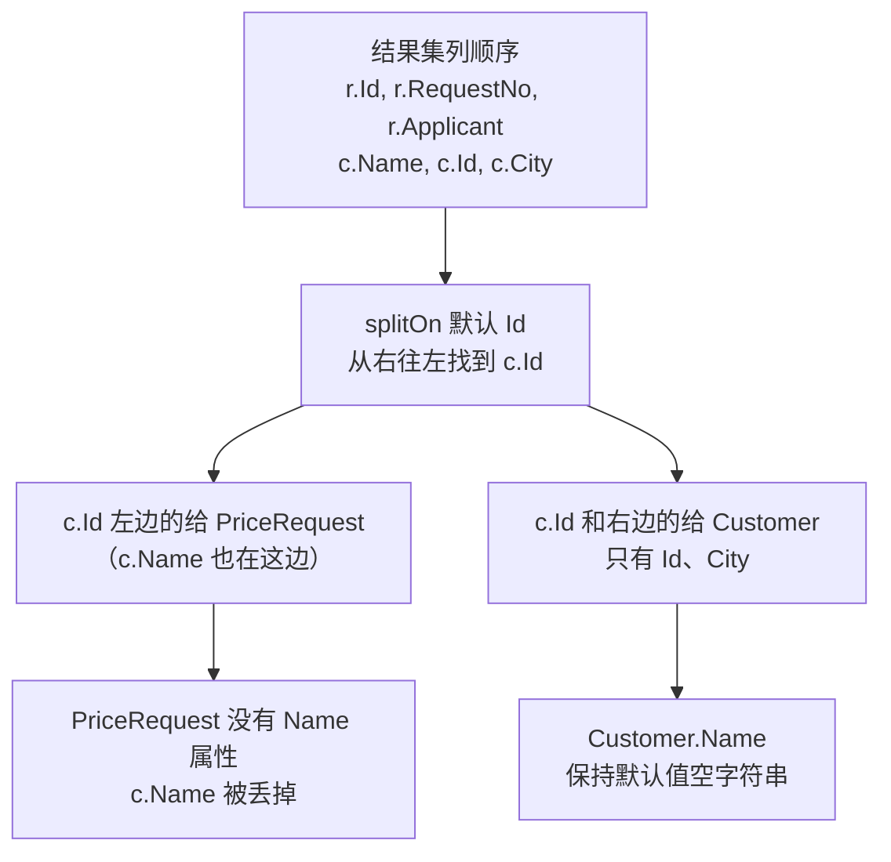
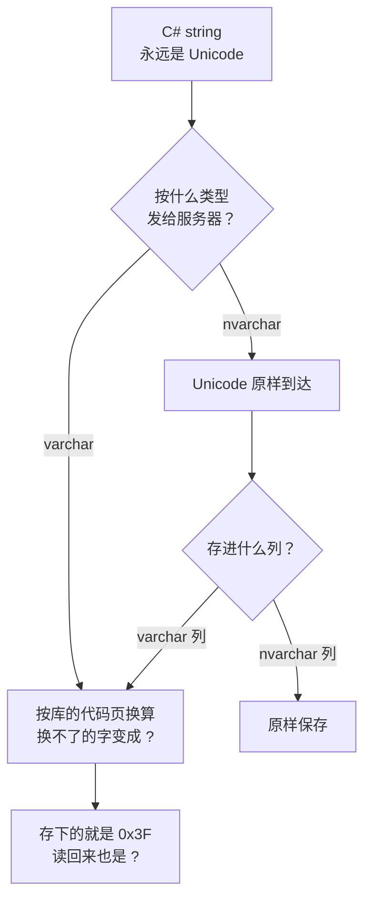

# 第 21 章 常见故障排查实战

## 这一章解决什么问题

第 20 章教你读懂一条报错：先分清是连接类、SQL 类还是映射类，再看 `SqlException.Number`。可是真正让人头疼的故障，往往**根本没有报错**：属性全是空的、总数对不上、中文变成了问号。有报错的那些，报错又常常指向一行"看起来没问题"的代码。

本章不讲新东西。我们把前面 20 章的知识拿来，走一遍 8 个真实场景。每个场景都按同一个顺序来：**现象 → 定位 → 修复 → 复盘**。目标是：下次遇到类似的问题，你知道第一步该查什么。

## 开始之前

- 上一章你已经会了：把异常分成连接类、SQL 类、映射类三类；用 `SqlException.Number` 区分具体错误（207 列名无效、547 外键、2627 唯一键、-2 超时……）；在堆栈里从上往下跳过 SqlClient、Dapper 的行，找第一行自己的代码。
- 需要的环境：PriceDemo 库是初始数据。如果被改乱了，先重跑 [`code/sql/00-reset-database.sql`](../code/sql/00-reset-database.sql)。本章不需要额外的 SQL 脚本，所有准备工作都写在各个例子的代码里。
- 预计耗时：90 分钟。8 个场景彼此独立，可以分两次做完：场景 1–4 一次，场景 5–8 一次。

---

## 正文

### 21.1 准备：新建本章项目

本章有 8 个场景，外加练习，都放在**同一个新项目**里。每做一个场景，就把 `Program.cs` 的内容**整个替换掉**。

1. 右键解决方案 →「**添加 → 新建项目**」→「控制台应用」，项目名称填 `Ch21Demo`，框架选 **.NET 10.0**。
2. **右键 `Ch21Demo` →「设为启动项目」**。
3. 「工具 → NuGet 包管理器 → 管理解决方案的 NuGet 程序包」，给 `Ch21Demo` 装上和第 2 章相同的三个包：`Dapper` 2.1.89、`Microsoft.Data.SqlClient` 7.1.1、`System.Security.Cryptography.Pkcs` 10.0.13。

csproj 和第 2 章一字不差（每个场景目录里各有一份，例如 [`code/ch21/Scene1-AllDefault/Scene1-AllDefault.csproj`](../code/ch21/Scene1-AllDefault/Scene1-AllDefault.csproj)）。

> 📷 **截图占位 ch21-01**：解决方案资源管理器里，`Ch21Demo` 项目名是粗体（已设为启动项目），「依赖项 → 包」下有三个包。
<!--  -->

**为什么每个场景都把"故障版"和"修复版"写在同一个程序里**：一次运行就能看到前后对比。有异常的地方都用 `try/catch` 接住，打印 `SqlException.Number` 和 `Message`（第 20 章的方法），这样程序不会在第一个错误处停下来。

**关于"为了能反复运行"的代码**：会往库里写数据的场景，开头会先删掉上一次留下的演示数据；改表结构的场景，结尾会改回去。这些行和故障本身无关，但能保证你按多少次 Ctrl+F5 结果都一样。

---

### 21.2 排查的固定套路

遇到问题时，先别急着改代码。先回答一个问题：**有没有异常？**



两类故障的排查重点不同：

| 类型 | 典型现象 | 先查什么 | 本章场景 |
|---|---|---|---|
| 有异常 | 报 `SqlException` / `DataException` | 错误号、报错里的列名或对象名、堆栈里第一行自己的代码 | 3（IN 查询）、4（超时） |
| 静默类 | 属性是默认值、行数不对、数据缺一半、文字变问号 | **结果集的真实列名**、**JOIN 后的真实行数**、**库里实际存了什么** | 1、2、5、6、7、8 |

静默类故障更难查，因为**没有任何东西告诉你出错了**。本章 8 个场景里有 6 个属于这一类。它们的共同点是：程序以为自己拿到了某样东西，实际拿到的是另一样东西。排查的办法也一样：**把"实际拿到的"打印出来，和"以为的"逐项对比。**

下面每个场景都按这个格式写：

| 小节 | 内容 |
|---|---|
| 现象 | 用户或测试看到了什么（附实测输出） |
| 定位 | 一步一步怎么找到原因，每一步看什么 |
| 修复 | 改哪里，改完的实测输出 |
| 别这样修 | 看起来能解决、其实埋了新坑的改法 |
| 复盘 | 用到了前面哪几章的知识 |

---

### 21.3 场景 1：属性全是默认值

**现象**：从老报表里复制来一条 SQL，在 SSMS 里跑得好好的，有 3 行数据。放进 `Query<T>` 以后，也拿到了 3 个对象，但每个属性都是空字符串。没有任何报错。

#### 💻 故障版 + 定位 + 修复

```csharp
// code/ch21/Scene1-AllDefault/Program.cs
// 场景 1：属性全是默认值——先打印结果集的真实列名，再和类的属性名逐个对照
using System.Data;
using Dapper;
using Microsoft.Data.SqlClient;

const string connStr =
    "Server=.;Database=PriceDemo;Integrated Security=True;TrustServerCertificate=True;";

// 从老报表里原样复制来的 SQL：为了报表表头好看，列别名写成了中文
const string oldSql = @"
    SELECT r.RequestNo AS 单号, r.Applicant AS 申请人, c.Name AS 客户
    FROM dbo.PriceRequest r
    JOIN dbo.Customer c ON c.Id = r.CustomerId
    ORDER BY r.Id";

using var conn = new SqlConnection(connStr);

Console.WriteLine("== 故障现象：三行都查到了，但每个属性都是空的");
foreach (var row in conn.Query<RequestReport>(oldSql))
    Console.WriteLine($"[{row.RequestNo}] [{row.Applicant}] [{row.CustomerName}]");

Console.WriteLine("== 定位：结果集里真实的列名");
PrintColumns(connStr, oldSql);

// 修复：别名改成属性名。属性名本来就和列名一样的两列，干脆不起别名
const string fixedSql = @"
    SELECT r.RequestNo, r.Applicant, c.Name AS CustomerName
    FROM dbo.PriceRequest r
    JOIN dbo.Customer c ON c.Id = r.CustomerId
    ORDER BY r.Id";

Console.WriteLine("== 修复后");
foreach (var row in conn.Query<RequestReport>(fixedSql))
    Console.WriteLine($"[{row.RequestNo}] [{row.Applicant}] [{row.CustomerName}]");

// 只读"表头"不读数据：用你熟悉的 ADO.NET，SchemaOnly 让服务器只返回列信息
static void PrintColumns(string connStr, string sql)
{
    using var conn = new SqlConnection(connStr);
    conn.Open();
    using var cmd = new SqlCommand(sql, conn);
    using var reader = cmd.ExecuteReader(CommandBehavior.SchemaOnly);
    for (int i = 0; i < reader.FieldCount; i++)
        Console.WriteLine($"  第 {i} 列：{reader.GetName(i)}（{reader.GetFieldType(i).Name}）");
}

public class RequestReport
{
    public string RequestNo { get; set; } = "";
    public string Applicant { get; set; } = "";
    public string CustomerName { get; set; } = "";
}
```

#### 🔍 实测输出

```text
== 故障现象：三行都查到了，但每个属性都是空的
[] [] []
[] [] []
[] [] []
== 定位：结果集里真实的列名
  第 0 列：单号（String）
  第 1 列：申请人（String）
  第 2 列：客户（String）
== 修复后
[PR20261001] [张伟] [华东第一医院]
[PR20261008] [李娜] [江南检测中心]
[PR20261015] [张伟] [华东第一医院]
```

#### 定位步骤

1. **先看行数**：3 个对象，和 SSMS 里的 3 行一致。说明 SQL 本身没问题，问题出在"列 → 属性"这一步。
2. **打印结果集的真实列名**：`PrintColumns` 用 `CommandBehavior.SchemaOnly` 只取表头，不取数据。看到的是"单号、申请人、客户"。
3. **和属性名逐个对照**：

| 结果集列名 | 类的属性名 | 对上了吗 |
|---|---|---|
| 单号 | RequestNo | ✗ |
| 申请人 | Applicant | ✗ |
| 客户 | CustomerName | ✗ |

一个都没对上。第 2 章讲过：对不上的列被跳过，对不上的属性保持默认值，**不报错**。

> 不想写代码也可以：在 SSMS 里执行同一条 SQL，结果网格的**表头**就是真实列名。要看的是表头，不是 SELECT 里写的表达式。

> 📷 **截图占位 ch21-02**：SSMS 结果网格，表头是"单号 / 申请人 / 客户"，用红框圈出表头。
<!--  -->

#### 修复

别名改成属性名。`r.RequestNo` 和 `r.Applicant` 的列名本来就和属性名一样，干脆不起别名；只有 `c.Name` 要起别名 `CustomerName`。

#### 别这样修

| 改法 | 为什么不好 |
|---|---|
| 把属性名改成中文 `public string 单号 { get; set; }` | C# 允许中文标识符，能跑通。但其余代码都要跟着用中文属性名，和团队其他代码风格不一致；报表改个表头文字，代码就得跟着改 |
| 改成 `SELECT *` | 列名倒是对上了，但会引入场景 8 的隐患 |

**同类原因还有哪些**：列名是下划线风格（`request_no`，第 7 章讲过别名和 `MatchNamesWithUnderscores`）；属性名拼错（第 2 章练习 2 的 `ListPirce`）。排查办法完全一样：**打印真实列名，逐个对照。**

#### 复盘

| 用到的知识 | 出处 |
|---|---|
| 列名按名字匹配属性，对不上不报错 | 第 2 章 |
| 用 `AS` 起别名；下划线列名的处理 | 第 2、7 章 |

---

### 21.4 场景 2：数据只写了一半

**现象**：用户新建申请单时报了错。可是列表里却出现了这张单子，点进去，明细只有一条。

#### 💻 故障版 + 定位 + 修复

```csharp
// code/ch21/Scene2-HalfWritten/Program.cs
// 场景 2：数据只写了一半——主表插进去了，明细只进了一条
using Dapper;
using Microsoft.Data.SqlClient;

const string connStr =
    "Server=.;Database=PriceDemo;Integrated Security=True;TrustServerCertificate=True;";

using var conn = new SqlConnection(connStr);

// 为了能反复运行：先删掉上一次运行留下的两张演示单据（先删明细再删主表）
conn.Execute(@"
    DELETE i FROM dbo.PriceRequestItem i JOIN dbo.PriceRequest r ON r.Id = i.RequestId
    WHERE r.RequestNo IN ('PR20261101', 'PR20261102');
    DELETE dbo.PriceRequest WHERE RequestNo IN ('PR20261101', 'PR20261102');");

const string insertHead = @"
    INSERT dbo.PriceRequest (RequestNo, CustomerId, Applicant)
    OUTPUT INSERTED.Id
    VALUES (@RequestNo, @CustomerId, @Applicant)";
const string insertItem = @"
    INSERT dbo.PriceRequestItem (RequestId, ProductId, Qty, RequestPrice)
    VALUES (@RequestId, @ProductId, @Qty, @RequestPrice)";

Console.WriteLine("== 故障现象：没有事务");
try
{
    int id = conn.QuerySingle<int>(insertHead,
        new { RequestNo = "PR20261101", CustomerId = 2, Applicant = "王芳" });
    // 传数组：Dapper 逐条执行（第 6 章）。第 2 条的产品 99 不存在，违反外键
    conn.Execute(insertItem, new[]
    {
        new { RequestId = id, ProductId = 1, Qty = 1, RequestPrice = 170000m },
        new { RequestId = id, ProductId = 99, Qty = 1, RequestPrice = 20000m },
    });
}
catch (SqlException ex)
{
    Console.WriteLine($"SqlException {ex.Number}：{ex.Message}");
}

Console.WriteLine("== 定位：每张单子各有几条明细");
PrintItemCounts(conn);

Console.WriteLine("== 修复：主表和明细放进同一个事务（第 9 章）");
conn.Open();                                   // 事务要求连接先打开
using (var tx = conn.BeginTransaction())
{
    try
    {
        int id = conn.QuerySingle<int>(insertHead,
            new { RequestNo = "PR20261102", CustomerId = 2, Applicant = "王芳" },
            transaction: tx);                  // 每条命令都要带上 transaction
        conn.Execute(insertItem, new[]
        {
            new { RequestId = id, ProductId = 1, Qty = 1, RequestPrice = 170000m },
            new { RequestId = id, ProductId = 99, Qty = 1, RequestPrice = 20000m },
        }, transaction: tx);
        tx.Commit();
    }
    catch (SqlException ex)
    {
        tx.Rollback();                         // 任何一条失败，三条一起撤销
        Console.WriteLine($"已回滚。SqlException {ex.Number}");
    }
}
PrintItemCounts(conn);

static void PrintItemCounts(SqlConnection conn)
{
    var rows = conn.Query<HeadCount>(@"
        SELECT r.RequestNo, COUNT(i.Id) AS ItemCount
        FROM dbo.PriceRequest r
        LEFT JOIN dbo.PriceRequestItem i ON i.RequestId = r.Id
        GROUP BY r.Id, r.RequestNo
        ORDER BY r.Id");
    foreach (var r in rows)
        Console.WriteLine($"  {r.RequestNo}  明细 {r.ItemCount} 条");
}

public class HeadCount
{
    public string RequestNo { get; set; } = "";
    public int ItemCount { get; set; }
}
```

#### 🔍 实测输出

```text
== 故障现象：没有事务
SqlException 547：The INSERT statement conflicted with the FOREIGN KEY constraint "FK__PriceRequ__Produ__02DD43D9". The conflict occurred in database "PriceDemo", table "dbo.Product", column 'Id'.
The statement has been terminated.
== 定位：每张单子各有几条明细
  PR20261001  明细 2 条
  PR20261008  明细 1 条
  PR20261015  明细 2 条
  PR20261101  明细 1 条
== 修复：主表和明细放进同一个事务（第 9 章）
已回滚。SqlException 547
  PR20261001  明细 2 条
  PR20261008  明细 1 条
  PR20261015  明细 2 条
  PR20261101  明细 1 条
```

中文版 SQL Server 上，547 的文字是：`INSERT 语句与 FOREIGN KEY 约束"FK__PriceRequ__Produ__…"冲突。该冲突发生于数据库"PriceDemo"，表"dbo.Product", column 'Id'。`（第 9 章贴过）。外键名末尾那串十六进制是系统自动生成的，每次建库都不一样，你看到的会不同。

#### 定位步骤

1. **读报错**：547，外键冲突，冲突的表是 `dbo.Product`，列是 `Id`。说明某条明细的 `ProductId` 在产品表里不存在。这是第 20 章的方法。
2. **报了错，为什么还有数据？** 去库里查"主表有、明细不全"的单子。`LEFT JOIN` + `COUNT(i.Id)` 能数出每张单子的明细条数：`PR20261101` 只有 1 条，应该有 2 条。
3. **看写入的代码**：三条 INSERT（1 条主表 + 2 条明细）各自独立执行。第 6 章讲过，传数组给 `Execute` 是**逐条执行**。前两条已经成功、已经提交，第三条失败时，前两条不会撤销。

#### 修复

把三条 INSERT 放进同一个事务。第 9 章的三个要点都用上了：先 `Open()`；**每条命令都传 `transaction: tx`**；出错时 `Rollback()`。

修复后的输出里，`PR20261102` **一条都没有**（主表也没有），说明三条 INSERT 一起撤销了。列表里的 `PR20261101` 是故障版留下的"半张单子"。真实系统里，修好代码以后，还要把这种残留数据找出来清理掉。上面那条 `LEFT JOIN` 统计 SQL，就是找残留数据用的。

#### 别这样修

| 改法 | 为什么不好 |
|---|---|
| 写入前先查一遍产品是否存在 | 能挡住这一种错误，但挡不住别的：网络中断、超时、唯一键冲突，照样会留下半张单子。而且"先查后写"之间，产品可能被别人删掉 |
| `catch` 里手动 `DELETE` 已经插入的行 | 删除本身也可能失败；程序在 catch 之前崩溃（比如进程被结束）就根本不会执行。事务是数据库保证的，这种手工补救不是 |

#### 复盘

| 用到的知识 | 出处 |
|---|---|
| `OUTPUT INSERTED.Id` 取新 Id；传集合逐条执行 | 第 6 章 |
| 事务：先 Open、每条命令传 transaction、回滚 | 第 9 章 |
| 547 外键冲突 | 第 20 章 |

---

### 21.5 场景 3：IN 查询报错

**现象**：列表页勾选几张单子，点"批量导出"，报 `Incorrect syntax near ','`。另一个同事写的类似功能，报的是 `Conversion failed when converting the nvarchar value '1,3' to data type int`。两个人的 SQL 看起来都没错。

#### 💻 三种错法 + 正确写法

```csharp
// code/ch21/Scene3-InList/Program.cs
// 场景 3：IN 查询报错——三种常见写错的方式，和唯一正确的写法
using Dapper;
using Microsoft.Data.SqlClient;

const string connStr =
    "Server=.;Database=PriceDemo;Integrated Security=True;TrustServerCertificate=True;";

using var conn = new SqlConnection(connStr);

// 页面上勾选了第 1、3 号单据，要查出它们的单号
int[] ids = { 1, 3 };
string idsText = "1,3";                        // 前端传来的往往是这样一个逗号分隔的字符串

Try("错法 A：IN (@Ids) 多写了括号", () =>
    conn.Query<string>("SELECT RequestNo FROM dbo.PriceRequest WHERE Id IN (@Ids)",
        new { Ids = ids }));

Try("错法 B：把逗号字符串当列表传", () =>
    conn.Query<string>("SELECT RequestNo FROM dbo.PriceRequest WHERE Id IN @Ids",
        new { Ids = idsText }));

Try("错法 C：字符串 + 括号", () =>
    conn.Query<string>("SELECT RequestNo FROM dbo.PriceRequest WHERE Id IN (@Ids)",
        new { Ids = idsText }));

// 正确：参数是集合，SQL 里 IN 后面不写括号（第 4 章）
Try("正确：IN @Ids + int[]", () =>
    conn.Query<string>("SELECT RequestNo FROM dbo.PriceRequest WHERE Id IN @Ids",
        new { Ids = ids }));

// 字符串先在 C# 里拆成 int 数组，再按正确写法传
int[] parsed = idsText.Split(',').Select(int.Parse).ToArray();
Try("修复错法 B/C：先拆成 int[]", () =>
    conn.Query<string>("SELECT RequestNo FROM dbo.PriceRequest WHERE Id IN @Ids",
        new { Ids = parsed }));

// 每种写法都包在 try 里，一次运行就能看全所有报错
static void Try(string title, Func<IEnumerable<string>> query)
{
    try
    {
        Console.WriteLine($"{title} → {string.Join("、", query())}");
    }
    catch (SqlException ex)
    {
        Console.WriteLine($"{title} → SqlException {ex.Number}：{ex.Message}");
    }
}
```

#### 🔍 实测输出

```text
错法 A：IN (@Ids) 多写了括号 → SqlException 102：Incorrect syntax near ','.
错法 B：把逗号字符串当列表传 → SqlException 102：Incorrect syntax near '@Ids'.
错法 C：字符串 + 括号 → SqlException 245：Conversion failed when converting the nvarchar value '1,3' to data type int.
正确：IN @Ids + int[] → PR20261001、PR20261015
修复错法 B/C：先拆成 int[] → PR20261001、PR20261015
```

中文版 SQL Server 上：102 是 `',' 附近有语法错误。` / `'@Ids' 附近有语法错误。`；245 是 `在将 nvarchar 值 '1,3' 转换成数据类型 int 时失败。`

#### 定位步骤

三条报错，三个不同的原因。关键是**想清楚 Dapper 把 SQL 改成了什么样**，再把改写后的 SQL 想象成在 SSMS 里执行：

| 错法 | 参数 | Dapper 改写后服务器收到的 | 服务器为什么报错 |
|---|---|---|---|
| A | `int[]` | `IN ((@Ids1,@Ids2))` | 多了一层括号。`(@Ids1,@Ids2)` 被当成一个值，值里不能有逗号 → 102 |
| B | `string` | `IN @Ids`（原样不动） | 字符串不是集合，Dapper 不展开，就当普通参数。`IN` 后面必须有括号 → 102 |
| C | `string` | `IN (@Ids)`，`@Ids = N'1,3'` | 语法对了。但 `'1,3'` 是一个字符串，要和 `int` 类型的 `Id` 比较，转换失败 → 245 |

错法 A 改写后的语句，第 4 章用扩展事件抓到过；你也可以用第 19 章的方法自己抓一次看看。

**一句话记住**：Dapper 只在参数是**集合**（数组、`List<T>`）时展开 `IN`，展开时**自己加括号**。所以 SQL 里写 `IN @Ids`，参数给集合。

#### 修复

- 错法 A：去掉括号，写成 `IN @Ids`。
- 错法 B、C：先在 C# 里把字符串拆成 `int[]`，再按正确写法传。`int.Parse` 遇到非数字会直接抛 `FormatException`，脏数据在进数据库之前就被挡住了。

#### 别这样修

| 改法 | 为什么不好 |
|---|---|
| `$"SELECT RequestNo FROM dbo.PriceRequest WHERE Id IN ({idsText})"` 直接拼进 SQL | 能跑，但这就是第 4 章演示过的 SQL 注入入口：`idsText` 是前端传来的，用户可以传任何东西 |
| SQL 里用 `STRING_SPLIT(@Ids, ',')` | 能用（SQL Server 2016 起），但得到的是字符串，还要再转换类型；而且每个调用的地方都要记得这样写。在 C# 里拆成 `int[]` 更直接 |

#### 复盘

| 用到的知识 | 出处 |
|---|---|
| `IN @ids` 列表展开、不写括号、空列表不报错 | 第 4 章 |
| 用扩展事件看服务器实际收到的语句 | 第 19 章 |
| 102 语法错误、245 转换失败 | 第 20 章 |

---

### 21.6 场景 4：查询偶尔超时

**现象**：申请单列表页，平时打开不到 1 秒，偶尔会转圈 30 秒，然后报"执行超时已过期"。表里只有几千行。DBA 说这条 SQL 的执行计划没问题。

**"偶尔"是最重要的线索**：SQL 本身慢的话，每次都会慢。只是偶尔慢，往往说明**它在等别的东西**，最常见的就是在等锁。

#### 🖼 图解：被锁挡住的查询



在默认的隔离级别（READ COMMITTED，已提交读）下，读操作要等写操作提交以后才能读到这一行。会话 A 不提交，会话 B 就一直等。

#### 💻 故障版 + 定位 + 修复

```csharp
// code/ch21/Scene4-Timeout/Program.cs
// 场景 4：查询偶尔超时——另一个连接开着事务没提交，锁住了要读的行
using System.Diagnostics;
using Dapper;
using Microsoft.Data.SqlClient;

const string connStr =
    "Server=.;Database=PriceDemo;Integrated Security=True;TrustServerCertificate=True;";

// 模拟"别人"：改了第 2 号单据，事务一直没提交（比如代码在 Commit 前等用户确认、或者抛异常没回滚）
using var blocker = new SqlConnection(connStr);
blocker.Open();
int blockerSpid = blocker.QuerySingle<int>("SELECT @@SPID");
var tx = blocker.BeginTransaction();
blocker.Execute("UPDATE dbo.PriceRequest SET Remark = N'改了一半' WHERE Id = 2", transaction: tx);
Console.WriteLine($"阻塞方会话号：{blockerSpid}（事务未提交）");

Console.WriteLine("== 故障现象：列表查询 3 秒后超时");
var listTask = LoadListAsync(connStr);         // 先发出查询，不等它，下面趁它被卡住时去看原因
await Task.Delay(1000);

Console.WriteLine("== 定位：查服务器上谁在等谁（需要 VIEW SERVER STATE 权限）");
using (var dba = new SqlConnection(connStr))
{
    var waits = dba.Query<WaitInfo>(@"
        SELECT r.session_id          AS SessionId,
               r.blocking_session_id AS BlockingSessionId,
               r.wait_type           AS WaitType,
               t.text                AS SqlText
        FROM sys.dm_exec_requests r
        CROSS APPLY sys.dm_exec_sql_text(r.sql_handle) t
        WHERE r.blocking_session_id <> 0");
    foreach (var w in waits)
        Console.WriteLine($"  会话 {w.SessionId} 被会话 {w.BlockingSessionId} 挡住，等待类型 {w.WaitType}\n  它在执行：{w.SqlText.Trim()}");
}

try
{
    await listTask;
}
catch (SqlException ex)
{
    Console.WriteLine($"SqlException {ex.Number}：{ex.Message.Split('\n')[0]}");
}

Console.WriteLine("== 修复：阻塞方尽快提交（或回滚），事务里不做耗时的事");
tx.Commit();
var sw = Stopwatch.StartNew();
var rows = await LoadListAsync(connStr);
Console.WriteLine($"查到 {rows.Count} 行，用时 {sw.ElapsedMilliseconds} 毫秒");

// 列表页的查询本身没有任何问题：一张 3 行的表
static async Task<List<string>> LoadListAsync(string connStr)
{
    using var conn = new SqlConnection(connStr);
    var list = await conn.QueryAsync<string>(
        "SELECT RequestNo FROM dbo.PriceRequest ORDER BY Id",
        commandTimeout: 3);                    // 默认 30 秒，这里缩短到 3 秒，方便演示（第 14 章）
    return list.ToList();
}

public class WaitInfo
{
    public short SessionId { get; set; }       // session_id 列是 SMALLINT
    public short BlockingSessionId { get; set; }
    public string WaitType { get; set; } = "";
    public string SqlText { get; set; } = "";
}
```

#### 🔍 实测输出

```text
阻塞方会话号：66（事务未提交）
== 故障现象：列表查询 3 秒后超时
== 定位：查服务器上谁在等谁（需要 VIEW SERVER STATE 权限）
  会话 67 被会话 66 挡住，等待类型 LCK_M_S
  它在执行：SELECT RequestNo FROM dbo.PriceRequest ORDER BY Id
SqlException -2：Execution Timeout Expired.  The timeout period elapsed prior to completion of the operation or the server is not responding.
== 修复：阻塞方尽快提交（或回滚），事务里不做耗时的事
查到 3 行，用时 5 毫秒
```

会话号（66、67）和最后的毫秒数每次运行都可能不同。超时报错在中文环境下是 `执行超时已过期。完成操作之前已超时或服务器未响应。`（第 14 章贴过）。

#### 定位步骤

1. **读报错**：`-2`，命令超时（第 14、20 章）。注意它不是连接超时，连接早就连上了，是 SQL 执行时间超过了 `commandTimeout`。
2. **在超时发生的时候**，用另一个连接查 `sys.dm_exec_requests`。`blocking_session_id` 不为 0 的行，就是正在被别人挡住的请求：
   - `SessionId = 67` 是列表查询；
   - `BlockingSessionId = 66` 是挡住它的会话，正好是开着事务的那个；
   - `WaitType = LCK_M_S`：在等一把共享锁（S 锁，读数据时要加的锁）。`LCK_M_` 开头的等待类型都表示在等锁。
3. **找到会话 66 是谁**：真实环境里，再查 `sys.dm_exec_sessions` 的 `host_name`、`program_name`，就能知道是哪台机器、哪个程序。然后去看那段代码为什么没有及时提交。

> 在 SSMS 里也能看：「对象资源管理器 → 右键服务器 → 活动监视器」→「进程」，看「阻塞者」一列。⚠️ 本段图形界面操作未实机验证（沙箱没有 SSMS）。

> 📷 **截图占位 ch21-03**：SSMS 活动监视器「进程」面板，一行的「阻塞者」列显示另一个会话号。
<!--  -->

#### 修复

修的是**阻塞方**，不是被挡住的列表查询。阻塞方一提交，列表查询 5 毫秒就回来了。

真实代码里常见的"事务开太久"：

| 写法 | 问题 |
|---|---|
| 开事务 → 调外部接口 / 发邮件 → 提交 | 外部接口慢 3 秒，锁就占 3 秒 |
| 开事务 → 弹窗让用户确认 → 提交 | 用户去吃午饭，锁就一直占着 |
| `BeginTransaction()` 不写 `using`，异常时没回滚 | 连接还回连接池以前，事务和锁都不会释放（第 9 章：用 `using`） |

#### 别这样修

| 改法 | 为什么不好 |
|---|---|
| 把 `commandTimeout` 调到 300 秒 | 不报错了，但用户要干等 5 分钟。超时只是症状，锁才是原因 |
| 查询加 `WITH (NOLOCK)` | 不等锁了，但会读到别人**还没提交、可能会回滚**的数据（脏读）。价格、金额这类数据不能这样读 |

**超时的其他常见原因**（不是每次都和锁有关）：

| 现象特点 | 可能原因 | 定位办法 |
|---|---|---|
| 每次都慢 | 缺索引、数据量涨了 | SSMS 里看实际执行计划（「查询 → 包括实际的执行计划」，⚠️ 未实机验证） |
| 某些参数慢、别的参数快 | 参数嗅探（计划按第一次的参数编译，换了参数不合适） | 用慢的参数在 SSMS 里单独跑 |
| 一次读几十万行 | 数据传输本身就慢 | 第 15 章的流式读取；或者分页 |

#### 复盘

| 用到的知识 | 出处 |
|---|---|
| 事务、`using` 自动回滚 | 第 9 章 |
| `QueryAsync`、`commandTimeout`、默认 30 秒 | 第 14 章 |
| `SqlException.Number == -2` | 第 20 章 |

---

### 21.7 场景 5：分页总数不对

**现象**：申请单查询页按"包含探头类产品"筛选，列表里只有 2 张单子，页脚却写着"共 3 条"。翻到第 2 页，是空的。

#### 💻 故障版 + 定位 + 修复

```csharp
// code/ch21/Scene5-PageTotal/Program.cs
// 场景 5：分页总数不对——列表只有 2 张单子，页脚却写"共 3 条"
using Dapper;
using Microsoft.Data.SqlClient;

const string connStr =
    "Server=.;Database=PriceDemo;Integrated Security=True;TrustServerCertificate=True;";

using var conn = new SqlConnection(connStr);

// 查询条件：包含探头类产品（编码以 PB 开头）的申请单。每页 10 条，看第 1 页
var filter = new { CodePrefix = "PB%", Skip = 0, Take = 10 };

Console.WriteLine("== 故障现象");
// 总数和当前页用 JOIN 写了同样的条件，一次往返取回（第 12 章 QueryMultiple）
using (var grid = conn.QueryMultiple(@"
    SELECT COUNT(*)
    FROM dbo.PriceRequest r
    JOIN dbo.PriceRequestItem i ON i.RequestId = r.Id
    JOIN dbo.Product p ON p.Id = i.ProductId
    WHERE p.Code LIKE @CodePrefix;

    SELECT DISTINCT r.Id, r.RequestNo
    FROM dbo.PriceRequest r
    JOIN dbo.PriceRequestItem i ON i.RequestId = r.Id
    JOIN dbo.Product p ON p.Id = i.ProductId
    WHERE p.Code LIKE @CodePrefix
    ORDER BY r.Id
    OFFSET @Skip ROWS FETCH NEXT @Take ROWS ONLY;", filter))
{
    int total = grid.ReadSingle<int>();
    var page = grid.Read<RequestRow>().ToList();
    foreach (var r in page) Console.WriteLine($"  {r.Id}  {r.RequestNo}");
    Console.WriteLine($"  本页 {page.Count} 条，共 {total} 条");
}

Console.WriteLine("== 定位：去掉 COUNT，看 JOIN 之后到底有几行");
foreach (var x in conn.Query<JoinRow>(@"
    SELECT r.RequestNo, p.Code
    FROM dbo.PriceRequest r
    JOIN dbo.PriceRequestItem i ON i.RequestId = r.Id
    JOIN dbo.Product p ON p.Id = i.ProductId
    WHERE p.Code LIKE @CodePrefix
    ORDER BY r.Id, p.Code", filter))
    Console.WriteLine($"  {x.RequestNo}  {x.Code}");

Console.WriteLine("== 修复：用 EXISTS 判断\"有没有\"，主表一行就只算一行");
using (var grid = conn.QueryMultiple(@"
    SELECT COUNT(*)
    FROM dbo.PriceRequest r
    WHERE EXISTS (SELECT 1 FROM dbo.PriceRequestItem i
                  JOIN dbo.Product p ON p.Id = i.ProductId
                  WHERE i.RequestId = r.Id AND p.Code LIKE @CodePrefix);

    SELECT r.Id, r.RequestNo
    FROM dbo.PriceRequest r
    WHERE EXISTS (SELECT 1 FROM dbo.PriceRequestItem i
                  JOIN dbo.Product p ON p.Id = i.ProductId
                  WHERE i.RequestId = r.Id AND p.Code LIKE @CodePrefix)
    ORDER BY r.Id
    OFFSET @Skip ROWS FETCH NEXT @Take ROWS ONLY;", filter))
{
    int total = grid.ReadSingle<int>();
    var page = grid.Read<RequestRow>().ToList();
    foreach (var r in page) Console.WriteLine($"  {r.Id}  {r.RequestNo}");
    Console.WriteLine($"  本页 {page.Count} 条，共 {total} 条");
}

public class RequestRow
{
    public int Id { get; set; }
    public string RequestNo { get; set; } = "";
}

public class JoinRow
{
    public string RequestNo { get; set; } = "";
    public string Code { get; set; } = "";
}
```

#### 🔍 实测输出

```text
== 故障现象
  1  PR20261001
  3  PR20261015
  本页 2 条，共 3 条
== 定位：去掉 COUNT，看 JOIN 之后到底有几行
  PR20261001  PB-01
  PR20261015  PB-01
  PR20261015  PB-02
== 修复：用 EXISTS 判断"有没有"，主表一行就只算一行
  1  PR20261001
  3  PR20261015
  本页 2 条，共 2 条
```

#### 定位步骤

1. **总数和列表是两条 SQL**，分开看。列表用了 `DISTINCT`，所以是 2 行；总数 `COUNT(*)` 没有去重。
2. **把 `COUNT(*)` 换成具体的列，看它数的是什么**：JOIN 之后有 3 行。第 15 号单据有两个探头（PB-01、PB-02），在 JOIN 结果里出现了两次。
3. 这就是第 11 章讲的 **JOIN 后行数膨胀**：主表一行，对上子表几行，结果就变成几行。



#### 修复

条件是"**有没有**某种明细"，不是"要明细的数据"，所以用 `EXISTS` 子查询代替 JOIN。主表的每一行最多算一次，总数和列表自然一致，列表也不需要 `DISTINCT` 了。

**为什么不只把总数改成 `COUNT(DISTINCT r.Id)`**：这样也能得到 2，实测结果一样。但列表那条 SQL 还得靠 `DISTINCT` 去重，以后列表里加一列明细上的字段（比如产品编码），`DISTINCT` 就去不掉重了，列表又会变多。`EXISTS` 从根上不产生重复行。

#### 别这样修

| 改法 | 为什么不好 |
|---|---|
| 在 C# 里用 `page.Count` 当总数 | 只是当前页的条数，不是总数。第 2 页以后就全错了 |
| 总数改成先把所有行查回来，再在内存里 `Distinct().Count()` | 结果对了，但为了数个数把全部数据传回来，数据一多就慢 |

#### 复盘

| 用到的知识 | 出处 |
|---|---|
| JOIN 后行数膨胀 | 第 11 章 |
| `QueryMultiple` 一次取总数和当前页 | 第 12 章 |
| `OFFSET … FETCH` 分页；总数和列表必须用同样的条件 | 第 13 章 |

---

### 21.8 场景 6：多重映射属性错位

**现象**：申请单列表要显示客户名称和城市。城市都对，客户名称却全是空的。没有报错。上周还是好的，这周同事"加了个需求"。

#### 🖼 图解：splitOn 从哪里切



#### 💻 故障版 + 定位 + 修复

```csharp
// code/ch21/Scene6-SplitOn/Program.cs
// 场景 6：多重映射属性错位——客户城市有值，客户名称却是空的
using Dapper;
using Microsoft.Data.SqlClient;

const string connStr =
    "Server=.;Database=PriceDemo;Integrated Security=True;TrustServerCertificate=True;";

using var conn = new SqlConnection(connStr);

// 同事加需求时，把 c.Name 插到了 c.Id 前面
const string badSql = @"
    SELECT r.Id, r.RequestNo, r.Applicant,
           c.Name, c.Id, c.City
    FROM dbo.PriceRequest r
    JOIN dbo.Customer c ON c.Id = r.CustomerId
    ORDER BY r.Id";

Console.WriteLine("== 故障现象");
Print(conn, badSql);

Console.WriteLine("== 定位：在每个切分点前后打印列名");
var columns = new[] { "r.Id", "r.RequestNo", "r.Applicant", "c.Name", "c.Id", "c.City" };
int split = Array.LastIndexOf(columns, "c.Id");    // splitOn 默认是 "Id"，从右往左找第一个（第 10 章）
Console.WriteLine($"  给 PriceRequest：{string.Join(", ", columns[..split])}");
Console.WriteLine($"  给 Customer    ：{string.Join(", ", columns[split..])}");

Console.WriteLine("== 修复：第二个对象的列，以切分列 c.Id 打头");
Print(conn, @"
    SELECT r.Id, r.RequestNo, r.Applicant,
           c.Id, c.Name, c.City
    FROM dbo.PriceRequest r
    JOIN dbo.Customer c ON c.Id = r.CustomerId
    ORDER BY r.Id");

static void Print(SqlConnection conn, string sql)
{
    var list = conn.Query<PriceRequest, Customer, PriceRequest>(sql,
        (r, c) => { r.Customer = c; return r; });    // splitOn 不写，默认 "Id"
    foreach (var r in list)
        Console.WriteLine($"  {r.RequestNo}  {r.Applicant}  客户 {r.Customer!.Id} [{r.Customer.Name}] {r.Customer.City}");
}

public class PriceRequest
{
    public int Id { get; set; }
    public string RequestNo { get; set; } = "";
    public string Applicant { get; set; } = "";
    public Customer? Customer { get; set; }
}

public class Customer
{
    public int Id { get; set; }
    public string Name { get; set; } = "";
    public string City { get; set; } = "";
}
```

#### 🔍 实测输出

```text
== 故障现象
  PR20261001  张伟  客户 1 [] 上海
  PR20261008  李娜  客户 2 [] 杭州
  PR20261015  张伟  客户 1 [] 上海
== 定位：在每个切分点前后打印列名
  给 PriceRequest：r.Id, r.RequestNo, r.Applicant, c.Name
  给 Customer    ：c.Id, c.City
== 修复：第二个对象的列，以切分列 c.Id 打头
  PR20261001  张伟  客户 1 [华东第一医院] 上海
  PR20261008  李娜  客户 2 [江南检测中心] 杭州
  PR20261015  张伟  客户 1 [华东第一医院] 上海
```

#### 定位步骤

1. **只有部分属性不对**：客户 Id 和城市对，名称不对。"整体全空"多半是没对上，"部分不对"多半是**切分位置不对**。
2. **把 SELECT 列表按切分点分成两段**：第 10 章讲过，`splitOn` 的规则是从右往左找切分列，**切分列是第二个对象的第一列**。代码里的"定位"段就是把这条规则手工执行了一遍：`c.Name` 落在了切分点左边，归了 `PriceRequest`。
3. `PriceRequest` 没有 `Name` 属性，这一列被静默丢掉；`Customer` 那一段里没有 `Name` 列，`Customer.Name` 保持默认值。两条都是第 2 章的规则，都不报错。

真实代码里不会有 `columns` 数组。你要做的就是：**把 SELECT 列表抄下来，在切分列前面画一条线**，看每一段的列是不是都属于对应的那个类。

#### 修复

调整列顺序，让 `c.Id` 排在客户那一组的最前面。规则：**每一组列，都以切分列打头。**

#### 别这样修

| 改法 | 为什么不好 |
|---|---|
| 写 `splitOn: "Name"` | 这一次能对上，但 `Customer.Id` 就会落到左边那一段，客户 Id 变成 0。而且很多表都有 `Name` 列，以后再加一张表就乱了 |
| 给 `PriceRequest` 加一个 `Name` 属性接住它 | 数据进了错误的对象，问题被藏起来了 |

#### 复盘

| 用到的知识 | 出处 |
|---|---|
| 对不上的列跳过、对不上的属性保持默认值 | 第 2 章 |
| `splitOn` 从右往左找、切分列是第二个对象的第一列 | 第 10 章 |

---

### 21.9 场景 7：中文变成问号

**现象**：在公司测试库里一切正常。程序部署到另一台服务器（比如云上的 SQL Server）以后，新录入的城市、备注全变成了 `??`。

#### 🖼 图解：中文在哪一步变成了问号



**代码页**（code page，指 varchar 用哪张表把字符换成字节）由**排序规则**决定：

| 排序规则 | 代码页 | varchar 能存中文吗 |
|---|---|---|
| `Chinese_PRC_CI_AS`（中文版 SQL Server 的常见默认值） | 936（GBK） | 能（GBK 范围内的字） |
| `SQL_Latin1_General_CP1_CI_AS`（英文版的常见默认值，本教程沙箱用的就是它） | 1252（西欧） | **不能**，全部变成 `?` |

这就是"测试库正常、换台服务器就出问题"的原因：**两台服务器的排序规则不一样**。

#### 💻 四种写法 × 三种列

```csharp
// code/ch21/Scene7-Chinese/Program.cs
// 场景 7：中文变成问号——varchar 列、SQL 里没加 N 的字面量、IsAnsi 的 DbString
using Dapper;
using Microsoft.Data.SqlClient;

const string connStr =
    "Server=.;Database=PriceDemo;Integrated Security=True;TrustServerCertificate=True;";

using var conn = new SqlConnection(connStr);
conn.Open();                                   // 临时表只在当前会话里存在，所以全程用这一个打开的连接

// 三种列：varchar（跟随服务器默认排序规则）、nvarchar、指定中文排序规则的 varchar
conn.Execute(@"
    CREATE TABLE #Memo (
        Way        NVARCHAR(30),
        VarcharCol VARCHAR(20),
        NvarCol    NVARCHAR(20),
        CnVarchar  VARCHAR(20) COLLATE Chinese_PRC_CI_AS)");

// 写法 1：Dapper 参数（string 默认按 nvarchar 发送）
conn.Execute("INSERT #Memo VALUES (N'1 Dapper 参数', @Text, @Text, @Text)", new { Text = "成都" });

// 写法 2：SQL 里直接写字面量，忘了 N 前缀
conn.Execute("INSERT #Memo VALUES (N'2 字面量没加 N', '成都', '成都', '成都')");

// 写法 3：字面量加了 N
conn.Execute("INSERT #Memo VALUES (N'3 字面量加 N', N'成都', N'成都', N'成都')");

// 写法 4：第 15 章的 DbString，IsAnsi = true 表示按 varchar 发送
var ansi = new DbString { Value = "成都", IsAnsi = true, Length = 20 };
conn.Execute("INSERT #Memo VALUES (N'4 DbString IsAnsi', @Text, @Text, @Text)", new { Text = ansi });

Console.WriteLine("== 现象：写法 / varchar 列 / nvarchar 列 / 中文排序规则的 varchar 列");
foreach (var m in conn.Query<Memo>("SELECT Way, VarcharCol, NvarCol, CnVarchar FROM #Memo"))
    Console.WriteLine($"  {m.Way,-18}{m.VarcharCol,-6}{m.NvarCol,-6}{m.CnVarchar}");

Console.WriteLine("== 定位 1：库的排序规则，以及它对应的代码页");
var db = conn.QuerySingle<CollationInfo>(@"
    SELECT CAST(DATABASEPROPERTYEX(DB_NAME(), 'Collation') AS NVARCHAR(128)) AS Collation,
           CAST(COLLATIONPROPERTY(CAST(DATABASEPROPERTYEX(DB_NAME(), 'Collation') AS NVARCHAR(128)),
                'CodePage') AS INT) AS CodePage");
Console.WriteLine($"  {db.Collation}  代码页 {db.CodePage}");

Console.WriteLine("== 定位 2：看存进去的字节。问号是 0x3F，\"成都\"的 GBK 编码是 0xB3C9B6BC");
foreach (var b in conn.Query<BytesRow>(@"
    SELECT Way, CAST(VarcharCol AS VARBINARY(20)) AS Latin1Bytes,
           CAST(CnVarchar AS VARBINARY(20)) AS CnBytes
    FROM #Memo"))
    Console.WriteLine($"  {b.Way,-18}varchar 列 0x{Convert.ToHexString(b.Latin1Bytes!)}" +
                      $"   中文排序规则列 0x{Convert.ToHexString(b.CnBytes!)}");

public class Memo
{
    public string Way { get; set; } = "";
    public string? VarcharCol { get; set; }
    public string? NvarCol { get; set; }
    public string? CnVarchar { get; set; }
}

public class CollationInfo
{
    public string Collation { get; set; } = "";
    public int CodePage { get; set; }
}

public class BytesRow
{
    public string Way { get; set; } = "";
    public byte[]? Latin1Bytes { get; set; }
    public byte[]? CnBytes { get; set; }
}
```

#### 🔍 实测输出（沙箱，库的排序规则是 SQL_Latin1_General_CP1_CI_AS）

```text
== 现象：写法 / varchar 列 / nvarchar 列 / 中文排序规则的 varchar 列
  1 Dapper 参数       ??    成都    成都
  2 字面量没加 N         ??    ??    ??
  3 字面量加 N          ??    成都    成都
  4 DbString IsAnsi ??    ??    ??
== 定位 1：库的排序规则，以及它对应的代码页
  SQL_Latin1_General_CP1_CI_AS  代码页 1252
== 定位 2：看存进去的字节。问号是 0x3F，"成都"的 GBK 编码是 0xB3C9B6BC
  1 Dapper 参数       varchar 列 0x3F3F   中文排序规则列 0xB3C9B6BC
  2 字面量没加 N         varchar 列 0x3F3F   中文排序规则列 0x3F3F
  3 字面量加 N          varchar 列 0x3F3F   中文排序规则列 0xB3C9B6BC
  4 DbString IsAnsi varchar 列 0x3F3F   中文排序规则列 0x3F3F
```

（中文字符在控制台里占两个字符宽，所以列没有对齐，不影响结果。）

逐行解释：

| 写法 | varchar 列 | nvarchar 列 | 中文排序规则的 varchar 列 | 原因 |
|---|---|---|---|---|
| 1 Dapper 参数 | `??` | 成都 | 成都 | Dapper 默认把 `string` 按 **nvarchar** 发送，Unicode 原样到达。存进代码页 1252 的 varchar 列时换算失败；存进代码页 936 的列时换算成功 |
| 2 字面量没加 N | `??` | `??` | `??` | `'成都'` 是 **varchar 字面量**，服务器解析 SQL 时就按**当前库**的代码页 1252 换算，还没存就已经是 `??` 了。后面存进哪种列都救不回来 |
| 3 字面量加 N | `??` | 成都 | 成都 | `N'成都'` 是 Unicode 字面量，和写法 1 一样 |
| 4 DbString IsAnsi | `??` | `??` | `??` | 第 15 章讲过，`IsAnsi = true` 表示按 **varchar** 发送参数。参数本身在发送时就换算成了 1252 代码页，和写法 2 一样，到达时已经是 `??` |

**字节才是真相**：`0x3F3F` 就是两个问号。一旦存成了 `0x3F`，原来的字就**永远找不回来了**。所以发现问题以后，除了改代码，还要找出这段时间录入的数据，让用户重新录入。

#### 在中文排序规则的库里会怎样

我在同一台服务器上另建了一个 `COLLATE Chinese_PRC_CI_AS` 的库，建一张同样结构的普通表，跑同样的 4 种写法（实测）：**4 种写法存进 varchar 列和 nvarchar 列，全部是"成都"。** 所以在中文版服务器上，这个坑平时根本看不出来。

但 varchar（GBK）也不是万能的。同一个库里再存一个 GBK 以外的字（实测用的是 `𠀀`，扩展 B 区的汉字），varchar 列里变成了 `??`，nvarchar 列里完好。人名、地名里的生僻字就属于这种情况。

#### 定位步骤

1. **先确认库里存的是什么**：用 `CAST(列 AS VARBINARY)` 看字节。是 `0x3F` 就是存的时候已经丢了；字节是对的、显示是乱的，那是显示端的问题（比如控制台字体），不是数据库的问题。
2. **查库的排序规则和代码页**：`DATABASEPROPERTYEX(DB_NAME(), 'Collation')` + `COLLATIONPROPERTY(…, 'CodePage')`。
3. **查列的类型**：在 SSMS 里展开表的「列」节点，或者查 `sys.columns`。存中文的列是 varchar 还是 nvarchar。
4. **查 SQL 里的字面量**：在代码里搜 `'`（单引号）开头的中文字面量，看前面有没有 `N`。
5. **查 `DbString`**：搜 `IsAnsi = true`，看传的值会不会有中文。

#### 修复

| 问题 | 改法 |
|---|---|
| 存中文的列是 varchar | 改成 nvarchar（`ALTER TABLE … ALTER COLUMN … NVARCHAR(n)`），改表前先备份，按第 18 章的三步走 |
| SQL 里的中文字面量 | 加 `N` 前缀；更好的做法是改成参数，Dapper 默认就按 nvarchar 发送 |
| `DbString { IsAnsi = true }` | 只用在**确定只有英文和数字**的列上（单号、产品编码），这正是第 15 章用它的地方 |

#### 别这样修

| 改法 | 为什么不好 |
|---|---|
| 把服务器排序规则改成中文的 | 改服务器排序规则要重建系统库，影响服务器上所有的库，不是改一个程序的事 |
| 在 C# 里先把字符串转成 GBK 字节再存 | 这是在绕路：读的时候也得手工转回来，别的程序（报表、SSMS）读到的还是乱的 |

#### 复盘

| 用到的知识 | 出处 |
|---|---|
| `string` 参数默认按 nvarchar 发送；`DbString` 与 `IsAnsi` | 第 15 章 |
| 排序规则会影响结果（城市排序） | 第 2 章 |
| 改表结构的三步走 | 第 18 章 |

---

### 21.10 场景 8：改了表以后，旧查询静默出错

**现象**：DBA 把 `PriceRequest.Remark` 改名为 `Note`。改完以后，有的页面直接报错，这种很快就修好了。但过了一周才有人发现：申请单详情页的备注一直是空的，而这个页面从来没报过错。

#### 💻 故障版 + 定位 + 修复

```csharp
// code/ch21/Scene8-SchemaChange/Program.cs
// 场景 8：改了表以后旧查询静默出错——列 Remark 被改名为 Note
using Dapper;
using Microsoft.Data.SqlClient;

const string connStr =
    "Server=.;Database=PriceDemo;Integrated Security=True;TrustServerCertificate=True;";

using var conn = new SqlConnection(connStr);

// 模拟 DBA 改表：Remark → Note。程序最后会改回去，不影响后面的章节
conn.Execute("EXEC sp_rename 'dbo.PriceRequest.Remark', 'Note', 'COLUMN'");
try
{
    Console.WriteLine("== 故障现象：SELECT * 的旧查询，不报错，备注全没了");
    foreach (var r in conn.Query<PriceRequest>("SELECT * FROM dbo.PriceRequest ORDER BY Id"))
        Console.WriteLine($"  {r.RequestNo}  备注：{r.Remark ?? "(null)"}");

    Console.WriteLine("== 对照：明确写出列名的查询，直接报错");
    try
    {
        conn.Query<PriceRequest>("SELECT Id, RequestNo, Remark FROM dbo.PriceRequest").ToList();
    }
    catch (SqlException ex)
    {
        Console.WriteLine($"  SqlException {ex.Number}：{ex.Message}");
    }

    Console.WriteLine("== 定位：查这张表现在有哪些列");
    var cols = conn.Query<string>(@"
        SELECT name FROM sys.columns
        WHERE object_id = OBJECT_ID('dbo.PriceRequest') ORDER BY column_id");
    Console.WriteLine("  " + string.Join(", ", cols));

    Console.WriteLine("== 修复：写明列名，新列名用别名对上旧属性");
    foreach (var r in conn.Query<PriceRequest>(@"
        SELECT Id, RequestNo, Note AS Remark FROM dbo.PriceRequest ORDER BY Id"))
        Console.WriteLine($"  {r.RequestNo}  备注：{r.Remark ?? "(null)"}");
}
finally
{
    // 改回原名，保证示例库和其他章节一致
    conn.Execute("EXEC sp_rename 'dbo.PriceRequest.Note', 'Remark', 'COLUMN'");
}

public class PriceRequest
{
    public int Id { get; set; }
    public string RequestNo { get; set; } = "";
    public string? Remark { get; set; }
}
```

#### 🔍 实测输出

```text
== 故障现象：SELECT * 的旧查询，不报错，备注全没了
  PR20261001  备注：(null)
  PR20261008  备注：(null)
  PR20261015  备注：(null)
== 对照：明确写出列名的查询，直接报错
  SqlException 207：Invalid column name 'Remark'.
== 定位：查这张表现在有哪些列
  Id, RequestNo, CustomerId, Applicant, Status, CreatedAt, Note
== 修复：写明列名，新列名用别名对上旧属性
  PR20261001  备注：年度框架采购
  PR20261008  备注：(null)
  PR20261015  备注：追加探头
```

中文版 SQL Server 上，207 是 `列名 'Remark' 无效。`

#### 定位步骤

1. **同一次改表，为什么有的报错、有的不报错**：写明列名的查询，服务器发现 `Remark` 不存在，直接报 207。`SELECT *` 的查询，服务器照样返回所有列，只是其中一列现在叫 `Note`。Dapper 找不到叫 `Remark` 的列，`Remark` 属性保持 `null`，和场景 1 是同一个规则。
2. **查表现在的列**：`sys.columns` 按 `column_id` 排序，就是表的列顺序。看到 `Note` 而不是 `Remark`。
3. **找出所有受影响的代码**：第 18 章讲过，用 VS「编辑 → 查找和替换 → 在文件中查找」搜表名 `PriceRequest`，逐个检查。特别注意**带 `*` 的查询**，它们不会自己报错。

#### 修复

把 `SELECT *` 改成写明列名，新列名用 `AS` 对上旧属性名。这样 C# 那边一行都不用动。以后再改表，写明列名的查询会**直接报错**，至少你能马上知道。

PR20261008 的备注本来就是 NULL（初始数据），所以修复后它仍然是 `(null)`。

#### 别这样修

| 改法 | 为什么不好 |
|---|---|
| 把属性也改名为 `Note`，继续用 `SELECT *` | 这一次好了，下一次改表又是同样的静默故障 |
| 只修报错的页面 | 静默出错的页面才是真正的风险。改表以后，要按第 18 章的冒烟测试把每个查询都跑一遍，断言关键属性不是默认值 |

#### 复盘

| 用到的知识 | 出处 |
|---|---|
| 列对不上属性时保持默认值 | 第 2 章 |
| `SELECT *` 的隐患、改动三步走、冒烟测试 | 第 18 章 |
| 207 列名无效 | 第 20 章 |

---

### 21.11 八个场景汇总

| 场景 | 现象 | 有报错吗 | 第一步查什么 | 根本原因 |
|---|---|---|---|---|
| 1 | 属性全是默认值 | 无 | 结果集真实列名 | 列名对不上属性名 |
| 2 | 数据只写了一半 | 有（547） | 主表有、明细不全的数据 | 多条写操作没放在一个事务里 |
| 3 | IN 查询报错 | 有（102 / 245） | Dapper 改写后的 SQL | 多写括号；传了字符串而不是集合 |
| 4 | 偶尔超时 | 有（-2） | 超时时谁在挡着（`blocking_session_id`） | 另一个事务持有锁不提交 |
| 5 | 分页总数不对 | 无 | JOIN 之后的真实行数 | 一对多 JOIN 让主表行重复计数 |
| 6 | 多重映射部分属性为空 | 无 | 按切分列把 SELECT 列表分段 | 列顺序和 splitOn 不配套 |
| 7 | 中文变问号 | 无 | 库里存的字节、库的排序规则 | varchar / 无 N 字面量 / IsAnsi |
| 8 | 改表后备注为空 | 无 | 表现在的列 | `SELECT *` + 列改名 |

一条规律：**没有报错的故障，几乎都是"名字""行数""类型"三样里有一样和你以为的不一样。** 排查时把这三样实际的情况打印出来，比盯着代码看快得多。

---

## 🧱 类比：同样的故障，在 ADO.NET 里会怎样

| 场景 | ADO.NET 写法下的表现 | Dapper 写法下的表现 |
|---|---|---|
| 1 列名对不上 | `GetOrdinal("RequestNo")` 直接报 `IndexOutOfRangeException` | **不报错**，属性是默认值 |
| 2 数据写一半 | 一样会写一半，事务要自己开 | 一样，事务要自己开、自己传 |
| 3 IN 列表 | 没有列表参数，只能自己拼 `@p0,@p1…` 或者拼字符串 | 支持 `IN @Ids`，但写法错了就报语法错误 |
| 4 等锁超时 | 完全一样，`SqlCommand.CommandTimeout` 默认 30 秒 | 完全一样，`commandTimeout` 默认 30 秒 |
| 5 总数不对 | 完全一样，是 SQL 的问题 | 完全一样 |
| 6 多表映射错位 | 按列名逐个取值，不存在切分问题；但同名列（两个 `Id`）要用别名区分 | 按位置切分，列顺序写错就**静默错位** |
| 7 中文问号 | 完全一样；`SqlParameter` 用 `SqlDbType.VarChar` 就相当于 `IsAnsi = true` | `string` 默认 nvarchar，比手写 `AddWithValue` 更不容易出错 |
| 8 改表后 | 写明列名时服务器报 207；`SELECT *` 时 `GetOrdinal("Remark")` 报 `IndexOutOfRangeException` | 写明列名时服务器报 207；`SELECT *` 时**静默为 null** |

可以看出：Dapper 把"手写映射"省掉了，也把一部分**本来会报错的问题变成了静默问题**（场景 1、6、8）。SQL 本身的问题（场景 2、4、5、7），用不用 Dapper 都一样会遇到。

## ⚠️ 踩坑警告

这里列的是**排查过程本身**容易踩的坑。

| 现象 | 原因 | 怎么改 |
|---|---|---|
| 在测试库上怎么也复现不了中文问号（实测：中文排序规则的库 4 种写法全部正常） | 两台服务器的排序规则不同，varchar 用的代码页不同 | 先查两边的 `DATABASEPROPERTYEX(DB_NAME(), 'Collation')`，不同就按目标服务器的规则测 |
| 场景 2 修好了代码，列表里还有"半张单子"（实测：`PR20261101` 留在库里） | 修代码只能防止以后再出现，已经写进去的残留数据还在 | 用 `LEFT JOIN … COUNT` 那类 SQL 找出残留数据，单独处理 |
| 等锁超时，查 `sys.dm_exec_requests` 却什么都没看到 | 查得太晚：被挡住的查询已经超时退出，等待关系也就消失了；或者账号没有 `VIEW SERVER STATE` 权限，只能看到自己的会话 | 要在**正在等**的时候查（实测程序里是先发查询、1 秒后去查）；权限不够请 DBA 授权或代查 |
| `catch (Exception ex)` 里只写日志 `ex.Message`，事后分不清是哪种错误 | 丢掉了 `SqlException.Number`，也丢掉了堆栈 | 记日志时记 `ex.ToString()`（含堆栈）；是 `SqlException` 时把 `Number` 也记下来（第 20 章） |
| 多重映射时客户名称为空，以为是数据问题，去查客户表（实测：客户表数据完好） | 静默类故障让人先怀疑数据 | 先在 SSMS 里跑同一条 SQL，数据对，就是映射的问题；再按 splitOn 规则给列分段 |

## 🎯 动手练习

**练习 1：两个故障叠在一起**

下面的程序要查第 1、3 号单据的金额（数量 × 申请价，再求和）。运行后报错（实测）：

```text
Unhandled exception. Microsoft.Data.SqlClient.SqlException (0x80131904): Incorrect syntax near ','.
```

```csharp
// code/ch21/Exercise1-Bug/Program.cs
// 练习 1 的原题：查第 1、3 号单据的金额。先报错，修掉报错后金额又全是 0。
using Dapper;
using Microsoft.Data.SqlClient;

const string connStr =
    "Server=.;Database=PriceDemo;Integrated Security=True;TrustServerCertificate=True;";

using var conn = new SqlConnection(connStr);

var rows = conn.Query<RequestAmount>(@"
    SELECT r.RequestNo, SUM(i.Qty * i.RequestPrice) AS 金额
    FROM dbo.PriceRequest r
    JOIN dbo.PriceRequestItem i ON i.RequestId = r.Id
    WHERE r.Id IN (@Ids)
    GROUP BY r.Id, r.RequestNo
    ORDER BY r.Id", new { Ids = new[] { 1, 3 } });

foreach (var r in rows)
    Console.WriteLine($"{r.RequestNo}{r.Amount,14:N2}");

public class RequestAmount
{
    public string RequestNo { get; set; } = "";
    public decimal Amount { get; set; }
}
```

修掉这个报错以后，你会遇到第二个问题。两个都修好。

- 验收标准：输出完全一致：

```text
PR20261001    422,000.00
PR20261015     94,000.00
```

- 额外要求：说出两个问题分别对应本章哪个场景、第一步该查什么。

**练习 2：看现象，定场景**

下面 4 个现象，各对应本章哪个场景？第一步查什么？

| 编号 | 现象 |
|---|---|
| A | 报表"客户数"一栏比客户表里的客户总数还多 |
| B | 新增产品时报错了，但产品表里却有了这个产品，产品价格表里没有 |
| C | 每天上午 10 点左右，查询页会卡住，其他时间都正常 |
| D | 从 Excel 导入的客户名称里，有一个"喆"字在测试库正常，在正式库变成了 `?` |

- 验收标准：4 个都说对场景编号，并且每个能说出第一步要查的东西。

卡住了看文末参考答案。

## 📌 一句话总结

没报错的故障，先把真实的列名、行数、字节打印出来对照。

## 下一章

把前面封装好的连接工厂和仓储，搬进 ASP.NET Core Minimal API，让浏览器和前端能通过 HTTP 调用它们。

---

<!-- 以下是参考答案，先自己动手，卡住了再往下翻 -->


## 参考答案

### 练习 1

**思路**：两个问题按出现顺序修。

1. 报错 `Incorrect syntax near ','`（102）+ SQL 里有 `IN (@Ids)`：这是**场景 3** 的错法 A。Dapper 展开后变成 `IN ((@Ids1,@Ids2))`。去掉括号，写成 `IN @Ids`。
2. 去掉括号后**不报错了，但两张单据的金额都是 0**（实测输出如下）：

```text
PR20261001          0.00
PR20261015          0.00
```

这是**场景 1**：金额那一列的别名是 `金额`，属性叫 `Amount`，对不上就保持默认值 0。第一步打印（或在 SSMS 里看）结果集的真实列名，发现是 `金额`。别名改成 `Amount`。

金额核对：第 1 号 = 2 × 165,000 + 4 × 23,000 = 422,000；第 3 号 = 2 × 24,500 + 2 × 22,500 = 94,000。

完整项目在 [`code/ch21/Exercise/`](../code/ch21/Exercise/)。实测输出：

```text
PR20261001    422,000.00
PR20261015     94,000.00
```

```csharp
// code/ch21/Exercise/Program.cs
// 第 21 章练习 1 参考答案：去掉 IN 后面的括号（场景 3），金额别名改成属性名（场景 1）
using Dapper;
using Microsoft.Data.SqlClient;

const string connStr =
    "Server=.;Database=PriceDemo;Integrated Security=True;TrustServerCertificate=True;";

using var conn = new SqlConnection(connStr);

var rows = conn.Query<RequestAmount>(@"
    SELECT r.RequestNo, SUM(i.Qty * i.RequestPrice) AS Amount   -- 别名 = 属性名
    FROM dbo.PriceRequest r
    JOIN dbo.PriceRequestItem i ON i.RequestId = r.Id
    WHERE r.Id IN @Ids                                           -- 不写括号，Dapper 自己展开
    GROUP BY r.Id, r.RequestNo
    ORDER BY r.Id", new { Ids = new[] { 1, 3 } });

foreach (var r in rows)
    Console.WriteLine($"{r.RequestNo}{r.Amount,14:N2}");

public class RequestAmount
{
    public string RequestNo { get; set; } = "";
    public decimal Amount { get; set; }
}
```

### 练习 2

| 编号 | 场景 | 第一步查什么 | 理由 |
|---|---|---|---|
| A | 场景 5（JOIN 行数膨胀） | 把统计 SQL 里的 `COUNT` 去掉，看 JOIN 之后的真实行数 | "比总数还多"说明有重复计数，一对多 JOIN 最常见 |
| B | 场景 2（数据写一半） | 找"产品表有、价格表没有"的数据；看两条 INSERT 是否在同一个事务里 | 报了错还留下了一部分数据，就是没有事务 |
| C | 场景 4（等锁超时） | 卡住的时候查 `sys.dm_exec_requests` 的 `blocking_session_id` | "固定时间偶尔卡"，往往是那个时间有别的程序（比如定时任务）开着长事务 |
| D | 场景 7（中文问号） | 看两边库的排序规则，以及这一列是不是 varchar | 测试库正常、正式库不正常，说明两边环境不同；"喆"在 GBK 里有，所以测试库（中文排序规则）的 varchar 能存，正式库如果是 Latin1 排序规则就存不了 |
