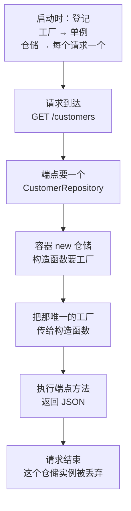
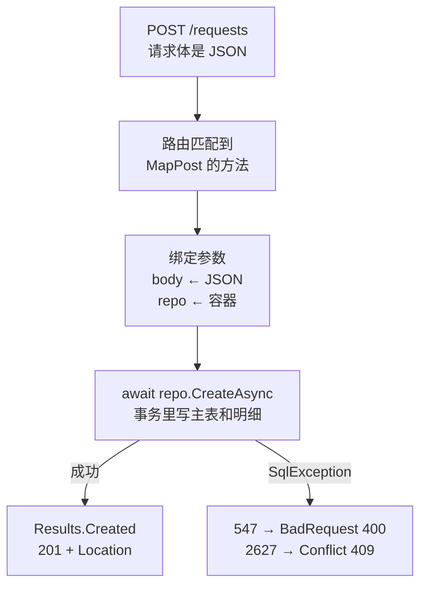
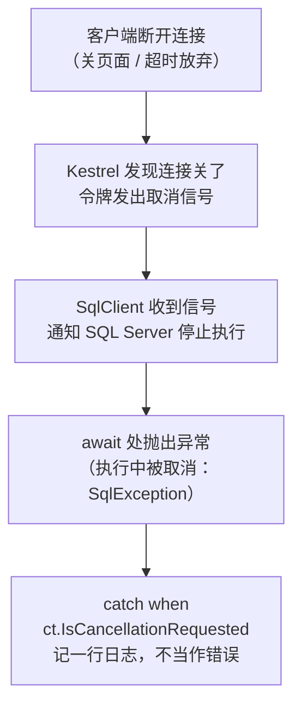

# 第 22 章 在 ASP.NET Core Minimal API 里用 Dapper

## 这一章解决什么问题

前面 21 章的程序都是控制台程序，只有你自己能用。实际工作里，申请单列表要显示在网页上，ERP 要通过接口拿价格数据。这些都要通过 HTTP 调用。

在 WebForm 里，你习惯在 `Page_Load` 里直接 `new SqlConnection`。换到 ASP.NET Core 以后，会遇到三个新问题：

1. 第 16 章的连接工厂和仓储，**由谁来创建、什么时候创建**？
2. 接口里怎么调用仓储，怎么返回 404、201 这些状态码？
3. 用户关掉了浏览器，**数据库里那条 5 秒的查询还在跑吗**？

本章用 Minimal API 回答这三个问题。

## 开始之前

- 前面你已经会了：连接工厂 `IDbConnectionFactory` 和仓储（第 16 章）；`QueryAsync`、`CommandDefinition` + `CancellationToken`（第 14 章）；事务（第 9 章）；`QueryMultiple`（第 12 章）；`SqlException.Number`（第 20 章）。上一章用这些知识排查了 8 个故障。
- 需要的环境：VS 2026 已勾选工作负荷「**ASP.NET 和 Web 开发**」（第 1 章装过）。PriceDemo 库是初始数据。本章不需要额外的 SQL 脚本。
- 预计耗时：90 分钟。

---

## 正文

### 22.1 准备：新建 Web 项目

本章有 3 个例子和 1 个练习，都放在同一个 Web 项目里，每次整个替换 `Program.cs`。

1. 右键解决方案 →「**添加 → 新建项目**」，搜索框输入 `空`，选「**ASP.NET Core 空**」（语言标签 C#）。点「下一步」。
2. 项目名称填 `Ch22Demo`。点「下一步」。
3. 「框架」选 **.NET 10.0（长期支持）**。「配置 HTTPS」可以不勾，本章都用 http，少一个证书环节。其余保持默认，点「创建」。
4. 右键 `Ch22Demo` →「**设为启动项目**」。
5. 用 NuGet 装上 `Dapper` 2.1.89、`Microsoft.Data.SqlClient` 7.1.1、`System.Security.Cryptography.Pkcs` 10.0.13。

> ⚠️ 本节 VS 图形界面操作未实机验证（沙箱没有 VS）。沙箱里用同样内容的 csproj 实测通过。

> 📷 **截图占位 ch22-01**：「添加新项目」窗口，搜索"空"，选中「ASP.NET Core 空」。
<!--  -->

装完后的 csproj：

```xml
<!-- code/ch22/Step1-DI/Step1-DI.csproj（本章各项目的 csproj 都相同） -->
<Project Sdk="Microsoft.NET.Sdk.Web">

  <PropertyGroup>
    <TargetFramework>net10.0</TargetFramework>
    <Nullable>enable</Nullable>
    <ImplicitUsings>enable</ImplicitUsings>
  </PropertyGroup>

  <ItemGroup>
    <PackageReference Include="Dapper" Version="2.1.89" />
    <PackageReference Include="Microsoft.Data.SqlClient" Version="7.1.1" />
    <!-- SqlClient 7.1.1 间接带进来的 Pkcs 9.0.18 有已知漏洞（NU1903 警告），显式升到新版消掉 -->
    <PackageReference Include="System.Security.Cryptography.Pkcs" Version="10.0.13" />
  </ItemGroup>

</Project>
```

和控制台项目比，只差一处：`Sdk="Microsoft.NET.Sdk.Web"`。

| 差异 | 控制台（`Microsoft.NET.Sdk`） | Web（`Microsoft.NET.Sdk.Web`） |
|---|---|---|
| `OutputType` | 要写 `Exe` | 不用写，默认就是可执行程序 |
| ASP.NET Core 框架 | 没有 | 自动引用，不用装 NuGet 包 |
| `appsettings.json` | 要在属性里设「复制到输出目录」（第 16 章） | 自动复制，不用设 |
| 读配置 | 要装 `Microsoft.Extensions.Configuration.Json` | 框架自带，`builder.Configuration` 直接用 |

**模板生成的文件**：

| 文件 | 作用 |
|---|---|
| `Program.cs` | 只有 4 行：创建 builder → Build → 一个返回 "Hello World!" 的 `MapGet("/")` → `Run()` |
| `appsettings.json` | 配置文件，下面要往里加连接串 |
| `appsettings.Development.json` | 开发环境专用的配置，会覆盖 `appsettings.json` 里的同名项。本章不用改 |
| `Properties/launchSettings.json` | 按 F5 / Ctrl+F5 时用的启动设置：端口、环境名 |

把 `appsettings.json` 改成下面这样，**只是加了 `ConnectionStrings` 一段**：

```json
{
  "ConnectionStrings": {
    "PriceDemo": "Server=.;Database=PriceDemo;Integrated Security=True;TrustServerCertificate=True;"
  },
  "Logging": {
    "LogLevel": {
      "Default": "Information",
      "Microsoft.AspNetCore": "Warning"
    }
  },
  "AllowedHosts": "*"
}
```

**端口**：模板会随机生成一个端口（比如 `http://localhost:5123`）。为了和本章的输出一致，把 `Properties/launchSettings.json` 里 `http` 那一段的 `applicationUrl` 改成 `http://localhost:5080`。本章各项目里的 launchSettings.json 都是这样：

```json
{
  "$schema": "https://json.schemastore.org/launchsettings.json",
  "profiles": {
    "http": {
      "commandName": "Project",
      "dotnetRunMessages": true,
      "launchBrowser": false,
      "applicationUrl": "http://localhost:5080",
      "environmentVariables": {
        "ASPNETCORE_ENVIRONMENT": "Development"
      }
    }
  }
}
```

`ASPNETCORE_ENVIRONMENT = Development` 表示"开发环境"。后面会看到，开发环境下框架会多做一些检查，出错时也会把详细信息返回给你。

#### Minimal API 一句话

```csharp
app.MapGet("/customers", (CustomerRepository repo) => repo.GetAll());
```

意思是：**收到 `GET /customers` 请求时，执行后面这个方法，把返回值变成 JSON 发回去。** 它相当于 WebForm 里一个只处理一件事的 `.ashx` 一般处理程序，只是不用写类、不用自己 `Response.Write`。本章只用 `MapGet` 和 `MapPost` 两个方法。

**沙箱里怎么运行**：沙箱没有 VS，用命令行在项目目录启动，再用 `curl` 发请求：

```text
（在 code/ch22/Step1-DI 目录执行）
dotnet run --urls http://127.0.0.1:5080
```

你在 VS 里按 **Ctrl+F5**（「调试 → 开始执行(不调试)」）效果一样。会弹出一个控制台窗口，显示 `Now listening on: http://localhost:5080`，然后用浏览器或者 22.3 节的 `.http` 文件发请求。

---

### 22.2 概念一：依赖注入——注册连接工厂与仓储

**白话定义**：依赖注入（dependency injection，DI，指对象不自己 new 它要用的东西，而是由外部传进来）。在 ASP.NET Core 里，你在启动时把"有人要 X 时给什么"**登记**到一个容器（container）里。之后接口方法的参数、仓储的构造函数要什么，容器就**自动创建好传进去**。

**业务场景**：申请单接口、客户接口、审批接口都要用仓储。每个接口里都写 `new PriceRequestRepository(new SqlConnectionFactory(连接串))`，连接串就散落在各处了。用 DI 以后，连接串只在启动时读一次，仓储由容器创建，接口里只写一个参数。

**反例（什么时候不该用）**：
- 控制台小工具、一次性的数据处理脚本：直接 `new` 就行。第 23 章的控制台项目就没有用 DI。容器带来的好处，要到"很多地方都要用同一批对象"时才明显。
- **不要把 `SqlConnection` 本身注册成单例**。第 16 章讲过，一个连接对象被多个请求同时使用会出错。注册的应该是**工厂**，每次用的时候再 `Create()` 一个新连接。

#### 🖼 图解：一个请求里，容器做了什么



三种生命周期（lifetime，指容器多久换一个新实例）：

| 注册方法 | 多久换一个 | 本章用在 | 为什么 |
|---|---|---|---|
| `AddSingleton` | 整个程序只有一个 | 连接工厂 | 工厂里只存了一个连接串，没有会变的状态，大家共用一个就行 |
| `AddScoped` | 每个 HTTP 请求一个 | 仓储 | 同一个请求里多处要用时是同一个实例；请求结束就丢弃。以后仓储里要放"本次请求的事务"这类东西时也不会串到别的请求 |
| `AddTransient` | 每次要都 new 一个 | 本章不用 | 适合很轻、完全无状态的小对象 |

#### 💻 最小可运行代码

把 `Program.cs` 整个替换成：

```csharp
// code/ch22/Step1-DI/Program.cs
// 依赖注入：启动时注册连接工厂和仓储，接口参数里直接"要"一个仓储
using System.Data;
using Dapper;
using Microsoft.Data.SqlClient;

var builder = WebApplication.CreateBuilder(args);

// ① 连接串从 appsettings.json 的 ConnectionStrings:PriceDemo 读（第 16 章）
string connStr = builder.Configuration.GetConnectionString("PriceDemo")
    ?? throw new InvalidOperationException("appsettings.json 里没有 ConnectionStrings:PriceDemo");

// ② 注册服务：告诉容器"有人要 X 的时候，给他什么、多久换一个"
builder.Services.AddSingleton<IDbConnectionFactory>(new SqlConnectionFactory(connStr)); // 全程一个
builder.Services.AddScoped<CustomerRepository>();                                    // 每个请求一个

var app = builder.Build();

// 参数 CustomerRepository repo：容器发现它已注册，就自动创建一个传进来
app.MapGet("/customers", (CustomerRepository repo) => repo.GetAll());

app.Run();

// ===================== 以下和第 16 章基本相同：连接串的空值检查挪到了上面，构造函数里多了计数输出 =====================

public interface IDbConnectionFactory
{
    IDbConnection Create();
}

public class SqlConnectionFactory : IDbConnectionFactory
{
    private readonly string _connStr;
    public SqlConnectionFactory(string connStr) => _connStr = connStr;
    public IDbConnection Create() => new SqlConnection(_connStr);
}

public class CustomerRepository
{
    private static int _count;                         // 只为演示：数一数容器一共创建了几个实例
    private readonly IDbConnectionFactory _factory;

    // 构造函数要一个 IDbConnectionFactory：容器会把上面注册的那一个单例传进来
    public CustomerRepository(IDbConnectionFactory factory)
    {
        _factory = factory;
        Console.WriteLine($"CustomerRepository 第 {++_count} 个实例，工厂 HashCode = {factory.GetHashCode()}");
    }

    public List<Customer> GetAll()
    {
        using var conn = _factory.Create();
        return conn.Query<Customer>(
            "SELECT Id, Name, City, Level FROM dbo.Customer ORDER BY Id").ToList();
    }
}

public class Customer
{
    public int Id { get; set; }
    public string Name { get; set; } = "";
    public string City { get; set; } = "";
    public string Level { get; set; } = "";
}
```

#### 🔍 拆解运行结果

启动程序，连续发两次 `GET /customers`。实测，客户端收到的（两次相同）：

```text
$ curl -i http://127.0.0.1:5080/customers
HTTP/1.1 200 OK
Content-Type: application/json; charset=utf-8
Server: Kestrel
Transfer-Encoding: chunked

[{"id":1,"name":"华东第一医院","city":"上海","level":"A"},{"id":2,"name":"江南检测中心","city":"杭州","level":"B"},{"id":3,"name":"北方影像诊所","city":"天津","level":"C"}]
```

服务端控制台（实测）：

```text
info: Microsoft.Hosting.Lifetime[14]
      Now listening on: http://127.0.0.1:5080
info: Microsoft.Hosting.Lifetime[0]
      Application started. Press Ctrl+C to shut down.
info: Microsoft.Hosting.Lifetime[0]
      Hosting environment: Development
info: Microsoft.Hosting.Lifetime[0]
      Content root path: /projects/sandbox/.tools/run/ch22-Step1-DI
CustomerRepository 第 1 个实例，工厂 HashCode = 52727599
CustomerRepository 第 2 个实例，工厂 HashCode = 52727599
```

HashCode 的数字每次运行都不一样，`Content root path` 是你的项目目录。

| 看到了什么 | 说明 |
|---|---|
| 两次请求，创建了 2 个仓储 | `AddScoped`：每个请求一个新仓储 |
| 两个仓储拿到的工厂 HashCode 相同 | `AddSingleton`：工厂全程只有一个 |
| 返回的是 JSON 数组 | 端点返回 `List<Customer>`，框架自动序列化。属性名变成了**小驼峰**（`Name` → `name`），这是 ASP.NET Core 的默认规则 |
| 中文原样输出 | 实测 .NET 10 下中文没有被转成 `\uXXXX` |
| `Hosting environment: Development` | 来自 launchSettings.json，下面"改坏 B"会用到 |

**和第 16 章的写法对比**：

| 第 16 章控制台 | 本章 Web |
|---|---|
| `new ConfigurationBuilder()…AddJsonFile(…)` | `builder.Configuration`，框架已经读好了 appsettings.json |
| `var factory = new SqlConnectionFactory(…)` | `AddSingleton<IDbConnectionFactory>(new SqlConnectionFactory(…))` |
| `var customers = new CustomerRepository(factory)` | `AddScoped<CustomerRepository>()`，构造函数的参数由容器填 |
| `customers.GetAll()` | 端点参数 `(CustomerRepository repo)`，调用 `repo.GetAll()` |

仓储类本身**一行都没改**。DI 改变的只是"谁来 new"。

#### 改坏一处试试

**改坏 A**：删掉 `builder.Services.AddScoped<CustomerRepository>();` 这一行。程序能启动，第一次请求时返回 500。实测客户端收到的正文开头：

```text
HTTP/1.1 500 Internal Server Error
Content-Type: text/plain; charset=utf-8

System.InvalidOperationException: Body was inferred but the method does not allow inferred body parameters.
Below is the list of parameters that we found: 

Parameter           | Source                        
---------------------------------------------------------------------------------
repo                | Body (Inferred)


Did you mean to register the "Body (Inferred)" parameter(s) as a Service or apply the [FromServices] or [FromBody] attribute?
```

**怎么读这条报错**：框架要给参数 `repo` 找一个来源。它先看容器里有没有登记 `CustomerRepository`，没有；又不是路由参数、也不是 `int` 这类简单类型，于是**推断**（inferred）它来自请求体（Body）。可 GET 请求不允许从请求体推断参数，所以报错。最后一句已经给出了答案：*是不是忘了把它注册成服务（register … as a Service）？*

**改坏 B**：把两种生命周期反过来，工厂用 `AddScoped`、仓储用 `AddSingleton`：

```csharp
builder.Services.AddScoped<IDbConnectionFactory>(_ => new SqlConnectionFactory(connStr));
builder.Services.AddSingleton<CustomerRepository>();
```

这次程序**根本启动不起来**。实测：

```text
Unhandled exception. System.AggregateException: Some services are not able to be constructed (Error while validating the service descriptor 'ServiceType: CustomerRepository Lifetime: Singleton ImplementationType: CustomerRepository': Cannot consume scoped service 'IDbConnectionFactory' from singleton 'CustomerRepository'.)
```

关键是最后一句：**单例不能使用"每个请求一个"的服务**。单例活得比请求长，它要是拿着某个请求的对象不放，请求结束后那个对象就成了"该丢却没丢"的东西。开发环境（`Development`）下，框架在 `builder.Build()` 时就检查了所有登记，所以一启动就报错。**规则：生命周期长的，只能依赖生命周期一样长或更长的。**

---

### 22.3 概念二：在接口里调用仓储（异步）

**白话定义**：端点方法写成 `async`，`await` 仓储的 `XxxAsync` 方法。返回普通对象，框架就回 200 + JSON；要返回别的状态码，就返回 `Results.NotFound()`、`Results.Created()` 这些。

**业务场景**：申请单详情页用 `GET /requests/1` 取数据，查不到要显示"单据不存在"；新建页点"保存"时 `POST /requests`，主表和明细要么都存上，要么都不存。

**反例（什么时候不该用）**：
- **不要指望 async 让 SQL 变快**。第 14 章讲过，一条 3 秒的查询，用 async 还是 3 秒。async 的好处是等数据库的这 3 秒里，线程可以去处理别的请求。
- **不要在端点里写 `.Result` 或 `.Wait()`** 把异步方法"变成同步"。这样等待期间线程被占住，async 的好处就没了。要么全程 `await`，要么干脆用同步方法。
- 只有一两个简单接口的内部小工具，不必为了"规范"硬造仓储层。直接在端点里用工厂 `Create()` 一个连接查询也可以。

#### 🖼 图解：一个请求从进来到返回



端点参数从哪里来，框架按下面的规则判断：

| 参数 | 写法 | 来源 |
|---|---|---|
| `int id` | 路由模板里有 `{id}` | URL 路径，比如 `/requests/1` 里的 1 |
| `string? applicant` | 简单类型，路由里没有同名的 | 查询字符串 `?applicant=…`（练习会用到） |
| `NewRequest body` | 复杂类型，POST 请求 | 请求体的 JSON |
| `PriceRequestRepository repo` | 在容器里登记过 | 容器 |
| `CancellationToken ct` | 特殊类型 | 本次请求的取消信号（22.4 节） |

#### 💻 最小可运行代码

把 `Program.cs` 整个替换成：

```csharp
// code/ch22/Step2-Endpoints/Program.cs
// 三个接口：客户列表、申请单详情（含明细，查不到 404）、新建申请单（事务）。仓储方法全部异步
using System.Data;
using Dapper;
using Microsoft.Data.SqlClient;

var builder = WebApplication.CreateBuilder(args);

string connStr = builder.Configuration.GetConnectionString("PriceDemo")
    ?? throw new InvalidOperationException("appsettings.json 里没有 ConnectionStrings:PriceDemo");
builder.Services.AddSingleton<IDbConnectionFactory>(new SqlConnectionFactory(connStr));
builder.Services.AddScoped<CustomerRepository>();
builder.Services.AddScoped<PriceRequestRepository>();

var app = builder.Build();

// GET /customers：直接返回列表，框架把它序列化成 JSON 数组，状态码 200
app.MapGet("/customers", async (CustomerRepository repo) => await repo.GetAllAsync());

// GET /requests/1：{id:int} 限定只匹配整数，id 自动从路由里取
app.MapGet("/requests/{id:int}", async (int id, PriceRequestRepository repo) =>
{
    var detail = await repo.GetDetailAsync(id);
    return detail is null
        ? Results.NotFound(new { message = $"申请单 {id} 不存在" })   // 404
        : Results.Ok(detail);                                          // 200
});

// POST /requests：请求体的 JSON 自动反序列化成 NewRequest
app.MapPost("/requests", async (NewRequest body, PriceRequestRepository repo) =>
{
    try
    {
        int id = await repo.CreateAsync(body);
        return Results.Created($"/requests/{id}", new { id });        // 201 + Location 头
    }
    catch (SqlException ex) when (ex.Number == 547)                    // 外键：客户或产品不存在（第 20 章）
    {
        return Results.BadRequest(new { message = "客户或产品不存在，整张单据未保存" });
    }
    catch (SqlException ex) when (ex.Number == 2627)                   // 唯一键：单号重复
    {
        return Results.Conflict(new { message = $"单号 {body.RequestNo} 已存在" });
    }
});

app.Run();

// ===================== 连接工厂（同第 16 章） =====================

public interface IDbConnectionFactory
{
    IDbConnection Create();
}

public class SqlConnectionFactory : IDbConnectionFactory
{
    private readonly string _connStr;
    public SqlConnectionFactory(string connStr) => _connStr = connStr;
    public IDbConnection Create() => new SqlConnection(_connStr);
}

// ===================== 仓储：全部改成 Async 方法（第 14 章） =====================

public class CustomerRepository
{
    private readonly IDbConnectionFactory _factory;
    public CustomerRepository(IDbConnectionFactory factory) => _factory = factory;

    public async Task<List<Customer>> GetAllAsync()
    {
        using var conn = _factory.Create();
        var list = await conn.QueryAsync<Customer>(
            "SELECT Id, Name, City, Level FROM dbo.Customer ORDER BY Id");
        return list.ToList();
    }
}

public class PriceRequestRepository
{
    private readonly IDbConnectionFactory _factory;
    public PriceRequestRepository(IDbConnectionFactory factory) => _factory = factory;

    // 主表 + 明细两个结果集，一次往返（第 12 章）
    public async Task<RequestDetail?> GetDetailAsync(int id)
    {
        using var conn = _factory.Create();
        using var grid = await conn.QueryMultipleAsync(@"
            SELECT r.Id, r.RequestNo, c.Name AS CustomerName, r.Applicant, r.Status, r.CreatedAt, r.Remark
            FROM dbo.PriceRequest r
            JOIN dbo.Customer c ON c.Id = r.CustomerId
            WHERE r.Id = @Id;

            SELECT i.ProductId, p.Name AS ProductName, i.Qty, i.RequestPrice
            FROM dbo.PriceRequestItem i
            JOIN dbo.Product p ON p.Id = i.ProductId
            WHERE i.RequestId = @Id
            ORDER BY i.Id;", new { Id = id });

        var head = await grid.ReadSingleOrDefaultAsync<RequestDetail>();   // 0 行 → null（第 5 章）
        if (head is null) return null;
        head.Items = (await grid.ReadAsync<RequestItemView>()).ToList();
        return head;
    }

    // 主表 + 明细放在一个事务里（第 9 章），返回新单据的 Id（第 6 章 OUTPUT INSERTED.Id）
    public async Task<int> CreateAsync(NewRequest r)
    {
        using var conn = _factory.Create();
        conn.Open();
        using var tx = conn.BeginTransaction();         // 没 Commit 就离开 using → 自动回滚

        int id = await conn.QuerySingleAsync<int>(@"
            INSERT dbo.PriceRequest (RequestNo, CustomerId, Applicant, Remark)
            OUTPUT INSERTED.Id
            VALUES (@RequestNo, @CustomerId, @Applicant, @Remark)",
            new { r.RequestNo, r.CustomerId, r.Applicant, r.Remark }, tx);

        // 传集合：逐条执行，每条都在同一个事务里
        await conn.ExecuteAsync(@"
            INSERT dbo.PriceRequestItem (RequestId, ProductId, Qty, RequestPrice)
            VALUES (@RequestId, @ProductId, @Qty, @RequestPrice)",
            r.Items.Select(i => new { RequestId = id, i.ProductId, i.Qty, i.RequestPrice }), tx);

        tx.Commit();
        return id;
    }
}

// ===================== 数据类 =====================

public class Customer
{
    public int Id { get; set; }
    public string Name { get; set; } = "";
    public string City { get; set; } = "";
    public string Level { get; set; } = "";
}

public class RequestDetail
{
    public int Id { get; set; }
    public string RequestNo { get; set; } = "";
    public string CustomerName { get; set; } = "";
    public string Applicant { get; set; } = "";
    public byte Status { get; set; }
    public DateTime CreatedAt { get; set; }
    public string? Remark { get; set; }
    public List<RequestItemView> Items { get; set; } = new();
}

public class RequestItemView
{
    public int ProductId { get; set; }
    public string ProductName { get; set; } = "";
    public int Qty { get; set; }
    public decimal RequestPrice { get; set; }
}

// POST 请求体：JSON 的属性名不分大小写对上这里（requestNo → RequestNo）
public class NewRequest
{
    public string RequestNo { get; set; } = "";
    public int CustomerId { get; set; }
    public string Applicant { get; set; } = "";
    public string? Remark { get; set; }
    public List<NewItem> Items { get; set; } = new();
}

public class NewItem
{
    public int ProductId { get; set; }
    public int Qty { get; set; }
    public decimal RequestPrice { get; set; }
}
```

#### 用 VS 的 .http 文件发请求

模板没有生成 `.http` 文件时，右键项目 →「添加 → 新建项」，搜索 `http`，选「HTTP 文件」，名字填 `Step2-Endpoints.http`。内容如下（[`code/ch22/Step2-Endpoints/Step2-Endpoints.http`](../code/ch22/Step2-Endpoints/Step2-Endpoints.http)）：

```text
# code/ch22/Step2-Endpoints/Step2-Endpoints.http
# 在 VS 里打开本文件，点每个请求上方的「发送请求」（或右键 → 发送请求）
# 端口要和 Properties/launchSettings.json 里的 applicationUrl 一致
@host = http://localhost:5080

### 1 客户列表
GET {{host}}/customers

### 2 申请单详情（含明细）
GET {{host}}/requests/1

### 3 不存在的申请单 → 404
GET {{host}}/requests/99

### 4 新建申请单 → 201
POST {{host}}/requests
Content-Type: application/json

{
  "requestNo": "PR20261102",
  "customerId": 3,
  "applicant": "王芳",
  "remark": "新客户首单",
  "items": [
    { "productId": 1, "qty": 1, "requestPrice": 172000 },
    { "productId": 3, "qty": 2, "requestPrice": 25000 }
  ]
}

### 5 单号重复 → 409
POST {{host}}/requests
Content-Type: application/json

{ "requestNo": "PR20261102", "customerId": 3, "applicant": "王芳", "items": [] }

### 6 产品不存在 → 400，整张单据回滚
POST {{host}}/requests
Content-Type: application/json

{
  "requestNo": "PR20261103",
  "customerId": 3,
  "applicant": "王芳",
  "items": [
    { "productId": 1, "qty": 1, "requestPrice": 172000 },
    { "productId": 99, "qty": 1, "requestPrice": 1 }
  ]
}
```

先按 Ctrl+F5 启动项目，再打开这个文件，点每个 `###` 下面那一行上方的「**发送请求**」。右边会打开一个窗格显示状态码、响应头和正文。

> 📷 **截图占位 ch22-02**：VS 里打开 `.http` 文件，左边请求上方有「发送请求」链接，右边响应窗格显示 `200 OK` 和 JSON。
<!--  -->

> ⚠️ `.http` 文件的 VS 界面操作未实机验证。沙箱里用 curl 发了完全相同的请求，下面贴的是 curl 的实测结果。

#### 🔍 拆解运行结果

按 `.http` 文件的顺序发请求，实测（为了简短，只保留状态行、Location 头和正文）：

```text
GET /requests/1
HTTP/1.1 200 OK
{"id":1,"requestNo":"PR20261001","customerName":"华东第一医院","applicant":"张伟","status":2,"createdAt":"2026-10-01T09:30:00","remark":"年度框架采购","items":[{"productId":1,"productName":"便携超声主机","qty":2,"requestPrice":165000.00},{"productId":3,"productName":"线阵探头","qty":4,"requestPrice":23000.00}]}

GET /requests/99
HTTP/1.1 404 Not Found
{"message":"申请单 99 不存在"}

POST /requests（PR20261102，2 条明细）
HTTP/1.1 201 Created
Location: /requests/4
{"id":4}

POST /requests（PR20261102 再发一次）
HTTP/1.1 409 Conflict
{"message":"单号 PR20261102 已存在"}

POST /requests（PR20261103，第 2 条明细的产品 99 不存在）
HTTP/1.1 400 Bad Request
{"message":"客户或产品不存在，整张单据未保存"}
```

再查一次新建的单据，`GET /requests/4`（实测，`createdAt` 是你运行时的时间）：

```text
HTTP/1.1 200 OK
{"id":4,"requestNo":"PR20261102","customerName":"北方影像诊所","applicant":"王芳","status":0,"createdAt":"2026-10-23T09:15:22","remark":"新客户首单","items":[{"productId":1,"productName":"便携超声主机","qty":1,"requestPrice":172000.00},{"productId":3,"productName":"线阵探头","qty":2,"requestPrice":25000.00}]}
```

逐个看：

| 请求 | 结果 | 说明 |
|---|---|---|
| `GET /requests/1` | 200，主表 + 2 条明细 | `QueryMultipleAsync` 一次取回两个结果集（第 12 章），`ReadSingleOrDefaultAsync` 读主表 |
| `GET /requests/99` | 404 + 提示 | `ReadSingleOrDefaultAsync` 返回 null（第 5 章），端点返回 `Results.NotFound` |
| `POST` 新建 | 201 + `Location: /requests/4` | `Results.Created` 的第一个参数变成 `Location` 响应头，告诉调用方"新资源在哪里" |
| 单号重复 | 409 | 唯一键冲突 2627，被 `catch … when` 接住（第 20 章） |
| 产品不存在 | 400 | 外键冲突 547。**主表那条 INSERT 已经执行过了，但事务没提交**，`using` 结束时自动回滚（第 9 章） |

**怎么证明 400 那次真的回滚了**：在 SSMS 里查一下（实测）：

```text
Id RequestNo
-- ---------
1 PR20261001
2 PR20261008
3 PR20261015
4 PR20261102
```

没有 `PR20261103`。

**一个容易吓一跳的现象**：接着再新建一张正常的单据（`PR20261104`），实测返回的是 `Location: /requests/7`，不是 5。因为 409 和 400 那两次，主表的 INSERT 都执行过，各占用了一个自增值（5 和 6）。**事务回滚不会退回自增值。** 这是 SQL Server 的正常行为，不是数据丢了。不要拿 Id 是否连续来判断有没有丢数据，单号要连续的话，自己用别的办法生成。

**`GET /requests/abc` 会怎样**：实测返回 `404 Not Found`，正文为空。路由模板写的是 `{id:int}`，`abc` 不是整数，路由根本没匹配上，端点方法都没执行。

**JSON 的几个细节**：

| 现象 | 原因 |
|---|---|
| `status` 是数字 2 | C# 里 `Status` 是 `byte`。想输出成文字，可以用枚举加上 JSON 转换设置，本章不展开 |
| `createdAt` 是 `"2026-10-01T09:30:00"` | `DateTime` 默认按 ISO 8601 格式输出，前端 JavaScript 可以直接解析 |
| `requestPrice` 是 `165000.00` | `decimal` 保留了数据库里的两位小数 |
| 请求体里写 `requestNo`，C# 属性是 `RequestNo` | 反序列化时不分大小写 |

#### 改坏一处试试

把 POST 端点里 `catch (SqlException ex) when (ex.Number == 547)` 那一段删掉，再发第 6 个请求（只带一条产品 99 的明细）。实测客户端收到：

```text
HTTP/1.1 500 Internal Server Error
Content-Type: text/plain; charset=utf-8

Microsoft.Data.SqlClient.SqlException (0x80131904): The INSERT statement conflicted with the FOREIGN KEY constraint "FK__PriceRequ__Produ__7D79703E". The conflict occurred in database "PriceDemo", table "dbo.Product", column 'Id'.
The statement has been terminated.
   at Microsoft.Data.SqlClient.SqlConnection.OnError(SqlException exception, Boolean breakConnection, Action`1 wrapCloseInAction)
```

服务端控制台里的完整记录（实测，行号是改坏后那份文件的）。堆栈里属于你自己代码的只有最后两行：`PriceRequestRepository.CreateAsync`（出错的地方）和 `Program` 里的端点方法（调用它的地方）：

```text
fail: Microsoft.AspNetCore.Diagnostics.DeveloperExceptionPageMiddleware[1]
      An unhandled exception has occurred while executing the request.
      Microsoft.Data.SqlClient.SqlException (0x80131904): The INSERT statement conflicted with the FOREIGN KEY constraint "FK__PriceRequ__Produ__7D79703E". The conflict occurred in database "PriceDemo", table "dbo.Product", column 'Id'.
      The statement has been terminated.
         at Microsoft.Data.SqlClient.SqlConnection.OnError(SqlException exception, Boolean breakConnection, Action`1 wrapCloseInAction)
         at Microsoft.Data.SqlClient.Connection.SqlConnectionInternal.OnError(SqlException exception, Boolean breakConnection, Action`1 wrapCloseInAction)
         at Microsoft.Data.SqlClient.TdsParser.ThrowExceptionAndWarning(TdsParserStateObject stateObj, SqlCommand command, Boolean callerHasConnectionLock, Boolean asyncClose)
         at Microsoft.Data.SqlClient.TdsParser.TryRun(RunBehavior runBehavior, SqlCommand cmdHandler, SqlDataReader dataStream, BulkCopySimpleResultSet bulkCopyHandler, TdsParserStateObject stateObj, Boolean& dataReady)
         at Microsoft.Data.SqlClient.SqlCommand.FinishExecuteReader(SqlDataReader ds, RunBehavior runBehavior, String resetOptionsString, Boolean isInternal, Boolean forDescribeParameterEncryption, Boolean shouldCacheForAlwaysEncrypted)
         at Microsoft.Data.SqlClient.SqlCommand.CompleteAsyncExecuteReader(Boolean isInternal, Boolean forDescribeParameterEncryption)
         at Microsoft.Data.SqlClient.SqlCommand.InternalEndExecuteNonQuery(IAsyncResult asyncResult, Boolean isInternal, String endMethod)
         at Microsoft.Data.SqlClient.SqlCommand.EndExecuteNonQueryInternal(IAsyncResult asyncResult)
         at Microsoft.Data.SqlClient.SqlCommand.EndExecuteNonQueryAsync(IAsyncResult asyncResult)
         at Microsoft.Data.SqlClient.SqlCommand.<>c.<InternalExecuteNonQueryAsync>b__251_1(IAsyncResult asyncResult)
         at System.Threading.Tasks.TaskFactory`1.FromAsyncCoreLogic(IAsyncResult iar, Func`2 endFunction, Action`1 endAction, Task`1 promise, Boolean requiresSynchronization)
      --- End of stack trace from previous location ---
         at Dapper.SqlMapper.ExecuteMultiImplAsync(IDbConnection cnn, CommandDefinition command, IEnumerable multiExec) in /_/Dapper/SqlMapper.Async.cs:line 641
         at PriceRequestRepository.CreateAsync(NewRequest r) in /projects/sandbox/.tools/run/ch22-Step2-Endpoints-bad/Program.cs:line 116
         at Program.<>c.<<<Main>$>b__0_2>d.MoveNext() in /projects/sandbox/.tools/run/ch22-Step2-Endpoints-bad/Program.cs:line 34
```

| 看到了什么 | 说明 |
|---|---|
| 500，正文是完整的异常和堆栈 | 开发环境下，框架的"开发者异常页"把详细信息直接返回给了客户端，方便你调试 |
| `ExecuteMultiImplAsync` | Dapper 里"传集合、逐条执行"的那个方法，说明是写明细时出的错 |
| `PriceRequestRepository.CreateAsync` | 自己的代码，出错就在这个方法里。第 20 章讲过：上面那一大段 SqlClient、Dapper 的内部调用不用看，直接找自己的代码 |

**为什么要自己接住 547**：一是 500 表示"服务器出了毛病"，而这其实是调用方传错了数据，应该回 400；二是正式环境下默认没有开发者异常页，调用方只会收到一个空的 500，不知道错在哪。（⚠️ 正式环境的表现本段未实机验证。）

---

### 22.4 概念三：把取消令牌接到 HTTP 请求

**白话定义**：端点方法加一个 `CancellationToken ct` 参数，框架就会传进来一个令牌，客户端断开连接（关浏览器、刷新、前端超时放弃）时这个令牌会发出取消信号。你把它一路传给 `CommandDefinition`（第 14 章），SQL 就会跟着停。

**业务场景**：月度价格汇总报表接口要跑 5 秒。用户等不及，连续刷新了 3 次。不接令牌的话，服务器上就有 3 条查询都在跑满 5 秒，而前两次的结果已经没人要了。

**反例（什么时候不该用）**：
- **必须做完的操作不要接请求的令牌**。比如审批通过后要写审计日志、发通知：用户关了浏览器，日志也得写完。这类操作传 `CancellationToken.None`，或者放到后台任务里。
- 几毫秒就返回的查询，接不接区别不大。真正要接的是**可能跑好几秒**的查询，比如报表、导出、复杂搜索。

#### 🖼 图解：断开连接以后发生了什么



**注意每一环都要接上**：端点有 `ct` 参数 → 传给仓储方法 → 仓储放进 `CommandDefinition`。哪一环漏了，后面就收不到信号。

#### 💻 最小可运行代码

把 `Program.cs` 整个替换成：

```csharp
// code/ch22/Step3-Cancel/Program.cs
// 取消令牌接到 HTTP 请求上：浏览器关了 / 客户端断开，正在执行的 SQL 跟着停
using System.Data;
using System.Diagnostics;
using Dapper;
using Microsoft.Data.SqlClient;

var builder = WebApplication.CreateBuilder(args);

string connStr = builder.Configuration.GetConnectionString("PriceDemo")
    ?? throw new InvalidOperationException("appsettings.json 里没有 ConnectionStrings:PriceDemo");
builder.Services.AddSingleton<IDbConnectionFactory>(new SqlConnectionFactory(connStr));
builder.Services.AddScoped<ReportRepository>();

var app = builder.Build();

// 端点参数写一个 CancellationToken：框架自动绑定为"这个请求被中止"的信号（HttpContext.RequestAborted）
app.MapGet("/reports/slow", async (ReportRepository repo, CancellationToken ct) =>
{
    var sw = Stopwatch.StartNew();
    try
    {
        int count = await repo.GetSlowReportAsync(ct);
        Console.WriteLine($"[slow] 完成，用时 {sw.Elapsed.TotalSeconds:F1} 秒");
        return Results.Ok(new { count });
    }
    catch (Exception ex) when (ct.IsCancellationRequested)   // 不猜异常类型，问令牌（第 14 章）
    {
        Console.WriteLine($"[slow] 客户端已断开，查询被取消，用时 {sw.Elapsed.TotalSeconds:F1} 秒（{ex.GetType().Name}）");
        return Results.Empty;                                  // 客户端已经不在了，返回什么都收不到
    }
});

// 对照组：同样的查询，不接令牌
app.MapGet("/reports/slow-no-ct", async (ReportRepository repo) =>
{
    var sw = Stopwatch.StartNew();
    int count = await repo.GetSlowReportAsync(CancellationToken.None);
    Console.WriteLine($"[slow-no-ct] 完成，用时 {sw.Elapsed.TotalSeconds:F1} 秒（客户端早就走了）");
    return Results.Ok(new { count });
});

app.Run();

public interface IDbConnectionFactory
{
    IDbConnection Create();
}

public class SqlConnectionFactory : IDbConnectionFactory
{
    private readonly string _connStr;
    public SqlConnectionFactory(string connStr) => _connStr = connStr;
    public IDbConnection Create() => new SqlConnection(_connStr);
}

public class ReportRepository
{
    private readonly IDbConnectionFactory _factory;
    public ReportRepository(IDbConnectionFactory factory) => _factory = factory;

    // 仓储方法多一个 CancellationToken 参数，原样交给 CommandDefinition（第 14 章）
    public async Task<int> GetSlowReportAsync(CancellationToken ct)
    {
        using var conn = _factory.Create();
        var cmd = new CommandDefinition(@"
            WAITFOR DELAY '00:00:05';                 -- 模拟一个要跑 5 秒的报表
            SELECT COUNT(*) FROM dbo.PriceRequest;",
            cancellationToken: ct);
        return await conn.ExecuteScalarAsync<int>(cmd);
    }
}
```

#### 🔍 拆解运行结果

实测发了三个请求：

```text
$ curl -i http://127.0.0.1:5080/reports/slow
HTTP/1.1 200 OK
{"count":3}

$ curl --max-time 1 http://127.0.0.1:5080/reports/slow
（1 秒后 curl 放弃等待，断开连接，没有收到任何内容）

$ curl --max-time 1 http://127.0.0.1:5080/reports/slow-no-ct
（同上）
```

`--max-time 1` 的意思是"最多等 1 秒，到时间就断开"，用来模拟用户关掉了页面。服务端控制台（实测）：

```text
[slow] 完成，用时 5.2 秒
[slow] 客户端已断开，查询被取消，用时 1.0 秒（SqlException）
[slow-no-ct] 完成，用时 5.0 秒（客户端早就走了）
```

| 行 | 说明 |
|---|---|
| 第 1 行 5.2 秒 | 正常等完。比 5 秒多出来的 0.2 秒是程序第一次连数据库、第一次执行查询的准备时间 |
| 第 2 行 1.0 秒 | 客户端在第 1 秒断开，令牌发出信号，SqlClient 让服务器停下。抛出的是 `SqlException`（第 14 章讲过：执行中被取消是 `SqlException`，发出前就取消是 `TaskCanceledException`），所以用 `when (ct.IsCancellationRequested)` 判断，不猜异常类型 |
| 第 3 行 5.0 秒 | 没接令牌：客户端第 1 秒就走了，服务器上的查询还是跑满了 5 秒，结果没人要 |

**`ct` 和请求的关系**：框架传进来的 `ct` 就是 `HttpContext.RequestAborted`。写成参数比在方法里取 `HttpContext` 更简单，仓储也不用知道 HTTP 的存在。它就是一个普通的 `CancellationToken`，第 14 章的控制台程序里怎么用，这里就怎么用。

#### 改坏一处试试

把 `/reports/slow` 里的 `repo.GetSlowReportAsync(ct)` 改成 `repo.GetSlowReportAsync(CancellationToken.None)`：端点参数里还留着 `ct`，但没往下传。它的行为就和对照组 `/reports/slow-no-ct` 完全一样，实测结果就是上面第 3 行：客户端走了，查询照跑 5 秒。

这种写法**编译不报错、运行不报错、功能也正常**，只是取消不起作用。第 14 章也提醒过，`conn.QueryAsync<T>(sql, param)` 这种普通写法没有令牌参数。检查方法：在项目里搜 `CancellationToken ct`，看每个 `ct` 是不是都**被传下去了**；再搜 `QueryAsync`、`ExecuteAsync`，看它们的参数是不是 `CommandDefinition`。

---

## 🧱 类比：WebForm 写法与 Minimal API + Dapper 写法逐项对照

| 要做的事 | WebForm / .ashx（你熟悉的） | Minimal API + Dapper（本章） |
|---|---|---|
| 连接串放哪 | `web.config` 的 `<connectionStrings>`，`ConfigurationManager.ConnectionStrings["PriceDemo"]` | `appsettings.json` 的 `ConnectionStrings`，`builder.Configuration.GetConnectionString("PriceDemo")` |
| 数据访问对象谁来创建 | 每个页面自己 `new` | 启动时登记，容器按生命周期创建、注入 |
| 一个接口 | 一个 `.ashx` 类，`ProcessRequest(HttpContext context)` | 一行 `app.MapGet(路由, 方法)` |
| 取 URL 参数 | `context.Request.QueryString["id"]`，再自己 `int.Parse` | 方法参数 `int id`，框架负责转换 |
| 取请求体 JSON | 读 `InputStream`，`JavaScriptSerializer` 反序列化 | 方法参数 `NewRequest body` |
| 返回 JSON | `JavaScriptSerializer.Serialize` + `Response.Write` | 直接 `return` 对象 |
| 返回 404 | `Response.StatusCode = 404` | `return Results.NotFound(…)` |
| 客户端断开了 | 轮询 `Response.IsClientConnected` | `CancellationToken ct` 参数，传给 `CommandDefinition` |
| 异步 | 很少用（`async` 页面要额外设置） | 端点直接写 `async`，仓储用 `QueryAsync` |

## ⚠️ 踩坑警告

| 现象 | 原因 | 怎么改 |
|---|---|---|
| 500：`Body was inferred but the method does not allow inferred body parameters`（实测） | 端点参数的类型没在容器里登记，框架以为它来自请求体 | 在 `builder.Build()` 之前 `AddScoped<那个类>()` |
| 启动就崩：`Cannot consume scoped service … from singleton …`（实测） | 单例依赖了"每个请求一个"的服务 | 工厂用 Singleton、仓储用 Scoped；规则是长生命周期只能依赖不短于它的 |
| 失败的 POST 之后，新单据的 Id 跳号了（实测：返回 `/requests/7`） | 回滚不退还自增值 | 正常现象，不要用 Id 连续性判断数据完整性 |
| 用户关了页面，数据库里的报表查询还在跑（实测：`slow-no-ct` 跑满 5 秒） | 端点没有 `CancellationToken` 参数，或者有参数但没传下去 | 端点加 `CancellationToken ct`，一路传到 `CommandDefinition` |
| 调用方传错数据，却收到 500 和一大段堆栈（实测） | 外键、唯一键冲突没有接住 | `catch (SqlException ex) when (ex.Number == 547)` 回 400，2627 回 409 |
| `GET /requests/abc` 返回空的 404（实测） | `{id:int}` 约束不匹配，路由没命中 | 正常现象；调用方要传整数 Id |

## 🎯 动手练习

**练习：按申请人查申请单列表**

在 Step3 的基础上（或者新替换一份 `Program.cs`），加一个接口 `GET /requests`：

- 带查询字符串 `?applicant=张伟` 时，只返回这个申请人的单据；不带时返回全部。
- 每个元素包含 `id`、`requestNo`、`applicant`、`status` 四项，按 `id` 排序。
- 端点要接 `CancellationToken`，并且真的传到 `CommandDefinition` 里。
- 条件要按第 13 章的方法拼：只拼固定的 SQL 片段，值走参数。

- 验收标准：三个请求的正文分别**完全一致**：

```text
GET /requests?applicant=张伟
[{"id":1,"requestNo":"PR20261001","applicant":"张伟","status":2},{"id":3,"requestNo":"PR20261015","applicant":"张伟","status":0}]

GET /requests
[{"id":1,"requestNo":"PR20261001","applicant":"张伟","status":2},{"id":2,"requestNo":"PR20261008","applicant":"李娜","status":1},{"id":3,"requestNo":"PR20261015","applicant":"张伟","status":0}]

GET /requests?applicant=赵六
[]
```

- 提示：GET 请求可以直接用浏览器测试，地址栏输入 `http://localhost:5080/requests?applicant=张伟`。

卡住了看文末参考答案。

## 📌 一句话总结

工厂单例、仓储按请求，端点要什么写在参数里，令牌一路传到底。

## 下一章

把全书的知识串成一个完整的控制台程序：价格申请单的列表、查看、新建、提交、查询。

---

<!-- 以下是参考答案，先自己动手，卡住了再往下翻 -->


## 参考答案

**思路**：

- `string? applicant` 是简单类型，路由模板里没有 `{applicant}`，框架就从查询字符串里取；不传时是 `null`。
- 仓储方法用第 13 章的 `WHERE 1 = 1` + `StringBuilder`，有申请人时才拼 `AND Applicant = @Applicant`。参数对象里始终带着 `Applicant`，SQL 里没用到它时也没关系。
- 令牌放进 `CommandDefinition`，用 `QueryAsync<T>(CommandDefinition)` 这个重载。
- 查不到时 `QueryAsync` 返回空集合（第 2 章），序列化出来就是 `[]`，不用特别处理。

完整项目在 [`code/ch22/Exercise/`](../code/ch22/Exercise/)（csproj、appsettings.json、launchSettings.json 与正文相同）。实测（curl 用 `--get --data-urlencode "applicant=张伟"` 来传中文）：

```text
$ curl -i --get --data-urlencode "applicant=张伟" http://127.0.0.1:5080/requests
HTTP/1.1 200 OK
Content-Type: application/json; charset=utf-8

[{"id":1,"requestNo":"PR20261001","applicant":"张伟","status":2},{"id":3,"requestNo":"PR20261015","applicant":"张伟","status":0}]

$ curl -i http://127.0.0.1:5080/requests
HTTP/1.1 200 OK
Content-Type: application/json; charset=utf-8

[{"id":1,"requestNo":"PR20261001","applicant":"张伟","status":2},{"id":2,"requestNo":"PR20261008","applicant":"李娜","status":1},{"id":3,"requestNo":"PR20261015","applicant":"张伟","status":0}]

$ curl -i --get --data-urlencode "applicant=赵六" http://127.0.0.1:5080/requests
HTTP/1.1 200 OK
Content-Type: application/json; charset=utf-8

[]
```

```csharp
// code/ch22/Exercise/Program.cs
// 第 22 章练习参考答案：GET /requests?applicant=张伟，按申请人筛选（可不传），接上取消令牌
using System.Data;
using System.Text;
using Dapper;
using Microsoft.Data.SqlClient;

var builder = WebApplication.CreateBuilder(args);

string connStr = builder.Configuration.GetConnectionString("PriceDemo")
    ?? throw new InvalidOperationException("appsettings.json 里没有 ConnectionStrings:PriceDemo");
builder.Services.AddSingleton<IDbConnectionFactory>(new SqlConnectionFactory(connStr));
builder.Services.AddScoped<PriceRequestRepository>();

var app = builder.Build();

// string? applicant：简单类型、路由里又没有同名参数 → 框架从查询字符串 ?applicant= 里取；不传就是 null
app.MapGet("/requests", async (string? applicant, PriceRequestRepository repo, CancellationToken ct) =>
    await repo.SearchAsync(applicant, ct));

app.Run();

public interface IDbConnectionFactory
{
    IDbConnection Create();
}

public class SqlConnectionFactory : IDbConnectionFactory
{
    private readonly string _connStr;
    public SqlConnectionFactory(string connStr) => _connStr = connStr;
    public IDbConnection Create() => new SqlConnection(_connStr);
}

public class PriceRequestRepository
{
    private readonly IDbConnectionFactory _factory;
    public PriceRequestRepository(IDbConnectionFactory factory) => _factory = factory;

    public async Task<List<RequestBrief>> SearchAsync(string? applicant, CancellationToken ct)
    {
        // 第 13 章：只拼固定的 SQL 片段，值永远走参数
        var sql = new StringBuilder("SELECT Id, RequestNo, Applicant, Status FROM dbo.PriceRequest WHERE 1 = 1");
        if (!string.IsNullOrWhiteSpace(applicant))
            sql.Append(" AND Applicant = @Applicant");
        sql.Append(" ORDER BY Id");

        using var conn = _factory.Create();
        var cmd = new CommandDefinition(sql.ToString(), new { Applicant = applicant }, cancellationToken: ct);
        return (await conn.QueryAsync<RequestBrief>(cmd)).ToList();   // 查不到 → 空列表 → JSON []
    }
}

public class RequestBrief
{
    public int Id { get; set; }
    public string RequestNo { get; set; } = "";
    public string Applicant { get; set; } = "";
    public byte Status { get; set; }
}
```
