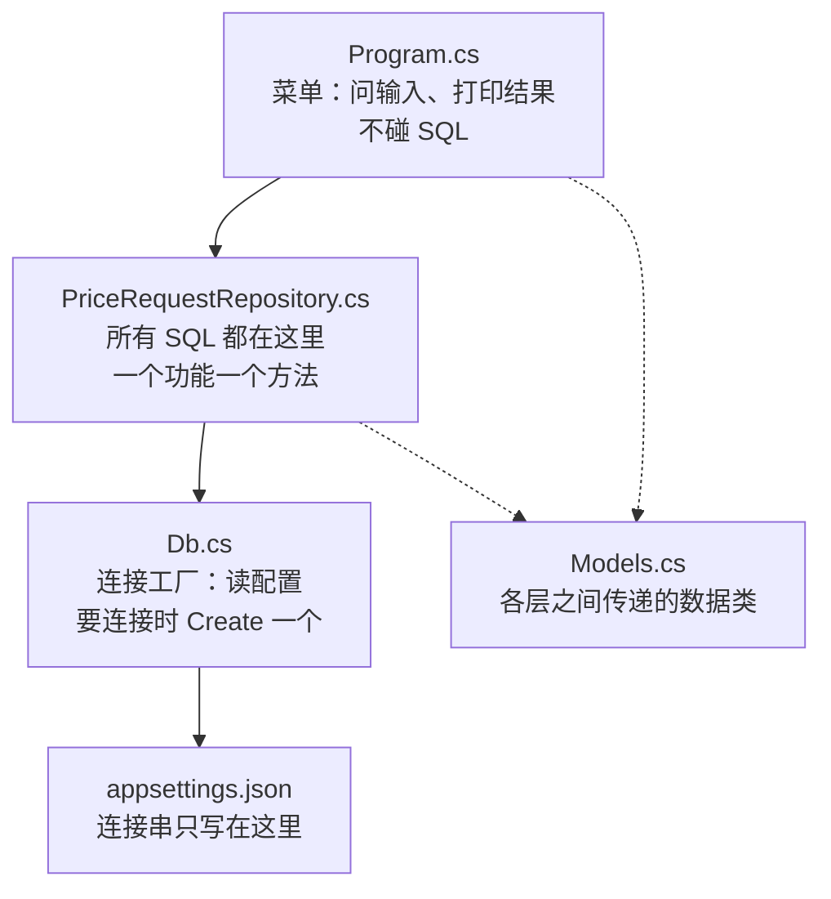
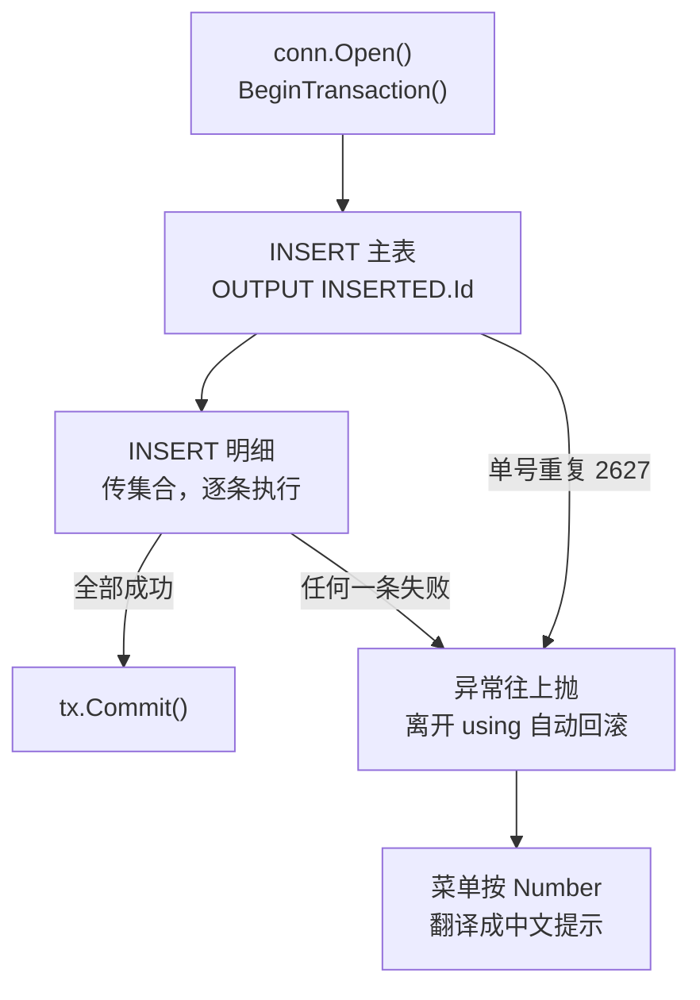
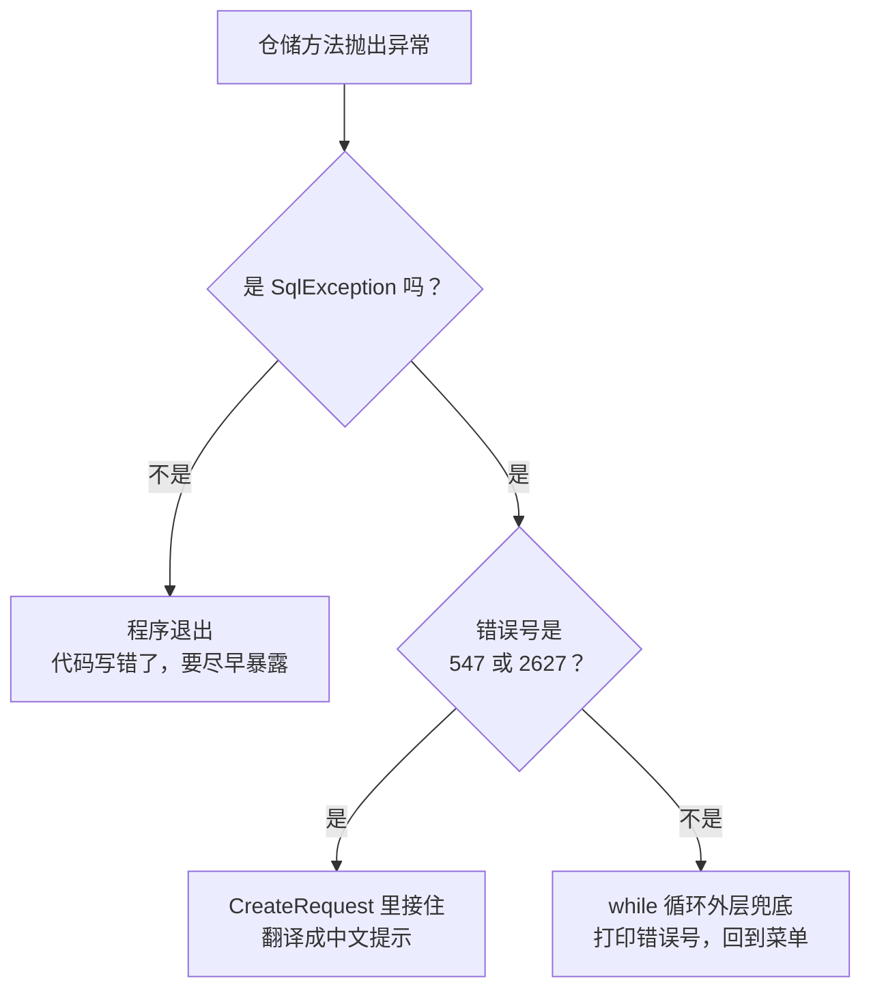

# 第 23 章 综合项目：价格申请单管理

## 这一章解决什么问题

前面 22 章，每章一个知识点，每个例子一个 `Program.cs`。可真正的程序不是这样的：列表、查看、新建、审批放在一起，SQL 有十几条，连接串、事务、存储过程、异常处理交织在一起。知识点都会了，**拼到一起时该怎么组织**？

本章做一个完整的控制台程序「价格申请单管理」，5 个功能，分 4 个文件。不引入新概念，每一行代码都能在前面某一章找到出处。做完以后，你手里就有了一个可以照着改的"样板工程"。

## 开始之前

- 前面你已经会了：第 1–22 章的全部内容。本章主要用到第 5、6、8、9、12、13、16 章，其次是第 7、15、20 章。
- 需要的环境：PriceDemo 库是初始数据；另外要执行本章的脚本 [`code/sql/ch23-project.sql`](../code/sql/ch23-project.sql)（建提交审批用的存储过程，23.2 节）。
- 预计耗时：90–120 分钟。建议分两次：第一次做到 23.6 节（把代码敲完、跑起来），第二次做 23.7 节以后的验证、改坏和练习。

---

## 正文

### 23.1 先看成品：要做什么

运行后是一个菜单，输入数字选功能：

```text
===== 价格申请单管理 =====
1 分页列表  2 查看单据  3 新建申请单  4 提交审批  5 按单号查询  0 退出
请选择：
```

| 菜单 | 功能 | 主要用到 | 出自 |
|---|---|---|---|
| 1 分页列表 | 可按申请人筛选，每页 2 条，显示"第几页 / 共几页" | `OFFSET…FETCH`、动态 WHERE、`DynamicParameters`、`QueryMultiple` | 第 13、12 章 |
| 2 查看单据 | 主表 + 明细 + 审批记录 | `QueryMultiple` 三个结果集、`ReadSingleOrDefault` | 第 12、5 章 |
| 3 新建申请单 | 输入主表信息和多条明细，一起保存 | 事务、`OUTPUT INSERTED.Id`、传集合逐条执行、`SqlException.Number` | 第 9、6、20 章 |
| 4 提交审批 | 草稿 → 待审，写审批记录 | 存储过程、Output 参数、ReturnValue | 第 8 章 |
| 5 按单号查询 | 查一张单的概要 | `QuerySingleOrDefault`、`DbString` | 第 5、15 章 |

#### 🖼 图解：程序分成四层



每一层只认识它下面那一层：

| 层 | 只做什么 | 不做什么 |
|---|---|---|
| `Program.cs` | 读键盘输入、调仓储方法、打印结果、把错误号翻译成提示 | 不写 SQL，不 new 连接 |
| `PriceRequestRepository.cs` | 写 SQL、调 Dapper、管事务 | 不读键盘，不打印 |
| `Db.cs` | 读连接串、创建连接 | 不知道有哪些表 |
| `Models.cs` | 定义数据的形状 | 没有任何逻辑（只有一个状态转中文的小方法） |

**为什么这样分**：改需求时只动一层。比如列表页要多显示一列，只改 SQL 和数据类，菜单不动；以后要做成网站（第 22 章），仓储、工厂、数据类原样拿过去，只把 `Program.cs` 换成 Minimal API 的端点。

---

### 23.2 准备：新建项目与建库脚本

1. 右键解决方案 →「**添加 → 新建项目**」→「控制台应用」，项目名称填 `PriceManager`，框架 **.NET 10.0**。
2. 右键 `PriceManager` →「**设为启动项目**」。
3. NuGet 装 4 个包：`Dapper` 2.1.89、`Microsoft.Data.SqlClient` 7.1.1、`System.Security.Cryptography.Pkcs` 10.0.13、`Microsoft.Extensions.Configuration.Json` 10.0.13（第 16 章用过）。
4. 右键项目 →「添加 → 新建项」→「JSON 文件」，名字 `appsettings.json`。在解决方案资源管理器里选中它，「属性」窗口里把「**复制到输出目录**」改成「**如果较新则复制**」（第 16 章）。
5. 再右键项目 →「添加 → 类」三次，分别建 `Models.cs`、`Db.cs`、`PriceRequestRepository.cs`。

> 📷 **截图占位 ch23-01**：解决方案资源管理器里 `PriceManager` 项目展开，能看到 4 个 .cs 文件和 appsettings.json；右下属性窗口里「复制到输出目录」是「如果较新则复制」。
<!--  -->

csproj（[`code/ch23/PriceManager/PriceManager.csproj`](../code/ch23/PriceManager/PriceManager.csproj)）：

```xml
<Project Sdk="Microsoft.NET.Sdk">

  <PropertyGroup>
    <OutputType>Exe</OutputType>
    <TargetFramework>net10.0</TargetFramework>
    <ImplicitUsings>enable</ImplicitUsings>
    <Nullable>enable</Nullable>
  </PropertyGroup>

  <ItemGroup>
    <PackageReference Include="Dapper" Version="2.1.89" />
    <PackageReference Include="Microsoft.Data.SqlClient" Version="7.1.1" />
    <!-- SqlClient 7.1.1 间接带进来的 Pkcs 9.0.18 有已知漏洞（NU1903 警告），显式升到新版消掉 -->
    <PackageReference Include="System.Security.Cryptography.Pkcs" Version="10.0.13" />
    <!-- 读 appsettings.json：它会顺带引入 Configuration 的基础包，GetConnectionString 就在里面 -->
    <PackageReference Include="Microsoft.Extensions.Configuration.Json" Version="10.0.13" />
  </ItemGroup>

  <ItemGroup>
    <!-- 等于 VS 里 appsettings.json 的属性「复制到输出目录：如果较新则复制」 -->
    <None Update="appsettings.json">
      <CopyToOutputDirectory>PreserveNewest</CopyToOutputDirectory>
    </None>
  </ItemGroup>

</Project>
```

appsettings.json：

```json
{
  "ConnectionStrings": {
    "PriceDemo": "Server=.;Database=PriceDemo;Integrated Security=True;TrustServerCertificate=True;"
  }
}
```

**建库脚本**：在 SSMS 里打开 [`code/sql/ch23-project.sql`](../code/sql/ch23-project.sql)，按 F5 执行。它只建一个存储过程 `Update_PriceRequestSubmit_Proc`，内容和第 8 章 `ch08-procs.sql` 里的同名过程**完全相同**。做过第 8 章的话已经有了，再执行一次也没影响（`CREATE OR ALTER`）。单独给一份，是为了让本章不依赖前面章节的脚本。

```sql
-- code/sql/ch23-project.sql
-- 用途：第 23 章综合项目要用的存储过程。可以反复执行（CREATE OR ALTER）。
-- 过程定义与第 8 章 ch08-procs.sql 里的同名过程完全相同：两个脚本谁先谁后执行都没有影响。
-- 在 SSMS 中连上 PriceDemo 库后整段执行（F5）。

USE PriceDemo;
GO

-- 提交审批：只有"草稿(0)"能提交。改成"待审(1)"并写一条审批记录。
--    @NewStatus（OUTPUT）：执行后单据的状态；单号不存在时为 NULL
--    RETURN 0 = 成功，1 = 失败（单号不存在或不是草稿）
CREATE OR ALTER PROCEDURE dbo.Update_PriceRequestSubmit_Proc
    @RequestNo VARCHAR(20),
    @Operator  NVARCHAR(20),
    @NewStatus TINYINT OUTPUT
AS
BEGIN
    SET NOCOUNT ON;
    DECLARE @Id INT;

    SELECT @Id = Id, @NewStatus = Status
    FROM dbo.PriceRequest
    WHERE RequestNo = @RequestNo;

    IF @Id IS NULL OR @NewStatus <> 0
        RETURN 1;                       -- 失败：@NewStatus 保留查到的当前状态（查不到就是 NULL）

    BEGIN TRAN;                         -- 两条写操作要么都成功要么都不做（事务第 9 章细讲）
        UPDATE dbo.PriceRequest SET Status = 1 WHERE Id = @Id;
        INSERT dbo.ApprovalLog (RequestId, Approver, Action) VALUES (@Id, @Operator, N'提交');
    COMMIT;

    SET @NewStatus = 1;
    RETURN 0;                           -- 成功
END
GO
```

---

### 23.3 第一层：数据类 Models.cs

```csharp
// code/ch23/PriceManager/Models.cs
// 数据类：每个类对应一种"查询结果的形状"，而不是一张表
namespace PriceManager;

// Status 列是 TINYINT，枚举底层类型写 byte 才能直接映射（第 7 章）
public enum RequestStatus : byte
{
    Draft = 0,      // 草稿
    Pending = 1,    // 待审
    Approved = 2,   // 通过
    Rejected = 3,   // 驳回
}

public static class RequestStatusText
{
    // 界面上显示中文；数据库和代码里用枚举，避免到处写魔法数字 0/1/2/3
    public static string ToText(this RequestStatus s) => s switch
    {
        RequestStatus.Draft => "草稿",
        RequestStatus.Pending => "待审",
        RequestStatus.Approved => "通过",
        RequestStatus.Rejected => "驳回",
        _ => $"未知({(byte)s})",
    };
}

// 列表页的一行：主表 + 客户名称 + 金额合计
public class RequestListItem
{
    public int Id { get; set; }
    public string RequestNo { get; set; } = "";
    public string CustomerName { get; set; } = "";
    public string Applicant { get; set; } = "";
    public RequestStatus Status { get; set; }
    public DateTime CreatedAt { get; set; }
    public decimal? Amount { get; set; }          // 没有明细时 SUM 是 NULL，所以用可空类型（第 7 章）
}

// 一页数据 + 总条数
public class PageResult<T>
{
    public int Total { get; set; }
    public List<T> Items { get; set; } = new();
}

// 单据详情：主表 + 明细 + 审批记录
public class RequestDetail
{
    public int Id { get; set; }
    public string RequestNo { get; set; } = "";
    public string CustomerName { get; set; } = "";
    public string Applicant { get; set; } = "";
    public RequestStatus Status { get; set; }
    public DateTime CreatedAt { get; set; }
    public string? Remark { get; set; }
    public List<RequestItemView> Items { get; set; } = new();
    public List<ApprovalLogView> Logs { get; set; } = new();
}

public class RequestItemView
{
    public string ProductCode { get; set; } = "";
    public string ProductName { get; set; } = "";
    public int Qty { get; set; }
    public decimal RequestPrice { get; set; }
    public decimal Amount => Qty * RequestPrice;  // 只读计算属性，Dapper 不会往里写（第 2 章练习）
}

public class ApprovalLogView
{
    public string Approver { get; set; } = "";
    public string Action { get; set; } = "";
    public string? Comment { get; set; }
    public DateTime ActedAt { get; set; }
}

// 新建申请单时，从菜单收集到的输入
public class NewRequest
{
    public string RequestNo { get; set; } = "";
    public int CustomerId { get; set; }
    public string Applicant { get; set; } = "";
    public string? Remark { get; set; }
    public List<NewItem> Items { get; set; } = new();
}

public class NewItem
{
    public int ProductId { get; set; }
    public int Qty { get; set; }
    public decimal RequestPrice { get; set; }
}

// 提交审批的结果：存储过程的 RETURN 值 + OUTPUT 参数（第 8 章）
public class SubmitResult
{
    public bool Success { get; set; }
    public RequestStatus? CurrentStatus { get; set; }   // 单号不存在时为 null
}
```

**设计要点**：

| 写法 | 为什么 | 出自 |
|---|---|---|
| 一个类对应**一种查询结果**，不是一张表 | 列表要客户名称和金额，详情要明细和审批记录，形状不同。硬用一个 `PriceRequest` 类去接，就会有一堆"这个查询里永远是空"的属性 | 第 2 章映射规则 |
| `enum RequestStatus : byte` | `Status` 列是 TINYINT，枚举底层类型写 `byte` 正好对上。代码里写 `RequestStatus.Pending`，比写数字 1 好读 | 第 7 章 |
| `ToText()` 扩展方法 | 枚举是你自己的类型，按第 2 章的说法本可以写成实例方法，但 C# 的枚举里不能写方法，只能用扩展方法 | 第 2 章 |
| `decimal? Amount` | 金额用 `SUM` 子查询算，没有明细时 `SUM` 返回 NULL | 第 7 章 |
| `RequestItemView.Amount => Qty * RequestPrice` | 只读计算属性，Dapper 只给能写的属性赋值，不会报错 | 第 2 章练习 |
| `SubmitResult.CurrentStatus` 是可空的 | 单号不存在时，存储过程的 OUTPUT 参数是 NULL | 第 8 章 |
| 都放在 `namespace PriceManager;` 里 | 4 个文件用同一个命名空间，互相引用不用写 using | — |

---

### 23.4 第二层：连接工厂 Db.cs

```csharp
// code/ch23/PriceManager/Db.cs
// 连接工厂：连接串只在这里读一次，其余代码只管"要一个连接"（第 16 章）
using System.Data;
using Microsoft.Data.SqlClient;
using Microsoft.Extensions.Configuration;

namespace PriceManager;

public interface IDbConnectionFactory
{
    IDbConnection Create();
}

public class SqlConnectionFactory : IDbConnectionFactory
{
    private readonly string _connStr;

    public SqlConnectionFactory(string connStr) => _connStr = connStr;

    // 每次都 new 一个：SqlConnection 很轻，真正的物理连接由连接池复用
    public IDbConnection Create() => new SqlConnection(_connStr);

    // 从输出目录下的 appsettings.json 读 ConnectionStrings:PriceDemo
    public static SqlConnectionFactory FromAppSettings()
    {
        IConfiguration config = new ConfigurationBuilder()
            .SetBasePath(AppContext.BaseDirectory)
            .AddJsonFile("appsettings.json", optional: false)
            .Build();

        string? connStr = config.GetConnectionString("PriceDemo");
        if (string.IsNullOrWhiteSpace(connStr))
            throw new InvalidOperationException("appsettings.json 里没有找到 ConnectionStrings:PriceDemo");
        return new SqlConnectionFactory(connStr);
    }
}
```

和第 16 章的 `SqlConnectionFactory` 相比，只多了一个静态方法 `FromAppSettings()`，把"读配置文件"这件事也收进来。这样 `Program.cs` 里只需要一行就能拿到工厂。

| 写法 | 为什么 | 出自 |
|---|---|---|
| 返回 `IDbConnection` 接口 | 仓储只依赖接口，以后写测试时可以换成别的实现 | 第 16 章 |
| 每次 `Create()` 都 `new` | `SqlConnection` 对象很轻；真正的物理连接由连接池复用，`Dispose` 时还回池里 | 第 16 章 |
| 读不到连接串就抛异常，说清楚是哪一项 | 否则要等到第一次查询时才报一个看不懂的错 | 第 16、20 章 |
| `SetBasePath(AppContext.BaseDirectory)` | 从程序所在的目录（`bin\Debug\net10.0`）找 appsettings.json，所以第 23.2 节第 4 步的"复制到输出目录"必不可少 | 第 16 章 |

---

### 23.5 第三层：仓储 PriceRequestRepository.cs

这是整个程序的核心，所有 SQL 都在这里。

```csharp
// code/ch23/PriceManager/PriceRequestRepository.cs
// 申请单的全部 SQL 都在这里。菜单只调方法，不碰 SQL、不碰连接
using System.Data;
using System.Text;
using Dapper;

namespace PriceManager;

// partial：允许把这个类的方法分写在几个文件里。第 23 章练习会在另一个文件里给它加方法
public partial class PriceRequestRepository
{
    private readonly IDbConnectionFactory _factory;

    public PriceRequestRepository(IDbConnectionFactory factory) => _factory = factory;

    // 菜单 1：分页列表。申请人可选（第 13 章动态条件），总数和当前页一次取回（第 12 章）
    public PageResult<RequestListItem> GetPage(string? applicant, int pageIndex, int pageSize)
    {
        var where = new StringBuilder(" WHERE 1 = 1");
        var p = new DynamicParameters();
        if (!string.IsNullOrWhiteSpace(applicant))
        {
            where.Append(" AND r.Applicant = @Applicant");     // 只拼固定片段，值走参数
            p.Add("Applicant", applicant);
        }
        p.Add("Skip", (pageIndex - 1) * pageSize);
        p.Add("Take", pageSize);

        string sql = $@"
            SELECT COUNT(*) FROM dbo.PriceRequest r{where};

            SELECT r.Id, r.RequestNo, c.Name AS CustomerName, r.Applicant, r.Status, r.CreatedAt,
                   (SELECT SUM(i.Qty * i.RequestPrice)
                    FROM dbo.PriceRequestItem i WHERE i.RequestId = r.Id) AS Amount
            FROM dbo.PriceRequest r
            JOIN dbo.Customer c ON c.Id = r.CustomerId{where}
            ORDER BY r.Id
            OFFSET @Skip ROWS FETCH NEXT @Take ROWS ONLY;";

        using var conn = _factory.Create();
        using var grid = conn.QueryMultiple(sql, p);
        return new PageResult<RequestListItem>
        {
            Total = grid.ReadSingle<int>(),                    // 读的顺序必须和 SQL 里的顺序一致
            Items = grid.Read<RequestListItem>().ToList(),
        };
    }

    // 菜单 2：单据详情 = 主表 + 明细 + 审批记录，三个结果集一次往返（第 12 章）
    public RequestDetail? GetDetail(int id)
    {
        using var conn = _factory.Create();
        using var grid = conn.QueryMultiple(@"
            SELECT r.Id, r.RequestNo, c.Name AS CustomerName, r.Applicant, r.Status, r.CreatedAt, r.Remark
            FROM dbo.PriceRequest r
            JOIN dbo.Customer c ON c.Id = r.CustomerId
            WHERE r.Id = @Id;

            SELECT p.Code AS ProductCode, p.Name AS ProductName, i.Qty, i.RequestPrice
            FROM dbo.PriceRequestItem i
            JOIN dbo.Product p ON p.Id = i.ProductId
            WHERE i.RequestId = @Id
            ORDER BY i.Id;

            SELECT Approver, Action, Comment, ActedAt
            FROM dbo.ApprovalLog
            WHERE RequestId = @Id
            ORDER BY ActedAt, Id;", new { Id = id });

        var head = grid.ReadSingleOrDefault<RequestDetail>();  // 0 行 → null（第 5 章）
        if (head is null) return null;
        head.Items = grid.Read<RequestItemView>().ToList();
        head.Logs = grid.Read<ApprovalLogView>().ToList();
        return head;
    }

    // 菜单 3：新建申请单。主表 + 明细在一个事务里（第 9 章），OUTPUT 取新 Id（第 6 章）
    public int Create(NewRequest r)
    {
        using var conn = _factory.Create();
        conn.Open();                                           // 开事务前必须先打开连接
        using var tx = conn.BeginTransaction();                // 没 Commit 就离开 using → 自动回滚

        int id = conn.QuerySingle<int>(@"
            INSERT dbo.PriceRequest (RequestNo, CustomerId, Applicant, Remark)
            OUTPUT INSERTED.Id
            VALUES (@RequestNo, @CustomerId, @Applicant, @Remark)",
            new { r.RequestNo, r.CustomerId, r.Applicant, r.Remark }, tx);

        conn.Execute(@"
            INSERT dbo.PriceRequestItem (RequestId, ProductId, Qty, RequestPrice)
            VALUES (@RequestId, @ProductId, @Qty, @RequestPrice)",
            r.Items.Select(i => new { RequestId = id, i.ProductId, i.Qty, i.RequestPrice }), tx);

        tx.Commit();
        return id;
    }

    // 菜单 4：提交审批。调存储过程，读 RETURN 值和 OUTPUT 参数（第 8 章）
    public SubmitResult Submit(string requestNo, string operatorName)
    {
        var p = new DynamicParameters();
        p.Add("RequestNo", requestNo, DbType.AnsiString, size: 20);   // 过程参数是 VARCHAR(20)
        p.Add("Operator", operatorName);
        p.Add("NewStatus", dbType: DbType.Byte, direction: ParameterDirection.Output);
        p.Add("Ret", dbType: DbType.Int32, direction: ParameterDirection.ReturnValue);

        using var conn = _factory.Create();
        conn.Execute("dbo.Update_PriceRequestSubmit_Proc", p, commandType: CommandType.StoredProcedure);

        // Output / ReturnValue 要在执行之后才能取
        return new SubmitResult
        {
            Success = p.Get<int>("Ret") == 0,
            CurrentStatus = (RequestStatus?)p.Get<byte?>("NewStatus"),
        };
    }

    // 菜单 5：按单号查一张。单号有唯一约束，最多一行（第 5 章）
    public RequestListItem? GetByNo(string requestNo)
    {
        using var conn = _factory.Create();
        return conn.QuerySingleOrDefault<RequestListItem>(@"
            SELECT r.Id, r.RequestNo, c.Name AS CustomerName, r.Applicant, r.Status, r.CreatedAt,
                   (SELECT SUM(i.Qty * i.RequestPrice)
                    FROM dbo.PriceRequestItem i WHERE i.RequestId = r.Id) AS Amount
            FROM dbo.PriceRequest r
            JOIN dbo.Customer c ON c.Id = r.CustomerId
            WHERE r.RequestNo = @RequestNo",
            new { RequestNo = new DbString { Value = requestNo, IsAnsi = true, Length = 20 } }); // 第 15 章
    }
}
```

逐个方法看：

| 方法 | 菜单 | 用到的 Dapper 写法 | 关键点 | 出自 |
|---|---|---|---|---|
| `GetPage` | 1 | `DynamicParameters` + `QueryMultiple` + `ReadSingle<int>` + `Read<T>` | `where` 片段**同时用在总数和当前页**两条 SQL 里，保证条件一致（第 21 章场景 5）；值永远走参数 | 第 12、13 章 |
| `GetDetail` | 2 | `QueryMultiple` 三个结果集 + `ReadSingleOrDefault<T>` | 主表查不到时直接返回 null，剩下两个结果集不读也可以，`using` 会释放 | 第 5、12 章 |
| `Create` | 3 | `BeginTransaction` + `QuerySingle<int>`（OUTPUT）+ `Execute`（传集合） | 先 `Open`；**每条命令都传 `tx`**；没走到 `Commit` 就自动回滚 | 第 6、9 章 |
| `Submit` | 4 | `Execute` + `commandType: StoredProcedure` + `DynamicParameters`（Output、ReturnValue） | 执行**之后**才能 `Get`；Output 可能是 NULL，所以 `Get<byte?>` | 第 8 章 |
| `GetByNo` | 5 | `QuerySingleOrDefault<T>` + `DbString` | 单号有唯一约束，最多一行；单号列是 varchar，参数也按 varchar 发送，避免隐式转换 | 第 5、15 章 |

#### 🖼 图解：新建申请单（菜单 3）的事务



**为什么 `Create` 里没有 `try/catch`**：仓储只负责"做"，出错就把异常原样往上抛；`using var tx` 保证没提交的事务一定回滚。至于出错以后**对用户说什么**，是菜单的事，所以 `catch … when (ex.Number == 547)` 写在 `Program.cs` 里。这样同一个仓储方法，放到网站里时可以翻译成 400，放到控制台里就打印一行中文。

**为什么用 `partial class`**：现在只有一个文件，`partial` 没有任何作用。加上它，是为了本章练习可以**新建一个文件**给这个类加方法，不用改动原文件。

---

### 23.6 第四层：菜单 Program.cs

```csharp
// code/ch23/PriceManager/Program.cs
// 控制台菜单：只负责"问用户要输入、把结果打印出来"，数据访问全部交给仓储
using Microsoft.Data.SqlClient;
using PriceManager;

const int PageSize = 2;                                  // 每页 2 条：示例库只有 3 张单，方便看到翻页

var repo = new PriceRequestRepository(SqlConnectionFactory.FromAppSettings());

while (true)
{
    Console.WriteLine();
    Console.WriteLine("===== 价格申请单管理 =====");
    Console.WriteLine("1 分页列表  2 查看单据  3 新建申请单  4 提交审批  5 按单号查询  0 退出");
    string? choice = Ask("请选择：");
    if (choice is null or "0") break;                    // null：输入流结束（管道输入读完了）

    try
    {
        switch (choice)
        {
            case "1": ShowPage(); break;
            case "2": ShowDetail(); break;
            case "3": CreateRequest(); break;
            case "4": SubmitRequest(); break;
            case "5": FindByNo(); break;
            default: Console.WriteLine("没有这个选项"); break;
        }
    }
    catch (SqlException ex)                              // 兜底：数据库报错不让程序退出，打印错误号方便查（第 20 章）
    {
        Console.WriteLine($"数据库错误 {ex.Number}：{ex.Message}");
    }
}
Console.WriteLine("再见");

// ---------- 菜单 1 ----------
void ShowPage()
{
    string? applicant = Ask("申请人（直接回车 = 全部）：");
    int page = Math.Max(1, AskInt("页码：") ?? 1);              // 不填或填 0 都按第 1 页
    var result = repo.GetPage(applicant, page, PageSize);

    int pageCount = (result.Total + PageSize - 1) / PageSize;   // 总页数向上取整
    Console.WriteLine($"第 {page}/{pageCount} 页，共 {result.Total} 条");
    foreach (var r in result.Items)
        Console.WriteLine($"  {r.Id,-3}{r.RequestNo,-12}{r.CustomerName,-8}{r.Applicant,-4}" +
                          $"{r.Status.ToText(),-4}{r.CreatedAt:yyyy-MM-dd}{r.Amount ?? 0,14:N2}");
    if (result.Items.Count == 0) Console.WriteLine("  （这一页没有数据）");
}

// ---------- 菜单 2 ----------
void ShowDetail()
{
    int? id = AskInt("申请单 Id：");
    if (id is null) return;
    var d = repo.GetDetail(id.Value);
    if (d is null) { Console.WriteLine($"找不到 Id = {id} 的申请单"); return; }

    Console.WriteLine($"单号 {d.RequestNo}  客户 {d.CustomerName}  申请人 {d.Applicant}  状态 {d.Status.ToText()}");
    Console.WriteLine($"创建 {d.CreatedAt:yyyy-MM-dd HH:mm}  备注 {d.Remark ?? "（无）"}");
    Console.WriteLine("  明细：");
    foreach (var i in d.Items)
        Console.WriteLine($"    {i.ProductCode,-8}{i.ProductName,-8}{i.Qty,3} × {i.RequestPrice,12:N2} = {i.Amount,12:N2}");
    Console.WriteLine($"    合计 {d.Items.Sum(i => i.Amount):N2}");
    Console.WriteLine("  审批记录：");
    foreach (var l in d.Logs)
        Console.WriteLine($"    {l.ActedAt:yyyy-MM-dd HH:mm}  {l.Approver}  {l.Action}  {l.Comment}");
    if (d.Logs.Count == 0) Console.WriteLine("    （无）");
}

// ---------- 菜单 3 ----------
void CreateRequest()
{
    var r = new NewRequest
    {
        RequestNo = Ask("单号：") ?? "",
        CustomerId = AskInt("客户 Id：") ?? 0,
        Applicant = Ask("申请人：") ?? "",
    };
    string? remark = Ask("备注（可空）：");
    r.Remark = string.IsNullOrWhiteSpace(remark) ? null : remark;   // 空字符串存成 NULL

    while (true)
    {
        string? line = Ask("明细（产品Id 数量 单价，直接回车结束）：");
        if (string.IsNullOrWhiteSpace(line)) break;
        string[] parts = line.Split(' ', StringSplitOptions.RemoveEmptyEntries);
        if (parts.Length == 3 && int.TryParse(parts[0], out int pid)
            && int.TryParse(parts[1], out int qty) && decimal.TryParse(parts[2], out decimal price))
            r.Items.Add(new NewItem { ProductId = pid, Qty = qty, RequestPrice = price });
        else
            Console.WriteLine("  格式不对，这一行没有加入。例：1 2 165000");
    }
    if (r.Items.Count == 0) { Console.WriteLine("至少要有一条明细，已取消"); return; }

    try
    {
        int id = repo.Create(r);
        Console.WriteLine($"新建成功：Id = {id}，单号 {r.RequestNo}，明细 {r.Items.Count} 条");
    }
    catch (SqlException ex) when (ex.Number == 547)      // 外键：客户或产品不存在
    {
        Console.WriteLine("客户或产品不存在，整张单据没有保存（已回滚）");
    }
    catch (SqlException ex) when (ex.Number == 2627)     // 唯一键：单号重复
    {
        Console.WriteLine($"单号 {r.RequestNo} 已存在，请换一个");
    }
}

// ---------- 菜单 4 ----------
void SubmitRequest()
{
    string no = Ask("单号：") ?? "";
    string op = Ask("操作人：") ?? "";
    var result = repo.Submit(no, op);

    if (result.Success)
        Console.WriteLine($"提交成功，当前状态：{result.CurrentStatus!.Value.ToText()}");
    else if (result.CurrentStatus is null)
        Console.WriteLine($"提交失败：单号 {no} 不存在");
    else
        Console.WriteLine($"提交失败：当前状态是「{result.CurrentStatus.Value.ToText()}」，只有草稿能提交");
}

// ---------- 菜单 5 ----------
void FindByNo()
{
    string no = Ask("单号：") ?? "";
    var r = repo.GetByNo(no);
    Console.WriteLine(r is null
        ? $"找不到单号 {no}"
        : $"Id {r.Id}  {r.RequestNo}  {r.CustomerName}  {r.Applicant}  {r.Status.ToText()}  金额 {r.Amount ?? 0:N2}");
}

// ---------- 读输入 ----------
// 输入来自管道（printf … | dotnet run）时，键入的内容不会显示在屏幕上，这里补打一遍，输出才看得懂
static string? Ask(string prompt)
{
    Console.Write(prompt);
    string? line = Console.ReadLine();
    if (Console.IsInputRedirected) Console.WriteLine(line);
    return line?.Trim();
}

static int? AskInt(string prompt)
{
    string? s = Ask(prompt);
    if (int.TryParse(s, out int n)) return n;
    if (!string.IsNullOrEmpty(s)) Console.WriteLine("  请输入数字");
    return null;
}
```

#### 🖼 图解：一个异常最后去了哪里



**设计要点**：

| 写法 | 为什么 |
|---|---|
| 程序开头只 `new` 一次仓储 | 控制台程序只有一个用户，不需要第 22 章的依赖注入容器 |
| `while (true)` 外面套一个 `catch (SqlException)` | 兜底：没预料到的数据库错误不会让程序退出，而是打印错误号继续运行（23.8 节改坏 2 会用到） |
| `CreateRequest` 里单独 `catch … when (ex.Number == 547 / 2627)` | 预料得到的错误，翻译成用户看得懂的话。没列出来的错误号会继续往外抛，被外层兜底 |
| `Ask` 返回 `null` 时退出 | 键盘输入时不会出现 null；输入来自管道（下一节）时，读完了就是 null |
| `Console.IsInputRedirected` 时补打输入 | 管道输入不会显示在屏幕上，补打一遍，输出才看得出"输入了什么" |
| `Math.Max(1, …)` | 页码填 0 或负数时，`OFFSET` 会算出负数，SQL Server 报 10742（实测：`The offset specified in a OFFSET clause may not be negative.`）。界面这一层先挡住 |
| 空备注存成 NULL | 直接回车得到的是空字符串。"没填"和"填了空字符串"在数据库里应该是同一个意思，统一成 NULL |

---

### 23.7 跑一遍：五个功能逐个验证

在 VS 里按 Ctrl+F5，按提示输入就行。

为了让结果可以重复，沙箱里是**用管道把输入一次喂进去**的。命令是这样（在 `code/ch23/PriceManager` 目录执行，`\n` 表示回车）：

```text
printf '1\n\n1\n1\n\n2\n1\n张伟\n1\n2\n1\n2\n99\n0\n' | dotnet run
```

每次验证前，都先重跑了 `00-reset-database.sql`，所以你照着输入，结果应该一模一样（日期时间除外）。

#### 菜单 1、2：列表与详情

输入顺序：全部第 1 页 → 全部第 2 页 → 张伟第 1 页 → 查看 Id 1 → 查看 Id 99 → 退出。实测输出：

```text

===== 价格申请单管理 =====
1 分页列表  2 查看单据  3 新建申请单  4 提交审批  5 按单号查询  0 退出
请选择：1
申请人（直接回车 = 全部）：
页码：1
第 1/2 页，共 3 条
  1  PR20261001  华东第一医院  张伟  通过  2026-10-01    422,000.00
  2  PR20261008  江南检测中心  李娜  待审  2026-10-08    395,000.00

===== 价格申请单管理 =====
1 分页列表  2 查看单据  3 新建申请单  4 提交审批  5 按单号查询  0 退出
请选择：1
申请人（直接回车 = 全部）：
页码：2
第 2/2 页，共 3 条
  3  PR20261015  华东第一医院  张伟  草稿  2026-10-15     94,000.00

===== 价格申请单管理 =====
1 分页列表  2 查看单据  3 新建申请单  4 提交审批  5 按单号查询  0 退出
请选择：1
申请人（直接回车 = 全部）：张伟
页码：1
第 1/1 页，共 2 条
  1  PR20261001  华东第一医院  张伟  通过  2026-10-01    422,000.00
  3  PR20261015  华东第一医院  张伟  草稿  2026-10-15     94,000.00

===== 价格申请单管理 =====
1 分页列表  2 查看单据  3 新建申请单  4 提交审批  5 按单号查询  0 退出
请选择：2
申请单 Id：1
单号 PR20261001  客户 华东第一医院  申请人 张伟  状态 通过
创建 2026-10-01 09:30  备注 年度框架采购
  明细：
    US-100  便携超声主机    2 ×   165,000.00 =   330,000.00
    PB-01   线阵探头      4 ×    23,000.00 =    92,000.00
    合计 422,000.00
  审批记录：
    2026-10-01 09:35  张伟  提交  
    2026-10-02 11:00  王经理  通过  同意框架价

===== 价格申请单管理 =====
1 分页列表  2 查看单据  3 新建申请单  4 提交审批  5 按单号查询  0 退出
请选择：2
申请单 Id：99
找不到 Id = 99 的申请单

===== 价格申请单管理 =====
1 分页列表  2 查看单据  3 新建申请单  4 提交审批  5 按单号查询  0 退出
请选择：0
再见
```

（中文在控制台里占两个字符宽，列对不齐，不影响结果。）

> 📷 **截图占位 ch23-02**：VS 按 Ctrl+F5 后的控制台窗口，显示菜单和"第 1/2 页，共 3 条"的列表。
<!--  -->

| 看到了什么 | 对应的代码 |
|---|---|
| 3 张单子，每页 2 条，共 2 页 | `PageSize = 2`；总页数 = (3 + 2 − 1) ÷ 2 = 2（整数除法，向上取整） |
| 金额 422,000 / 395,000 / 94,000 | `SUM(Qty * RequestPrice)` 子查询。第 1 单 = 2 × 165,000 + 4 × 23,000 |
| 张伟筛选后"共 2 条" | 动态 WHERE 同时作用在总数和当前页上 |
| 状态显示"通过、待审、草稿" | TINYINT → `RequestStatus` 枚举 → `ToText()` |
| 详情里两条审批记录 | 第三个结果集；第一条的意见是 NULL，打印出来是空的 |
| Id 99 | `ReadSingleOrDefault` 返回 null |

#### 菜单 3：新建申请单

输入顺序：新建 PR20261101（2 条明细）→ 新建 PR20261102（第 2 条明细的产品 99 不存在）→ 再建一张 PR20261101（单号重复）→ 新建 PR20261103（明细格式写错）→ 查看 Id 4 → 列表第 2 页 → 退出。

```text
printf '3\nPR20261101\n3\n王芳\n新客户首单\n1 1 172000\n3 2 25000\n\n3\nPR20261102\n3\n王芳\n\n1 1 172000\n99 1 100\n\n3\nPR20261101\n2\n李娜\n\n4 1 23000\n\n3\nPR20261103\n2\n李娜\n\n4 一 23000\n\n2\n4\n1\n\n2\n0\n' | dotnet run
```

实测输出：

```text

===== 价格申请单管理 =====
1 分页列表  2 查看单据  3 新建申请单  4 提交审批  5 按单号查询  0 退出
请选择：3
单号：PR20261101
客户 Id：3
申请人：王芳
备注（可空）：新客户首单
明细（产品Id 数量 单价，直接回车结束）：1 1 172000
明细（产品Id 数量 单价，直接回车结束）：3 2 25000
明细（产品Id 数量 单价，直接回车结束）：
新建成功：Id = 4，单号 PR20261101，明细 2 条

===== 价格申请单管理 =====
1 分页列表  2 查看单据  3 新建申请单  4 提交审批  5 按单号查询  0 退出
请选择：3
单号：PR20261102
客户 Id：3
申请人：王芳
备注（可空）：
明细（产品Id 数量 单价，直接回车结束）：1 1 172000
明细（产品Id 数量 单价，直接回车结束）：99 1 100
明细（产品Id 数量 单价，直接回车结束）：
客户或产品不存在，整张单据没有保存（已回滚）

===== 价格申请单管理 =====
1 分页列表  2 查看单据  3 新建申请单  4 提交审批  5 按单号查询  0 退出
请选择：3
单号：PR20261101
客户 Id：2
申请人：李娜
备注（可空）：
明细（产品Id 数量 单价，直接回车结束）：4 1 23000
明细（产品Id 数量 单价，直接回车结束）：
单号 PR20261101 已存在，请换一个

===== 价格申请单管理 =====
1 分页列表  2 查看单据  3 新建申请单  4 提交审批  5 按单号查询  0 退出
请选择：3
单号：PR20261103
客户 Id：2
申请人：李娜
备注（可空）：
明细（产品Id 数量 单价，直接回车结束）：4 一 23000
  格式不对，这一行没有加入。例：1 2 165000
明细（产品Id 数量 单价，直接回车结束）：
至少要有一条明细，已取消

===== 价格申请单管理 =====
1 分页列表  2 查看单据  3 新建申请单  4 提交审批  5 按单号查询  0 退出
请选择：2
申请单 Id：4
单号 PR20261101  客户 北方影像诊所  申请人 王芳  状态 草稿
创建 2026-10-23 09:14  备注 新客户首单
  明细：
    US-100  便携超声主机    1 ×   172,000.00 =   172,000.00
    PB-01   线阵探头      2 ×    25,000.00 =    50,000.00
    合计 222,000.00
  审批记录：
    （无）

===== 价格申请单管理 =====
1 分页列表  2 查看单据  3 新建申请单  4 提交审批  5 按单号查询  0 退出
请选择：1
申请人（直接回车 = 全部）：
页码：2
第 2/2 页，共 4 条
  3  PR20261015  华东第一医院  张伟  草稿  2026-10-15     94,000.00
  4  PR20261101  北方影像诊所  王芳  草稿  2026-10-23    222,000.00

===== 价格申请单管理 =====
1 分页列表  2 查看单据  3 新建申请单  4 提交审批  5 按单号查询  0 退出
请选择：0
再见
```

| 看到了什么 | 说明 |
|---|---|
| 新建成功，Id = 4 | `OUTPUT INSERTED.Id` 直接拿回新 Id。状态"草稿"、创建时间是表上的默认值（`Status` 默认 0，`CreatedAt` 默认当前时间） |
| 产品 99 → "已回滚" | 主表已插入、第 1 条明细已插入，第 2 条报 547；事务回滚，列表里**没有** PR20261102，总数是 4 不是 5 |
| 单号重复 → "已存在" | 唯一键 2627。这一次是第一条 INSERT 就失败了 |
| `4 一 23000` → 格式不对 | 在 C# 里就挡住了，没有发到数据库 |
| 最后列表"共 4 条" | 只有成功的那一张进了库 |

#### 菜单 4、5：提交审批与按单号查询

输入顺序：提交 PR20261015（草稿）→ 提交 PR20261001（已通过）→ 提交 PR99999999（不存在）→ 查看 Id 3 → 按单号查 PR20261015 → 按单号查 PR404 → 退出。

```text
printf '4\nPR20261015\n张伟\n4\nPR20261001\n张伟\n4\nPR99999999\n张伟\n2\n3\n5\nPR20261015\n5\nPR404\n0\n' | dotnet run
```

实测输出：

```text

===== 价格申请单管理 =====
1 分页列表  2 查看单据  3 新建申请单  4 提交审批  5 按单号查询  0 退出
请选择：4
单号：PR20261015
操作人：张伟
提交成功，当前状态：待审

===== 价格申请单管理 =====
1 分页列表  2 查看单据  3 新建申请单  4 提交审批  5 按单号查询  0 退出
请选择：4
单号：PR20261001
操作人：张伟
提交失败：当前状态是「通过」，只有草稿能提交

===== 价格申请单管理 =====
1 分页列表  2 查看单据  3 新建申请单  4 提交审批  5 按单号查询  0 退出
请选择：4
单号：PR99999999
操作人：张伟
提交失败：单号 PR99999999 不存在

===== 价格申请单管理 =====
1 分页列表  2 查看单据  3 新建申请单  4 提交审批  5 按单号查询  0 退出
请选择：2
申请单 Id：3
单号 PR20261015  客户 华东第一医院  申请人 张伟  状态 待审
创建 2026-10-15 10:00  备注 追加探头
  明细：
    PB-01   线阵探头      2 ×    24,500.00 =    49,000.00
    PB-02   凸阵探头      2 ×    22,500.00 =    45,000.00
    合计 94,000.00
  审批记录：
    2026-10-23 09:14  张伟  提交  

===== 价格申请单管理 =====
1 分页列表  2 查看单据  3 新建申请单  4 提交审批  5 按单号查询  0 退出
请选择：5
单号：PR20261015
Id 3  PR20261015  华东第一医院  张伟  待审  金额 94,000.00

===== 价格申请单管理 =====
1 分页列表  2 查看单据  3 新建申请单  4 提交审批  5 按单号查询  0 退出
请选择：5
单号：PR404
找不到单号 PR404

===== 价格申请单管理 =====
1 分页列表  2 查看单据  3 新建申请单  4 提交审批  5 按单号查询  0 退出
请选择：0
再见
```

存储过程的三种结果，和 `SubmitResult` 的对应关系：

| 情况 | RETURN 值 | `@NewStatus` | `Success` | `CurrentStatus` | 菜单显示 |
|---|---|---|---|---|---|
| 草稿 → 提交 | 0 | 1 | true | Pending | 提交成功，当前状态：待审 |
| 已通过 | 1 | 2（查到的当前状态） | false | Approved | 当前状态是「通过」 |
| 单号不存在 | 1 | NULL | false | null | 单号不存在 |

**同样是"失败"，靠 OUTPUT 参数区分原因**。如果过程只返回 0/1，菜单就只能说"提交失败"，用户不知道该怎么办。

---

### 23.8 改坏三处试试

**改坏 1：明细的 `Execute` 漏传 `tx`**

把 `Create` 里明细那条 `conn.Execute(…, r.Items.Select(…), tx);` 末尾的 `, tx` 删掉，新建一张单。实测：

```text
明细（产品Id 数量 单价，直接回车结束）：
Unhandled exception. System.InvalidOperationException: ExecuteNonQuery requires the command to have a transaction when the connection assigned to the command is in a pending local transaction.  The Transaction property of the command has not been initialized.
   at Microsoft.Data.SqlClient.SqlCommand.ValidateCommand(Boolean isAsync, String method)
   at Microsoft.Data.SqlClient.SqlCommand.InternalExecuteNonQuery(TaskCompletionSource`1 completion, Boolean sendToPipe, Int32 timeout, Boolean& usedCache, Boolean asyncWrite, Boolean isRetry, String methodName)
   at Microsoft.Data.SqlClient.SqlCommand.ExecuteNonQuery()
   at Dapper.SqlMapper.ExecuteImpl(IDbConnection cnn, CommandDefinition& command) in /_/Dapper/SqlMapper.cs:line 673
   at Dapper.SqlMapper.Execute(IDbConnection cnn, String sql, Object param, IDbTransaction transaction, Nullable`1 commandTimeout, Nullable`1 commandType) in /_/Dapper/SqlMapper.cs:line 562
   at PriceManager.PriceRequestRepository.Create(NewRequest r) in /projects/sandbox/.tools/run/ch23w/Bad1/PriceRequestRepository.cs:line 90
   at Program.<<Main>$>g__CreateRequest|0_2(<>c__DisplayClass0_0&) in /projects/sandbox/.tools/run/ch23w/Bad1/Program.cs:line 99
   at Program.<Main>$(String[] args) in /projects/sandbox/.tools/run/ch23w/Bad1/Program.cs:line 24
```

两个要点：

1. 报错就是第 9 章讲过的"连接上有事务，命令却没带事务"。
2. **程序直接退出了**。菜单里有两层 `catch`，可都只接 `SqlException`，而这是 `InvalidOperationException`。这是故意的：这种错误是**代码写错了**，不是数据有问题，应该在开发时就暴露出来，而不是被兜底吞掉、打印一行"数据库错误"继续跑。

**改坏 2：忘了执行 `ch23-project.sql`**

在一个没有这个存储过程的库上运行，选菜单 4。实测：

```text
请选择：4
单号：PR20261015
操作人：张伟
数据库错误 2812：Could not find stored procedure 'dbo.Update_PriceRequestSubmit_Proc'.
```

这次程序没有退出：2812 是 `SqlException`，被 `while` 循环里的兜底 `catch` 接住了，打印错误号后回到菜单。中文版 SQL Server 上，这条消息是 `找不到存储过程 'dbo.Update_PriceRequestSubmit_Proc'。`（第 8 章贴过同类报错）。看到 2812，先确认脚本执行了没有、连的是不是同一个库。

**改坏 3：appsettings.json 没有复制到输出目录**

把 csproj 里 `<None Update="appsettings.json">` 那一段删掉（相当于属性窗口里「复制到输出目录」选了「不复制」），清理后重新生成、运行。实测：

```text
Unhandled exception. System.IO.FileNotFoundException: The configuration file 'appsettings.json' was not found and is not optional. The expected physical path was '/projects/sandbox/.tools/run/ch23w/Bad3/bin/Debug/net10.0/appsettings.json'.
```

报错里的 `expected physical path` 写明了它去哪里找：`bin/Debug/net10.0/`。去那个目录看一眼，确实没有这个文件。这和 `Db.cs` 里的 `SetBasePath(AppContext.BaseDirectory)` 对得上。

---

### 23.9 回头看：每个知识点用在了哪里

| 章 | 知识点 | 在本项目里的位置 |
|---|---|---|
| 2 | `Query<T>`、列名映射、只读计算属性 | 所有查询；`RequestItemView.Amount` |
| 4 | 参数化 | 所有 `@参数`，没有一处拼接值 |
| 5 | `QuerySingleOrDefault`、`ReadSingleOrDefault` | `GetByNo`、`GetDetail` |
| 6 | `OUTPUT INSERTED.Id`、传集合逐条执行 | `Create` |
| 7 | 枚举映射、可空类型 | `RequestStatus`、`decimal? Amount`、`string? Remark` |
| 8 | 存储过程、Output、ReturnValue | `Submit` |
| 9 | 事务、每条命令传 `tx`、`using` 自动回滚 | `Create` |
| 12 | `QueryMultiple`、读的顺序 | `GetPage`、`GetDetail` |
| 13 | `OFFSET…FETCH`、`WHERE 1 = 1`、`DynamicParameters` | `GetPage` |
| 15 | `DbString { IsAnsi = true }` | `GetByNo` |
| 16 | 配置文件、连接工厂、仓储 | `Db.cs`、整个仓储类 |
| 20 | `SqlException.Number`、`catch … when` | `Program.cs` 的两层 catch |
| 21 | 总数和列表用同一个条件（场景 5） | `GetPage` 共用 `where` |

没用到的几章：第 3 章（原理）、第 10、11 章（多重映射；这里用 `QueryMultiple` 分开查，没有用 JOIN 拼对象）、第 14 章（异步，控制台单用户不需要）、第 17 章（类型处理器）、第 18、19 章（测试和日志，见文末"接下来"）。

---

## 🧱 类比：你熟悉的 WebForm 三层架构，和本项目对照

| WebForm 时代常见的写法 | 本项目 | 区别 |
|---|---|---|
| `SqlHelper.ExecuteDataset(…)` 返回 `DataSet` | 仓储方法返回强类型对象 `List<RequestListItem>` | 不用 `ds.Tables[0].Rows[i]["列名"]`，列名写错时编译不报错的问题少了一大半 |
| DAL 层 + BLL 层 + UI 层 | 仓储 + 菜单（没有单独的业务层） | 业务规则少的时候，"BLL 只是把 DAL 原样转一遍"没有意义；规则多了再拆出来 |
| 连接串在 `web.config` | 连接串在 `appsettings.json` | 读取方式不同，作用一样 |
| `SqlHelper` 里一个静态的 `SqlConnection` | 工厂每次 `Create()` 新连接 | 连接池负责复用，不共享连接对象（第 16 章） |
| 存储过程的 Output 参数，每个写 3 行 `SqlParameter` | `DynamicParameters.Add(…, direction: Output)` 一行 | 读取时 `p.Get<T>("名字")` |
| 错误处理：`catch (Exception ex) { lblMsg.Text = ex.Message; }` | 按 `SqlException.Number` 区分，翻译成用户看得懂的话；代码错误不吞掉 | 用户看到的是"单号已存在"，不是一段英文 |

## ⚠️ 踩坑警告

| 现象 | 原因 | 怎么改 |
|---|---|---|
| 新建单据时程序直接退出：`ExecuteNonQuery requires the command to have a transaction…`（实测） | 事务里有一条命令没传 `tx` | 检查 `Create` 里每一个 `Execute`/`Query`，都要带 `tx`（第 9 章） |
| 菜单 4 报 `数据库错误 2812：Could not find stored procedure…`（实测） | 没执行 `ch23-project.sql`，或者连到了别的库 | 在 SSMS 里执行脚本；核对 appsettings.json 里的 `Database=` |
| 一启动就报 `The configuration file 'appsettings.json' was not found`（实测） | 文件没复制到 `bin\Debug\net10.0` | appsettings.json 属性 →「复制到输出目录：如果较新则复制」 |
| 用管道输入测试时，屏幕上看不到输入的内容（实测：所以写了 `IsInputRedirected` 补打） | 管道输入不经过键盘，控制台不会回显 | 只在测试时出现；照本章 `Ask` 的写法补打一遍 |
| 新建失败以后，再建一张成功的，Id 跳号了（第 22 章实测过同样的现象） | 失败的 INSERT 也会占用自增值，回滚不退还 | 正常现象。单号由用户输入或单独生成，不要依赖 Id 连续 |

## 🎯 动手练习

两个练习都在 `PriceManager` 上扩展。**提示**：仓储的新方法可以写在一个新文件 `PriceRequestRepository.Exercise.cs` 里，类声明写 `public partial class PriceRequestRepository`，和原文件合成同一个类，原文件一行不用改。菜单要改 `Program.cs`。

**练习 1：菜单 6「审批」**

- 输入：单号、审批人、结果（1 通过 / 2 驳回）、意见（可空）。
- 只有**待审**的单据能审批。通过 → 状态改为 2，驳回 → 状态改为 3，同时写一条审批记录（`Action` 写"通过"或"驳回"）。两步要在一个事务里。
- 不用存储过程，用 C# 写。提示：`UPDATE … WHERE RequestNo = @RequestNo AND Status = 1`，看受影响行数（第 6 章）。

**练习 2：菜单 7「客户汇总」**

- 每个客户一行：客户名称、单据张数、金额合计（数量 × 申请价）。没有单据的客户也要列出来，金额显示 0.00。
- 小心第 21 章场景 5 的坑：客户 JOIN 单据再 JOIN 明细以后，`COUNT` 会重复计数。

**验收标准**：重置数据库后，依次输入：

```text
printf '4\nPR20261015\n张伟\n6\nPR20261015\n王经理\n1\n同意追加\n6\nPR20261015\n王经理\n2\n\n6\nPR20261008\n王经理\n2\n价格过低\n2\n2\n7\n0\n' | dotnet run
```

也就是：先提交 PR20261015 → 审批通过它 → 再审批它一次（应该失败）→ 驳回 PR20261008 → 查看 Id 2 → 客户汇总。输出里要依次出现这些行（菜单行和提示行省略；审批记录的时间是你运行的时间）：

```text
提交成功，当前状态：待审
审批完成
审批失败：单号 PR20261015 不存在，或者不是「待审」状态
审批完成
单号 PR20261008  客户 江南检测中心  申请人 李娜  状态 驳回
    2026-10-08 14:15  李娜  提交  
    2026-10-23 09:15  王经理  驳回  价格过低
  华东第一医院    2 张      516,000.00
  江南检测中心    1 张      395,000.00
  北方影像诊所    0 张            0.00
```

卡住了看文末参考答案。

## 📌 一句话总结

SQL 全在仓储，菜单只翻译结果，事务和错误号各管一层。

## 接下来

本章是正文的最后一章。接下来可以：

**查阅附录**：

| 附录 | 什么时候翻 |
|---|---|
| A. Dapper 常用 API 速查表 | 忘了某个方法叫什么、返回什么 |
| B. ADO.NET ↔ Dapper 写法对照表 | 改造老项目时，把一段 ADO.NET 代码翻译成 Dapper |
| C. 报错信息速查 | 看到一条报错，想知道是哪一章讲过的 |
| D. Dapper 和 EF Core 怎么选 | 新项目选型 |

**在这个项目上继续扩展**（每一项都能在前面找到做法）：

| 方向 | 做法 | 参考 |
|---|---|---|
| 做成网站接口 | 仓储、工厂、数据类原样拿过去，`Program.cs` 换成 Minimal API 端点，仓储方法改成 Async 并接上 `CancellationToken` | 第 22、14 章 |
| 加冒烟测试 | 建一个 xUnit 测试项目，每个仓储方法跑一次，断言关键属性不是默认值 | 第 18 章 |
| 记录每条 SQL | 给仓储里的查询包一层日志，打印 SQL、参数和耗时 | 第 19 章 |
| 单号自动生成 | 现在是用户输入单号。可以用 SQL Server 的 `SEQUENCE` 或者按日期加流水号生成，注意并发时不能重复 | 第 6、20 章（2627） |
| 列表按状态、日期筛选 | 在 `GetPage` 里多加几个"有值才拼"的条件 | 第 13 章 |

---

<!-- 以下是参考答案，先自己动手，卡住了再往下翻 -->


## 参考答案

**练习 1 思路**：

- `UPDATE … WHERE RequestNo = @RequestNo AND Status = @Pending`：把"必须是待审"写进条件里，受影响 0 行就说明单号不存在或者状态不对（第 6 章）。这样**判断和修改是同一条语句**，不会出现"先查是待审、改的时候已经被别人审过了"的情况。
- 审批记录用 `INSERT … SELECT Id … WHERE RequestNo = @RequestNo` 写入，不用先查 Id。
- 两条语句在一个事务里（第 9 章）。受影响 0 行时直接 `return false`，不 `Commit`，`using` 结束时回滚（其实什么也没改）。
- 枚举可以直接当参数传，Dapper 按底层的 `byte` 值发送。

**练习 2 思路**：

- 用子查询分别算"张数"和"金额"，每个客户只有一行，不会重复计数（第 21 章场景 5）。用 JOIN 写的话，张数要写 `COUNT(DISTINCT r.Id)`。
- 没有单据的客户，`SUM` 子查询返回 NULL，所以 `Amount` 是 `decimal?`，打印时 `?? 0`。
- 金额核对：华东第一医院 = 422,000 + 94,000 = 516,000；江南检测中心 = 395,000。

**项目结构**：完整项目在 [`code/ch23/Exercise/`](../code/ch23/Exercise/)。新写的只有两个文件：`PriceRequestRepository.Exercise.cs` 和改过的 `Program.cs`；`Models.cs`、`Db.cs`、`PriceRequestRepository.cs`、`appsettings.json` 没有改动，csproj 里直接**链接** `PriceManager` 目录下的原文件（VS 里：右键项目 →「添加 → 现有项」，选中文件后点「添加」按钮右边的小箭头 →「添加为链接」；⚠️ 本段 VS 操作未实机验证）。你自己做练习时，直接在 `PriceManager` 里改就行。

```xml
<!-- code/ch23/Exercise/Exercise.csproj -->
<Project Sdk="Microsoft.NET.Sdk">

  <PropertyGroup>
    <OutputType>Exe</OutputType>
    <TargetFramework>net10.0</TargetFramework>
    <ImplicitUsings>enable</ImplicitUsings>
    <Nullable>enable</Nullable>
  </PropertyGroup>

  <ItemGroup>
    <PackageReference Include="Dapper" Version="2.1.89" />
    <PackageReference Include="Microsoft.Data.SqlClient" Version="7.1.1" />
    <!-- SqlClient 7.1.1 间接带进来的 Pkcs 9.0.18 有已知漏洞（NU1903 警告），显式升到新版消掉 -->
    <PackageReference Include="System.Security.Cryptography.Pkcs" Version="10.0.13" />
    <PackageReference Include="Microsoft.Extensions.Configuration.Json" Version="10.0.13" />
  </ItemGroup>

  <ItemGroup>
    <!-- 没改动的三个文件和配置文件，直接链接 PriceManager 里的原文件（VS：添加 → 现有项 → 添加为链接） -->
    <Compile Include="..\PriceManager\Models.cs" Link="Models.cs" />
    <Compile Include="..\PriceManager\Db.cs" Link="Db.cs" />
    <Compile Include="..\PriceManager\PriceRequestRepository.cs" Link="PriceRequestRepository.cs" />
    <None Include="..\PriceManager\appsettings.json" Link="appsettings.json">
      <CopyToOutputDirectory>PreserveNewest</CopyToOutputDirectory>
    </None>
  </ItemGroup>

</Project>
```

```csharp
// code/ch23/Exercise/PriceRequestRepository.Exercise.cs
// 第 23 章练习参考答案：给仓储加两个方法（审批、按客户汇总）。partial 让它们和原文件合成同一个类
using System.Data;
using Dapper;

namespace PriceManager;

public partial class PriceRequestRepository
{
    // 练习 1：审批。只有"待审"能审批；改状态 + 写审批记录在同一个事务里
    public bool Approve(string requestNo, string approver, bool pass, string? comment)
    {
        var p = new
        {
            RequestNo = requestNo,
            Approver = approver,
            Comment = comment,
            NewStatus = pass ? RequestStatus.Approved : RequestStatus.Rejected,  // 枚举按底层的 byte 值传
            Pending = RequestStatus.Pending,
            Action = pass ? "通过" : "驳回",
        };

        using var conn = _factory.Create();
        conn.Open();
        using var tx = conn.BeginTransaction();

        // 条件里带上 Status = 待审：受影响 0 行，就是单号不存在或者状态不对（第 6 章）
        int rows = conn.Execute(@"
            UPDATE dbo.PriceRequest SET Status = @NewStatus
            WHERE RequestNo = @RequestNo AND Status = @Pending", p, tx);
        if (rows == 0) return false;                   // 不 Commit，离开 using 自动回滚

        conn.Execute(@"
            INSERT dbo.ApprovalLog (RequestId, Approver, Action, Comment)
            SELECT Id, @Approver, @Action, @Comment FROM dbo.PriceRequest WHERE RequestNo = @RequestNo",
            p, tx);

        tx.Commit();
        return true;
    }

    // 练习 2：按客户汇总。用子查询而不是 JOIN 后 COUNT，避免第 21 章场景 5 的重复计数
    public List<CustomerSummary> GetCustomerSummary()
    {
        using var conn = _factory.Create();
        return conn.Query<CustomerSummary>(@"
            SELECT c.Name AS CustomerName,
                   (SELECT COUNT(*) FROM dbo.PriceRequest r WHERE r.CustomerId = c.Id) AS RequestCount,
                   (SELECT SUM(i.Qty * i.RequestPrice)
                    FROM dbo.PriceRequestItem i
                    JOIN dbo.PriceRequest r ON r.Id = i.RequestId
                    WHERE r.CustomerId = c.Id) AS Amount
            FROM dbo.Customer c
            ORDER BY c.Id").ToList();
    }
}

public class CustomerSummary
{
    public string CustomerName { get; set; } = "";
    public int RequestCount { get; set; }
    public decimal? Amount { get; set; }               // 没有单据的客户，SUM 是 NULL
}
```

`Program.cs` 和 `PriceManager` 的相比，改了 4 处：开头两行注释、菜单多一行"6 审批  7 客户汇总"、`switch` 多两个 `case`、末尾多两个方法 `ApproveRequest` 和 `ShowCustomerSummary`。完整代码：

```csharp
// code/ch23/Exercise/Program.cs
// 第 23 章练习参考答案：在 PriceManager 的菜单上加 6 审批、7 客户汇总（其余部分与 PriceManager 相同）
using Microsoft.Data.SqlClient;
using PriceManager;

const int PageSize = 2;                                  // 每页 2 条：示例库只有 3 张单，方便看到翻页

var repo = new PriceRequestRepository(SqlConnectionFactory.FromAppSettings());

while (true)
{
    Console.WriteLine();
    Console.WriteLine("===== 价格申请单管理 =====");
    Console.WriteLine("1 分页列表  2 查看单据  3 新建申请单  4 提交审批  5 按单号查询");
    Console.WriteLine("6 审批  7 客户汇总  0 退出");
    string? choice = Ask("请选择：");
    if (choice is null or "0") break;                    // null：输入流结束（管道输入读完了）

    try
    {
        switch (choice)
        {
            case "1": ShowPage(); break;
            case "2": ShowDetail(); break;
            case "3": CreateRequest(); break;
            case "4": SubmitRequest(); break;
            case "5": FindByNo(); break;
            case "6": ApproveRequest(); break;        // 练习 1 新增
            case "7": ShowCustomerSummary(); break;   // 练习 2 新增
            default: Console.WriteLine("没有这个选项"); break;
        }
    }
    catch (SqlException ex)                              // 兜底：数据库报错不让程序退出，打印错误号方便查（第 20 章）
    {
        Console.WriteLine($"数据库错误 {ex.Number}：{ex.Message}");
    }
}
Console.WriteLine("再见");

// ---------- 菜单 1 ----------
void ShowPage()
{
    string? applicant = Ask("申请人（直接回车 = 全部）：");
    int page = Math.Max(1, AskInt("页码：") ?? 1);              // 不填或填 0 都按第 1 页
    var result = repo.GetPage(applicant, page, PageSize);

    int pageCount = (result.Total + PageSize - 1) / PageSize;   // 总页数向上取整
    Console.WriteLine($"第 {page}/{pageCount} 页，共 {result.Total} 条");
    foreach (var r in result.Items)
        Console.WriteLine($"  {r.Id,-3}{r.RequestNo,-12}{r.CustomerName,-8}{r.Applicant,-4}" +
                          $"{r.Status.ToText(),-4}{r.CreatedAt:yyyy-MM-dd}{r.Amount ?? 0,14:N2}");
    if (result.Items.Count == 0) Console.WriteLine("  （这一页没有数据）");
}

// ---------- 菜单 2 ----------
void ShowDetail()
{
    int? id = AskInt("申请单 Id：");
    if (id is null) return;
    var d = repo.GetDetail(id.Value);
    if (d is null) { Console.WriteLine($"找不到 Id = {id} 的申请单"); return; }

    Console.WriteLine($"单号 {d.RequestNo}  客户 {d.CustomerName}  申请人 {d.Applicant}  状态 {d.Status.ToText()}");
    Console.WriteLine($"创建 {d.CreatedAt:yyyy-MM-dd HH:mm}  备注 {d.Remark ?? "（无）"}");
    Console.WriteLine("  明细：");
    foreach (var i in d.Items)
        Console.WriteLine($"    {i.ProductCode,-8}{i.ProductName,-8}{i.Qty,3} × {i.RequestPrice,12:N2} = {i.Amount,12:N2}");
    Console.WriteLine($"    合计 {d.Items.Sum(i => i.Amount):N2}");
    Console.WriteLine("  审批记录：");
    foreach (var l in d.Logs)
        Console.WriteLine($"    {l.ActedAt:yyyy-MM-dd HH:mm}  {l.Approver}  {l.Action}  {l.Comment}");
    if (d.Logs.Count == 0) Console.WriteLine("    （无）");
}

// ---------- 菜单 3 ----------
void CreateRequest()
{
    var r = new NewRequest
    {
        RequestNo = Ask("单号：") ?? "",
        CustomerId = AskInt("客户 Id：") ?? 0,
        Applicant = Ask("申请人：") ?? "",
    };
    string? remark = Ask("备注（可空）：");
    r.Remark = string.IsNullOrWhiteSpace(remark) ? null : remark;   // 空字符串存成 NULL

    while (true)
    {
        string? line = Ask("明细（产品Id 数量 单价，直接回车结束）：");
        if (string.IsNullOrWhiteSpace(line)) break;
        string[] parts = line.Split(' ', StringSplitOptions.RemoveEmptyEntries);
        if (parts.Length == 3 && int.TryParse(parts[0], out int pid)
            && int.TryParse(parts[1], out int qty) && decimal.TryParse(parts[2], out decimal price))
            r.Items.Add(new NewItem { ProductId = pid, Qty = qty, RequestPrice = price });
        else
            Console.WriteLine("  格式不对，这一行没有加入。例：1 2 165000");
    }
    if (r.Items.Count == 0) { Console.WriteLine("至少要有一条明细，已取消"); return; }

    try
    {
        int id = repo.Create(r);
        Console.WriteLine($"新建成功：Id = {id}，单号 {r.RequestNo}，明细 {r.Items.Count} 条");
    }
    catch (SqlException ex) when (ex.Number == 547)      // 外键：客户或产品不存在
    {
        Console.WriteLine("客户或产品不存在，整张单据没有保存（已回滚）");
    }
    catch (SqlException ex) when (ex.Number == 2627)     // 唯一键：单号重复
    {
        Console.WriteLine($"单号 {r.RequestNo} 已存在，请换一个");
    }
}

// ---------- 菜单 4 ----------
void SubmitRequest()
{
    string no = Ask("单号：") ?? "";
    string op = Ask("操作人：") ?? "";
    var result = repo.Submit(no, op);

    if (result.Success)
        Console.WriteLine($"提交成功，当前状态：{result.CurrentStatus!.Value.ToText()}");
    else if (result.CurrentStatus is null)
        Console.WriteLine($"提交失败：单号 {no} 不存在");
    else
        Console.WriteLine($"提交失败：当前状态是「{result.CurrentStatus.Value.ToText()}」，只有草稿能提交");
}

// ---------- 菜单 5 ----------
void FindByNo()
{
    string no = Ask("单号：") ?? "";
    var r = repo.GetByNo(no);
    Console.WriteLine(r is null
        ? $"找不到单号 {no}"
        : $"Id {r.Id}  {r.RequestNo}  {r.CustomerName}  {r.Applicant}  {r.Status.ToText()}  金额 {r.Amount ?? 0:N2}");
}

// ---------- 菜单 6（练习 1） ----------
void ApproveRequest()
{
    string no = Ask("单号：") ?? "";
    string approver = Ask("审批人：") ?? "";
    string? decision = Ask("结果（1 通过 / 2 驳回）：");
    if (decision is not ("1" or "2")) { Console.WriteLine("只能输入 1 或 2"); return; }
    string? comment = Ask("意见（可空）：");

    bool ok = repo.Approve(no, approver, decision == "1", string.IsNullOrWhiteSpace(comment) ? null : comment);
    Console.WriteLine(ok ? "审批完成" : $"审批失败：单号 {no} 不存在，或者不是「待审」状态");
}

// ---------- 菜单 7（练习 2） ----------
void ShowCustomerSummary()
{
    foreach (var c in repo.GetCustomerSummary())
        Console.WriteLine($"  {c.CustomerName,-8}{c.RequestCount,3} 张{c.Amount ?? 0,16:N2}");
}

// ---------- 读输入 ----------
// 输入来自管道（printf … | dotnet run）时，键入的内容不会显示在屏幕上，这里补打一遍，输出才看得懂
static string? Ask(string prompt)
{
    Console.Write(prompt);
    string? line = Console.ReadLine();
    if (Console.IsInputRedirected) Console.WriteLine(line);
    return line?.Trim();
}

static int? AskInt(string prompt)
{
    string? s = Ask(prompt);
    if (int.TryParse(s, out int n)) return n;
    if (!string.IsNullOrEmpty(s)) Console.WriteLine("  请输入数字");
    return null;
}
```

实测输出（按验收标准里的输入）：

```text

===== 价格申请单管理 =====
1 分页列表  2 查看单据  3 新建申请单  4 提交审批  5 按单号查询
6 审批  7 客户汇总  0 退出
请选择：4
单号：PR20261015
操作人：张伟
提交成功，当前状态：待审

===== 价格申请单管理 =====
1 分页列表  2 查看单据  3 新建申请单  4 提交审批  5 按单号查询
6 审批  7 客户汇总  0 退出
请选择：6
单号：PR20261015
审批人：王经理
结果（1 通过 / 2 驳回）：1
意见（可空）：同意追加
审批完成

===== 价格申请单管理 =====
1 分页列表  2 查看单据  3 新建申请单  4 提交审批  5 按单号查询
6 审批  7 客户汇总  0 退出
请选择：6
单号：PR20261015
审批人：王经理
结果（1 通过 / 2 驳回）：2
意见（可空）：
审批失败：单号 PR20261015 不存在，或者不是「待审」状态

===== 价格申请单管理 =====
1 分页列表  2 查看单据  3 新建申请单  4 提交审批  5 按单号查询
6 审批  7 客户汇总  0 退出
请选择：6
单号：PR20261008
审批人：王经理
结果（1 通过 / 2 驳回）：2
意见（可空）：价格过低
审批完成

===== 价格申请单管理 =====
1 分页列表  2 查看单据  3 新建申请单  4 提交审批  5 按单号查询
6 审批  7 客户汇总  0 退出
请选择：2
申请单 Id：2
单号 PR20261008  客户 江南检测中心  申请人 李娜  状态 驳回
创建 2026-10-08 14:10  备注 （无）
  明细：
    US-200  彩超工作站     1 ×   395,000.00 =   395,000.00
    合计 395,000.00
  审批记录：
    2026-10-08 14:15  李娜  提交  
    2026-10-23 09:15  王经理  驳回  价格过低

===== 价格申请单管理 =====
1 分页列表  2 查看单据  3 新建申请单  4 提交审批  5 按单号查询
6 审批  7 客户汇总  0 退出
请选择：7
  华东第一医院    2 张      516,000.00
  江南检测中心    1 张      395,000.00
  北方影像诊所    0 张            0.00

===== 价格申请单管理 =====
1 分页列表  2 查看单据  3 新建申请单  4 提交审批  5 按单号查询
6 审批  7 客户汇总  0 退出
请选择：0
再见
```
