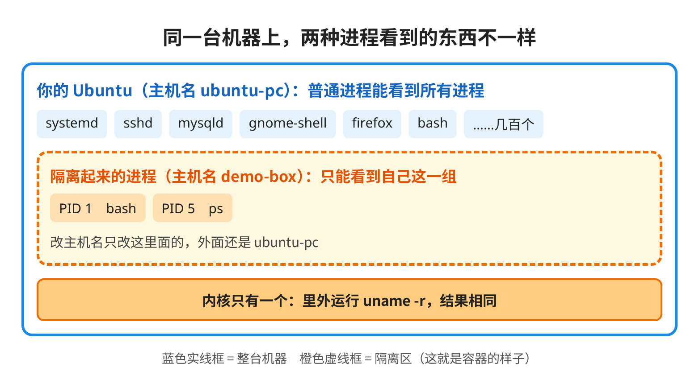
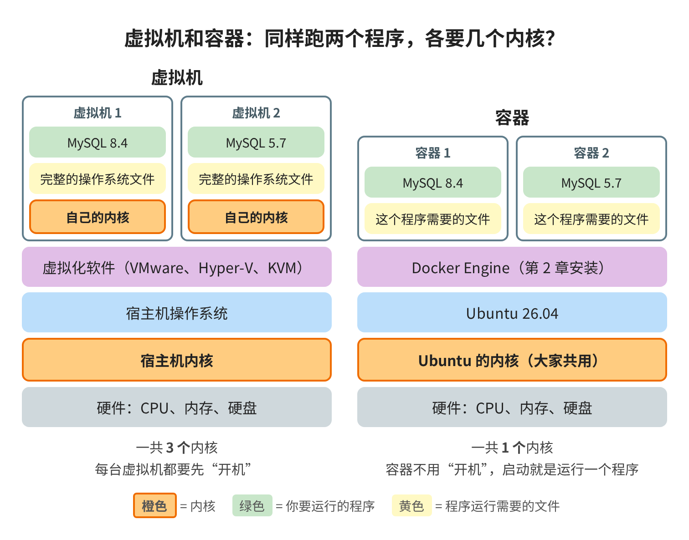
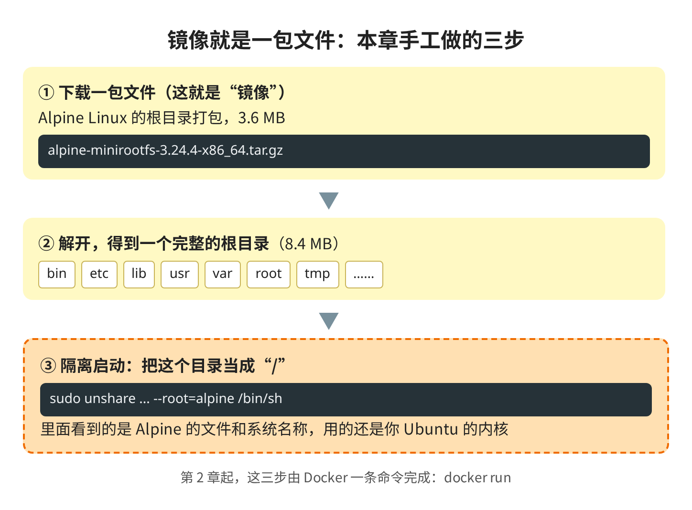
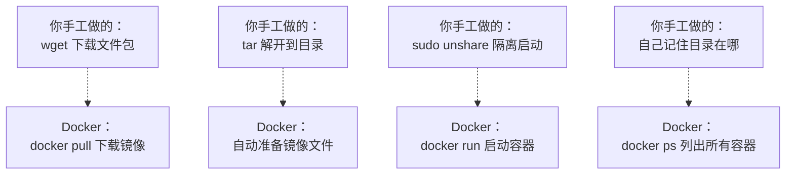

# 第 1 章 容器是什么：和虚拟机、直接安装软件有什么区别

## 这一章解决什么问题

一台服务器上，老系统要 MySQL 5.7，新系统要 MySQL 8.4，两个版本直接装在一起会抢端口、抢配置文件。你写的程序交给别人部署，又常常是“我这里能跑，他那里跑不起来”。大家都说“用 Docker 就好了”，可容器到底是什么、和虚拟机有什么区别，你还没弄明白。

这一章先不装 Docker，只用 Ubuntu 自带的命令亲手做出一个最简单的“容器”。做完你会知道，Docker 替你做的事其实没有那么神秘。

## 开始之前

- 一台 Ubuntu 26.04，桌面版、服务器版、装在虚拟机里的都可以，你的账号能用 `sudo`。
- 本章**不需要安装 Docker**，用到的 `unshare` 命令是 Ubuntu 自带的（属于 util-linux 软件包）。
- 打开终端：桌面版按 `Ctrl + Alt + T`；服务器版登录后就在终端里。
- 本章的命令都在你的主目录（`~`）里执行。

本章有 3 个新概念：**容器**、**共享内核（和虚拟机的区别）**、**镜像**。

> 💡 本章的输出在 Ubuntu 26.04.1 上实测。测试机的主机名是 `ubuntu-pc`，用户名是 `zhang`。你看到的主机名、用户名、进程数量和内核版本号会和这里不同，这是正常的。

---

## 1.1 先看问题：软件直接装在系统里的三个麻烦

| 麻烦 | 具体场景 | 原因 |
|---|---|---|
| 版本冲突 | MySQL 5.7 和 8.4 要同时用 | 两个版本默认用同一个端口（3306）、同一个配置目录 |
| 环境不一样 | 程序在你的电脑上能跑，到服务器上缺这缺那 | 程序依赖的库、配置、运行时版本，每台机器都可能不同 |
| 删不干净 | 试装了一个软件，卸载后还留下配置和服务 | 软件的文件散落在系统的很多目录里 |

这三个麻烦有一个共同原因：**所有程序都挤在同一套系统文件、同一个进程列表、同一组端口里**。容器的思路就是把每个程序隔开。

## 1.2 容器：被隔离起来的普通进程

### 🖼 图解



先说结论：**容器（container）就是一个被隔离起来运行的普通进程**。它在你的 Ubuntu 上运行，但只能看到分给它的那部分：自己的进程列表、自己的主机名、自己的文件。

Linux 内核提供了这种隔离功能，叫命名空间（namespace）。这里只需要知道这个名字，不用记它的细节。`unshare` 命令就是用来打开这个功能的。

### 💻 动手

先在外面看看你的机器。

```bash
# 在主目录执行：看主机名和进程数量
hostname
ps -e | wc -l
```

测试机的输出（你的进程数会多得多，桌面版一般有几百个）：

```text
ubuntu-pc
13
```

然后用 `unshare` 启动一个隔离起来的 bash：

```bash
# 在主目录执行
sudo unshare --pid --fork --mount-proc --uts bash
```

提示符变成 `root@...#` 就说明你已经在隔离环境里了。依次输入下面 4 条命令，最后用 `exit` 退出：

```text
root@ubuntu-pc:/home/zhang# hostname demo-box
root@ubuntu-pc:/home/zhang# hostname
demo-box
root@ubuntu-pc:/home/zhang# ps -e
    PID TTY          TIME CMD
      1 pts/1    00:00:00 bash
      5 pts/1    00:00:00 ps
root@ubuntu-pc:/home/zhang# exit
exit
```

退出后，在外面再看一次主机名：

```bash
hostname
```

```text
ubuntu-pc
```

### 🔍 看结果

| 现象 | 说明 |
|---|---|
| 隔离环境里 `ps -e` 只有 2 行 | 里面只能看到自己启动的进程，外面那些进程它看不到 |
| 里面的 bash 是 PID 1 | 在它自己的进程列表里，它是第一个进程。容器里的主程序都是 PID 1 |
| 里面改了主机名，外面还是 `ubuntu-pc` | 主机名也被隔开了，里面怎么改都不影响外面 |
| 改完主机名，提示符还是 `root@ubuntu-pc` | bash 启动时就记下了主机名，提示符不会跟着变。用 `hostname` 命令看到的才是真实值 |

命令里每个参数的作用：

| 参数 | 作用 |
|---|---|
| `--pid` | 给新进程一个独立的进程列表（进程编号从 1 开始） |
| `--fork` | 先创建一个子进程，再让子进程运行 bash。`--pid` 必须和它一起用，原因见踩坑警告 |
| `--mount-proc` | 重新挂载 `/proc`。`ps` 命令是从 `/proc` 读进程信息的，不重新挂载就会读到外面的进程 |
| `--uts` | 给新进程一个独立的主机名 |
| `bash` | 在隔离环境里要运行的程序 |

### 改坏一处试试

**改法 1：去掉 `--mount-proc`。**

```bash
sudo unshare --pid --fork bash -c "ps -e | wc -l"
```

```text
15
```

输出的进程数和外面一样多（比外面的 13 多出来的，是这条命令自己启动的几个进程）。进程列表其实已经隔开了，但 `ps` 读的还是外面的 `/proc`，所以看到的是外面的进程。可见要做出一个完整的隔离环境，每个环节都得配好。

**改法 2：去掉 `sudo`。**

```bash
unshare --pid --fork --mount-proc --uts bash
```

```text
unshare: unshare failed: Operation not permitted
```

普通用户没有权限创建这种隔离环境。第 2 章安装的 Docker Engine 以 root 身份在后台运行，替你完成这一步。

### 三件套

| 项 | 内容 |
|---|---|
| 白话定义 | 容器是被隔离起来运行的普通进程，只能看到分给它的进程、主机名、文件 |
| 业务场景 | 同一台服务器上同时跑 MySQL 5.7（给老的价格申请系统）和 MySQL 8.4（给新系统），各在各的容器里，互不干扰 |
| 反例：什么时候不该用 | 程序只能在 Windows 上运行，比如部署在 IIS 上的 WebForm 网站，Linux 容器跑不了它。日常用的桌面软件（浏览器、WPS）直接用 apt 或应用中心安装更省事，没必要放进容器 |

## 1.3 共享内核：容器和虚拟机最大的区别

### 🖼 图解



内核（kernel）是操作系统最底层的部分，负责管理 CPU、内存、硬盘，所有程序都要通过它才能使用硬件。

- **虚拟机**：每台虚拟机里装了一套完整的操作系统，包括它自己的内核。所以要先“开机”，等系统启动完才能运行程序。
- **容器**：没有自己的内核，所有容器都**共用你 Ubuntu 的那一个内核**。启动容器就是启动一个进程，不用开机。

### 💻 动手

在外面看一次内核版本，再在隔离环境里看一次：

```bash
# 在主目录执行：外面
uname -r
# 隔离环境里
sudo unshare --pid --fork --mount-proc --uts bash -c "uname -r"
```

两行输出完全相同。测试机的输出：

```text
6.1.190-237.442.amzn2023.x86_64
6.1.190-237.442.amzn2023.x86_64
```

> 测试环境里的 Ubuntu 26.04 运行在另一台机器的内核上，所以内核名称不像 Ubuntu 的。你的机器上会是 Ubuntu 自己的内核版本号，一般以 `-generic` 结尾。只要两行相同，就说明结论成立。

### 🔍 看结果

隔离环境里能改主机名、能有自己的进程列表，但内核版本和外面一模一样，因为它用的就是外面那个内核。

| 对比项 | 虚拟机 | 容器 |
|---|---|---|
| 内核 | 每台都有自己的内核 | 共用宿主机的内核 |
| 启动 | 要等操作系统开机 | 就是启动一个进程。在测试机上，用 Docker 启动并退出一个小容器约 0.7 秒 |
| 占用 | 每台都要装一整套系统，并预先分走一块内存 | 只占程序本身用的内存，文件只包含程序需要的那部分 |
| 能跑什么系统 | 什么系统都能装，包括 Windows | 只能跑 Linux 程序，而且要和宿主机的 CPU 架构一致 |
| 隔离程度 | 强：内核都是分开的 | 弱一些：大家共用内核，内核出了漏洞会影响所有容器 |

### 改坏一处试试

“共用内核”意味着容器里的程序必须能在你这台机器的 CPU 上运行。这个实验要用到下一节下载的 Alpine 文件包，下一节会给出实际报错。先记住这个结论：**容器不能自带内核，也换不了 CPU 架构**。

### 三件套

| 项 | 内容 |
|---|---|
| 白话定义 | 所有容器共用宿主机的一个内核，所以容器启动快、占用少，但只能跑和宿主机同类的 Linux 程序 |
| 业务场景 | 一台 8 GB 内存的测试服务器，要同时跑数据库、后端程序、nginx 三样东西。用三台虚拟机，三套系统光开机就要占掉不少内存；用三个容器，内存基本都给程序本身用 |
| 反例：什么时候不该用 | 要跑 Windows 程序，或者要运行别人提供、你不信任的代码，需要更强的隔离，这时用虚拟机更合适 |

## 1.4 镜像：程序运行需要的一整包文件

1.2 节的隔离环境还有一个问题：里面看到的文件和外面一样，`cat /etc/os-release` 显示的还是你的 Ubuntu。真正的容器要有**自己的一套文件**，这套文件就来自镜像。

### 🖼 图解



镜像（image）是一个程序运行需要的全部文件打成的包：精简过的系统文件、程序本身、配置。启动容器时，把镜像里的文件当成容器的根目录 `/`，容器里就只能看到这些文件。

下面用 Alpine Linux 来做这个实验。Alpine 是一个很小的 Linux 发行版，它的根目录打包后只有几 MB，很多 Docker 镜像都基于它。

### 💻 动手

先确认你的 CPU 架构：

```bash
uname -m
```

```text
x86_64
```

普通的 PC 和服务器显示 `x86_64`。如果显示 `aarch64`（ARM 架构），下面命令里的两处 `x86_64` 都改成 `aarch64`。

下载 Alpine 的根目录包并解开。这里用清华大学的镜像站，国内下载更快：

```bash
# 在主目录执行（如果提示找不到 wget，先执行 sudo apt install wget）
wget -q https://mirrors.tuna.tsinghua.edu.cn/alpine/v3.24/releases/x86_64/alpine-minirootfs-3.24.4-x86_64.tar.gz
ls -lh alpine-minirootfs-3.24.4-x86_64.tar.gz
mkdir alpine
tar -xzf alpine-minirootfs-3.24.4-x86_64.tar.gz -C alpine
ls alpine
du -sh alpine
```

```text
-rw-r--r-- 1 zhang zhang 3.6M Nov  5 09:19 alpine-minirootfs-3.24.4-x86_64.tar.gz
bin  dev  etc  home  lib  media  mnt  opt  proc  root  run  sbin  srv  sys  tmp  usr  var
8.4M	alpine
```

> 官方下载地址是 `https://dl-cdn.alpinelinux.org/alpine/v3.24/releases/x86_64/`，文件名相同。

然后隔离启动，这次多加一个 `--root=alpine`，把 `alpine` 目录当成根目录，运行里面的 `/bin/sh`：

```bash
# 在主目录执行
sudo unshare --pid --fork --mount-proc --uts --root=alpine /bin/sh
```

提示符变成 `/ #`。依次输入：

```text
/ # cat /etc/os-release
NAME="Alpine Linux"
ID=alpine
VERSION_ID=3.24.4
PRETTY_NAME="Alpine Linux v3.24"
HOME_URL="https://alpinelinux.org/"
BUG_REPORT_URL="https://gitlab.alpinelinux.org/alpine/aports/-/issues"
/ # uname -r
6.1.190-237.442.amzn2023.x86_64
/ # ps
PID   USER     TIME  COMMAND
    1 root      0:00 /bin/sh
    5 root      0:00 ps
/ # ls /
bin    etc    lib    mnt    proc   run    srv    tmp    var
dev    home   media  opt    root   sbin   sys    usr
/ # exit
```

### 🔍 看结果

| 现象 | 说明 |
|---|---|
| `/etc/os-release` 显示 Alpine Linux | 里面看到的是 alpine 目录里的文件，你的 Ubuntu 文件一个都看不到 |
| `uname -r` 还是你的内核 | 文件换成了 Alpine 的，内核还是共用的，印证了 1.3 节 |
| `ps` 只有 2 个进程 | 进程隔离照样生效 |

到这里，你已经手工做出了一个真正意义上的容器：**有自己的文件（来自镜像）、自己的进程列表、自己的主机名，共用宿主机的内核**。

### 改坏一处试试

**改法 1：在 Alpine 里运行 bash。**

```bash
sudo unshare --pid --fork --mount-proc --uts --root=alpine bash
```

```text
unshare: failed to execute bash: No such file or directory
```

你的 Ubuntu 里明明有 bash，但 Alpine 的文件包里没有。**容器里只能用镜像里有的东西**，这也是为什么不同的镜像里能用的命令不一样。

**改法 2：在 x86_64 机器上运行 ARM 版的文件包**（接着 1.3 节的实验）。

```bash
# 在主目录执行：下载 aarch64 版并尝试运行
wget -q https://mirrors.tuna.tsinghua.edu.cn/alpine/v3.24/releases/aarch64/alpine-minirootfs-3.24.4-aarch64.tar.gz
mkdir arm
tar -xzf alpine-minirootfs-3.24.4-aarch64.tar.gz -C arm
sudo unshare --pid --fork --mount-proc --uts --root=arm /bin/sh
```

```text
unshare: failed to execute /bin/sh: Exec format error
```

文件包能下载、能解开，但里面的程序是给 ARM CPU 编译的，你的 x86_64 CPU 执行不了。容器共用宿主机的内核和 CPU，所以**镜像的架构必须和宿主机一致**。以后在 Docker Hub 上看到同一个镜像分 `amd64`、`arm64` 好几个版本，就是这个原因。

### 三件套

| 项 | 内容 |
|---|---|
| 白话定义 | 镜像是程序运行需要的全部文件打成的一个包，启动容器时把它当成容器的根目录 |
| 业务场景 | 你把程序和它需要的运行环境做成一个镜像交给运维，他在任何装了 Docker 的 Linux 服务器上启动，里面的文件都和你测试时一模一样，不会再出现“我这里能跑” |
| 反例：什么时候不该用 | 会变的数据不要放进镜像。数据库文件、上传的附件放在镜像里，换个新版本的镜像就全没了。数据要放在容器外面，第 8 章讲 |

## 1.5 你手工做的，就是 Docker 要替你做的

本章你手工走了一遍容器的启动过程。第 2 章装好 Docker 后，这些步骤都由 Docker 完成：



Docker 还会做很多你这次没做的事：给容器分配网络和端口、限制它能用多少内存、记录日志、程序崩溃后自动重启。这些在后面的章节里一项一项讲。

本章的实验文件以后用不到，可以删掉：

```bash
# 在主目录执行
rm -rf alpine arm alpine-minirootfs-3.24.4-*.tar.gz
```

---

## 🧱 类比

| Docker 里的概念 | 日常生活里的类比 |
|---|---|
| 虚拟机 | 独栋别墅：每栋都有自己的地基、水电总闸，盖一栋要很久 |
| 容器 | 同一栋楼里的公寓套间：共用地基和水电主管（内核），每套有自己的门锁和房间（进程、主机名、文件） |
| 镜像 | 精装修的标准户型：按同一个户型可以交付很多套房子，住户在自己家里怎么摆放都不影响户型本身 |

这个类比有一个地方不准：公寓楼里水管坏了能找物业修，容器共用的内核出了问题，所有容器都会受影响。所以 1.3 节说容器的隔离比虚拟机弱。

## ⚠️ 踩坑警告

| 现象 | 原因 | 怎么改 |
|---|---|---|
| `unshare: unshare failed: Operation not permitted` | 没加 `sudo`，普通用户不能创建隔离环境 | 命令前加 `sudo` |
| 进了隔离环境，`ps -e` 还是能看到外面所有进程 | 漏了 `--mount-proc`，`ps` 读的还是外面的 `/proc` | 加上 `--mount-proc` |
| 用了 `--pid` 没加 `--fork`，运行几条命令后报 `bash: fork: Cannot allocate memory` | 不加 `--fork` 时，bash 自己不在新的进程列表里，它启动的第一个子进程成了 PID 1，那个子进程一结束，就再也不能创建新进程了 | `--pid` 和 `--fork` 一起用 |
| `unshare: failed to execute /bin/sh: Exec format error` | 下载的文件包和你的 CPU 架构不一致（比如在 x86_64 机器上用了 aarch64 的包） | 先 `uname -m` 看架构，再下载对应的包 |
| `unshare: cannot change root directory to 'alpne': No such file or directory` | `--root=` 后面的目录名写错了，或者没在主目录里执行 | 用 `ls` 确认目录存在，回到主目录再执行 |

## 🎯 动手练习

**练习 1：做一个主机名叫 `price-box` 的隔离环境**

用 `unshare` 启动一个隔离的 bash，在里面把主机名改成 `price-box`。

验收标准：

- 在里面执行 `hostname` 输出 `price-box`；
- 在里面执行 `ps -e`，进程列表只有 2 行（`bash` 和 `ps`）；
- `exit` 退出后，在外面执行 `hostname`，还是你原来的主机名。

**练习 2：容器里写的文件去了哪里**

重新下载并解开 Alpine 文件包，用 `--root=alpine` 隔离启动，在容器里执行 `echo hi > /hello.txt` 创建一个文件，然后退出。

验收标准：

- 退出后，在你的 Ubuntu 主目录里能找到这个文件，`cat` 它输出 `hi`；
- 想一想：如果 Docker 也这样让容器直接改镜像的文件，用同一个镜像启动的第二个容器会看到什么？这样有什么问题？

卡住了看文末参考答案。

## 📌 一句话总结

容器是只能看到自己那份文件和进程的普通进程，镜像就是那份文件。

## 下一章

手工做容器要下载、解包、记一长串参数，第 2 章在 Ubuntu 26.04 上安装 Docker Engine，用一条 `docker run` 完成这些事。

---

<!-- 以下是参考答案，先自己动手，卡住了再往下翻 -->


## 参考答案

### 练习 1

思路：和 1.2 节一样，用 `--pid --fork --mount-proc` 隔开进程列表，用 `--uts` 隔开主机名，进去后再改名。

```bash
# 在主目录执行
sudo unshare --pid --fork --mount-proc --uts bash
```

```text
root@ubuntu-pc:/home/zhang# hostname price-box
root@ubuntu-pc:/home/zhang# hostname
price-box
root@ubuntu-pc:/home/zhang# ps -e
    PID TTY          TIME CMD
      1 pts/1    00:00:00 bash
      5 pts/1    00:00:00 ps
root@ubuntu-pc:/home/zhang# exit
exit
```

```bash
hostname
```

```text
ubuntu-pc
```

### 练习 2

思路：容器的根目录 `/` 就是主目录下的 `alpine` 目录，在容器里写到 `/hello.txt`，实际写到了 `~/alpine/hello.txt`。

```bash
# 在主目录执行
wget -q https://mirrors.tuna.tsinghua.edu.cn/alpine/v3.24/releases/x86_64/alpine-minirootfs-3.24.4-x86_64.tar.gz
mkdir alpine
tar -xzf alpine-minirootfs-3.24.4-x86_64.tar.gz -C alpine
sudo unshare --pid --fork --mount-proc --uts --root=alpine /bin/sh
```

```text
/ # echo hi > /hello.txt
/ # cat /hello.txt
hi
/ # exit
```

```bash
# 回到 Ubuntu，在主目录执行
cat alpine/hello.txt
ls -l alpine/hello.txt
```

```text
hi
-rw-r--r-- 1 root root 3 Nov 25 06:20 alpine/hello.txt
```

文件属于 root，因为它是在容器里以 root 身份创建的。

思考题：第二个容器会看到第一个容器写进去的 `hello.txt`，镜像就被改动了。用同一个镜像启动的容器本来应该一模一样，这样一来每次启动的结果都可能不同，又回到了“这台能跑、那台不能跑”的老问题。所以 Docker 不让容器改镜像本身：镜像只读，每个容器的改动单独存放。第 4 章会看到这一点：删掉容器，它的改动也跟着没了。
