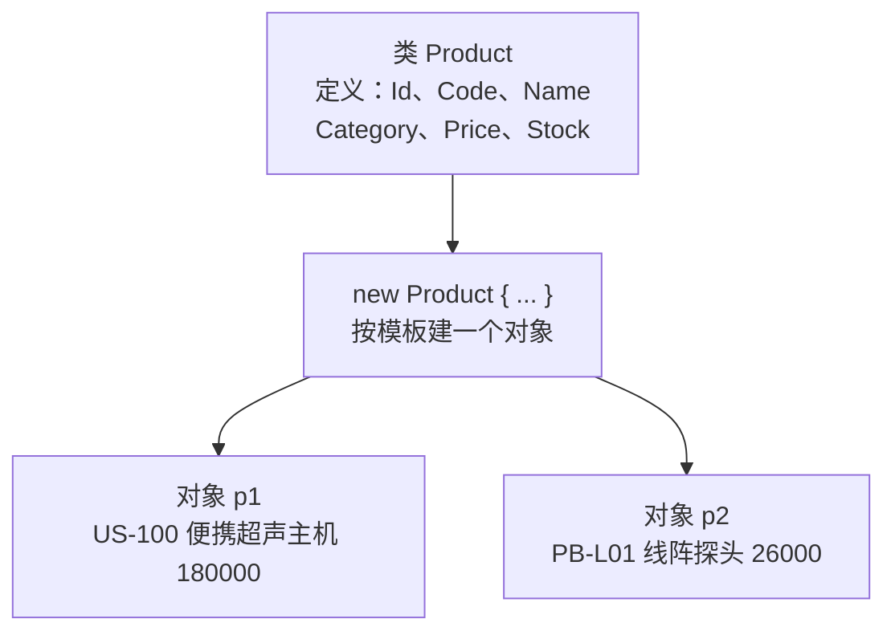
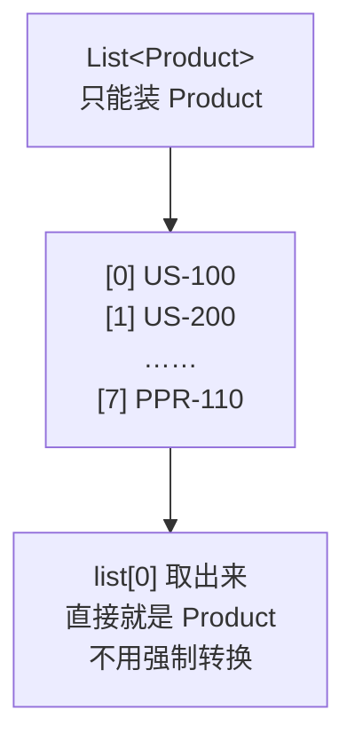
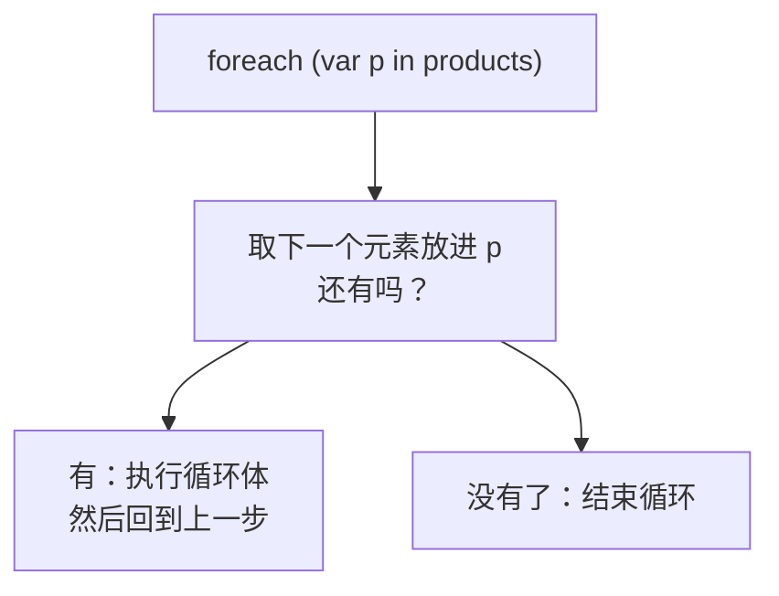

# 第 0 章 预备：类、List 与 foreach

## 这一章解决什么问题

后面每一章都离不开三样东西：表示"一个产品"的**类** `Product`，装着一批产品的 **`List<Product>`**，以及逐个处理它们的 **`foreach`**。EF Core 查数据库，返回给你的也正是 `List<Product>`，而不是 WebForm 时代常用的 `DataTable`。

这些你多半用过，但 .NET 10 的写法和 .NET Framework 时代有不少差别：自动属性、对象初始化器、`= ""`、集合表达式 `[ ... ]`、没有 `Main` 的 `Program.cs`。本章把它们一次讲清，并搭好整本教程用的解决方案。

## 开始之前

- 你已经会：C# 的基本语法；ADO.NET 的 `DataTable` / `DataRow`。
- 需要的环境：Visual Studio 2026，已勾选工作负荷「ASP.NET 和 Web 开发」（自带 .NET 10 SDK）。确认方法：开始菜单打开「Visual Studio Installer」→ VS 2026 那一栏点「修改」→「工作负荷」页查看。
- 数据库：**本章不需要**，第 5 章才连 SQL Server。

> 预计耗时：60 分钟。已经熟悉现代 C# 写法的，可以只看每节的"改坏一处试试"和 0.5 节的类比，然后直接进入第 1 章。

## 正文

### 0.1 建解决方案和第一个项目

整本教程用**一个解决方案** `EfCoreStudy`，每章在里面新建一个项目。

1. 启动 VS 2026，在开始窗口点「**创建新项目**」。
2. 在搜索框输入 `控制台`，选中「**控制台应用**」（语言标签是 C#）。⚠ 不要选「控制台应用 (.NET Framework)」，那是旧框架。点「下一步」。
3. 「项目名称」填 `Ch00Basics`，「解决方案名称」改成 `EfCoreStudy`。点「下一步」。
4. 「框架」选 **.NET 10.0（长期支持）**，「不使用顶级语句」**不要勾**。点「创建」。

> 📷 **截图占位 ch00-01**：「配置新项目」页，项目名称 Ch00Basics，解决方案名称 EfCoreStudy。
> 截好后保存为 `images/ch00-01-create-project.png`，再删掉下一行的 `<!--` 和 `-->`。
<!--  -->

建好后打开 `Program.cs`，里面只有一行 `Console.WriteLine("Hello, World!");`，没有 `class Program`，也没有 `static void Main`。这叫**顶级语句**（top-level statements，C# 9 起）：直接写在文件里的语句就是程序入口，编译器替你生成 `Main`。本教程所有 `Program.cs` 都是这种写法。

> 仓库里本章每节一个独立项目（[`code/ch00/`](../code/ch00/) 下的 `Step1-Class` 等），方便对照。你自己练习只用 `Ch00Basics` 一个项目，每节替换 `Program.cs`。

### 0.2 概念一：类与对象 —— 一个产品

**白话定义**：类（class）是"一行数据长什么样"的定义：有哪些字段、各是什么类型。对象（object）是按这个定义 `new` 出来的**一行具体数据**。

**业务场景**：产品表的一行有编码、名称、分类、单价、库存。写一个 `Product` 类，每个产品就是一个 `Product` 对象。第 5 章起，EF Core 会按这个类**生成数据库表**：类 ↔ 表，属性 ↔ 列，对象 ↔ 一行。

**反例（什么时候不该专门写类）**：只在一处临时用一下、取几列显示就扔的数据，不必专门写类，用第 2 章的匿名类型 `new { p.Code, p.Name }` 就行。专门写类是为了**多处使用、跨方法传递、要保存到数据库**的数据。

#### 🖼 原理：类是模板，对象是按模板填好的一行



另外要知道一点：变量里放的**不是对象本身，而是指向对象的"引用"**。`var p4 = p2;` 并没有复制产品，只是让 `p4` 也指向 `p2` 那个对象。第 9 章 EF Core 发现"你改了哪个属性"，依靠的就是这一点。

#### 💻 最小可运行代码

右键项目 `Ch00Basics` →「**添加 → 类**」，名称填 `Product.cs`，内容全部替换成：

```csharp
// code/ch00/Step1-Class/Product.cs
namespace EfCoreStudy;

// 产品。第 5 章起它会原样变成数据库里的 Products 表，所以现在就按"一行数据"来设计
public class Product
{
    public int Id { get; set; }
    public string Code { get; set; } = "";      // 给默认值，避免 Nullable 警告 CS8618
    public string Name { get; set; } = "";
    public string Category { get; set; } = "";  // 第 12 章会拆成单独的 Category 表
    public decimal Price { get; set; }          // 金额一律 decimal，不用 double
    public int Stock { get; set; }
}
```

`Program.cs` 全部替换成：

```csharp
// code/ch00/Step1-Class/Program.cs
using EfCoreStudy;

// ① 先 new，再一行一行赋值（你熟悉的写法）
var p1 = new Product();
p1.Id = 1;
p1.Code = "US-100";
p1.Name = "便携超声主机";
p1.Category = "主机";
p1.Price = 180000m;
p1.Stock = 3;

// ② 对象初始化器：new 和赋值写在一起，效果和 ① 完全相同
var p2 = new Product { Id = 3, Code = "PB-L01", Name = "线阵探头", Category = "探头", Price = 26000m, Stock = 8 };

// ③ 没赋值的属性取默认值：数字是 0，字符串是 Product 里写的 ""
var p3 = new Product { Code = "TEMP" };

Console.WriteLine($"① {p1.Code}  {p1.Name}  单价 {p1.Price:N0}  库存 {p1.Stock}");
Console.WriteLine($"② {p2.Code}  {p2.Name}  单价 {p2.Price:N0}  库存 {p2.Stock}");
Console.WriteLine($"③ {p3.Code}  名称=[{p3.Name}]  单价 {p3.Price}  库存 {p3.Stock}");

// ④ 变量里放的是"指向对象的引用"：p4 和 p2 指向同一个产品，改 p4 就是改 p2
var p4 = p2;
p4.Stock = 0;
Console.WriteLine($"④ 改了 p4 的库存之后，p2 的库存：{p2.Stock}");
```

按 **Ctrl+F5**（菜单「调试 → 开始执行(不调试)」）运行。

#### 🔍 拆解运行结果

实测输出：

```text
① US-100  便携超声主机  单价 180,000  库存 3
② PB-L01  线阵探头  单价 26,000  库存 8
③ TEMP  名称=[]  单价 0  库存 0
④ 改了 p4 的库存之后，p2 的库存：0
```

`Product.cs` 里的写法：

| 写法 | 含义 | 为什么这样写 |
|---|---|---|
| `namespace EfCoreStudy;` | 文件级命名空间（C# 10 起），整个文件都属于它，不用再套一层大括号 | 少一层缩进。`Program.cs` 顶部的 `using EfCoreStudy;` 就是引用它 |
| `public int Id { get; set; }` | 自动属性：编译器替你生成背后的私有字段 | 不用再手写 `private int _id;` 加 get/set 方法体 |
| `= "";` | 属性的初始值 | 项目开启了可空检查（Nullable），`string` 不给初始值会有警告，见下面"改坏一处试试" |
| `decimal Price` | 金额用 `decimal` | `double` 是二进制小数，0.1 + 0.2 不等于 0.3，金额会有误差。对应 SQL 的 `DECIMAL` |

`Program.cs` 里的写法：

- ② **对象初始化器**：`new Product { Id = 3, Code = "PB-L01", ... }`，和 ① 的 7 行效果完全相同。后面所有章节都用这种写法。
- ③ 没赋值的属性取默认值：`int`、`decimal` 是 0，`Name` 是 `Product` 里写好的 `""`。
- ④ 改 `p4` 就是改 `p2`，证明两个变量指向**同一个对象**。
- `$"...{p1.Price:N0}..."`：字符串插值，大括号里直接写表达式；`:N0` 表示千分位、无小数。代替 `string.Format("{0:N0}", ...)`。

#### 改坏一处试试

| 改法 | 生成时的报错（实测） | 原因 |
|---|---|---|
| 属性名拼错：`p1.Pirce` | `error CS1061: 'Product' does not contain a definition for 'Pirce' ...` | **编译时**就报错。对比 `DataRow` 的 `row["Pirce"]`，要到运行时才报错（见 0.5 节） |
| 单价写成 `Price = 180000.5`（不带 `m`） | `error CS0664: Literal of type double cannot be implicitly converted to type 'decimal'; use an 'M' suffix to create a literal of this type` | 带小数点的数字默认是 `double`，要写 `180000.5m` |
| 删掉 `Product.cs` 里 `Name` 后面的 `= "";` | `warning CS8618: Non-nullable property 'Name' must contain a non-null value when exiting constructor. ...` | 可空检查认为 `Name` 可能一直是 `null`。给初始值 `""` 就消除了 |

> 中文版 VS 的错误列表会显示中文译文，错误号（如 `CS1061`）相同。本教程贴的是编译器英文原文。

### 0.3 概念二：`List<T>` —— 一批产品

**白话定义**：`List<T>` 是一个能自动变长的有序容器。尖括号里的 `T` 写装什么类型：`List<Product>` 只能装 `Product`，`List<string>` 只能装字符串。这种"用尖括号指定类型"的写法叫**泛型**（generic）。

**业务场景**：一次查出来的一批产品，放在一个 `List<Product>` 里。EF Core 的 `ToList()` 返回的就是它。

**反例**：要**按编码快速查**某个产品，而且查得很频繁，就不该每次在 List 里从头找，用 `Dictionary<string, Product>`（按键直接取）。List 适合"一批数据按顺序处理"。

#### 🖼 原理：带类型的容器



和 .NET 1.x 的 `ArrayList`、ADO.NET 的 `DataTable` 比，`List<T>` 多了一层**编译时检查**：放错类型、点错属性，编译就不通过。

#### 💻 最小可运行代码

右键项目 →「添加 → 类」，新建 `SampleData.cs`，内容全部替换成（这就是后面每一章用的 8 个示例产品）：

```csharp
// code/ch00/Step2-List/SampleData.cs
namespace EfCoreStudy;

// 第 1–4 章不连数据库，数据就放在内存里。每次调用都返回一份新的 List，互不影响
public static class SampleData
{
    public static List<Product> Products() =>
    [
        new() { Id = 1, Code = "US-100",  Name = "便携超声主机", Category = "主机", Price = 180000m, Stock = 3 },
        new() { Id = 2, Code = "US-200",  Name = "彩超工作站",   Category = "主机", Price = 420000m, Stock = 2 },
        new() { Id = 3, Code = "PB-L01",  Name = "线阵探头",     Category = "探头", Price = 26000m,  Stock = 8 },
        new() { Id = 4, Code = "PB-C02",  Name = "凸阵探头",     Category = "探头", Price = 24000m,  Stock = 0 },
        new() { Id = 5, Code = "PB-E03",  Name = "腔内探头",     Category = "探头", Price = 31000m,  Stock = 5 },
        new() { Id = 6, Code = "GEL-250", Name = "耦合剂",       Category = "耗材", Price = 35m,     Stock = 120 },
        new() { Id = 7, Code = "CVR-01",  Name = "探头保护套",   Category = "耗材", Price = 12m,     Stock = 300 },
        new() { Id = 8, Code = "PPR-110", Name = "热敏打印纸",   Category = "耗材", Price = 80m,     Stock = 6 },
    ];
}
```

`Program.cs`：

```csharp
// code/ch00/Step2-List/Program.cs
using EfCoreStudy;

// ① 建一个空 List，逐个 Add。<Product> 表示"这个 List 只能装 Product"
var list = new List<Product>();
list.Add(new Product { Id = 1, Code = "US-100", Name = "便携超声主机", Price = 180000m });
list.Add(new Product { Id = 6, Code = "GEL-250", Name = "耦合剂", Price = 35m });
Console.WriteLine($"① 个数：{list.Count}，第 1 个：{list[0].Name}，第 2 个：{list[1].Name}");

// ② 集合表达式 [ ... ]（C# 12 起）：建 List 时直接写好内容。SampleData.cs 用的就是这种写法
List<string> categories = ["主机", "探头", "耗材"];
Console.WriteLine($"② 分类：{string.Join("、", categories)}");

// ③ 示例数据：后面每一章都用这 8 个产品
var products = SampleData.Products();
Console.WriteLine($"③ 示例数据：{products.Count} 个产品，最后一个是 {products[products.Count - 1].Name}");

// ④ 取出来的元素就是 Product，直接点属性，不用强制转换
Product first = products[0];
Console.WriteLine($"④ 第 1 个产品的单价：{first.Price:N0}");
```

#### 🔍 拆解运行结果

实测输出：

```text
① 个数：2，第 1 个：便携超声主机，第 2 个：耦合剂
② 分类：主机、探头、耗材
③ 示例数据：8 个产品，最后一个是 热敏打印纸
④ 第 1 个产品的单价：180,000
```

| 写法 | 含义 |
|---|---|
| `list.Add(...)` / `list.Count` / `list[0]` | 添加、个数、按位置取（从 0 开始） |
| `List<string> categories = ["主机", "探头", "耗材"];` | **集合表达式**（C# 12 起），等同于 `new List<string> { "主机", "探头", "耗材" }` |
| `SampleData.cs` 里的 `new() { ... }` | 省略了类名：List 的元素类型是 `Product`，编译器知道 `new()` 建的是 `Product` |
| `public static List<Product> Products() => [ ... ];` | `=>` 后面直接写返回值的简写方法，等同于 `{ return [ ... ]; }`。第 1 章讲 lambda 时还会见到 `=>` |
| `string.Join("、", categories)` | 把集合的元素用"、"连成一个字符串，打印时常用 |

④ 取出来的 `first` 直接就是 `Product`，`first.Price` 是 `decimal`。不需要像 `(decimal)row["Price"]` 那样强制转换。

#### 改坏一处试试

| 改法 | 结果（实测） | 原因 |
|---|---|---|
| `products.Add("US-300");` | 生成时 `error CS1503: Argument 1: cannot convert from 'string' to 'EfCoreStudy.Product'` | `List<Product>` 只能装 `Product`，编译时就拦住了 |
| `products[8].Name`（只有 8 个，位置是 0–7） | 运行时 `System.ArgumentOutOfRangeException: Index was out of range. Must be non-negative and less than the size of the collection. (Parameter 'index')` | 位置从 0 开始，最后一个是 `[Count - 1]` |

### 0.4 概念三：foreach —— 逐个处理

**白话定义**：`foreach (var p in products)` 依次取出集合里的每个元素，每一轮 `p` 代表"当前这个"。

**业务场景**：逐个产品计算库存金额并累加；把缺货的产品挑出来放进另一个 List。

**反例**：遍历的同时要**删除或添加**元素，不能直接在 `foreach` 里改这个集合（见下面"改坏一处试试"）。这时改用倒着走的 `for` 循环，或者先挑出要删的再统一删。

#### 🖼 原理



`foreach` 不只能用在 List 上。任何"可以逐个取出元素"的东西都能用，比如数组、字符串，以及第 1 章开始的 LINQ 查询结果。第 4 章会讲这背后的 `IEnumerable<T>`。

#### 💻 最小可运行代码

```csharp
// code/ch00/Step3-Foreach/Program.cs
using EfCoreStudy;

var products = SampleData.Products();

// ① foreach：依次取出每个产品，p 每一轮代表"当前这个"
foreach (var p in products)
{
    // {p.Code,-8}：左对齐占 8 格；{p.Price,10:N0}：右对齐占 10 格、千分位、无小数
    Console.WriteLine($"{p.Code,-8}{p.Price,10:N0}  {p.Name}");
}

// ② 边循环边算：库存总金额，同时把缺货的产品挑出来
decimal total = 0;
var outOfStock = new List<Product>();
foreach (var p in products)
{
    total += p.Price * p.Stock;
    if (p.Stock == 0)
        outOfStock.Add(p);
}
Console.WriteLine($"库存总金额：{total:N0}");
Console.WriteLine($"缺货：{outOfStock.Count} 个，是 {outOfStock[0].Name}");
```

#### 🔍 拆解运行结果

实测输出：

```text
US-100     180,000  便携超声主机
US-200     420,000  彩超工作站
PB-L01      26,000  线阵探头
PB-C02      24,000  凸阵探头
PB-E03      31,000  腔内探头
GEL-250         35  耦合剂
CVR-01          12  探头保护套
PPR-110         80  热敏打印纸
库存总金额：1,751,280
缺货：1 个，是 凸阵探头
```

- `var p`：`var` 让编译器根据右边推断类型，这里 `p` 就是 `Product`，不是"没有类型"。
- ② 的写法是 **`foreach` + `if` + `Add`**：从一批数据里挑出满足条件的。请记住这个写法，**第 1 章的 LINQ 就是把它包装成了一个方法**。
- `{p.Code,-8}` 左对齐占 8 格，`{p.Price,10:N0}` 右对齐占 10 格。名称放在最后，是因为一个汉字占两个字符宽，放中间会对不齐。

#### 改坏一处试试

| 改法 | 结果（实测） | 原因 |
|---|---|---|
| 循环里给 p 赋值：`p = new Product();` | 生成时 `error CS1656: Cannot assign to 'p' because it is a 'foreach iteration variable'` | `p` 是只读的"当前元素"，不能换成别的对象 |
| 循环里改 p 的属性：`p.Stock += 10;` | 可以，运行后 `products[3].Stock` 是 10（原来是 0） | `p` 指向 List 里那个对象（0.2 节的"引用"），改属性就是改 List 里的产品 |
| 循环里删元素：`if (p.Stock == 0) products.Remove(p);` | 运行时 `System.InvalidOperationException: Collection was modified; enumeration operation may not execute.` | 遍历期间集合被改，.NET 拒绝继续遍历 |

## 🧱 类比：DataTable 和 `List<Product>` 对照

ADO.NET 用 `SqlDataAdapter.Fill` 得到的是 `DataTable`；EF Core 得到的是 `List<Product>`。同一件事两种写法：

| 事情 | `DataTable` / `DataRow` | `List<Product>` / `Product` |
|---|---|---|
| 一行数据 | `DataRow row` | `Product p` |
| 取单价 | `(decimal)row["Price"]` | `p.Price` |
| 列名写错 | 运行时才报错 | **编译时**报错（CS1061） |
| 类型取错 | 强制转换时运行报错 | 不用转换，类型就是 `decimal` |
| VS 智能提示 | 列名是字符串，没有提示 | 输入 `p.` 就列出所有属性 |
| 遍历 | `foreach (DataRow row in table.Rows)` | `foreach (var p in products)` |

EF Core 这类 ORM 的出发点之一，就是让你用右边这一列的方式处理数据库数据。

## ⚠️ 踩坑警告

| 现象 | 原因 | 怎么改 |
|---|---|---|
| `CS0664: Literal of type double cannot be implicitly converted to type 'decimal'` | `decimal` 属性赋了不带 `m` 的小数 | 写成 `180000.5m` |
| `warning CS8618: Non-nullable property 'Name' must contain a non-null value ...` | `string` 属性没有初始值 | 加 `= "";` |
| `ArgumentOutOfRangeException: Index was out of range` | 位置从 0 开始，`[Count]` 已经越界 | 最后一个是 `[Count - 1]` |
| `Collection was modified; enumeration operation may not execute.` | `foreach` 里删或加了这个集合的元素 | 用倒序 `for`，或先挑出来再统一处理 |
| 改了 `p4`，`p2` 也变了 | 两个变量指向同一个对象，不是两个副本 | 要副本就 `new` 一个新对象，把属性逐个赋过去 |

## 🎯 动手练习

**练习 1：追加一个产品**
往 `SampleData.Products()` 返回的 List 里，用对象初始化器追加一个产品：Id 9、编码 `PB-T04`、名称"经食道探头"、分类"探头"、单价 58000、库存 0。然后输出个数和最后一个产品的名称。

- 验收标准：输出 `产品数：9，最后一个：经食道探头`。

**练习 2：用 foreach 统计探头**
接着练习 1，只用 `foreach` 和 `if`，统计探头有几个、最高单价是多少。

- 验收标准：输出 `探头：4 个，最高单价 58,000`。

卡住了看文末参考答案。

## 📌 一句话总结

类是一行的模板，List 装一批，foreach 逐个处理，都在编译时检查类型。

## 下一章

练习 2 写了七八行循环才统计出一个结果。第 1 章用 LINQ 一行写完，并讲清它背后的原理。

---

<!-- 以下是参考答案，先自己动手，卡住了再往下翻 -->


## 参考答案

思路：练习 1 先用对象初始化器建好对象再 `Add`；练习 2 把计数器和"目前最高价"放在循环外面，循环里遇到探头就更新它们，`continue` 表示跳过本轮、直接看下一个。

完整项目在 [`code/ch00/Exercise/`](../code/ch00/Exercise/)。实测输出：

```text
产品数：9，最后一个：经食道探头
探头：4 个，最高单价 58,000
```

```csharp
// code/ch00/Exercise/Program.cs
// 第 0 章练习参考答案：练习 1（追加一个产品）+ 练习 2（用 foreach 统计探头）
using EfCoreStudy;

var products = SampleData.Products();

// 练习 1：用对象初始化器建好新产品，再 Add 进 List
products.Add(new Product { Id = 9, Code = "PB-T04", Name = "经食道探头", Category = "探头", Price = 58000m, Stock = 0 });
Console.WriteLine($"产品数：{products.Count}，最后一个：{products[products.Count - 1].Name}");

// 练习 2：计数器和"目前最高价"都放在循环外面，循环里只更新它们
int probeCount = 0;
decimal maxProbePrice = 0;
foreach (var p in products)
{
    if (p.Category != "探头")
        continue;               // 不是探头，直接看下一个
    probeCount++;
    if (p.Price > maxProbePrice)
        maxProbePrice = p.Price;
}
Console.WriteLine($"探头：{probeCount} 个，最高单价 {maxProbePrice:N0}");
```
