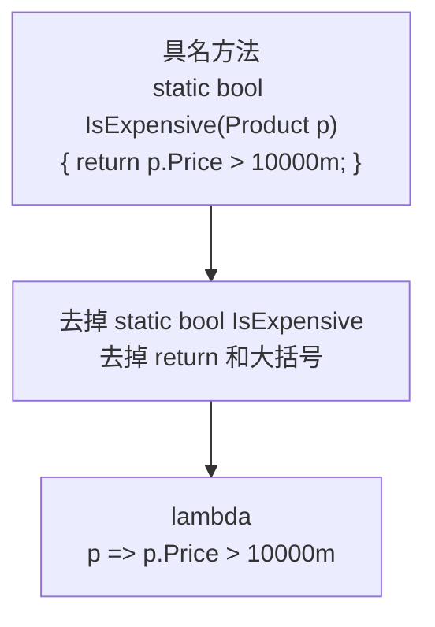
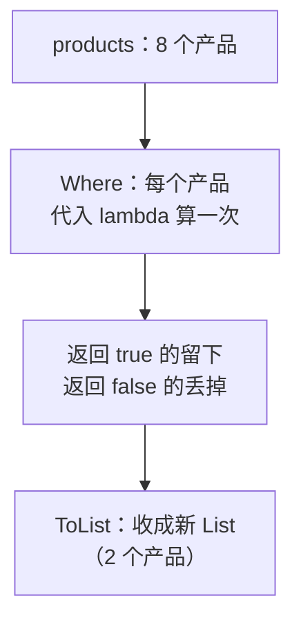
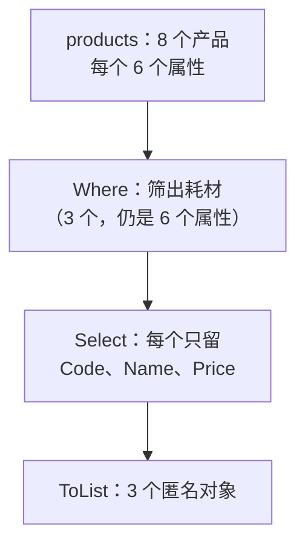

# 第 1 章 第一个 LINQ 查询：筛选和挑列

## 这一章解决什么问题

内存里有一批产品数据，你要"筛出探头类、有库存的产品，只取编码和名称"。以前的写法是 `foreach` 加 `if`，再加一个新 `List`，七八行代码。本章用 LINQ 一行写完。

EF Core 查数据库用的也是这套写法。所以前 3 章先不连数据库，只在内存里把 LINQ 练熟。

## 开始之前

- 你已经会：C# 的类、`List<T>`、`foreach`；SQL 的 `SELECT ... FROM ... WHERE`。
- 需要的环境：

| 项 | 要求 | 怎么确认 |
|---|---|---|
| Visual Studio 2026 | 已勾选工作负荷「ASP.NET 和 Web 开发」（自带 .NET 10 SDK，第 14 章也要用） | 开始菜单打开「Visual Studio Installer」→ VS 2026 那一栏点「修改」→「工作负荷」页查看 |
| 数据库 | **本章不需要** | 第 4 章才连 SQL Server |

> 预计耗时：60 分钟。

---

## 正文

### 1.1 建项目、放好示例数据

整本教程用**一个解决方案** `EfCoreStudy`，每章在里面新建一个项目。

1. 启动 VS 2026，在开始窗口点「**创建新项目**」。
2. 在搜索框输入 `控制台`，选中「**控制台应用**」（语言标签是 C#）。⚠ 不要选「控制台应用 (.NET Framework)」，那是旧框架。点「下一步」。
3. 「项目名称」填 `Ch01Linq`，「解决方案名称」改成 `EfCoreStudy`。点「下一步」。
4. 「框架」选 **.NET 10.0（长期支持）**，「不使用顶级语句」**不要勾**。点「创建」。

> 📷 **截图占位 ch01-01**：「配置新项目」页，项目名称 Ch01Linq，解决方案名称 EfCoreStudy。
> 截好后保存为 `images/ch01-01-create-project.png`，再删掉下一行的 `<!--` 和 `-->`。
<!--  -->

5. 在「解决方案资源管理器」里右键项目 `Ch01Linq` →「**添加 → 类**」，新建 `Product.cs`，内容全部替换成：

```csharp
// code/ch01/Step1-Lambda/Product.cs
namespace EfCoreStudy;

// 产品。第 4 章起它会原样变成数据库里的 Products 表，所以现在就按"一行数据"来设计
public class Product
{
    public int Id { get; set; }
    public string Code { get; set; } = "";      // 给默认值，避免 Nullable 警告 CS8618
    public string Name { get; set; } = "";
    public string Category { get; set; } = "";  // 第 11 章会拆成单独的 Category 表
    public decimal Price { get; set; }          // 金额一律 decimal，不用 double
    public int Stock { get; set; }
}
```

6. 用同样的方法新建 `SampleData.cs`：

```csharp
// code/ch01/Step1-Lambda/SampleData.cs
namespace EfCoreStudy;

// 第 1–3 章不连数据库，数据就放在内存里。每次调用都返回一份新的 List，互不影响
public static class SampleData
{
    public static List<Product> Products() =>
    [
        new() { Id = 1, Code = "US-100",  Name = "便携超声主机", Category = "主机", Price = 180000m, Stock = 3 },
        new() { Id = 2, Code = "US-200",  Name = "彩超工作站",   Category = "主机", Price = 420000m, Stock = 2 },
        new() { Id = 3, Code = "PB-L01",  Name = "线阵探头",     Category = "探头", Price = 26000m,  Stock = 8 },
        new() { Id = 4, Code = "PB-C02",  Name = "凸阵探头",     Category = "探头", Price = 24000m,  Stock = 0 },
        new() { Id = 5, Code = "PB-E03",  Name = "腔内探头",     Category = "探头", Price = 31000m,  Stock = 5 },
        new() { Id = 6, Code = "GEL-250", Name = "耦合剂",       Category = "耗材", Price = 35m,     Stock = 120 },
        new() { Id = 7, Code = "CVR-01",  Name = "探头保护套",   Category = "耗材", Price = 12m,     Stock = 300 },
        new() { Id = 8, Code = "PPR-110", Name = "热敏打印纸",   Category = "耗材", Price = 80m,     Stock = 6 },
    ];
}
```

两处新语法：`[ ... ]` 是集合表达式（C# 12 起），作用等同于 `new List<Product> { ... }`；`new() { ... }` 省略了类名，编译器会根据 List 的元素类型推断出是 `Product`。

> 仓库里每一节是一个独立项目（[`code/ch01/`](../code/ch01/) 下的 `Step1-Lambda`、`Step2-Where`……），方便你对照。你自己练习时**只用 `Ch01Linq` 一个项目就行**，每节把 `Program.cs` 整个替换掉。`Product.cs` 和 `SampleData.cs` 在各个文件夹里内容相同。

---

### 1.2 概念一：lambda 表达式

**白话定义**：lambda 是一种**省掉方法名的简写方法**。`p => p.Price > 10000m` 读作"给我一个 p，返回 `p.Price > 10000m` 的结果"。

**业务场景**：判断"单价超过 1 万的算大件，要走审批"。这个判断只在一处用，专门写一个具名方法太重了，写成 lambda 就是一行。

**反例（什么时候不该用）**：判断逻辑超过两三个条件、或者在多个地方要复用（比如"是否需要审批"牵涉金额、客户等级、产品类别），就应该写成具名方法并起个好名字。挤在一行 lambda 里，别人读不懂，也没法单独调试。

#### 🖼 图解



#### 💻 最小可运行代码

```csharp
// code/ch01/Step1-Lambda/Program.cs
using EfCoreStudy;

var products = SampleData.Products();

// 写法 B：同一个判断写成 lambda，存进变量。Func<Product, bool> = 输入 Product、返回 bool
Func<Product, bool> isExpensive = p => p.Price > 10000m;

foreach (var p in products)
{
    // 两种写法结果必须完全一样
    Console.WriteLine($"{p.Code,-8} 方法：{IsExpensive(p),-6} lambda：{isExpensive(p)}");
}

// 写法 A：具名方法，你一直以来的写法
static bool IsExpensive(Product p)
{
    return p.Price > 10000m;
}
```

按 **Ctrl+F5**（菜单「调试 → 开始执行(不调试)」）运行。

#### 🔍 拆解运行结果

实测输出：

```text
US-100   方法：True   lambda：True
US-200   方法：True   lambda：True
PB-L01   方法：True   lambda：True
PB-C02   方法：True   lambda：True
PB-E03   方法：True   lambda：True
GEL-250  方法：False  lambda：False
CVR-01   方法：False  lambda：False
PPR-110  方法：False  lambda：False
```

两列完全一致，说明 lambda 和具名方法做的是同一件事。

| 部分 | 含义 |
|---|---|
| `Func<Product, bool>` | 变量的类型：一个"输入 `Product`、返回 `bool`"的方法。尖括号里**最后一个**是返回类型 |
| `p` | 参数名，随便起。参数类型不用写，编译器从 `Func<Product, bool>` 推断出它是 `Product` |
| `=>` | 分隔参数和方法体 |
| `p.Price > 10000m` | 方法体。只有一个表达式时，它的值就是返回值，不用写 `return` |

单独定义一个 lambda 变量的写法，实际中很少用。lambda 真正的用处是**直接当参数传给 LINQ 方法**，下一节马上就会看到。

#### 改坏一处试试

把 `10000m` 改成 `10000.5`（去掉 `m`），生成时报错：

```text
error CS0019: Operator '>' cannot be applied to operands of type 'decimal' and 'double'
```

原因：带小数点、不带后缀的数字是 `double`，C# 不允许 `decimal` 和 `double` 直接比较。写成 `10000.5m`。

> 中文版 VS 的错误列表会显示中文译文，错误号（如 `CS0019`）相同。本教程贴的是编译器英文原文。

---

### 1.3 概念二：Where —— 筛选行

**白话定义**：`Where` 对集合里的每个元素调用一次你给的 lambda，只留下返回 `true` 的那些。作用就是 SQL 的 `WHERE`。

**业务场景**：仓库要一份"探头类、目前有货"的清单，拿去盘点。

**反例**：

- 只想知道"**有没有**"满足条件的，不要写 `Where(...).Count() > 0`，用第 2 章的 `Any`，找到第一个就停，不会把整个集合走完。
- 按主键找**一条**，不要用 `Where` 再取第一个元素，用第 2 章的 `First` / `FirstOrDefault`，意图更清楚。

#### 🖼 图解



#### 💻 最小可运行代码

```csharp
// code/ch01/Step2-Where/Program.cs
using EfCoreStudy;

var products = SampleData.Products();

// 老写法：foreach + if + 新建 List
var oldWay = new List<Product>();
foreach (var p in products)
{
    if (p.Category == "探头" && p.Stock > 0)
        oldWay.Add(p);
}
Console.WriteLine($"foreach 写法：{oldWay.Count} 个");

// LINQ 写法：条件就是一个 lambda，Where 替你写好了循环和 if
var linqWay = products.Where(p => p.Category == "探头" && p.Stock > 0).ToList();
Console.WriteLine($"Where 写法：{linqWay.Count} 个");
foreach (var p in linqWay)
    Console.WriteLine($"  {p.Code}  {p.Name}  库存 {p.Stock}");

// Where 返回的是新结果，不会删改原来的 List
Console.WriteLine($"原列表仍是 {products.Count} 个");
```

#### 🔍 拆解运行结果

实测输出：

```text
foreach 写法：2 个
Where 写法：2 个
  PB-L01  线阵探头  库存 8
  PB-E03  腔内探头  库存 5
原列表仍是 8 个
```

- 凸阵探头（PB-C02）库存是 0，被 `p.Stock > 0` 筛掉了，所以只剩 2 个。
- `Where` 是 `List` 本来没有的方法。它来自命名空间 `System.Linq`，项目开启了 `ImplicitUsings`，所以不用手写 `using System.Linq;`。
- `.ToList()`：把筛选结果收成一个新的 `List<Product>`。为什么需要这一步，第 3 章讲"延迟执行"时会说清楚。现在先记住：**要拿到结果，末尾加 `.ToList()`**。
- 最后一行说明 `Where` 不改原集合。这一点和 SQL 一样：`SELECT ... WHERE` 不会删表里的数据。

#### 改坏一处试试

| 改法 | 生成时的报错（实测） | 原因 |
|---|---|---|
| `==` 写成 `=`：`p.Category = "探头"` | `error CS0029: Cannot implicitly convert type 'string' to 'bool'` | 写 SQL 写惯了，一个等号是 SQL 的比较；在 C# 里是赋值，赋值结果是 `string`，不是 `bool` |
| 去掉 `.ToList()`，赋给 `List<Product>` 变量 | `error CS0266: Cannot implicitly convert type 'System.Collections.Generic.IEnumerable<EfCoreStudy.Product>' to 'System.Collections.Generic.List<EfCoreStudy.Product>'` | `Where` 返回的是 `IEnumerable<Product>`，不是 `List`。第 3 章细讲 |

---

### 1.4 概念三：Select —— 挑列、算列

**白话定义**：`Select` 对每个元素调用一次 lambda，把**lambda 的返回值**收集起来。作用就是 SQL 的 `SELECT 列清单`：可以只取几列，也可以算出新列。

**业务场景**：报表只要"产品名称 + 库存金额（单价 × 库存）"，不要整个 `Product`。

**反例**：如果取出来的数据**后面还要修改并保存**，就不要投影成匿名类型。匿名类型的属性是只读的，改不了；第 8 章你还会看到，EF Core 也不会跟踪匿名类型的变化。另外，匿名类型不能作为方法的返回类型，要跨方法传递时请专门定义一个类。

#### 🖼 图解



#### 💻 最小可运行代码

```csharp
// code/ch01/Step3-Select/Program.cs
using EfCoreStudy;

var products = SampleData.Products();

// ① 只要一列：结果是 List<string>
var names = products.Select(p => p.Name).ToList();
Console.WriteLine("全部名称：" + string.Join("、", names));

// ② 要几列：用匿名类型 new { ... }，不用为了一次查询专门写一个类
var cheap = products
    .Where(p => p.Price < 100m)                        // 先筛行
    .Select(p => new { p.Code, p.Name, p.Price })      // 再挑列
    .ToList();
foreach (var x in cheap)
    Console.WriteLine($"{x.Code}  {x.Name}  {x.Price}");

// ③ 计算列：相当于 SQL 的 Price * Stock AS Amount
var amounts = products
    .Where(p => p.Category == "主机")
    .Select(p => new { p.Name, Amount = p.Price * p.Stock })
    .ToList();
foreach (var x in amounts)
    Console.WriteLine($"{x.Name}  库存金额 {x.Amount:N0}");
```

#### 🔍 拆解运行结果

实测输出：

```text
全部名称：便携超声主机、彩超工作站、线阵探头、凸阵探头、腔内探头、耦合剂、探头保护套、热敏打印纸
GEL-250  耦合剂  35
CVR-01  探头保护套  12
PPR-110  热敏打印纸  80
便携超声主机  库存金额 540,000
彩超工作站  库存金额 840,000
```

| 写法 | 结果类型 | 对应 SQL |
|---|---|---|
| `Select(p => p.Name)` | `List<string>` | `SELECT Name` |
| `Select(p => new { p.Code, p.Name, p.Price })` | 匿名类型的 List | `SELECT Code, Name, Price` |
| `Select(p => new { p.Name, Amount = p.Price * p.Stock })` | 匿名类型的 List | `SELECT Name, Price * Stock AS Amount` |

- `new { p.Code, p.Name }`：匿名类型（anonymous type，编译器自动生成的、没有名字的类）。属性名默认沿用原属性名；`Amount = ...` 是自己起名，相当于 SQL 的 `AS`。
- 多个方法用 `.` 串起来，叫**方法链**。每一步的输出就是下一步的输入，一行一个方法，读起来最清楚。

#### 改坏一处试试

把②的 `Where` 和 `Select` 调换顺序：

```csharp
products.Select(p => new { p.Code, p.Name }).Where(x => x.Price < 100m)
```

生成时报错（实测）：

```text
error CS1061: '<anonymous type: string Code, string Name>' does not contain a definition for 'Price' ...
```

原因：`Select` 之后，每个元素只剩 `Code`、`Name` 两个属性，`Price` 已经没有了。这和 SQL 的逻辑执行顺序一致：**先 FROM、再 WHERE、最后 SELECT**。LINQ 把这个顺序直接写在了代码上。

---

## 🧱 类比：SQL、foreach、LINQ 三种写法对照

同一个需求"探头类、有库存，取编码和名称"：

| 写法 | 代码 |
|---|---|
| SQL | `SELECT Code, Name FROM Products WHERE Category = N'探头' AND Stock > 0` |
| foreach | `foreach` + `if` + `list.Add(new ...)`，6–8 行 |
| LINQ | `products.Where(p => p.Category == "探头" && p.Stock > 0).Select(p => new { p.Code, p.Name }).ToList()` |

| SQL | LINQ | 区别 |
|---|---|---|
| `FROM Products` | `products.` | LINQ 把数据源写在最前面，所以输入 `p.` 时 VS 就能提示出属性 |
| `WHERE 条件` | `.Where(p => 条件)` | 比较用 `==`，逻辑用 `&&` / `\|\|`，不是 `=` / `AND` / `OR` |
| `SELECT 列` | `.Select(p => new { 列 })` | 写在最后，和 SQL 的逻辑执行顺序一致 |

## ⚠️ 踩坑警告

| 现象 | 原因 | 怎么改 |
|---|---|---|
| `CS0029: Cannot implicitly convert type 'string' to 'bool'` | 比较写成了 `=`（SQL 习惯） | 改成 `==` |
| `CS0019: Operator '>' cannot be applied to operands of type 'decimal' and 'double'` | `decimal` 属性和不带 `m` 的小数比较 | 数字后加 `m`：`99.5m` |
| `Console.WriteLine(products.Where(...))` 打印出 `` System.Linq.Enumerable+ListWhereIterator`1[EfCoreStudy.Product] ``（实测） | 打印的是"查询对象"本身，不是里面的数据 | 先 `.ToList()`，再用 `foreach` 或 `string.Join` 输出 |
| `products.Where(p => p.Code.StartsWith("pb"))` 一个都找不到（实测 0 个） | 内存里的字符串比较**区分大小写**，`"pb"` ≠ `"PB"` | 写对大小写，或用 `StartsWith("pb", StringComparison.OrdinalIgnoreCase)`（实测 3 个）。注意：到了 SQL Server 上，默认排序规则**不区分**大小写，同一句会找到 3 个，第 7 章细讲这种差异 |

## 🎯 动手练习

**练习 1：需补货清单**
找出"有货但不足 10 件"的产品，输出编码、名称、库存。

- 验收标准：输出 5 行，依次是 US-100、US-200、PB-L01、PB-E03、PPR-110；凸阵探头（库存 0）和耗材里库存充足的两个都不在里面。

**练习 2：耗材含税价**
列出所有耗材的名称和含税价（单价 × 1.13），保留两位小数。

- 验收标准：输出 3 行，含税价依次是 `39.55`、`13.56`、`90.40`。

卡住了看文末参考答案。

## 📌 一句话总结

lambda 是省掉名字的方法，Where 筛行、Select 挑列，顺序同 SQL。

## 下一章

数据筛出来了，还要排序、只取一条、算个总数，本章的写法还做不到。第 2 章解决这些。

---

<!-- 以下是参考答案，先自己动手，卡住了再往下翻 -->


## 参考答案

思路：练习 1 的两个条件写在同一个 lambda 里，用 `&&` 连接；练习 2 是计算列，`1.13` 必须写成 `1.13m`，否则会出现正文"改坏一处试试"里的 CS0019。

完整项目在 [`code/ch01/Exercise/`](../code/ch01/Exercise/)。实测输出：

```text
需补货：
  US-100  便携超声主机  库存 3
  US-200  彩超工作站  库存 2
  PB-L01  线阵探头  库存 8
  PB-E03  腔内探头  库存 5
  PPR-110  热敏打印纸  库存 6
耗材含税价：
  耦合剂  39.55
  探头保护套  13.56
  热敏打印纸  90.40
```

```csharp
// code/ch01/Exercise/Program.cs
// 第 1 章练习参考答案：练习 1（需补货清单）+ 练习 2（耗材含税价）
using EfCoreStudy;

var products = SampleData.Products();

// 练习 1：有货但不足 10 件。两个条件写在同一个 lambda 里，用 && 连接
var toRestock = products
    .Where(p => p.Stock > 0 && p.Stock < 10)
    .Select(p => new { p.Code, p.Name, p.Stock })
    .ToList();
Console.WriteLine("需补货：");
foreach (var x in toRestock)
    Console.WriteLine($"  {x.Code}  {x.Name}  库存 {x.Stock}");

// 练习 2：计算列。1.13m 必须带 m，否则是 double，和 decimal 相乘会编译报错
var withTax = products
    .Where(p => p.Category == "耗材")
    .Select(p => new { p.Name, TaxPrice = p.Price * 1.13m })
    .ToList();
Console.WriteLine("耗材含税价：");
foreach (var x in withTax)
    Console.WriteLine($"  {x.Name}  {x.TaxPrice:N2}");
```
