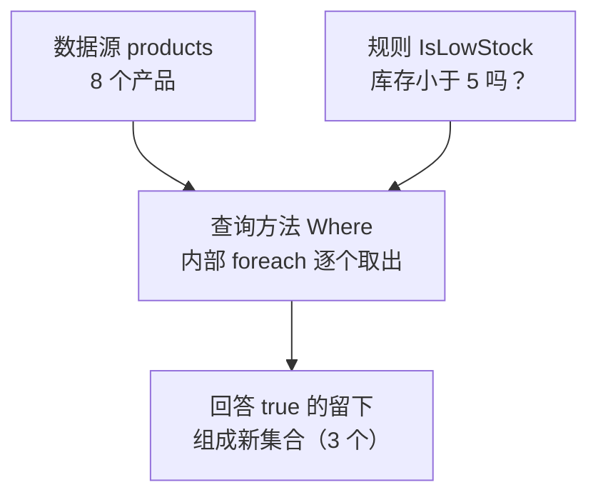
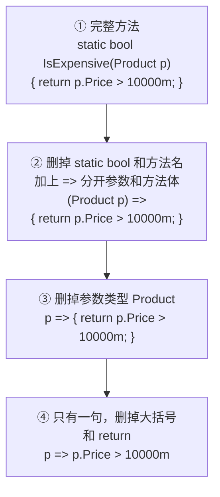

# 第 1 章 LINQ 是什么：原理与第一个查询

## 这一章解决什么问题

EF Core 查数据库，写的不是 SQL，而是 LINQ。不弄清 LINQ 是什么、背后怎么工作，后面每一章都会看得似懂非懂。

本章先讲清 LINQ 的原理，再学写规则的简写方式 lambda，最后用 `Where` 写出第一个查询。前 4 章都不连数据库，只在内存的 `List` 上练习。

## 开始之前

- 你已经会：C# 的类、`List<T>`、`foreach`；SQL 的 `SELECT ... FROM ... WHERE`。
- 需要的环境：Visual Studio 2026，已勾选工作负荷「ASP.NET 和 Web 开发」（自带 .NET 10 SDK）。确认方法：开始菜单打开「Visual Studio Installer」→ VS 2026 那一栏点「修改」→「工作负荷」页查看。
- 数据库：**本章不需要**，第 5 章才连 SQL Server。

> 预计耗时：75 分钟。

## 正文

### 1.1 建项目、放好示例数据

整本教程用**一个解决方案** `EfCoreStudy`，每章在里面新建一个项目。

1. 启动 VS 2026，在开始窗口点「**创建新项目**」。
2. 在搜索框输入 `控制台`，选中「**控制台应用**」（语言标签是 C#）。⚠ 不要选「控制台应用 (.NET Framework)」，那是旧框架。点「下一步」。
3. 「项目名称」填 `Ch01Linq`，「解决方案名称」改成 `EfCoreStudy`。点「下一步」。
4. 「框架」选 **.NET 10.0（长期支持）**，「不使用顶级语句」**不要勾**。点「创建」。

> 📷 **截图占位 ch01-01**：「配置新项目」页，项目名称 Ch01Linq，解决方案名称 EfCoreStudy。
> 截好后保存为 `images/ch01-01-create-project.png`，再删掉下一行的 `<!--` 和 `-->`。
<!--  -->

5. 在「解决方案资源管理器」里右键项目 `Ch01Linq` →「**添加 → 类**」，新建 `Product.cs`，内容全部替换成：

```csharp
// code/ch01/Step1-WhatIsLinq/Product.cs
namespace EfCoreStudy;

// 产品。第 5 章起它会原样变成数据库里的 Products 表，所以现在就按"一行数据"来设计
public class Product
{
    public int Id { get; set; }
    public string Code { get; set; } = "";      // 给默认值，避免 Nullable 警告 CS8618
    public string Name { get; set; } = "";
    public string Category { get; set; } = "";  // 第 12 章会拆成单独的 Category 表
    public decimal Price { get; set; }          // 金额一律 decimal，不用 double
    public int Stock { get; set; }
}
```

6. 用同样的方法新建 `SampleData.cs`：

```csharp
// code/ch01/Step1-WhatIsLinq/SampleData.cs
namespace EfCoreStudy;

// 第 1–4 章不连数据库，数据就放在内存里。每次调用都返回一份新的 List，互不影响
public static class SampleData
{
    public static List<Product> Products() =>
    [
        new() { Id = 1, Code = "US-100",  Name = "便携超声主机", Category = "主机", Price = 180000m, Stock = 3 },
        new() { Id = 2, Code = "US-200",  Name = "彩超工作站",   Category = "主机", Price = 420000m, Stock = 2 },
        new() { Id = 3, Code = "PB-L01",  Name = "线阵探头",     Category = "探头", Price = 26000m,  Stock = 8 },
        new() { Id = 4, Code = "PB-C02",  Name = "凸阵探头",     Category = "探头", Price = 24000m,  Stock = 0 },
        new() { Id = 5, Code = "PB-E03",  Name = "腔内探头",     Category = "探头", Price = 31000m,  Stock = 5 },
        new() { Id = 6, Code = "GEL-250", Name = "耦合剂",       Category = "耗材", Price = 35m,     Stock = 120 },
        new() { Id = 7, Code = "CVR-01",  Name = "探头保护套",   Category = "耗材", Price = 12m,     Stock = 300 },
        new() { Id = 8, Code = "PPR-110", Name = "热敏打印纸",   Category = "耗材", Price = 80m,     Stock = 6 },
    ];
}
```

两处新语法：`[ ... ]` 是集合表达式（C# 12 起），作用等同于 `new List<Product> { ... }`；`new() { ... }` 省略了类名，编译器根据 List 的元素类型推断出是 `Product`。

> 仓库里每一节是一个独立项目（[`code/ch01/`](../code/ch01/) 下的 `Step1-WhatIsLinq`、`Step2-Lambda`……），方便对照。你自己练习时**只用 `Ch01Linq` 一个项目就行**，每节把 `Program.cs` 整个替换掉。

### 1.2 概念一：LINQ 是什么

**白话定义**：LINQ（Language Integrated Query，语言集成查询）是 .NET 自带的**一组查询方法**：`Where`（筛选）、`Select`（挑列）、`OrderBy`（排序）、`Count`（计数）等。它们能用在任何集合上，让你不用自己写循环就能"从一堆数据里取出想要的那部分"。

它和 EF Core 的关系：**同一套写法**，用在 `List` 上，就在内存里查；用在 EF Core 的 `db.Products` 上，EF Core 会把它翻译成 SQL，到数据库里去查。所以先在 `List` 上把它学会。

**业务场景**：内存里有一份产品清单，要找出"库存不足 5 件"的产品，提醒采购补货。

**反例（什么时候不该用）**：如果循环不是为了"查"，而是为了"逐个做事"，比如给每个客户发一封邮件、逐行写日志，就用 `foreach`。把发邮件这种动作塞进 LINQ 的规则里，代码难懂；而且第 4 章你会看到，LINQ 不一定马上执行，邮件什么时候发出去都说不准。

#### 🖼 原理：LINQ 由三样东西组成

| 组成 | 是什么 | 本节例子 |
|---|---|---|
| 数据源 | 任何能用 `foreach` 遍历的集合（`List`、数组等） | `products`，8 个产品 |
| 查询方法 | .NET 写好的方法，**内部就是 `foreach` + `if`** | `Where` |
| 规则 | 你写的方法：给它一个产品，它回答 true 或 false | `IsLowStock`：库存小于 5 吗？ |



一句话原理：**查询方法 = .NET 替你写好的 `foreach`，规则 = 你交给它的判断方法。** 没有别的东西。

"把方法交给另一个方法"，你在 WebForm 里早就做过：`Button1.Click += Button1_Click;` 是把方法交给按钮，用户点按钮时由按钮去调用。`products.Where(IsLowStock)` 是把方法交给 `Where`，由 `Where` 在逐个检查产品时去调用。

下面用代码证明这件事：同一个查询写三遍，第三遍用的是**自己写的** `Where`。

#### 💻 最小可运行代码

右键项目 →「添加 → 类」，新建 `MyLinq.cs`：

```csharp
// code/ch01/Step1-WhatIsLinq/MyLinq.cs
namespace EfCoreStudy;

// 自己写一个 Where，看清 LINQ 的原理。
// .NET 自带的 Enumerable.Where 能用于任何类型的集合，这里为了好读只写 Product 版
public static class MyLinq
{
    // this：让它能写成 products.MyWhere(...)，看起来像 List 自己的方法（扩展方法）
    // rule：调用方交进来的"规则"。Func<Product, bool> 读作"收一个 Product、返回 bool 的方法"
    public static List<Product> MyWhere(this List<Product> source, Func<Product, bool> rule)
    {
        var result = new List<Product>();
        foreach (var p in source)
        {
            if (rule(p))          // 每个产品都拿去问一下规则
                result.Add(p);    // 回答 true 的留下
        }
        return result;
    }
}
```

把 `Program.cs` 全部替换成：

```csharp
// code/ch01/Step1-WhatIsLinq/Program.cs
using EfCoreStudy;

var products = SampleData.Products();

// ① 平常看到的 LINQ 写法：把规则 IsLowStock 交给 Where
var a = products.Where(IsLowStock).ToList();

// ② 同一句的"真面目"：Where 其实是 Enumerable 类里的静态方法，集合是第一个参数
var b = Enumerable.Where(products, IsLowStock).ToList();

// ③ 自己写的 MyWhere（见 MyLinq.cs）：里面就是 foreach + if
var c = products.MyWhere(IsLowStock);

Print("① products.Where", a);
Print("② Enumerable.Where", b);
Print("③ 自己写的 MyWhere", c);

// 规则：给它一个产品，它回答"库存是否不足 5 件"
static bool IsLowStock(Product p)
{
    return p.Stock < 5;
}

static void Print(string title, List<Product> list)
{
    Console.Write(title + "：");
    foreach (var p in list)
        Console.Write(p.Code + "  ");
    Console.WriteLine();
}
```

按 **Ctrl+F5**（菜单「调试 → 开始执行(不调试)」）运行。

#### 🔍 拆解运行结果

实测输出：

```text
① products.Where：US-100  US-200  PB-C02
② Enumerable.Where：US-100  US-200  PB-C02
③ 自己写的 MyWhere：US-100  US-200  PB-C02
```

三种写法结果完全相同，库存是 3、2、0 的三个产品。

- **① 和 ② 是同一句话。** `Where` 不是 `List` 自己的方法，而是 .NET 里 `Enumerable` 这个静态类的静态方法，集合是它的第一个参数。它的第一个参数前面有 `this`，这种方法叫**扩展方法**（extension method，可以"挂"到别的类型上调用的静态方法），所以编译器允许你写成 ① 那样，编译时再自动改写成 ②。
- **③ 证明里面没有别的东西。** `MyWhere` 就是 `foreach` + `if` + `Add`，结果和 .NET 自带的一模一样。
- `Where` 所在的命名空间是 `System.Linq`。项目开启了 `ImplicitUsings`，已经自动引入，所以不用手写 `using System.Linq;`。

`MyLinq.cs` 里的关键写法：

| 写法 | 含义 |
|---|---|
| `this List<Product> source` | 第一个参数前加 `this`，就能写成 `products.MyWhere(...)` |
| `Func<Product, bool> rule` | 参数 `rule` 的类型。`string` 是"文本"的类型，`Func<Product, bool>` 是"收一个 `Product`、返回 `bool` 的**方法**"的类型。尖括号里最后一个是返回类型 |
| `rule(p)` | 调用别人交进来的规则。`Where` 不知道规则是什么，只管调用 |

> 真正的 `Where` 和 `MyWhere` 只有一处不同：它**不会马上执行**，所以 ① ② 末尾要加 `.ToList()` 才拿到结果。第 4 章专门讲这一点。

#### 改坏一处试试

把 `MyLinq.cs` 里的 `this` 删掉，生成时报错（实测）：

```text
error CS1061: 'List<Product>' does not contain a definition for 'MyWhere' and no accessible extension method 'MyWhere' accepting a first argument of type 'List<Product>' could be found (are you missing a using directive or an assembly reference?)
```

原因：没有 `this`，`MyWhere` 就只是普通的静态方法，不能再"挂"到 `List` 上用点号调用。这时把 ③ 改成 ② 的写法 `MyLinq.MyWhere(products, IsLowStock)`，又能正常运行（实测）。这说明 `this` 的作用只是让你能用点号来写。

> 中文版 VS 的错误列表会显示中文译文，错误号（如 `CS1061`）相同。本教程贴的是编译器英文原文。

### 1.3 概念二：lambda 表达式

**白话定义**：lambda 是**没有名字、直接写在用它的地方的方法**。`p => p.Price > 10000m` 读作："给我一个产品 p，我告诉你它的价格是不是大于 10000。"

**业务场景**：产品列表页按"单价超过多少"筛选。这条规则只在这一处用，而且价格下限往往是用户在页面上输入的。

**反例（什么时候不该用）**：规则超过两三个条件、或者好几个地方都要用（比如"是否需要审批"牵涉金额、客户等级、产品类别），就应该写成具名方法并起个好名字。挤在一行 lambda 里，别人读不懂，也没法单独调试。

#### 🖼 图解：规则方法太短，就地简写

像 1.2 节 `IsLowStock` 这样的规则方法，真正有用的只有一句，却要写 4 行、起个名字，而查询规则又多半只用一次。所以 C# 允许你把规则就地简写。下面用本节代码里的规则 `IsExpensive`（价格是否超过 10000）演示，每一步删掉编译器能自己推断出来的东西：



| 步骤 | 为什么可以删 |
|---|---|
| ② 删方法名和返回类型 | 只在这里用一次，不需要名字；编译器看 `p.Price > 10000m` 就知道返回 `bool` |
| ③ 删参数类型 | `Where` 作用在 `List<Product>` 上，编译器知道 p 一定是 `Product` |
| ④ 删大括号和 `return` | 方法体只有一个表达式时，这个表达式的值就是返回值 |

④ 就是 lambda。**它就是一个没有名字的方法，只是写得很短。** 交给 `Where` 的仍然是"一个方法"，原理和 1.2 节完全一样。

#### 💻 最小可运行代码

```csharp
// code/ch01/Step2-Lambda/Program.cs
using EfCoreStudy;

var products = SampleData.Products();

// 写法 A：把写好的方法交给 Where。只写方法名、不加括号——方法由 Where 去调用
var listA = products.Where(IsExpensive).ToList();

// 写法 B：同一条规则写成 lambda，直接写在括号里
var listB = products.Where(p => p.Price > 10000m).ToList();

Console.WriteLine($"写法 A：{listA.Count} 个");
Console.WriteLine($"写法 B：{listB.Count} 个");
foreach (var p in listB)
    Console.WriteLine($"  {p.Code}  {p.Name}  {p.Price:N0}");

// 价格下限往往是运行时才知道的（这里用字符串模拟用户在页面上的输入）
// lambda 可以直接用外面的变量 minPrice；写法 A 的方法只收一个 Product 参数，做不到
var minPrice = decimal.Parse("30000");
var listC = products.Where(p => p.Price > minPrice).ToList();
Console.WriteLine($"高于 {minPrice:N0} 的：{listC.Count} 个");

// 写法 A 用到的具名方法：给它一个产品，它回答 true 或 false
static bool IsExpensive(Product p)
{
    return p.Price > 10000m;
}
```

#### 🔍 拆解运行结果

实测输出：

```text
写法 A：5 个
写法 B：5 个
  US-100  便携超声主机  180,000
  US-200  彩超工作站  420,000
  PB-L01  线阵探头  26,000
  PB-C02  凸阵探头  24,000
  PB-E03  腔内探头  31,000
高于 30,000 的：3 个
```

- 写法 A 和写法 B 都找到 5 个，做的事完全一样。
- 写法 A 只写方法名 `IsExpensive`，**不加括号**。加了括号就是"现在就调用它"，而这里要的是"把方法交出去"。`Button1.Click += Button1_Click;` 也不加括号，道理相同。
- 最后一段是写法 A 做不到的：规则里用到了外面的变量 `minPrice`。`IsExpensive` 只收一个 `Product` 参数，没地方放价格下限；lambda 写在括号里，能直接用上面定义的 `minPrice`。实际的查询条件大多是这种情况，所以绝大多数时候都写 lambda。

> 到了 EF Core，查数据库时**必须用 lambda**：EF Core 能读懂 lambda 里写的条件，翻译成 SQL 的 `WHERE`；交给它一个具名方法，它只看得到方法名，翻译不了。第 8 章细讲。

#### 改坏一处试试

| 改法 | 生成时的报错（实测） | 原因 |
|---|---|---|
| 写法 A 加上括号：`products.Where(IsExpensive())` | `error CS7036: There is no argument given that corresponds to the required parameter 'p' of 'IsExpensive(Product)'` | 加了括号就是"现在调用它"，可你没给它产品参数 |
| 写法 B 的 `10000m` 改成 `10000.5`（去掉 `m`） | `error CS0019: Operator '>' cannot be applied to operands of type 'decimal' and 'double'` | 带小数点、不带后缀的数字是 `double`，不能和 `decimal` 直接比较。写成 `10000.5m` |

### 1.4 概念三：Where —— 筛选行

**白话定义**：`Where` 对集合里的每个元素调用一次你给的规则，只留下回答 true 的那些（🖼 图解就是 1.2 节那张原理图）。作用就是 SQL 的 `WHERE`。

**业务场景**：仓库要一份"探头类、目前有货"的清单，拿去盘点。

**反例**：只想知道"**有没有**"满足条件的，不要写 `Where(...).Count() > 0`，用第 3 章的 `Any`，找到第一个就停；按主键找**一条**，用第 2 章的 `First` / `FirstOrDefault`，意图更清楚。

#### 💻 最小可运行代码

```csharp
// code/ch01/Step3-Where/Program.cs
using EfCoreStudy;

var products = SampleData.Products();

// 老写法：foreach + if + 新建 List
var oldWay = new List<Product>();
foreach (var p in products)
{
    if (p.Category == "探头" && p.Stock > 0)
        oldWay.Add(p);
}
Console.WriteLine($"foreach 写法：{oldWay.Count} 个");

// LINQ 写法：条件就是一个 lambda，Where 替你写好了循环和 if
var linqWay = products.Where(p => p.Category == "探头" && p.Stock > 0).ToList();
Console.WriteLine($"Where 写法：{linqWay.Count} 个");
foreach (var p in linqWay)
    Console.WriteLine($"  {p.Code}  {p.Name}  库存 {p.Stock}");

// Where 返回的是新结果，不会删改原来的 List
Console.WriteLine($"原列表仍是 {products.Count} 个");
```

#### 🔍 拆解运行结果

实测输出：

```text
foreach 写法：2 个
Where 写法：2 个
  PB-L01  线阵探头  库存 8
  PB-E03  腔内探头  库存 5
原列表仍是 8 个
```

- 凸阵探头（PB-C02）库存是 0，被 `p.Stock > 0` 筛掉，所以只剩 2 个。
- 多个条件写在同一个 lambda 里，用 `&&`（并且）、`||`（或者）连接，比较用 `==`。这是 C# 的写法，不是 SQL 的 `AND` / `OR` / `=`。
- `.ToList()`：把结果收成一个新的 `List<Product>`。现在先记住：**要拿到结果，末尾加 `.ToList()`**，第 4 章讲为什么。
- 最后一行说明 `Where` 不改原集合，和 SQL 一样：`SELECT ... WHERE` 不会删表里的数据。

#### 改坏一处试试

| 改法 | 生成时的报错（实测） | 原因 |
|---|---|---|
| `==` 写成 `=`：`p.Category = "探头"` | `error CS0029: Cannot implicitly convert type 'string' to 'bool'` | 一个等号在 SQL 里是比较，在 C# 里是赋值，赋值结果是 `string`，不是 `bool` |
| 去掉 `.ToList()`，赋给 `List<Product>` 变量 | `error CS0266: Cannot implicitly convert type 'System.Collections.Generic.IEnumerable<EfCoreStudy.Product>' to 'System.Collections.Generic.List<EfCoreStudy.Product>'` | `Where` 返回的是 `IEnumerable<Product>`，不是 `List`。第 4 章细讲 |

## 🧱 类比：SQL 和 LINQ 逐段对照

同一个需求"探头类、有库存"，SQL 写 `SELECT * FROM Products WHERE Category = N'探头' AND Stock > 0`，LINQ 写 `products.Where(p => p.Category == "探头" && p.Stock > 0).ToList()`：

| SQL | LINQ | 区别 |
|---|---|---|
| `FROM Products` | `products.` | LINQ 把数据源写在最前面，所以输入 `p.` 时 VS 就能提示出属性 |
| `WHERE 条件` | `.Where(p => 条件)` | 条件是一个方法（规则），比较用 `==`，逻辑用 `&&` / `\|\|` |
| 数据库引擎逐行判断 | `Where` 内部 `foreach` 逐个判断 | 原理相同：逐行代入条件，留下满足的 |

## ⚠️ 踩坑警告

| 现象 | 原因 | 怎么改 |
|---|---|---|
| `CS0029: Cannot implicitly convert type 'string' to 'bool'` | 比较写成了 `=`（SQL 习惯） | 改成 `==` |
| `CS7036: There is no argument given that corresponds to the required parameter 'p'` | 把方法交给 `Where` 时加了括号：`Where(IsExpensive())` | 只写方法名 `Where(IsExpensive)`，或直接写 lambda |
| `CS0019: Operator '>' cannot be applied to operands of type 'decimal' and 'double'` | `decimal` 属性和不带 `m` 的小数比较 | 数字后加 `m`：`99.5m` |
| `Console.WriteLine(products.Where(...))` 打印出 `` System.Linq.Enumerable+ListWhereIterator`1[EfCoreStudy.Product] ``（实测） | 打印的是"查询对象"本身，不是里面的数据 | 先 `.ToList()`，再用 `foreach` 输出 |
| `products.Where(p => p.Code.StartsWith("pb"))` 一个都找不到（实测 0 个） | 内存里的字符串比较**区分大小写**，`"pb"` ≠ `"PB"` | 写对大小写，或用 `StartsWith("pb", StringComparison.OrdinalIgnoreCase)`（实测 3 个）。到了 SQL Server 上，默认排序规则**不区分**大小写，同一句会找到 3 个，第 8 章细讲这种差异 |

## 🎯 动手练习

**练习 1：需补货清单**
找出"有货但不足 10 件"的产品，输出编码、名称、库存。

- 验收标准：输出 5 行，依次是 US-100、US-200、PB-L01、PB-E03、PPR-110；凸阵探头（库存 0）不在里面。

**练习 2：按价格区间筛选**
用两个变量模拟用户输入的价格区间：`var minPrice = decimal.Parse("20000");`、`var maxPrice = decimal.Parse("30000");`，找出单价在这个区间内（含两端）的产品。

- 验收标准：输出 2 行，PB-L01 线阵探头 26,000 和 PB-C02 凸阵探头 24,000。把 `maxPrice` 改成 `"40000"` 后变成 3 行（多出腔内探头）。

卡住了看文末参考答案。

## 📌 一句话总结

LINQ 是写好的 foreach：查询方法负责循环，你用 lambda 给规则。

## 下一章

只会筛行还不够：报表要挑几列、要排序、要只取一条。第 2 章解决这些。

---

<!-- 以下是参考答案，先自己动手，卡住了再往下翻 -->


## 参考答案

思路：两道题都只用 `Where`。多个条件写在同一个 lambda 里，用 `&&` 连接；练习 2 的 lambda 直接用到外面的 `minPrice`、`maxPrice`，这正是 1.3 节说的"写法 A 做不到"的情况。

完整项目在 [`code/ch01/Exercise/`](../code/ch01/Exercise/)。实测输出：

```text
需补货：
  US-100  便携超声主机  库存 3
  US-200  彩超工作站  库存 2
  PB-L01  线阵探头  库存 8
  PB-E03  腔内探头  库存 5
  PPR-110  热敏打印纸  库存 6
20,000 到 30,000 之间：
  PB-L01  线阵探头  26,000
  PB-C02  凸阵探头  24,000
```

```csharp
// code/ch01/Exercise/Program.cs
// 第 1 章练习参考答案：练习 1（需补货清单）+ 练习 2（按价格区间筛选）
using EfCoreStudy;

var products = SampleData.Products();

// 练习 1：有货但不足 10 件。两个条件写在同一个 lambda 里，用 && 连接
var toRestock = products.Where(p => p.Stock > 0 && p.Stock < 10).ToList();
Console.WriteLine("需补货：");
foreach (var p in toRestock)
    Console.WriteLine($"  {p.Code}  {p.Name}  库存 {p.Stock}");

// 练习 2：区间来自"用户输入"，lambda 直接用外面的两个变量
var minPrice = decimal.Parse("20000");
var maxPrice = decimal.Parse("30000");
var inRange = products.Where(p => p.Price >= minPrice && p.Price <= maxPrice).ToList();
Console.WriteLine($"{minPrice:N0} 到 {maxPrice:N0} 之间：");
foreach (var p in inRange)
    Console.WriteLine($"  {p.Code}  {p.Name}  {p.Price:N0}");
```
