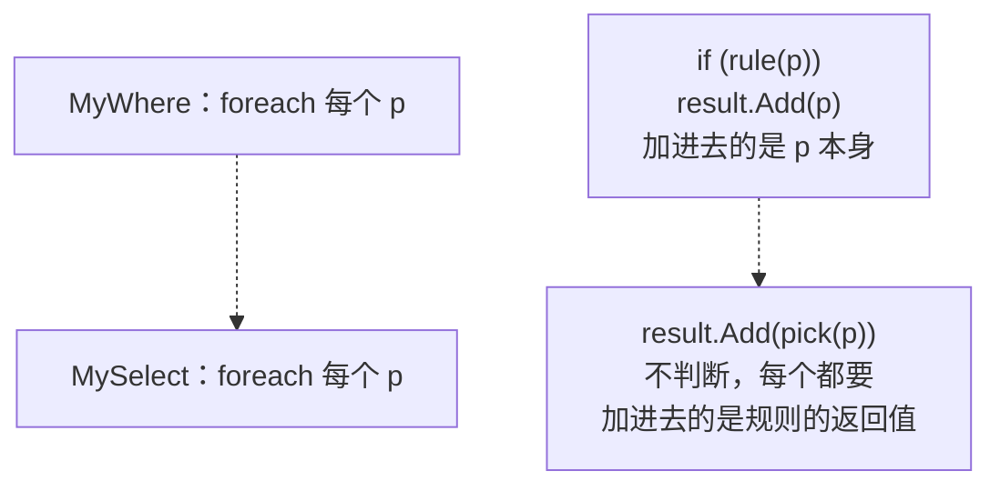
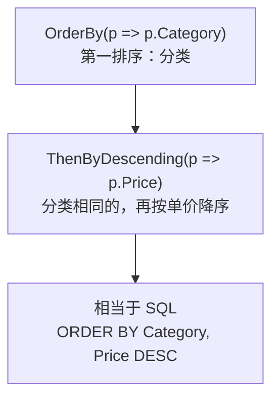

# 第 2 章 挑列、排序、取一条

## 这一章解决什么问题

第 1 章的 `Where` 只能筛行。真实的报表还要：只取几列、算出新列、按价格排好序；按编码查一个产品时，要拿到的是"那一个"，而不是一个只装了一个元素的 List。本章解决这三件事。

## 开始之前

- 上一章你已经会了：LINQ 的原理（查询方法 = 写好的 `foreach`，规则由你交给它）、lambda、`Where`。
- 需要的环境：和第 1 章相同，本章仍不连数据库。

> 预计耗时：75 分钟。

## 正文

### 2.1 新建本章项目

1. 在「解决方案资源管理器」里右键解决方案 `EfCoreStudy` →「**添加 → 新建项目**」，选「**控制台应用**」，项目名称填 `Ch02Linq`，框架选 **.NET 10.0**，点「创建」。
2. 右键项目 `Ch02Linq` →「**添加 → 现有项**」，进入 `Ch00Basics` 文件夹，按住 Ctrl 选中 `Product.cs` 和 `SampleData.cs`，点「添加」。VS 会把这两个文件**复制**一份到 `Ch02Linq`。
3. 右键项目 `Ch02Linq` →「**设为启动项目**」。之后按 Ctrl+F5 运行的就是它。

> 📷 **截图占位 ch02-01**：右键项目后的菜单，「设为启动项目」高亮。
<!--  -->

> 仓库里本章每节一个独立项目（[`code/ch02/`](../code/ch02/) 下的 `Step1-Select` 等）。你自己练习只用 `Ch02Linq`，每节替换 `Program.cs`。

### 2.2 先补一条原理：不同的查询方法，要的"规则"不同

第 1 章说过：查询方法内部是写好的 `foreach`，规则由你交给它。本章的三个方法也一样，区别只在于**规则回答的问题不同**：

| 方法 | 规则回答的问题 | 规则的返回值 | 例子 |
|---|---|---|---|
| `Where`（第 1 章） | 这个产品**留不留**？ | `bool` | `p => p.Stock > 0` |
| `Select` | 这个产品我**要它的什么**？ | 你想要的任何值 | `p => p.Name` |
| `OrderBy` | 这个产品**按什么排**？ | 用来比较大小的值 | `p => p.Price` |
| `First` / `Single` | 这个产品**是不是要找的**？ | `bool` | `p => p.Code == "PB-L01"` |

记住这张表，遇到新的 LINQ 方法，先问一句"它要的规则回答什么问题"，就知道 lambda 该怎么写。

### 2.3 概念一：Select —— 挑列、算列

**白话定义**：`Select` 对每个元素调用一次你给的规则，把**规则的返回值**收集起来。作用就是 SQL 的 `SELECT 列清单`：可以只取几列，也可以算出新列。

**业务场景**：报表只要"产品名称 + 库存金额（单价 × 库存）"，不要整个 `Product`。

**反例（什么时候不该用）**：取出来的数据**后面还要修改**，就不要投影成匿名类型，它的属性是只读的（见下面"改坏一处试试"）；第 9 章你还会看到，EF Core 也不跟踪匿名类型的变化。另外，匿名类型不能作为方法的返回类型，要跨方法传递时请专门定义一个类。

#### 🖼 原理：和 MyWhere 只差一行



左边留下的是**原来的产品**（数量变少），右边留下的是**规则算出来的值**（数量不变，内容变了）。下面自己写一个 `MySelect` 来证明。

#### 💻 最小可运行代码

右键项目 →「添加 → 类」，新建 `MyLinq.cs`：

```csharp
// code/ch02/Step1-Select/MyLinq.cs
namespace EfCoreStudy;

// 自己写一个 Select，和第 1 章的 MyWhere 对照着看
public static class MyLinq
{
    // MyWhere（第 1 章）：规则回答 true/false，决定这个产品"留不留"
    public static List<Product> MyWhere(this List<Product> source, Func<Product, bool> rule)
    {
        var result = new List<Product>();
        foreach (var p in source)
        {
            if (rule(p))
                result.Add(p);
        }
        return result;
    }

    // MySelect：规则回答"要它的什么"，把规则的返回值收集起来。
    // 为了好读只写返回 string 的版本；.NET 自带的 Select 能返回任何类型
    public static List<string> MySelect(this List<Product> source, Func<Product, string> pick)
    {
        var result = new List<string>();
        foreach (var p in source)
            result.Add(pick(p));    // 不做判断，每个都要；加进去的是 pick(p) 的结果，不是 p 本身
        return result;
    }
}
```

`Program.cs`：

```csharp
// code/ch02/Step1-Select/Program.cs
using EfCoreStudy;

var products = SampleData.Products();

// ① 原理：自己写的 MySelect 和 .NET 自带的 Select，结果相同
var names1 = products.MySelect(p => p.Name);
var names2 = products.Select(p => p.Name).ToList();
Console.WriteLine("MySelect：" + string.Join("、", names1));
Console.WriteLine("Select：" + string.Join("、", names2));

// ② 要几列：用匿名类型 new { ... }，不用为一次查询专门写一个类
var cheap = products
    .Where(p => p.Price < 100m)                     // 先筛行
    .Select(p => new { p.Code, p.Name, p.Price })   // 再挑列
    .ToList();
foreach (var x in cheap)
    Console.WriteLine($"{x.Code}  {x.Name}  {x.Price}");

// ③ 计算列：相当于 SQL 的 Price * Stock AS Amount
var amounts = products
    .Where(p => p.Category == "主机")
    .Select(p => new { p.Name, Amount = p.Price * p.Stock })
    .ToList();
foreach (var x in amounts)
    Console.WriteLine($"{x.Name}  库存金额 {x.Amount:N0}");
```

#### 🔍 拆解运行结果

实测输出：

```text
MySelect：便携超声主机、彩超工作站、线阵探头、凸阵探头、腔内探头、耦合剂、探头保护套、热敏打印纸
Select：便携超声主机、彩超工作站、线阵探头、凸阵探头、腔内探头、耦合剂、探头保护套、热敏打印纸
GEL-250  耦合剂  35
CVR-01  探头保护套  12
PPR-110  热敏打印纸  80
便携超声主机  库存金额 540,000
彩超工作站  库存金额 840,000
```

| 写法 | 结果的元素类型 | 对应 SQL |
|---|---|---|
| `Select(p => p.Name)` | `string` | `SELECT Name` |
| `Select(p => new { p.Code, p.Name, p.Price })` | 匿名类型 | `SELECT Code, Name, Price` |
| `Select(p => new { p.Name, Amount = p.Price * p.Stock })` | 匿名类型 | `SELECT Name, Price * Stock AS Amount` |

- `new { p.Code, p.Name }`：匿名类型（anonymous type，编译器自动生成的、没有名字的类）。属性名默认沿用原属性名；`Amount = ...` 是自己起名，相当于 SQL 的 `AS`。
- 匿名类型没有名字，所以变量只能用 `var` 声明。
- 多个方法用 `.` 串起来，叫**方法链**：每一步的输出就是下一步的输入。一行写一个方法，最好读。

#### 改坏一处试试

| 改法 | 生成时的报错（实测） | 原因 |
|---|---|---|
| ② 的 `Where` 和 `Select` 调换顺序：`products.Select(p => new { p.Code, p.Name }).Where(x => x.Price < 100m)` | `error CS1061: '<anonymous type: string Code, string Name>' does not contain a definition for 'Price' ...` | `Select` 之后，每个元素只剩 `Code`、`Name`，`Price` 已经没了。和 SQL 的逻辑顺序一致：先 WHERE、后 SELECT |
| 给匿名类型的属性赋值：`x.Price = 1m;` | `error CS0200: Property or indexer '<anonymous type: string Code, decimal Price>.Price' cannot be assigned to -- it is read only` | 匿名类型的属性是只读的，只能用来"看" |

### 2.4 概念二：OrderBy / ThenBy —— 排序

**白话定义**：`OrderBy` 按规则返回的值从小到大排序，`OrderByDescending` 从大到小。要按第二个条件继续排，接 `ThenBy` / `ThenByDescending`。作用就是 SQL 的 `ORDER BY`。

**业务场景**：价格表先按分类排，同一分类里贵的排前面。

**反例**：只要"最高价是多少"这一个数字，不需要把整个集合排好序，用第 3 章的 `Max`，走一遍就够。排序要反复比较元素，数据多时更慢。

#### 🖼 原理

`OrderBy` 用你的规则从每个产品取出一个"比较用的值"（这里是单价），按这个值把产品排好，返回**排好序的新结果**，原来的 List 顺序不变。规则只负责"按什么排"，怎么排由 .NET 完成。



#### 💻 最小可运行代码

```csharp
// code/ch02/Step2-OrderBy/Program.cs
using EfCoreStudy;

var products = SampleData.Products();

// ① 按单价从低到高：相当于 ORDER BY Price
var byPrice = products.OrderBy(p => p.Price).ToList();
Print("① 单价升序", byPrice);

// ② 从高到低：相当于 ORDER BY Price DESC
var byPriceDesc = products.OrderByDescending(p => p.Price).ToList();
Print("② 单价降序", byPriceDesc);

// ③ 先按分类，同一分类里再按单价从高到低：相当于 ORDER BY Category, Price DESC
//    第二个排序条件必须用 ThenBy / ThenByDescending，不能再写一个 OrderBy
var byCategory = products
    .OrderBy(p => p.Category)
    .ThenByDescending(p => p.Price)
    .ToList();
Print("③ 分类 + 单价降序", byCategory);

static void Print(string title, List<Product> list)
{
    Console.WriteLine(title + "：");
    foreach (var p in list)
        Console.WriteLine($"  {p.Category}  {p.Code,-8}{p.Price,10:N0}");
}
```

#### 🔍 拆解运行结果

实测输出（中文系统）：

```text
① 单价升序：
  耗材  CVR-01          12
  耗材  GEL-250         35
  耗材  PPR-110         80
  探头  PB-C02      24,000
  探头  PB-L01      26,000
  探头  PB-E03      31,000
  主机  US-100     180,000
  主机  US-200     420,000
② 单价降序：
  主机  US-200     420,000
  主机  US-100     180,000
  探头  PB-E03      31,000
  探头  PB-L01      26,000
  探头  PB-C02      24,000
  耗材  PPR-110         80
  耗材  GEL-250         35
  耗材  CVR-01          12
③ 分类 + 单价降序：
  耗材  PPR-110         80
  耗材  GEL-250         35
  耗材  CVR-01          12
  探头  PB-E03      31,000
  探头  PB-L01      26,000
  探头  PB-C02      24,000
  主机  US-200     420,000
  主机  US-100     180,000
```

- ③ 中分类的顺序是"耗材、探头、主机"，这是**拼音顺序**（hao、tan、zhu）。中文字符串怎么排，取决于系统的语言设置，见踩坑警告。
- `{p.Code,-8}`：左对齐占 8 格；`{p.Price,10:N0}`：右对齐占 10 格、千分位无小数。只为输出整齐。

#### 改坏一处试试

把 ③ 的 `ThenByDescending` 换成 `OrderByDescending`：

```csharp
products.OrderBy(p => p.Category).OrderByDescending(p => p.Price)
```

编译不报错，但输出的分类变成了（实测）：

```text
主机 主机 探头 探头 探头 耗材 耗材 耗材
```

分类排序丢了，结果和 ② 一样只按单价排。原因：**每个 `OrderBy` 都是重新从头排序**，第二个把第一个的结果覆盖了。第二个及以后的排序条件，一律用 `ThenBy` / `ThenByDescending`。

### 2.5 概念三：First / FirstOrDefault / Single / SingleOrDefault —— 只取一个

**白话定义**：这 4 个方法都返回**一个元素**，不是集合。区别在于"找不到"和"找到多个"时怎么处理。

**业务场景**：用户输入产品编码，查出这个产品的名称和库存。

**反例**：要的是"满足条件的**所有**产品"，比如所有探头，就用 `Where`。用 `First` 只会拿到第一个，其余的静悄悄地丢了，不会报错。

#### 🖼 原理：4 个方法的区别

它们内部都是 `foreach` 逐个检查，区别只在找到之后：

| 方法 | 找到第 1 个后 | 一个都没有 | 有多个 | 相当于 SQL |
|---|---|---|---|---|
| `First` | 立刻返回 | **抛异常** | 返回第 1 个 | `SELECT TOP 1` |
| `FirstOrDefault` | 立刻返回 | 返回 `null` | 返回第 1 个 | `SELECT TOP 1`，没有就算了 |
| `Single` | **继续往下找**，确认没有第 2 个 | **抛异常** | **抛异常** | 按主键或唯一键查 |
| `SingleOrDefault` | 继续往下找 | 返回 `null` | **抛异常** | 按唯一键查，可能不存在 |

怎么选：**按唯一键（编码、ID）查，用 `Single` 系列**，数据里一旦出现重复编码，它会立刻报错提醒你；**只要第一个（通常配合排序），用 `First` 系列**。**可能找不到的，用带 `OrDefault` 的**，再判断 `null`。

#### 💻 最小可运行代码

```csharp
// code/ch02/Step3-First/Program.cs
using EfCoreStudy;

var products = SampleData.Products();

// ① First：取第一个满足条件的。相当于 SELECT TOP 1 ... WHERE
var firstProbe = products.First(p => p.Category == "探头");
Console.WriteLine($"① First 第一个探头：{firstProbe.Code}");

// ② FirstOrDefault：找不到时返回 null，不报错
var notFound = products.FirstOrDefault(p => p.Code == "XX-999");
Console.WriteLine($"② FirstOrDefault 找 XX-999：{(notFound is null ? "null" : notFound.Name)}");

// ③ Single：断言"恰好只有一个"。按编码查，编码本来就不该重复
var byCode = products.Single(p => p.Code == "PB-L01");
Console.WriteLine($"③ Single 按编码 PB-L01：{byCode.Name}");

// ④ 编码来自用户输入，可能不存在：用 SingleOrDefault，再判断 null
var input = "GEL-250";
var found = products.SingleOrDefault(p => p.Code == input);
if (found is null)
    Console.WriteLine($"④ 编码 {input} 不存在");
else
    Console.WriteLine($"④ SingleOrDefault 按编码 {input}：{found.Name}，库存 {found.Stock}");
```

#### 🔍 拆解运行结果

实测输出：

```text
① First 第一个探头：PB-L01
② FirstOrDefault 找 XX-999：null
③ Single 按编码 PB-L01：线阵探头
④ SingleOrDefault 按编码 GEL-250：耦合剂，库存 120
```

- ① 探头有 3 个，`First` 只返回按 List 顺序的第一个（PB-L01）。
- ② 编码不存在，`FirstOrDefault` 返回 `null`，程序不中断。
- `is null`：判断是否为 `null`，和 `== null` 作用一样。
- `First` 和 `Single` 返回的是 `Product` 本身，可以直接 `.Name`；不用再 `.ToList()`，因为结果已经是一个值。

#### 改坏一处试试

| 改法 | 运行结果（实测） | 原因 |
|---|---|---|
| ① 改成 `products.First(p => p.Code == "XX-999")` | `System.InvalidOperationException: Sequence contains no matching element` | `First` 认为"一定有"，没有就抛异常 |
| ③ 改成 `products.Single(p => p.Category == "探头")` | `System.InvalidOperationException: Sequence contains more than one matching element` | 探头有 3 个，`Single` 要求恰好 1 个 |
| ② 不判断 null，直接 `Console.WriteLine(notFound.Name);` | 生成时有警告 `warning CS8602: Dereference of a possibly null reference.`；运行时 `System.NullReferenceException` | 编译器已经提醒你"这里可能是 null"，不要忽略这条警告 |

## 🧱 类比：SQL 和 LINQ 对照

| SQL | LINQ |
|---|---|
| `SELECT Name, Price * Stock AS Amount` | `.Select(p => new { p.Name, Amount = p.Price * p.Stock })` |
| `ORDER BY Category, Price DESC` | `.OrderBy(p => p.Category).ThenByDescending(p => p.Price)` |
| `SELECT TOP 1 ... ORDER BY Price DESC` | `.OrderByDescending(p => p.Price).First()` |
| `WHERE Code = @code`（Code 唯一） | `.SingleOrDefault(p => p.Code == code)` |
| 书写顺序：SELECT → FROM → WHERE → ORDER BY | 书写顺序：数据源 → Where → OrderBy → Select，和执行顺序一致 |

## ⚠️ 踩坑警告

| 现象 | 原因 | 怎么改 |
|---|---|---|
| 写了两个排序条件，第一个不起作用（编译不报错） | 第二个条件也写成了 `OrderBy`，它会重新排序 | 第二个及以后用 `ThenBy` / `ThenByDescending` |
| 按中文字符串排序，同事电脑上顺序不一样 | 字符串排序按**系统语言**规则：中文系统按拼音（实测：耗材、探头、主机），英文系统按字符编码（实测：主机、探头、耗材） | 结果顺序很重要时，按编号、代码这类不依赖语言的列排序。到了 EF Core，排序交给数据库，由 SQL Server 的排序规则决定（第 8 章） |
| `Sequence contains no matching element` | 用 `First` / `Single` 查了一个可能不存在的值 | 改用 `FirstOrDefault` / `SingleOrDefault`，再判断 `null` |
| `Sequence contains more than one matching element` | 用 `Single` 查的条件其实不唯一，比如按分类查 | 确实可能有多个就用 `First` 或 `Where`；本该唯一就去查数据为什么重复 |
| `warning CS8602: Dereference of a possibly null reference.` | `FirstOrDefault` 的结果可能是 `null`，没判断就用了 | 先 `if (x is null)` 判断 |

## 🎯 动手练习

**练习 1：耗材价格表**
列出所有耗材，按单价从低到高，只输出名称和单价（保留两位小数）。

- 验收标准：输出 3 行，依次是 `探头保护套  12.00`、`耦合剂  35.00`、`热敏打印纸  80.00`。

**练习 2：最贵的探头、按编码查**
① 找出单价最高的探头，输出名称和单价。② 依次查编码 `PB-C02` 和 `PB-X99`，存在就输出名称，不存在输出"不存在"，程序不能报错。

- 验收标准：输出 `最贵的探头：腔内探头 31,000`、`PB-C02：凸阵探头`、`PB-X99：不存在`。

卡住了看文末参考答案。

## 📌 一句话总结

Select 要什么、OrderBy 按什么排、Single 按唯一键找，规则不同而已。

## 下一章

报表还要合计、按分类小计、分页显示，第 3 章解决这些。

---

<!-- 以下是参考答案，先自己动手，卡住了再往下翻 -->


## 参考答案

思路：练习 1 按 `Where` → `OrderBy` → `Select` 的顺序写，和 SQL 的执行顺序一致；练习 2 ① 先降序排好再取 `First`，② 编码唯一且可能不存在，所以用 `SingleOrDefault` 加 `null` 判断。

完整项目在 [`code/ch02/Exercise/`](../code/ch02/Exercise/)。实测输出：

```text
耗材价格表：
  探头保护套  12.00
  耦合剂  35.00
  热敏打印纸  80.00
最贵的探头：腔内探头 31,000
PB-C02：凸阵探头
PB-X99：不存在
```

```csharp
// code/ch02/Exercise/Program.cs
// 第 2 章练习参考答案：练习 1（耗材价格表）+ 练习 2（最贵的探头、按编码查）
using EfCoreStudy;

var products = SampleData.Products();

// 练习 1：Where → OrderBy → Select，顺序和 SQL 的 WHERE → ORDER BY → SELECT 一致
var priceList = products
    .Where(p => p.Category == "耗材")
    .OrderBy(p => p.Price)
    .Select(p => new { p.Name, p.Price })
    .ToList();
Console.WriteLine("耗材价格表：");
foreach (var x in priceList)
    Console.WriteLine($"  {x.Name}  {x.Price:N2}");

// 练习 2-1：先按单价降序排好，第一个就是最贵的
var top = products
    .Where(p => p.Category == "探头")
    .OrderByDescending(p => p.Price)
    .First();
Console.WriteLine($"最贵的探头：{top.Name} {top.Price:N0}");

// 练习 2-2：编码可能不存在，用 SingleOrDefault（编码唯一）再判断 null
foreach (var code in new[] { "PB-C02", "PB-X99" })
{
    var p = products.SingleOrDefault(x => x.Code == code);
    Console.WriteLine(p is null ? $"{code}：不存在" : $"{code}：{p.Name}");
}
```
