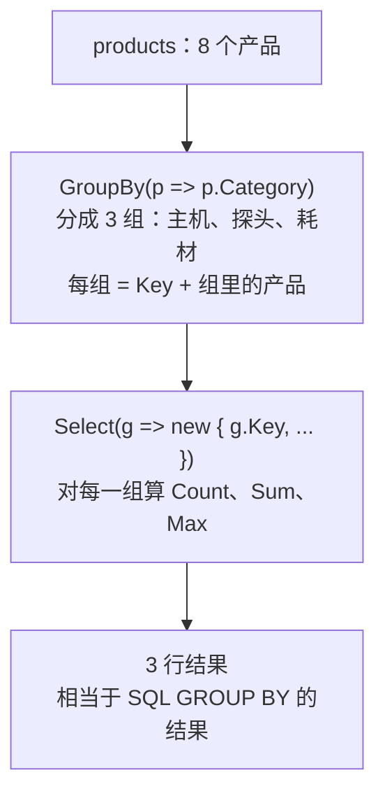

# 第 3 章 汇总、分组与分页

## 这一章解决什么问题

报表底部要一行合计；按分类出小计；产品列表一页只显示 3 条，要能翻页。这三件事在 SQL 里分别是聚合函数、`GROUP BY`、`OFFSET ... FETCH`，本章用 LINQ 写出来。

## 开始之前

- 上一章你已经会了：`Select`、`OrderBy` / `ThenBy`、`First` / `Single` 系列，以及"不同方法要的规则不同"。
- 需要的环境：和第 1 章相同。按第 2 章 2.1 节的方法新建项目 `Ch03Linq`，添加 `Product.cs`、`SampleData.cs`，设为启动项目。

> 预计耗时：75 分钟。

## 正文

### 3.1 概念一：汇总方法 —— Count / Any / Sum / Max / Average

**白话定义**：汇总方法把一个集合算成**一个值**：个数、有没有、合计、最大、平均。作用就是 SQL 的 `COUNT`、`EXISTS`、`SUM`、`MAX`、`AVG`。

**业务场景**：库存报表底部显示"产品总数、库存总金额、最高单价"；首页提示"有缺货产品"。

**反例（什么时候不该用）**：只想知道"**有没有**"，不要用 `Count(...) > 0`，用 `Any`，原因见下面的实测。另外，`List` 自己就有 `Count` 属性（不带括号），直接读就行，不需要调用 LINQ 的 `Count()` 方法。

#### 🖼 原理

汇总方法内部也是 `foreach`，只是不再往新 List 里装东西，而是边走边算一个数：

| 方法 | 循环里做什么 | 返回 |
|---|---|---|
| `Count(规则)` | 规则回答 true 就计数器 +1 | `int` |
| `Sum(规则)` | 把规则返回的值累加 | 数字 |
| `Max` / `Min(规则)` | 记住目前为止最大 / 最小的值 | 数字 |
| `Average(规则)` | 累加，同时计数，最后相除 | 数字 |
| `Any(规则)` | 规则回答 true 就**立刻停止**，返回 true | `bool` |

`Any` 的"立刻停止"是它和 `Count(...) > 0` 的区别。下面的代码把每次检查都打印出来，让你看到这个区别。

#### 💻 最小可运行代码

```csharp
// code/ch03/Step1-Aggregate/Program.cs
using EfCoreStudy;

var products = SampleData.Products();

// 汇总方法返回"一个值"，不是集合，所以末尾不用 ToList()
int total = products.Count();                                  // COUNT(*)
int probes = products.Count(p => p.Category == "探头");         // COUNT(*) ... WHERE
decimal stockValue = products.Sum(p => p.Price * p.Stock);     // SUM(Price * Stock)
decimal maxPrice = products.Max(p => p.Price);                 // MAX(Price)
decimal avgConsumable = products
    .Where(p => p.Category == "耗材")
    .Average(p => p.Price);                                    // AVG(Price) ... WHERE

Console.WriteLine($"产品总数：{total}");
Console.WriteLine($"探头个数：{probes}");
Console.WriteLine($"库存总金额：{stockValue:N0}");
Console.WriteLine($"最高单价：{maxPrice:N0}");
Console.WriteLine($"耗材平均单价：{avgConsumable:N2}");

// Any 和 Count 的区别：用一个带大括号的 lambda，把"检查了谁"打印出来
Console.WriteLine("Any：有缺货的吗？");
bool anyEmpty = products.Any(p =>
{
    Console.WriteLine($"  检查 {p.Code}");
    return p.Stock == 0;
});
Console.WriteLine($"  结果：{anyEmpty}");

Console.WriteLine("Count(...) > 0：有缺货的吗？");
bool countEmpty = products.Count(p =>
{
    Console.WriteLine($"  检查 {p.Code}");
    return p.Stock == 0;
}) > 0;
Console.WriteLine($"  结果：{countEmpty}");
```

#### 🔍 拆解运行结果

实测输出：

```text
产品总数：8
探头个数：3
库存总金额：1,751,280
最高单价：420,000
耗材平均单价：42.33
Any：有缺货的吗？
  检查 US-100
  检查 US-200
  检查 PB-L01
  检查 PB-C02
  结果：True
Count(...) > 0：有缺货的吗？
  检查 US-100
  检查 US-200
  检查 PB-L01
  检查 PB-C02
  检查 PB-E03
  检查 GEL-250
  检查 CVR-01
  检查 PPR-110
  结果：True
```

- 汇总方法的结果直接赋给 `int`、`decimal`、`bool`，不用 `.ToList()`。
- 库存总金额 1,751,280 是 8 个产品"单价 × 库存"的合计，规则里可以写计算式。
- 耗材平均单价：(35 + 12 + 80) ÷ 3 = 42.33。
- **`Any` 检查到第 4 个（PB-C02，库存 0）就停了；`Count` 把 8 个全部检查完**。结果相同，但 `Any` 做的事少。到了 EF Core，`Any` 会翻译成 SQL 的 `EXISTS`，数据库同样找到一行就停。
- 带大括号的 lambda：第 1 章 1.3 节图中的第 ③ 步写法。规则里要写多句时就用这种写法，最后用 `return` 给出回答。这里只是为了打印检查过程，平时很少这样写。

#### 改坏一处试试

把耗材平均单价的条件改成一个不存在的分类 `"软件"`：

| 方法 | 运行结果（实测） |
|---|---|
| `.Where(p => p.Category == "软件").Average(p => p.Price)` | `System.InvalidOperationException: Sequence contains no elements` |
| `.Where(p => p.Category == "软件").Max(p => p.Price)` | `System.InvalidOperationException: Sequence contains no elements` |
| `.Where(p => p.Category == "软件").Sum(p => p.Price)` | 输出 `0`，不报错 |

原因：0 个元素的合计可以说是 0，但"平均值"和"最大值"无从谈起，.NET 选择抛异常。筛选条件来自用户输入时，先用 `Any()` 判断有没有数据，再求平均或最大。

### 3.2 概念二：GroupBy —— 分组

**白话定义**：`GroupBy` 按规则返回的值（比如分类）把元素分成若干组。每一组有一个 `Key`（分组依据的值），组本身又是一个集合，装着这一组的所有元素。作用就是 SQL 的 `GROUP BY`。

**业务场景**：按分类出小计：每个分类有几个产品、库存合计多少、最高单价多少。

**反例**：只要**一个分类**的合计，比如"探头的库存合计"，不需要分组，直接 `Where(...).Sum(...)`。分组是为了一次算出**每一组**的结果。

#### 🖼 原理：和 SQL 的 GROUP BY 不一样的地方

SQL 的 `GROUP BY` 直接得到每组一行汇总结果；LINQ 的 `GroupBy` 先得到"一组一组的数据"，再由你用 `Select` 决定每组算出什么：



所以 LINQ 能做到 SQL 做不到的事：分组之后还能看到组里的每个产品（下面代码的 ①）。

#### 💻 最小可运行代码

```csharp
// code/ch03/Step2-GroupBy/Program.cs
using EfCoreStudy;

var products = SampleData.Products();

// ① 先看清分组长什么样：每组有一个 Key（分类名），组里装着这个分类的全部产品
var groups = products.GroupBy(p => p.Category).ToList();
foreach (var g in groups)
{
    Console.WriteLine($"【{g.Key}】{g.Count()} 个");
    foreach (var p in g)                 // 组本身就是一个集合，可以 foreach
        Console.WriteLine($"    {p.Code}  {p.Name}");
}

// ② 报表：每个分类的产品数、库存总量、最高单价。相当于
//    SELECT Category, COUNT(*), SUM(Stock), MAX(Price) FROM Products GROUP BY Category
var report = products
    .GroupBy(p => p.Category)
    .Select(g => new
    {
        Category = g.Key,
        Count = g.Count(),               // 汇总方法作用在"组"上，不是整个 products
        TotalStock = g.Sum(p => p.Stock),
        MaxPrice = g.Max(p => p.Price),
    })
    .ToList();
foreach (var r in report)
    Console.WriteLine($"{r.Category}  {r.Count} 个  库存 {r.TotalStock}  最高价 {r.MaxPrice:N0}");
```

#### 🔍 拆解运行结果

实测输出：

```text
【主机】2 个
    US-100  便携超声主机
    US-200  彩超工作站
【探头】3 个
    PB-L01  线阵探头
    PB-C02  凸阵探头
    PB-E03  腔内探头
【耗材】3 个
    GEL-250  耦合剂
    CVR-01  探头保护套
    PPR-110  热敏打印纸
主机  2 个  库存 5  最高价 420,000
探头  3 个  库存 13  最高价 31,000
耗材  3 个  库存 426  最高价 80
```

- `g` 是一组。`g.Key` 是这组的分类名；`foreach (var p in g)` 能遍历组里的产品。
- `g.Count()`、`g.Sum(...)`、`g.Max(...)`：3.1 节的汇总方法，作用在**这一组**上。
- 组的顺序是分类在原 List 里**第一次出现的顺序**（主机、探头、耗材）。SQL 的 `GROUP BY` 不保证顺序，要固定顺序须再加排序。

#### 改坏一处试试

在 ① 里把 `g.Key` 写成 `g.Name`（以为组和产品一样有名称），生成时报错（实测）：

```text
error CS1061: 'IGrouping<string, Product>' does not contain a definition for 'Name' ...
```

原因：`g` 的类型是 `IGrouping<string, Product>`，读作"一个 Key 是 `string`、元素是 `Product` 的组"。组只有 `Key`，没有产品的属性；要产品的属性，得先 `foreach` 进组里，或者用 `g.First().Name` 之类的方法取。

### 3.3 概念三：Skip / Take —— 分页

**白话定义**：`Skip(n)` 跳过前 n 个，`Take(n)` 取前 n 个。两个连用就是分页，相当于 SQL Server 的 `OFFSET n ROWS FETCH NEXT m ROWS ONLY`。

**业务场景**：产品列表每页显示 3 条，用户点"第 2 页"。

**反例**：数据只有几十条、页面一次显示得下，就不要分页，用户反而要来回翻。另外，用户要"导出全部"时，也不要为了导出而一页一页地取。

#### 🖼 原理

第 page 页 = 先按固定顺序排好，跳过前面 (page − 1) 页的数量，再取一页的数量。每页 3 条时：

| 第几页 | Skip | Take | 拿到第几条 |
|---|---|---|---|
| 1 | 0 | 3 | 第 1–3 条 |
| 2 | 3 | 3 | 第 4–6 条 |
| 3 | 6 | 3 | 第 7–8 条（不够 3 条，有几条取几条） |

#### 💻 最小可运行代码

```csharp
// code/ch03/Step3-Paging/Program.cs
using EfCoreStudy;

var products = SampleData.Products();
const int pageSize = 3;

// 共几页：8 个、每页 3 个 → 8 ÷ 3 = 2.67，向上取整是 3 页（最后一页只有 2 个）
int pageCount = (int)Math.Ceiling(products.Count / (double)pageSize);
Console.WriteLine($"共 {products.Count} 个，每页 {pageSize} 个，共 {pageCount} 页");

for (int page = 1; page <= pageCount; page++)
{
    var items = products
        .OrderBy(p => p.Id)                  // 分页前先排序，"第 2 页是哪几条"才是确定的
        .Skip((page - 1) * pageSize)         // 跳过前面几页：第 1 页跳 0 个，第 2 页跳 3 个，第 3 页跳 6 个
        .Take(pageSize)                      // 再取一页的量；不够 3 个就有几个取几个
        .ToList();
    Console.Write($"第 {page} 页：");
    foreach (var p in items)
        Console.Write($"{p.Id}.{p.Code}  ");
    Console.WriteLine();
}
```

#### 🔍 拆解运行结果

实测输出：

```text
共 8 个，每页 3 个，共 3 页
第 1 页：1.US-100  2.US-200  3.PB-L01
第 2 页：4.PB-C02  5.PB-E03  6.GEL-250
第 3 页：7.CVR-01  8.PPR-110
```

- **分页前必须先排序**。内存里的 List 有固定顺序，不排序看起来也对；但数据库不保证不带 `ORDER BY` 的查询每次顺序相同，到了 EF Core，不排序就分页，第 2 页可能和第 1 页重复。这里按 `Id` 排，和按主键分页的习惯一致。
- 页数：8 ÷ 3 = 2.67，向上取整是 3。`Math.Ceiling` 是向上取整；写 `/ (double)pageSize` 是为了做小数除法，整数相除 8 / 3 会直接得到 2。

#### 改坏一处试试

| 改法 | 结果（实测） | 原因 |
|---|---|---|
| `Take` 写在 `Skip` 前面：`.Take(3).Skip(3)` | 每页都是 0 个 | 先只留 3 个，再跳过 3 个，什么都不剩。顺序必须是先 `Skip` 后 `Take`，和 SQL 的 OFFSET 在 FETCH 前面一致 |
| 页码超出范围：`.Skip(30).Take(3)` | 0 个，不报错 | 跳过的数量超过总数，结果为空。页面上要自己判断并提示"没有更多了" |
| 页码传了 0：`.Skip(-3).Take(3)` | 返回第 1–3 条，不报错 | 负数被当成 0。页码来自用户输入时要先校验，否则 0 页和第 1 页显示相同的内容，不容易发现 |

## 🧱 类比：SQL 和 LINQ 对照

| SQL | LINQ |
|---|---|
| `SELECT COUNT(*) FROM Products WHERE Category = N'探头'` | `products.Count(p => p.Category == "探头")` |
| `IF EXISTS (SELECT 1 FROM Products WHERE Stock = 0)` | `products.Any(p => p.Stock == 0)` |
| `SELECT SUM(Price * Stock)` | `products.Sum(p => p.Price * p.Stock)` |
| `SELECT Category, COUNT(*) ... GROUP BY Category` | `.GroupBy(p => p.Category).Select(g => new { g.Key, Count = g.Count() })` |
| `HAVING SUM(Stock) > 10` | 分组 `Select` 之后再接 `.Where(x => x.TotalStock > 10)` |
| `ORDER BY Id OFFSET 3 ROWS FETCH NEXT 3 ROWS ONLY` | `.OrderBy(p => p.Id).Skip(3).Take(3)` |

## ⚠️ 踩坑警告

| 现象 | 原因 | 怎么改 |
|---|---|---|
| `Sequence contains no elements` | 对 0 个元素求 `Average` / `Max` / `Min` | 先 `Any()` 判断；`Sum` 和 `Count` 对 0 个元素返回 0，不会报错 |
| `IGrouping<string, Product>' does not contain a definition for 'Name'` | 把"组"当成了产品 | 组只有 `Key`；产品的属性要进组里取，或用汇总方法算 |
| 分页结果每页都是空的 | 写成了 `Take(...).Skip(...)` | 先 `Skip` 后 `Take` |
| 页码 0 和页码 1 显示相同的内容 | `Skip` 收到负数时按 0 处理，不报错 | 页码小于 1 时按 1 处理，或直接提示错误 |
| 判断"有没有"用了 `Count(...) > 0`，数据多时慢 | `Count` 要数完全部，`Any` 找到一个就停 | 改用 `Any` |

## 🎯 动手练习

**练习 1：首页提示**
算出：① 缺货（库存为 0）的产品有几个；② 有没有单价超过 50 万的产品；③ 探头的平均单价。

- 验收标准：输出 `缺货产品：1 个`、`有单价超过 50 万的吗：False`、`探头平均单价：27,000`。

**练习 2：相当于 HAVING 的分组筛选**
按分类汇总库存总量，只列出库存总量超过 10 的分类。

- 验收标准：输出 2 行，`探头  13` 和 `耗材  426`；主机（库存 5）不在里面。

卡住了看文末参考答案。

## 📌 一句话总结

汇总得一个值，GroupBy 先分组再算，分页先排序再 Skip、Take。

## 下一章

前 3 章末尾都要写 `.ToList()`，还见过"查询对象"被打印成一串类型名。第 4 章讲清楚查询到底什么时候执行。

---

<!-- 以下是参考答案，先自己动手，卡住了再往下翻 -->


## 参考答案

思路：练习 1 是三个汇总方法，各返回一个值；练习 2 先 `GroupBy` + `Select` 算出每组的合计，再接 `Where` 筛选"组"，这就是 SQL 的 `HAVING`。

完整项目在 [`code/ch03/Exercise/`](../code/ch03/Exercise/)。实测输出：

```text
缺货产品：1 个
有单价超过 50 万的吗：False
探头平均单价：27,000
库存总量超过 10 的分类：
  探头  13
  耗材  426
```

```csharp
// code/ch03/Exercise/Program.cs
// 第 3 章练习参考答案：练习 1（汇总）+ 练习 2（相当于 HAVING 的分组筛选）
using EfCoreStudy;

var products = SampleData.Products();

// 练习 1：三个汇总，各返回一个值
int outOfStock = products.Count(p => p.Stock == 0);
bool over500k = products.Any(p => p.Price > 500000m);
decimal avgProbe = products.Where(p => p.Category == "探头").Average(p => p.Price);
Console.WriteLine($"缺货产品：{outOfStock} 个");
Console.WriteLine($"有单价超过 50 万的吗：{over500k}");
Console.WriteLine($"探头平均单价：{avgProbe:N0}");

// 练习 2：GroupBy 之后再 Where，筛的是"组"，相当于 SQL 的 HAVING SUM(Stock) > 10
var bigStock = products
    .GroupBy(p => p.Category)
    .Select(g => new { Category = g.Key, TotalStock = g.Sum(p => p.Stock) })
    .Where(x => x.TotalStock > 10)
    .ToList();
Console.WriteLine("库存总量超过 10 的分类：");
foreach (var x in bigStock)
    Console.WriteLine($"  {x.Category}  {x.TotalStock}");
```
