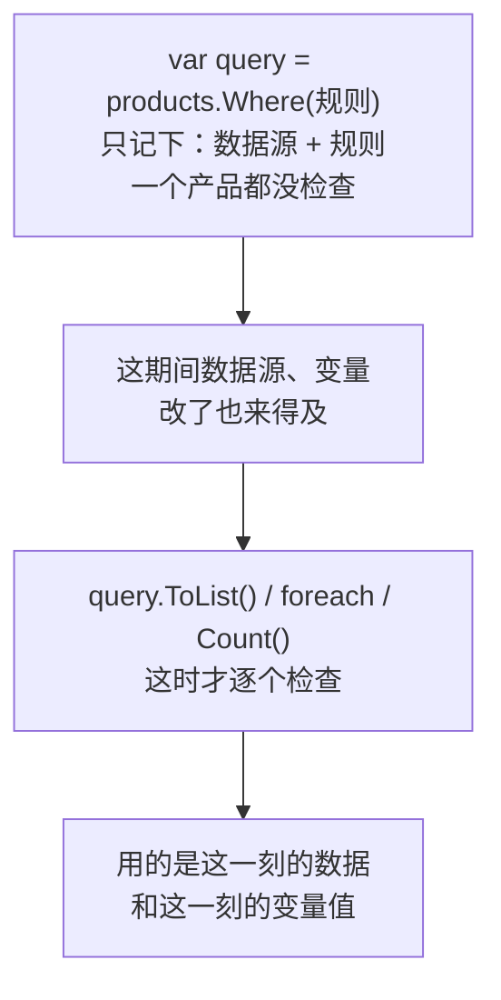
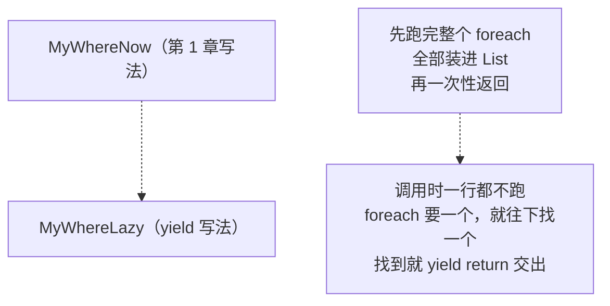
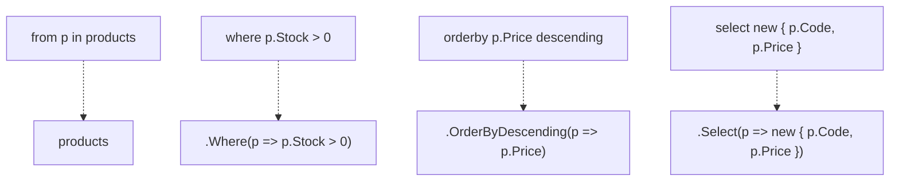

# 第 4 章 延迟执行与查询语法

## 这一章解决什么问题

前 3 章一直说"末尾加 `.ToList()` 才拿到结果"，却没说为什么。不弄清这一点，会遇到很怪的现象：查询定义好以后改了一个变量，结果跟着变了；同一个查询用两次，执行了两次。到了 EF Core，这意味着**同一条 SQL 发了两次**。

本章讲清 LINQ 查询**什么时候真正执行**、它是怎么做到的，最后介绍另一种像 SQL 的写法（查询语法），这样你在别人的代码里看到它时不会陌生。

## 开始之前

- 上一章你已经会了：汇总方法、`GroupBy`、`Skip` / `Take`。
- 需要的环境：和第 1 章相同。按第 2 章 2.1 节的方法新建项目 `Ch04Linq`，添加 `Product.cs`、`SampleData.cs`，设为启动项目。

> 预计耗时：80 分钟。

## 正文

### 4.1 概念一：延迟执行

**白话定义**：延迟执行（deferred execution）是指 `Where`、`Select`、`OrderBy` 这类方法被调用时**并不马上查**，只是把"要怎么查"记下来，返回一个"查询"。等你真正去要结果时（`ToList()`、`foreach`、`Count()`、`First()` 等），才从头开始执行。

**业务场景**：页面上有多个可选的筛选条件，用户填了哪个就加哪个 `Where`。条件全部加完以后才执行一次。到了 EF Core，这样只生成并发送**一条** SQL。

**反例（什么时候要避免依赖它）**：查询结果要用好几次，或者定义查询之后数据源、变量还会改，就应该在定义时立刻 `.ToList()`，把结果固定下来。否则每用一次就重新执行一次，结果还可能变化（见踩坑警告）。

#### 🖼 原理：查询是"菜谱"，不是"菜"

`products.Where(...)` 返回的不是结果，而是一份"菜谱"：数据源是谁、规则是什么。做菜（执行）发生在你要结果的时候：



哪些方法只记菜谱、哪些方法马上执行：

| 只记下"怎么查"（延迟） | 马上执行，返回结果 |
|---|---|
| `Where`、`Select`、`OrderBy`、`ThenBy`、`GroupBy`、`Skip`、`Take` | `ToList`、`ToArray`、`foreach`、`Count`、`Any`、`Sum`、`Max`、`Average`、`First`、`Single` 等 |

规律：**返回的还是一个集合的，是延迟的；返回一个值或一个 List 的，是马上执行的。**

#### 💻 最小可运行代码

```csharp
// code/ch04/Step1-Deferred/Program.cs
using EfCoreStudy;

var products = SampleData.Products();

// ① 定义查询。lambda 里加了一行打印，用来看它"什么时候"真正被调用
Console.WriteLine("1. 定义查询");
var query = products.Where(p =>
{
    Console.Write($"[检查 {p.Code}] ");
    return p.Stock == 0;
});
Console.WriteLine("2. 查询定义完了，上面没有任何“检查”");

// ② 定义之后，往数据源里再加一个缺货产品
products.Add(new Product { Id = 9, Code = "PB-T04", Name = "经食道探头", Category = "探头", Price = 58000m, Stock = 0 });
Console.WriteLine("3. 往 products 里加了一个缺货产品 PB-T04");

// ③ 到 ToList() 这一刻，才真正开始逐个检查
Console.WriteLine("4. 调用 ToList()：");
var result = query.ToList();
Console.WriteLine();
Console.WriteLine("5. 缺货产品：" + string.Join("、", result.Select(p => p.Code)));
```

#### 🔍 拆解运行结果

实测输出：

```text
1. 定义查询
2. 查询定义完了，上面没有任何“检查”
3. 往 products 里加了一个缺货产品 PB-T04
4. 调用 ToList()：
[检查 US-100] [检查 US-200] [检查 PB-L01] [检查 PB-C02] [检查 PB-E03] [检查 GEL-250] [检查 CVR-01] [检查 PPR-110] [检查 PB-T04]
5. 缺货产品：PB-C02、PB-T04
```

- 第 1、2 步之间没有任何"检查"：`Where` 被调用了，但规则一次也没执行。
- 第 3 步在**定义查询之后**才加的 PB-T04，结果里却有它。因为第 4 步执行时，用的是那一刻的 `products`，已经有 9 个产品了。
- 和 SQL 对照：`var query = ...` 相当于**写好一条 SQL 语句但还没执行**；`ToList()` 相当于 `ExecuteReader()`。

#### 改坏一处试试

把第 4 步的 `var result = query.ToList();` 以及后面两行删掉，只留前 3 步，运行结果里**一次"检查"都没有**（实测）。查询从来没有被执行。这说明 `Where` 本身什么都没做。

### 4.2 概念二：IEnumerable 与 yield return —— 延迟是怎么做到的

**白话定义**：`IEnumerable<T>`（可枚举接口）的意思是"**可以 foreach 的东西**"。`List<T>`、数组都是；`Where` 返回的"查询"也是，只不过它不存数据，你 `foreach` 它的时候，它才一个一个**现算**出来。现算靠的是 C# 的 `yield return`。

**业务场景**：理解这一点，你就能看懂第 1 章的报错 `cannot convert 'IEnumerable<Product>' to 'List<Product>'`：`Where` 返回的是"可以 foreach 的东西"，不是装好数据的 `List`。

**反例**：日常写业务代码，**不需要**自己写 `yield return`。本节写它只是为了看清原理；需要查询就用 .NET 自带的 LINQ 方法。

#### 🖼 原理：第 1 章的 MyWhere 改一行

第 1 章的 `MyWhere` 先把循环全部跑完，结果装进 List 再返回。.NET 真正的 `Where` 不建 List，而是用 `yield return` 每找到一个就**交出去**，然后停在原地，等调用方要下一个时再接着循环：



#### 💻 最小可运行代码

新建 `MyLinq.cs`：

```csharp
// code/ch04/Step2-Yield/MyLinq.cs
namespace EfCoreStudy;

public static class MyLinq
{
    // 第 1 章的写法：立刻把循环全部跑完，结果装进 List 再返回
    public static List<Product> MyWhereNow(this List<Product> source, Func<Product, bool> rule)
    {
        var result = new List<Product>();
        foreach (var p in source)
        {
            if (rule(p))
                result.Add(p);
        }
        return result;
    }

    // .NET 的 Where 真正的写法：yield return。
    // 返回类型是 IEnumerable<Product>（"可以 foreach 的东西"），而不是装好结果的 List
    public static IEnumerable<Product> MyWhereLazy(this IEnumerable<Product> source, Func<Product, bool> rule)
    {
        foreach (var p in source)
        {
            if (rule(p))
                yield return p;   // 交出一个结果后"停在这里"；调用方要下一个时，再从这里接着往下跑
        }
    }
}
```

`Program.cs`：

```csharp
// code/ch04/Step2-Yield/Program.cs
using EfCoreStudy;

// 只取前 4 个产品，输出短一些。库存依次是 3、2、8、0
var products = SampleData.Products().Take(4).ToList();

Console.WriteLine("=== MyWhereNow（List 版）");
var now = products.MyWhereNow(p =>
{
    Console.WriteLine($"  检查 {p.Code}");
    return p.Stock < 5;
});
Console.WriteLine("  -- 方法已返回，开始 foreach --");
foreach (var p in now)
    Console.WriteLine($"  拿到 {p.Code}");

Console.WriteLine("=== MyWhereLazy（yield 版）");
var lazy = products.MyWhereLazy(p =>
{
    Console.WriteLine($"  检查 {p.Code}");
    return p.Stock < 5;
});
Console.WriteLine("  -- 方法已返回，开始 foreach --");
foreach (var p in lazy)
    Console.WriteLine($"  拿到 {p.Code}");
```

#### 🔍 拆解运行结果

实测输出：

```text
=== MyWhereNow（List 版）
  检查 US-100
  检查 US-200
  检查 PB-L01
  检查 PB-C02
  -- 方法已返回，开始 foreach --
  拿到 US-100
  拿到 US-200
  拿到 PB-C02
=== MyWhereLazy（yield 版）
  -- 方法已返回，开始 foreach --
  检查 US-100
  拿到 US-100
  检查 US-200
  拿到 US-200
  检查 PB-L01
  检查 PB-C02
  拿到 PB-C02
```

- **List 版**：调用时就把 4 个全部检查完，然后才开始 `foreach`。
- **yield 版**：调用时一个都没检查；`foreach` 开始后，"检查"和"拿到"**交替出现**。PB-L01 库存 8，不满足条件，所以检查完没有"拿到"，接着去检查下一个。
- yield 版的参数是 `IEnumerable<Product> source`，不是 `List<Product>`。所以它能接在另一个查询后面，比如 `products.Where(...).MyWhereLazy(...)`。.NET 的 LINQ 方法能一个接一个串起来，靠的就是这一点：每个方法收的、返回的都是 `IEnumerable<T>`。

#### 改坏一处试试

把 `MyWhereLazy` 的返回类型 `IEnumerable<Product>` 改成 `List<Product>`，生成时报错（实测）：

```text
error CS1624: The body of 'MyLinq.MyWhereLazy(IEnumerable<Product>, Func<Product, bool>)' cannot be an iterator block because 'List<Product>' is not an iterator interface type
```

原因：用了 `yield return` 的方法叫迭代器（iterator），只能返回 `IEnumerable<T>` 这类"可以 foreach 的东西"。`List` 是装好数据的容器，不能边算边交。

### 4.3 概念三：查询语法 —— 像 SQL 的另一种写法

**白话定义**：查询语法（query syntax）是 C# 提供的另一种 LINQ 写法：`from ... where ... orderby ... select ...`。编译器会把它**翻译成**前 3 章的方法写法（方法语法），两种写法的结果完全相同。

**业务场景**：你接手别人的项目，或者看微软文档的示例，会看到这种写法，要能读懂。

**反例**：本教程以后**主要用方法语法**。原因：`Count`、`First`、`Any`、`Skip`、`Take`、`ToList` 这些在查询语法里没有对应的关键字，写到最后还是要加括号接方法，两种写法混在一起反而难读。只在多表关联、分组比较复杂时，查询语法有时更清楚。

#### 🖼 原理：两种写法逐句对应



左边是查询语法，右边是编译器翻译出的方法语法。`from p in products` 里的 `p`，就是每个 lambda 里的那个 `p`。

#### 💻 最小可运行代码

```csharp
// code/ch04/Step3-QuerySyntax/Program.cs
using EfCoreStudy;

var products = SampleData.Products();

// ① 方法语法：前 3 章一直用的写法
var m = products
    .Where(p => p.Category == "探头" && p.Stock > 0)
    .OrderByDescending(p => p.Price)
    .Select(p => new { p.Code, p.Price })
    .ToList();

// ② 查询语法：同一个查询。像 SQL，但 from 在最前、select 在最后
var q = (from p in products
         where p.Category == "探头" && p.Stock > 0
         orderby p.Price descending
         select new { p.Code, p.Price }).ToList();

Console.WriteLine("方法语法：" + string.Join("  ", m.Select(x => $"{x.Code} {x.Price:N0}")));
Console.WriteLine("查询语法：" + string.Join("  ", q.Select(x => $"{x.Code} {x.Price:N0}")));

// ③ 分组：group ... by ... into g，之后用 g 写 select
var report = (from p in products
              group p by p.Category into g
              select new { Category = g.Key, Count = g.Count() }).ToList();
Console.WriteLine("分组：" + string.Join("  ", report.Select(x => $"{x.Category} {x.Count} 个")));

// ④ 查询语法里没有 Count、First、ToList 这些关键字：整句加括号，再接方法
int outOfStock = (from p in products where p.Stock == 0 select p).Count();
Console.WriteLine($"缺货：{outOfStock} 个");
```

#### 🔍 拆解运行结果

实测输出：

```text
方法语法：PB-E03 31,000  PB-L01 26,000
查询语法：PB-E03 31,000  PB-L01 26,000
分组：主机 2 个  探头 3 个  耗材 3 个
缺货：1 个
```

- ① ② 结果完全相同。
- 和 SQL 的区别：`from` 写在最前面（所以 VS 能提示 `p.` 后面的属性），`select` 写在最后；排序关键字是 `descending`，不是 SQL 的 `DESC`。
- ③ `group p by p.Category into g`：分好的组起名叫 `g`，后面的 `select` 用 `g`，和第 3 章 `GroupBy(...).Select(g => ...)` 一样。
- ④ 查询语法里没有 `Count`，只能整句加括号再接 `.Count()`。

#### 改坏一处试试

| 改法 | 生成时的报错（实测） | 原因 |
|---|---|---|
| 漏写 select：`from p in products where p.Stock == 0;` | `error CS0742: A query body must end with a select clause or a group clause` | 查询语法必须以 `select` 或 `group` 结尾 |
| 按 SQL 习惯写 `orderby p.Price desc select p` | `error CS0742: ...` 和 `error CS1003: Syntax error, ',' expected` | C# 不认识 `desc`，要写 `descending` |

## 🧱 类比：和 ADO.NET 对照

| ADO.NET | LINQ |
|---|---|
| `var cmd = new SqlCommand("SELECT ...", conn);`：写好 SQL，还没执行 | `var query = products.Where(...);`：写好查询，还没执行 |
| `cmd.ExecuteReader()` / `ExecuteScalar()`：这时才执行 | `query.ToList()` / `query.Count()`：这时才执行 |
| 同一个 `cmd` 执行两次，就查两次数据库 | 同一个 `query` 用两次，就执行两次 |
| `SqlDataReader` 一行一行读，读一行取一行 | `yield return` 一个一个算，要一个算一个 |
| 拼接 SQL 字符串：执行前可以随时再加 `AND ...` | 执行前可以随时再加 `.Where(...)` |

## ⚠️ 踩坑警告

| 现象 | 原因 | 怎么改 |
|---|---|---|
| 定义查询后改了 lambda 里用到的变量，结果跟着变了（实测：价格下限从 10000 改成 100000 后，结果从 5 个变成 2 个） | 查询执行时读的是变量**那一刻**的值 | 需要固定结果时，定义时立刻 `.ToList()` |
| 同一个查询先 `Count()` 再 `Any()`，规则被执行了两遍（实测：8 + 4 = 12 次） | 每次要结果都从头执行一次。到了 EF Core，就是**同一条 SQL 发两次** | 结果要用多次时，先 `.ToList()` 存到变量里，再对 List 操作 |
| `foreach` 一个查询时往数据源里 `Add`，报 `System.InvalidOperationException: Collection was modified; enumeration operation may not execute.`（实测） | 查询边遍历边读数据源，数据源被改了 | 先 `.ToList()` 把结果固定下来，再遍历这个 List 去改数据源（实测通过） |
| 打印查询变量，输出一串类型名（第 1 章见过） | 查询是"菜谱"，不是结果 | 先 `.ToList()` 再输出 |

## 🎯 动手练习

**练习 1：修 bug**
把下面 4 行放在 `var products = SampleData.Products();` 之后。它本意是"统计单价超过 1 万的产品"，应该输出 5 个，实际输出 2 个。先运行确认，再只改一处让它输出 5 个。

```text
var minPrice = 10000m;
var expensive = products.Where(p => p.Price > minPrice);
minPrice = 100000m;   // 后面别的代码改了这个变量
Console.WriteLine($"贵重产品：{expensive.Count()} 个");
```

- 验收标准：输出 `贵重产品：5 个`；`minPrice = 100000m;` 这一行保留不删。

**练习 2：改写成查询语法**
把第 2 章练习 1（耗材按单价升序，取名称和单价）改用查询语法写。

- 验收标准：输出和第 2 章练习 1 完全相同：`探头保护套  12.00`、`耦合剂  35.00`、`热敏打印纸  80.00`。

卡住了看文末参考答案。

## 📌 一句话总结

查询先只记"怎么查"，ToList 等才执行；要固定结果就当场 ToList。

## 下一章

LINQ 基础学完了。第 5 章接上 SQL Server：先写一个 C# 类，由 EF Core 生成表，再用这几章学的 LINQ 查出数据。

---

<!-- 以下是参考答案，先自己动手，卡住了再往下翻 -->


## 参考答案

思路：练习 1 的问题是延迟执行，`Count()` 执行时 `minPrice` 已经变成 100000；在定义查询时就 `.ToList()`，当场执行，结果固定下来（注意改完后 `expensive` 是 List，用 `Count` 属性）。练习 2 按 `from → where → orderby → select` 逐句对应改写，升序不用写关键字。

完整项目在 [`code/ch04/Exercise/`](../code/ch04/Exercise/)。实测输出：

```text
贵重产品：5 个
耗材价格表：
  探头保护套  12.00
  耦合剂  35.00
  热敏打印纸  80.00
```

```csharp
// code/ch04/Exercise/Program.cs
// 第 4 章练习参考答案：练习 1（修复延迟执行的 bug）+ 练习 2（改写成查询语法）
using EfCoreStudy;

var products = SampleData.Products();

// 练习 1：定义时就 ToList()，当场执行，结果固定下来，后面改 minPrice 不再影响它
var minPrice = 10000m;
var expensive = products.Where(p => p.Price > minPrice).ToList();
minPrice = 100000m;   // 后面别的代码改了这个变量
Console.WriteLine($"贵重产品：{expensive.Count} 个");

// 练习 2：第 2 章练习 1 的耗材价格表，改写成查询语法
var priceList = (from p in products
                 where p.Category == "耗材"
                 orderby p.Price
                 select new { p.Name, p.Price }).ToList();
Console.WriteLine("耗材价格表：");
foreach (var x in priceList)
    Console.WriteLine($"  {x.Name}  {x.Price:N2}");
```
