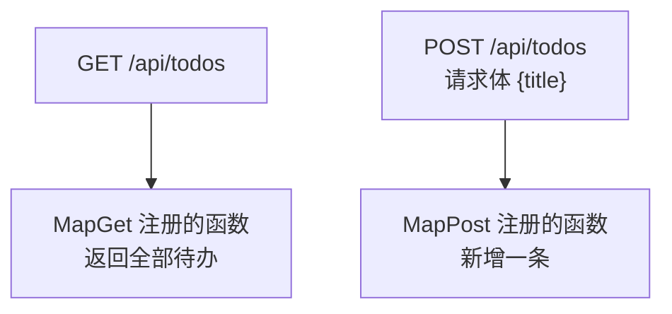

# 第 1 章 先把接口立起来：Minimal API 返回 JSON

> 预计用时：60 分钟（通读 25 分钟 + 动手 35 分钟）

## 这一章解决什么问题

手机上的 H5 页面要显示待办列表，数据得从后端拿。但页面还没写，你没法通过页面确认后端对不对。这一章先把后端单独做出来：只用浏览器地址栏和 curl，就能确认接口返回的 JSON 和状态码都是对的。

## 开始之前

- 你已经会：C# 语法、HTTP 的 GET/POST 是什么。
- 需要的环境：
  - .NET 10 SDK。命令行执行 `dotnet --list-sdks`，能看到 `10.0.xxx` 就行。
  - curl。macOS、Linux、Git Bash 自带；Windows 10 以上的 `cmd` 里也有 `curl`（PowerShell 的情况见本章踩坑表）。

建项目（在你放练习代码的目录执行）：

```bash
dotnet new web -n Backend -f net10.0
cd Backend
```

`dotnet new web` 生成的是空的 ASP.NET Core 项目，只有一个 `Program.cs`。

再把 `Properties/launchSettings.json` 整个替换成下面的内容（📄 `code/ch01/Backend/Properties/launchSettings.json`）。这样做是为了固定端口：模板每次生成的端口号都是随机的，后面几章的命令会对不上。

```json
{
  "$schema": "https://json.schemastore.org/launchsettings.json",
  "profiles": {
    "http": {
      "commandName": "Project",
      "dotnetRunMessages": true,
      "launchBrowser": false,
      "applicationUrl": "http://localhost:5080",
      "environmentVariables": {
        "ASPNETCORE_ENVIRONMENT": "Development"
      }
    }
  }
}
```

## 正文

### 1.1 路由映射：一个 URL + 一个 HTTP 方法 → 一个函数

**一句话定义**：`app.MapGet("/路径", 函数)` 表示"收到这个路径的 GET 请求，就执行这个函数"。`MapPost` 同理，对应 POST 请求。

**场景**：审批流里"查我的待审单据"是 GET，"提交一张新单据"是 POST。两个操作可以共用 `/api/todos` 这一个地址，靠 HTTP 方法来区分。

**反例（什么时候不该用 Minimal API）**：如果接口有几十个，还需要按模块统一加权限、过滤器、版本号，全写在一个 `Program.cs` 里会很难维护。这时应该用 Controller，或者用 `MapGroup` 按模块拆分（超出本教程范围）。

🖼 **图解**



💻 **最小可运行代码**：把 `Program.cs` 整个替换成：

```csharp
// code/ch01/Backend/Program.cs
// 第 1 章：只有接口，没有页面。用浏览器地址栏和 curl 就能验证。

var builder = WebApplication.CreateBuilder(args);
var app = builder.Build();

// 用内存列表代替数据库：本教程关注"页面和接口怎么通讯"，先不引入数据库。
// 代价是重启后数据回到初始状态。
var todos = new List<Todo>
{
    new(1, "买牛奶", false),
    new(2, "写周报", true),
};
var nextId = 3;

// List<T> 不是线程安全的：两部手机同时提交，可能出现 id 重复。
// 所有读写都包在同一把锁里。
var locker = new object();

// 查询全部。返回 C# 对象，框架负责转成 JSON 并加上 Content-Type: application/json。
app.MapGet("/api/todos", () =>
{
    lock (locker)
    {
        // ToList() 复制一份再返回：序列化发生在锁外，直接返回原列表会和写入撞车
        return Results.Ok(todos.ToList());
    }
});

// 新增。请求体里的 JSON 会被自动反序列化成 CreateTodoRequest。
app.MapPost("/api/todos", (CreateTodoRequest req) =>
{
    // 后端必须自己校验：页面上的校验谁都能绕过，直接用 curl 就能调这个接口
    if (string.IsNullOrWhiteSpace(req.Title))
    {
        return Results.BadRequest(new ErrorBody("标题不能为空"));
    }

    lock (locker)
    {
        var todo = new Todo(nextId++, req.Title.Trim(), false);
        todos.Add(todo);
        // 201 表示"新建成功"，同时把新对象（含后端分配的 id）返回给调用方
        return Results.Created($"/api/todos/{todo.Id}", todo);
    }
});

app.Run();

// record 自带构造函数和只读属性，适合做"只在接口上传输的数据"。
// 序列化时属性名自动转成小驼峰：Id → id、Title → title、Done → done
record Todo(int Id, string Title, bool Done);

// Title 声明成 string?：请求体里可能根本没有 title 字段，要允许它是 null 再自己校验
record CreateTodoRequest(string? Title);

// 统一的错误返回格式，页面只需要读 message 一个字段
record ErrorBody(string Message);
```

启动（在 `Backend/` 目录执行）：

```bash
dotnet run
```

🔍 **拆解运行结果**

控制台出现下面这行，就说明启动成功了：

```
Now listening on: http://localhost:5080
```

用浏览器打开 `http://localhost:5080/api/todos`，会看到：

```json
[{"id":1,"title":"买牛奶","done":false},{"id":2,"title":"写周报","done":true}]
```

| 关键行 | 作用 |
|---|---|
| `app.MapGet("/api/todos", ...)` | 把路径、HTTP 方法和函数绑在一起。这里没有 Controller 类，也没有 Action 方法 |
| `app.Run()` | 启动 Kestrel 开始监听，程序会一直停在这一行，直到你按 `Ctrl+C` |
| `record` 写在文件最后 | 这种没有 `Main` 方法的写法（顶级语句）规定：类型声明必须放在所有语句之后 |
| `nextId++` 在 `lock` 里 | 取号和加入列表必须作为一个整体完成，否则两个请求可能拿到同一个 id |

**改坏一处试试**：再开一个命令行窗口，用 DELETE 方法请求同一个地址：

```bash
curl -i -X DELETE http://localhost:5080/api/todos
```

返回 `HTTP/1.1 405 Method Not Allowed`。路径匹配上了，但没有注册 DELETE 方法，所以框架回 405 而不是 404。再把地址少打一个 `s`，请求 `/api/todo`，这次返回 404：路径根本不存在。

### 1.2 JSON 自动转换：进来反序列化，出去序列化

**一句话定义**：处理函数的参数如果是 record/类，框架会把请求体里的 JSON 转成这个对象；处理函数返回的对象，框架会转成 JSON 发出去。

**场景**：价格申请单提交时，前端发 `{"title":"..."}`，你在函数里直接用 `req.Title`，不用自己读取请求流再解析。

**反例**：上传文件、接收表单 `multipart/form-data`、要求原样接收 XML 的场景，不能靠这种自动 JSON 绑定，要用 `IFormFile` 等专门的方式。

💻 **代码**：用 1.1 节的代码即可，不需要改。新开一个命令行窗口（后端保持运行）发 POST：

```bash
# macOS / Linux / Git Bash
curl -i -X POST http://localhost:5080/api/todos \
  -H "Content-Type: application/json" \
  -d '{"title":"交水电费"}'
```

```bat
:: Windows cmd（⚠️ 本段未实机验证）。cmd 里中文的编码容易出问题，先用英文
curl -i -X POST http://localhost:5080/api/todos -H "Content-Type: application/json" -d "{\"title\":\"milk\"}"
```

🔍 **拆解运行结果**

```
HTTP/1.1 201 Created
Content-Type: application/json; charset=utf-8
Location: /api/todos/3

{"id":3,"title":"交水电费","done":false}
```

| 现象 | 原因 |
|---|---|
| 返回里是 `id`/`title`，不是 `Id`/`Title` | ASP.NET Core 默认把属性名转成小驼峰（camelCase）输出，这是 JavaScript 那边的命名习惯 |
| `Content-Type: application/json` | 返回对象时框架自动加上的，前端靠它判断该按 JSON 解析 |
| 再请求一次 GET，能看到 3 条 | 数据存在进程内存里，后端没重启就一直在 |

**改坏一处试试**：去掉 `-H "Content-Type: application/json"` 再发一次：

```bash
curl -i -X POST http://localhost:5080/api/todos -d '{"title":"交水电费"}'
```

返回 `415 Unsupported Media Type`。请求体内容没变，但没声明是 JSON，框架就不会去解析它。第 3 章在页面里调用接口时，会再碰到这个问题。

### 1.3 状态码：让调用方不看内容就知道成功还是失败

**一句话定义**：`Results.Ok` / `Results.Created` / `Results.BadRequest` 分别返回 200、201、400，同时带上返回内容。

**场景**：前端拿到 400 就显示 `message` 里的提示，拿到 201 就刷新列表。不需要和后端约定"返回体里 `success` 字段为 false 表示失败"这种额外规则。

**反例**：别把所有错误都返回 200 再在返回体里放错误码。HTTP 状态码是浏览器、代理、监控工具都认识的通用语言，全部返回 200，这些工具就分不出成功和失败了。

💻 **代码**：仍然是 1.1 节的代码。发一个空标题：

```bash
curl -i -X POST http://localhost:5080/api/todos \
  -H "Content-Type: application/json" \
  -d '{"title":"   "}'
```

🔍 **拆解运行结果**

```
HTTP/1.1 400 Bad Request

{"message":"标题不能为空"}
```

状态码说明了"失败"，`message` 说明了"为什么失败"，前端两样都能用上。

**改坏一处试试**：把 `return Results.BadRequest(new ErrorBody("标题不能为空"));` 改成 `return new ErrorBody("标题不能为空");`，然后执行 `dotnet build`：

```
error CS1678: Parameter 1 is declared as type 'CreateTodoRequest' but should be 'Microsoft.AspNetCore.Http.HttpContext'
error CS1661: Cannot convert lambda expression to type 'RequestDelegate' ...
```

这个报错看起来和改动毫无关系。真正的原因是：lambda 里一个分支返回 `ErrorBody`，另一个分支返回 `IResult`，编译器推断不出统一的返回类型，于是去尝试 `MapPost` 的另一个重载（参数是 `HttpContext` 的那个），结果报出了参数类型不对。**看到这两个报错，先检查各个分支的返回类型是否一致。**

## 🧱 类比

| Minimal API | 你熟悉的 WebForm 做法 | 差别 |
|---|---|---|
| `app.MapGet("/api/todos", ...)` | 一个 `.ashx` 一般处理程序 | `.ashx` 一个文件一个地址，`ProcessRequest` 里要自己判断 `Request.HttpMethod`；这里路径和方法在注册时就分好了 |
| 返回对象，自动转 JSON | `context.Response.Write(JsonConvert.SerializeObject(obj))` | 不用自己设 `ContentType`，也不用手动序列化 |
| `Results.BadRequest(...)` | `context.Response.StatusCode = 400` | 状态码和返回内容在一个返回值里一起给出 |

## ⚠️ 踩坑警告

| 现象 | 原因 | 怎么改 |
|---|---|---|
| POST 返回 415 | 请求没带 `Content-Type: application/json` | 加上这个请求头 |
| PowerShell 里执行 `curl -X POST ...` 报参数错误 | Windows PowerShell 5.1 里 `curl` 是 `Invoke-WebRequest` 的别名，不是真正的 curl | 改用 `cmd`、Git Bash，或者在 PowerShell 里写 `curl.exe` |
| 改了 `Program.cs`，请求结果没变 | `dotnet run` 不会自动重新加载代码 | 按 `Ctrl+C` 停止，再执行 `dotnet run` |
| 编译报 CS1678 / CS1661，提示参数应该是 `HttpContext` | lambda 各分支的返回类型不一致 | 所有分支都用 `Results.Xxx(...)` 返回 |

## 🎯 动手练习

**练习 1**：新增接口 `GET /api/todos/{id}`，按 id 查询一条待办。

- 验收标准：`curl -i http://localhost:5080/api/todos/1` 返回 200 和买牛奶那条；`/api/todos/99` 返回 404 和 `{"message":"找不到 id=99 的待办"}`；`/api/todos/abc` 返回 404。

**练习 2**：发请求之前，先预测下面两个请求的状态码，再实际执行，看看猜得对不对。

```bash
curl -i -X POST http://localhost:5080/api/todos -H "Content-Type: application/json" -d '{"name":"x"}'
curl -i -X POST http://localhost:5080/api/todos -H "Content-Type: application/json" -d '{"Title":"大写字段"}'
```

- 验收标准：两个都猜对，并且能说出原因。

卡住了看文末参考答案。

## 📌 一句话总结

一个路由映射一个函数，返回对象就是 JSON，用状态码告诉对方成功还是失败。

## 下一章

接口有了，下一章写一个 H5 页面，并让这个后端把页面也发给浏览器。

---

**导航**：[返回目录](../README.md) · [下一章](ch02-tsc-build-static-files.md)

---

<!-- 以下是参考答案，先自己动手，卡住了再往下翻 -->


## 参考答案

### 练习 1

在 `app.Run();` 前面加上：

```csharp
// {id:int} 是路由约束：/api/todos/abc 根本匹配不上这条路由，直接 404，不会进到函数里
app.MapGet("/api/todos/{id:int}", (int id) =>
{
    lock (locker)
    {
        var todo = todos.FirstOrDefault(t => t.Id == id);
        return todo is null
            ? Results.NotFound(new ErrorBody($"找不到 id={id} 的待办"))
            : Results.Ok(todo);
    }
});
```

思路：路径里的 `{id}` 会自动绑定到同名参数 `int id`。`Results.NotFound` 和 `Results.Ok` 的返回类型都是 `IResult`，所以可以放在同一个三元表达式里。这正好避开了 1.3 节那个编译错误。

实测输出：

```
/api/todos/1   → 200 {"id":1,"title":"买牛奶","done":false}
/api/todos/99  → 404 {"message":"找不到 id=99 的待办"}
/api/todos/abc → 404（空内容）
```

### 练习 2

| 请求体 | 状态码 | 原因 |
|---|---|---|
| `{"name":"x"}` | **400** `标题不能为空` | JSON 里没有 `title` 字段，`req.Title` 是 null，被你写的校验拦下了。多出来的 `name` 字段会被直接忽略，不报错 |
| `{"Title":"大写字段"}` | **201** | ASP.NET Core 解析 JSON 时属性名**不区分大小写**，`Title` 和 `title` 都能绑定上 |

结论：字段名大小写写错不会出问题，但字段名拼错不会报"字段不存在"，只会拿到 null。所以后端一定要自己校验。
