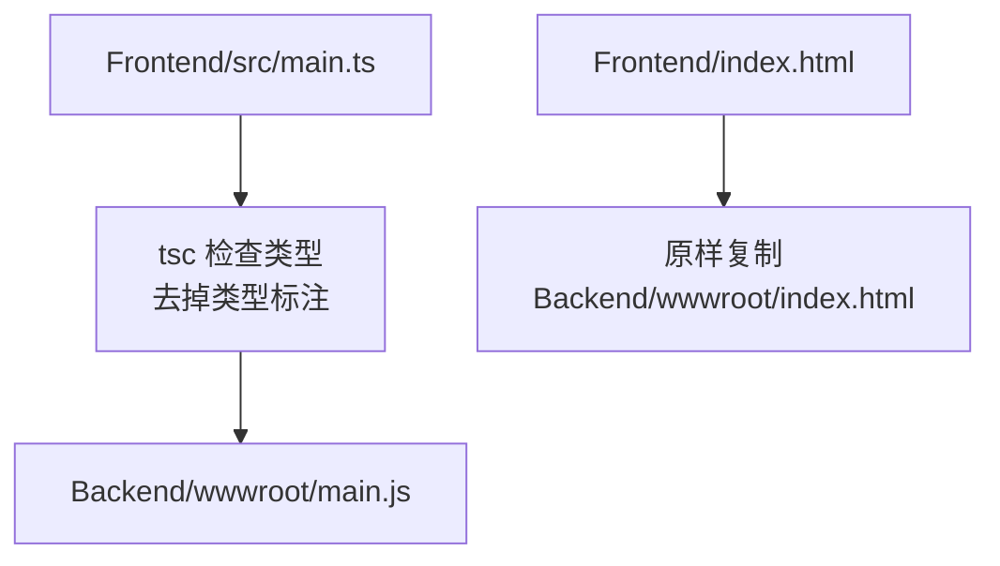
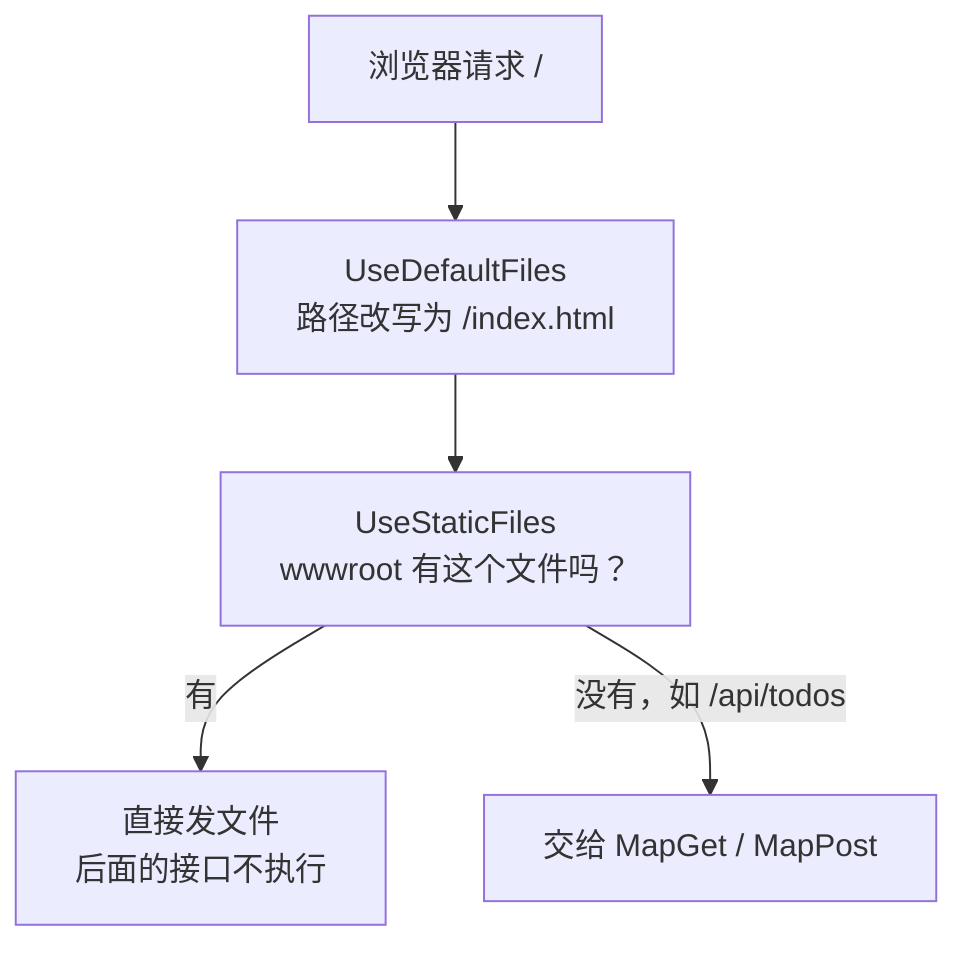

# 第 2 章 页面源码放 Frontend，产物交给后端发

> 预计用时：75 分钟（通读 30 分钟 + 动手 45 分钟）

## 这一章解决什么问题

页面脚本用 TypeScript 写，可浏览器只认 JavaScript。编译出来的文件放在哪？由谁发给浏览器？如果手写的源码和编译生成的文件混在一个目录里，时间一长就分不清哪些能改、哪些不能改。这一章的做法是：源码只放在 `Frontend/`，一条命令构建到 `Backend/wwwroot/`，由后端负责把文件发出去。整个过程只用 `index.html` 加 TypeScript 编译器 `tsc`，不用任何打包工具。

## 开始之前

- 上一章你已经会了：用 Minimal API 写 GET/POST 接口，并用 curl 验证。
- 需要的环境：Node.js（任意在维护期内的 LTS 版本）。它只用来安装和运行 `tsc`，执行 `node --version` 能看到版本号就行。
- 本章做完后的目录：

```
h5-demo/
├── Backend/              ← 第 1 章的项目，本章改 Program.cs
│   └── wwwroot/          ← 构建产物：index.html + main.js，不手改
└── Frontend/             ← 本章新建，前端源码全在这里
    ├── index.html
    ├── src/main.ts
    ├── tsconfig.json
    └── package.json
```

## 正文

### 2.1 tsc 编译：src/main.ts → wwwroot/main.js

**一句话定义**：`tsc` 是 TypeScript 编译器，它先检查类型，再把 `.ts` 文件里的类型标注去掉，输出成同名的 `.js` 文件。`rootDir` 指定源码目录，`outDir` 指定输出目录。

**场景**：报表页面的脚本有一两个文件，用 TypeScript 写可以提前发现字段拼错、漏判 null 这类问题，编译后浏览器直接运行。

**反例**：要用 npm 上的第三方库（比如图表库，写成 `import ... from "echarts"`）时，`tsc` 不会帮你把库的代码打包进来，浏览器也不认识 `"echarts"` 这种不带路径的写法。到那一步就该用打包工具了。

🖼 **图解**



💻 **最小可运行代码**：在 `Backend` 旁边新建 `Frontend` 目录，创建下面 4 个文件。

📄 `code/ch02/Frontend/tsconfig.json`（JSON 文件不能写注释，路径标在这里）

```json
{
  "compilerOptions": {
    "target": "ES2022",
    "module": "ES2022",
    "lib": ["ES2022", "DOM", "DOM.Iterable"],
    "moduleDetection": "force",
    "rootDir": "src",
    "outDir": "../Backend/wwwroot",
    "strict": true,
    "noUnusedLocals": true,
    "noUnusedParameters": true,
    "noEmitOnError": true,
    "skipLibCheck": true
  },
  "include": ["src"]
}
```

| 选项 | 为什么这样设 |
|---|---|
| `target: ES2022` | 现在主流手机浏览器都支持，`async/await`、模板字符串都会原样保留，不会被改写得面目全非 |
| `lib` 里有 `DOM` | 没有它，`document`、`HTMLElement` 这些浏览器里的类型 tsc 都不认识 |
| `noEmitOnError: true` | 有类型错误时一个文件都不输出，避免把有问题的代码发到浏览器 |
| `moduleDetection: force` | 见本章踩坑表 |

📄 `code/ch02/Frontend/package.json`

```json
{
  "name": "h5-frontend",
  "private": true,
  "version": "0.0.0",
  "scripts": {
    "clean": "node -e \"require('node:fs').rmSync('../Backend/wwwroot', { recursive: true, force: true })\"",
    "copy": "node -e \"require('node:fs').cpSync('index.html', '../Backend/wwwroot/index.html')\"",
    "build": "tsc --noEmit && npm run clean && tsc && npm run copy"
  },
  "devDependencies": {
    "typescript": "~5.9.3"
  }
}
```

`clean` 和 `copy` 只用 Node 自带的文件函数，删除目录、复制文件，Windows 和 macOS 上都能用，不需要额外安装工具。`build` 的顺序在 2.2 节讲。

```html
<!-- code/ch02/Frontend/index.html -->
<!DOCTYPE html>
<html lang="zh-CN">
  <head>
    <meta charset="UTF-8" />
    <title>待办 H5</title>
  </head>
  <body>
    <h1>我的待办</h1>
    <p id="status">脚本还没运行</p>

    <!-- 引用的是 tsc 编译出来的 main.js，不是 src/main.ts：浏览器只认 JavaScript -->
    <!-- type="module"：编译结果里有 export 语句，普通 script 标签执行会报语法错误 -->
    <script type="module" src="/main.js"></script>
  </body>
</html>
```

```ts
// code/ch02/Frontend/src/main.ts
// 第 2 章只证明一件事：后端发出的页面里，TypeScript 编译出的脚本真的跑起来了。

const status = document.querySelector<HTMLParagraphElement>("#status");

// querySelector 找不到元素时返回 null。strict 模式下不判断就用，tsc 会直接报错
if (status === null) {
  throw new Error("页面缺少 #status 元素");
}

// 每次构建后刷新页面，时间都会变：用来确认看到的是最新产物，不是浏览器缓存
status.textContent = `脚本已运行：${new Date().toLocaleTimeString()}`;
```

构建（在 `Frontend/` 目录执行）：

```bash
npm install
npm run build
```

🔍 **拆解运行结果**：`Backend/wwwroot/` 里出现了两个文件，`index.html` 和 `main.js`。打开 `main.js`：

```js
// code/ch02/Frontend/src/main.ts
// 第 2 章只证明一件事：后端发出的页面里，TypeScript 编译出的脚本真的跑起来了。
const status = document.querySelector("#status");
// querySelector 找不到元素时返回 null。strict 模式下不判断就用，tsc 会直接报错
if (status === null) {
    throw new Error("页面缺少 #status 元素");
}
// 每次构建后刷新页面，时间都会变：用来确认看到的是最新产物，不是浏览器缓存
status.textContent = `脚本已运行：${new Date().toLocaleTimeString()}`;
export {};
```

| 现象 | 原因 |
|---|---|
| `<HTMLParagraphElement>` 不见了 | 类型只在编译时用来检查，输出时全部去掉。其余代码一字不改，注释也保留了下来，浏览器里调试时看到的就是你写的代码 |
| 最后多了一行 `export {};` | `moduleDetection: force` 让 tsc 把文件当作模块处理，这一行就是模块的标记。也正因为有这一行，`<script>` 必须写 `type="module"` |

**改坏一处试试**：把 `index.html` 里的 `src="/main.js"` 改成 `src="/src/main.ts"`，重新构建，再按 2.3 节启动后端打开页面：页面一直显示"脚本还没运行"。按 F12 打开 Network 面板，可以看到 `/src/main.ts` 返回 404：源码根本不在 wwwroot 里，浏览器拿不到，就算拿到了也无法执行 TypeScript。

### 2.2 构建脚本：先检查，再清空，再输出

**一句话定义**：`npm run build` 按顺序做四件事：只检查类型（`tsc --noEmit`）→ 清空 wwwroot → 编译输出 → 复制 index.html。`&&` 表示前一步成功才执行下一步。

**场景**：你想改页面，只会去 `Frontend/` 里找文件。`Backend/wwwroot/` 随时可以删掉，重新构建就能恢复，所以要把它加进 `.gitignore`，不提交到仓库。

**反例**：如果 `wwwroot` 里有不经过构建的手写文件（比如运维直接放进去的 `robots.txt`），`clean` 每次都会把它删掉。这类文件也应该放进 `Frontend/`，再加进 `copy` 脚本里。

💻 **代码**：就是 2.1 节的 `package.json`。仓库根目录的 `.gitignore` 加上：

```gitignore
# 构建产物：由 Frontend 的 npm run build 生成，不手改、不提交
**/Backend/wwwroot/
bin/
obj/
node_modules/
```

🔍 **拆解：为什么是这个顺序**

| 步骤 | 去掉会怎样 |
|---|---|
| `tsc --noEmit`（先只检查） | 如果直接先清空，代码一旦有类型错误，wwwroot 已经被删光、新文件又没生成，页面直接 404 |
| `npm run clean` | tsc 只会覆盖同名文件，不会删除文件。把 `main.ts` 改名成 `app.ts` 后，旧的 `main.js` 会一直留在 wwwroot 里 |
| `tsc` | 真正输出 `.js` |
| `npm run copy` | tsc 只处理 `.ts` 文件，`index.html` 要自己复制过去 |

**改坏一处试试**：在 `main.ts` 末尾加一行 `const n: number = "abc";`，执行 `npm run build`：

```
src/main.ts(13,7): error TS2322: Type 'string' is not assignable to type 'number'.
```

构建停在第一步，`wwwroot` 里还是上一次的 `index.html` 和 `main.js`，页面照常能打开。删掉这一行，重新构建即可恢复。

### 2.3 静态文件中间件：让后端把 wwwroot 里的文件发出去

**一句话定义**：`UseStaticFiles()` 收到请求时，如果 `wwwroot` 里有和请求路径同名的文件，就直接把文件发出去；`UseDefaultFiles()` 把 `/` 这种目录地址改写成 `/index.html`。

**场景**：内部审批小工具只有一台服务器。页面和接口由同一个程序提供，部署时拷贝一个目录就行，也不存在跨域问题。

**反例**：面向大量外部用户的正式产品，静态文件更适合交给 Nginx 或 CDN 处理。到那时把 `outDir` 和 `copy` 的目标目录改到别处，后端删掉这两行即可。

🖼 **图解**



💻 **代码**：在第 1 章 `Program.cs` 的 `var app = builder.Build();` 后面加上静态文件的配置，完整文件如下：

```csharp
// code/ch02/Backend/Program.cs
// 第 2 章：在第 1 章接口的基础上，让后端把 wwwroot 里的构建产物发给浏览器。

var builder = WebApplication.CreateBuilder(args);
var app = builder.Build();

// 访问 "/" 这种目录地址时，把请求路径改写成 "/index.html"。
// 它只改写路径、不发文件，所以必须排在 UseStaticFiles 前面。
app.UseDefaultFiles();

// 请求路径能对上 wwwroot 里的某个文件，就直接把文件发出去，后面的接口不再执行；
// 对不上（比如 /api/todos）就放行给下面的 MapGet / MapPost。
app.UseStaticFiles(new StaticFileOptions
{
    // main.js 每次构建都叫同一个名字。不加这个头，浏览器可能继续用缓存里的旧版本。
    // no-cache 的意思不是"不缓存"，而是"用之前先问服务器一句有没有变"：
    // 没变时服务器只回 304（没有内容），代价很小。
    OnPrepareResponse = ctx =>
        ctx.Context.Response.Headers.CacheControl = "no-cache",
});

var todos = new List<Todo>
{
    new(1, "买牛奶", false),
    new(2, "写周报", true),
};
var nextId = 3;
var locker = new object();

app.MapGet("/api/todos", () =>
{
    lock (locker)
    {
        return Results.Ok(todos.ToList());
    }
});

app.MapPost("/api/todos", (CreateTodoRequest req) =>
{
    if (string.IsNullOrWhiteSpace(req.Title))
    {
        return Results.BadRequest(new ErrorBody("标题不能为空"));
    }

    lock (locker)
    {
        var todo = new Todo(nextId++, req.Title.Trim(), false);
        todos.Add(todo);
        return Results.Created($"/api/todos/{todo.Id}", todo);
    }
});

app.Run();

record Todo(int Id, string Title, bool Done);
record CreateTodoRequest(string? Title);
record ErrorBody(string Message);
```

启动（在 `Backend/` 目录执行，**要先构建过前端**）：

```bash
dotnet run
```

🔍 **拆解运行结果**：浏览器打开 `http://localhost:5080/`，页面显示"我的待办"和"脚本已运行：15:20:31"（时间是你打开页面的时间）。

| 请求 | 结果 | 说明 |
|---|---|---|
| `/` | 200，返回 index.html | `UseDefaultFiles` 改写路径后，由 `UseStaticFiles` 发出 |
| `/main.js` | 200，`Content-Type: text/javascript`，`Cache-Control: no-cache`，带 `ETag` | 类型按扩展名自动设置；`ETag` 是文件的版本标记 |
| `/main.js`，请求时带上次的 `ETag` | **304**，没有内容 | 文件没变，浏览器继续用自己缓存的那份 |
| `/api/todos` | 200，返回 JSON | wwwroot 里没有这个文件，交给接口处理 |
| `/src/main.ts` | 404 | 源码不会被发布出去，这是对的 |

**改坏一处试试**：把 `UseDefaultFiles()` 和 `UseStaticFiles(...)` 的顺序对调，重启后端：`/` 返回 **404**，`/index.html` 仍然返回 200。原因是请求先到了 `UseStaticFiles`，这时路径还是 `/`，找不到同名文件就放行了；等 `UseDefaultFiles` 把路径改好时，已经没有中间件负责发文件了。**中间件按注册顺序执行**，顺序本身就是逻辑的一部分。

## 🧱 类比

（只针对后端部分；TypeScript 是前端内容，不做类比。）

| 本章做法 | 你熟悉的做法 | 差别 |
|---|---|---|
| `UseStaticFiles()` 发 wwwroot 里的文件 | IIS 直接发站点目录里的 `.html`、`.js` | ASP.NET Core 默认**不发**任何静态文件，必须显式加这个中间件 |
| `UseDefaultFiles()` | IIS 的"默认文档"设置 | 写在代码里，并且要注意和 `UseStaticFiles` 的先后顺序 |

## ⚠️ 踩坑警告

| 现象 | 原因 | 怎么改 |
|---|---|---|
| 先启动后端再构建前端，打开 `/` 一直 404，后端日志里有 `The WebRootPath was not found` | 后端启动时 `wwwroot` 还不存在，静态文件中间件就不再关注这个目录了 | 先 `npm run build`，再启动后端；已经启动了就重启一次 |
| 页面一直显示"脚本还没运行"，控制台报 `Uncaught SyntaxError: Unexpected token 'export'` | `<script>` 漏写了 `type="module"`，浏览器把带 `export` 的文件当成普通脚本执行 | 写成 `<script type="module" src="/main.js">` |
| `tsc` 报 `Cannot redeclare block-scoped variable 'status'` | 文件里没有 `import`/`export` 时，TypeScript 把它当成全局脚本，`status` 和浏览器自带的 `window.status` 重名了 | tsconfig 里加 `"moduleDetection": "force"` |
| 拆出 `api.ts` 后写 `import { hello } from "./api"`，编译通过，页面却不运行 | tsc 原样保留 import 路径，浏览器去请求 `/api`，返回 404（实测） | 写成 `from "./api.js"`：写编译**后**的文件名，tsc 能识别它对应的是 `api.ts` |

## 🎯 动手练习

**练习 1**：新建 `Frontend/style.css`，把页面背景设为浅灰色 `#f5f5f5`，让它出现在构建产物里，并被页面引用。

- 验收标准：`npm run build` 之后 `Backend/wwwroot/` 里有 `style.css`；刷新 `http://localhost:5080/`，背景变成灰色。

**练习 2**：后端**保持运行**，把 `main.ts` 里的"脚本已运行"改成"新版本已上线"，只执行 `npm run build`。

- 验收标准：不重启后端，刷新页面就看到新文字，并且能说出为什么不需要重启。

卡住了看文末参考答案。

## 📌 一句话总结

源码在 Frontend，tsc 编译加复制产出到 wwwroot，后端只负责发文件和提供接口。

## 下一章

页面现在只会显示一行字。下一章让它用 `fetch` 调用第 1 章的接口，显示列表并能新增待办。

---

**导航**：[上一章](ch01-minimal-api-json.md) · [返回目录](../README.md) · [下一章](ch03-fetch-json.md)

---

<!-- 以下是参考答案，先自己动手，卡住了再往下翻 -->


## 参考答案

### 练习 1

```css
/* code/ch02/Frontend/style.css */
body {
  background: #f5f5f5;
}
```

`index.html` 的 `<head>` 里加一行：

```html
<link rel="stylesheet" href="/style.css" />
```

`package.json` 的 `copy` 改成复制两个文件：

```json
"copy": "node -e \"for (const f of ['index.html', 'style.css']) require('node:fs').cpSync(f, '../Backend/wwwroot/' + f)\"",
```

思路：tsc 只处理 `.ts`，其他文件都要靠 `copy` 放进 wwwroot。光在 HTML 里加引用、不改 `copy`，浏览器请求 `/style.css` 会得到 404，背景不会变色。

### 练习 2

刷新后显示"新版本已上线：……"（实测）。

思路：`UseStaticFiles` 每次收到请求都去磁盘读文件，不会在启动时把文件缓存到内存里。`clean` 删掉 wwwroot 又重建，只要后端启动时这个目录存在，之后就能正常读到新文件。浏览器这边因为有 `Cache-Control: no-cache`，每次都会先问一下服务器，发现 `ETag` 变了，就下载新的 `main.js`。
