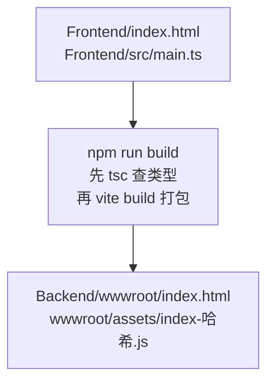
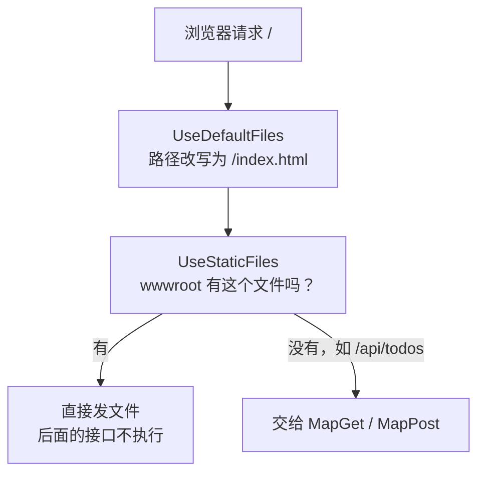

# 第 2 章 页面源码放 Frontend，产物交给后端发

> 预计用时：75 分钟（通读 30 分钟 + 动手 45 分钟）

## 这一章解决什么问题

页面源码用 TypeScript 写，浏览器却只认 JavaScript。编译出来的文件放哪、谁来发给浏览器？如果手写的源码和编译生成的文件混在同一个目录，时间一长就分不清哪个能改、哪个不能改。这一章的做法是：源码只放在 `Frontend/`，用一条命令构建到 `Backend/wwwroot/`，再由后端把它发给浏览器。

## 开始之前

- 上一章你已经会了：用 Minimal API 写 GET/POST 接口，并用 curl 验证。
- 需要的环境：Node.js **20.19+ 或 22.12+**（Vite 8 的要求），执行 `node --version` 查看。
- 本章做完后的目录：

```
h5-demo/
├── Backend/              ← 第 1 章的项目，本章改 Program.cs
│   └── wwwroot/          ← 构建产物，npm run build 生成，不手改
└── Frontend/             ← 本章新建，前端源码全在这里
    ├── index.html
    ├── src/main.ts
    ├── tsconfig.json
    ├── vite.config.ts
    └── package.json
```

## 正文

### 2.1 Vite 构建：把源码变成浏览器能直接运行的文件

**一句话定义**：Vite 是前端构建工具（build tool），`vite build` 从 `index.html` 出发，找到它引用的 TypeScript/CSS，编译、合并后输出到一个目录。

**场景**：报表页面的脚本拆成了好几个 `.ts` 文件。构建后变成一个带版本号的 `.js` 文件，服务器只需要发这一个。

**反例**：如果只是一个页面加十几行脚本，而且不打算用 TypeScript，直接手写一个 `.html` 文件放进 `wwwroot` 就够了，不需要构建工具。

🖼 **图解**



💻 **最小可运行代码**：在 `Backend` 旁边新建 `Frontend` 目录，创建下面 5 个文件。

📄 `code/ch02/Frontend/package.json`（JSON 文件不能写注释，路径标在这里）

```json
{
  "name": "h5-frontend",
  "private": true,
  "version": "0.0.0",
  "type": "module",
  "scripts": {
    "build": "tsc && vite build"
  },
  "devDependencies": {
    "typescript": "~5.9.3",
    "vite": "^8.3.5"
  }
}
```

📄 `code/ch02/Frontend/tsconfig.json`

```json
{
  "compilerOptions": {
    "target": "ES2022",
    "module": "ESNext",
    "lib": ["ES2022", "DOM", "DOM.Iterable"],
    "moduleResolution": "bundler",
    "moduleDetection": "force",
    "noEmit": true,
    "strict": true,
    "noUnusedLocals": true,
    "noUnusedParameters": true,
    "skipLibCheck": true
  },
  "include": ["src"]
}
```

`noEmit: true` 的意思是：`tsc` 只检查类型，不生成文件，生成文件的工作交给 Vite。`moduleDetection` 的作用见本章踩坑表。

```ts
// code/ch02/Frontend/vite.config.ts
import { defineConfig } from "vite";

export default defineConfig({
  build: {
    // 构建产物直接写进后端的静态文件目录。
    // 以后改用 Nginx 单独部署前端时，只改这一行（或删掉它，用默认的 dist/）。
    outDir: "../Backend/wwwroot",
    // outDir 在 Frontend 目录之外时，Vite 默认不敢清空它，旧的 js 会越积越多。
    // 这里明确告诉它：这个目录全归构建管，每次先清空再写。
    emptyOutDir: true,
  },
});
```

```html
<!-- code/ch02/Frontend/index.html -->
<!DOCTYPE html>
<html lang="zh-CN">
  <head>
    <meta charset="UTF-8" />
    <title>待办 H5</title>
  </head>
  <body>
    <h1>我的待办</h1>
    <p id="status">脚本还没运行</p>

    <!-- 指向 TypeScript 源码。构建时 Vite 会把它换成编译好的 /assets/index-xxxx.js -->
    <script type="module" src="/src/main.ts"></script>
  </body>
</html>
```

```ts
// code/ch02/Frontend/src/main.ts
// 第 2 章只证明一件事：后端发出的页面里，TypeScript 编译出的脚本真的跑起来了。

const status = document.querySelector<HTMLParagraphElement>("#status");

// querySelector 找不到元素时返回 null。strict 模式下不判断就用，tsc 会直接报错
if (status === null) {
  throw new Error("页面缺少 #status 元素");
}

// 每次构建后刷新页面，时间都会变：用来确认看到的是最新产物，不是浏览器缓存
status.textContent = `脚本已运行：${new Date().toLocaleTimeString()}`;
```

构建（在 `Frontend/` 目录执行）：

```bash
npm install
npm run build
```

🔍 **拆解运行结果**

```
vite v8.3.5 building client environment for production...
✓ 4 modules transformed.
../Backend/wwwroot/index.html                0.43 kB │ gzip: 0.35 kB
../Backend/wwwroot/assets/index-BCik4kWO.js  0.83 kB │ gzip: 0.52 kB
✓ built in 36ms
```

打开生成的 `Backend/wwwroot/index.html`，`<script>` 那一行已经被换掉了：

```html
<script type="module" crossorigin src="/assets/index-BCik4kWO.js"></script>
```

| 现象 | 原因 |
|---|---|
| 文件名里有 `BCik4kWO` | 这是按文件内容算出来的哈希。内容一变，文件名就变，浏览器不会继续用缓存里的旧脚本 |
| `<script>` 被移到了 `<head>` 里 | `type="module"` 的脚本会等页面解析完再执行，放在哪里效果都一样，Vite 统一放到 head |
| `build` 是 `tsc && vite build` | `&&` 表示前一步成功才执行后一步：类型检查不通过，就不会产出文件 |

**改坏一处试试**：在 `main.ts` 末尾加一行 `const n: number = "abc";`，然后分别执行两条命令：

```bash
npx vite build     # ✓ built in 33ms   ← 照样构建成功！
npm run build      # error TS2322: Type 'string' is not assignable to type 'number'.
```

**Vite 只负责把 TypeScript 的类型标注去掉，不检查类型对不对。** 类型检查靠的是 `tsc`。所以要始终用 `npm run build`，不要直接执行 `vite build`。做完实验记得删掉这一行。

### 2.2 构建产物和源码分开：wwwroot 只放生成的文件

**一句话定义**：`outDir` 决定产物写到哪里，`emptyOutDir` 决定构建前是否先清空这个目录。

**场景**：你想改页面，只会去 `Frontend/` 里找文件；`Backend/wwwroot/` 里的东西随时可以删掉，重新构建就能恢复。所以它应该加进 `.gitignore`，不提交到仓库。

**反例**：如果 `wwwroot` 里还有不经过构建的手写文件（比如运维直接放进去的 `robots.txt`），就不能开 `emptyOutDir`，否则每次构建都会把它们删掉。这类文件应该放在 `Frontend/public/` 目录，Vite 会原样复制过去。

💻 **代码**：就是 2.1 节的 `vite.config.ts`。仓库根目录的 `.gitignore` 加上：

```gitignore
# 构建产物：由 Frontend 的 npm run build 生成，不手改、不提交
**/Backend/wwwroot/
bin/
obj/
node_modules/
```

🔍 **拆解运行结果**：随便改一下 `main.ts` 的文字，再执行 `npm run build`，然后看 `Backend/wwwroot/assets/` 目录：里面始终**只有一个** `.js` 文件，文件名换成了新的哈希值。

**改坏一处试试**：删掉 `emptyOutDir: true` 这一行，改一下 `main.ts` 的文字，再构建：

```
(!) outDir .../Backend/wwwroot is not inside project root and will not be emptied.
Use --emptyOutDir to override.
```

`assets/` 里会同时出现新旧两个 `.js` 文件。页面只引用新的那个，所以不影响运行，但旧文件会越积越多，没人知道哪些能删。做完实验把这一行加回去。

### 2.3 静态文件中间件：让后端把 wwwroot 里的文件发出去

**一句话定义**：`UseStaticFiles()` 收到请求时，如果 `wwwroot` 里有和请求路径同名的文件，就直接把文件发出去；`UseDefaultFiles()` 把 `/` 这种目录地址改写成 `/index.html`。

**场景**：内部审批小工具只有一台服务器。页面和接口由同一个程序提供，部署时拷贝一个目录就行，也不存在跨域问题。

**反例**：面向大量外部用户的正式产品，静态文件更适合交给 Nginx 或 CDN，它们缓存、压缩、就近分发都更合适。到那时把 `outDir` 改到别处，后端删掉这两行即可。

🖼 **图解**



💻 **代码**：在第 1 章 `Program.cs` 的 `var app = builder.Build();` 后面加两行，完整文件如下：

```csharp
// code/ch02/Backend/Program.cs
// 第 2 章：在第 1 章接口的基础上，让后端把 wwwroot 里的构建产物发给浏览器。

var builder = WebApplication.CreateBuilder(args);
var app = builder.Build();

// 访问 "/" 这种目录地址时，把请求路径改写成 "/index.html"。
// 它只改写路径、不发文件，所以必须排在 UseStaticFiles 前面。
app.UseDefaultFiles();

// 请求路径能对上 wwwroot 里的某个文件，就直接把文件发出去，后面的接口不再执行；
// 对不上（比如 /api/todos）就放行给下面的 MapGet / MapPost。
app.UseStaticFiles();

var todos = new List<Todo>
{
    new(1, "买牛奶", false),
    new(2, "写周报", true),
};
var nextId = 3;
var locker = new object();

app.MapGet("/api/todos", () =>
{
    lock (locker)
    {
        return Results.Ok(todos.ToList());
    }
});

app.MapPost("/api/todos", (CreateTodoRequest req) =>
{
    if (string.IsNullOrWhiteSpace(req.Title))
    {
        return Results.BadRequest(new ErrorBody("标题不能为空"));
    }

    lock (locker)
    {
        var todo = new Todo(nextId++, req.Title.Trim(), false);
        todos.Add(todo);
        return Results.Created($"/api/todos/{todo.Id}", todo);
    }
});

app.Run();

record Todo(int Id, string Title, bool Done);
record CreateTodoRequest(string? Title);
record ErrorBody(string Message);
```

启动（在 `Backend/` 目录执行，**要先构建过前端**）：

```bash
dotnet run
```

🔍 **拆解运行结果**：浏览器打开 `http://localhost:5080/`，页面显示"我的待办"和"脚本已运行：15:20:31"（时间是你构建后打开的时间）。

| 请求 | 结果 | 说明 |
|---|---|---|
| `/` | 200，返回 index.html | `UseDefaultFiles` 改写路径后，由 `UseStaticFiles` 发出 |
| `/assets/index-xxxx.js` | 200，`Content-Type: text/javascript` | 框架按扩展名设置类型，还会自动加上 `ETag`，方便浏览器缓存 |
| `/api/todos` | 200，返回 JSON | wwwroot 里没有这个文件，交给接口处理 |
| `/src/main.ts` | 404 | 源码不在 wwwroot 里，不会被发布出去，这是对的 |

**改坏一处试试**：把 `UseDefaultFiles()` 和 `UseStaticFiles()` 的顺序对调，重启后端：

- `/` 返回 **404**
- `/index.html` 仍然返回 200

原因：请求先到 `UseStaticFiles`，这时路径还是 `/`，找不到同名文件，就放行了；等到 `UseDefaultFiles` 把路径改成 `/index.html` 时，已经没有中间件负责发文件了。**中间件按注册顺序执行**，顺序本身就是逻辑的一部分。

## 🧱 类比

（只针对后端部分；Vite 和 TypeScript 是前端内容，不做类比。）

| 本章做法 | 你熟悉的做法 | 差别 |
|---|---|---|
| `UseStaticFiles()` 发 wwwroot 里的文件 | IIS 直接发站点目录里的 `.html`、`.js` | ASP.NET Core 默认**不发**任何静态文件，必须显式加这个中间件 |
| `UseDefaultFiles()` | IIS 的"默认文档"设置 | 写在代码里，并且要注意和 `UseStaticFiles` 的先后顺序 |

## ⚠️ 踩坑警告

| 现象 | 原因 | 怎么改 |
|---|---|---|
| 先启动后端再构建前端，打开 `/` 一直 404。后端日志里有 `The WebRootPath was not found` | 后端启动时 `wwwroot` 还不存在，静态文件中间件就不再关注这个目录了 | 先 `npm run build`，再启动后端；已经启动了就重启一次 |
| `tsc` 报 `Cannot redeclare block-scoped variable 'status'` | 文件里没有 `import`/`export` 时，TypeScript 把它当成全局脚本，`status` 和浏览器自带的 `window.status` 撞名了 | tsconfig 里加 `"moduleDetection": "force"`，让每个文件都按模块处理 |
| 页面能打开，类型错误却没被发现 | 直接执行了 `vite build`，跳过了 `tsc` | 统一用 `npm run build` |
| `assets` 里的旧 js 越来越多 | outDir 在项目外面，Vite 默认不清空 | 加 `emptyOutDir: true` |

## 🎯 动手练习

**练习 1**：新建 `Frontend/src/style.css`，把页面背景设为浅灰色 `#f5f5f5`，并让构建产物包含这个 CSS。

- 验收标准：`npm run build` 的输出里多了一行 `assets/index-xxxx.css`，刷新 `http://localhost:5080/` 后背景变成灰色。

**练习 2**：后端**保持运行**，把 `main.ts` 里的"脚本已运行"改成"新版本已上线"，然后只执行 `npm run build`。

- 验收标准：不重启后端，刷新页面就能看到新文字；`wwwroot/assets/` 里只有一个 `.js` 文件。能说出为什么不需要重启后端。

卡住了看文末参考答案。

## 📌 一句话总结

源码在 Frontend，`npm run build` 产出到 wwwroot，后端只负责发文件和提供接口。

## 下一章

页面现在只会显示一行字。下一章让它用 `fetch` 调用第 1 章的接口，显示列表并能新增待办。

---

**导航**：[上一章](ch01-minimal-api-json.md) · [返回目录](../README.md) · [下一章](ch03-fetch-json.md)

---

<!-- 以下是参考答案，先自己动手，卡住了再往下翻 -->


## 参考答案

### 练习 1

```css
/* code/ch02/Frontend/src/style.css */
body {
  background: #f5f5f5;
}
```

在 `index.html` 的 `<head>` 里加一行：

```html
<link rel="stylesheet" href="/src/style.css" />
```

思路：和 `<script src="/src/main.ts">` 一样，`index.html` 引用了哪些源码，Vite 就打包哪些。光把 CSS 文件放进 `src/`、不被任何地方引用，构建时会被忽略。（在 `main.ts` 里写 `import "./style.css";` 也能达到同样效果。）

### 练习 2

刷新后显示"新版本已上线：……"，`assets/` 里只有新的那个 `.js` 文件。

思路：`UseStaticFiles` 每次收到请求都去磁盘读取文件，不会在启动时把文件缓存到内存里。所以只要 `wwwroot` 目录在后端启动时已经存在，之后替换里面的文件，刷新就能生效。新的 `index.html` 引用的是新哈希的 `.js`，浏览器也不会继续用缓存里的旧脚本。只有一个 `.js` 文件，是因为 `emptyOutDir: true` 在构建前清空了目录。
