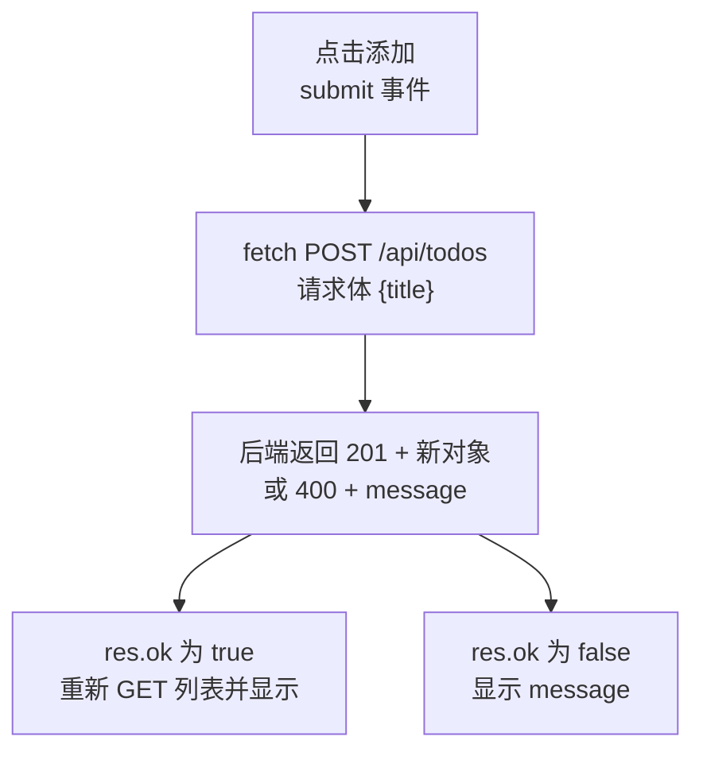

# 第 3 章 页面用 fetch 调接口：显示列表、新增待办

> 预计用时：80 分钟（通读 30 分钟 + 动手 50 分钟）

## 这一章解决什么问题

页面和接口都有了，但它们之间还没有任何联系：页面上看不到待办列表，输入的内容也提交不到后端。这一章让页面里的脚本去调用第 1 章的接口，拿到 JSON 后更新列表，整个过程页面不刷新、不跳转。

## 开始之前

- 上一章你已经会了：在 `Frontend/` 写源码，用 `npm run build` 构建到 `Backend/wwwroot/`，由后端发给浏览器。
- 需要的环境：第 2 章的两个项目。**后端代码本章不改。**
- 本章要改的文件：`Frontend/index.html`、`Frontend/src/main.ts`。

## 正文

### 先看完整代码，再分三个概念拆开讲

🖼 **图解：一次"新增"的往返过程**



💻 **代码**：两个文件都整个替换。

```html
<!-- code/ch03/Frontend/index.html -->
<!DOCTYPE html>
<html lang="zh-CN">
  <head>
    <meta charset="UTF-8" />
    <title>待办 H5</title>
  </head>
  <body>
    <h1>我的待办</h1>

    <form id="form">
      <input id="title" placeholder="输入待办事项" autocomplete="off" />
      <button id="addBtn" type="submit">添加</button>
    </form>

    <!-- 出错时在这里显示后端返回的 message -->
    <p id="msg"></p>

    <ul id="list"></ul>

    <script type="module" src="/src/main.ts"></script>
  </body>
</html>
```

```ts
// code/ch03/Frontend/src/main.ts
// 第 3 章：页面用 fetch 调第 1 章的两个接口，拿到 JSON 后更新列表，整页不刷新。

// ---------- 和后端约定的数据形状 ----------
// 对应后端 record Todo(int Id, string Title, bool Done)，序列化后是小驼峰
interface Todo {
  id: number;
  title: string;
  done: boolean;
}

// 对应后端 record ErrorBody(string Message)
interface ErrorBody {
  message: string;
}

// 相对路径：页面和接口由同一个后端发出（同源），换服务器部署不用改
const API = "/api/todos";

// ---------- 统一的请求函数 ----------
// T 由调用方指定：getTodos 要 Todo[]，addTodo 要 Todo
async function request<T>(url: string, init?: RequestInit): Promise<T> {
  const res = await fetch(url, init);

  // fetch 只在"网络不通"时抛异常；后端返回 400/404/500 时它照样正常返回，
  // 不检查 res.ok，错误信息会被当成正常数据往下传
  if (!res.ok) {
    const body = (await res.json().catch(() => null)) as ErrorBody | null;
    throw new Error(body?.message ?? `请求失败：HTTP ${res.status}`);
  }

  // as T 只是告诉编译器"相信我"，运行时并不会检查后端真的返回了这个形状
  return (await res.json()) as T;
}

function getTodos(): Promise<Todo[]> {
  return request<Todo[]>(API);
}

function addTodo(title: string): Promise<Todo> {
  return request<Todo>(API, {
    method: "POST",
    // 后端按 JSON 解析请求体，必须声明类型；不写的话浏览器默认发 text/plain，后端回 415
    headers: { "Content-Type": "application/json" },
    // 请求体只能是字符串，对象要先序列化
    body: JSON.stringify({ title }),
  });
}

// ---------- 页面元素 ----------
// 泛型参数决定返回类型：拿到 HTMLInputElement 才有 .value，HTMLButtonElement 才有 .disabled
function getById<T extends HTMLElement>(id: string): T {
  const el = document.getElementById(id);
  if (el === null) {
    throw new Error(`页面缺少 #${id} 元素`);
  }
  return el as T;
}

const form = getById<HTMLFormElement>("form");
const titleInput = getById<HTMLInputElement>("title");
const addBtn = getById<HTMLButtonElement>("addBtn");
const msg = getById<HTMLParagraphElement>("msg");
const list = getById<HTMLUListElement>("list");

// ---------- 把数据画到页面上 ----------
function render(todos: Todo[]): void {
  list.innerHTML = "";
  for (const t of todos) {
    const li = document.createElement("li");
    // 用 textContent 不用 innerHTML：有人输入 ，也只会当文字显示
    li.textContent = t.done ? `✔ ${t.title}` : t.title;
    list.appendChild(li);
  }
}

// catch 拿到的是 unknown：抛出来的不一定是 Error 对象，先判断再取 message
function showError(e: unknown): void {
  msg.textContent = e instanceof Error ? e.message : String(e);
}

async function reload(): Promise<void> {
  try {
    render(await getTodos());
    msg.textContent = "";
  } catch (e) {
    showError(e);
  }
}

// ---------- 提交表单 ----------
form.addEventListener("submit", async (e: SubmitEvent) => {
  // 阻止浏览器默认的整页提交（那会跳转、刷新页面），改由 fetch 在后台发请求
  e.preventDefault();

  // 请求没回来之前禁用按钮：手机网络慢时用户会连点，不禁用就会提交两条
  addBtn.disabled = true;
  try {
    await addTodo(titleInput.value);
    titleInput.value = "";
    await reload();
  } catch (err) {
    showError(err);
  } finally {
    addBtn.disabled = false;
  }
});

// 页面打开时先拉一次列表
void reload();
```

构建并启动：

```bash
# 在 Frontend/ 目录
npm run build

# 在 Backend/ 目录（如果后端已经在运行，不用重启，刷新页面即可）
dotnet run
```

打开 `http://localhost:5080/`，能看到"买牛奶""✔ 写周报"两条。输入"交水电费"点添加，列表变成三条，输入框被清空，地址栏没变，页面也没有闪烁。

下面分三个概念拆开讲。

### 3.1 fetch 取数据：拿到的 JSON 要和后端形状对上

**一句话定义**：`fetch(url)` 是浏览器自带的发 HTTP 请求的函数（返回 Promise），`await res.json()` 把响应体解析成 JavaScript 对象。

**场景**：报表页打开时先显示框架，再用 `fetch` 拉数据填进去，不用等服务器把整页拼好。

**反例**：纯展示、不需要交互的页面（比如一份公告），后端直接输出完整的 HTML 更简单，加载也更快，不需要前端再取一次数据。

🔍 **拆解**

| 关键行 | 为什么这样写 |
|---|---|
| `interface Todo { id; title; done }` | 把后端 record 的形状照抄成 TypeScript 类型，之后写 `t.title` 时编辑器能提示、能检查拼写 |
| `request<T>(...)` | 所有接口都走同一个函数，错误处理只写一遍（见 3.3） |
| `return (await res.json()) as T` | `res.json()` 的返回类型是 `any`，用 `as T` 收窄成具体类型，后面的代码就不会接触到 `any` |
| `li.textContent = ...` | 用户输入的内容一律当文字处理。实测输入 ``，页面上原样显示这串字符，不会执行 |

**改坏一处试试**：把 `interface Todo` 里的 `title` 改成 `Title`，`render` 里的两处 `t.title` 也改成 `t.Title`，然后执行 `npm run build`：

- **构建成功**，没有任何报错；
- 刷新页面，第一条是空白，第二条显示 `✔ undefined`。

原因：后端返回的是小驼峰 `title`，而 `as T` 只是你对编译器的承诺，运行时没有任何检查。**TypeScript 的类型只在编译期起作用，不会校验后端实际返回了什么。** 前后端字段名一旦对不上，只能靠你自己保持一致。

### 3.2 fetch 提交数据：方法、请求头、请求体三样都要写

**一句话定义**：`fetch` 的第二个参数可以指定 `method`、`headers`、`body`，用来发 POST 等请求。

**场景**：价格申请表单填好后，脚本把它组装成 JSON 提交，后端返回新单号，页面立刻显示出来。

**反例**：上传附件时请求体是文件，不是 JSON。这时应该用 `FormData` 作为 body，并且**不要**手动设置 `Content-Type`（让浏览器自动生成带 boundary 的类型），后端也要换成接收表单的写法。

🔍 **拆解**

| 关键行 | 为什么这样写 |
|---|---|
| `method: "POST"` | fetch 默认是 GET，不写就不会走到 `MapPost` |
| `"Content-Type": "application/json"` | 告诉后端请求体是 JSON。第 1 章已经看到，不声明就会返回 415 |
| `JSON.stringify({ title })` | `body` 只接受字符串等格式，直接传对象会被转成字符串 `"[object Object]"` |
| `e.preventDefault()` | `<form>` 默认会整页提交并刷新页面，这里改为由脚本在后台提交 |
| `addBtn.disabled = true` | 请求回来之前禁止再点，避免网络慢时连点产生重复数据 |

**改坏一处试试**：删掉 `headers` 那一行，重新构建，然后添加一条待办。页面显示 `请求失败：HTTP 415`。

为什么会这样：`body` 是字符串时，浏览器默认把 `Content-Type` 设成 `text/plain;charset=UTF-8`，后端不认这个类型，返回 415。而 415 的响应体不是 JSON，`res.json()` 解析失败，于是走了兜底提示 `请求失败：HTTP 415`。

### 3.3 检查 res.ok：fetch 不会因为 400/500 抛异常

**一句话定义**：`res.ok` 在状态码为 200–299 时为 `true`，其余为 `false`。fetch **只在网络层面失败时**才会抛异常。

**场景**：标题为空时后端返回 400 和 `{"message":"标题不能为空"}`，页面要把这句话显示给用户，而不是把它当成一条新待办。

**反例**：如果某个接口明确用 404 表示"没有数据，属于正常情况"（比如查询某个可选配置），就不应该统一把它当错误抛出，要在调用处单独判断 `res.status === 404`。

🔍 **拆解：在浏览器控制台（F12 → Console）里实测**

| 在控制台执行的代码 | 结果 |
|---|---|
| `fetch('/api/nothing').then(r => r.status + ' ' + r.ok)` | `"404 false"`，Promise 正常完成，**没有抛异常** |
| `fetch('http://localhost:5999/api/todos')`（没有服务的端口） | 抛异常 `Failed to fetch` |

在页面上输入几个空格再点添加，页面显示"标题不能为空"，列表保持不变。

**改坏一处试试**：把 `request` 函数里的 `if (!res.ok) {` 改成 `if (res.status >= 600) {`（条件永远不成立，相当于不检查），重新构建，再提交空标题：

- 页面**什么提示都没有**，输入框被清空，看起来像是提交成功了；
- 实际上 `{"message":"标题不能为空"}` 被当成了 `Todo` 返回，后面的代码照常执行。

这种 bug 最难排查：没有报错，只是数据悄悄不对。做完实验记得恢复代码。

> 为什么不直接删掉整个 `if`？因为删掉后 `ErrorBody` 就没有地方用了，tsconfig 里的 `noUnusedLocals` 会让 `tsc` 报 `TS6196` 错误，构建失败，wwwroot 里还是旧代码，你就看不到实验效果了。

## ⚠️ 踩坑警告

| 现象 | 原因 | 怎么改 |
|---|---|---|
| 提交后页面提示 `请求失败：HTTP 415` | 没写 `Content-Type: application/json` | 在 `headers` 里加上 |
| 列表里出现 `undefined`，构建却没报错 | interface 的字段名和后端返回的 JSON 对不上（大小写或拼写） | 打开 `/api/todos` 看实际返回的 JSON，照着改 interface |
| 用 `npx vite` 打开 `localhost:5173` 的页面，列表出不来，提示请求失败 | 5173 是 Vite 自己的开发服务器，它没有 `/api/todos`，请求根本没到后端 | 本教程统一用 `npm run build` 后访问 `localhost:5080`（开发服务器要配代理，不在本教程范围） |
| 点一下"添加"，整页刷新了一次，地址栏末尾多了 `?` | 漏了 `e.preventDefault()`，浏览器按默认方式整页提交了表单 | 在 submit 处理函数第一行加上 |
| 改了代码、刷新页面，效果还是旧的 | `npm run build` 其实失败了（比如 `tsc` 报未使用变量），wwwroot 里还是上一次的产物 | 每次构建都看一眼最后有没有 `✓ built in` |
| 后端返回了错误，页面却没有提示 | 没检查 `res.ok` | 所有请求都走统一的 `request` 函数 |

## 🎯 动手练习

**练习 1**：在列表上方显示统计，例如"共 3 条，已完成 1 条"。

- 验收标准：打开页面显示"共 2 条，已完成 1 条"；添加一条后自动变成"共 3 条，已完成 1 条"。

**练习 2**：在前端也加一道空标题检查：输入为空或全是空格时，不发请求，直接提示"请先输入内容"。

- 验收标准：输入空格点添加，提示的是"请先输入内容"（不是后端返回的"标题不能为空"）；用第 1 章的 curl 直接调接口，仍然返回 400。

卡住了看文末参考答案。

## 📌 一句话总结

fetch 发请求、检查 res.ok、按约定的形状读 JSON：页面和接口就连起来了。

## 下一章

电脑上已经能用了。下一章让手机通过局域网打开这个页面，并且排版正常、点得准。

---

**导航**：[上一章](ch02-vite-build-static-files.md) · [返回目录](../README.md) · [下一章](ch04-mobile.md)

---

<!-- 以下是参考答案，先自己动手，卡住了再往下翻 -->


## 参考答案

### 练习 1

`index.html` 里，在 `<ul id="list"></ul>` 上面加一行：

```html
<p id="summary"></p>
```

`main.ts` 里，在 `const list = ...` 下面加：

```ts
const summary = getById<HTMLParagraphElement>("summary");
```

`render` 函数改成：

```ts
function render(todos: Todo[]): void {
  list.innerHTML = "";
  for (const t of todos) {
    const li = document.createElement("li");
    li.textContent = t.done ? `✔ ${t.title}` : t.title;
    list.appendChild(li);
  }

  // filter 返回新数组，length 就是已完成条数
  const doneCount = todos.filter((t) => t.done).length;
  summary.textContent = `共 ${todos.length} 条，已完成 ${doneCount} 条`;
}
```

思路：统计放在 `render` 里，因为每次列表变化都会经过它，不需要在新增的地方再单独更新一次。

### 练习 2

在 submit 处理函数的 `e.preventDefault();` 后面加：

```ts
  // 前端先拦一道：空内容不发请求，省一次往返。后端的校验仍然保留
  if (titleInput.value.trim() === "") {
    msg.textContent = "请先输入内容";
    return;
  }
```

思路：前端校验是为了让用户更快得到反馈，后端校验是为了保证数据正确，两者都要有。提示文字故意和后端的不一样，这样一眼就能看出是哪一层拦下的。
