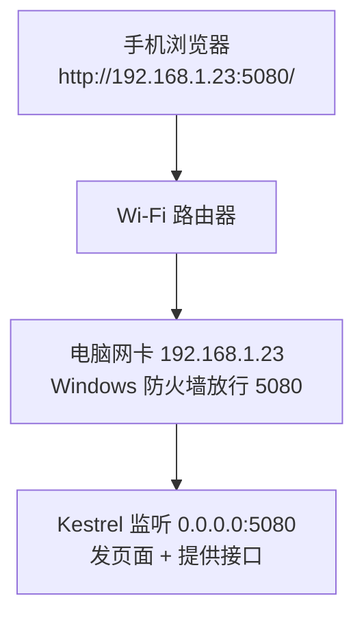

# 第 4 章 在手机上打开：视口、局域网访问、触控细节

> 预计用时：70 分钟（通读 25 分钟 + 动手 45 分钟）

## 这一章解决什么问题

电脑上已经能正常使用了，但拿手机输入 `localhost:5080` 打不开：手机上的 localhost 指的是手机自己。就算换成电脑的 IP 打开了，字也小得要放大才能看清，按钮也很难点准。这一章解决这三个问题：手机连得上，排版按手机宽度来，手指点得准。

## 开始之前

- 上一章你已经会了：页面用 fetch 调接口，显示列表、新增待办。
- 需要的环境：手机和电脑连**同一个 Wi-Fi**。
- 本章要改的文件：`Backend/Properties/launchSettings.json`、`Frontend/index.html`，`Frontend/package.json`（`copy` 多复制一个文件），新建 `Frontend/style.css`。`main.ts` 和 `Program.cs` 不改。

## 正文

### 4.1 视口（viewport）：让手机按真实宽度排版

**一句话定义**：视口（viewport，浏览器用来排版的那块区域）声明告诉手机浏览器"按屏幕的真实宽度排版"，而不是假装自己是一块 980px 宽的电脑屏幕再整体缩小。

**场景**：审批人在手机上打开待审列表，不用双指放大，就能直接看清文字、点按钮。

**反例**：如果页面只在电脑上使用，并且是按固定 1200px 宽度设计的，加上这行反而会让手机上的布局挤成一团。没有做移动端适配的页面，不要只加这一行就算完事。

💻 **代码**：`<head>` 里加一行 `<meta name="viewport">`，完整的 `index.html`：

```html
<!-- code/ch04/Frontend/index.html -->
<!DOCTYPE html>
<html lang="zh-CN">
  <head>
    <meta charset="UTF-8" />
    <!-- 告诉手机浏览器：按屏幕真实宽度排版，不要假装自己是 980px 宽的电脑屏幕 -->
    <!-- viewport-fit=cover：页面铺满刘海区域，再由 CSS 的 safe-area 自己留白 -->
    <meta name="viewport" content="width=device-width, initial-scale=1, viewport-fit=cover" />
    <title>待办 H5</title>
    <!-- style.css 由构建脚本原样复制到 wwwroot 根目录 -->
    <link rel="stylesheet" href="/style.css" />
  </head>
  <body>
    <h1>我的待办</h1>

    <form id="form">
      <input id="title" placeholder="输入待办事项" autocomplete="off" />
      <button id="addBtn" type="submit">添加</button>
    </form>

    <p id="msg"></p>

    <ul id="list"></ul>

    <!-- 引用 tsc 编译出来的 main.js；type="module" 不能省，原因见第 2 章 -->
    <script type="module" src="/main.js"></script>
  </body>
</html>
```

🔍 **拆解运行结果**：用浏览器模拟 iPhone 14（屏幕宽 390）打开页面，在控制台执行 `window.innerWidth`：

| 情况 | `innerWidth` | 看到的效果 |
|---|---|---|
| 有 viewport 这一行 | **390** | 文字是正常大小，输入框和按钮占满一行 |
| 没有这一行 | **980** | 整页按 980 宽排版后再缩小到屏幕宽，字很小 |

`initial-scale=1` 表示打开时不缩放。`viewport-fit=cover` 让页面延伸到刘海区域，配合 4.3 节的 `safe-area` 留白使用。

**改坏一处试试**：删掉 viewport 这一行，重新构建，在电脑 Chrome 里按 F12 → 点"切换设备工具栏"（手机图标）→ 选一款 iPhone，刷新页面，在控制台执行 `window.innerWidth`：结果是 980。

### 4.2 监听地址：localhost 只接受本机连接

**一句话定义**：`http://localhost:5080` 表示后端只接受**本机**发来的连接；`http://0.0.0.0:5080` 表示接受**所有网卡**上的连接，局域网里的手机才连得上。

**场景**：开发时用手机实际测试页面，或者给同一个办公室里的同事临时演示。

**反例**：在咖啡店、酒店这类公共 Wi-Fi 上**不要**监听 `0.0.0.0`。同一网络里的任何人都能访问你的接口，而本教程的接口没有任何登录校验。测试完就改回 `localhost`。

🖼 **图解**



💻 **代码**：把 `launchSettings.json` 里的 `localhost` 改成 `0.0.0.0`，完整文件（📄 `code/ch04/Backend/Properties/launchSettings.json`）：

```json
{
  "$schema": "https://json.schemastore.org/launchsettings.json",
  "profiles": {
    "http": {
      "commandName": "Project",
      "dotnetRunMessages": true,
      "launchBrowser": false,
      "applicationUrl": "http://0.0.0.0:5080",
      "environmentVariables": {
        "ASPNETCORE_ENVIRONMENT": "Development"
      }
    }
  }
}
```

然后按下面四步操作：

1. 在 `Backend/` 目录执行 `dotnet run`，日志显示 `Now listening on: http://0.0.0.0:5080`。
2. 查电脑的局域网 IP：Windows 在 `cmd` 里执行 `ipconfig`，找到当前 Wi-Fi 网卡的"IPv4 地址"，比如 `192.168.1.23`；macOS 执行 `ipconfig getifaddr en0`。
3. 放行防火墙（⚠️ 本段未实机验证，沙箱是 Linux 环境）：Windows 第一次运行时如果弹出防火墙提示，勾选"专用网络"并允许。没有弹窗的话，用**管理员身份**打开 PowerShell，执行：

   ```powershell
   New-NetFirewallRule -DisplayName "H5 Demo 5080" -Direction Inbound -Protocol TCP -LocalPort 5080 -Action Allow
   ```

   测试完删掉这条规则：`Remove-NetFirewallRule -DisplayName "H5 Demo 5080"`。
4. 手机浏览器打开 `http://192.168.1.23:5080/`（换成你的 IP）。

🔍 **拆解运行结果**（在沙箱里用本机的非回环地址实测）：

| 监听地址 | 用 `localhost` 访问 | 用网卡 IP 访问 |
|---|---|---|
| `http://localhost:5080` | 200 | **连接被拒绝** |
| `http://0.0.0.0:5080` | 200 | 200 |

页面里的接口地址写的是相对路径 `/api/todos`，所以手机打开 `192.168.1.23:5080` 的页面后，接口请求自动发到 `192.168.1.23:5080/api/todos`，前端代码一行都不用改。这正是第 3 章坚持用相对路径的原因。

**改坏一处试试**：把 `applicationUrl` 改回 `http://localhost:5080`，重启后端，手机刷新页面：显示"无法连接"或一直转圈。电脑上访问 `localhost:5080` 仍然正常。

### 4.3 触控与输入细节：给手指和小屏幕留余量

**一句话定义**：手机上要额外照顾三件事：点击区域要够大，输入框字号不能太小，长内容要能自动换行。

**场景**：用户在地铁上单手操作，手指比鼠标指针粗得多；有人在待办里粘贴了一个很长的链接。

**反例**：只在电脑上使用的后台管理页面，不需要把所有按钮都做到 44px 高，那样会浪费大量屏幕空间。

💻 **代码**：在 `Frontend/` 目录新建样式文件（和 `index.html` 放在一起，不放进 `src/`，因为 `tsc` 只处理 `.ts`）：

```css
/* code/ch04/Frontend/style.css */

/* 宽度包含 padding 和边框，否则 width:100% 再加 padding 会把横向撑出屏幕 */
* {
  box-sizing: border-box;
}

body {
  margin: 0;
  font-family: -apple-system, "PingFang SC", "Microsoft YaHei", sans-serif;
  background: #f5f5f5;
  /* 刘海屏顶部、iPhone 底部横条的高度由系统提供；普通屏幕上这两个值是 0 */
  padding: env(safe-area-inset-top) 16px env(safe-area-inset-bottom);
}

h1 {
  font-size: 20px;
  margin: 16px 0;
}

form {
  display: flex;
  gap: 8px;
}

input {
  /* 输入框占满剩余宽度，按钮保持自身宽度 */
  flex: 1;
  /* 小于 16px 时，iPhone 的 Safari 会在聚焦输入框时自动放大整页 */
  font-size: 16px;
  padding: 10px;
  border: 1px solid #ccc;
  border-radius: 6px;
}

button {
  font-size: 16px;
  padding: 0 16px;
  /* 手指的点击面积比鼠标大得多，44px 是 iOS 人机界面指南建议的最小触控尺寸 */
  min-height: 44px;
  border: 0;
  border-radius: 6px;
  background: #1677ff;
  color: #fff;
}

button:disabled {
  background: #999;
}

#msg {
  color: #d4380d;
  /* 先占住一行高度：报错信息出现时，下面的列表不会突然往下跳 */
  min-height: 1.2em;
}

ul {
  list-style: none;
  padding: 0;
}

li {
  background: #fff;
  margin-bottom: 8px;
  padding: 12px 14px;
  border-radius: 6px;
  min-height: 44px;
  /* 用户输入的超长英文或网址不换行会把页面横向撑开 */
  overflow-wrap: anywhere;
}
```

`package.json` 的 `copy` 改成复制两个文件（📄 `code/ch04/Frontend/package.json` 里只有这一行变化）：

```json
"copy": "node -e \"for (const f of ['index.html', 'style.css']) require('node:fs').cpSync(f, '../Backend/wwwroot/' + f)\"",
```

构建（`Frontend/` 目录执行 `npm run build`）后，`Backend/wwwroot/` 里有 `index.html`、`main.js`、`style.css` 三个文件。

🔍 **拆解运行结果**（模拟 iPhone 14 实测）：

| 检查项 | 实测值 | 说明 |
|---|---|---|
| 输入框字号 | 16px | ⚠️ "小于 16px 时 iOS Safari 会自动放大"这一条需要真 iPhone 才能观察到，沙箱的 Chromium 模拟不出来，未实机验证 |
| 按钮高度 | 44px | 手指容易点中 |
| 添加一条将近 90 个字符、中间没有空格的链接后，页面宽度 | 390（和屏幕一样宽） | 长链接在卡片里折行显示 |

`env(safe-area-inset-*)` 只在有刘海或底部横条的 iPhone 上才有值，在其他设备上是 0，不影响排版（⚠️ 刘海屏的实际效果未实机验证）。

**改坏一处试试**：删掉 `li` 里的 `overflow-wrap: anywhere;`，重新构建，添加一条 `https://example.com/?token=ABCDEFGHIJKLMNOPQRSTUVWXYZabcdefghijklmnopqrstuvwxyz0123456789`。实测页面宽度被撑到 **658**：浏览器为了放下这一长串字符，把整页缩小了，所有文字一起变小。

为什么之前用带 `-` 的长链接测试没有出问题：浏览器会在 `-` 后面换行，只有完全没有断点的字符串才会把页面撑开。所以测试数据要特意用"中间没有任何符号"的长字符串。

## ⚠️ 踩坑警告

| 现象 | 原因 | 怎么改 |
|---|---|---|
| 手机打开 `localhost:5080` 打不开 | 手机上的 localhost 是手机自己 | 改用电脑的局域网 IP |
| 用电脑 IP 打不开，电脑本机却正常 | 后端只监听了 `localhost`，或者 Windows 防火墙拦截了 | 按 4.2 节改成 `0.0.0.0`，并放行 5080 端口 |
| 手机能打开页面，接口却全部失败 | 前端把接口地址写死成了 `http://localhost:5080/api/...` | 用相对路径 `/api/todos` |
| 手机上整页字很小 | 缺少 viewport 声明 | 加上 4.1 节那一行 |
| 某条内容出现后页面整体缩小，或者可以左右滑动 | 没有空格的长字符串撑宽了页面 | 给容器加 `overflow-wrap: anywhere` |

## 🎯 动手练习

**练习 1**：用你自己的手机打开页面，在手机上添加一条"手机添加的"。

- 验收标准：手机上看到列表并添加成功；在电脑浏览器刷新 `localhost:5080`，也能看到这一条。

**练习 2**：已完成的待办不再用"✔"前缀，改为灰色文字加删除线。

- 验收标准：手机上"写周报"显示为灰色加删除线，"买牛奶"是正常的黑色，两条都没有"✔"。

卡住了看文末参考答案。

## 📌 一句话总结

监听 0.0.0.0 让手机连得上，viewport 让排版对，44px 和 16px 让手指好用。

## 下一章

这套教程到这里就结束了。后续方向见 [README 的"学完之后"](../README.md#学完之后)。

---

**导航**：[上一章](ch03-fetch-json.md) · [返回目录](../README.md)

---

<!-- 以下是参考答案，先自己动手，卡住了再往下翻 -->


## 参考答案

### 练习 1

没有代码要写，按 4.2 节的四步操作即可。手机和电脑访问的是同一个后端进程，数据存在这个进程的内存里，所以两边看到的是同一份列表。

如果打不开，按顺序排查：

1. 电脑上用 `http://你的IP:5080/` 能打开吗？打不开说明问题在监听地址；
2. 电脑能打开、手机打不开，说明是防火墙，或者手机和电脑不在同一个网络（比如手机用的是流量，或者连的是访客 Wi-Fi）。

### 练习 2

`main.ts` 的 `render` 函数里，把：

```ts
    li.textContent = t.done ? `✔ ${t.title}` : t.title;
```

改成：

```ts
    li.textContent = t.title;
    // 样式交给 CSS：脚本只负责标记"这条已完成"，长什么样由 style.css 决定
    li.className = t.done ? "done" : "";
```

`style.css` 末尾加：

```css
li.done {
  color: #999;
  text-decoration: line-through;
}
```

思路：脚本只负责标记状态，外观交给 CSS。以后想把"已完成"改成别的样式，只改 CSS，不用动脚本。实测：写周报那条的 `className` 是 `done`，删除线生效，颜色是 `rgb(153, 153, 153)`；买牛奶是正常的黑色。
