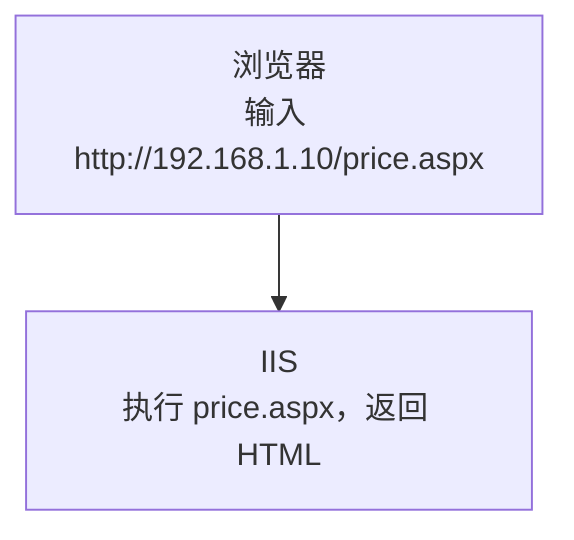
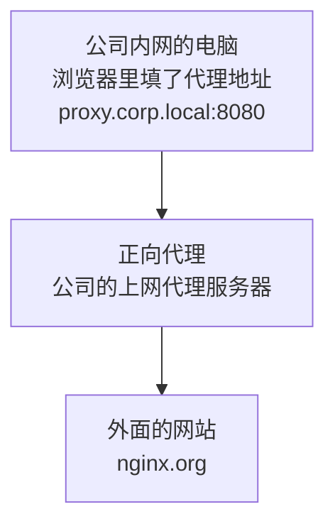
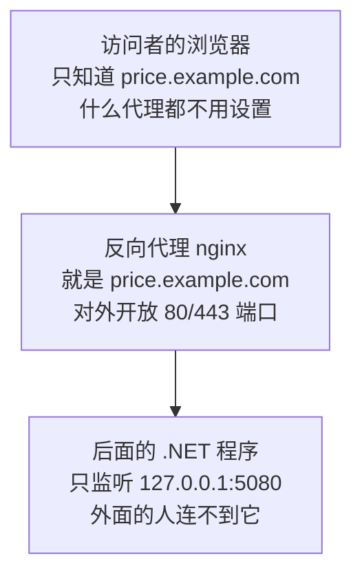
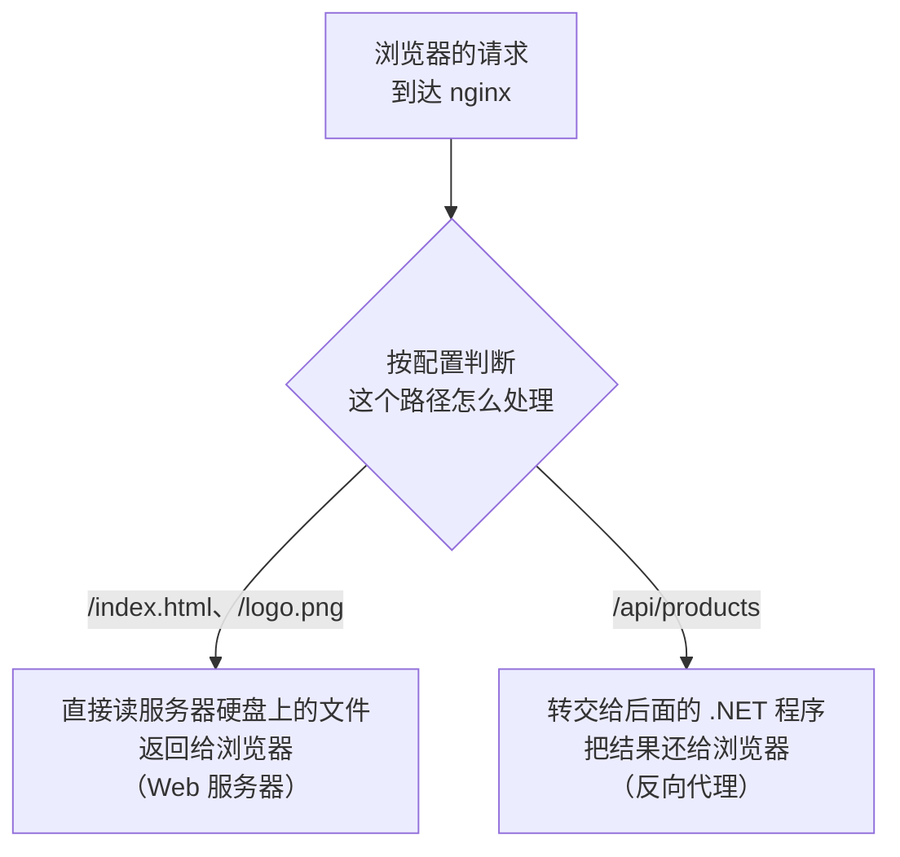

# 第 1 章 代理和反向代理：nginx 站在中间做什么

## 这一章解决什么问题

讲 nginx 的资料一上来就说"反向代理""proxy_pass""upstream"。你在 IIS 上部署网站时，浏览器直接连 IIS，中间没有别人，所以这些词没有对应的经验可以套。如果不先弄清"代理"替谁办事、"反向"反在哪里，后面每一行配置都只能死记。

这一章不装任何软件，在你自己的 Windows 电脑上用 `curl.exe` 看清楚：一个请求在到达真正处理它的程序之前，经过了谁，谁又知道谁的存在。

## 开始之前

- 这是第 1 章，不需要服务器。
- 需要一台能上网的 Windows 10（1803 及以后）或 Windows 11 电脑。系统自带 `curl.exe`，不用安装。
- 打开 PowerShell：按 `Win` 键，输入 `PowerShell`，回车。后面所有 `PS C:\Users\zhang>` 开头的命令都在这个窗口里执行。

本章 3 个新概念：**正向代理**、**反向代理**、**nginx 的两种工作方式**。

---

## 1.1 先看没有代理时的样子

你以前在 IIS 上发布 WebForm 网站，访问过程是这样的：



浏览器连的是 IIS，处理请求的也是 IIS。两边之间没有第三方。

"代理"（proxy）的意思就是：**两边之间多了一个中间人，请求先交给它，由它再去找真正的目标**。中间人替谁办事，决定了它叫"正向代理"还是"反向代理"。

---

## 1.2 正向代理：替"你"出去办事

### 白话定义

正向代理（forward proxy，平常直接叫"代理"）是**替访问者出去访问网站**的中间人。访问者自己知道它的存在，并且要在自己的电脑或浏览器里**主动填上它的地址**。

### 🖼 图解



- 电脑不直接连 nginx.org，而是把"我要访问 nginx.org"这件事交给代理。
- 代理替它去访问，再把结果转回来。
- nginx.org 看到的来访者是**代理服务器**，不知道后面是哪台电脑。

### 业务里的场景

| 场景 | 为什么要用正向代理 |
|---|---|
| 公司内网电脑统一通过上网代理访问外网 | 公司要记录谁访问了什么、屏蔽某些网站，只给代理服务器开外网权限 |
| 内网的 Ubuntu 服务器不能直接上网，但要 `apt` 安装软件 | 让服务器通过一台能上网的代理下载，`apt` 支持设置代理地址 |

### 💻 动手：看看你的电脑有没有设置正向代理

**步骤 1**：打开 Windows 的代理设置。

- Windows 11：`设置` → `网络和 Internet` → `代理`
- Windows 10：`设置` → `网络和 Internet` → 左侧 `代理`

看"手动设置代理"下面的"使用代理服务器"是不是打开了。公司电脑如果是打开的，那里填的地址就是公司的正向代理。家里电脑一般是关闭的。

> ⚠️ 本步骤的界面未实机验证（测试环境没有 Windows 图形界面），菜单名称可能因 Windows 版本略有不同。

**步骤 2**：用 `curl.exe` 正常访问一次 nginx.org，只看响应头（`-I` 表示只要响应头，不要网页内容）。

```powershell
PS C:\Users\zhang> curl.exe -I http://nginx.org
```

实测输出（前 3 行）：

```text
HTTP/1.1 200 OK
Server: nginx/1.31.8
Date: Wed, 25 Nov 2026 06:30:18 GMT
```

`200 OK` 说明访问成功。这一次你的电脑是**直接**连 nginx.org 的。

**步骤 3**：用 `-x` 参数让 `curl.exe` 走一个正向代理。这里故意填一个不存在的代理地址 `127.0.0.1:8888`（你自己电脑上的 8888 端口，没有程序在监听）。

```powershell
PS C:\Users\zhang> curl.exe -I -x http://127.0.0.1:8888 http://nginx.org
```

实测输出：

```text
curl: (7) Failed to connect to 127.0.0.1:8888 over proxy 127.0.0.1 after 0 ms: Could not connect to server
```

> 这行输出来自 curl 8.21。Windows 自带的 `curl.exe` 版本较旧，文字可能略有不同，但都会说连不上代理 `127.0.0.1` 的 8888 端口。

### 🔍 拆解运行结果

- 步骤 2 和步骤 3 访问的是**同一个网站**，nginx.org 一直好好的。
- 步骤 3 失败的原因是：`-x` 让 curl 不去连 nginx.org，而是先去连代理 `127.0.0.1:8888`。代理不存在，请求根本没有出门。
- 这说明了正向代理的两个特点：
  1. **是访问者自己选择、自己配置的**（这里是 `-x` 参数，浏览器里是代理设置）；
  2. **访问者的所有请求都先交给它**，它一停，访问者访问哪个网站都不行。

### 改坏一处试试

上面步骤 3 本身就是"改坏"：把代理地址填错。现实里最常见的同类情况是：

- 电脑装过翻墙软件或抓包工具，它们会把 Windows 代理设成 `127.0.0.1:某端口`；
- 软件退出后，代理设置没有恢复；
- 结果：浏览器打开任何网站都提示"无法连接到代理服务器"（Chrome/Edge 的错误码是 `ERR_PROXY_CONNECTION_FAILED`）。

解决办法是回到步骤 1 的界面，把"使用代理服务器"关掉。

### 什么时候不该用正向代理

- **你部署自己的网站时，用不到正向代理。** 访问你网站的人用不用代理是他们的事，你没法要求全国的访问者都去配一个代理地址。
- 本教程后面讲的 nginx 配置，几乎全部是**反向代理**。nginx 本身也不擅长做正向代理：它不支持浏览器访问 HTTPS 网站时发出的 `CONNECT` 请求。公司里的上网代理一般用 Squid 之类的专门软件。第 8 章会亲手试一次，看到 nginx 对 `CONNECT` 返回 400。

---

## 1.3 反向代理：替"网站"接待来访者

### 白话定义

反向代理（reverse proxy）是**站在网站门口、替网站接待所有来访者**的中间人。访问者**不知道它的存在，也不用做任何设置**，以为它就是网站本身；它收到请求后，再交给后面真正干活的程序。

"反向"指的是方向反过来了：正向代理替访问者办事，反向代理替网站办事。

### 🖼 图解



- 浏览器以为自己在和 `price.example.com` 说话，其实接电话的是 nginx。
- nginx 把请求交给后面的 .NET 程序，拿到结果再还给浏览器。
- .NET 程序只在服务器内部监听，外面的人**连不到它**，只能经过 nginx。

### 业务里的场景

假设你要上线一个"产品价格查询"系统，前端是 React 页面，后端是 .NET 程序：

| 需求 | 反向代理怎么解决 |
|---|---|
| 对外只想给一个地址 `https://price.example.com` | 页面和接口都从 nginx 这一个入口进，nginx 按路径分开：`/api/...` 交给 .NET，其余的直接给页面文件（第 9 章） |
| HTTPS 证书只想装一次 | 证书只装在 nginx 上，nginx 和后面的 .NET 之间在服务器内部用普通 HTTP（第 10 章） |
| 后端程序不想直接暴露在公网 | .NET 只监听 `127.0.0.1`，外面只能看到 nginx（第 8 章） |
| 一台服务器放好几个系统 | 都用 80/443 端口，nginx 按访问的域名分给不同的程序或目录（第 6 章） |

### 和你熟悉的 IIS 对照

你其实已经用过反向代理，只是 IIS 把它藏起来了：

| 你在 IIS 上做过的事 | 实际发生的事 |
|---|---|
| 部署 ASP.NET Core 程序，应用池选"无托管代码"，`web.config` 里 `hostingModel="outofprocess"` | IIS 收到请求后，转给后台运行的 Kestrel（.NET 自带的 Web 服务器），这就是反向代理 |
| 装 ARR（Application Request Routing）+ URL Rewrite，把某个站点转发到另一台机器 | IIS 当反向代理 |

区别在于：IIS 是在图形界面里勾选，nginx 是在配置文件里写一行 `proxy_pass`。另外，`hostingModel` 默认是 `inprocess`（程序直接跑在 IIS 进程里），那种情况下**没有**反向代理。

### 💻 动手：看看大网站门口站着谁

你访问一个网站时，看不见它后面有几层。不过很多反向代理会在响应头里留下名字。

**步骤 1**：看 nginx 官网的响应头。

```powershell
PS C:\Users\zhang> curl.exe -I https://nginx.org
```

实测输出（只列出关心的行）：

```text
HTTP/1.1 200 OK
Server: nginx/1.31.8
```

**步骤 2**：看京东首页的响应头。

```powershell
PS C:\Users\zhang> curl.exe -I https://www.jd.com
```

实测输出（只列出关心的行）：

```text
HTTP/2 301
server: nginx
x-via: 0.0 PSmgasbIAD1pb76:19 (Cdn Cache Server V2.0)
```

> 以上是 2026-11-25 在测试网络里的结果。你在国内访问会连到别的服务器，`x-via` 等头的值、甚至有没有这些头，都可能不同。

### 🔍 拆解运行结果

| 响应头 | 说明 |
|---|---|
| `Server: nginx/1.31.8` | 门口回答你的是 nginx，版本 1.31.8 |
| `server: nginx` | 京东门口也是 nginx，只是隐藏了版本号（第 12 章会讲怎么隐藏） |
| `x-via: ... (Cdn Cache Server V2.0)` | 请求还经过了 CDN 的缓存服务器。CDN 就是分布在各地的反向代理，离你近的那台先接待你 |
| `HTTP/2 301` | 301 是"永久跳转"，京东让你去另一个地址。反向代理可以直接回答跳转，不必打扰后面的程序 |

关键点：**你只输入了一个网址，没有做任何代理设置**，但请求实际经过了一层或几层反向代理。这正是反向代理的特点：对访问者透明。

### 改坏一处试试：不说要找哪个网站

一台反向代理后面往往有很多网站，它靠请求里的 `Host` 头（你输入的域名）判断你要找谁。我们绕过域名，直接用 nginx.org 的 IP 地址访问。

**步骤 1**：先查出 nginx.org 的 IPv4 地址。

```powershell
PS C:\Users\zhang> Resolve-DnsName nginx.org -Type A
```

在输出的 `IPAddress` 列里能看到地址。测试时查到的是 `3.136.61.53`，你查到的可能不同，下面换成你查到的。

> ⚠️ `Resolve-DnsName` 的输出格式未实机验证。IP 地址 `3.136.61.53` 是在 Linux 上用 `curl -v` 实测得到的。

**步骤 2**：直接访问这个 IP。

```powershell
PS C:\Users\zhang> curl.exe -I http://3.136.61.53
```

实测输出：

```text
curl: (56) Recv failure: Connection reset by peer
```

**步骤 3**：还是访问这个 IP，但用 `-H` 手动带上 `Host: nginx.org`。

```powershell
PS C:\Users\zhang> curl.exe -I -H "Host: nginx.org" http://3.136.61.53
```

实测输出（前 2 行）：

```text
HTTP/1.1 200 OK
Server: nginx/1.31.8
```

> Windows 的 `curl.exe` 对"连接被重置"的提示文字可能略有不同。

同一个 IP、同一台服务器：不说要找谁，它直接挂断；说清要找 `nginx.org`，它就正常回答。这说明门口的 nginx **按域名决定把请求交给哪个网站**。第 6 章你会在自己的服务器上配出同样的效果。

### 什么时候不该用反向代理

| 情况 | 原因 |
|---|---|
| 内网里只有你自己用的小工具，比如在服务器上临时跑一个 .NET 程序看看效果 | 直接访问 `http://服务器IP:5080` 就行，多一层 nginx 只是多一份配置 |
| 现有 Windows + IIS 站点运行稳定，没有新需求 | IIS 已经承担了门口的角色，没必要为了用 nginx 而在前面再加一层 |
| 后端程序需要直接拿到访问者的网络连接（比如某些要求客户端证书的接口） | 经过反向代理后，后端拿到的连接来自 nginx，需要额外配置转交信息，第 8 章会遇到这个问题 |

---

## 1.4 正向代理和反向代理对照

| 对比项 | 正向代理 | 反向代理 |
|---|---|---|
| 替谁办事 | 访问者 | 网站 |
| 谁来配置 | 访问者（浏览器、系统代理、`curl -x`） | 网站的管理员（你），访问者什么都不用做 |
| 谁知道它的存在 | 访问者知道；网站只看到代理 | 访问者不知道；后面的程序知道 |
| 隐藏了谁 | 隐藏访问者 | 隐藏后面的程序 |
| 放在哪里 | 访问者那一边（公司内网出口） | 网站那一边（服务器门口） |
| 典型软件 | Squid、各种上网代理 | nginx、IIS + ARR、CDN |
| 本教程用得多吗 | 第 8 章对照一次 | 几乎每一章 |

区分的办法只有一条：**看它替谁办事**。不要看软件名字，同一个软件可能两种都能做。

---

## 1.5 nginx 的两种工作方式

nginx 收到请求后，只有两种处理办法：



| 工作方式 | 英文 | 适合处理什么 | 本教程章节 |
|---|---|---|---|
| Web 服务器 | web server | 写好的文件：HTML、CSS、JS、图片、React 打包后的 `dist` | 第 3、5、6 章 |
| 反向代理 | reverse proxy | 需要程序计算的请求：查数据库、保存数据 | 第 8、9 章 |

在 IIS 上，静态文件和 `.aspx` 都由 IIS 一个程序处理。在 Linux 上通常分工：nginx 负责门口和静态文件，.NET 程序只负责接口。

### 反向代理带来的一个副作用

请求经过 nginx 转交以后，在 .NET 程序看来，**来访者变成了 nginx**（地址是 `127.0.0.1`），而不是真正的浏览器。如果你的程序要记录访问者 IP、判断是不是 HTTPS，就需要 nginx 把原始信息放在请求头里转交过去，程序再读出来。这是第 8 章的内容，现在只要记住：**多了中间人，后面的程序就看不到原始的来访者**。

---

## 🧱 类比

| 概念 | 日常生活里的样子 |
|---|---|
| 正向代理 | **代购**。你知道代购，把要买的东西告诉他；商店只看到代购来买东西，不知道是你要的 |
| 反向代理 | **公司前台总机**。客户只知道总机号码，打进来由前台转给负责的同事；客户不知道是谁处理的，同事的分机号也不对外公开 |
| 按 Host 分发 | 一栋写字楼的前台，访客要说清楚找哪家公司，前台才知道带你去几楼 |

---

## ⚠️ 踩坑警告

| 现象 | 原因 | 怎么改 |
|---|---|---|
| 在 PowerShell 里输入 `curl -I https://nginx.org`，报错说找不到参数 `I` | Windows PowerShell 5.1 里 `curl` 是 `Invoke-WebRequest` 的别名，不是真正的 curl | 输入 `curl.exe`，带上 `.exe`。⚠️ 报错原文未实机验证 |
| 所有网站都打不开，浏览器提示"无法连接到代理服务器" | 系统代理指向了一个已经关闭的程序（常见于退出了翻墙或抓包软件） | `设置` → `网络和 Internet` → `代理`，关闭"使用代理服务器" |
| 用 `curl.exe -I` 看某个网站，`Server` 不是 nginx，就以为它没有反向代理 | 响应头的名字可以随便改或隐藏。测试时百度返回 `Server: bfe`，腾讯返回 `Server: stgw`，都是它们自己的反向代理 | `Server` 头只能当线索，有就说明经过了它，没有不代表没经过 |
| 直接用 IP 访问一个网站，连接被重置或者显示别的网站 | 这台服务器上有多个网站，门口的反向代理按域名分发，IP 不对应任何一个网站 | 用域名访问；排查时用 `curl.exe -H "Host: 域名" http://IP` 指定要找的网站 |

---

## 🎯 动手练习

**练习 1：看看你常用的网站门口是谁**

用 `curl.exe -I` 查看下面 3 个网站的响应头，把 `Server` 头和带 `via`、`cache` 字样的头记下来：

- 你公司的官网（或者任何一个你常用的网站）
- `https://www.baidu.com`
- `https://www.163.com`

验收标准：能填出下面这张表，并对每个网站说出"门口至少有一层反向代理"的依据是哪个响应头。

| 网站 | Server 头 | 其他相关的头 | 门口是什么 |
|---|---|---|---|
| | | | |

**练习 2：判断是正向还是反向**

判断下面 4 个场景里的中间人是正向代理还是反向代理，每个写一句依据：

1. 公司规定所有电脑的浏览器都要填 `proxy.corp.local:8080` 才能上网。
2. 你在服务器上用 nginx 接收 `https://price.example.com` 的请求，把 `/api` 开头的转给本机 5080 端口的 .NET 程序。
3. 机房里的 Ubuntu 服务器不能直接上网，你给 `apt` 设置了一台能上网的机器的地址，让它帮忙下载软件包。
4. 用户访问一个视频网站，实际由离他最近的 CDN 节点返回视频文件。

验收标准：4 个判断都对，并且依据都落在"它替谁办事、谁配置的它"上。

卡住了看文末参考答案。

---

## 📌 一句话总结

正向代理替访问者出门，反向代理替网站接客；nginx 主要当后者。

## 下一章

nginx 要装在 Ubuntu 服务器上。下一章先解决：在 Windows 上怎样登录这台服务器、怎样把文件传上去。

---

<!-- 以下是参考答案，先自己动手，卡住了再往下翻 -->


## 参考答案

### 练习 1

思路：每个网站执行一次 `curl.exe -I`，看 `Server` 和名字里带 `via`、`cache` 的头。

```powershell
PS C:\Users\zhang> curl.exe -I https://www.baidu.com
PS C:\Users\zhang> curl.exe -I https://www.163.com
```

测试网络里的实测结果如下（你在国内访问会连到别的节点，值可能不同）：

| 网站 | Server 头 | 其他相关的头 | 门口是什么 |
|---|---|---|---|
| www.baidu.com | `Server: bfe` | 无 | 百度自己的反向代理 BFE |
| www.163.com | `server: Tengine` | `via: ens-cache7.us27[,403011]` | Tengine（阿里基于 nginx 改的版本），前面还有一层 CDN 缓存 |

测试时 163 返回的状态码是 `403`（拒绝了测试所在的网络），但拒绝它的正是门口的反向代理，所以响应头照样能说明问题。

只要看到 `Server` 不是"真正写业务的程序"，或者出现 `via`、`x-cache` 一类的头，就说明门口至少有一层反向代理。

### 练习 2

| 场景 | 判断 | 依据 |
|---|---|---|
| 1 | 正向代理 | 替员工的电脑出去访问；是访问者（员工电脑）自己配置的 |
| 2 | 反向代理 | 替网站接待访问者；访问者不用设置任何东西，配置的是网站管理员 |
| 3 | 正向代理 | 替服务器（这时服务器是访问者）出去下载；是服务器这边主动设置的 |
| 4 | 反向代理 | 替视频网站接待用户；用户只输入了网址，没有做任何设置 |

场景 3 容易判断错：服务器平常是被访问的一方，但在下载软件包时它是**访问者**，所以给它用的是正向代理。判断时只看这一次请求里谁在访问、中间人替谁办事。
