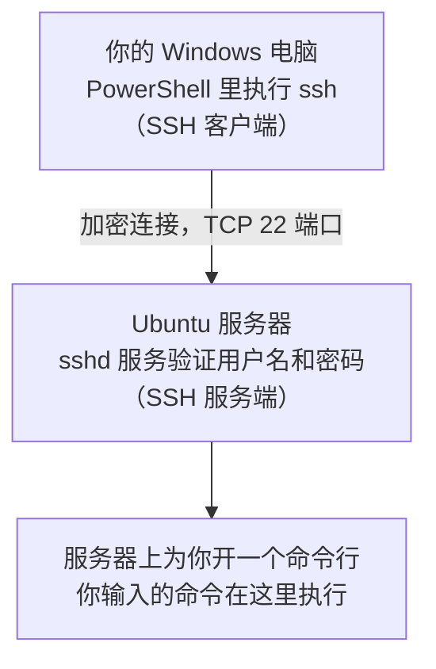
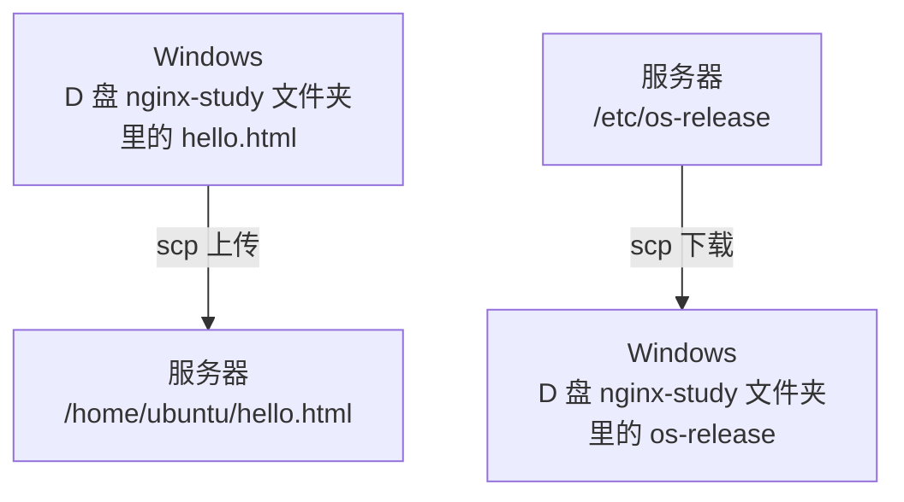
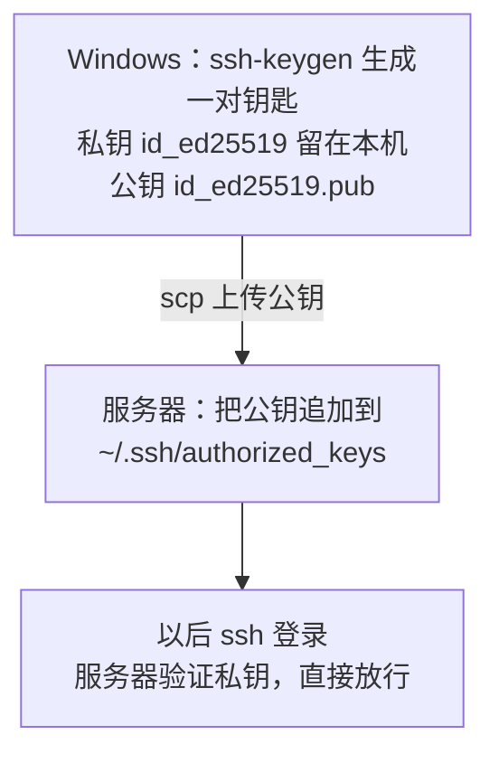

# 第 2 章 从 Windows 登录 Ubuntu 服务器、上传文件

## 这一章解决什么问题

在 Windows Server 上，你用远程桌面登录，打开 IIS 管理器点几下，网站文件直接复制粘贴过去。Ubuntu Server 没有图形界面，没有远程桌面，也不能拖文件。

这一章解决两件事：在 Windows 的 PowerShell 里**登录服务器执行命令**，以及**把文件和文件夹传上去、取下来**。最后配好密钥，以后登录和上传都不用再输密码。

## 开始之前

- 上一章你已经知道：nginx 主要当反向代理，站在服务器门口替网站接待访问者。
- 你需要一台 **Ubuntu Server 26.04** 服务器（虚拟机或云服务器都行），并且知道：

  | 要知道的 | 怎么得到 |
  |---|---|
  | 服务器的 IP 地址 | 见下面"找到服务器的 IP" |
  | 用户名和密码 | 安装 Ubuntu 时你自己设置的；云服务器在购买页面或控制台设置 |

- 服务器上要装有 SSH 服务端（OpenSSH Server）：
  - 自己安装 Ubuntu Server 时，安装程序里有一步 "Install OpenSSH server"，要勾选；
  - 云服务器默认已经装好；
  - 不确定的话，在服务器的控制台（虚拟机窗口，或云服务器网页上的"远程连接 / VNC"）登录，执行：

    ```bash
    ubuntu@web01:~$ sudo apt install -y openssh-server
    ```

    ⚠️ 本条在真实服务器上的输出未实机验证。

- **云服务器**还要在控制台的"安全组"里放行 TCP 22 端口（大多数云服务器默认已放行）。

### 找到服务器的 IP

在服务器控制台登录后执行：

```bash
ubuntu@web01:~$ hostname -I
```

实测输出：

```text
192.168.1.50
```

这就是后面要连接的地址。云服务器要用控制台上显示的**公网 IP**。`hostname -I` 显示的是服务器网卡上的内网地址，从外网连不上。

### 准备练习用的文件

在 Windows 上建一个练习文件夹 `D:\nginx-study`，放进下面这些文件（也可以从仓库 [`code/ch02/`](../code/ch02/) 下载）：

```text
D:\nginx-study
├── hello.html
└── site
    ├── index.html
    └── images
        └── logo.png      ← 随便找一张 png 图片，改名成 logo.png
```

用记事本新建 `hello.html`，内容如下，保存时编码选 **UTF-8**：

```html
<!-- code/ch02/hello.html：第 2 章用 scp 上传到服务器的测试页面 -->
<!DOCTYPE html>
<html lang="zh-CN">
<head>
  <meta charset="utf-8">
  <title>上传测试</title>
</head>
<body>
  <h1>这个文件是从 Windows 上传的</h1>
</body>
</html>
```

`site\index.html`：

```html
<!-- code/ch02/site/index.html：用来练习"上传整个文件夹"的小网站首页 -->
<!DOCTYPE html>
<html lang="zh-CN">
<head>
  <meta charset="utf-8">
  <title>产品价格</title>
</head>
<body>
  <h1>产品价格</h1>
  <p>这是第 2 章上传的整个文件夹。</p>
</body>
</html>
```

本章 3 个新概念：**SSH 登录**、**scp 传文件**、**密钥登录**。

---

## 2.1 SSH 登录：在 PowerShell 里操作服务器

### 白话定义

SSH（Secure Shell，安全外壳协议）是一种**加密的远程命令行**。你在 Windows 上输入命令，命令在服务器上执行，结果显示回你的窗口。作用和远程桌面差不多，只是没有图形界面，只有命令行。

### 🖼 图解



### 业务里的场景

以后装 nginx、改配置、看日志、重启服务，全部在 SSH 登录后的命令行里完成。它就是你管理 Ubuntu 服务器的"远程桌面"。

### 💻 动手

**步骤 1**：确认 Windows 自带 SSH 客户端。

```powershell
PS C:\Users\zhang> ssh -V
```

能看到类似 `OpenSSH_for_Windows_9.5p1, LibreSSL 3.8.2` 的一行就说明有，版本号因 Windows 版本而不同。

如果提示"无法将 ssh 项识别为 cmdlet、函数……"，说明没装：`设置` → `系统`（Windows 10 是 `应用`）→ `可选功能` → `添加可选功能`，搜索 `OpenSSH 客户端`，安装后**重新打开** PowerShell。

> ⚠️ 本步骤的输出和菜单未实机验证（测试环境没有 Windows）。

**步骤 2**：登录服务器。格式是 `ssh 用户名@服务器IP`。

```powershell
PS C:\Users\zhang> ssh ubuntu@192.168.1.50
```

第一次连接这台服务器，会出现下面的提示（实测输出）：

```text
The authenticity of host '192.168.1.50 (192.168.1.50)' can't be established.
ED25519 key fingerprint is: SHA256:babqiAR8mhP6nDn5QnJdMDiFUcGL2xu69p+IdAG9Fnc
This key is not known by any other names.
Are you sure you want to continue connecting (yes/no/[fingerprint])?
```

输入 `yes`（要打全三个字母，不能只打 `y`），回车：

```text
Warning: Permanently added '192.168.1.50' (ED25519) to the list of known hosts.
ubuntu@192.168.1.50's password:
```

**步骤 3**：输入密码，回车。**输入密码时屏幕上什么都不显示，连星号都没有**，这是正常的，照常输完回车即可。

登录成功后（实测输出）：

```text
Welcome to Ubuntu 26.04.1 LTS (GNU/Linux 6.1.190-237.442.amzn2023.x86_64 x86_64)

 * Documentation:  https://docs.ubuntu.com
 * Management:     https://landscape.canonical.com
 * Support:        https://ubuntu.com/pro

（中间几行省略，真实服务器还会显示系统负载、内存、可更新的软件包数量）

ubuntu@web01:~$
```

> 内核版本那一串是测试环境的，你的服务器会显示自己的内核版本。

**步骤 4**：执行两条命令，确认现在是在服务器上。

```bash
ubuntu@web01:~$ whoami
ubuntu
ubuntu@web01:~$ hostname
web01
```

**步骤 5**：退出登录，回到 Windows。

```bash
ubuntu@web01:~$ exit
logout
Connection to 192.168.1.50 closed.
PS C:\Users\zhang>
```

### 🔍 拆解运行结果

**提示符 `ubuntu@web01:~$` 怎么读**：

| 部分 | 含义 |
|---|---|
| `ubuntu` | 当前登录的用户 |
| `web01` | 服务器的主机名 |
| `~` | 当前所在目录。`~` 表示你的家目录 `/home/ubuntu`，相当于 Windows 的 `C:\Users\zhang` |
| `$` | 普通用户。如果是 `#`，说明现在是最高权限的 root 用户 |

看提示符就知道命令会在哪执行：`PS C:\...>` 是你的电脑，`ubuntu@web01:~$` 是服务器。**命令敲错窗口是新手最常犯的错误**，执行前先看一眼提示符。

**第一次连接时问的"指纹"是什么**：

- 每台服务器有一个自己的"身份证"，叫主机密钥（host key），指纹（fingerprint）是它的摘要。
- 你输入 `yes` 后，Windows 把这个指纹记到 `C:\Users\zhang\.ssh\known_hosts` 文件里。
- 以后每次连接都会比对。如果有一天指纹变了，ssh 会拒绝连接并给出警告（见本章踩坑警告）。这是为了防止有人冒充你的服务器骗你的密码。

### 登录后要知道的一件事：sudo

安装软件、修改 `/etc` 下的配置文件，普通用户没有权限。在命令前面加 `sudo`，表示"用管理员权限执行这一条"，相当于 Windows 里的"以管理员身份运行"。

```bash
ubuntu@web01:~$ sudo apt update
[sudo: authenticate] Password:
```

这里要输入的是**你自己（ubuntu 用户）的密码**，同样不显示。输对一次后，几分钟内再用 `sudo` 不会重复询问。

> ⚠️ 测试环境不能执行 `sudo` 提权，上面的提示文字未实机验证。Ubuntu 26.04 默认的 `sudo` 是用 Rust 重写的 sudo-rs，提示文字和老版本的 `[sudo] password for ubuntu:` 不同，两种你都可能在网上看到。

### 改坏一处试试：输错密码

故意输错三次密码，实测输出：

```text
ubuntu@192.168.1.50's password:
Permission denied, please try again.
ubuntu@192.168.1.50's password:
Permission denied, please try again.
ubuntu@192.168.1.50's password:
ubuntu@192.168.1.50: Permission denied (publickey,password).
```

- 每次输错提示 `Permission denied, please try again.`，三次后断开。
- 最后一行括号里的 `publickey,password` 表示服务器接受两种登录方式：密钥和密码。2.3 节会配置密钥。
- 用户名写错（比如写成 `root`，或者把 Windows 用户名当成服务器用户名），提示也是一样的。所以遇到 `Permission denied`，**先检查 `@` 前面的用户名**，再检查密码。

### 什么时候不该用 SSH

| 情况 | 该用什么 |
|---|---|
| 服务器网络断了，或者你把 SSH 配置、防火墙改坏了，连不上 | 用虚拟机窗口或云服务器控制台的"远程连接 / VNC"登录，那是直接接在服务器屏幕上的，不经过网络 |
| 你更习惯用鼠标管理一大堆文件 | 可以另装 WinSCP 这类图形化工具（它底层也是 SSH）。本教程只用 Windows 自带的命令，保证每一步都能照着做 |

---

## 2.2 scp：把文件传上去、取下来

### 白话定义

scp（secure copy）是**借用 SSH 连接复制文件**的命令。用户名、密码、端口都和 `ssh` 一样，不需要在服务器上另外开 FTP。

### 🖼 图解



上传的命令是 `scp hello.html ubuntu@192.168.1.50:~/`，下载的命令是 `scp ubuntu@192.168.1.50:/etc/os-release .`。格式只有一条规则：**`scp 从哪里 到哪里`**。服务器上的路径写成 `用户名@IP:路径`，Windows 上的路径正常写。

### 业务里的场景

第 5 章要把 React 打包出来的 `dist` 文件夹传到服务器，第 7 章要传 .NET 发布出来的文件夹。每次发布新版本都是一条 `scp` 命令。

### 💻 动手

**步骤 1**：进入练习文件夹。

```powershell
PS C:\Users\zhang> cd D:\nginx-study
PS D:\nginx-study>
```

**步骤 2**：上传一个文件到服务器的家目录。`~/` 表示服务器上的 `/home/ubuntu/`。

```powershell
PS D:\nginx-study> scp hello.html ubuntu@192.168.1.50:~/
```

实测输出：

```text
ubuntu@192.168.1.50's password:
hello.html                                    100%  260   848.5KB/s   00:00
```

`100%` 表示传完了，`260` 是文件大小（字节）。

**步骤 3**：上传整个文件夹，要加 `-r`（recursive，连同里面的子文件夹）。目标写**上一级目录** `~/`：

```powershell
PS D:\nginx-study> scp -r site ubuntu@192.168.1.50:~/
```

实测输出（这一步同样会先问密码，这里省略了密码那一行）：

```text
index.html                                    100%  296     1.3MB/s   00:00
logo.png                                      100%   99   449.5KB/s   00:00
```

**步骤 4**：不用登录，直接让服务器执行一条命令看结果。`ssh` 后面跟上用双引号括起来的命令，执行完自动断开：

```powershell
PS D:\nginx-study> ssh ubuntu@192.168.1.50 "ls -R ~/site"
```

实测输出：

```text
/home/ubuntu/site:
images
index.html

/home/ubuntu/site/images:
logo.png
```

文件夹结构和 Windows 上一样，说明上传成功。

**步骤 5**：反方向，把服务器上的文件取回 Windows。最后的 `.` 表示"Windows 的当前目录"：

```powershell
PS D:\nginx-study> scp ubuntu@192.168.1.50:/etc/os-release .
```

实测输出：

```text
os-release                                    100%  410     1.1MB/s   00:00
```

在 `D:\nginx-study` 里能看到 `os-release` 文件，用记事本打开，第一行是 `PRETTY_NAME="Ubuntu 26.04.1 LTS"`。

### 🔍 拆解运行结果

| 写法 | 含义 |
|---|---|
| `hello.html` | Windows 当前目录下的文件 |
| `ubuntu@192.168.1.50:~/` | 服务器上 ubuntu 用户的家目录。**冒号不能少**，少了冒号，scp 会以为是 Windows 上的一个文件名 |
| `-r site` | 整个 `site` 文件夹 |
| `ubuntu@192.168.1.50:/etc/os-release` | 服务器上的绝对路径，以 `/` 开头 |
| `.` | 当前目录 |

### 改坏一处试试（1）：目标写成文件夹本身

把步骤 3 的目标从 `~/` 改成 `~/site`，并且**执行两次**：

```powershell
PS D:\nginx-study> scp -r site ubuntu@192.168.1.50:~/site
PS D:\nginx-study> scp -r site ubuntu@192.168.1.50:~/site
```

两次都显示上传成功。再看服务器上的结构：

```powershell
PS D:\nginx-study> ssh ubuntu@192.168.1.50 "ls -R ~/site"
```

实测输出：

```text
/home/ubuntu/site:
images
index.html
site

/home/ubuntu/site/images:
logo.png

/home/ubuntu/site/site:
images
index.html

/home/ubuntu/site/site/images:
logo.png
```

多出了一层 `site/site`。规则是：

- 目标 `~/site` **不存在**时，scp 把文件夹复制过去并命名为 `site`；
- 目标 `~/site` **已经存在**时，scp 把文件夹放**进去**，变成 `~/site/site`。

所以第一次正常、第二次出错。发布新版本时，nginx 读的还是旧文件，页面不变，很难发现原因。**目标一律写上一级目录 `~/`**，就不会有这个问题。清理多出来的那层：

```powershell
PS D:\nginx-study> ssh ubuntu@192.168.1.50 "rm -r ~/site/site"
```

### 改坏一处试试（2）：直接传到系统目录

```powershell
PS D:\nginx-study> scp hello.html ubuntu@192.168.1.50:/opt/
```

实测输出：

```text
scp: dest open "/opt/hello.html": Permission denied
scp: failed to upload file hello.html to /opt/
```

`/opt`、`/etc`、`/var/www` 这些系统目录，普通用户 ubuntu 没有写权限，scp 又不能加 `sudo`。正确做法分两步：先传到家目录，再登录服务器用 `sudo` 复制过去。第 3 章往网站目录放文件时就这样做。

### 什么时候不该用 scp

| 情况 | 原因和替代办法 |
|---|---|
| 传前端项目的源码文件夹（带 `node_modules`） | `node_modules` 有几万个小文件，scp 一个一个传，要很久。只传打包结果 `dist`（第 5 章） |
| 只改了大文件夹里的一两个文件 | scp 会把整个文件夹重新传一遍。这时只传改了的那个文件；文件很多时，可以先在 Windows 上压缩成一个文件再传 |

---

## 2.3 密钥登录：以后不再输密码

### 白话定义

密钥登录是用**一对文件**代替密码：

- **私钥**（private key）：留在你的 Windows 上，**绝不给别人**；
- **公钥**（public key）：放到服务器上的 `~/.ssh/authorized_keys` 文件里，给谁看都没关系。

登录时，服务器用公钥出一道题，只有持有对应私钥的电脑能答对，答对就放行，不需要密码。

### 🖼 图解



### 业务里的场景

- 每次发布要执行好几条 `ssh` 和 `scp`，每条都输一遍密码，很容易输错，也没法写成一键发布的脚本。
- 密码可能被猜中；私钥是一个很长的随机文件，猜不出来。

### 💻 动手

**步骤 1**：在 Windows 上生成密钥。`-t ed25519` 指定密钥类型，ed25519 是 OpenSSH 目前推荐的类型，文件短、速度快。

```powershell
PS C:\Users\zhang> ssh-keygen -t ed25519
```

接下来会问三个问题，**全部直接回车**：

```text
Generating public/private ed25519 key pair.
Enter file in which to save the key (C:\Users\zhang/.ssh/id_ed25519):
Enter passphrase for "C:\Users\zhang/.ssh/id_ed25519" (empty for no passphrase):
Enter same passphrase again:
Your identification has been saved in C:\Users\zhang/.ssh/id_ed25519
Your public key has been saved in C:\Users\zhang/.ssh/id_ed25519.pub
The key fingerprint is:
SHA256:7jbwtmIf19cdweWQs6yAGGZFP957GO78WR54kb6qwPo zhang@DESKTOP-ABC123
```

> 以上输出在 Linux 版 OpenSSH 上实测，路径和最后的"用户名@电脑名"按 Windows 改写。⚠️ Windows 上的路径显示未实机验证。后面还会显示一个由字符画成的方框（randomart），不用管它。

三个问题的含义：

| 问题 | 直接回车的效果 |
|---|---|
| 密钥保存到哪 | 保存到默认位置 `C:\Users\zhang\.ssh\`，ssh 会自动去这里找 |
| passphrase（私钥的密码） | 不设。私钥文件被人拿走就能直接用，所以只在你自己的电脑上这样做 |
| 再输一次 | 同上 |

**步骤 2**：把公钥上传到服务器的家目录。这一次还需要输密码。

```powershell
PS C:\Users\zhang> scp $HOME\.ssh\id_ed25519.pub ubuntu@192.168.1.50:~/
```

实测输出：

```text
ubuntu@192.168.1.50's password:
id_ed25519.pub                                100%   92   348.1KB/s   00:00
```

`$HOME` 是 PowerShell 里你的用户目录，即 `C:\Users\zhang`。

**步骤 3**：登录服务器，把公钥追加到 `authorized_keys`，并设置权限。

```powershell
PS C:\Users\zhang> ssh ubuntu@192.168.1.50
```

```bash
ubuntu@web01:~$ mkdir -p ~/.ssh && chmod 700 ~/.ssh
ubuntu@web01:~$ cat ~/id_ed25519.pub >> ~/.ssh/authorized_keys
ubuntu@web01:~$ chmod 600 ~/.ssh/authorized_keys && rm ~/id_ed25519.pub
ubuntu@web01:~$ exit
```

逐条说明：

| 命令 | 作用 | 为什么 |
|---|---|---|
| `mkdir -p ~/.ssh` | 建 `.ssh` 目录，已存在也不报错 | 新用户默认没有这个目录 |
| `chmod 700 ~/.ssh` | 只有自己能读写进入 | 别人能改这个目录，服务器就**不认**里面的公钥（见下面"改坏一处"） |
| `cat ... >> authorized_keys` | 把公钥**追加**到文件末尾 | 用 `>>` 不用 `>`：`>` 会覆盖文件，把别的电脑已经放进去的公钥清掉 |
| `chmod 600 authorized_keys` | 只有自己能读写 | 同上 |
| `rm ~/id_ed25519.pub` | 删掉上传的临时文件 | 已经追加进去了，留着没用 |

**步骤 4**：验证。这次不应该再问密码：

```powershell
PS C:\Users\zhang> ssh ubuntu@192.168.1.50 "echo 不用输密码了"
```

实测输出：

```text
不用输密码了
```

**步骤 5**：给服务器起个别名，以后只打 `ssh web01`。用记事本打开（没有会新建）SSH 客户端的配置文件：

```powershell
PS C:\Users\zhang> notepad $HOME\.ssh\config
```

记事本问"是否创建新文件"时选"是"。写入下面的内容并保存：

```text
# C:\Users\zhang\.ssh\config：ssh 和 scp 都会读这个文件
Host web01
    HostName 192.168.1.50
    User ubuntu
```

| 行 | 含义 |
|---|---|
| `Host web01` | 别名，随便起 |
| `HostName 192.168.1.50` | 真实地址 |
| `User ubuntu` | 登录用的用户名，以后不用写 `ubuntu@` |

验证（实测输出）：

```powershell
PS C:\Users\zhang> ssh web01 "whoami; hostname"
ubuntu
web01
```

scp 也能用别名：`scp hello.html web01:~/`。本教程后面的命令仍然写完整的 `ubuntu@192.168.1.50`，方便你对照替换，你自己用别名即可。

### 🔍 拆解运行结果

- 步骤 4 没有询问密码，是因为 ssh 自动带上了 `C:\Users\zhang\.ssh\id_ed25519`，服务器在 `authorized_keys` 里找到了对应的公钥。
- 公钥文件内容是一行文字，格式是 `ssh-ed25519 一长串字符 注释`。注释默认是"用户名@电脑名"，方便你在 `authorized_keys` 里认出哪一行是哪台电脑的。
- 换一台电脑，重复步骤 1–4 即可，`authorized_keys` 里每台电脑一行。

### 改坏一处试试：把 .ssh 目录权限放开

```powershell
PS C:\Users\zhang> ssh web01 "chmod 777 ~/.ssh"
PS C:\Users\zhang> ssh web01
```

实测输出：

```text
ubuntu@192.168.1.50's password:
```

又开始问密码了。`777` 表示所有人都能改这个目录，服务器认为这里的公钥可能被别人替换过，就**不使用**它，退回到密码登录。没有任何报错，只是密钥"悄悄失效"。

输入密码登录后，把权限改回来：

```bash
ubuntu@web01:~$ chmod 700 ~/.ssh
ubuntu@web01:~$ exit
```

再执行 `ssh web01`，又不用密码了。

### 什么时候不该这样配

| 情况 | 原因 |
|---|---|
| 在公用电脑、别人的电脑上 | 不要生成不带 passphrase 的私钥，用完就忘在那台电脑上，谁都能登录你的服务器 |
| 想把私钥发给同事一起用 | 每人生成自己的密钥，把各自的公钥都加进 `authorized_keys`。私钥共享后，有人离职就没法只停掉他一个人 |
| 刚配好密钥，就想关闭服务器的密码登录 | 关闭密码登录更安全，但如果密钥没配对，你会被锁在外面，只能去控制台修。确认密钥在每台常用电脑上都能用以后再考虑，本教程不做这一步 |

---

## 🧱 类比

| 概念 | 日常生活里的样子 |
|---|---|
| SSH 登录 | 打电话给机房值班员，你说一句，他在服务器上照做一句，再把结果念给你听 |
| 主机指纹 | 第一次去一家银行，记住它的门牌；下次门牌变了，先别进去，问清楚是不是搬了家 |
| 公钥和私钥 | 公钥是装在服务器门上的锁，可以装很多把、给谁看都行；私钥是你口袋里的钥匙，只有它能开这把锁 |

---

## ⚠️ 踩坑警告

| 现象 | 原因 | 怎么改 |
|---|---|---|
| `ssh: connect to host 192.168.1.50 port 22: Connection refused`（实测） | 服务器上没有运行 SSH 服务端，或者 IP 写成了另一台机器 | 去服务器控制台执行 `sudo apt install -y openssh-server`；核对 IP |
| `ssh: connect to host 192.168.1.50 port 22: Connection timed out`（实测） | 网络不通，或防火墙、云服务器安全组没放行 22 端口。和上一条的区别是：refused 是"有人接电话但说没这个服务"，timed out 是"根本没人接" | 先 `ping 192.168.1.50`；云服务器检查安全组；第 3 章开防火墙时一定先放行 SSH |
| 输入密码时屏幕不动，以为卡住了，按了很多次键 | SSH 输入密码时不显示任何字符 | 照常输完回车。输乱了就连按几次退格键再重新输 |
| 重装服务器后，ssh 报 `WARNING: REMOTE HOST IDENTIFICATION HAS CHANGED!`，最后是 `Host key verification failed.`（实测） | 重装后服务器的主机密钥变了，和 `known_hosts` 里记的不一样 | **确认是你自己重装的**，执行 `ssh-keygen -R 192.168.1.50` 删掉旧记录，再连接时重新输入 `yes`。不是你重装的，就不要连，先找管理员 |
| `ssh web01` 报 `Could not resolve hostname web01`（实测，Windows 上文字可能不同） | 记事本保存成了 `config.txt`，ssh 只认没有扩展名的 `config` | 在 PowerShell 里执行 `Rename-Item $HOME\.ssh\config.txt config`；或保存时"保存类型"选"所有文件"。⚠️ 记事本的行为未实机验证 |
| 上传后 nginx 显示的还是旧页面 | `scp -r site ...:~/site` 执行了第二次，新文件进了 `~/site/site` | 目标写上一级目录 `~/`，见 2.2 节"改坏一处（1）" |

---

## 🎯 动手练习

**练习 1：上传整个文件夹，并核对结构**

在 Windows 的 `D:\nginx-study\site` 里再建一个文件夹 `css`，里面放一个 `style.css`（内容随便写一行，比如 `h1 { color: #1e78c8; }`）。把整个 `site` 文件夹重新上传到服务器，覆盖原来的版本。

验收标准：在 Windows 上执行一条命令（不登录服务器）就能看到服务器上 `~/site` 的结构，其中有 `css/style.css`，并且**没有** `~/site/site`。

**练习 2：用别名下载服务器上的文件**

用 2.3 节配置的别名 `web01`，把服务器上的 `/etc/hostname` 文件下载到 `D:\nginx-study`，再在 PowerShell 里显示它的内容。

验收标准：整个过程不输入任何密码；最后显示的内容是 `web01`（你的服务器主机名）。

卡住了看文末参考答案。

---

## 📌 一句话总结

ssh 登录执行命令，scp 传文件，配好密钥以后两者都不用输密码。

## 下一章

能登录、能传文件了。下一章在服务器上安装 nginx，并在 Windows 的浏览器里打开服务器地址，看到 nginx 的欢迎页。

---

<!-- 以下是参考答案，先自己动手，卡住了再往下翻 -->


## 参考答案

### 练习 1

思路：目标写上一级目录 `~/`，已有的 `~/site` 会被合并覆盖，不会多出一层；用 `ssh 别名 "命令"` 不登录直接看结果。

```powershell
PS D:\nginx-study> mkdir site\css
PS D:\nginx-study> notepad site\css\style.css
PS D:\nginx-study> scp -r site ubuntu@192.168.1.50:~/
PS D:\nginx-study> ssh ubuntu@192.168.1.50 "ls -R ~/site"
```

`notepad` 打开后写入 `h1 { color: #1e78c8; }` 并保存（保存类型选"所有文件"，避免变成 `style.css.txt`）。

最后一条命令的输出应该是：

```text
/home/ubuntu/site:
css
images
index.html

/home/ubuntu/site/css:
style.css

/home/ubuntu/site/images:
logo.png
```

如果输出里出现 `/home/ubuntu/site/site:`，说明之前用 `~/site` 当目标多传过一次，执行 `ssh ubuntu@192.168.1.50 "rm -r ~/site/site"` 删掉。

### 练习 2

思路：`scp` 和 `ssh` 一样读 `config` 里的别名和用户名，服务器那一侧写成 `web01:路径`。

```powershell
PS D:\nginx-study> scp web01:/etc/hostname .
PS D:\nginx-study> Get-Content hostname
```

输出：

```text
hostname                                      100%    6    12.9KB/s   00:00
web01
```

如果问密码，说明密钥没有生效：检查 `C:\Users\zhang\.ssh\id_ed25519` 是否存在，以及服务器上 `~/.ssh` 的权限是不是 `700`。
