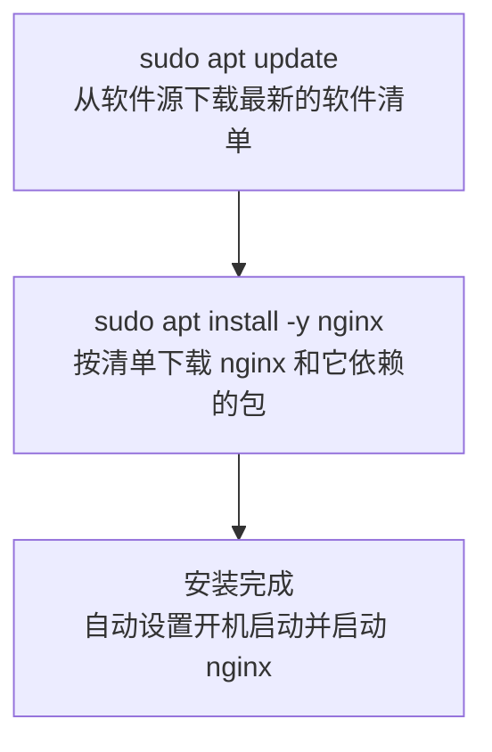
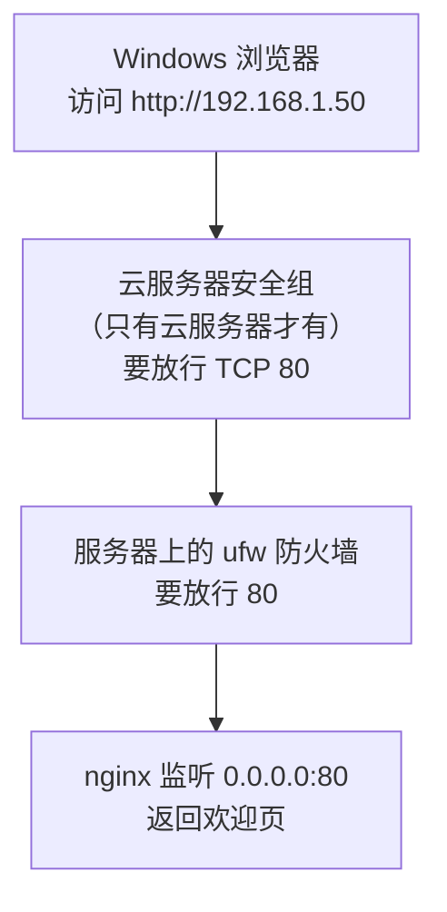
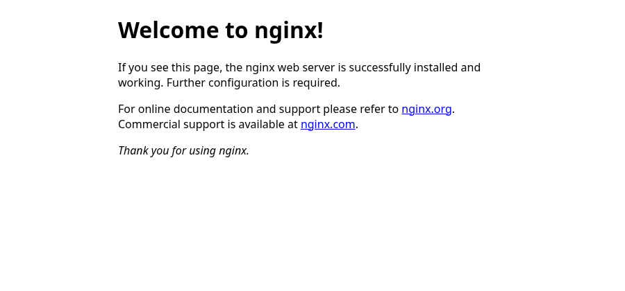

# 第 3 章 安装 nginx，在浏览器里看到欢迎页

## 这一章解决什么问题

在 Windows Server 上装 IIS，是在"服务器管理器"里添加角色，装好后在"服务"里能看到它，防火墙规则也自动加好了。在 Ubuntu 上，这三件事都要用命令完成：**装软件**、**让它作为服务一直运行**、**在防火墙上开门**。

这一章走完，你在 Windows 的浏览器里输入服务器地址，能看到 nginx 的欢迎页，并且知道这个页面是从服务器哪个文件夹里读出来的。

## 开始之前

- 上一章你已经会了：用 `ssh` 登录服务器、用 `scp` 上传文件；服务器家目录里有第 2 章上传的 `hello.html`。
- 服务器要能上网，`apt` 要从 Ubuntu 的软件源下载 nginx。
- 云服务器要在控制台的"安全组"里放行 **TCP 80 端口**（见 3.3 节）。
- 本章的服务器命令都在 ssh 登录后执行：

  ```powershell
  PS C:\Users\zhang> ssh ubuntu@192.168.1.50
  ```

本章 3 个新概念：**apt 安装软件**、**systemctl 管理服务**、**防火墙和端口**。

---

## 3.1 用 apt 安装 nginx

### 白话定义

apt 是 Ubuntu 的**软件包管理工具**。你告诉它软件名，它从 Ubuntu 官方的软件源（一组下载服务器）下载、安装，并自动装上这个软件依赖的其他软件包。以后升级、卸载也都用它。

### 🖼 图解



### 业务里的场景

第 7 章安装 .NET 运行时、第 10 章安装申请证书的 certbot，都是同样的两条命令。

### 💻 动手

**步骤 1**：更新软件清单。

```bash
ubuntu@web01:~$ sudo apt update
```

输入你的密码后，实测输出：

```text
Hit:1 http://security.ubuntu.com/ubuntu resolute-security InRelease
Hit:2 http://archive.ubuntu.com/ubuntu resolute InRelease
Hit:3 http://archive.ubuntu.com/ubuntu resolute-updates InRelease
Hit:4 http://archive.ubuntu.com/ubuntu resolute-backports InRelease
Reading package lists... Done
Building dependency tree... Done
Reading state information... Done
31 packages can be upgraded. Run 'apt list --upgradable' to see them.
```

- `resolute` 是 Ubuntu 26.04 的代号。
- `Hit` 表示清单没有变化，`Get` 表示下载了新清单，两种都正常。
- 最后一行说有些软件可以升级，现在不用管。

**步骤 2**：安装 nginx。`-y` 表示中途问"是否继续"时自动回答"是"。

```bash
ubuntu@web01:~$ sudo apt install -y nginx
```

实测输出（省略了部分进度行）：

```text
Installing:
  nginx

Installing dependencies:
  nginx-common

Suggested packages:
  fcgiwrap  nginx-doc  ssl-cert

Summary:
  Upgrading: 0, Installing: 2, Removing: 0, Not Upgrading: 31
  Download size: 659 kB
  Space needed: 1866 kB / 91.7 GB available

Unpacking nginx-common (1.28.3-2ubuntu1.14) ...
Unpacking nginx (1.28.3-2ubuntu1.14) ...
Setting up nginx-common (1.28.3-2ubuntu1.14) ...
Created symlink '/etc/systemd/system/multi-user.target.wants/nginx.service' → '/usr/lib/systemd/system/nginx.service'.
Setting up nginx (1.28.3-2ubuntu1.14) ...
```

> 真实服务器上最后可能还有几行 `Scanning processes...`、`No services need to be restarted.` 之类的检查信息，属于正常输出。

**步骤 3**：确认版本。

```bash
ubuntu@web01:~$ nginx -v
nginx version: nginx/1.28.3 (Ubuntu)
```

### 🔍 拆解运行结果

| 输出 | 含义 |
|---|---|
| `Installing: nginx` | 你要装的软件 |
| `Installing dependencies: nginx-common` | nginx 依赖的包，apt 自动一起装。默认配置文件就在这个包里 |
| `Suggested packages` | 建议装但不是必须的，apt 不会自动装 |
| `Created symlink ... multi-user.target.wants/nginx.service` | 把 nginx 设成了**开机自动启动**（3.2 节解释） |
| `1.28.3-2ubuntu1.14` | nginx 1.28.3，后面是 Ubuntu 打包的修订号。Ubuntu 修复安全问题时只增加修订号，nginx 的主版本不变 |

装完后，nginx 的文件分布在这些位置。后面每一章都会用到，先有个印象：

| 位置 | 放的是什么 | 对应 IIS 里的 |
|---|---|---|
| `/usr/sbin/nginx` | nginx 程序本身 | IIS 的程序文件 |
| `/etc/nginx/` | 所有配置文件（第 4 章） | IIS 管理器里的各种设置，以及 `applicationHost.config` |
| `/var/www/html/` | 默认网站的文件 | `C:\inetpub\wwwroot` |
| `/var/log/nginx/` | 访问日志和错误日志（第 11 章） | `C:\inetpub\logs\LogFiles` |

### 改坏一处试试：忘了加 sudo

```bash
ubuntu@web01:~$ apt install -y nginx
```

实测输出：

```text
Error: Could not open lock file /var/lib/dpkg/lock-frontend - open (13: Permission denied)
Error: Unable to acquire the dpkg frontend lock (/var/lib/dpkg/lock-frontend), are you root?
```

最后一句 `are you root?` 就是提示你：安装软件要管理员权限。在前面加上 `sudo` 重新执行。

### 什么时候不该用 Ubuntu 自带的 nginx

Ubuntu 26.04 软件源里的 nginx 是 1.28.3，在整个 Ubuntu 26.04 的支持期内主版本都不变，只打安全补丁。nginx 官网同时在发布更新的版本（第 1 章看到 nginx.org 自己用的是 1.31.8）。

| 情况 | 建议 |
|---|---|
| 你只是要托管网站、做反向代理、配 HTTPS（本教程的全部内容） | 用 Ubuntu 自带的，`apt upgrade` 就能拿到安全更新 |
| 你确实需要某个新版本才有的功能 | 按 nginx.org 官网的说明添加官方软件源再安装。配置文件的目录结构和 Ubuntu 版不同（比如没有 `sites-available`），本教程的路径要相应调整 |
| 网上教程让你下载源码自己编译 | 新手不要这样做。编译出来的 nginx 不归 apt 管，以后的安全更新要自己重新编译 |

---

## 3.2 用 systemctl 管理 nginx 服务

### 白话定义

nginx 要一直在后台运行，随时接待访问。Ubuntu 用一个叫 **systemd** 的程序管理所有后台服务，你用 **systemctl** 命令告诉它启动、停止、重启某个服务，或者设置开机自动启动。

它对应 Windows 的"服务"（`services.msc`）：nginx 就是 Ubuntu 上的一个服务，和 Windows 上的 `W3SVC`（IIS 的服务）地位一样。

### 常用命令对照

| 你要做的事 | Ubuntu 命令 | Windows "服务"里的操作 |
|---|---|---|
| 看状态 | `sudo systemctl status nginx` | 看"状态"一列 |
| 启动 | `sudo systemctl start nginx` | 右键 → 启动 |
| 停止 | `sudo systemctl stop nginx` | 右键 → 停止 |
| 重启 | `sudo systemctl restart nginx` | 右键 → 重新启动 |
| 重新读取配置，不中断服务 | `sudo systemctl reload nginx` | 没有对应。IIS 改配置后自动生效 |
| 开机自动启动 | `sudo systemctl enable nginx` | 启动类型设成"自动" |
| 取消开机自动启动 | `sudo systemctl disable nginx` | 启动类型设成"手动" |

`apt` 安装 nginx 时已经替你执行了"启动"和"开机自动启动"，所以装完就在运行了。

### 💻 动手

**步骤 1**：看 nginx 的状态。

```bash
ubuntu@web01:~$ sudo systemctl status nginx
```

输出的前几行类似：

```text
● nginx.service - A high performance web server and a reverse proxy server
     Loaded: loaded (/usr/lib/systemd/system/nginx.service; enabled; preset: enabled)
     Active: active (running) since Wed 2026-11-25 14:27:39 CST; 2min ago
```

> ⚠️ 本段输出未实机验证（测试环境没有以 systemd 启动）。第一行的说明文字取自 nginx 软件包里的服务文件 `/usr/lib/systemd/system/nginx.service`。

要看的只有两处：

| 位置 | 正常的值 | 含义 |
|---|---|---|
| `Loaded:` 行括号里的第二项 | `enabled` | 开机自动启动 |
| `Active:` | `active (running)` | 正在运行。如果是 `failed`，说明启动失败，下面几行会有原因 |

**输出显示完后，命令行不回到提示符**，屏幕下方可能有 `lines 1-20` 字样。这是因为输出较长，进入了分页查看模式。**按 `q` 键退出**。

**步骤 2**：在服务器上访问一下自己。`curl` 是命令行里的浏览器，`-I` 只看响应头，`localhost` 指本机。

```bash
ubuntu@web01:~$ curl -I http://localhost
```

实测输出：

```text
HTTP/1.1 200 OK
Server: nginx/1.28.3 (Ubuntu)
Date: Wed, 25 Nov 2026 06:27:39 GMT
Content-Type: text/html
Content-Length: 615
Last-Modified: Wed, 25 Nov 2026 06:27:34 GMT
Connection: keep-alive
ETag: "6b067fd6-267"
Accept-Ranges: bytes
```

`200 OK` 和 `Server: nginx/1.28.3 (Ubuntu)` 说明 nginx 正在工作。`Date` 是格林尼治时间，比北京时间晚 8 小时。

**步骤 3**：看 nginx 的进程。

```bash
ubuntu@web01:~$ ps -o pid,user,cmd -C nginx
```

实测输出：

```text
    PID USER     CMD
      6 root     nginx: master process nginx
      7 www-data nginx: worker process
      8 www-data nginx: worker process
      9 www-data nginx: worker process
     10 www-data nginx: worker process
     11 www-data nginx: worker process
     12 www-data nginx: worker process
     14 www-data nginx: worker process
     15 www-data nginx: worker process
```

> 用 systemctl 启动时，`master process` 后面显示的是 `/usr/sbin/nginx -g daemon on; master_process on;`，进程号也会不同。

**步骤 4**：看 nginx 在监听哪个端口。

```bash
ubuntu@web01:~$ sudo ss -tlnp | grep nginx
```

实测输出（右边很长的进程列表截掉了）：

```text
LISTEN  0  511     0.0.0.0:80     0.0.0.0:*    users:(("nginx",pid=15,fd=6),...
LISTEN  0  511        [::]:80        [::]:*    users:(("nginx",pid=15,fd=7),...
```

### 🔍 拆解运行结果

**一个 master，多个 worker**：

| 进程 | 用户 | 干什么 |
|---|---|---|
| master process | root | 读配置、打开 80 端口、管理 worker。只有 root 能打开 1024 以下的端口 |
| worker process | www-data | 真正接待访问者。数量默认等于 CPU 核数，测试机有 8 核所以是 8 个 |

worker 用权限很低的 `www-data` 用户运行，万一被攻破，攻击者也只有 www-data 的权限。这也意味着：**nginx 读取网站文件时，用的是 www-data 的身份**。第 5 章遇到 403 错误时会回到这一点。

这和 IIS 的设计思路一样：IIS 的工作进程 `w3wp.exe` 用应用池账户运行，不用管理员账户。

**监听端口**：

| 列 | 含义 |
|---|---|
| `0.0.0.0:80` | 在本机所有 IPv4 地址的 80 端口等待连接，所以用 `localhost` 和 `192.168.1.50` 都能访问 |
| `[::]:80` | 同上，IPv6 |
| `LISTEN` | 正在等待连接 |

### 改坏一处试试（1）：停掉 nginx

```bash
ubuntu@web01:~$ sudo systemctl stop nginx
ubuntu@web01:~$ curl -I http://localhost
```

实测输出：

```text
curl: (7) Failed to connect to localhost port 80 after 0 ms: Could not connect to server
```

80 端口没人监听，连接直接被拒绝。重新启动，再访问就恢复了：

```bash
ubuntu@web01:~$ sudo systemctl start nginx
ubuntu@web01:~$ curl -I http://localhost
HTTP/1.1 200 OK
```

> 测试环境用 `nginx -s stop` 和 `nginx` 代替了 `systemctl stop` 和 `start`，curl 的输出相同。

### 改坏一处试试（2）：不经过 systemctl，直接再启动一次

网上有些教程让你直接执行 `sudo nginx` 启动。nginx 已经在运行时这样做：

```bash
ubuntu@web01:~$ sudo nginx
```

实测输出（同样的两行重复了 5 遍，这里只列一遍）：

```text
nginx: [emerg] bind() to 0.0.0.0:80 failed (98: Address already in use)
nginx: [emerg] bind() to [::]:80 failed (98: Address already in use)
nginx: [emerg] still could not bind()
```

`Address already in use` 表示 80 端口已经被占用，这次是被正在运行的 nginx 自己占的。服务器上装了 Apache 等其他 Web 服务器时，`systemctl start nginx` 也会因为同样的原因失败，在 `systemctl status nginx` 里能看到这几行。

**统一用 systemctl 管理 nginx**。直接执行 `sudo nginx` 启动的进程不归 systemd 管，之后 `systemctl stop` 停不掉它，`systemctl status` 也显示不准确。

### 什么时候不该用 restart

`restart` 是先停再启，正在下载文件、正在提交表单的访问者会被断开。只是改了配置文件时，用 `reload`：nginx 先检查新配置，没问题才换上，旧的连接处理完再退出，访问者感觉不到。第 4 章改配置时一律用 `reload`。

`restart` 只在 nginx 没有响应，或者 `reload` 之后仍然不正常时使用。

---

## 3.3 防火墙和端口：让外面能访问到

### 白话定义

**端口**（port）是服务器上区分不同服务的编号。一台服务器只有一个 IP，访问者靠端口号说明要找哪个服务：

| 端口 | 服务 |
|---|---|
| 22 | SSH，你登录服务器用的 |
| 80 | HTTP 网站 |
| 443 | HTTPS 网站（第 10 章） |

**防火墙**决定哪些端口允许从外面连进来。在 Ubuntu 上有两层可能挡住你：

1. **服务器自己的防火墙 ufw**（Uncomplicated Firewall），用命令配置；
2. **云服务器的安全组**，在云平台的网页控制台里配置。自己的虚拟机或物理机没有这一层。

两层都放行，浏览器才能访问到 nginx。

### 🖼 图解



### 业务里的场景

第 7 章的 .NET 程序会监听 5080 端口。这个端口**不要**在防火墙上放行，外面只能通过 nginx 的 80/443 访问，这正是第 1 章说的"后面的程序不直接暴露"。防火墙就是保证这一点的那道门。

### 💻 动手

**步骤 1**：看 ufw 的状态。

```bash
ubuntu@web01:~$ sudo ufw status
```

实测输出：

```text
Status: inactive
```

Ubuntu 默认**没有开启** ufw，所有端口都不拦。所以如果你不是云服务器，现在就已经能从浏览器访问了，可以先跳到 3.4 节看到欢迎页，再回来开防火墙。

服务器直接面对公网时，建议把防火墙开起来，只放行需要的端口。下面的步骤按顺序做，**不能调换顺序**。

**步骤 2**：看 ufw 认识哪些"应用"。安装 nginx 时，它自动登记了几组端口：

```bash
ubuntu@web01:~$ sudo ufw app list
```

实测输出：

```text
Available applications:
  Nginx Full
  Nginx HTTP
  Nginx HTTPS
  Nginx QUIC
  OpenSSH
```

每个名字对应的端口（用 `sudo ufw app info '名字'` 查看，以下为实测结果）：

| 名字 | 端口 |
|---|---|
| `OpenSSH` | 22/tcp |
| `Nginx HTTP` | 80/tcp |
| `Nginx HTTPS` | 443/tcp |
| `Nginx Full` | 80,443/tcp |
| `Nginx QUIC` | 80,443/tcp 和 443/udp |

**步骤 3**：**先放行 SSH**。这一步一定在开启防火墙之前做，否则一开启，你当前的 ssh 连接和以后的登录都会被挡住。

```bash
ubuntu@web01:~$ sudo ufw allow OpenSSH
Rules updated
Rules updated (v6)
```

**步骤 4**：放行 HTTP 80 端口。现在还没有 HTTPS，只放行 80；第 10 章再放行 443。

```bash
ubuntu@web01:~$ sudo ufw allow 'Nginx HTTP'
Rules updated
Rules updated (v6)
```

`Nginx HTTP` 中间有空格，要用引号括起来。

**步骤 5**：开启防火墙。通过 ssh 执行时，ufw 会提醒你可能断开 ssh，输入 `y` 回车：

```bash
ubuntu@web01:~$ sudo ufw enable
Command may disrupt existing ssh connections. Proceed with operation (y|n)? y
Firewall is active and enabled on system startup
```

> 确认提示的文字取自 ufw 0.36.2 的源码，测试环境不是通过 ssh 执行的，没有出现这个提示。最后一行是实测输出。

**步骤 6**：确认规则。

```bash
ubuntu@web01:~$ sudo ufw status
```

实测输出：

```text
Status: active

To                         Action      From
--                         ------      ----
OpenSSH                    ALLOW       Anywhere
Nginx HTTP                 ALLOW       Anywhere
OpenSSH (v6)               ALLOW       Anywhere (v6)
Nginx HTTP (v6)            ALLOW       Anywhere (v6)
```

**步骤 7（只有云服务器要做）**：在云平台控制台找到这台服务器的"安全组"（有的平台叫"防火墙"），添加入方向规则：协议 TCP、端口 80、来源 `0.0.0.0/0`（所有地址）。

> ⚠️ 本步骤未实机验证，各云平台的菜单名称不同。

### 🔍 拆解运行结果

- `Status: active` 表示防火墙已开启，`enabled on system startup` 表示重启后也会自动开启。
- 规则表里没有列出的端口，从外面连进来**一律拒绝**。所以 5080 这类端口不用专门去禁止。
- `(v6)` 是同一条规则的 IPv6 版本，ufw 自动一起加。
- `From Anywhere` 表示允许任何地址访问。

### 改坏一处试试：删掉 80 端口的规则

```bash
ubuntu@web01:~$ sudo ufw delete allow 'Nginx HTTP'
Rule deleted
Rule deleted (v6)
ubuntu@web01:~$ sudo ufw status numbered
```

实测输出：

```text
Status: active

     To                         Action      From
     --                         ------      ----
[ 1] OpenSSH                    ALLOW IN    Anywhere
[ 2] OpenSSH (v6)               ALLOW IN    Anywhere (v6)
```

这时在 Windows 浏览器里打开 `http://192.168.1.50`，会一直转圈，最后提示连接超时。在服务器上 `curl -I http://localhost` 却仍然是 `200 OK`，因为防火墙只拦外面进来的连接，不拦服务器访问自己。

> ⚠️ 浏览器的表现未实机验证。

**"服务器上能访问、外面不能访问"，第一个要怀疑的就是防火墙和安全组。**

改回来：

```bash
ubuntu@web01:~$ sudo ufw allow 'Nginx HTTP'
```

### 什么时候不该开 ufw

| 情况 | 原因 |
|---|---|
| 你不确定自己是否放行了 SSH | 先执行 `sudo ufw status` 或检查规则，确认 OpenSSH 在列表里再 `enable`。被挡在外面后，只能去虚拟机窗口或云控制台的"远程连接 / VNC"执行 `sudo ufw disable` |
| 你的 SSH 不在 22 端口（有人会改成别的端口） | `OpenSSH` 这个名字只代表 22 端口，要改用 `sudo ufw allow 端口号/tcp` |
| 公司内网的服务器，网络部门已经在交换机、硬件防火墙上统一控制 | 可以不开，避免两边规则不一致时难以排查。按公司规定执行 |

---

## 3.4 在浏览器里打开，看看欢迎页从哪来

**步骤 1**：在 Windows 的浏览器地址栏输入 `http://192.168.1.50`（**带上 `http://`**），回车。



*图 3-1：浏览器打开 `http://192.168.1.50` 后看到的 nginx 欢迎页（无头浏览器实测截图）。*

也可以在 PowerShell 里确认：

```powershell
PS C:\Users\zhang> curl.exe -I http://192.168.1.50
```

输出和 3.2 节步骤 2 一样，第一行是 `HTTP/1.1 200 OK`。

**步骤 2**：看这个页面是哪个文件。

```bash
ubuntu@web01:~$ ls -l /var/www/html
```

实测输出：

```text
total 4
-rw-r--r-- 1 root root 615 Nov 25 06:27 index.nginx-debian.html
```

文件大小 615 字节，和 3.2 节 `curl -I` 看到的 `Content-Length: 615` 一样，就是它。

**步骤 3**：看 nginx 为什么去这里找文件。默认网站的配置在 `/etc/nginx/sites-enabled/default`，用 `grep` 只挑出关键的几行（`-n` 显示行号）：

```bash
ubuntu@web01:~$ grep -nE '^\s*(listen|root|index|server_name)' /etc/nginx/sites-enabled/default
```

实测输出：

```text
22:	listen 80 default_server;
23:	listen [::]:80 default_server;
41:	root /var/www/html;
44:	index index.html index.htm index.nginx-debian.html;
46:	server_name _;
```

| 配置 | 含义 |
|---|---|
| `listen 80` | 在 80 端口接待访问 |
| `root /var/www/html;` | 网站文件放在这个目录，相当于 IIS 网站的"物理路径" |
| `index index.html index.htm index.nginx-debian.html;` | 访问者只输入了目录（比如 `/`）时，**按顺序**找这几个文件，找到第一个就返回。相当于 IIS 的"默认文档" |

前两个 `index.html`、`index.htm` 都不存在，所以返回了第三个 `index.nginx-debian.html`。配置文件的完整写法第 4 章细讲。

**步骤 4**：验证上面的说法。在网站目录里放一个 `index.html`，它排在第一位，应该优先返回：

```bash
ubuntu@web01:~$ echo '<h1>Hello nginx</h1>' | sudo tee /var/www/html/index.html
<h1>Hello nginx</h1>
ubuntu@web01:~$ curl http://192.168.1.50
<h1>Hello nginx</h1>
```

浏览器刷新，页面变成了一行大字 **Hello nginx**。不需要重启或 reload nginx，因为改的是网站文件，不是配置文件。

`tee` 的作用是把收到的内容写进文件，同时显示在屏幕上。为什么不用 `sudo echo ... > 文件`，见下面"改坏一处"。

**步骤 5**：恢复原样。删掉刚才的文件，欢迎页又回来了：

```bash
ubuntu@web01:~$ sudo rm /var/www/html/index.html
```

### 改坏一处试试（1）：用重定向写文件

```bash
ubuntu@web01:~$ sudo echo '<h1>Hello nginx</h1>' > /var/www/html/index.html
```

实测输出（测试时执行的是不带 `sudo` 的同一条命令，带不带 `sudo` 结果相同，原因见下）：

```text
-bash: /var/www/html/index.html: Permission denied
```

`>` 不是 `echo` 的一部分，而是由你当前的命令行（以 ubuntu 用户身份）负责打开文件。`sudo` 只给了 `echo` 管理员权限，打开文件的还是 ubuntu，所以被拒绝。`| sudo tee 文件` 让 `tee` 以管理员身份打开文件，就没问题了。

### 改坏一处试试（2）：访问一个不存在的文件

浏览器打开 `http://192.168.1.50/nothing.html`：


*图 3-2：nginx 默认的 404 页面（无头浏览器实测截图）。*

`/var/www/html` 里没有 `nothing.html`，nginx 返回 404。页面底部显示了 nginx 的版本号，第 12 章会讲怎么隐藏它。

---

## 🧱 类比

| 概念 | 日常生活里的样子 |
|---|---|
| apt 和软件源 | 手机的应用商店：说出名字就能装，商店负责保证是正版、推送更新 |
| systemd 和 systemctl | 大楼的物业：负责每天早上开门营业（开机启动）、有事时关门、重新开门 |
| 端口和防火墙 | 写字楼的门牌号和门禁：22 号门给管理员进，80 号门给顾客进，没登记的门一律锁着 |

---

## ⚠️ 踩坑警告

| 现象 | 原因 | 怎么改 |
|---|---|---|
| 执行 `sudo ufw enable` 后，ssh 窗口卡住，再也连不上（ssh 报 `Connection timed out`） | 开防火墙之前没有放行 OpenSSH | 去虚拟机窗口或云控制台的"远程连接 / VNC"登录，执行 `sudo ufw allow OpenSSH`。以后严格按 3.3 节的顺序：先 allow 再 enable |
| 服务器上 `curl -I http://localhost` 正常，Windows 浏览器打不开 | 防火墙或云服务器安全组没放行 80 | `sudo ufw status` 看有没有 `Nginx HTTP`；云服务器检查安全组 |
| `sudo systemctl status nginx` 显示完后命令行不动了 | 输出进入了分页查看模式 | 按 `q` 退出 |
| `sudo systemctl start nginx` 失败，`status` 里有 `bind() to 0.0.0.0:80 failed (98: Address already in use)` | 80 端口被别的程序占了，常见的是 Apache，或者有人用 `sudo nginx` 直接启动过一个 nginx | `sudo ss -tlnp | grep ':80 '` 看是谁占了 80。是 Apache 就 `sudo systemctl stop apache2`；是 nginx 就 `sudo nginx -s stop`，再用 systemctl 启动 |
| 往 `/var/www/html` 写文件报 `Permission denied` | 网站目录属于 root；`sudo echo ... > 文件` 里的 `>` 不受 sudo 影响 | 用 `| sudo tee 文件`，或先写到家目录再 `sudo cp` |

---

## 🎯 动手练习

**练习 1：把第 2 章上传的页面放上网站**

第 2 章你把 `hello.html` 上传到了服务器的家目录。把它放进 nginx 的网站目录，让 Windows 浏览器能打开它。

验收标准：

- 浏览器打开 `http://192.168.1.50/hello.html`，看到大字"这个文件是从 Windows 上传的"，标签页标题是"上传测试"；
- 浏览器打开 `http://192.168.1.50/`，看到的**仍然是** nginx 欢迎页。

**练习 2：确认 nginx 会开机自动启动**

用命令查出 nginx 是否设置了开机自动启动、现在是否在运行，每个问题只用一条命令、只输出一个词。然后重启服务器，验证重启后不用做任何操作，浏览器就能打开欢迎页。

验收标准：

- 两条命令分别输出 `enabled` 和 `active`；
- 执行 `sudo reboot` 等一两分钟后，不登录服务器，直接在 Windows 浏览器里打开 `http://192.168.1.50`，能看到欢迎页。

卡住了看文末参考答案。

---

## 📌 一句话总结

apt 装上 nginx，systemctl 管它运行，防火墙先放行 22 再放行 80。

## 下一章

欢迎页来自默认网站的配置文件。下一章打开 `/etc/nginx`，看懂配置文件的结构，学会安全地修改并让它生效。

---

<!-- 以下是参考答案，先自己动手，卡住了再往下翻 -->


## 参考答案

### 练习 1

思路：网站目录属于 root，`scp` 不能直接写进去；第 2 章已经把文件传到了家目录，用 `sudo cp` 复制过去即可。不要把文件改名成 `index.html`，否则首页就被替换了。

```bash
ubuntu@web01:~$ sudo cp ~/hello.html /var/www/html/
ubuntu@web01:~$ ls -l /var/www/html
```

实测输出：

```text
total 8
-rw-r--r-- 1 root root 260 Nov 25 06:42 hello.html
-rw-r--r-- 1 root root 615 Nov 25 06:27 index.nginx-debian.html
```

在 Windows 上确认：

```powershell
PS C:\Users\zhang> curl.exe -I http://192.168.1.50/hello.html
```

第一行是 `HTTP/1.1 200 OK`，`Content-Length: 260` 和文件大小一致。浏览器里看到的页面：


*图 3-3：`http://192.168.1.50/hello.html`（无头浏览器实测截图）。*

如果浏览器里中文显示成乱码，说明保存 `hello.html` 时没有选 UTF-8：在 Windows 上用记事本另存为 UTF-8，重新执行第 2 章的 `scp` 和上面的 `sudo cp`。

### 练习 2

思路：`systemctl is-enabled` 只回答"是否开机启动"，`systemctl is-active` 只回答"是否正在运行"，各输出一个词，适合快速检查。

```bash
ubuntu@web01:~$ systemctl is-enabled nginx
enabled
ubuntu@web01:~$ systemctl is-active nginx
active
ubuntu@web01:~$ sudo reboot
```

> ⚠️ 本段未实机验证（测试环境没有 systemd，也不能重启）。

`sudo reboot` 后 ssh 连接会断开，这是正常的。等一两分钟，在 Windows 浏览器里刷新 `http://192.168.1.50`，看到欢迎页即说明 nginx 随系统自动启动了。如果打不开，再 ssh 登录执行 `sudo systemctl status nginx` 看原因；如果是 `inactive (dead)` 并且 `Loaded` 行里是 `disabled`，执行 `sudo systemctl enable --now nginx`（`--now` 表示设置开机启动的同时立即启动）。
