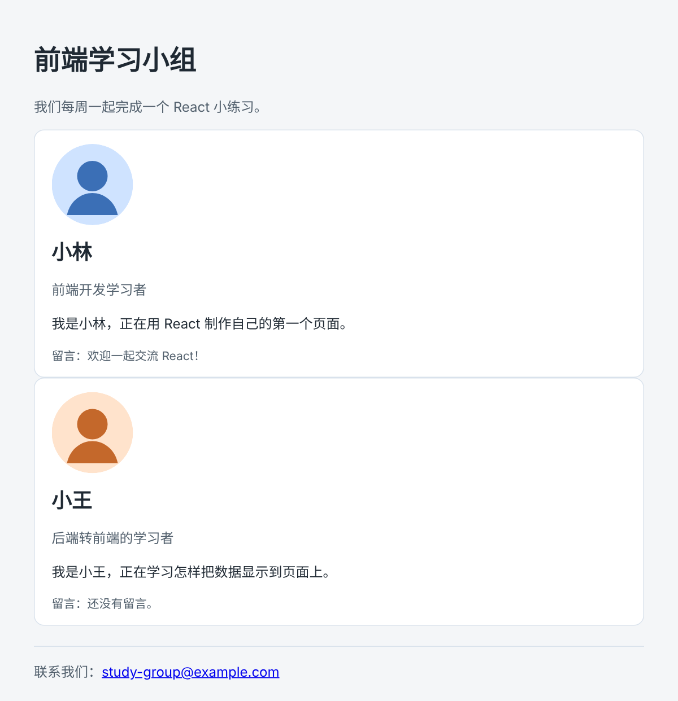
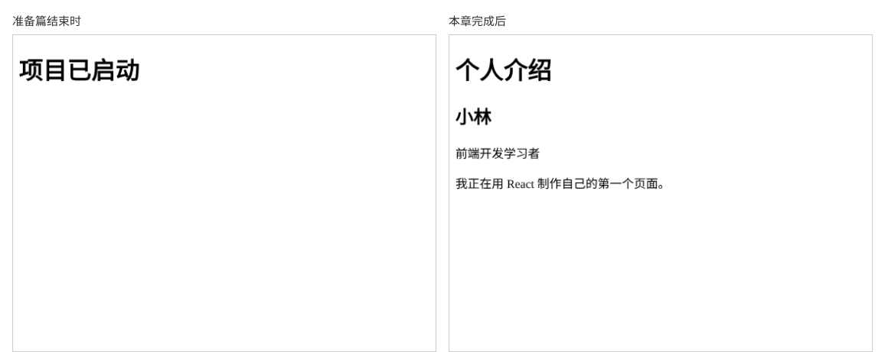

# 第 1 章：如何用 React 显示一个最简单的个人介绍页？

前置：[准备篇三：怎样用 Git 保存每一章的进度？](准备篇三-怎样用Git保存每一章的进度.md)

## 一、本章要解决的问题

准备篇的页面只有一行“项目已启动”。本章把它换成一个真正的个人介绍页：有页面标题、姓名、身份和一句自我介绍。

完成后，浏览器中依次显示“个人介绍”“小林”“前端开发学习者”和介绍文字。

本章是第 1 部分的起点。学完第 1 部分（第 1—11 章）时，页面会变成下图的样子：一个学习小组的介绍页，有页头、两位成员的资料卡片和页脚。



下图左边是准备篇结束时的页面，右边是本章完成后的页面：



## 二、必要原理

### 组件：返回页面内容的函数

`App.tsx` 中的 `App` 是一个函数，它返回一段页面内容。在 React 中，这样的函数叫**组件**。React 调用 `App`，拿到它返回的内容，再显示到浏览器中。

整个页面可以由许多组件拼起来，`App` 是最外层的那一个。本章只修改 `App` 返回的内容。

### JSX：写在代码里的页面标记

`return` 后面那段看起来像 HTML 的内容叫 **JSX**。它让我们直接在 JavaScript 代码中描述“这里有一个标题，下面有一段文字”。浏览器并不认识 JSX，是 Vite 在后台把它转换成了普通的 JavaScript。

JSX 和 HTML 很像，但有三条规则必须遵守：

1. **只能返回一个最外层的标签。** 多个标签要放在同一个外层标签里，本章用 `<main>` 包住所有内容。
2. **每个标签都要闭合。** 有开始标签 `<p>` 就要有结束标签 `</p>`。
3. **多行内容放在括号里。** `return` 后面紧跟 `(`，二者写在同一行。

### 选择合适的标签

本章用到的标签都是 HTML 中常见的语义标签：

- `<main>`：页面的主要内容区域。
- `<h1>`：页面的一级标题，一个页面通常只有一个。
- `<article>`：一块独立完整的内容，这里是一个人的介绍。
- `<h2>`：二级标题，这里放姓名。
- `<p>`：一个段落。

先用合适的标签表达“这是什么内容”，外观以后再用 CSS 调整（第 4 章）。读屏软件和搜索引擎也依靠这些标签理解页面结构。

## 三、动手实现

打开 `src/App.tsx`，把全部内容替换为：

```tsx
export default function App() {
  return (
    <main>
      <h1>个人介绍</h1>
      <article>
        <h2>小林</h2>
        <p>前端开发学习者</p>
        <p>我正在用 React 制作自己的第一个页面。</p>
      </article>
    </main>
  );
}
```

逐段说明：

- `export default function App()` 与准备篇相同，`main.tsx` 不需要修改。
- `return (` 后面的括号包住多行 JSX，括号本身不会显示在页面上。
- `<main>` 是唯一的最外层标签，所有内容都在它里面。
- `<article>` 把同一个人的姓名、身份和介绍放在一起。
- 最后的 `);` 结束 `return` 语句。注意结束标签的顺序：先关闭里面的 `</article>`，再关闭外面的 `</main>`。

## 四、运行与检查

保持开发服务器运行（`npm.cmd run dev`），保存文件后在浏览器中查看。

1. 页面依次显示“个人介绍”“小林”“前端开发学习者”和“我正在用 React 制作自己的第一个页面。”。
2. 标题比正文大，这是浏览器给 `h1`、`h2` 的默认样式。页面现在没有颜色和边框，第 4 章再添加。
3. 按 F12 打开开发者工具，在 Elements（元素）面板中展开 `<div id="root">`，可以看到里面正是你写的 `main`、`h1`、`article` 等标签。

   开发者工具是浏览器自带的检查工具，本教程以 Chrome 和 Windows 自带的 Edge 为例，两者的用法基本相同。界面可能是中文，也可能是英文：本教程写作“Elements（元素）”，前面是英文界面的名称，括号中是中文界面的名称。开发者工具的详细用法和完整的中英文对照，见[附录 D](附录D-浏览器开发者工具使用说明.md)。

最后在另一个终端运行类型检查，应没有错误输出：

```powershell
npm.cmd run typecheck
```

**小练习**：把介绍文字改成你自己的学习目标，保存后确认只有这一段文字变化。练习后可以保留自己的文字，后面章节的代码以教程中的文字为准。

## 五、常见错误

| 现象 | 原因 | 怎么改 |
| --- | --- | --- |
| 页面仍然显示“项目已启动” | 文件没有保存，或改的不是 `src/App.tsx` | 保存文件，确认 VS Code 标签页上的文件路径 |
| 页面上出现深色的错误层，编辑器提示 JSX 需要一个外层元素 | `return` 返回了多个并列的标签，例如在 `</main>` 后面又写了一个 `<p>` | 把所有内容放进 `<main>` 里 |
| 页面上出现深色的错误层，编辑器提示缺少结束标签 | 某个标签没有闭合，或结束标签顺序写错 | 检查每个开始标签都有对应的结束标签，并且内层先关闭 |
| 页面什么都不显示，但没有报错 | `return` 单独写在一行，`(` 写在了下一行，JavaScript 认为 `return` 后面什么都没有 | 把 `(` 写在 `return` 同一行 |

页面上的错误层怎样看、页面一片空白时如何找原因，第 6 章会专门讲。

## 六、本章完整代码

### `src/App.tsx`

内容同第三节。

## 七、本章改动小结

修改 `src/App.tsx`：把“项目已启动”换成个人介绍页。其他文件不变。

---

下一章：[第 2 章：如何把一个变量显示在网页中？](第002章-如何把一个变量显示在网页中.md)
