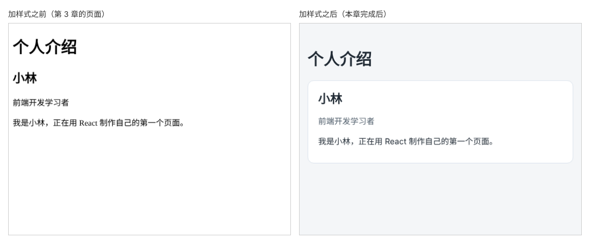

# 第 4 章：如何给页面添加 CSS 样式？

前置：[第 3 章：如何用一个带类型的对象保存一组资料？](第003章-如何用一个带类型的对象保存一组资料.md)

## 一、本章要解决的问题

现在的介绍页只有浏览器默认样式：文字贴着窗口左边，内容挤成一团，看不出哪部分是一张资料卡。

本章新建一个 CSS 文件，让页面内容居中，资料放在一张白色圆角卡片里，身份文字显示为灰色。完成后，页面看起来像一张整齐的个人名片。

下图左边是现在的样子，右边是本章完成后的样子：



## 二、必要原理

### 在 React 项目中引入 CSS 文件

CSS 写在单独的 `.css` 文件中，然后在组件文件顶部导入：

```tsx
import './App.css';
```

这行导入没有取出任何变量，作用只是告诉 Vite：“这个页面需要这份样式。”Vite 会把样式加到页面上。保存 CSS 文件后，页面会立即更新，不需要刷新。

### 在 JSX 中用 className 指定类名

HTML 中给元素指定类名写 `class="card"`。在 JSX 中要写成 `className`：

```tsx
<article className="profile-card">
```

原因是 `class` 在 JavaScript 中是一个保留字，有特殊用途，所以 React 改用 `className`。浏览器中生成的仍然是普通的 `class` 属性，CSS 写法完全不变：用 `.profile-card` 选中它。

### 本章用到的 CSS 属性

- `max-width` 与 `margin: 0 auto`：限制内容最大宽度，并让它在页面中水平居中。
- `padding`：元素内容与边框之间的空白。
- `border` 和 `border-radius`：边框和圆角。
- `background`、`color`：背景色和文字颜色。

这样导入的 CSS 对整个页面生效。如果两个组件用了相同的类名，样式会互相影响，第 15 章会讲怎样避免。

## 三、动手实现

### 第 1 步：新建样式文件

在 `src` 文件夹中新建 `App.css`：

```css
body {
  margin: 0;
  font-family: system-ui, sans-serif;
  background: #f4f6f8;
  color: #1f2933;
}

.page {
  max-width: 720px;
  margin: 0 auto;
  padding: 24px 16px;
}

.profile-card {
  padding: 16px 20px;
  border: 1px solid #d9e2ec;
  border-radius: 12px;
  background: #ffffff;
}

.profile-card h2 {
  margin: 0 0 8px;
}

.profile-role {
  color: #52606d;
}
```

- `body` 去掉浏览器默认的外边距，设置整页的字体、背景色和文字颜色。`system-ui` 表示使用操作系统的默认界面字体，中文显示效果较好。
- `.page` 是页面主体区域，最宽 720 像素并居中，四周留出空白。
- `.profile-card h2` 只选中卡片里的 `h2`，去掉它上方的默认空白，让姓名紧贴卡片顶部的内边距。

### 第 2 步：导入样式并添加类名

修改 `src/App.tsx`。在文件第一行加入导入：

```tsx
import './App.css';

type Profile = {
```

然后给 `main`、`article` 和身份所在的 `p` 加上类名：

```tsx
    <main className="page">
      <h1>个人介绍</h1>
      <article className="profile-card">
        <h2>{profile.name}</h2>
        <p className="profile-role">{profile.role}</p>
```

其余代码不变。

## 四、运行与检查

保持开发服务器运行（`npm.cmd run dev`），保存文件后在浏览器中查看。

1. 页面背景变成浅灰色，内容在页面中间，两侧留有空白。
2. 姓名、身份和介绍在一张白色圆角卡片里，身份文字是灰色。
3. 把浏览器窗口拉宽，内容最宽不超过 720 像素；把窗口缩窄，卡片随之变窄，文字自动换行。
4. 按 F12 打开开发者工具，在 Elements（元素）面板中选中 `<article>`，可以看到它的属性是 `class="profile-card"`。右侧的 Styles（样式）面板显示了 `.profile-card` 中的样式。
5. 把 `.profile-card` 的 `border-radius` 改成 `0`，保存后卡片变成直角，页面没有整体刷新。检查后改回 `12px`。

最后运行类型检查，应没有错误输出：

```powershell
npm.cmd run typecheck
```

**小练习**：给介绍文字所在的 `p` 加一个类名 `profile-intro`，在 `App.css` 中把它的行高设为 `1.7`（`line-height: 1.7;`）。

## 五、常见错误

| 现象 | 原因 | 怎么改 |
| --- | --- | --- |
| 样式完全没有生效 | 没有在 `App.tsx` 中导入 `./App.css`，或文件名大小写不一致 | 检查导入语句和文件名 |
| 控制台警告 `Invalid DOM property 'class'` | 在 JSX 中写了 `class=` | 改成 `className=` |
| 某个元素没有样式 | CSS 中类名漏了前面的点，写成了 `profile-card {` | 类选择器要写成 `.profile-card` |
| 页面报错找不到 `./App.css` | CSS 文件没有放在 `src` 文件夹中 | 确认它和 `App.tsx` 在同一个文件夹 |
| 一处样式写错导致后面的样式都失效 | 漏写了 `}` 或分号 | 检查每段规则的花括号是否成对 |

## 六、本章完整代码

### `src/App.css`

内容同第三节第 1 步。

### `src/App.tsx`

```tsx
import './App.css';

type Profile = {
  name: string;
  role: string;
  intro: string;
};

export default function App() {
  const profile: Profile = {
    name: '小林',
    role: '前端开发学习者',
    intro: '正在用 React 制作自己的第一个页面。',
  };

  return (
    <main className="page">
      <h1>个人介绍</h1>
      <article className="profile-card">
        <h2>{profile.name}</h2>
        <p className="profile-role">{profile.role}</p>
        <p>
          我是{profile.name}，{profile.intro}
        </p>
      </article>
    </main>
  );
}
```

## 七、本章改动小结

新增 `src/App.css`；修改 `src/App.tsx`：导入样式文件，给 `main`、`article` 和身份段落加上类名。

---

下一章：[第 5 章：如何在页面上显示一张本地图片？](第005章-如何在页面上显示一张本地图片.md)
