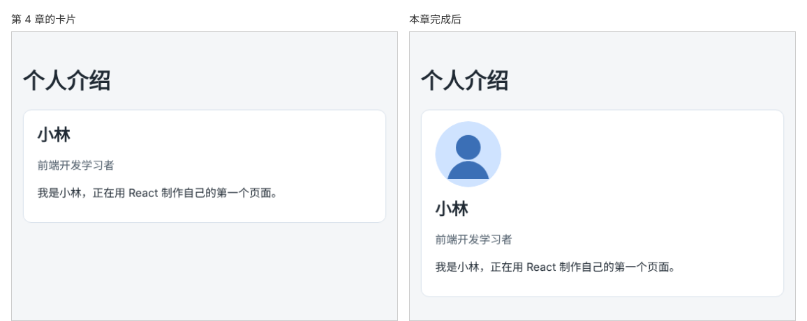

# 第 5 章：如何在页面上显示一张本地图片？

前置：[第 4 章：如何给页面添加 CSS 样式？](第004章-如何给页面添加CSS样式.md)

## 一、本章要解决的问题

个人介绍卡片上还缺一张头像。头像图片放在项目文件夹里，需要显示在卡片顶部。

本章把一张图片放进项目，在卡片中显示成圆形头像，并为它写上替代文字。完成后，卡片顶部出现一个圆形头像，姓名在它下方。

下图左边是现在的卡片，右边是本章完成后的卡片：



## 二、必要原理

### 用 import 取得图片地址

在 React + Vite 项目中，放在 `src` 文件夹中（包括它里面的子文件夹）的图片，可以像代码一样导入：

```tsx
import avatarLin from './assets/avatar-lin.svg';
```

图片放在 `src` 文件夹里面的 `assets` 子文件夹中，完整路径是 `src/assets/avatar-lin.svg`。`assets` 的意思是“资源”，图片、字体这类文件通常放在这里，和代码分开。导入语句写在 `src/App.tsx` 中，`./` 表示“`App.tsx` 所在的文件夹”，也就是 `src`，所以 `./assets/avatar-lin.svg` 指的正是 `src/assets/avatar-lin.svg`：

```text
src/
├── assets/
│   └── avatar-lin.svg   ← 图片
├── App.tsx              ← 在这里写 import
└── main.tsx
```

这行代码得到的 `avatarLin` 不是图片本身，而是一个字符串：这张图片在网站中的访问地址。Vite 负责把图片放到合适的位置，并给出正确的地址。正式构建时，图片文件名后面还会自动加上一串字符，用来避免浏览器使用旧的缓存。

导入的名字由你决定，这里叫 `avatarLin`，表示“小林的头像”。

### 在属性中使用花括号

第 2 章在标签中间用 `{name}` 显示变量。属性的值也可以用花括号读取变量：

```tsx

```

注意花括号外面**不加引号**。写成 `src="avatarLin"`，浏览器会去找一个名叫 `avatarLin` 的文件，自然找不到。

花括号里也可以把文字拼接起来，例如 `alt={profile.name + '的头像'}` 会得到“小林的头像”。

### img 标签的几个属性

- `alt`：图片的替代文字。图片加载失败时显示它，读屏软件也会读出它。头像这类有意义的图片都应该写 `alt`。
- `width`、`height`：图片的显示尺寸。提前写明尺寸，页面在图片下载完成之前就会预留出位置，不会出现内容突然往下跳的情况。
- JSX 中的 `img` 没有结束标签，要写成自闭合形式 ``，最后的 `/` 不能省略。

### 本章使用 SVG 图片

常见的图片分两类：

| 类型 | 怎样保存图片 | 放大以后 | 常见格式 |
| --- | --- | --- | --- |
| 位图 | 记录每一个小点（像素）的颜色 | 变模糊、出现锯齿 | PNG、JPG、WebP |
| 矢量图 | 用文字写出“在哪里画一个圆、填什么颜色” | 始终清晰 | SVG |

SVG 是一种矢量图。它的文件内容就是一段文字，和 HTML 很像，所以可以直接在编辑器中新建、修改，不需要绘图软件。图标、标志、简单插画常用 SVG，照片则用 PNG 或 JPG。

你自己的 PNG、JPG 照片，导入方式和 SVG 完全相同，只需换成对应的文件名。

## 三、动手实现

### 第 1 步：把图片放进项目

在 `src` 文件夹中新建 `assets` 文件夹，在其中新建 `avatar-lin.svg`，内容如下：

```xml
<svg xmlns="http://www.w3.org/2000/svg" width="96" height="96" viewBox="0 0 96 96">
  <rect width="96" height="96" rx="48" fill="#cfe3ff" />
  <circle cx="48" cy="38" r="18" fill="#3b6fb6" />
  <path d="M18 84c4-18 18-26 30-26s26 8 30 26" fill="#3b6fb6" />
</svg>
```

这段代码画了一个浅蓝色的圆形背景，以及一个简单的人像轮廓：`rect` 是矩形，`rx` 把它的四个角变圆，这里圆到变成一个圆形；`circle` 是圆，画出头部；`path` 按坐标画出一条路径，画出肩膀；`fill` 是填充颜色。这些写法不需要记住，知道 SVG 是“用文字画图”就够了。

### 第 2 步：导入图片并显示

修改 `src/App.tsx`。在 CSS 导入下方加入图片导入：

```tsx
import './App.css';
import avatarLin from './assets/avatar-lin.svg';
```

在 `<article>` 中、`<h2>` 的上方加入图片：

```tsx
      <article className="profile-card">
        
        <h2>{profile.name}</h2>
```

属性较多时，可以像这样每个属性占一行，方便阅读。

### 第 3 步：让头像显示成圆形

在 `src/App.css` 的末尾加入：

```css
.profile-avatar {
  display: block;
  margin-bottom: 12px;
  border-radius: 50%;
}
```

- `display: block` 让图片单独占一行，姓名会显示在它下方。
- `border-radius: 50%` 把图片裁成圆形。当前这张 SVG 本身就是圆形，换成方形照片时这条规则才看得出效果。

## 四、运行与检查

保持开发服务器运行（`npm.cmd run dev`），保存文件后在浏览器中查看。

1. 卡片顶部显示一个蓝色圆形头像，姓名在头像下方。
2. 按 F12 打开开发者工具，在 Elements（元素）面板中选中头像，可以看到 `src` 是类似 `/src/assets/avatar-lin.svg` 的地址，`alt` 是“小林的头像”。
3. 把 `src={avatarLin}` 临时改成 `src="avatarLin"`，保存。头像变成一个破损图标，旁边显示替代文字“小林的头像”。这说明了两件事：加引号会被当成文件名；`alt` 会在图片无法显示时出现。检查后改回来。

最后运行类型检查，应没有错误输出：

```powershell
npm.cmd run typecheck
```

**小练习**：把一张你自己的 PNG 或 JPG 照片复制到 `src/assets`，修改导入语句中的文件名，让卡片显示你的照片。照片如果不是正方形，可以给 `.profile-avatar` 加上 `object-fit: cover;`，让它裁剪后填满圆形。练习后恢复本章的图片。

## 五、常见错误

| 现象 | 原因 | 怎么改 |
| --- | --- | --- |
| 页面空白，提示无法解析 `./assets/avatar-lin.svg` | 文件路径或文件名不一致 | 确认文件位于 `src/assets`，名称与导入语句完全相同 |
| 显示破损的图片图标 | `src` 写成了带引号的字符串，或把图片路径直接写在 `src` 中 | 先 `import` 图片，再写 `src={avatarLin}` |
| 编辑器提示 JSX 元素没有结束标签 | `img` 没有写成自闭合形式 | 写成 `` |
| 头像没有在姓名上方单独一行 | `App.css` 中缺少 `display: block` | 对照第三节第 3 步补上 |
| 头像被拉伸变形 | 照片的宽高比与 `width`、`height` 不一致 | 给图片加 `object-fit: cover;` |

## 六、本章完整代码

### `src/assets/avatar-lin.svg`

内容同第三节第 1 步。

### `src/App.tsx`

```tsx
import './App.css';
import avatarLin from './assets/avatar-lin.svg';

type Profile = {
  name: string;
  role: string;
  intro: string;
};

export default function App() {
  const profile: Profile = {
    name: '小林',
    role: '前端开发学习者',
    intro: '正在用 React 制作自己的第一个页面。',
  };

  return (
    <main className="page">
      <h1>个人介绍</h1>
      <article className="profile-card">
        
        <h2>{profile.name}</h2>
        <p className="profile-role">{profile.role}</p>
        <p>
          我是{profile.name}，{profile.intro}
        </p>
      </article>
    </main>
  );
}
```

### `src/App.css`

```css
body {
  margin: 0;
  font-family: system-ui, sans-serif;
  background: #f4f6f8;
  color: #1f2933;
}

.page {
  max-width: 720px;
  margin: 0 auto;
  padding: 24px 16px;
}

.profile-card {
  padding: 16px 20px;
  border: 1px solid #d9e2ec;
  border-radius: 12px;
  background: #ffffff;
}

.profile-card h2 {
  margin: 0 0 8px;
}

.profile-role {
  color: #52606d;
}

.profile-avatar {
  display: block;
  margin-bottom: 12px;
  border-radius: 50%;
}
```

## 七、本章改动小结

新增 `src/assets/avatar-lin.svg`；修改 `src/App.tsx`（导入并显示头像）和 `src/App.css`（新增 `.profile-avatar`）。

---

下一章：[第 6 章：页面一片空白时，如何找到第一条有用的错误信息？](第006章-页面一片空白时，如何找到第一条有用的错误信息.md)
