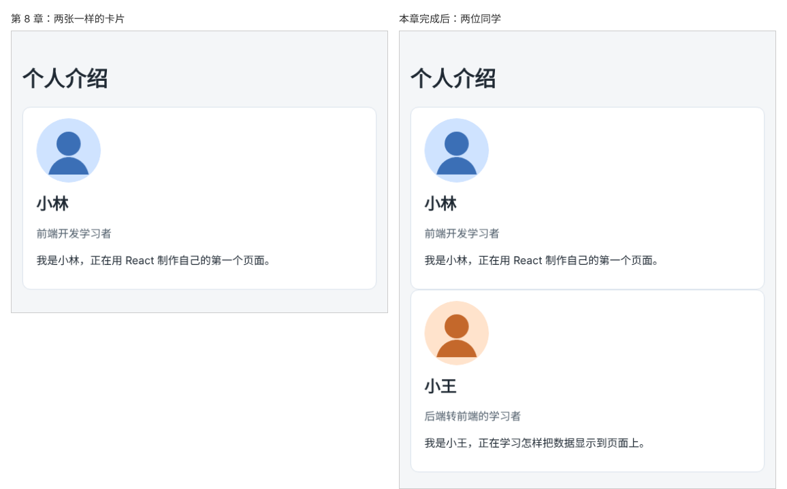

# 第 9 章：如何让同一个组件显示不同的数据？

前置：[第 8 章：如何把一段界面提取成组件？](第008章-如何把一段界面提取成组件.md)

## 一、本章要解决的问题

第 8 章写两次 `<ProfileCard />`，得到的是两张一样的小林卡片，因为资料写死在组件内部。现在页面要介绍两位同学：小林和小王。

本章让 `ProfileCard` 不再自己保存资料，而是由 `App` 把资料“交给”它。完成后，页面上有两张卡片，分别显示小林和小王的头像、姓名、身份和介绍，它们使用的是同一个组件。

下图左边是第 8 章写两次组件的结果，右边是本章完成后的结果：



## 二、必要原理

### props：从外面传给组件的数据

使用 HTML 标签时，可以通过属性传入信息，例如 ``。自己写的组件也一样：

```tsx
<ProfileCard profile={lin} />
```

这里的 `profile` 叫做组件的一个 **prop**（属性），值是变量 `lin`。所有传给组件的属性合在一起叫 **props**。

React 调用 `ProfileCard` 时，会把这些属性打包成一个对象，作为第一个参数传进函数。这个参数习惯上命名为 `props`：

```tsx
function ProfileCard(props) {
  const profile = props.profile; // props.profile 就是传进来的 lin
}
```

函数第一行把 `props.profile` 取出来，放进变量 `profile`。这个变量名和第 8 章组件内部的变量名一样，所以下面的 JSX 一行都不用改。

### 给参数写上类型

TypeScript 需要知道参数 `props` 是什么样子，否则会报错说参数隐含 `any` 类型（不知道是什么类型）。在参数后面加上类型：

```tsx
function ProfileCard(props: { profile: Profile }) { …… }
```

冒号后面的 `{ profile: Profile }` 是一个对象类型，写法和第 3 章的 `Profile` 相同，只是直接写在了参数后面。它表示“`props` 对象中有一个 `profile` 属性，它是 `Profile` 类型”。第 10 章会把它单独定义成一个类型，写得更清楚。

### 数据放在使用它的上层组件中

现在 `App` 决定页面上显示哪几个人，所以资料放在 `App` 中，再分别传给每张卡片。`ProfileCard` 只负责“给我一个人的资料，我把它显示成卡片”，不关心资料从哪里来。数据从上层组件流向下层组件，这是 React 组织数据的基本方式。

`App` 要创建 `Profile` 类型的对象，就需要用到这个类型，所以 `ProfileCard.tsx` 要把它导出：

```tsx
export type Profile = { …… };
```

`App.tsx` 中用 `import type` 导入。`import type` 表示只导入类型，类型在运行时不存在，这样写能让 Vite 在转换代码时直接去掉这一行。

## 三、动手实现

### 第 1 步：准备第二张头像

在 `src/assets` 中新建 `avatar-wang.svg`，内容与 `avatar-lin.svg` 相同，只是换了颜色：

```xml
<svg xmlns="http://www.w3.org/2000/svg" width="96" height="96" viewBox="0 0 96 96">
  <rect width="96" height="96" rx="48" fill="#ffe3cc" />
  <circle cx="48" cy="38" r="18" fill="#c4682b" />
  <path d="M18 84c4-18 18-26 30-26s26 8 30 26" fill="#c4682b" />
</svg>
```

### 第 2 步：修改 ProfileCard，从 props 接收资料

打开 `src/components/ProfileCard.tsx`，做三处修改：

1. 删除头像的导入语句 `import avatarLin from ...`。头像也是资料的一部分，以后由 `App` 传入。
2. 给 `Profile` 类型加上 `export`，并增加 `avatar` 属性，保存头像的地址：

```tsx
export type Profile = {
  name: string;
  role: string;
  intro: string;
  avatar: string;
};
```

3. 函数加上参数 `props`，把函数中的 `const profile = {...}` 整段换成从参数中取出 `profile`；图片的 `src` 改为读取 `profile.avatar`：

```tsx
export default function ProfileCard(props: { profile: Profile }) {
  const profile = props.profile;
  return (
    <article className="profile-card">
      ` 换成两张卡片，分别传入不同的资料：

```tsx
      <h1>个人介绍</h1>
      <ProfileCard profile={lin} />
      <ProfileCard profile={wang} />
```

## 四、运行与检查

保持开发服务器运行（`npm.cmd run dev`），保存文件后在浏览器中查看。

1. 页面上有两张卡片：第一张是蓝色头像的小林，第二张是橙色头像的小王，姓名、身份、介绍各不相同。
2. 两张卡片上下紧贴在一起，这是正常的，第 12 章会处理卡片的排列和间距。
3. 把 `wang` 的 `intro` 改成别的句子，保存，只有第二张卡片的介绍变化。检查后改回。

最后运行检查，应没有错误：

```powershell
npm.cmd run check
```

**小练习**：再准备第三位同学的资料（头像可以先复用 `avatarLin`），在页面上显示第三张卡片。练习后恢复本章代码。

## 五、常见错误

| 现象 | 原因 | 怎么改 |
| --- | --- | --- |
| 编辑器提示参数隐式具有 `any` 类型 | 参数 `props` 后面没有写类型 | 写成 `props: { profile: Profile }` |
| 页面空白，控制台提示 `Cannot read properties of undefined (reading 'avatar')` | 某处使用组件时没有传入 `profile`，例如还保留着一行 `<ProfileCard />` | 每处使用都要写 `profile={...}` |
| 编辑器提示模块没有导出 `Profile` | `ProfileCard.tsx` 中的类型前面漏写了 `export` | 写成 `export type Profile` |
| 编辑器提示 `avatar` 属性缺失 | `Profile` 新增了 `avatar`，资料对象中没有写 | 给每个资料对象加上 `avatar` |
| 头像变成破损图标 | 把 `avatar: avatarLin` 写成了 `avatar: 'avatarLin'` | 去掉引号，使用导入得到的变量 |

## 六、本章完整代码

### `src/assets/avatar-wang.svg`

内容同第三节第 1 步。

### `src/components/ProfileCard.tsx`

```tsx
export type Profile = {
  name: string;
  role: string;
  intro: string;
  avatar: string;
};

export default function ProfileCard(props: { profile: Profile }) {
  const profile = props.profile;
  return (
    <article className="profile-card">
      
      <h2>{profile.name}</h2>
      <p className="profile-role">{profile.role}</p>
      <p>
        我是{profile.name}，{profile.intro}
      </p>
    </article>
  );
}
```

### `src/App.tsx`

```tsx
import './App.css';
import avatarLin from './assets/avatar-lin.svg';
import avatarWang from './assets/avatar-wang.svg';
import ProfileCard from './components/ProfileCard';
import type { Profile } from './components/ProfileCard';

export default function App() {
  const lin: Profile = {
    name: '小林',
    role: '前端开发学习者',
    intro: '正在用 React 制作自己的第一个页面。',
    avatar: avatarLin,
  };
  const wang: Profile = {
    name: '小王',
    role: '后端转前端的学习者',
    intro: '正在学习怎样把数据显示到页面上。',
    avatar: avatarWang,
  };

  return (
    <main className="page">
      <h1>个人介绍</h1>
      <ProfileCard profile={lin} />
      <ProfileCard profile={wang} />
    </main>
  );
}
```

## 七、本章改动小结

新增 `src/assets/avatar-wang.svg`；修改 `src/components/ProfileCard.tsx`（导出 `Profile` 类型并增加 `avatar`，资料改为从 props 接收）和 `src/App.tsx`（准备两人资料，显示两张卡片）。

---

下一章：[第 10 章：如何用 TypeScript 检查组件收到的数据是否正确？](第010章-如何用TypeScript检查组件收到的数据是否正确.md)
