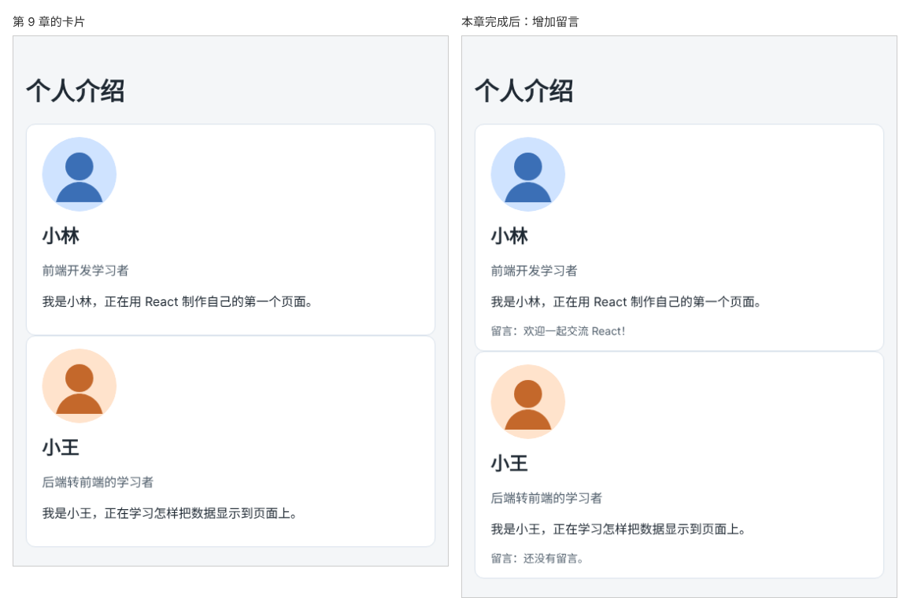

# 第 10 章：如何用 TypeScript 检查组件收到的数据是否正确？

前置：[第 9 章：如何让同一个组件显示不同的数据？](第009章-如何让同一个组件显示不同的数据.md)

## 一、本章要解决的问题

第 9 章的 `ProfileCard` 只接收一个 `profile`。现在卡片底部要增加一行“留言”：有的同学写了留言，就显示他的留言；没写的，显示“还没有留言。”。

组件的属性变多以后，使用时容易漏传、拼错属性名或传错类型。本章给组件的 props 定义一个专门的类型，加入一个可以不传的属性 `note`，再故意写错几次，学会读懂 TypeScript 的提示。完成后，小林的卡片显示他的留言，小王的卡片显示默认文字。

下图左边是现在的卡片，右边是本章完成后的卡片：



## 二、必要原理

### 为 props 定义一个具名类型

第 9 章把参数类型直接写在参数后面：`props: { profile: Profile }`。属性多了以后，这一行会很长。通常把它单独定义成一个类型，名字习惯叫“组件名 + Props”：

```tsx
type ProfileCardProps = {
  profile: Profile;
  note?: string;
};
```

读代码的人看一眼 `ProfileCardProps`，就知道这个组件需要哪些数据。

### 用解构直接取出属性

第 9 章在函数第一行写 `const profile = props.profile;`，属性多了，就要一行一行地取。JavaScript 有一种简写，可以在参数的位置直接写出需要的属性名：

```tsx
export default function ProfileCard({ profile, note }: ProfileCardProps) {
```

参数位置的 `{ profile, note }` 表示“从传进来的对象中取出 `profile` 和 `note` 两个属性，各作为一个变量使用”。这种写法叫**解构**，效果和下面这几行相同：

```tsx
export default function ProfileCard(props: ProfileCardProps) {
  const profile = props.profile;
  const note = props.note;
```

注意参数位置的花括号是解构，不是类型：类型写在冒号后面，这里是 `ProfileCardProps`。如果不单独定义类型，就会写成 `{ profile }: { profile: Profile }`，一行里出现两对花括号：前一对是解构，取出属性；后一对是类型，描述形状。这样很容易看混，这也是要给 props 单独定义类型的原因之一。

### 可选属性：问号

属性名后面加 `?`，表示这个属性可以不传：`note?: string` 的意思是“`note` 如果传了，必须是字符串；也可以完全不传”。没有问号的 `profile` 则是必须传的。

不传的属性在组件中的值是 `undefined`（没有值）。

### 给可选属性设置默认值

在解构时可以写上默认值：

```tsx
function ProfileCard({ profile, note = '还没有留言。' }: ProfileCardProps) {
```

`note = '还没有留言。'` 表示：使用组件时没有传 `note`，就用“还没有留言。”。传了就用传入的值。这样组件中的 `note` 一定是字符串，可以直接显示。

### TypeScript 在使用组件的地方检查

定义了 `ProfileCardProps` 以后，每一处 `<ProfileCard ... />` 都会被检查：

- 必须传的属性有没有传；
- 传入的属性名是否存在；
- 每个属性的值类型是否正确。

问题会在**使用组件的那一行**报告出来，而不是等到页面运行时才发现。

## 三、动手实现

### 第 1 步：定义 ProfileCardProps

打开 `src/components/ProfileCard.tsx`，在 `Profile` 类型下面加入：

```tsx
type ProfileCardProps = {
  profile: Profile;
  note?: string;
};
```

这个类型只在本文件中使用，所以不需要 `export`。

### 第 2 步：使用新类型并显示留言

把函数的第一行改为使用解构，并删除下面的 `const profile = props.profile;`：

```tsx
export default function ProfileCard({ profile, note = '还没有留言。' }: ProfileCardProps) {
```

在介绍文字的 `</p>` 之后、`</article>` 之前加入留言：

```tsx
      <p className="profile-note">留言：{note}</p>
    </article>
```

在 `src/App.css` 末尾加入留言的样式，让它和介绍文字有所区分：

```css
.profile-note {
  margin-bottom: 0;
  color: #52606d;
  font-size: 14px;
}
```

### 第 3 步：在 App 中只给小林传留言

打开 `src/App.tsx`，修改第一张卡片：

```tsx
      <ProfileCard profile={lin} note="欢迎一起交流 React！" />
      <ProfileCard profile={wang} />
```

字符串属性可以像 HTML 一样直接用引号，不需要花括号。

### 第 4 步：故意写错三次，读懂提示

每次修改后运行 `npm.cmd run check`，读完提示再改回来。

**漏传必须的属性。** 把第二张卡片改成 `<ProfileCard note="你好" />`，提示：

```text
error TS2322: Type '{ note: string; }' is not assignable to type 'IntrinsicAttributes & ProfileCardProps'.
  Property 'profile' is missing in type '{ note: string; }' but required in type 'ProfileCardProps'.
```

第一行是总的结论：传入的属性不符合组件要求的类型。第二行缩进的部分说明具体原因：传入的属性只有 `{ note: string; }`，缺少 `ProfileCardProps` 要求必须有的 `profile`。读这类提示时，重点看最后一行。

`IntrinsicAttributes` 是 React 给每个组件都加上的通用属性（例如以后会学到的 `key`），可以先忽略它。

这次还会多出一条 `'wang' is declared but its value is never read`，意思是变量 `wang` 声明了却没有被使用，因为原来使用它的那一行被改掉了。

**属性名拼错。** 改成 `<ProfileCard profle={wang} />`，提示：

```text
error TS2322: Type '{ profle: Profile; }' is not assignable to type 'IntrinsicAttributes & ProfileCardProps'.
  Property 'profle' does not exist on type 'IntrinsicAttributes & ProfileCardProps'. Did you mean 'profile'?
```

看第二行：组件没有 `profle` 这个属性，你是不是想写 `profile`？

**值的类型不对。** 改成 `<ProfileCard profile={wang} note={1} />`，提示：

```text
error TS2322: Type 'number' is not assignable to type 'string'.
```

`{1}` 是数字，而 `note` 要求字符串。

每条提示开头的 `src/App.tsx:行:列` 都指向使用组件的那一行。三处都改回第 3 步的写法后，`check` 不再报错。

## 四、运行与检查

保持开发服务器运行（`npm.cmd run dev`），保存文件后在浏览器中查看。

1. 小林的卡片底部显示“留言：欢迎一起交流 React！”。
2. 小王的卡片底部显示“留言：还没有留言。”，这是默认值。
3. 给小王也加上 `note="今天学会了 props"`，保存，他的留言随之变化。检查后去掉。
4. 第三节第 4 步的三种错误都能被 `check` 发现，并指出 `App.tsx` 中的具体行。

最后运行检查，应没有错误：

```powershell
npm.cmd run check
```

**小练习**：给 `ProfileCardProps` 增加一个可选属性 `city?: string`，默认值为“未填写”，在身份后面显示“来自某城市”。只给小王传入 `city="上海"`。练习后恢复本章代码。

## 五、常见错误

| 现象 | 原因 | 怎么改 |
| --- | --- | --- |
| 小王的卡片下面出现红线，提示缺少 `note` | 类型中漏写了问号，`note` 变成了必须传的属性 | 可选属性写成 `note?: string` |
| 不传 `note` 时页面显示“留言：”，后面是空的 | 没有设置默认值 | 解构时写 `note = '还没有留言。'` |
| 属性名拼错，页面不报错，只是不显示 | 浏览器运行时不检查属性名 | 运行 `check`，或注意编辑器中的红线 |
| 写成 `note={欢迎一起交流}` 后报错 | 花括号里的内容会被当作代码，中文被当成了变量名 | 字符串直接写 `note="欢迎一起交流"`，或 `note={'欢迎一起交流'}` |
| 把默认值写进了类型，例如 `note?: string = '还没有留言。'`，编辑器报错 | 类型只描述形状，不能写值 | 默认值写在函数参数的解构中 |

## 六、本章完整代码

### `src/components/ProfileCard.tsx`

```tsx
export type Profile = {
  name: string;
  role: string;
  intro: string;
  avatar: string;
};

type ProfileCardProps = {
  profile: Profile;
  note?: string;
};

export default function ProfileCard({ profile, note = '还没有留言。' }: ProfileCardProps) {
  return (
    <article className="profile-card">
      
      <h2>{profile.name}</h2>
      <p className="profile-role">{profile.role}</p>
      <p>
        我是{profile.name}，{profile.intro}
      </p>
      <p className="profile-note">留言：{note}</p>
    </article>
  );
}
```

### `src/App.tsx`

```tsx
import './App.css';
import avatarLin from './assets/avatar-lin.svg';
import avatarWang from './assets/avatar-wang.svg';
import ProfileCard from './components/ProfileCard';
import type { Profile } from './components/ProfileCard';

export default function App() {
  const lin: Profile = {
    name: '小林',
    role: '前端开发学习者',
    intro: '正在用 React 制作自己的第一个页面。',
    avatar: avatarLin,
  };
  const wang: Profile = {
    name: '小王',
    role: '后端转前端的学习者',
    intro: '正在学习怎样把数据显示到页面上。',
    avatar: avatarWang,
  };

  return (
    <main className="page">
      <h1>个人介绍</h1>
      <ProfileCard profile={lin} note="欢迎一起交流 React！" />
      <ProfileCard profile={wang} />
    </main>
  );
}
```

### `src/App.css`

```css
body {
  margin: 0;
  font-family: system-ui, sans-serif;
  background: #f4f6f8;
  color: #1f2933;
}

.page {
  max-width: 720px;
  margin: 0 auto;
  padding: 24px 16px;
}

.profile-card {
  padding: 16px 20px;
  border: 1px solid #d9e2ec;
  border-radius: 12px;
  background: #ffffff;
}

.profile-card h2 {
  margin: 0 0 8px;
}

.profile-role {
  color: #52606d;
}

.profile-avatar {
  display: block;
  margin-bottom: 12px;
  border-radius: 50%;
}

.profile-note {
  margin-bottom: 0;
  color: #52606d;
  font-size: 14px;
}
```

## 七、本章改动小结

修改 `src/components/ProfileCard.tsx`（新增 `ProfileCardProps` 类型和可选属性 `note`，显示留言）、`src/App.tsx`（给小林传入留言）和 `src/App.css`（新增 `.profile-note`）。

---

下一章：[第 11 章：拿到一个页面需求后，如何划分组件？](第011章-拿到一个页面需求后，如何划分组件.md)
