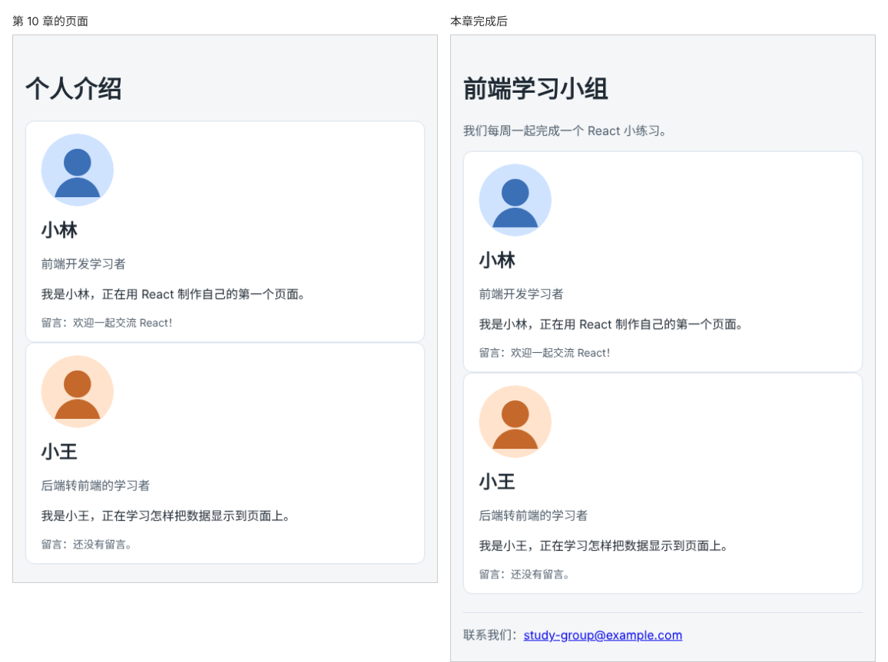

# 第 11 章：拿到一个页面需求后，如何划分组件？

前置：[第 10 章：如何用 TypeScript 检查组件收到的数据是否正确？](第010章-如何用TypeScript检查组件收到的数据是否正确.md)

## 一、本章要解决的问题

前面几章是先写出页面，再把一部分提取成组件。实际开发中，通常是先拿到一份需求，再决定页面由哪些组件组成。

本章的需求是：把个人介绍页改成“学习小组”介绍页，包括三部分：

- 顶部：小组名称“前端学习小组”和一句说明。
- 中间：成员资料卡片，也就是现有的两张卡片。
- 底部：小组联系邮箱，点击可以发邮件。

本章按一套固定的步骤划分组件，新建页头和页脚两个组件。完成后，页面从上到下显示小组名称和说明、两张成员卡片、联系邮箱。

下图左边是现在的页面，右边是本章完成后的学习小组页：



## 二、必要原理

### 划分组件的四个步骤

**第 1 步：把页面画成框。** 在纸上或脑中把页面按区域画框，每个框是一块相对独立的内容：

```text
┌──────────────────────────────┐
│ 页头：小组名称 + 说明          │  → PageHeader
├──────────────────────────────┤
│ 成员卡片（小林）               │  → ProfileCard
│ 成员卡片（小王）               │  → ProfileCard
├──────────────────────────────┤
│ 页脚：联系邮箱                 │  → PageFooter
└──────────────────────────────┘
        整个页面               → App
```

**第 2 步：每个框只做一件事，按职责起名。** 页头负责“告诉用户这是什么页面”，卡片负责“展示一个成员”，页脚负责“提供联系方式”。名字说清楚它是什么，例如 `PageHeader`，而不是 `TopPart`、`Box1`。

**第 3 步：找出重复的部分。** 两张成员卡片结构相同、只是内容不同，用同一个组件，内容通过 props 传入。这正是第 9 章做过的事。

**第 4 步：决定数据放在哪里。** 小组名称、说明、成员资料、邮箱都属于“这个页面要显示什么”，由最外层的 `App` 决定，再通过 props 交给各个组件。页头和页脚组件只负责显示，不自己写死文字。这样以后做另一个小组的页面时，组件可以直接复用。

### 不是拆得越细越好

一个标签、一段文字通常不需要单独做成组件。下面这些情况才值得拆：

- 同样的结构出现了不止一次；
- 这块内容有明确、完整的含义，单独起名能让代码更好懂；
- 组件太长，读起来要上下翻好几屏。

本章的页头和页脚都很短，拆出来的主要原因是第二条：`App` 中写 `<PageHeader ... />` 比写一段 `header` 标签更容易看出页面结构。

### header 与 footer 标签

`<header>` 表示一块内容的头部，`<footer>` 表示尾部，都是 HTML 的语义标签。邮箱链接用 `mailto:` 开头的地址，点击后会打开电脑上的邮件程序。

## 三、动手实现

### 第 1 步：新建页头组件

新建 `src/components/PageHeader.tsx`：

```tsx
type PageHeaderProps = {
  title: string;
  description: string;
};

export default function PageHeader({ title, description }: PageHeaderProps) {
  return (
    <header className="page-header">
      <h1>{title}</h1>
      <p>{description}</p>
    </header>
  );
}
```

页面的一级标题 `h1` 现在由页头组件负责。

### 第 2 步：新建页脚组件

新建 `src/components/PageFooter.tsx`：

```tsx
type PageFooterProps = {
  email: string;
};

export default function PageFooter({ email }: PageFooterProps) {
  return (
    <footer className="page-footer">
      联系我们：<a href={'mailto:' + email}>{email}</a>
    </footer>
  );
}
```

`href={'mailto:' + email}` 把 `mailto:` 和邮箱拼接成链接地址，写法与第 5 章的 `alt` 相同。

### 第 3 步：在 App 中组合三部分

打开 `src/App.tsx`，在导入中加入两个新组件：

```tsx
import ProfileCard from './components/ProfileCard';
import PageHeader from './components/PageHeader';
import PageFooter from './components/PageFooter';
```

把 `return` 中的内容改为：

```tsx
    <main className="page">
      <PageHeader title="前端学习小组" description="我们每周一起完成一个 React 小练习。" />
      <ProfileCard profile={lin} note="欢迎一起交流 React！" />
      <ProfileCard profile={wang} />
      <PageFooter email="study-group@example.com" />
    </main>
```

原来的 `<h1>个人介绍</h1>` 已经由 `PageHeader` 代替，删除它。

### 第 4 步：添加页头和页脚的样式

在 `src/App.css` 末尾加入：

```css
.page-header p {
  color: #52606d;
}

.page-footer {
  margin-top: 24px;
  padding-top: 16px;
  border-top: 1px solid #d9e2ec;
  color: #52606d;
}
```

页脚上方加一条细线，与成员卡片分开。

## 四、运行与检查

保持开发服务器运行（`npm.cmd run dev`），保存文件后在浏览器中查看。

1. 页面顶部显示“前端学习小组”和灰色的说明文字。
2. 中间是小林和小王的两张卡片，内容与第 10 章相同。
3. 底部有一条细线，下方显示“联系我们：study-group@example.com”。把鼠标移到邮箱上，浏览器左下角显示 `mailto:study-group@example.com`。
4. 看 `App.tsx` 的 `return` 部分：只有五行，对照第二节的框图，每一行对应一个框。

最后运行检查，应没有错误：

```powershell
npm.cmd run check
```

**小练习**：需求增加了“每张卡片下方显示加入时间”。想一想：这个信息应该放进哪个组件？数据应该放在哪里？按你的判断修改 `Profile` 类型、两人的资料和 `ProfileCard`，然后运行 `check`。练习后恢复本章代码。

## 五、常见错误

| 现象 | 原因 | 怎么改 |
| --- | --- | --- |
| 页面上出现了两个“前端学习小组”标题，或者还留着“个人介绍” | `App` 中原来的 `<h1>` 没有删除 | 删除 `App` 中的 `<h1>`，标题由 `PageHeader` 负责 |
| 点击邮箱没有反应 | 电脑上没有设置默认的邮件程序 | 这是系统设置问题，链接本身正确即可 |
| 编辑器提示 `PageHeader` 缺少 `description` | 使用组件时只传了 `title` | 两个属性都是必须的，都要传入 |
| 把小组名称写死在 `PageHeader` 组件里 | 组件只能用于这一个页面 | 名称、说明通过 props 由 `App` 传入 |
| 为每一段文字都建了一个组件，文件很多却难以阅读 | 拆得过细 | 按第二节的三个条件判断是否值得拆分 |

## 六、本章完整代码

### `src/components/PageHeader.tsx`

内容同第三节第 1 步。

### `src/components/PageFooter.tsx`

内容同第三节第 2 步。

### `src/App.tsx`

```tsx
import './App.css';
import avatarLin from './assets/avatar-lin.svg';
import avatarWang from './assets/avatar-wang.svg';
import ProfileCard from './components/ProfileCard';
import PageHeader from './components/PageHeader';
import PageFooter from './components/PageFooter';
import type { Profile } from './components/ProfileCard';

export default function App() {
  const lin: Profile = {
    name: '小林',
    role: '前端开发学习者',
    intro: '正在用 React 制作自己的第一个页面。',
    avatar: avatarLin,
  };
  const wang: Profile = {
    name: '小王',
    role: '后端转前端的学习者',
    intro: '正在学习怎样把数据显示到页面上。',
    avatar: avatarWang,
  };

  return (
    <main className="page">
      <PageHeader title="前端学习小组" description="我们每周一起完成一个 React 小练习。" />
      <ProfileCard profile={lin} note="欢迎一起交流 React！" />
      <ProfileCard profile={wang} />
      <PageFooter email="study-group@example.com" />
    </main>
  );
}
```

### `src/App.css`

```css
body {
  margin: 0;
  font-family: system-ui, sans-serif;
  background: #f4f6f8;
  color: #1f2933;
}

.page {
  max-width: 720px;
  margin: 0 auto;
  padding: 24px 16px;
}

.profile-card {
  padding: 16px 20px;
  border: 1px solid #d9e2ec;
  border-radius: 12px;
  background: #ffffff;
}

.profile-card h2 {
  margin: 0 0 8px;
}

.profile-role {
  color: #52606d;
}

.profile-avatar {
  display: block;
  margin-bottom: 12px;
  border-radius: 50%;
}

.profile-note {
  margin-bottom: 0;
  color: #52606d;
  font-size: 14px;
}

.page-header p {
  color: #52606d;
}

.page-footer {
  margin-top: 24px;
  padding-top: 16px;
  border-top: 1px solid #d9e2ec;
  color: #52606d;
}
```

## 七、本章改动小结

新增 `src/components/PageHeader.tsx` 和 `src/components/PageFooter.tsx`；修改 `src/App.tsx`（用页头、卡片、页脚组合页面，删除原来的 `h1`）和 `src/App.css`（新增页头和页脚样式）。`ProfileCard.tsx` 不变。

---

下一章：[第 12 章：如何让多张卡片并排显示？](第012章-如何让多张卡片并排显示.md)
