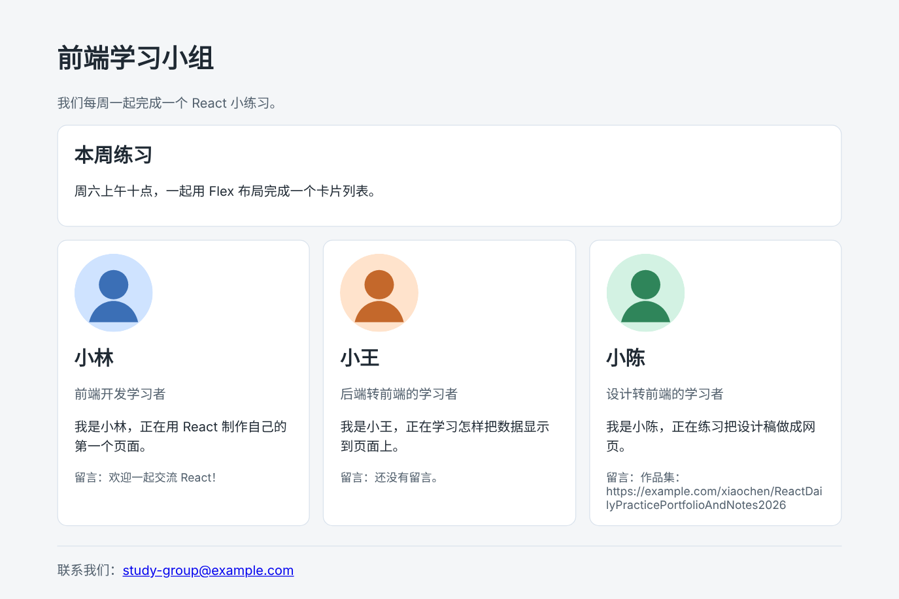

# 第 12 章：如何让多张卡片并排显示？

前置：[第 11 章：拿到一个页面需求后，如何划分组件？](第011章-拿到一个页面需求后，如何划分组件.md)

## 一、本章要解决的问题

学习小组新加入了一位成员小陈，现在有三张资料卡片。卡片默认一张接一张从上往下排，而且紧贴在一起，页面很长，右侧却空着。

本章让成员卡片在一行中并排显示，卡片之间留出间距，三张卡片宽度相同。完成后，在电脑浏览器中，三张卡片横向排成一行。

本章是第 2 部分的起点。学完第 2 部分（第 12—16 章）时，页面会变成下图的样子：成员卡片在电脑上并排、在手机上自动换行，上方多了一张样式相同的公告卡片。



## 二、必要原理

### 块级元素默认上下排列

`article`、`p`、`h2` 这类元素默认是“块级”的：每个元素独占一整行，下一个元素只能排在它下面。所以卡片会从上到下排列。

### 用 Flex 布局让子元素横向排列

给**父元素**设置 `display: flex`，它就变成一个弹性容器，里面的子元素会改为横向排成一行：

```css
.card-list {
  display: flex;
  gap: 16px;
}
```

- `display: flex`：让子元素横向排列。这条规则写在父元素上，不是写在卡片上。
- `gap: 16px`：子元素之间留 16 像素的间距。只出现在两个元素之间，第一张卡片左边和最后一张右边不会多出空白。

### 让每张卡片平分宽度

子元素横向排列后，默认宽度由内容决定，内容多的卡片会更宽。给子元素设置 `flex: 1`，表示“平分容器中剩余的空间”，每张卡片一样宽：

```css
.card-list .profile-card {
  flex: 1;
}
```

`.card-list .profile-card` 中间有空格，表示选中 `.card-list` 里面的 `.profile-card`。这样写，这条规则只影响列表中的卡片，以后在别处单独使用卡片时不受影响。

### 需要一个包住卡片的父元素

Flex 布局作用在父元素上，所以要给三张卡片外面加一层容器。这里用 `<section>`，它表示页面中的一个区块。

### 页面需要更宽一些

第 4 章把页面内容的最大宽度设成了 720 像素，放一张卡片很合适，并排放三张就太挤了。本章把它改成 960 像素。

## 三、动手实现

### 第 1 步：准备第三位成员的头像

在 `src/assets` 中新建 `avatar-chen.svg`：

```xml
<svg xmlns="http://www.w3.org/2000/svg" width="96" height="96" viewBox="0 0 96 96">
  <rect width="96" height="96" rx="48" fill="#d3f2e3" />
  <circle cx="48" cy="38" r="18" fill="#2f855a" />
  <path d="M18 84c4-18 18-26 30-26s26 8 30 26" fill="#2f855a" />
</svg>
```

### 第 2 步：添加小陈的资料

打开 `src/App.tsx`，在头像导入中加一行：

```tsx
import avatarWang from './assets/avatar-wang.svg';
import avatarChen from './assets/avatar-chen.svg';
```

在 `wang` 的下面加入小陈的资料：

```tsx
  const chen: Profile = {
    name: '小陈',
    role: '设计转前端的学习者',
    intro: '正在练习把设计稿做成网页。',
    avatar: avatarChen,
  };
```

### 第 3 步：用 section 包住所有卡片

把 `return` 中的卡片部分改为：

```tsx
      <section className="card-list">
        <ProfileCard profile={lin} note="欢迎一起交流 React！" />
        <ProfileCard profile={wang} />
        <ProfileCard profile={chen} />
      </section>
```

### 第 4 步：添加 Flex 布局样式

打开 `src/App.css`，先把 `.page` 中的最大宽度改为 960 像素：

```css
.page {
  max-width: 960px;
```

然后在文件末尾加入：

```css
.card-list {
  display: flex;
  gap: 16px;
}

.card-list .profile-card {
  flex: 1;
}
```

## 四、运行与检查

保持开发服务器运行（`npm.cmd run dev`），保存文件后在浏览器中查看。

1. 浏览器窗口足够宽时，小林、小王、小陈三张卡片排成一行，宽度相同，之间有 16 像素的间距。页头和页脚也随页面一起变宽了。
2. 三张卡片的高度相同，即使小林的卡片多了一行留言。这是 Flex 布局的默认效果：同一行的子元素高度会拉伸到一样高。
3. 按 F12，在 Elements（元素）面板中选中 `<section class="card-list">`，标签旁边出现一个 `flex` 小标记，点击它，页面上会用虚线标出每个子元素的位置。
4. 把 `.card-list .profile-card` 中的 `flex: 1;` 临时删掉，保存，三张卡片的宽度变得各不相同。检查后恢复。

现在把浏览器窗口缩窄，三张卡片会被挤得很窄，文字只能几个字一行；窗口再窄一些，卡片甚至会超出页面右边。这个问题第 13 章解决。

最后运行检查，应没有错误：

```powershell
npm.cmd run check
```

**小练习**：把 `gap` 改成 `24px`，观察间距变化；再试着把 `.card-list` 的 `display: flex` 删掉，看看卡片恢复成什么样子。练习后恢复本章代码。

## 五、常见错误

| 现象 | 原因 | 怎么改 |
| --- | --- | --- |
| 卡片仍然上下排列 | `display: flex` 写在了 `.profile-card` 上，而不是父元素 `.card-list` 上 | Flex 写在包住卡片的容器上 |
| 卡片横排了，但宽度不一样 | 卡片上没有 `flex: 1` | 给列表中的卡片加上 `flex: 1` |
| 卡片之间没有间距 | `gap` 写在了卡片上 | `gap` 写在父元素上 |
| 页头或页脚也挤进了同一行 | `display: flex` 写在了 `.page` 上，页面中的所有内容都变成了横排 | 只给包住卡片的 `section` 加 Flex |
| 小陈的头像显示为破损图标 | 头像文件名或导入路径与第 1 步不一致 | 核对 `src/assets/avatar-chen.svg` |

## 六、本章完整代码

### `src/assets/avatar-chen.svg`

内容同第三节第 1 步。

### `src/App.tsx`

```tsx
import './App.css';
import avatarLin from './assets/avatar-lin.svg';
import avatarWang from './assets/avatar-wang.svg';
import avatarChen from './assets/avatar-chen.svg';
import ProfileCard from './components/ProfileCard';
import PageHeader from './components/PageHeader';
import PageFooter from './components/PageFooter';
import type { Profile } from './components/ProfileCard';

export default function App() {
  const lin: Profile = {
    name: '小林',
    role: '前端开发学习者',
    intro: '正在用 React 制作自己的第一个页面。',
    avatar: avatarLin,
  };
  const wang: Profile = {
    name: '小王',
    role: '后端转前端的学习者',
    intro: '正在学习怎样把数据显示到页面上。',
    avatar: avatarWang,
  };
  const chen: Profile = {
    name: '小陈',
    role: '设计转前端的学习者',
    intro: '正在练习把设计稿做成网页。',
    avatar: avatarChen,
  };

  return (
    <main className="page">
      <PageHeader title="前端学习小组" description="我们每周一起完成一个 React 小练习。" />
      <section className="card-list">
        <ProfileCard profile={lin} note="欢迎一起交流 React！" />
        <ProfileCard profile={wang} />
        <ProfileCard profile={chen} />
      </section>
      <PageFooter email="study-group@example.com" />
    </main>
  );
}
```

### `src/App.css`

```css
body {
  margin: 0;
  font-family: system-ui, sans-serif;
  background: #f4f6f8;
  color: #1f2933;
}

.page {
  max-width: 960px;
  margin: 0 auto;
  padding: 24px 16px;
}

.profile-card {
  padding: 16px 20px;
  border: 1px solid #d9e2ec;
  border-radius: 12px;
  background: #ffffff;
}

.profile-card h2 {
  margin: 0 0 8px;
}

.profile-role {
  color: #52606d;
}

.profile-avatar {
  display: block;
  margin-bottom: 12px;
  border-radius: 50%;
}

.profile-note {
  margin-bottom: 0;
  color: #52606d;
  font-size: 14px;
}

.page-header p {
  color: #52606d;
}

.page-footer {
  margin-top: 24px;
  padding-top: 16px;
  border-top: 1px solid #d9e2ec;
  color: #52606d;
}

.card-list {
  display: flex;
  gap: 16px;
}

.card-list .profile-card {
  flex: 1;
}
```

## 七、本章改动小结

新增 `src/assets/avatar-chen.svg`；修改 `src/App.tsx`（新增小陈的资料，用 `section` 包住三张卡片）和 `src/App.css`（页面最大宽度改为 960 像素，新增 `.card-list` 的 Flex 布局）。

---

下一章：[第 13 章：如何让卡片在手机窄屏上自动换行？](第013章-如何让卡片在手机窄屏上自动换行.md)
