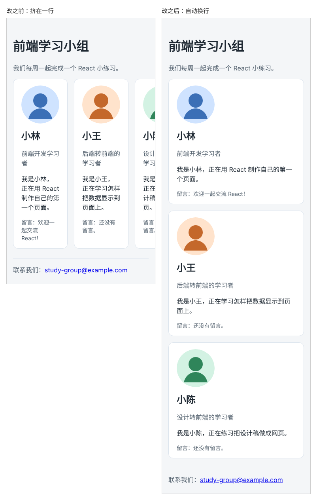

# 第 13 章：如何让卡片在手机窄屏上自动换行？

前置：[第 12 章：如何让多张卡片并排显示？](第012章-如何让多张卡片并排显示.md)

## 一、本章要解决的问题

第 12 章的三张卡片在电脑上排成一行很好看，但在手机上，三张卡片仍然硬挤在一行里，每张只有一百多像素宽，文字几个字一行，还会超出屏幕右边。

本章让卡片根据屏幕宽度自动换行：宽屏时一行三张，中等宽度时一行两张，手机上一行一张。完成后，用浏览器模拟手机屏幕查看，卡片从上到下排列，不需要左右滑动。

下图是手机宽度（375 像素）下的页面，左边是现在的样子，右边是本章完成后的样子：



## 二、必要原理

### flex-wrap：放不下就换行

Flex 容器默认让所有子元素挤在同一行，宁可把它们压窄。加上 `flex-wrap: wrap`，子元素在一行放不下时会自动移到下一行：

```css
.card-list {
  display: flex;
  flex-wrap: wrap;
  gap: 16px;
}
```

### flex 的三个值：先定基础宽度

“放不下”是怎么判断的？需要告诉浏览器每张卡片至少希望有多宽。`flex` 属性可以写三个值：

```css
flex: 1 1 200px;
```

| 位置 | 名称 | 本例的值 | 含义 |
| --- | --- | --- | --- |
| 第一个 | 放大比例 | `1` | 一行有剩余空间时，按比例放大，填满这一行 |
| 第二个 | 缩小比例 | `1` | 空间不够时，允许按比例缩小 |
| 第三个 | 基础宽度 | `200px` | 每张卡片先按 200 像素计算 |

浏览器先算出每张卡片至少要占多宽：200 像素的基础宽度，再加上卡片自己的左右内边距（各 20 像素）和边框（各 1 像素），一共 242 像素。然后加上卡片之间的间距，看一行能放下几张，放不下的移到下一行。每一行排好后，再用第一个值把剩余空间平分给这一行的卡片，所以卡片总是填满整行。

第 12 章写的 `flex: 1` 相当于 `flex: 1 1 0`，基础宽度为 0，所以永远“放得下”，不会换行。

### 怎样在电脑上模拟手机屏幕

浏览器开发者工具可以模拟手机屏幕：按 F12 打开开发者工具，点击开发者工具左上角的手机图标（切换设备工具栏），页面顶部会出现尺寸设置，可以选择具体机型，也可以直接输入宽度。也可以先用鼠标点一下开发者工具，再按 Ctrl+Shift+M；如果焦点还在页面或别的程序上，这个快捷键可能不起作用。

## 三、动手实现

### 第 1 步：允许卡片换行

打开 `src/App.css`，在 `.card-list` 中加入 `flex-wrap: wrap;`：

```css
.card-list {
  display: flex;
  flex-wrap: wrap;
  gap: 16px;
}
```

### 第 2 步：给卡片设置基础宽度

把 `.card-list .profile-card` 中的 `flex: 1;` 改为：

```css
.card-list .profile-card {
  flex: 1 1 200px;
}
```

本章只修改 CSS，组件代码不变。

## 四、运行与检查

保持开发服务器运行（`npm.cmd run dev`），保存文件后在浏览器中查看。

1. 电脑浏览器窗口较宽时，三张卡片仍然排成一行，与第 12 章相同。
2. 慢慢把窗口缩窄。到某个宽度时，小陈的卡片会移到第二行，并且独自占满第二行，上面一行是小林和小王。
3. 按 F12，点击左上角的手机图标打开手机模拟，把宽度设为 375。三张卡片从上到下排列，每张占满整行，页面不需要左右滑动。
4. 在手机模拟中，把宽度从 375 慢慢加到 800，观察卡片从一行一张变成一行两张、一行三张。

最后运行检查，应没有错误：

```powershell
npm.cmd run check
```

**小练习**：把基础宽度从 `200px` 改成 `300px`，在电脑窗口最宽时，一行能放几张卡片？先自己算一算，再到浏览器中验证。练习后恢复为 `200px`。（提示：`.page` 最宽 960 像素，减去左右各 16 像素的内边距，内容区宽 928 像素；每张卡片还要加上 42 像素的内边距和边框；卡片之间的间距是 16 像素。）

## 五、常见错误

| 现象 | 原因 | 怎么改 |
| --- | --- | --- |
| 窗口缩窄后卡片仍然挤在一行 | 漏写了 `flex-wrap: wrap` | 写在 `.card-list` 上 |
| 加了换行，但卡片从不换行 | 卡片仍然是 `flex: 1`，基础宽度为 0 | 改成 `flex: 1 1 200px` |
| 第二行的卡片没有占满整行 | 第一个值写成了 `0`，不允许放大 | 写成 `flex: 1 1 200px` |
| 手机模拟时页面看起来非常小，像缩小的电脑页面 | `index.html` 中缺少 `viewport` 设置 | 确认 `<head>` 中有准备篇一给出的 `meta name="viewport"` 那一行 |
| 换行后两行卡片之间没有间距 | 以为 `gap` 只管左右间距 | `gap` 同时作用于行与行之间，检查是否写在 `.card-list` 上 |

## 六、本章完整代码

### `src/App.css`

```css
body {
  margin: 0;
  font-family: system-ui, sans-serif;
  background: #f4f6f8;
  color: #1f2933;
}

.page {
  max-width: 960px;
  margin: 0 auto;
  padding: 24px 16px;
}

.profile-card {
  padding: 16px 20px;
  border: 1px solid #d9e2ec;
  border-radius: 12px;
  background: #ffffff;
}

.profile-card h2 {
  margin: 0 0 8px;
}

.profile-role {
  color: #52606d;
}

.profile-avatar {
  display: block;
  margin-bottom: 12px;
  border-radius: 50%;
}

.profile-note {
  margin-bottom: 0;
  color: #52606d;
  font-size: 14px;
}

.page-header p {
  color: #52606d;
}

.page-footer {
  margin-top: 24px;
  padding-top: 16px;
  border-top: 1px solid #d9e2ec;
  color: #52606d;
}

.card-list {
  display: flex;
  flex-wrap: wrap;
  gap: 16px;
}

.card-list .profile-card {
  flex: 1 1 200px;
}
```

## 七、本章改动小结

修改 `src/App.css`：`.card-list` 加上 `flex-wrap: wrap`，卡片的 `flex` 改为 `1 1 200px`。组件代码不变。

---

下一章：[第 14 章：如何避免长文字把卡片撑出屏幕？](第014章-如何避免长文字把卡片撑出屏幕.md)
