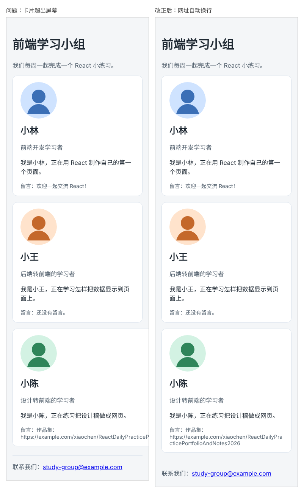

# 第 14 章：如何避免长文字把卡片撑出屏幕？

前置：[第 13 章：如何让卡片在手机窄屏上自动换行？](第013章-如何让卡片在手机窄屏上自动换行.md)

## 一、本章要解决的问题

小陈在留言里写了自己作品集的网址。网址是一长串没有空格的字母，结果卡片的排列乱了：电脑上小陈的卡片被挤到第二行，而且特别宽；手机上这张卡片超出了屏幕右边，整个页面可以左右滑动。

本章让长网址在卡片内自动折行。完成后，无论电脑还是手机，网址都留在卡片里面，卡片的排列恢复正常。

下图是手机宽度下的页面，左边是加入长网址后卡片超出屏幕的样子，右边是本章改正后的样子：



## 二、必要原理

### 浏览器只在“可以断开的地方”换行

浏览器排列文字时，只会在允许断开的位置换行：英文在空格和连字符处断开；中文每个字之间都可以断开，所以中文段落很少出问题。

网址、长单词、长串数字中间没有空格，浏览器认为这是一个不能拆开的整体。容器再窄，它也会完整地排在一行里，于是把容器撑宽。

### 卡片为什么不会自己变窄

第 13 章给卡片设置了 200 像素的基础宽度。但 Flex 布局中的子元素有一个默认规则：**不会缩到比自己内容中最长的、不可断开的那一段更窄**。这个网址排成一行比整张卡片的基础宽度长得多，卡片就至少要有网址那么宽。电脑上一行放不下三张，小陈的卡片被挤到下一行；手机屏幕本身不够宽，卡片就超出了屏幕。

### overflow-wrap: anywhere

`overflow-wrap` 控制“一段文字放不下时，能不能在原本不允许的位置断开”。设为 `anywhere`，表示必要时可以在任意字符之间断开：

```css
overflow-wrap: anywhere;
```

它只在放不下时才生效。正常长度的文字仍然在原来的位置换行，不会把普通英文单词拆得乱七八糟。

设置后，浏览器知道网址可以拆开，卡片“内容中最长的不可断开的一段”就变短了，卡片可以正常缩窄，网址在卡片内折成几行。

还有一个写法 `overflow-wrap: break-word`，它也会断开长文字，但不会让 Flex 子元素变窄，对本章的问题无效。遇到 Flex 布局中的长文字，用 `anywhere`。

## 三、动手实现

### 第 1 步：复现问题

打开 `src/App.tsx`，给小陈的卡片传入带网址的留言：

```tsx
        <ProfileCard profile={chen} note="作品集：https://example.com/xiaochen/ReactDailyPracticePortfolioAndNotes2026" />
```

保存后在浏览器中查看：电脑上小陈的卡片被挤到第二行，宽度明显比上面两张大，甚至可能超出页面内容区的右边；按 F12 再按 Ctrl+Shift+M，宽度设为 375，卡片超出屏幕右边，页面底部出现横向滚动条。

### 第 2 步：允许长文字在卡片内折行

打开 `src/App.css`，在 `.card-list .profile-card` 中加入一行：

```css
.card-list .profile-card {
  flex: 1 1 200px;
  overflow-wrap: anywhere;
}
```

写在卡片上，卡片里的所有文字都会受到保护，以后其他字段出现长文字也不会撑开卡片。

## 四、运行与检查

保持开发服务器运行（`npm.cmd run dev`），保存文件后在浏览器中查看。

1. 电脑窗口最宽时，三张卡片重新排成一行，宽度相同。小陈卡片中的网址折成两三行。
2. 手机模拟宽度 375 时，三张卡片从上到下排列，网址在卡片内折行，页面不能左右滑动。
3. 小林卡片中的中文介绍和留言，换行位置与之前相同，没有被奇怪地拆开。
4. 把 `overflow-wrap: anywhere;` 改成 `overflow-wrap: break-word;`，保存，问题又出现了。检查后改回 `anywhere`。

最后运行检查，应没有错误：

```powershell
npm.cmd run check
```

**小练习**：把小王的身份临时改成一个很长的英文单词，例如 `Supercalifragilisticexpialidocious-developer`，在手机模拟宽度 320 下查看，确认它也在卡片内折行。练习后恢复。

## 五、常见错误

| 现象 | 原因 | 怎么改 |
| --- | --- | --- |
| 加了 `overflow-wrap` 仍然超出 | 写成了 `break-word`，它不会让 Flex 子元素变窄 | 改成 `anywhere` |
| 规则不生效 | 写在了 `.card-list` 上，而不是卡片上 | 写在 `.card-list .profile-card` 中 |
| 网址折行了，但页面仍能左右滑动 | 别的元素也超宽了，例如宽度写死的图片 | 在 Elements（元素）面板中逐个选中元素，找到比屏幕更宽的那个 |
| 想用 `overflow: hidden` 把多出来的部分藏起来 | 网址后半段被切掉，用户看不到完整内容 | 让文字折行，而不是隐藏 |
| 用 `word-break: break-all` 后，普通英文单词也被拆开 | `break-all` 不管放不放得下都会拆 | 用 `overflow-wrap: anywhere`，只在放不下时才拆 |

## 六、本章完整代码

### `src/App.tsx`

```tsx
import './App.css';
import avatarLin from './assets/avatar-lin.svg';
import avatarWang from './assets/avatar-wang.svg';
import avatarChen from './assets/avatar-chen.svg';
import ProfileCard from './components/ProfileCard';
import PageHeader from './components/PageHeader';
import PageFooter from './components/PageFooter';
import type { Profile } from './components/ProfileCard';

export default function App() {
  const lin: Profile = {
    name: '小林',
    role: '前端开发学习者',
    intro: '正在用 React 制作自己的第一个页面。',
    avatar: avatarLin,
  };
  const wang: Profile = {
    name: '小王',
    role: '后端转前端的学习者',
    intro: '正在学习怎样把数据显示到页面上。',
    avatar: avatarWang,
  };
  const chen: Profile = {
    name: '小陈',
    role: '设计转前端的学习者',
    intro: '正在练习把设计稿做成网页。',
    avatar: avatarChen,
  };

  return (
    <main className="page">
      <PageHeader title="前端学习小组" description="我们每周一起完成一个 React 小练习。" />
      <section className="card-list">
        <ProfileCard profile={lin} note="欢迎一起交流 React！" />
        <ProfileCard profile={wang} />
        <ProfileCard profile={chen} note="作品集：https://example.com/xiaochen/ReactDailyPracticePortfolioAndNotes2026" />
      </section>
      <PageFooter email="study-group@example.com" />
    </main>
  );
}
```

### `src/App.css`

```css
body {
  margin: 0;
  font-family: system-ui, sans-serif;
  background: #f4f6f8;
  color: #1f2933;
}

.page {
  max-width: 960px;
  margin: 0 auto;
  padding: 24px 16px;
}

.profile-card {
  padding: 16px 20px;
  border: 1px solid #d9e2ec;
  border-radius: 12px;
  background: #ffffff;
}

.profile-card h2 {
  margin: 0 0 8px;
}

.profile-role {
  color: #52606d;
}

.profile-avatar {
  display: block;
  margin-bottom: 12px;
  border-radius: 50%;
}

.profile-note {
  margin-bottom: 0;
  color: #52606d;
  font-size: 14px;
}

.page-header p {
  color: #52606d;
}

.page-footer {
  margin-top: 24px;
  padding-top: 16px;
  border-top: 1px solid #d9e2ec;
  color: #52606d;
}

.card-list {
  display: flex;
  flex-wrap: wrap;
  gap: 16px;
}

.card-list .profile-card {
  flex: 1 1 200px;
  overflow-wrap: anywhere;
}
```

## 七、本章改动小结

修改 `src/App.tsx`（给小陈传入带网址的留言）和 `src/App.css`（卡片加上 `overflow-wrap: anywhere`）。

---

下一章：[第 15 章：如何避免不同组件的 CSS 样式互相影响？](第015章-如何避免不同组件的CSS样式互相影响.md)
