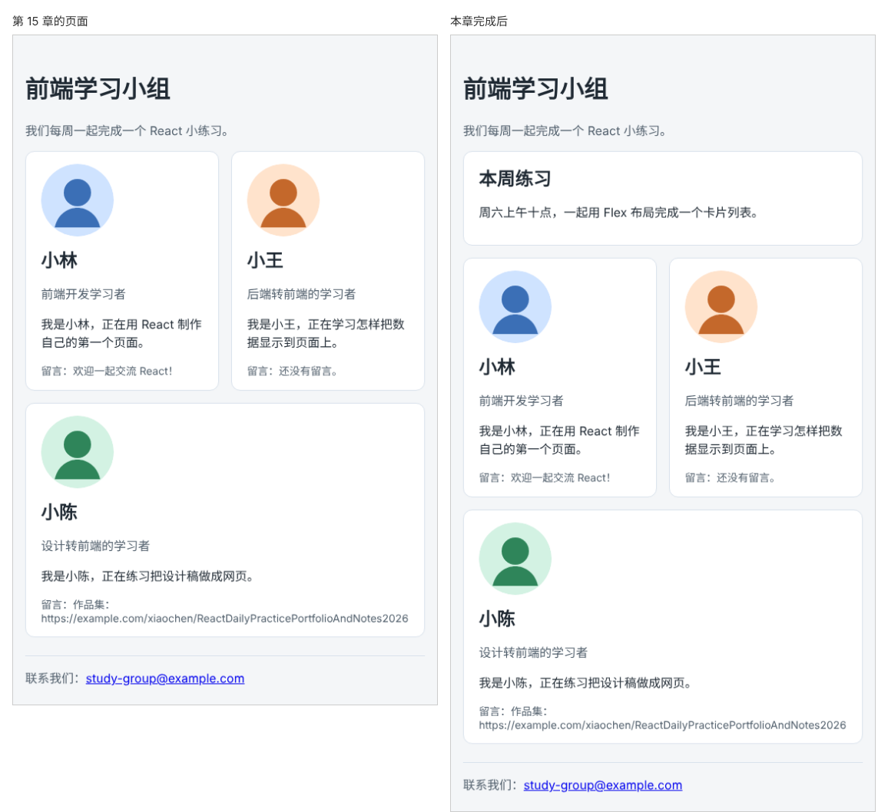

# 第 16 章：如何让同一个卡片容器放入不同内容？

前置：[第 15 章：如何避免不同组件的 CSS 样式互相影响？](第015章-如何避免不同组件的CSS样式互相影响.md)

## 一、本章要解决的问题

学习小组要在成员列表上方放一张“本周练习”公告卡片，外观要和成员卡片一样：白色背景、细边框、圆角。但公告的内容是标题和一段说明，没有头像，也没有留言，不能直接用 `ProfileCard`。

把边框、圆角这些样式再复制一份给公告用，以后改卡片外观就要改两处。本章做一个只负责“卡片外框”的组件 `Card`，里面放什么由使用者决定。完成后，页面上方出现一张公告卡片，下面的成员卡片外观不变，两者共用同一个 `Card` 组件。

下图左边是现在的页面，右边是本章完成后加上公告卡片的页面：



## 二、必要原理

### 组件标签之间也可以放内容

HTML 标签之间可以放内容，例如 `<p>文字</p>`。自己写的组件也可以这样用：

```tsx
<Card>
  <h2>本周练习</h2>
  <p>……</p>
</Card>
```

写在 `<Card>` 和 `</Card>` 之间的内容，React 会通过一个名叫 `children` 的 prop 传给组件。组件把 `children` 放在哪里，这些内容就显示在哪里：

```tsx
function Card({ children }) {
  return <article className={styles.card}>{children}</article>;
}
```

`Card` 只负责外框，不关心里面是成员资料、公告还是别的什么。这种组件常被称为“容器组件”或“布局组件”。

`children` 是 React 规定的名字，不能换成别的。

### children 的类型：ReactNode

`children` 里可能是一段文字、一个标签、一个组件，也可能是好几个元素。TypeScript 用 React 提供的 `ReactNode` 类型表示“任何可以在 JSX 中显示的内容”：

```tsx
import type { ReactNode } from 'react';

type CardProps = {
  children: ReactNode;
};
```

### 拆分样式：外框归 Card，内容归使用者

原来 `ProfileCard.module.css` 中的 `.card` 和 `.card h2` 描述的是卡片的外框和标题间距，搬到 `Card.module.css`。头像、身份、留言的样式仍然是 `ProfileCard` 自己的，留在原处。

## 三、动手实现

### 第 1 步：新建 Card 组件

在 `src/components` 中新建 `Card.module.css`：

```css
.card {
  padding: 16px 20px;
  border: 1px solid #d9e2ec;
  border-radius: 12px;
  background: #ffffff;
  overflow-wrap: anywhere;
}

.card h2 {
  margin: 0 0 8px;
}
```

再新建 `Card.tsx`：

```tsx
import type { ReactNode } from 'react';
import styles from './Card.module.css';

type CardProps = {
  children: ReactNode;
};

export default function Card({ children }: CardProps) {
  return <article className={styles.card}>{children}</article>;
}
```

### 第 2 步：让 ProfileCard 使用 Card

打开 `src/components/ProfileCard.module.css`，删除 `.card` 和 `.card h2` 两段规则，只保留 `.avatar`、`.role`、`.note`。

打开 `src/components/ProfileCard.tsx`，导入 `Card`：

```tsx
import Card from './Card';
import styles from './ProfileCard.module.css';
```

把最外层的 `<article className={styles.card}>` 换成 `<Card>`，结尾的 `</article>` 换成 `</Card>`：

```tsx
  return (
    <Card>
      留言：{note}</p>
    </Card>
  );
```

中间的头像、姓名、身份、介绍都不用改，它们现在是 `Card` 的 `children`。

### 第 3 步：在页面上添加公告卡片

打开 `src/App.tsx`，导入 `Card`：

```tsx
import Card from './components/Card';
```

在 `<PageHeader ... />` 和 `<section className="card-list">` 之间加入公告：

```tsx
      <Card>
        <h2>本周练习</h2>
        <p>周六上午十点，一起用 Flex 布局完成一个卡片列表。</p>
      </Card>
```

在 `src/App.css` 的 `.card-list` 中加一行，让公告和成员卡片之间留出间距：

```css
.card-list {
  display: flex;
  flex-wrap: wrap;
  gap: 16px;
  margin-top: 16px;
}
```

## 四、运行与检查

保持开发服务器运行（`npm.cmd run dev`），保存文件后在浏览器中查看。

1. 页头下方出现“本周练习”公告卡片，占满整行，边框、圆角、背景与成员卡片相同。
2. 下面的三张成员卡片外观与第 15 章相同，窄屏时照常换行。
3. 在 `Card.module.css` 中把 `border-radius` 改成 `0`，保存。公告和三张成员卡片同时变成直角，说明它们共用同一个外框。检查后改回 `12px`。
4. 按 F12，在 Elements（元素）面板中可以看到公告和成员卡片的最外层都是 `article`，`class` 相同。

最后运行检查，应没有错误：

```powershell
npm.cmd run check
```

**小练习**：再用 `Card` 做一张“活动地点”卡片，放在成员列表和页脚之间，内容是一个 `h2` 标题和两行地址文字。完成后修改 `Card.module.css` 的背景色，确认三处卡片同时变化。练习后恢复本章代码。

## 五、常见错误

| 现象 | 原因 | 怎么改 |
| --- | --- | --- |
| 公告卡片只有外框，里面是空的 | `Card` 中没有把 `{children}` 放进 JSX | 在 `article` 中写 `{children}` |
| 编辑器提示 `children` 隐式具有 `any` 类型 | 没有给 `Card` 的参数写类型 | 使用 `CardProps`，`children: ReactNode` |
| 编辑器提示找不到 `ReactNode` | 没有从 `react` 导入它 | `import type { ReactNode } from 'react';` |
| 成员卡片的边框消失了 | 从 `ProfileCard.module.css` 删除了 `.card`，但 `ProfileCard` 还在用 `styles.card`，没有换成 `<Card>` | 按第三节第 2 步替换最外层标签 |
| 公告卡片和成员卡片之间没有间距 | `.card-list` 中缺少 `margin-top` | 按第三节第 3 步补上 |

## 六、本章完整代码

### `src/components/Card.module.css`

内容同第三节第 1 步。

### `src/components/Card.tsx`

内容同第三节第 1 步。

### `src/components/ProfileCard.module.css`

```css
.avatar {
  display: block;
  margin-bottom: 12px;
  border-radius: 50%;
}

.role {
  color: #52606d;
}

.note {
  margin-bottom: 0;
  color: #52606d;
  font-size: 14px;
}
```

### `src/components/ProfileCard.tsx`

```tsx
import Card from './Card';
import styles from './ProfileCard.module.css';

export type Profile = {
  name: string;
  role: string;
  intro: string;
  avatar: string;
};

type ProfileCardProps = {
  profile: Profile;
  note?: string;
};

export default function ProfileCard({ profile, note = '还没有留言。' }: ProfileCardProps) {
  return (
    <Card>
      
      <h2>{profile.name}</h2>
      <p className={styles.role}>{profile.role}</p>
      <p>
        我是{profile.name}，{profile.intro}
      </p>
      <p className={styles.note}>留言：{note}</p>
    </Card>
  );
}
```

### `src/App.tsx`

```tsx
import './App.css';
import avatarLin from './assets/avatar-lin.svg';
import avatarWang from './assets/avatar-wang.svg';
import avatarChen from './assets/avatar-chen.svg';
import Card from './components/Card';
import ProfileCard from './components/ProfileCard';
import PageHeader from './components/PageHeader';
import PageFooter from './components/PageFooter';
import type { Profile } from './components/ProfileCard';

export default function App() {
  const lin: Profile = {
    name: '小林',
    role: '前端开发学习者',
    intro: '正在用 React 制作自己的第一个页面。',
    avatar: avatarLin,
  };
  const wang: Profile = {
    name: '小王',
    role: '后端转前端的学习者',
    intro: '正在学习怎样把数据显示到页面上。',
    avatar: avatarWang,
  };
  const chen: Profile = {
    name: '小陈',
    role: '设计转前端的学习者',
    intro: '正在练习把设计稿做成网页。',
    avatar: avatarChen,
  };

  return (
    <main className="page">
      <PageHeader title="前端学习小组" description="我们每周一起完成一个 React 小练习。" />
      <Card>
        <h2>本周练习</h2>
        <p>周六上午十点，一起用 Flex 布局完成一个卡片列表。</p>
      </Card>
      <section className="card-list">
        <ProfileCard profile={lin} note="欢迎一起交流 React！" />
        <ProfileCard profile={wang} />
        <ProfileCard profile={chen} note="作品集：https://example.com/xiaochen/ReactDailyPracticePortfolioAndNotes2026" />
      </section>
      <PageFooter email="study-group@example.com" />
    </main>
  );
}
```

### `src/App.css`

```css
body {
  margin: 0;
  font-family: system-ui, sans-serif;
  background: #f4f6f8;
  color: #1f2933;
}

.page {
  max-width: 960px;
  margin: 0 auto;
  padding: 24px 16px;
}

.page-header p {
  color: #52606d;
}

.page-footer {
  margin-top: 24px;
  padding-top: 16px;
  border-top: 1px solid #d9e2ec;
  color: #52606d;
}

.card-list {
  display: flex;
  flex-wrap: wrap;
  gap: 16px;
  margin-top: 16px;
}

.card-list > * {
  flex: 1 1 200px;
}
```

## 七、本章改动小结

新增 `src/components/Card.tsx` 和 `src/components/Card.module.css`；修改 `src/components/ProfileCard.tsx`（外框改用 `Card`）、`src/components/ProfileCard.module.css`（删除外框样式）、`src/App.tsx`（新增公告卡片）和 `src/App.css`（列表上方留出间距）。

---

下一章：[第 16A 章：项目中要做第二个页面时，如何整理页面文件？](第016A章-项目中要做第二个页面时，如何整理页面文件.md)
