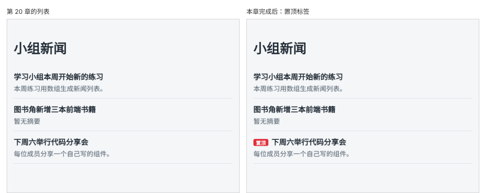

# 第 21 章：如何只给符合条件的项显示标记？

前置：[第 20 章：某项数据缺少字段时，如何显示默认内容？](第020章-某项数据缺少字段时，如何显示默认内容.md)

## 一、本章要解决的问题

代码分享会是一条重要新闻，需要在标题前面显示一个红色的“置顶”小标签，提醒大家注意。其他新闻不显示这个标签。

本章给新闻数据加一个“是否置顶”的字段，只有置顶的新闻才在标题前显示标签。完成后，第三条新闻标题前出现红色的“置顶”，另外两条没有。

下图左边是现在的新闻列表，右边是本章完成后的样子：



## 二、必要原理

### 布尔值：是或否

只有两种可能的数据，用布尔值表示：`true`（是）或 `false`（否）。TypeScript 中的类型写作 `boolean`。

```ts
export type NewsItem = {
  id: number;
  title: string;
  summary?: string;
  pinned?: boolean;
};
```

`pinned` 是“置顶”的意思。加问号表示可以不写，大部分新闻不置顶，只给需要置顶的那条写上 `pinned: true`。不写时值是 `undefined`，在判断条件时和 `false` 一样，都表示“否”。

### && ：条件成立才显示

第 19 章用条件运算符在两段内容中选一段。本章的情况更简单：条件成立时显示标签，不成立时**什么都不显示**。这时可以用 `&&`：

```tsx
{item.pinned && <span>置顶</span>}
```

意思是：`item.pinned` 为真时，结果是后面的 `<span>`；为假（`false` 或 `undefined`）时，结果就是左边的值本身。React 遇到 `false`、`undefined`、`null` 时什么都不显示。

也可以写成 `{item.pinned ? <span>置顶</span> : null}`，效果相同，`null` 表示“这里不显示任何内容”。只有一种结果需要显示时，`&&` 写起来更短。

### 用 && 时要当心数字 0

`&&` 左边的值为假时，结果是左边的值本身。如果左边是数字 `0`，结果就是 `0`，而 React **会把数字 0 显示出来**。例如：

```tsx
{commentCount && <span>{commentCount} 条评论</span>}
```

`commentCount` 为 0 时，页面上会出现一个孤零零的“0”。左边是数字时，写成明确的比较：`{commentCount > 0 && ...}`。本章的 `pinned` 是布尔值，没有这个问题。

### 用 span 显示标签

`<span>` 是行内元素，不会独占一行，适合放在标题文字前面。

## 三、动手实现

### 第 1 步：给数据加上 pinned 字段

打开 `src/data/news.ts`，在类型中加入 `pinned?: boolean;`，并给第三条新闻加上 `pinned: true`：

```ts
export type NewsItem = {
  id: number;
  title: string;
  summary?: string;
  pinned?: boolean;
};
```

```ts
  {
    id: 3,
    title: '下周六举行代码分享会',
    summary: '每位成员分享一个自己写的组件。',
    pinned: true,
  },
```

这一条的字段变多了，改成每个字段一行，更容易阅读。

### 第 2 步：添加标签样式

在 `src/pages/NewsPage.module.css` 末尾加入：

```css
.badge {
  display: inline-block;
  margin-right: 8px;
  padding: 0 6px;
  border-radius: 4px;
  background: #e12d39;
  color: #ffffff;
  font-size: 12px;
  vertical-align: middle;
}
```

`display: inline-block` 让标签既能和标题排在同一行，又能设置内边距；`vertical-align: middle` 让小字号的标签和大字号的标题在垂直方向上居中对齐。

### 第 3 步：只给置顶新闻显示标签

打开 `src/pages/NewsPage.tsx`，把 `<h2>` 那一行改为：

```tsx
              <h2>
                {item.pinned && <span className={styles.badge}>置顶</span>}
                {item.title}
              </h2>
```

## 四、运行与检查

保持开发服务器运行（`npm.cmd run dev`），保存文件后在浏览器中查看。

1. 第三条“下周六举行代码分享会”的标题前有一个红色的“置顶”小标签。
2. 第一条和第二条新闻没有标签，标题前也没有多余的空白。
3. 在 `news.ts` 中给第一条新闻也加上 `pinned: true`，保存，它的标题前也出现了标签。再改成 `pinned: false`，标签消失。检查后删掉第一条的 `pinned`。
4. 按 F12，在 Elements（元素）面板中查看第一条新闻的 `h2`，里面只有标题文字，没有空的 `span`。

最后运行检查，应没有错误：

```powershell
npm.cmd run check
```

**小练习**：给 `NewsItem` 增加 `commentCount: number`（每条新闻都要写），在摘要后面显示“3 条评论”。评论数为 0 时不显示这一行。先用 `{item.commentCount && ...}` 写一次，看看评论数为 0 的新闻显示了什么，再改成正确的写法。练习后恢复本章代码。

## 五、常见错误

| 现象 | 原因 | 怎么改 |
| --- | --- | --- |
| 所有新闻都显示了“置顶” | 写成了 `{'pinned' && ...}`，引号中的文字永远为真 | 写成 `{item.pinned && ...}` |
| 页面上出现了一个多余的“0” | `&&` 左边是数字 0 | 写成明确的比较，例如 `count > 0 &&` |
| 编辑器提示其他新闻缺少 `pinned` 属性 | 类型中的 `pinned` 没有加问号 | 写成 `pinned?: boolean` |
| 写成 `pinned: 'true'` 后编辑器报错 | 加了引号就成了字符串，不是布尔值 | 布尔值不加引号：`pinned: true` |
| 标签和标题文字粘在一起 | 缺少 `margin-right` | 按第三节第 2 步补上样式 |

## 六、本章完整代码

### `src/data/news.ts`

```ts
export type NewsItem = {
  id: number;
  title: string;
  summary?: string;
  pinned?: boolean;
};

export const newsItems: NewsItem[] = [
  { id: 1, title: '学习小组本周开始新的练习', summary: '本周练习用数组生成新闻列表。' },
  { id: 2, title: '图书角新增三本前端书籍' },
  {
    id: 3,
    title: '下周六举行代码分享会',
    summary: '每位成员分享一个自己写的组件。',
    pinned: true,
  },
];
```

### `src/pages/NewsPage.tsx`

```tsx
import { newsItems } from '../data/news';
import styles from './NewsPage.module.css';

export default function NewsPage() {
  return (
    <main className="page">
      <h1>小组新闻</h1>
      {newsItems.length === 0 ? (
        <p className={styles.empty}>暂时没有新闻。</p>
      ) : (
        <ul className={styles.list}>
          {newsItems.map((item) => (
            <li key={item.id} className={styles.item}>
              <h2>
                {item.pinned && <span className={styles.badge}>置顶</span>}
                {item.title}
              </h2>
              <p>{item.summary ?? '暂无摘要'}</p>
            </li>
          ))}
        </ul>
      )}
    </main>
  );
}
```

### `src/pages/NewsPage.module.css`

```css
.list {
  margin: 0;
  padding: 0;
  list-style: none;
}

.item {
  padding: 12px 0;
  border-bottom: 1px solid #d9e2ec;
}

.item h2 {
  margin: 0 0 4px;
  font-size: 18px;
}

.item p {
  margin: 0;
  color: #52606d;
}

.empty {
  color: #52606d;
}

.badge {
  display: inline-block;
  margin-right: 8px;
  padding: 0 6px;
  border-radius: 4px;
  background: #e12d39;
  color: #ffffff;
  font-size: 12px;
  vertical-align: middle;
}
```

## 七、本章改动小结

修改 `src/data/news.ts`（新增可选字段 `pinned`，第三条新闻置顶）、`src/pages/NewsPage.tsx`（置顶新闻显示标签）和 `src/pages/NewsPage.module.css`（新增 `.badge`）。

---

下一章：[第 22 章：如何把日期时间显示成容易阅读的格式？](第022章-如何把日期时间显示成容易阅读的格式.md)
